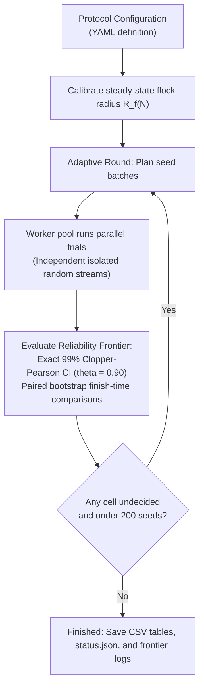

# HerdSim

[](LICENSE)
[](https://www.python.org/downloads/)
[](tests/)
[](results/)

Have you ever watched sheepdogs work a flock across an open field? A single border collie working patiently can eventually round up dozens of sheep. But what happens when the clock is ticking? Or when sheep are scattered across a vast pasture, split into separate groups, or wandering in opposite directions? A single dog simply cannot run in multiple directions at once. To gather the flock before time runs out, dogs must work together as a coordinated team.

That raises a fundamental question in collective animal behavior and autonomous swarm robotics:

> **How many dogs ($D$) do you actually need to gather a flock of $N$ sheep and guide them into a pen before a deadline?**

**HerdSim** is an open-source simulation laboratory built to answer that question. We investigate how this minimum team size (which we call **$D_{\min}$**) changes as flocks grow from 25 to 400 sheep, across different pasture layouts, under relaxed versus urgent deadlines, and with different levels of team coordination.


*Figure 1: A live simulation trial ($N = 200$ sheep, $D = 4$ dogs, wide start layout, seed 2026). The dogs fan out in parallel to collect distant strays, assemble them into a cohesive flock, form a driving arc behind them, and steer the collective smoothly into the circular goal.*

---

## Table of Contents

- [Core Scientific Findings](#core-scientific-findings)
- [How a Campaign Runs](#how-a-campaign-runs)
- [Task Geometry and Scale Invariance](#task-geometry-and-scale-invariance)
- [Initial Flock Configurations](#initial-flock-configurations)
- [Agent Models and Multi-Dog Coordination](#agent-models-and-multi-dog-coordination)
- [What the Frontier Rules Decide](#what-the-frontier-rules-decide)
- [Sensitivity and Robustness](#sensitivity-and-robustness)
- [Quick Start](#quick-start)
- [What a Run Writes](#what-a-run-writes)
- [Project Architecture](#project-architecture)
- [Verification and Benchmarks](#verification-and-benchmarks)
- [References and Further Reading](#references-and-further-reading)

---

## Core Scientific Findings

To map out how team size scales, we conducted **164,740 simulated herding trials** across 23 different research protocols (with zero crashes or execution errors). We evaluated flock sizes from 25 to 400 sheep across four initial pasture layouts, three deadline pressures, and two standards of mission success.

The complete scientific paper is available in [`docs/report/d_min_report.md`](docs/report/d_min_report.md). All underlying tables can be reproduced directly from the raw data using [`cli/dmin_tables.py`](cli/dmin_tables.py) and are collected in [`docs/report/results_tables.md`](docs/report/results_tables.md).


*Figure 2: The experimental design. Top: The adaptive sampling loop. Bottom: Coverage of the 23 protocols (main scaling grid, uncoordinated FAT baseline, continuous force model, and 14 sensitivity sweeps).*


*Figure 3: Minimum team size $D_{\min}$ plotted against flock size $N$ across three deadlines ($12\times$, $6\times$, and $3\times$ drive times). Solid lines and circles indicate strict 100% containment; dashed lines and squares show 99% arrival. Shaded bars denote undecided brackets (e.g., [3, 8]), hollow triangles mark lower bounds, and crosses indicate that no team size on our grid met the 90% reliability threshold.*

### 1. Cohesive flocks only ever need one dog ($D_{\min} = 1$)
When sheep start close together in a neat cluster (`compact`), **a single dog is sufficient across all flock sizes ($N = 25$ to $400$) and all deadlines ($12\times$ down to $3\times$ drive times)**. 

**Why?** Sheep are naturally social animals. When they start close together, no sheep are lost or wandering off. The dog never needs to waste time gathering strays—the mission is purely about steering the group forward. 

**Does adding more dogs help?** In our primary model ([Strömbom et al. 2014](https://doi.org/10.1098/rsif.2014.0719)), having 2, 4, or even 24 dogs does not speed up the drive at all (median completion time stays between 1.44 and 1.74 drive times regardless of team size). This is because a walking flock already moves at its natural cruising speed; extra dogs behind them cannot push them any faster without causing unnecessary panic. In the continuous force model of [Kubo et al. (2022)](https://doi.org/10.1007/s10015-021-00726-7), one dog is also sufficient for reliability, though adding dogs does help compress the flock slightly and guide it faster (finish times drop from ~110 s with 1 dog to ~30 s with 10 dogs).


*Figure 4: Finish time versus team size $D$ on compact starts. Left: Strömbom flock with team coordination (median completion time is invariant to team size). Right: Kubo force model (completion time drops smoothly as more dogs join the drive). Both models achieve 100% success across all team sizes.*

### 2. On scattered pastures, $D_{\min}$ grows much slower than flock size
When sheep start scattered across the pasture (`wide`, `split`, `outlier_rich`), dogs must first round up the strays before they can drive the flock to the pen:
- Under a relaxed deadline ($12\times$ drive time), **1 dog** is enough for up to $N = 50$ sheep, and you only need **2 or 3 dogs** for a large flock of $N = 400$ sheep.
- In log-log space ($\log_2 D_{\min}$ vs. $\log_2 N$), the scaling slope falls between **0.20 and 0.50** at $12\times$ drive times, and **0.30 and 0.80** at $6\times$ drive times. 

**Why does it scale so well?** You might imagine that herding four times as many sheep would require four times as many dogs. But sheep naturally want to stick together. Once a dog nudges a distant stray sheep toward the center, the stray spots its flock-mates and runs back to join them on its own. The flock's natural social attraction does half the gathering work for free!

### 3. Tight deadlines demand more dogs than larger flocks
Time pressure is a far more powerful multiplier than flock size. Under the 99% arrival rule, cutting the deadline from relaxed ($12\times$) to urgent ($3\times$) raises $D_{\min}$ on widely scattered flocks at $N = 400$ from **2 dogs to 5–6 dogs**. 

By comparison, multiplying the flock size fourfold (from $N = 100$ to $400$) under a relaxed deadline only raises the requirement from 1 dog to 2 dogs. 

**Why?** Sheep cannot run indefinitely faster. If you have plenty of time, a single dog can patiently trot over to Stray A, bring it back, then trot over to Stray B, bring it back, and repeat. But when time is short, sequential gathering is too slow. Dogs must divide and conquer—fanning out in parallel so Dog 1 collects Stray A while Dog 2 collects Stray B. Urgency forces teamwork.


*Figure 5: The impact of time pressure. Left and Middle: Success curves under relaxed ($12\times$), intermediate ($6\times$), and urgent ($3\times$) deadlines. Right: $D_{\min}$ plotted directly against deadline urgency.*

### 4. What counts as success? The "Straggler Effect"
How you define a "successful herding mission" fundamentally changes the results:
- **Strict 100% Rule**: Every single sheep must be inside the goal circle at the exact same second.
- **99% Arrival Rule**: At least 99% of the sheep are inside (allowing 1 stray out of 100, 2 out of 200, or 4 out of 400).

When we evaluated large dog packs ($D \ge 6$) on large flocks under the strict rule, they surprisingly failed. When we investigated why, our telemetry revealed a striking behavioral dynamic: **in 95% of those failed trials, the dogs had already guided 99% of the sheep into the goal circle with plenty of time to spare**. 

**Why did they fail?** One or two stubborn stragglers remained outside the circle. The dogs broke formation to chase down that last stray. Because the goal has no physical fence or gate, the dogs charged past the pen entrance at full speed, accidentally terrifying the settled flock and flushing them right back out onto the open pasture!


*Figure 6: Strict success rate versus 99% arrival rate on identical random seeds. In the shaded region, trials succeed $\ge 90\%$ of the time under the 99% rule but fail under the strict rule.*


*Figure 7: The Straggler Effect. Left: Trials with 6+ dogs reach 99% arrival almost every time, but fail strict 100% containment; slower dogs ($v = 1.15$) prevent this failure. Right: Flock position over time for an identical starting flock. Fast dogs drive the flock in, chase a straggler, and flush the flock back out. Slower, calmer dogs guide the flock inside in a single clean pass.*

When dogs run slightly slower ($v_{\text{dog}} = 1.15$ m/s instead of $1.50$ m/s), they don't overshoot the pen, and strict success jumps from 0% to 100%. In practical farming and robotics, one stubborn animal does not mean the mission failed. Evaluating 99% arrival isolates the true coordination challenge from the boundary artifact of penning animals in an open circle.

### 5. Without teamwork, extra dogs are useless
To test whether multi-dog coordination is truly necessary, we implemented an uncoordinated baseline called **FAT (Farthest-Agent Targeting)**. Under FAT, each dog follows the simplest possible greedy rule: find whichever sheep is farthest from the goal, and chase it. No dog communicates with teammates, negotiates assignments, or avoids colliding with other dogs.

The result is failure: because every dog has the same view of the field, **all dogs pick the exact same sheep**. They sprint toward that single stray, collide into a tight cluster, and move as a single disorganized pack while ignoring all other strays. While FAT works on small flocks ($N \le 100$), it completely fails at $N \ge 200$, achieving 0% reliability on scattered pastures no matter how many dogs you add. Without teamwork, extra dogs are dead weight.


*Figure 8: Success rate versus team size for coordinated strombom_multi (blue) versus uncoordinated FAT (orange) at 6 drive times. Without coordination, adding dogs produces flat curves and zero scaling benefit.*

### 6. What the detailed trial metrics reveal
HerdSim records 19 physical measurements on every single tick of every simulation:
- **Flock spread predicts success**: Across all trials, there is a strong negative correlation ($r = -0.56$ to $-0.81$) between average flock spread and mission success. When sheep stay tightly bunched, herding succeeds; when the flock scatters, success drops.
- **The `split` pasture anomaly**: On flocks split into separate clusters, adding more dogs ($D \ge 4$) surprisingly caused performance to plateau. Why? Our metrics revealed that dogs were freezing in place! Under Strömbom's rule, a dog stops moving if it gets within 6 meters ($3 r_a$) of a sheep to avoid spooking it. In dense clusters, this rule froze up to 25% of the dog pack. Reducing this standoff distance in replay experiments restored dog movement and cut completion times by ~22%.


*Figure 9: Detailed trial diagnostics. (a) Negative correlation between flock dispersion and success rate. (b) Percentage of dogs frozen in place under the standoff rule on split versus wide flocks. (c) Pairwise dog overlap.*


### 7. Beyond the minimum: enough dogs, and what extra dogs cost
After D_min, a follow-up analysis of the 99% runs (no new campaigns) asked from which team size an extra dog stops helping (D_sat), what dogs beyond it cost, and whether they put more pressure on the sheep:
- **Extra dogs beyond D_sat are pure cost**: every reliable team larger than D_sat finishes in 0.90 to 1.02 of the D_sat time, while total dog time grows in proportion to the number of dogs. On a compact flock, 24 dogs spend about 24 times the dog time of one dog for the same drive.
- **More dogs do not mean more pressure per sheep**: in 164 replayed trials, the seconds each sheep spends fleeing a dog fall from D_min to D_sat and then stay level. More of the flock is in flight at a given moment, but the drive is shorter. Part of this is the model: the push of several dogs is capped at the push of one.
- **No team size made the task fail under the 99% rule**: none of the eleven 99% folders has a team size that drops back below the reliability threshold after reaching it, up to 24 dogs. Extra dogs only made `split` flocks at N = 200 slower (about 700 s from D = 8 against 365 s with 2 dogs).
- **D_sat is still a range on a third of the scattered curves**, because these runs did not spend seeds on the finish-time comparisons that decide it. The next phase fills them in.


*Figure 10: Dogs beyond D_sat at 6 drive times (99% rule). Left: finish time relative to D_sat stays flat. Right: dog time grows along the line D / D_sat. Details and the pressure replay are in section 3.7 of the [report](docs/report/d_min_report.md).*

---

## How a Campaign Runs

If you tested every combination of flock size, team size, starting layout, and deadline with 200 runs each, you would need over 360,000 simulations. Most of that compute would be wasted on obvious outcomes—like running 200 trials to prove that 1 dog cannot herd 400 scattered sheep in 4 minutes, or running 200 trials to prove that 8 dogs easily handle 25 compact sheep.

Instead, HerdSim works like a thoughtful scientist: it uses an **adaptive sequential sampling loop** that spends compute cycles only where the answer is genuinely uncertain.

A **protocol** (configured in [`protocols/configs/protocols/`](protocols/configs/protocols/)) defines the experimental grid. Every unique combination of flock model, layout, and flock size $N$ forms a curve. Each specific dog count $D$ on that curve is a **cell**, and each evaluated seed is a **trial**.



### Adaptive Execution Mechanics

Four automated mechanisms decide where simulations are needed:

#### 1. Early stopping with statistical confidence (99% Clopper–Pearson CI)
Each cell begins with a small batch of 10 seeds. After each batch, we calculate the exact two-sided 99% Clopper–Pearson confidence interval $[L, U]$ for the true success probability:
- **Clear failure**: If the upper bound $U < 0.90$ (e.g. failing several trials early), the system knows this team is underpowered. Testing stops immediately to save compute.
- **Clear success**: If a team achieves 60 wins in a row with zero failures, the lower bound crosses $L \ge 0.90$. We are mathematically certain it is reliable, so testing halts early.
- **Borderline cases**: Only cells hovering right around the 90% threshold receive additional batches of 10 seeds, up to a cap of 200 seeds.


*Figure 11: Sequential refinement. Obvious failures stop after 10–20 seeds; clear successes stop after 60 consecutive wins; only borderline cells continue receiving seeds up to the 200-seed cap.*

#### 2. Midpoint densification
If adjacent tested dog counts jump across a behavioral boundary—for instance, if $D = 2$ fails and $D = 4$ succeeds—the engine automatically inserts the midpoint ($D = 3$) into the next round. This pinpoints the exact threshold $D_{\min}$ without having to test every single number up front.


*Figure 12: Midpoint densification. A detected zone transition between $D = 2$ and $D = 4$ automatically schedules $D = 3$ for evaluation in the following round.*

#### 3. Saturation and copycat pruning
Once a team size reaches peak speed ($D_{\text{sat}}$), if testing even larger dog packs shows that additional dogs simply copy existing dogs (mean `dog_overlap` $\ge 0.90$) without making the drive any faster, the engine marks the cell as **pruned** and stops running further seeds.


*Figure 13: Saturation pruning. Once completion speed plateaus, cells exhibiting high dog overlap ($\ge 0.90$) are pruned to avoid wasted compute.*

#### 4. Paired common random numbers
Every seed $i$ uses `master_seed + i` (e.g., $2026 + i$). The initial flock placement and the sheep's random choices are generated from dedicated, isolated random streams. This guarantees that when comparing $D = 2$ dogs against $D = 4$ dogs, both teams face the **exact same starting pasture and the exact same sheep reactions**, eliminating random pasture luck from the comparison.


*Figure 14: Paired random seeds. Seed 2026 generates the identical initial sheep coordinates across all tested dog counts $D$, isolating the true algorithmic effect of team size.*

#### 5. Crash-safe interrupt and resume
Trials are appended to disk immediately upon completion (`trials.jsonl`). Campaigns can be safely stopped (`Ctrl+C` / `SIGINT`) and resumed at any time without lost progress; directory locks prevent multiple processes from corrupting files.

---

## Task Geometry and Scale Invariance

A common flaw in animal and robotic flocking simulations is keeping the arena size fixed while increasing flock size $N$. 

**Why is a fixed arena a problem?** 400 sheep take up vastly more physical space than 25 sheep. If you put 400 sheep into a soccer field, they will be crammed wall-to-wall against the boundaries. The dogs wouldn't need to herd them; the boundaries would do the herding for them! That would corrupt the experiment by confusing *flock size* with *artificial crowding*.

HerdSim enforces **scale invariance** by anchoring all arena dimensions to the **calibrated flock radius $R_f(N)$**: the natural steady-state radius of an $N$-sheep flock when driven by a single dog.


*Figure 15: Task geometry drawn to scale. Left: Arena layout at $N = 200$. Middle: How drive distance is scaled. Right: Calibrated flock radius $R_f$ and goal radius across flock sizes.*

| Parameter | Mathematical Rule | Physical Meaning |
| :--- | :--- | :--- |
| **Flock Radius** $R_f(N)$ | Empirical calibration (e.g., 6.2 m at $N=25$; 11.4 m at $N=400$) | Natural equilibrium radius of an $N$-sheep flock under steady driving. |
| **Drive Distance** $l$ | $\max(13 \cdot R_f(N),\, 80,\, \text{reach} + R_{\text{goal}} + R_f)$ | Ensures larger flocks must travel proportionally farther to match physical scale. |
| **Goal Radius** $R_{\text{goal}}$ | $1.9 \cdot R_f(N)$ | Maintains consistent containment difficulty across all flock sizes. |
| **Field Clearance** | 80 m beyond the farthest possible starting agent | Keeps all initial agents safely away from coordinate edges. |
| **Open Boundary** | **No walls or reflecting boundaries** | Real pastures don't have pinball walls. Agents roam freely without artificial rebounds. |

### Normalized Deadlines

How do we set a fair deadline? A flock that must travel 200 meters naturally takes longer to walk than a flock traveling 80 meters. If we gave both a fixed 5-minute timer, the larger flock would be unfairly penalized.

HerdSim normalizes deadlines using the **characteristic drive time** ($T_{\text{drive}}$): the minimum time it takes the fastest sheep walking in a straight line to reach the pen:

$$
T_{\text{drive}} = \frac{\text{Drive Distance}}{v_{\text{sheep,max}}}
$$

A compact flock driven by an experienced single dog finishes in roughly 1.44 to 1.74 $\times T_{\text{drive}}$. We evaluate three realistic levels of time pressure:
- **Relaxed ($12\times T_{\text{drive}}$)**: Plenty of time. A single dog has time to gather strays one by one.
- **Intermediate ($6\times T_{\text{drive}}$)**: A standard, realistic working pace.
- **Urgent ($3\times T_{\text{drive}}$)**: Fast and tight. Leaves almost no margin for sequential gathering—dogs must work in parallel.

| Flock Size ($N$) | Flock Radius $R_f$ | Drive Distance $l$ | Drive Time ($T_{\text{drive}}$) | $12\times$ Deadline (Relaxed) | $6\times$ Deadline (Intermediate) | $3\times$ Deadline (Urgent) |
| :---: | :---: | :---: | :---: | :---: | :---: | :---: |
| **$N = 25$** | 6.20 m | 80.6 m | **80.6 s** (~1.3 min) | 967 s (~16.1 min) | 484 s (~8.1 min) | 242 s (~4.0 min) |
| **$N = 50$** | 7.60 m | 98.8 m | **98.8 s** (~1.6 min) | 1,185 s (~19.8 min) | 593 s (~9.9 min) | 296 s (~4.9 min) |
| **$N = 100$** | 9.08 m | 118.1 m | **118.1 s** (~2.0 min) | 1,417 s (~23.6 min) | 708 s (~11.8 min) | 354 s (~5.9 min) |
| **$N = 200$** | 10.47 m | 139.8 m | **139.8 s** (~2.3 min) | 1,678 s (~28.0 min) | 839 s (~14.0 min) | 419 s (~7.0 min) |
| **$N = 400$** | 11.40 m | 206.8 m | **206.8 s** (~3.4 min) | 2,482 s (~41.4 min) | 1,241 s (~20.7 min) | 620 s (~10.3 min) |

---

## Initial Flock Configurations

To study the transition from gathering stragglers to driving the flock, HerdSim provides four initial pasture layouts:


*Figure 16: The four initial flock layouts evaluated at $N = 200$ with $D = 4$ dogs (drawn to identical scale). The dashed circle marks the analytical collection boundary $f(N) = r_a \cdot N^{2/3}$. Any sheep outside this boundary triggers active outlier collection.*

1. **`compact`**: Flocks sampled from a tight 2D Gaussian ($\sigma = 0.5 \cdot R_f$). All sheep start close together well within $f(N)$; dogs immediately enter drive mode.
2. **`wide`**: Flocks sampled from a broad Gaussian ($\sigma = 0.5 \cdot 2 N^{2/3}$). Sheep are scattered over a wide area, requiring extensive perimeter rounding.
3. **`split`**: The flock is partitioned into 3 isolated clusters spaced symmetrically on a circle. Dogs must gather the clusters together without fragmenting them further.
4. **`outlier_rich`**: 80% of sheep begin in a dense central core, while 20% are placed as distant stragglers far out on the pasture.

### Shepherd Starting Positions (`dog_start`)

Dogs begin 30 meters behind the flock, arranged in one of three release geometries:
- **`arcs` (default)**: Dogs are spaced evenly along concentric arcs behind the flock. Single dogs start directly on the drive axis; extra dogs take flanking stations.
- **`ring`**: Dogs are distributed uniformly along an open ring surrounding the flock (leaving an opening toward the goal), testing whether encircling the flock helps or hinders gathering.
- **`handler`**: All dogs start from a single coordinate directly behind the flock, mimicking a human handler releasing dogs from a single post.


*Figure 17: Shepherd release geometries. Top: Default concentric arcs for $D = 1$ to $64$ behind an $N = 100$ flock. Bottom: Direct comparison of arcs, ring, and handler release at $N = 200$ with $D = 8$ dogs.*

---

## Agent Models and Multi-Dog Coordination

HerdSim simulates individual agent dynamics based on peer-reviewed biology literature, extended with multi-agent coordination.


*Figure 18: Coordinated multi-dog herding in strombom_multi. Top row: Dispersed collection assignment. The $D$ farthest outliers are matched 1-to-1 to the $D$ dogs via minimum-distance Hungarian matching. Bottom row: Cohesive parallel driving arc. Dogs spread evenly across an arc behind the flock, maintaining angular station order to prevent crossing paths.*

### 1. How Sheep Behave ([Strömbom et al. 2014](https://doi.org/10.1098/rsif.2014.0719))

Derived from empirical tracking of real sheep flocks under dog pursuit, each sheep follows five basic behavioral instincts:

#### Active Flight Mode ($\min_j \lVert \mathbf{x}_i - \mathbf{y}_j \rVert < r_s$)
When any dog enters threat distance $r_s = 65$ m, sheep $i$ calculates its flight heading $\mathbf{H}_i'$ by balancing inertia, social attraction, collision avoidance, predator escape, and random noise:

$$
\mathbf{H}_i' = h\,\mathbf{H}_i + c\,\mathbf{C}_i + \rho_a\,\mathbf{R}_{a,i} + \rho_s\,\mathbf{R}_{s,i} + e\,\mathbf{\epsilon}_i
$$

where each component is a **unit vector** scaled by its behavioral weight:
- $\mathbf{H}_i$: **Momentum** unit vector (direction from last tick), weight $h = 0.5$.
- $\mathbf{C}_i$: **Flock Cohesion** unit vector pointing toward the local center of mass ($\text{LCM}_i$) of its nearest neighbors, weight $c = 1.05$:

$$
\mathbf{C}_i = \frac{\text{LCM}_i - \mathbf{x}_i}{\lVert \text{LCM}_i - \mathbf{x}_i \rVert}, \quad \text{where } \text{LCM}_i = \frac{1}{n} \sum_{k \in \mathcal{N}_n(i)} \mathbf{x}_k
$$

- $\mathbf{R}_{a,i}$: **Collision Avoidance** unit vector pushing away from neighbors closer than distance $r_a = 2$ m, weight $\rho_a = 2.0$:

$$
\mathbf{R}_{a,i} = \frac{\sum_{j \ne i, \lVert \mathbf{x}_i - \mathbf{x}_j \rVert < r_a} \frac{\mathbf{x}_i - \mathbf{x}_j}{\lVert \mathbf{x}_i - \mathbf{x}_j \rVert}}{\left\lVert \sum_{j \ne i, \lVert \mathbf{x}_i - \mathbf{x}_j \rVert < r_a} \frac{\mathbf{x}_i - \mathbf{x}_j}{\lVert \mathbf{x}_i - \mathbf{x}_j \rVert} \right\rVert}
$$

- $\mathbf{R}_{s,i}$: **Predator Escape** unit vector pushing away from active dogs within threat distance $r_s = 65$ m, weight $\rho_s = 1.0$.
- $\mathbf{\epsilon}_i$: **Random Noise** unit vector drawn uniformly from $[0, 2\pi)$, weight $e = 0.3$.

Sheep $i$ advances a step $\delta = 1$ m/s along its normalized heading:

$$
\mathbf{x}_i^{t+1} = \mathbf{x}_i^t + \delta\,\frac{\mathbf{H}_i'}{\lVert \mathbf{H}_i' \rVert}
$$

#### Grazing Mode ($\min_j \lVert \mathbf{x}_i - \mathbf{y}_j \rVert \ge r_s$)
When all dogs are outside threat range $r_s$, sheep ignore social attraction and predator escape. They **graze**: staying put, or with probability $p = 0.05$ taking a random exploratory step:

$$
\mathbf{x}_i^{t+1} = \begin{cases}
\mathbf{x}_i^t + \delta\,\mathbf{\epsilon}_{\text{graze}}, & \text{with probability } 0.05 \\
\mathbf{x}_i^t, & \text{with probability } 0.95
\end{cases}
$$

#### Multi-Dog Push Blending ($\mathbf{R}_{s,i}$)
The original 2014 Strömbom model was built for **only a single dog**, where the threat vector pointed directly away from that single shepherd. If you naively add up independent dog pushes for 4 or 8 dogs, the fear force would multiply, overpowering flock cohesion and causing the flock to shatter into pieces. 

HerdSim blends individual dog repulsions and normalizes the sum to unit length:

$$
\mathbf{R}_{s,i} = \frac{\sum_{j \in \text{threat}} \frac{\mathbf{x}_i - \mathbf{y}_j}{\lVert \mathbf{x}_i - \mathbf{y}_j \rVert}}{\left\lVert \sum_{j \in \text{threat}} \frac{\mathbf{x}_i - \mathbf{y}_j}{\lVert \mathbf{x}_i - \mathbf{y}_j \rVert} \right\rVert}
$$

**Intuitive Example:** Imagine a sheep at $(0, 5)$ pursued by two flanking dogs: Dog 1 is stationed at $(-3, 0)$ (back-left) and Dog 2 is at $(3, 0)$ (back-right). 
- Dog 1 pushes the sheep forward and right.
- Dog 2 pushes the sheep forward and left.
- Summing their unit vectors cancels out the lateral sideways pushes while reinforcing forward motion. Normalizing back to unit length yields a resultant push directed straight ahead $(0, 1)$ with normal strength.

### 2. Shepherd Controllers

HerdSim implements three shepherd architectures:

#### Coordinated Architecture: `strombom_multi`
- **Outlier Mode**: When any sheep lies farther than $f(N) = r_a \cdot N^{2/3}$ from the flock center, the $D$ farthest outliers are identified. Dogs are assigned 1-to-1 to outliers using linear sum assignment (Hungarian matching) to minimize total travel distance. Extra dogs assist in driving the core flock.
- **Drive Mode**: When the flock is cohesive, dogs form an arc behind the flock at distance $r_d$, spanning the angular width of the flock. Dogs are sorted by their angular station around the flock, guaranteeing they never cross paths while moving to their slots.

#### Uncoordinated Baseline: `fat` (Farthest-Agent Targeting)
An uncoordinated ablation baseline (`dog_controller="fat"`) designed to test whether team coordination is actually necessary.
- **How it works**: Every dog independently targets the single sheep farthest from the goal, aiming $r_a$ behind it.
- **What is missing**: FAT has no Hungarian assignment, no driving arc, and no repulsion between dogs.
- **Result**: Every dog picks the exact same sheep. The dogs collapse into a clump, acting like a single dog, and fail to gather dispersed flocks at $N \ge 200$.


*Figure 19: FAT baseline. Left: Chasing geometry. Right: Without target assignment, all dogs clump behind the same outlier, exhibiting high overlap.*

#### Continuous Potential Force Model: `kubo` ([Kubo et al. 2022](https://doi.org/10.1007/s10015-021-00726-7))
A cross-check using a fundamentally different physics model:
- **Kubo Sheep**: Move continuously under four additive forces: inter-sheep collision repulsion ($1/r^2$), velocity alignment, social attraction ($-1/r$), and predator escape ($1/r^3$).
- **Kubo Dogs**: Guided by four continuous potential fields: pulled toward the farthest sheep, repelled when too close to that sheep ($1/r^3$), repelled away from the goal perimeter, and **strongly repelled from other dogs** ($1/r^3$). This mutual dog repulsion naturally spreads shepherds along the flock boundary like repelling magnets.


*Figure 20: The Kubo et al. (2022) model. Left: Forces on a sheep. Middle: Forces on a dog. Right: Simulation snapshot showing inter-dog repulsion dispersing shepherds around the flock.*

---

## What the Frontier Rules Decide

Statistical classifications are managed by [`analysis/frontier.py`](analysis/frontier.py):

1. **Reliability ($\theta = 0.90$)**: A cell is classified as **reliable** if the lower bound of its 99% Clopper–Pearson interval satisfies $L \ge 0.90$. It is **unreliable** if $U < 0.90$, and **undecided** otherwise.
2. **Finish-Time Comparisons**: Pairwise speed differences between reliable cells are evaluated using a paired bootstrap (4,000 resamples) on per-seed differences relative to the slower median.

### Derived Frontier Metrics

| Metric | Definition |
| :--- | :--- |
| **$D_{\min}$** | Smallest reliable dog count $D$. ($D_{\min,\text{low}}$: lowest $D$ whose upper bound reaches 0.90). |
| **$D_{\text{sat}}$** | Smallest reliable $D$ such that adding more dogs yields no statistically significant speedup. |
| **$D_{\text{best}}$** | Smallest reliable $D$ that is not slower than the fastest reliable count on the curve. |
| **$D_{\text{crowd}}$** | Smallest reliable $D > D_{\text{best}}$ that is measurably slower due to congestion. |
| **$D_{\text{overcrowd}}$** | Smallest $D > D_{\min}$ where it and subsequent counts fail reliability (collapse). |
| **$D_{\max}$** | Largest reliable dog count below $D_{\text{overcrowd}}$. |

### Behavioral Zones


*Figure 21: Classification of the dog count axis into behavioral zones based on reliability testing and paired bootstrap speed comparisons.*

- `too_few`: Unreliable, below $D_{\min}$.
- `improving`: Reliable, below $D_{\text{sat}}$; adding dogs provides meaningful speedups.
- `saturated`: Reliable, from $D_{\text{sat}}$ upward; extra dogs maintain reliability but add no speedup.
- `crowded`: Reliable, but slower than $D_{\text{best}}$ due to dog interference.
- `collapse`: Unreliable, at or above $D_{\text{overcrowd}}$.
- `undecided`, `unreliable_dip`, and `recovered`: Cells that are open, temporary performance dips, or recovered reliability.

---

## Sensitivity and Robustness

To verify that findings reflect real collective behavior rather than arbitrary simulation choices, HerdSim executed systematic sensitivity sweeps:


*Figure 22: Sensitivity analysis across experimental variants ($N \in \{100, 200, 400\}$, wide and outlier-rich layouts at $6\times$ drive time). Strict success (above divider) shows high volatility; 99% arrival (below divider) proves exceptionally robust.*

Key insights:
1. **Release Geometry**: Releasing dogs from a single handler post (`handler`), an open ring (`ring`), or concentric arcs (`arcs`) yields the **same $D_{\min}$ within 1 dog** under the 99% arrival rule. The handler post is slightly slower overall because all dogs start at one point.
2. **Dog Speed ($1.5$ vs. $1.15$)**: Slower dogs ($v = 1.15$ m/s) achieve substantially higher strict success on large flocks because they avoid overshooting the goal. Under the 99% arrival rule, both speeds require the exact same team size.
3. **Field-Matched Realism**: Calibrating sheep to empirical GPS field data ($r_a = 1.0$ m, interaction range 75 m, noise 0.1) reduces the collection radius. Under 99% arrival, field-matched sheep herd just as efficiently as the synthetic baseline.
4. **Goal Size**: Shrinking the goal radius to $1.5 R_f$ is the only variant that fundamentally increases $D_{\min}$ across both rules, because a tightly packed flock barely fits inside the pen.

---

## Quick Start

### Installation

HerdSim requires Python 3.11+ and uses [`uv`](https://docs.astral.sh/uv/) for high-performance dependency management:

```bash
# Clone the repository
git clone https://github.com/lykimq/HerdSim.git
cd HerdSim

# Install development environment and dependencies
make install     # uv sync --extra dev

# Run comprehensive checks (Ruff linter + basedpyright type checker + 268 tests)
make check

# Execute miniature verification campaigns (~1 minute)
make bench
```

### Running Campaigns

Execute single protocols or batch queues using the CLI:

```bash
# Preview the trial plan for a protocol without executing
uv run cli/campaign.py plan --protocol dmin_m6

# Run a campaign with 16 parallel workers
uv run cli/campaign.py run --protocol dmin_pilot --workers 16

# Check the real-time status of an active or completed campaign
uv run cli/campaign.py status --protocol dmin_pilot

# Inspect D_min results across multiple deadlines
uv run cli/dmin_report.py --protocol dmin_pilot --folder results/dmin_pilot --multiples 3 6 12

# Run the complete sequence of research protocols (resumes automatically)
uv run cli/run_queue.py --workers 20

# Generate publication-grade Markdown result tables from results/
uv run cli/dmin_tables.py record
uv run cli/dmin_tables.py dmin dmin_m12 dmin_m6 dmin_m3
```

---

## What a Run Writes

Every executed protocol writes a self-contained, auditable results directory:

```text
results/<protocol_id>/
|-- protocol.yaml         Merged configuration (canonical defaults + protocol overrides)
|-- provenance.json       Protocol id, physics hash, and creation timestamp
|-- calibration.json      Calibrated steady-state flock radius R_f(N) per method
|-- trials.jsonl          Append-only stream of completed trials (safe against crashes)
|-- trials.csv            Consolidated trial results table (rewritten after each round)
|-- frontier_cells.csv    Statistical outcomes per cell (Clopper-Pearson CI, finish times, zone)
|-- frontier_groups.csv   Frontier metrics per D-curve (D_min, D_sat, D_crowd, D_overcrowd)
|-- status.json           Live execution status, round counter, and timing diagnostics
|-- errors.jsonl          Captured execution exceptions (empty in standard runs)
|-- .lock                 File lock held during active execution
`-- timeseries/           Per-tick Parquet files (retained for first 3 seeds per cell)
```

---

## Project Architecture

The codebase is organized into modular decoupled layers:

```text
HerdSim/
|-- sim/                    # Simulation engine and domain logic
|   |-- core/               # State dataclasses, tick runner, arena, and layouts
|   |-- methods/            # Physical models: Strombom (2014) and Kubo (2022)
|   `-- plugins/            # Extensible plugin system
|       |-- sheep/          # Microscopic sheep dynamics (strombom, kubo)
|       |-- dogs/           # Shepherd controllers (collect_drive_multi, fat, kubo_forces)
|       |-- scenarios/      # Task geometry, goal evaluation, failure diagnostics
|       `-- metrics/        # Per-tick and summary geometric measurements
|-- services/               # Campaign orchestration
|   |-- adaptive.py         # Sequential sampling engine and batch planner
|   |-- calibration.py      # Automated R_f(N) steady-state calibration
|   |-- cells.py            # Parameter grid combinations and D-curves
|   |-- protocol.py         # YAML protocol loading, schema checks, inheritance
|   `-- runner.py           # Worker pool management and trial dispatch
|-- analysis/               # Statistical evaluation
|   |-- frontier.py         # Clopper-Pearson CI, paired bootstrap, zone classification
|   |-- dmin.py             # D_min of a finished run at tighter deadlines or 99% arrival
|   `-- dmin_tables.py      # Table generators for empirical reporting
|-- protocols/configs/      # Canonical defaults and protocol definitions
|-- cli/                    # Command-line tools (campaign, run_queue, dmin_report, dmin_tables)
|-- docs/                   # Report, architecture guide, figures and visualization scripts
|-- results/                # Archived empirical datasets (164k+ trials)
`-- tests/                  # Test suites and golden regression benchmarks
```

---

## Verification and Benchmarks

- **Unit & Invariant Tests** (`make test`, 268 tests, ~24 s):
  Verifies vector mathematics, collision avoidance boundaries, exact random stream isolation, and adaptive frontier decision logic.
- **Golden Regression Tests** ([`tests/sim/test_golden.py`](tests/sim/test_golden.py)):
  Verifies that reference simulation trials match recorded baseline trajectories to floating-point precision, ensuring physics parameters never drift silently.
- **Micro-Campaign Benchmarks** (`make bench`, ~60 s):
  Executes miniature end-to-end campaigns validating fundamental invariants:
  - *Speed bound*: No flock centroid moves faster than maximum sheep speed.
  - *Worker invariance*: Execution output is bit-identical whether run on 1 or 4 worker processes.
  - *Idempotency*: Re-running a completed campaign performs zero redundant computations.
  - *Physical orderings*: Compact flocks require zero outlier collection, and tighter deadlines never decrease the required team size.

---

## References and Further Reading

1. **Strömbom, D., et al. (2014)**. *Solving the shepherding problem: heuristics for herding autonomous, interacting agents*. Journal of the Royal Society Interface, 11(100), 20140719. [DOI: 10.1098/rsif.2014.0719](https://doi.org/10.1098/rsif.2014.0719)
2. **Kubo, M., Tashiro, M., Sato, H., Yamaguchi, A. (2022)**. *Herd guidance by multiple sheepdog agents with repulsive force*. Artificial Life and Robotics, 27, 416–427. [DOI: 10.1007/s10015-021-00726-7](https://doi.org/10.1007/s10015-021-00726-7)
3. **Empirical Results Tables**: [`docs/report/results_tables.md`](docs/report/results_tables.md)
4. **Architectural Deep-Dive**: [`docs/codes/architecture.md`](docs/codes/architecture.md)
