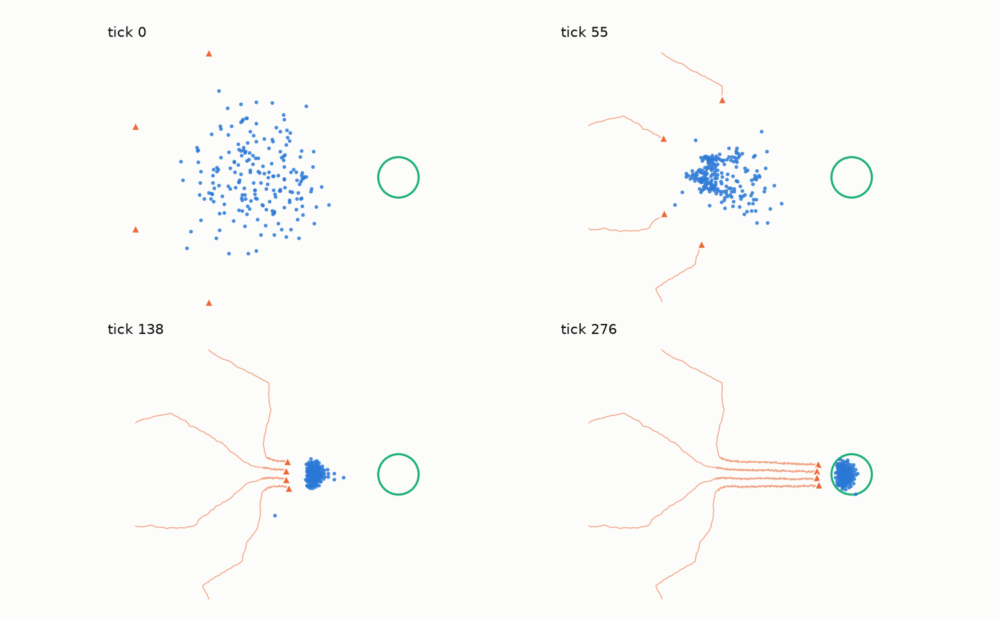

# HerdSim

[](LICENSE)
[](https://www.python.org/downloads/)
[](tests/)
[](results/)

One sheepdog can bring a flock that stays together into a pen. When the sheep start scattered and the job has a deadline, one dog may not reach every stray in time. HerdSim is a simulator, and a study run with it, that asks how many dogs that task needs. It uses the sheep model of Strombom et al. (2014) with a team rule for several dogs, and counts how often a team of $D$ dogs gets a flock of $N$ sheep into a goal before the deadline.

The question is how $D_{\min}$, the smallest reliable team, grows with $N$, and how the start layout and the deadline change that answer. Results are in the [report](docs/report/d_min_report.md); terms are in the [glossary](docs/glossary.md).

## Results in short

From 115,470 trials in six runs (12, 6 and 3 drive times, each under the strict and the 99% rule).

### Strict rule

Flock sizes $N = 25$, 50, 100, 200 and 400.

**12 drive times.** On `compact`, one dog is enough at every size. On `wide` and `outlier_rich`, a flock of 400 needs 3 dogs; across $N = 25$, 50, 100, 200 and 400 the log-log slope of $D_{\min}$ is 0.42 on both (0.32 to 0.42 on `split`).

**6 drive times.** On `compact`, one dog is enough at every size. On the scattered layouts $D_{\min}$ rises faster: `wide` needs 3 dogs at $N = 200$ and only a lower bound [9] at $N = 400$; `split` and `outlier_rich` have no reliable team up to 24 dogs at $N = 400$.

**3 drive times.** On `compact`, one dog is enough at every size. From $N = 200$, no team up to 24 dogs is reliable on `wide`, `split` or `outlier_rich`.

### 99% rule

Flock sizes $N = 25$, 50, 71, 100, 141, 200, 283, 400 and 566 at 12 and 6 drive times; $N = 25$, 50, 100, 200 and 400 at 3 drive times.

**12 drive times.** On `compact`, one dog is enough through $N = 566$. On `wide` and `outlier_rich`, a flock of 400 needs 2 dogs; across $N = 25$, 50, 71, 100, 141, 200, 283, 400 and 566 the log-log slope of $D_{\min}$ is 0.27 to 0.38 on `wide` and 0.28 to 0.38 on `outlier_rich`.

**6 drive times.** On `compact`, one dog is enough through $N = 566$. At $N = 400$, `wide` needs 2-3 dogs and `outlier_rich` needs 3; across $N = 25$, 50, 71, 100, 141, 200, 283, 400 and 566 the log-log slope is 0.38 to 0.61 on `wide` and 0.40 to 0.58 on `outlier_rich`.

**3 drive times.** On `compact`, one dog is enough at every size ($N = 25$, 50, 100, 200 and 400). On `wide`, $D_{\min}$ is 2 at $N = 100$, 3 at 200 and 5-6 at 400; on `outlier_rich` at $N = 400$ only a lower bound [6]; on `split` from $N = 200$, no team up to 24 is reliable.

## Task and methods

HerdSim moves sheep and dogs on an open field one tick at a time. The dogs bring the flock into a circular goal. The deadline is counted in drive times: one drive time is how long a sheep walking straight at 1 m/s needs to cover the drive distance (flock start centre to goal centre). The study uses 12, 6 and 3 drive times.

A trial succeeds under the strict rule when every sheep is in the goal at the same tick, and under the 99% rule when 99% of them are.

A sheep farther from the flock centre than the collect distance, $2 N^{2/3}$ m, is an outlier. The flock starts in one of four layouts:

1) `compact`: a tight flock.
2) `wide`: a loose flock; about 13% of the sheep start beyond the collect distance.
3) `split`: three compact clusters.
4) `outlier_rich`: a compact flock with 20% of the sheep on a ring beyond the collect distance.

The method `strombom_multi` pairs Strombom's sheep with the team rule `collect_drive_multi`. While there are outliers, the Hungarian algorithm assigns dogs to the $D$ farthest outliers at the least total distance, and spare dogs drive the sheep that are already within the collect distance. Once there are no outliers, the dogs stand on an arc behind the flock and drive it to the goal.

A protocol is a YAML recipe for one experiment: which flock sizes, team sizes, layouts, success rule and deadline to try. The id encodes the settings; in `dmin_f99_m6`, `f99` is the 99% rule and `m6` is 6 drive times. Ids without `f99` use the strict rule.



**Figure 1: One trial in HerdSim ($N = 200$ sheep, $D = 4$ dogs, `wide` start, seed 2026, strict rule, 1500-tick limit), at ticks 0, 55, 139 and 279.** The dogs start on an arc behind the flock, gather it from several sides, then drive it from behind into the goal. The green circle is the goal (radius 1.9 times the flock radius $R_{f}$); orange triangles are dogs with their tracks; blue dots are sheep.

## How the study is organised

Each protocol stores data in three levels:

- A **curve** is one setup, for example `wide` starts with 200 sheep, tried at each team size.
- A **cell** is one team size on that curve: "can 3 dogs herd 200 sheep in this setup?"
- A **trial** is one run of a cell with one random seed.

A cell is reliable when the lower end of its 99% [Clopper-Pearson](https://doi.org/10.1093/biomet/26.4.404) interval for the success rate is at least $\theta = 0.90$ (so the success rate is at least 0.90 at 99% confidence). It stays undecided while the interval still straddles $\theta$. $D_{\min}$ is the smallest reliable team on a curve.

The six protocols are `dmin_m12`, `dmin_m6` and `dmin_m3` (strict rule, $N = 25$ to 400) and `dmin_f99_m12`, `dmin_f99_m6` and `dmin_f99_m3` (99% rule). The 99% runs at 12 and 6 drive times also use $N = 71$, 141, 283 and 566. No trial ended in an error.

## Setup and tests

HerdSim needs Python 3.11 or later and [`uv`](https://docs.astral.sh/uv/):

```bash
git clone https://github.com/lykimq/HerdSim.git
cd HerdSim
make install   # uv sync --extra dev
make check     # ruff, basedpyright and the tests
```

Stored results live in `results/`.

## Running campaigns

A campaign runs one protocol and puts extra seeds on cells that are still undecided ([`cli/campaign.py`](docs/guides/cli_reference.md#clicampaignpy-one-protocol)). Each trial is written to `results/<protocol_id>/` as it finishes, so the same command resumes a stopped run. A protocol can take minutes to hours.

```bash
uv run cli/campaign.py plan --protocol dmin_m6               # what a run would do; runs nothing
uv run cli/campaign.py run --protocol dmin_m6 --workers 16   # run with 16 worker processes
uv run cli/campaign.py status --protocol dmin_m6             # progress of a run
uv run cli/run_queue.py --workers 20                         # every protocol, skipping finished ones

# Analysis (reads stored results only)

uv run cli/dmin_tables.py record                             # trials, cells, errors and hours per protocol
uv run cli/dmin_tables.py dmin dmin_m12 dmin_m6 dmin_m3      # smallest reliable team per layout and N
```

See [`cli/README.md`](cli/README.md) for the usual order of tools.

## Project architecture

`sim/` runs one trial and knows nothing about campaigns. `analysis/` only reads stored files; it never runs the model.

```text
HerdSim/
|-- analysis/               # cell decisions and values read from results
|-- cli/                    # command-line tools
|-- docs/                   # docs; generate_docs/ writes the generated pages and figures
|-- protocols/configs/      # canonical defaults and the six protocol files
|-- records/                # trial row, physics hash, code identity
|-- results/                # one folder per protocol
|-- services/               # campaign: protocols, campaigns, calibration, replays
|-- sim/                    # engine: models, task, start layouts
`-- tests/                  # unit, invariant and regression tests
```

## Documentation

**Results**

- [Report](docs/report/d_min_report.md) - question, decision rule, results and run record (every number in these docs comes from here)
- [Result tables](docs/report/results_tables.md) - tables built from the stored runs
- [Glossary](docs/glossary.md) - terms used in the study

**Methods and task**

- [Strombom sheep](docs/methods/strombom_sheep.md) and the [team rule](docs/methods/strombom_multi.md)
- [Task design](docs/experiments/task_design.md) - field and goal sized by $R_f(N)$, deadlines, sizes and sampling

**Running experiments**

- [Configuration](docs/guides/configuration.md) - protocol inheritance and result folders
- [CLI reference](docs/guides/cli_reference.md) - commands, flags and defaults
- [Settings](docs/guides/settings.md) and [protocol catalogue](docs/guides/protocols.md) (generated)

**Code**

- [Architecture](docs/codes/architecture.md) - how the code is put together

## References

1) Strombom, D., et al. (2014). *Solving the shepherding problem: heuristics for herding autonomous, interacting agents*. Journal of the Royal Society Interface, 11(100), 20140719. [DOI: 10.1098/rsif.2014.0719](https://doi.org/10.1098/rsif.2014.0719)
