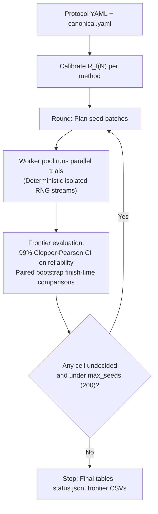

# HerdSim

[**English**](README.md) | [**Tiếng Việt**](README_vi.md)

[](LICENSE)
[](https://www.python.org/downloads/)
[](tests/)
[](results/)

**HerdSim** is a multi-agent simulation framework and empirical laboratory for collective shepherding. It investigates a fundamental question in bio-inspired swarm robotics and behavioural biology:

> **How many autonomous shepherds (D) are required to reliably gather and drive a flock of N sheep to a designated goal within a time deadline, and how does this minimum requirement (D_min) scale with flock size, initial dispersion, deadline pressure, and coordination rules?**

Given unbounded time, a single shepherd can eventually collect and steer almost any flock by sequentially chasing stray individuals. Under finite deadlines, however, shepherding becomes an active collective coordination problem: agents must parallelize the collection of dispersed outliers, prevent the flock from fracturing, and drive the aggregate without causing boundary scattering or overcrowding.

HerdSim couples high-fidelity microscopic agent physics (based on the models of [Strömbom et al. 2014](https://doi.org/10.1098/rsif.2014.0419) and [Kubo et al. 2022](https://doi.org/10.1088/2632-072X/ac6cb4)) with a novel multi-dog assignment layer, rigorous scale-invariant task geometry, and an adaptive sequential statistical engine (99% Clopper–Pearson confidence testing).


*Figure 1: Evolution of a real simulation trial (N = 200 sheep, D = 4 dogs, wide start, seed 2026). Dogs autonomously identify distant outliers, execute parallel collection sweeps to consolidate the flock, and subsequently establish an arc formation behind the flock centroid to drive the collective into the circular goal.*

---

## Table of Contents

- [Core Scientific Findings](#core-scientific-findings)
- [How a Campaign Runs](#how-a-campaign-runs)
- [Task Geometry and Scale Invariance](#task-geometry-and-scale-invariance)
- [Initial Flock Configurations](#initial-flock-configurations)
- [Agent Models and Multi-Dog Coordination](#agent-models-and-multi-dog-coordination)
- [Statistical Decisions and the Frontier](#what-the-frontier-rules-decide)
- [Sensitivity and Robustness](#sensitivity-and-robustness)
- [Quick Start](#quick-start)
- [What a Run Writes](#what-a-run-writes)
- [Project Architecture](#project-architecture)
- [Verification and Benchmarks](#verification-and-benchmarks)
- [References and Further Reading](#references-and-further-reading)

---

## Core Scientific Findings

Across 17 executed campaign protocols encompassing **112,785 individual simulation trials** (with zero execution or simulation errors), HerdSim systematically mapped the scaling frontier D_min(N) for N in [25, 400] across multiple layouts, deadlines, and coordination variants.

All empirical data tables are produced directly from `results/` by [`cli/dmin_tables.py`](cli/dmin_tables.py) and summarized in [`docs/reports/results_tables.md`](docs/reports/results_tables.md).


*Figure 2: Empirical scaling of D_min against flock size N across three normalized deadlines (12×, 6×, and 3× drive times). Circles denote strict success (100% of sheep in the goal); squares denote the 99% threshold (f99). For cohesive flocks (compact), D_min = 1 everywhere. For dispersed flocks, D_min scales sub-linearly with N, heavily modulated by deadline urgency.*

### 1. Compact Flocks Exhibit Invariant Scaling (D_min = 1)
When a flock begins in a cohesive spatial state (`compact`), **a single shepherd is sufficient across every tested flock size (N = 25 to 400) and every deadline (12× down to 3× drive times)**. Because no sheep begin outside the collection threshold, the task is purely one of directional driving. Adding more dogs to a compact flock yields no improvement in reliability (D_min = 1) and quickly saturates finish times.

### 2. Dispersed Flocks Scale Sub-linearly with N
On scattered layouts (`wide`, `split`, `outlier_rich`), shepherds must spend initial time collecting distant outliers before driving can begin:
- At generous deadlines (12× drive time), D_min remains 1 for N <= 100, rising modestly to 2 or 3 dogs at N = 400.
- In log-log space (log2 D_min vs. log2 N), growth slopes for scattered layouts fall between **0.25 and 0.45**, demonstrating strong sub-linear scaling: doubling flock size requires far less than double the shepherd force.

### 3. Deadline is a First-Order Governing Parameter
Tightening the deadline from 12× to 3× drive times exerts an effect comparable to a 16-fold expansion of flock size. At 3× drive times, wide flocks at N = 400 require D_min = 6 dogs (under f99), and tight deadlines completely prevent single shepherds from gathering split clusters.

### 4. The Last-Sheep / Straggler Mechanism
A crucial biological insight emerged from auditing strict success criteria (100% of sheep inside the goal circle at a single tick) against a 99% threshold (f99):


*Figure 3: The Straggler Effect. Left: Across trials with 6 or more dogs (wide and outlier-rich, N in {100, 200, 400}), faster dogs (speed 1.5) bring 99% of the flock into the goal in almost every trial, yet strict 100% success collapses; slower dogs (speed 1.15) avoid this penalty. Right: Time-series of one identical start flock (wide start, N = 400, D = 16 dogs, seed 2). The faster dog team drives the flock into the goal quickly with all but a couple stragglers, but then overshoots and pushes the flock out while chasing the trailing sheep. The slower dog team steers the flock steadily inside once, completing the task.*

In biological and agricultural herding, a single stubborn or drifting sheep does not represent collective failure. Evaluating f99 resolves artificial boundary censorship and exposes the true structural scaling laws of the multi-agent system.

---

## How a Campaign Runs

Rather than running wasteful fixed-sample Monte Carlo sweeps across hundreds of parameter combinations, HerdSim employs an **adaptive sequential exploration algorithm**.

A **protocol** (defined in [`protocols/configs/protocols/`](protocols/configs/protocols/)) specifies the parameter space: sheep models, shepherd algorithms, flock sizes N, shepherd counts D, initial layouts, and deadlines. Every unique combination of method, layout, and N forms a **D-curve** (group). Each specific dog count D within that curve is a **cell**, and each seed evaluated is a **trial**.



### Adaptive Execution Mechanics

Rather than running brute-force Monte Carlo sweeps across arbitrary grids, HerdSim implements four automated statistical mechanisms that focus computation precisely on decision boundaries:

#### 1. Sequential Refinement & Early Stopping (99% Clopper–Pearson CI)
Each cell begins with a baseline batch (`batch_seeds`, default 10). If the 99% Clopper–Pearson confidence interval confirms the cell is reliable (lower CI bound >= 0.90, mathematically requiring at least 51 consecutive successes) or unreliable (upper CI bound < 0.90), evaluation halts immediately. Undecided cells receive sequential batches of 10 seeds up to `max_seeds` (200), concentrating CPU cycles where classification variance is highest.


*Figure 4: Sequential refinement and early stopping using exact 99% Clopper–Pearson confidence intervals. Obvious failures stop at 10 seeds; obvious successes stop at 51 consecutive successes; undecided cells continue receiving batches of 10 seeds up to the 200-seed cap.*

#### 2. Adaptive Grid Densification (Midpoint Bisection)
When adjacent tested dog counts D cross a behavioral zone boundary (e.g. D = 2 is `too_few` and D = 4 is `improving`) with a gap larger than `refine_min_gap` (1), the midpoint integer (D = 3) is automatically injected into the curve for the next round to pinpoint D_min without coarse guessing.


*Figure 5: Adaptive grid densification. A detected zone shift between D = 2 and D = 4 triggers an automatic midpoint injection of D = 3 in Round 2, locating the exact boundary with minimal additional evaluations.*

#### 3. Saturation & Twin Overlap Pruning
Above a confirmed saturation point (D_sat), if additional dogs act as copies of one another (mean `dog_overlap` >= 0.90) without providing any finish-time speedup, further seeds for that cell are suppressed (`pruned`) to eliminate wasted compute.


*Figure 6: Saturation and twin overlap pruning. Once task speed plateaus at D_sat, cells exhibiting high dog overlap (>= 0.90) are flagged as pruned, eliminating wasteful evaluation of redundant copycat shepherds.*

#### 4. Deterministic Paired Comparisons (Common Random Numbers)
Every seed i evaluated across cells uses `master_seed + i` (default 2026 + i). The starting flock layout and sheep stochastic noise streams are drawn independently, guaranteeing that trials comparing D = 2 against D = 4 face the **exact same initial flock configuration and sheep stochastic decisions**, eliminating layout luck from shepherd team comparisons.


*Figure 7: Common random numbers scheme. Seeds 2026, 2027, and 2028 generate identical initial flock geometries and sheep noise across all tested dog counts D, isolating the pure effect of the shepherd algorithm.*

#### 5. Robust Interrupt and Resume
Every trial is committed to disk immediately upon completion (`trials.jsonl` and `trials.csv`). Campaigns can be safely interrupted (`SIGINT`) and resumed seamlessly without losing progress; directory locks prevent concurrent write collisions.

---

## Task Geometry and Scale Invariance

A common flaw in agent-based herding simulations is fixing physical field dimensions while varying flock size N. Because 400 sheep naturally occupy vastly more physical area than 25 sheep, fixed dimensions introduce artificial confinement and confound spatial density with agent count.

HerdSim enforces **scale invariance** by anchoring all spatial and temporal metrics to the **calibrated flock radius R_f(N)**: the steady-state radius of an N-sheep flock driven by a single shepherd.


*Figure 8: Task geometry drawn to scale from simulation code. Left: Physical layout at N = 200. The goal circle, drive distance, and arena boundaries expand proportionally with R_f(N). Middle: Drive length definition. Right: Calibrated growth of flock radius R_f and goal radius R_goal across N.*

| Parameter | Mathematical Formulation | Physical Rationale |
|---|---|---|
| **Flock Radius** R_f(N) | Empirical calibration (e.g., 3.14 at N=5, 9.08 at N=100, 11.4 at N=400) | Reflects natural inter-individual equilibrium spacing under driving. |
| **Drive Distance** | max(13 · R_f(N), 80, reach + R_goal + R_f) | Ensures large flocks travel proportionally farther to match physical scale. |
| **Goal Radius** R_goal | 1.9 · R_f(N) | Standardizes containment difficulty across flock sizes. |
| **Field Clearance** | 80 units beyond farthest possible starting agent | Positions initial entities safely away from coordinate boundaries. |
| **Open Boundary** | **No walls or reflecting boundaries** | Boundary reflections act as artificial collectors, artificially inflating success. Agents may freely roam. |

### Normalized Deadline

Deadlines are specified as multiples m of the characteristic **drive time**:

$$
T_{\text{drive}} = \frac{\text{Drive Distance}}{v_{\text{sheep,max}}}
$$

A trial evaluated at m = 6 requires the dog team to gather and drive the flock within 6 times the theoretical minimum travel time of the fastest sheep. A compact flock driven by an optimal shepherd completes the task in 1.45 to 1.74 × T_drive; thus m in {12, 6, 3} provides a graded, realistic scale from relaxed to urgent time pressure.

| Flock Size (N) | Flock Radius R_f | Drive Distance l | Drive Time (T_drive) | 12× Deadline (Relaxed) | 6× Deadline (Intermediate) | 3× Deadline (Urgent) |
| :---: | :---: | :---: | :---: | :---: | :---: | :---: |
| **N = 25** | 6.20 m | 80.6 m | **80.6 s** (~1.3 min) | 967 s (~16.1 min) | 484 s (~8.1 min) | 242 s (~4.0 min) |
| **N = 50** | 7.60 m | 98.8 m | **98.8 s** (~1.6 min) | 1,185 s (~19.8 min) | 593 s (~9.9 min) | 296 s (~4.9 min) |
| **N = 100** | 9.08 m | 118.1 m | **118.1 s** (~2.0 min) | 1,417 s (~23.6 min) | 708 s (~11.8 min) | 354 s (~5.9 min) |
| **N = 200** | 10.47 m | 139.8 m | **139.8 s** (~2.3 min) | 1,678 s (~28.0 min) | 839 s (~14.0 min) | 419 s (~7.0 min) |
| **N = 400** | 11.40 m | 206.8 m | **206.8 s** (~3.4 min) | 2,482 s (~41.4 min) | 1,241 s (~20.7 min) | 620 s (~10.3 min) |

*Note: Drive distance l = max(13 · R_f, 80, reach + R_goal + R_f). At N = 400, the arena clearance term dominates (206.8 m) because the initial dispersion radius of scattered layouts grows as N^(2/3) while R_f grows sub-linearly, ensuring the goal never overlaps any initial sheep placement.*

---

## Initial Flock Configurations

To study the transition between collection and driving, HerdSim provides four distinct initial spatial geometries:


*Figure 9: The four initial flock layouts evaluated at N = 200 with D = 4 dogs (identical scale). The grey dashed circle marks the analytical collection boundary f(N) = r_a · N^(2/3). Any sheep located outside this circle triggers active collection heuristics.*

1. **`compact`**: Flocks sampled from a 2D Gaussian (sigma = 0.5 · R_f, truncated at 3 sigma). All sheep begin well within f(N); dogs immediately enter drive mode.
2. **`wide`**: Flocks sampled from a broad Gaussian (sigma = 0.5 · 2 N^(2/3)). Sheep are broadly scattered, requiring substantial initial perimeter sweeping.
3. **`split`**: The flock is partitioned into 3 compact sub-clusters (2 when N < 12) spaced symmetrically on a circle of radius 2 N^(2/3). Dogs must address isolated groupings without dispersing them further.
4. **`outlier_rich`**: 80% of sheep reside in a dense compact core, while 20% are distributed as distant outliers between 1.1 and 1.6 × 2 N^(2/3).

### Shepherd Release Configurations (`dog_start`)

Dogs begin 30 units behind the flock's rear boundary, arranged in one of three experimental stations:
- **`arcs` (default)**: Dogs are spaced evenly along concentric semi-circular arcs behind the flock. Single dogs start directly on the drive axis; additional dogs occupy distinct flanking stations.
- **`ring`**: Dogs are distributed uniformly along a full 360° circle surrounding the flock, testing whether encirclement aids or hinders initial gathering.
- **`handler`**: All dogs originate from a single point directly behind the flock (simulating simultaneous release from a human handler's post; at $t = 0$ all dogs begin superimposed at this single coordinate before fanning out).


*Figure 10: Shepherd release configurations (dog_start). Top: Scaling of the default arcs geometry from D = 1 to D = 64 behind an N = 100 flock (dogs positioned on concentric arcs 30 units behind the flock perimeter). Bottom: Direct comparison of the three placement geometries (arcs, ring, handler) at N = 200 with D = 8 dogs on a wide flock start (in handler mode, all 8 dogs begin superimposed at the single release coordinate).*

**Why evaluate a single-point `handler` post?** In actual working trials, shepherds release dogs from a single post behind the flock rather than pre-positioning them across the pasture. HerdSim includes `handler` as an experimental control to verify that pre-deployed `arcs` do not artificially inflate algorithmic performance. Starting all dogs at the exact same $(x, y)$ coordinate at $t = 0$ prevents arbitrary directional bias before the assignment algorithm runs; at $t = 1$, the team coordinator immediately fans them out to their respective targets.

---

## Agent Models and Multi-Dog Coordination

HerdSim implements microscopic agent physics based on validated empirical literature, extended with a coordination layer designed to prevent trivial copycat dynamics.


*Figure 11: Multi-dog team coordination in strombom_multi. Left: Outlier collection assignment. D dogs are matched to the D farthest outliers via minimum-weight Euclidean matching (least total walking distance). Center: Parallel driving formation. Dogs occupy equidistant angular slots along a driving arc subtending the flock's width, maintaining angular order to avoid crossing trajectories. Right: Unit push blending. Multiple dogs near a single sheep combine their influence into a normalized unit repulsion vector.*

### 1. Sheep Dynamics ([Strömbom et al. 2014](https://doi.org/10.1098/rsif.2014.0419))

Derived from empirical observations of flocking under predation, the sheep behavior is governed by a threat-triggered state machine:

#### Active Flight Mode ($\min_j \lVert \mathbf{x}_i - \mathbf{y}_j \rVert < r_s$)
When any dog is within threat distance $r_s$, sheep $i$ computes a raw heading vector $\mathbf{H}_i'$ balancing momentum, social forces, dog avoidance, and noise:

$$
\mathbf{H}_i' = h\,\mathbf{H}_i + c\,\mathbf{C}_i + \rho_a\,\mathbf{R}_{a,i} + \rho_s\,\mathbf{R}_{s,i} + e\,\mathbf{\epsilon}_i
$$

where each constituent component is a **unit vector** scaled by its behavioral weight (Table 2):
- $\mathbf{H}_i$: **Previous heading** unit vector (direction from last tick, zero if stationary), with inertia weight $h = 0.5$.
- $\mathbf{C}_i$: **Cohesion** unit vector pointing toward the local center of mass ($\text{LCM}_i$) of the $n$ nearest neighbors ($n = N - 1$), with attraction weight $c = 1.05$:

$$
\mathbf{C}_i = \frac{\text{LCM}_i - \mathbf{x}_i}{\lVert \text{LCM}_i - \mathbf{x}_i \rVert}, \quad \text{where } \text{LCM}_i = \frac{1}{n} \sum_{k \in \mathcal{N}_n(i)} \mathbf{x}_k
$$

- $\mathbf{R}_{a,i}$: **Inter-sheep Repulsion** unit vector pushing away from neighbors closer than collision distance $r_a = 2$, with repulsion weight $\rho_a = 2.0$:

$$
\mathbf{R}_{a,i} = \frac{\sum_{j \ne i, \lVert \mathbf{x}_i - \mathbf{x}_j \rVert < r_a} \frac{\mathbf{x}_i - \mathbf{x}_j}{\lVert \mathbf{x}_i - \mathbf{x}_j \rVert}}{\left\lVert \sum_{j \ne i, \lVert \mathbf{x}_i - \mathbf{x}_j \rVert < r_a} \frac{\mathbf{x}_i - \mathbf{x}_j}{\lVert \mathbf{x}_i - \mathbf{x}_j \rVert} \right\rVert}
$$

- $\mathbf{R}_{s,i}$: **Shepherd Escape** unit vector pushing away from shepherds within threat distance $r_s = 65$, with escape weight $\rho_s = 1.0$.
- $\mathbf{\epsilon}_i$: **Noise** unit vector pointing in a random direction drawn uniformly from $[0, 2\pi)$, with noise weight $e = 0.3$.

Sheep $i$ advances a distance $\delta = 1$ m (speed $\delta = 1$ m/s) along the normalized heading:

$$
\mathbf{x}_i^{t+1} = \mathbf{x}_i^t + \delta\,\frac{\mathbf{H}_i'}{\lVert \mathbf{H}_i' \rVert}
$$

#### Grazing Mode ($\min_j \lVert \mathbf{x}_i - \mathbf{y}_j \rVert \ge r_s$)
When all dogs are outside threat range $r_s$, sheep do not experience social attraction or repulsion; they **graze**: staying put, or with probability $p = 0.05$ taking a step of length $\delta$ in a uniformly random direction:

$$
\mathbf{x}_i^{t+1} = \begin{cases}
\mathbf{x}_i^t + \delta\,\mathbf{\epsilon}_{\text{graze}}, & \text{with probability } 0.05 \\
\mathbf{x}_i^t, & \text{with probability } 0.95
\end{cases}
$$

#### Multi-Dog Push Blending ($\mathbf{R}_{s,i}$)

The original Strömbom et al. (2014) model was formulated for **only a single dog**, where the threat vector was simply the unit vector pointing directly away from that single shepherd: $\frac{\mathbf{x}_i - \mathbf{y}}{\lVert \mathbf{x}_i - \mathbf{y} \rVert}$. When scaling to multi-dog teams ($D \ge 2$), naively adding independent dog repulsions would multiply the fear force, overpowering flock cohesion and causing the flock to fracture. HerdSim resolves multi-dog repulsive scaling by blending individual dog repulsive pushes and normalizing to length 1:

$$
\mathbf{R}_{s,i} = \frac{\sum_{j \in \text{threat}} \frac{\mathbf{x}_i - \mathbf{y}_j}{\lVert \mathbf{x}_i - \mathbf{y}_j \rVert}}{\left\lVert \sum_{j \in \text{threat}} \frac{\mathbf{x}_i - \mathbf{y}_j}{\lVert \mathbf{x}_i - \mathbf{y}_j \rVert} \right\rVert}
$$

where:
- $\mathbf{x}_i$: 2D position vector of sheep $i$.
- $\mathbf{y}_j$: 2D position vector of dog $j$.
- $\frac{\mathbf{x}_i - \mathbf{y}_j}{\lVert \mathbf{x}_i - \mathbf{y}_j \rVert}$: Unit vector pointing directly away from dog $j$ toward sheep $i$ (the pure escape direction from dog $j$).
- $\text{threat}$: Set of all dogs currently within threat range of sheep $i$ ($\lVert \mathbf{x}_i - \mathbf{y}_j \rVert < r_s$).

**Intuitive Example:**
Imagine a sheep at $(0, 5)$ pursued by two flanking dogs: Dog 1 is stationed at $(-3, 0)$ (back-left) and Dog 2 is stationed at $(3, 0)$ (back-right). 
- Dog 1 exerts a repulsive push diagonally forward-right.
- Dog 2 exerts a repulsive push diagonally forward-left.
- Summing both unit vectors causes their lateral components to cancel out while their forward components reinforce. Normalizing to unit length yields a resultant push directed straight ahead $(0, 1)$.

This allows a coordinated dog team to steer and contain a flock smoothly through flanking geometry without exerting unphysical "super-force" or triggering artificial flock disintegration.

### 2. Shepherd Controllers and Alternative Baselines

To evaluate the necessity of explicit multi-agent coordination, HerdSim implements three distinct shepherd controller architectures:

#### Coordinated Architecture: `strombom_multi`
- **Outlier Mode**: When any sheep lies farther than $f(N) = r_a \cdot N^{2/3}$ from the flock centroid, the $D$ farthest outliers are identified. Dogs are assigned to distinct outliers using linear sum assignment (minimum total Euclidean travel distance). Leftover dogs assist in driving the core flock.
- **Drive Mode**: When the flock is cohesive, dogs form an arc behind the flock at distance $r_d$, spanning the angular width of the flock. Dogs are sorted by their relative angular station around the flock, guaranteeing they never cross paths while moving to their assigned driving slots.

#### Uncoordinated Baseline: `fat` (Farthest-Agent Targeting)
Each dog independently targets the sheep farthest from the goal without communicating, negotiating target assignments, or maintaining inter-dog spacing.


*Figure 12: Uncoordinated baseline FAT (Farthest-Agent Targeting). Left: Geometry of uncoordinated driving where dogs chase the single farthest sheep from the goal. Right: Without target assignment or repulsive spacing, dogs collapse into a tight cluster behind the same outlier, exhibiting high `dog_overlap` and failing to gather dispersed flocks.*

#### Cross-Model Continuous Force Architecture: `kubo` ([Kubo et al. 2022](https://doi.org/10.1088/2632-072X/ac6cb4))
To verify that scaling properties are not artifacts of the discrete Strömbom heuristic, HerdSim integrates the complete continuous potential force model of Kubo et al. (2022), encompassing both **Kubo sheep** and **Kubo dogs**:
- **Kubo Sheep Dynamics**: Sheep velocities update continuously via four additive forces within each sheep's field of view:
  1. *Inter-sheep repulsion* ($1/r^2$): Prevents collision and crowding.
  2. *Velocity alignment*: Matches headings with moving neighbors.
  3. *Inter-sheep attraction* ($-1/r$): Binds the flock together.
  4. *Flight from dogs* ($1/r^3$): Strong short-range push directly away from shepherds.
- **Kubo Shepherd Controller**: Unlike `strombom_multi`, Kubo dogs do not use discrete state machines or combinatorial assignment. Instead, each dog moves according to four continuous potential fields:
  1. *Target attraction*: Pulled toward the sheep farthest from the goal.
  2. *Target standoff* ($1/r^3$): Repelled when getting too close to that target sheep.
  3. *Goal standoff*: Repelled away from the goal perimeter to avoid driving sheep backward out of the pen.
  4. *Inter-dog repulsion* ($1/r^3$): Shepherds strongly repel one another, naturally fanning out along the flock boundary without explicit communication.
- **Role in HerdSim (`dmin_kubo`)**: Evaluated on compact flocks ($N \in \{25, 50, 100\}$, $D \in \{1 \dots 10\}$), the Kubo model independently confirms $D_{\min} = 1$ on cohesive herds, validating scale invariance across fundamentally different physics.


*Figure 13: The Kubo et al. (2022) continuous force model. Left: The four force vectors acting on one sheep (repulsion, alignment, attraction, flight from dogs). Middle: The four force vectors acting on one dog (target pull, target standoff, goal avoidance, inter-dog repulsion). Right: Simulation trajectory showing how inter-dog repulsion forces shepherds to disperse along the flock perimeter.*

---

## What the Frontier Rules Decide

Statistical decisions are governed by [`analysis/frontier.py`](analysis/frontier.py). For each cell (a given method, layout, N, and D):

1. **Reliability (theta = 0.90)**:
   A cell is classified as **reliable** if the lower bound of its two-sided 99% Clopper–Pearson binomial confidence interval satisfies p_lower >= 0.90. It is classified as **unreliable** if p_upper < 0.90, and **undecided** otherwise. At least 51 consecutive successes with 0 failures are mathematically required to establish reliability at 99% confidence.
2. **Finish-Time Comparisons**:
   Pairwise finish-time comparisons between reliable cells are evaluated using a paired bootstrap (4,000 resamples) on per-seed differences relative to the slower median. A cell is classified as **faster**, **slower**, or **same** (within a 5% margin).

### Derived Frontier Metrics

| Frontier Value | Definition |
|---|---|
| **D_min** | Smallest reliable dog count D. (D_min_low: lowest D whose upper bound reaches theta). |
| **D_sat** | Smallest reliable D such that no larger reliable D is statistically faster. |
| **D_best** | Smallest reliable D that is not slower than the fastest reliable count on the curve. |
| **D_crowd** | Smallest reliable D > D_best that is measurably slower than D_best (congestion). |
| **D_overcrowd** | Smallest D > D_min where it and the subsequent tested D are both unreliable (collapse). |
| **D_max** | Largest reliable dog count below D_overcrowd. |

### Cell Behavioral Zones


*Figure 14: Partition of the dog count axis into behavioral zones determined by reliability testing (theta = 0.90) and paired bootstrap finish-time comparisons against D_best.*


- `too_few`: Unreliable, below D_min.
- `improving`: Reliable, below D_sat; adding dogs provides statistically significant speedups.
- `saturated`: Reliable, from D_sat upward; additional dogs maintain reliability but yield no further speedup.
- `crowded`: Reliable, but slower than D_best due to dog interference.
- `collapse`: Unreliable, at or above D_overcrowd; excessive shepherds fracture or repeatedly overshoot the flock.

---

## Sensitivity and Robustness

To verify that findings reflect fundamental multi-agent dynamics rather than arbitrary parameter choices, HerdSim executed systematic sensitivity sweeps:


*Figure 15: Sensitivity analysis of D_min across experimental variants (N in {100, 200, 400}, wide and outlier-rich layouts at 6× drive time). Rows above the horizontal divider test strict success; rows below test the 99% arrival threshold (f99). The baseline rows ("strict: base (speed 1.5)" and "99%: base (speed 1.5)") use default model parameters: dog speed 1.5, arcs release, gap 30, and goal radius 1.9 R_f.*

1. **Release Geometry**: Releasing dogs from a single handler post (`handler`) requires fewer dogs than an encircling ring (`ring`), because ring dogs on the goal side can inadvertently frighten sheep backward before reaching their stations.
2. **Dog Speed (Base 1.5 vs. 1.15)**: The baseline configuration runs at dog speed $v_{\text{dog}} = 1.5$ (shown in the `strict: base (speed 1.5)` and `99%: base (speed 1.5)` rows), while the `dog speed 1.15` rows evaluate reduced dog speed. Counter-intuitively, slower dogs ($v_{\text{dog}} = 1.15$) achieve substantially lower $D_{\min}$ on large flocks under strict success rules (e.g. on outlier-rich $N = 400$, $D_{\min}$ drops from failure/"none" at base speed 1.5 to $D_{\min} = 6$ at speed 1.15). Slower dogs avoid forcefully overshooting the goal and stranding trailing sheep.
3. **Field-Matched Realism**: Calibrating sheep to empirical GPS field data (r_a = 1.0, interaction range 75 m, noise 0.1) halves the collection distance. Under strict 100% criteria, this ceiling suppresses success; under f99, field-matched sheep herd more efficiently than the synthetic baseline.

---

## Quick Start

### Installation

HerdSim requires Python 3.11+ and uses [`uv`](https://docs.astral.sh/uv/) for high-performance dependency management:

```bash
# Clone the repository
git clone https://github.com/lykimq/HerdSim.git
cd HerdSim

# Install development environment and dependencies
make install     # uv sync --extra dev

# Run comprehensive checks (Ruff linter + basedpyright type checker + 242 tests)
make check

# Execute miniature verification campaigns (~1 minute)
make bench
```

### Running Campaigns

Execute single protocols or batch queues using the CLI:

```bash
# Preview the trial plan for a protocol without executing
uv run cli/campaign.py plan --protocol dmin_m6

# Run a campaign with 16 parallel workers
uv run cli/campaign.py run --protocol dmin_pilot --workers 16

# Check the real-time status of an active or completed campaign
uv run cli/campaign.py status --protocol dmin_pilot

# Inspect D_min results across multiple deadlines
uv run cli/dmin_report.py --protocol dmin_pilot --folder results/dmin_pilot --multiples 3 6 12

# Run the complete sequence of research protocols (resumes automatically)
uv run cli/run_queue.py --workers 20

# Generate publication-grade Markdown result tables from results/
uv run cli/dmin_tables.py record
uv run cli/dmin_tables.py dmin dmin_m12 dmin_m6 dmin_m3
```

---

## What a Run Writes

Every executed protocol writes a self-contained, auditable results directory:

```text
results/<protocol_id>/
|-- protocol.yaml         Merged configuration (canonical defaults + protocol overrides)
|-- provenance.json       Git commit, physics hash, host environment, and timestamp
|-- calibration.json      Calibrated steady-state flock radius R_f(N) per method
|-- trials.jsonl          Append-only stream of completed trials (safe against crashes)
|-- trials.csv            Consolidated trial results table (rewritten after each round)
|-- frontier_cells.csv    Statistical outcomes per cell (Clopper-Pearson CI, finish times, zone)
|-- frontier_groups.csv   Frontier metrics per D-curve (D_min, D_sat, D_crowd, D_overcrowd)
|-- status.json           Live execution status, round counter, and timing diagnostics
|-- errors.jsonl          Captured execution exceptions (empty in standard runs)
|-- .lock                 File lock held during active execution
`-- timeseries/           Per-tick Parquet files (retained for first 3 seeds per cell)
```

All CSV tables include standard metadata headers readable with `pd.read_csv(path, skiprows=1)`.

---

## Project Architecture

The codebase is organized into modular decoupled layers:

```text
HerdSim/
|-- sim/                    # Simulation engine and domain logic
|   |-- core/               # State dataclasses, tick runner, arena, and layouts
|   |-- methods/            # Physical models: Strombom (2014) and Kubo (2022)
|   `-- plugins/            # Extensible plugin system
|       |-- sheep/          # Microscopic sheep dynamics (strombom, kubo)
|       |-- dogs/           # Shepherd controllers (collect_drive_multi, fat, kubo_forces)
|       |-- scenarios/      # Task geometry, goal evaluation, failure diagnostics
|       `-- metrics/        # Per-tick and summary geometric measurements
|-- services/               # Campaign orchestration
|   |-- adaptive.py         # Sequential sampling engine and batch planner
|   |-- calibration.py      # Automated R_f(N) steady-state calibration
|   |-- cells.py            # Parameter grid combinations and D-curves
|   |-- protocol.py         # YAML protocol loading, schema checks, inheritance
|   `-- runner.py           # Worker pool management and trial dispatch
|-- analysis/               # Statistical evaluation
|   |-- frontier.py         # Clopper-Pearson CI, paired bootstrap, zone classification
|   `-- dmin_tables.py      # Table generators for empirical reporting
|-- protocols/configs/      # Canonical defaults and protocol definitions
|-- cli/                    # Command-line tools (campaign, run_queue, dmin_tables)
|-- docs/                   # Scientific plans, architecture guides, and figure scripts
|-- results/                # Archived empirical datasets (112k+ trials)
`-- tests/                  # Test suites and golden regression benchmarks
```

---

## Verification and Benchmarks

HerdSim enforces rigorous validation at every layer:

- **Unit & Invariant Tests** (`make test`, 242 tests, ~24 s):
  Verifies that sheep vectors conserve physics, distances match analytical Euclidean formulas, and RNG streams remain isolated.
- **Golden Regression Tests** ([`tests/sim/test_golden.py`](tests/sim/test_golden.py)):
  Pins exact floating-point trajectories of reference trials across multiple seeds to prevent accidental physics drift.
- **Micro-Campaign Benchmarks** (`make bench`, ~60 s):
  Executes miniature end-to-end campaigns validating core model invariants:
  - *Speed bound*: No flock centroid travels faster than maximum sheep speed.
  - *Worker invariance*: Output is identical whether executed with 1 or 20 worker processes.
  - *Idempotency*: Re-running an existing completed folder performs zero redundant calculations.
  - *Physical orderings*: Compact flocks require zero collection; tighter deadlines require equal or greater shepherd counts.

---

## References and Further Reading

1. **Strömbom, D., et al. (2014)**. *Solving the shepherding problem: heuristics for herding autonomous, interacting agents*. Journal of the Royal Society Interface, 11(100), 20140419. [DOI: 10.1098/rsif.2014.0419](https://doi.org/10.1098/rsif.2014.0419)
2. **Kubo, T., et al. (2022)**. *A force-based collective shepherding algorithm for multiple agents*. Bioinspiration & Biomimetics, 17(4), 046001. [DOI: 10.1088/2632-072X/ac6cb4](https://doi.org/10.1088/2632-072X/ac6cb4)
3. **Comprehensive Research Design & Plan**: [`docs/science/design_version2/plan_dmin.md`](docs/science/design_version2/plan_dmin.md)
4. **Empirical Results Tables**: [`docs/science/design_version2/results_tables.md`](docs/science/design_version2/results_tables.md)
5. **Architectural Deep-Dive**: [`docs/codes/architecture.md`](docs/codes/architecture.md)
