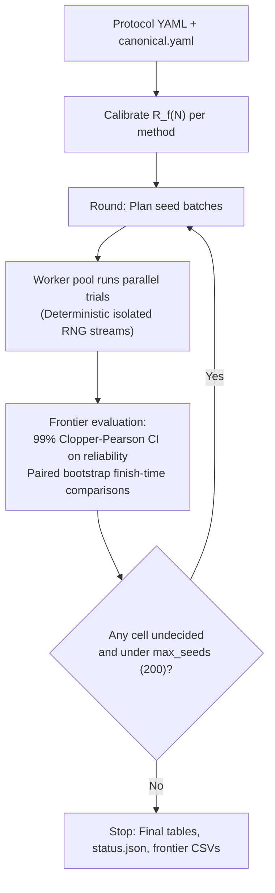

# HerdSim

[**English**](README.md) | [**Tiếng Việt**](README_vi.md)

[](LICENSE)
[](https://www.python.org/downloads/)
[](tests/)
[](results/)

**HerdSim** is a multi-agent simulation framework for collective shepherding. It asks one question:

> **How many dogs (D) are needed to gather a flock of N sheep and drive it into a goal reliably within a deadline, and how does this minimum (D_min) depend on flock size, the start layout, the deadline, the success criterion and the dog rule?**

Given unlimited time, one dog can eventually collect and steer almost any flock by chasing strays one at a time. Under a finite deadline the dogs have to collect scattered sheep in parallel, keep the flock from splitting, and drive it to the goal in the time left.

HerdSim combines agent models from [Strombom et al. 2014](https://doi.org/10.1098/rsif.2014.0719) and [Kubo et al. 2022](https://doi.org/10.1007/s10015-021-00726-7) with a multi-dog team layer, task lengths tied to the measured flock radius, and an adaptive sequential statistical engine (99% Clopper-Pearson intervals). The sheep and dogs are simulation models; the numbers say what this model and this team rule do, not how many dogs a farmer needs.


*Figure 1: One trial (N = 200 sheep, D = 4 dogs, wide start, seed 2026). The dogs go to the outlying sheep, bring them in, line up behind the flock and drive it into the circular goal. The trial ends after 279 ticks, about two drive times.*

---

## Table of Contents

- [Core Scientific Findings](#core-scientific-findings)
- [How a Campaign Runs](#how-a-campaign-runs)
- [Task Geometry and Scale Invariance](#task-geometry-and-scale-invariance)
- [Initial Flock Configurations](#initial-flock-configurations)
- [Agent Models and Multi-Dog Coordination](#agent-models-and-multi-dog-coordination)
- [Statistical Decisions and the Frontier](#what-the-frontier-rules-decide)
- [Sensitivity and Robustness](#sensitivity-and-robustness)
- [Quick Start](#quick-start)
- [What a Run Writes](#what-a-run-writes)
- [Project Architecture](#project-architecture)
- [Verification and Benchmarks](#verification-and-benchmarks)
- [References and Further Reading](#references-and-further-reading)

---

## Core Scientific Findings

Across 23 campaign protocols and **164,740 simulation trials** (no execution errors), HerdSim mapped D_min(N) for N from 25 to 400 over four start layouts, three deadlines and two success criteria. The full write-up is [`docs/report/d_min_report.md`](docs/report/d_min_report.md).

The tables are produced from `results/` by [`cli/dmin_tables.py`](cli/dmin_tables.py) and collected in [`docs/report/results_tables.md`](docs/report/results_tables.md). An entry such as "3-8" is a bracket: D = 8 is the smallest reliable team, but D from 3 up stayed undecided at 200 seeds, so the true D_min lies in [3, 8]. "[9]" is a lower bound with no reliable D yet, and "none" means no D on the grid is reliable.


*Figure 2: The design. Top: the steps of one protocol. Bottom: what each group of runs covers; the 14 sensitivity runs are a base and six variants, each under both success rules.*


*Figure 3: D_min against N at three deadlines. Circles and solid lines: strict success (every sheep in the goal); squares and dashed lines: 99% of the sheep in the goal. Shaded bars are brackets, hollow triangles are lower bounds, crosses are "none"; compact is 1 throughout.*

### 1. A compact flock needs one dog
When the flock starts compact, **one dog is enough at every tested flock size (N = 25 to 400) and every deadline (12 down to 3 drive times)**: no sheep starts outside the collection distance, so the task is only driving. For the Strombom sheep more dogs do not change the finish time (the median is 1.44 to 1.74 drive times for every D from 1 to 24). The Kubo model also needs one dog, but its finish time falls with D, from 102-116 s with one dog to about 30 s with ten.


*Figure 4: Finish time against D on compact starts. Left: Strombom sheep with the team rule, median finish time over drive time. Right: the Kubo model, median finish time in seconds. Success is 1.00 in every cell.*

### 2. On scattered layouts D_min grows slowly with N
Scattered layouts (`wide`, `split`, `outlier_rich`) first need the outliers collected:
- At 12 drive times D_min is 1 for N <= 50 (1 to 3 at N = 100 on `outlier_rich`) and 2 or 3 at N = 400.
- The log-log slope of D_min against N (log2 D_min vs. log2 N) is 0.2 to 0.5 at 12 drive times, and 0.3 to 0.8 at 6 drive times where D_min is decided at three or more sizes. Those sizes stop before N = 400 under the strict rule, where D_min is at least 9 on `wide`, so the strict slope understates the growth there.

### 3. The deadline moves D_min as much as the flock size
Under the 99% rule, tightening the deadline from 12 to 3 drive times raises D_min on `wide` at N = 400 from 2 to 5-6 dogs, where a fourfold increase of N at 12 drive times raises it from 1 to 2. Under the strict rule many of these cells are undecided. At 3 drive times no team on the grid reliably gathers `split` clusters at N >= 200 under either rule.


*Figure 5: Left and middle: success against D at 12, 6 and 3 drive times (99% rule, 99% intervals). Right: D_min against the deadline for four cells.*

### 4. The two success rules measure different things
The strict rule needs every sheep inside the goal at one tick; the 99% rule needs all but 1, 2 or 4 sheep at N = 100, 200 or 400 (at N <= 50 the two rules are the same). Among the strict failures of teams of six or more dogs on `wide` and `outlier_rich` (N >= 100), 95% had already brought 99% of the sheep into the goal at some tick, and 92% ended with fewer than half of them inside: the flock arrived and was then driven out. Under the strict rule eleven cells at N >= 200 have no decided D_min, six of which the 99% rule decides.


*Figure 6: Success rate of the same cells under the two rules, on the same seeds. Cells in the shaded area are below 0.90 under the strict rule and at or above it under the 99% rule.*


*Figure 7: Left: share of trials with 6 or more dogs (pooled) that succeed under the strict rule, that reach 99% of the sheep in the goal at some tick, and that succeed with the slower dog (speed 1.15). Right: one start flock (wide, N = 400, 16 dogs, seed 2), the distance of the flock centre to the goal and the number of sheep outside the goal. The faster dog's flock arrives with one sheep outside, is driven out and comes back; the slower dog's flock is inside on the first pass.*

The rule changes how large the setup effects look. Under the strict rule, setup conventions with no real-world value (start gap, dog start, sheep parameter set, dog speed) move D_min by a factor of three or more in some cells; under the 99% rule the same conventions keep it within one dog of the base bracket, and only a tighter goal moves it more (on `wide` and `outlier_rich` at 6 drive times). Both rules are reported side by side. For a team rule with no end-of-task step, the results suggest separating the arrival of the flock (a fraction of it inside) from holding it (a time inside, or a pen); a holding rule was not tested.

### 5. A rule without the team layer reaches no finite D_min
FAT (every dog aims behind the sheep farthest from the goal) lacks the team layer and the collect and drive switching. Run on the same task, it does not improve with more dogs: from N = 200 it has no reliable team on any scattered layout under either rule, and on a compact flock at N = 400 it fails where the team rule needs one dog. Its dogs pick the same sheep and move as copies. Which of the two missing parts matters was not isolated: a team of independent copies of the paper shepherd was not run.


*Figure 8: Success against D for the team rule (blue) and FAT (orange) on the same task, strict (solid) and 99% (dashed), 6 drive times. A hollow marker is a cell with fewer than 30 trials.*

### 6. What the per-trial metrics show
Every trial stores summaries of 19 per-tick measures of the flock, the dogs and the goal. Two of them add to the findings above:
- Across cells, success falls as the flock spreads: Spearman correlation -0.56 to -0.81 at 6 and 3 drive times under both success rules, close to the -0.70 of the 2025 scaling manuscript. Weighting the spread by N changes it by at most 0.02. It is a correlation: more dogs also tighten the flock.
- On `split` flocks at N = 200, about a quarter of the dogs stand still under the stop rule from D = 4 on, against about 1% on `wide`, and in a 12-seed replay shortening the stop distance cut the finish time by about a fifth. Crowding alone is not the cause: `wide` flocks show the same share of dogs with a twin and are unaffected.


*Figure 9: (a) Cell success against mean flock spread. (b) Dogs standing still and (c) dogs with a twin within 2 units, against D, at N = 200 under the 99% rule. Details are in section 6.10 of the [report](docs/report/d_min_report.md).*

---

## How a Campaign Runs

Instead of a fixed number of seeds for every cell, HerdSim adds seeds in rounds and spends them where a cell is still undecided.

A **protocol** (defined in [`protocols/configs/protocols/`](protocols/configs/protocols/)) specifies the parameter space: sheep models, shepherd algorithms, flock sizes N, shepherd counts D, initial layouts, and deadlines. Every unique combination of method, layout, and N forms a **D-curve** (group). Each specific dog count D within that curve is a **cell**, and each seed evaluated is a **trial**.



### Adaptive Execution Mechanics

Four mechanisms decide where the seeds go:

#### 1. Sequential refinement and early stopping (99% Clopper-Pearson CI)
Each cell begins with a baseline batch (`batch_seeds`, default 10). If the 99% Clopper-Pearson confidence interval confirms the cell is reliable (lower CI bound >= 0.90, which needs at least 51 successes in a row, so 60 trials with batches of 10) or unreliable (upper CI bound < 0.90), evaluation halts immediately. Undecided cells receive sequential batches of 10 seeds up to `max_seeds` (200), so most of the compute goes to cells near the boundary.


*Figure 10 (illustration): Sequential refinement with exact 99% Clopper-Pearson intervals. Clear failures stop after 10 seeds, clear successes after 60, and undecided cells get batches of 10 up to the 200-seed cap.*

#### 2. Midpoint densification
When adjacent tested dog counts D cross a behavioral zone boundary (e.g. D = 2 is `too_few` and D = 4 is `improving`) with a gap larger than `refine_min_gap` (1), the midpoint (D = 3) is added to the curve for the next round. A midpoint is also added next to a cell that is still undecided at the 200-seed cap, so the grid gets finer where the answer is open.


*Figure 11 (illustration): A zone change between D = 2 and D = 4 adds D = 3 in the next round. Other midpoints are added in the same round where their neighbours change zone.*

#### 3. Saturation and twin pruning
Above a confirmed saturation point (D_sat), a cell is pruned when the mean share of dogs with a twin (`dog_overlap`) is >= 0.90 in its trials. A pruned cell gets no more seeds and no midpoints.


*Figure 12 (illustration): Once the finish time stops improving at D_sat, cells with a twin share of 0.90 or more are marked pruned.*

#### 4. Paired seeds
Every seed i evaluated across cells uses `master_seed + i` (default 2026 + i). The start layout and the sheep noise are drawn from separate streams of that seed, so trials that compare D = 2 with D = 4 start from the same flock and use the same sheep noise draws. The dogs' actions then change what the sheep do, so the runs diverge after the first tick.


*Figure 13 (illustration): Seeds 2026, 2027 and 2028 give the same start flock and the same sheep noise draws at every D.*

#### 5. Robust Interrupt and Resume
Every finished trial is appended to `trials.jsonl` at once; `trials.csv` is rewritten after each round. A campaign can be interrupted (`SIGINT`) and resumed from the stored trials, and a lock file stops two runs from writing the same folder. A resumed run refuses to continue if the physics settings changed (the hash covers settings, not source code).

---

## Task Geometry and Scale Invariance

If the field stayed the same while N grew, a large flock would be cramped by the field and flock size would be mixed up with density. HerdSim sizes the task from the **calibrated flock radius R_f(N)**, the radius of an N-sheep flock driven by a single dog, so the goal and the drive grow with N. The match is partial: the scattered layouts are sized by 2 N^(2/3), and the gap, spacing, clearance and the sheep radius r_s are absolute lengths. From N = 200 the reach of the scattered starts sets the drive length.


*Figure 14: Task geometry drawn to scale. Left: the layout at N = 200. Middle: how the drive length is set. Right: R_f and the goal radius against N.*

| Parameter | Mathematical Formulation | Physical Rationale |
|---|---|---|
| **Flock Radius** R_f(N) | Empirical calibration (e.g., 3.14 at N=5, 9.08 at N=100, 11.4 at N=400) | Measured with one dog driving the flock. |
| **Drive Distance** | max(13 * R_f(N), 80, reach + R_goal + R_f) | The third term keeps the goal clear of the farthest start sheep. |
| **Goal Radius** R_goal | 1.9 * R_f(N) | Same relative goal size at every N. |
| **Field Clearance** | 80 units beyond the farthest start position | Keeps starts away from the edge of the field. |
| **Open Boundary** | **No walls or reflecting boundaries** | The field edge is not used by the dynamics; agents can leave it. |

### Normalized Deadline

Deadlines are specified as multiples m of the characteristic **drive time**:

$$
T_{\text{drive}} = \frac{\text{Drive Distance}}{v_{\text{sheep,max}}}
$$

A trial evaluated at m = 6 requires the dog team to gather and drive the flock within 6 times the theoretical minimum travel time of the fastest sheep. A compact flock driven by one dog with the Strombom rule finishes in 1.46 to 1.74 x T_drive (median); so m in {12, 6, 3} runs from a loose deadline to one with little room.

| Flock Size (N) | Flock Radius R_f | Drive Distance l | Drive Time (T_drive) | 12x Deadline (Relaxed) | 6x Deadline (Intermediate) | 3x Deadline (Urgent) |
| :---: | :---: | :---: | :---: | :---: | :---: | :---: |
| **N = 25** | 6.20 m | 80.6 m | **80.6 s** (~1.3 min) | 967 s (~16.1 min) | 484 s (~8.1 min) | 242 s (~4.0 min) |
| **N = 50** | 7.60 m | 98.8 m | **98.8 s** (~1.6 min) | 1,185 s (~19.8 min) | 593 s (~9.9 min) | 296 s (~4.9 min) |
| **N = 100** | 9.08 m | 118.1 m | **118.1 s** (~2.0 min) | 1,417 s (~23.6 min) | 708 s (~11.8 min) | 354 s (~5.9 min) |
| **N = 200** | 10.47 m | 139.8 m | **139.8 s** (~2.3 min) | 1,678 s (~28.0 min) | 839 s (~14.0 min) | 419 s (~7.0 min) |
| **N = 400** | 11.40 m | 206.8 m | **206.8 s** (~3.4 min) | 2,482 s (~41.4 min) | 1,241 s (~20.7 min) | 620 s (~10.3 min) |

*Note: Drive distance l = max(13 * R_f, 80, reach + R_goal + R_f). At N = 400, the arena clearance term dominates (206.8 m) because the reach of the scattered starts grows as N^(2/3) while R_f grows more slowly, so the goal does not overlap any start sheep.*

---

## Initial Flock Configurations

To study the transition between collection and driving, HerdSim provides four distinct initial spatial geometries:


*Figure 15: The four initial flock layouts evaluated at N = 200 with D = 4 dogs (identical scale). The grey dashed circle marks the analytical collection boundary f(N) = r_a * N^(2/3). Any sheep located outside this circle triggers active collection heuristics.*

1. **`compact`**: Flocks sampled from a 2D Gaussian (sigma = 0.5 * R_f, truncated at 3 sigma). All sheep begin well within f(N); dogs immediately enter drive mode.
2. **`wide`**: Flocks sampled from a broad Gaussian (sigma = 0.5 * 2 N^(2/3)). Sheep are broadly scattered, requiring substantial initial perimeter sweeping.
3. **`split`**: The flock is partitioned into 3 compact sub-clusters (2 when N < 12) spaced symmetrically on a circle of radius 2 N^(2/3). Dogs must address isolated groupings without dispersing them further.
4. **`outlier_rich`**: 80% of sheep reside in a dense compact core, while 20% are distributed as distant outliers between 1.1 and 1.6 x 2 N^(2/3).

### Shepherd Release Configurations (`dog_start`)

Dogs begin 30 units beyond the farthest sheep that can start, arranged in one of three experimental stations:
- **`arcs` (default)**: Dogs are spaced evenly along concentric semi-circular arcs behind the flock. Single dogs start directly on the drive axis; additional dogs occupy distinct flanking stations.
- **`ring`**: Dogs are distributed uniformly on a circle surrounding the flock, leaving out the cone (seen from the flock centre) that holds the goal, testing whether encirclement aids or hinders initial gathering. A full circle put one dog inside the goal for every even D from N = 200; that first ring run is kept in `results/dmin_s_ring_dog_in_goal` and not used.
- **`handler`**: All dogs originate from a single point directly behind the flock (simulating simultaneous release from a human handler's post; at $t = 0$ all dogs begin superimposed at this single coordinate before fanning out).


*Figure 16: Shepherd release configurations (dog_start). Top: Scaling of the default arcs geometry from D = 1 to D = 64 behind an N = 100 flock (concentric arcs 30 units beyond the farthest start sheep). Bottom: Direct comparison of the three placement geometries (arcs, ring, handler) at N = 200 with D = 8 dogs on a wide flock start (in handler mode, all 8 dogs begin superimposed at the single release coordinate).*

**Why a single-point `handler` post?** A handler may release the dogs from one place behind the flock instead of spreading them out first. The `handler` start checks how much the spread-out `arcs` start helps: all dogs begin at one point and the team rule sends them to their targets from the first tick.

---

## Agent Models and Multi-Dog Coordination

The sheep follow the Strombom et al. (2014) rule, the dogs follow a multi-dog extension of the same paper, and a second sheep and dog model (Kubo et al. 2022) serves as a cross-check.


*Figure 17: The team rule in strombom_multi, in a 2 x 4 grid of panels. Columns: D = 1, 2, 4, 8. Top row: a wide flock (N = 200), where the D farthest outliers each get one dog, matched by least total walk. Bottom row: a compact flock, where the dogs take slots on an arc behind it, in the order of their angle around the flock.*

### 1. Sheep Dynamics ([Strömbom et al. 2014](https://doi.org/10.1098/rsif.2014.0719))

Derived from empirical observations of flocking under predation, the sheep behavior is governed by a threat-triggered state machine:

#### Active Flight Mode ($\min_j \lVert \mathbf{x}_i - \mathbf{y}_j \rVert < r_s$)
When any dog is within threat distance $r_s$, sheep $i$ computes a raw heading vector $\mathbf{H}_i'$ balancing momentum, social forces, dog avoidance, and noise:

$$
\mathbf{H}_i' = h\,\mathbf{H}_i + c\,\mathbf{C}_i + \rho_a\,\mathbf{R}_{a,i} + \rho_s\,\mathbf{R}_{s,i} + e\,\mathbf{\epsilon}_i
$$

where each constituent component is a **unit vector** scaled by its behavioral weight (Table 2):
- $\mathbf{H}_i$: **Previous heading** unit vector (direction from last tick, zero if stationary), with inertia weight $h = 0.5$.
- $\mathbf{C}_i$: **Cohesion** unit vector pointing toward the local center of mass ($\text{LCM}_i$) of the $n$ nearest neighbors ($n = N - 1$), with attraction weight $c = 1.05$:

$$
\mathbf{C}_i = \frac{\text{LCM}_i - \mathbf{x}_i}{\lVert \text{LCM}_i - \mathbf{x}_i \rVert}, \quad \text{where } \text{LCM}_i = \frac{1}{n} \sum_{k \in \mathcal{N}_n(i)} \mathbf{x}_k
$$

- $\mathbf{R}_{a,i}$: **Inter-sheep Repulsion** unit vector pushing away from neighbors closer than collision distance $r_a = 2$, with repulsion weight $\rho_a = 2.0$:

$$
\mathbf{R}_{a,i} = \frac{\sum_{j \ne i, \lVert \mathbf{x}_i - \mathbf{x}_j \rVert < r_a} \frac{\mathbf{x}_i - \mathbf{x}_j}{\lVert \mathbf{x}_i - \mathbf{x}_j \rVert}}{\left\lVert \sum_{j \ne i, \lVert \mathbf{x}_i - \mathbf{x}_j \rVert < r_a} \frac{\mathbf{x}_i - \mathbf{x}_j}{\lVert \mathbf{x}_i - \mathbf{x}_j \rVert} \right\rVert}
$$

- $\mathbf{R}_{s,i}$: **Shepherd Escape** unit vector pushing away from shepherds within threat distance $r_s = 65$, with escape weight $\rho_s = 1.0$.
- $\mathbf{\epsilon}_i$: **Noise** unit vector pointing in a random direction drawn uniformly from $[0, 2\pi)$, with noise weight $e = 0.3$.

Sheep $i$ advances a distance $\delta = 1$ m (speed $\delta = 1$ m/s) along the normalized heading:

$$
\mathbf{x}_i^{t+1} = \mathbf{x}_i^t + \delta\,\frac{\mathbf{H}_i'}{\lVert \mathbf{H}_i' \rVert}
$$

#### Grazing Mode ($\min_j \lVert \mathbf{x}_i - \mathbf{y}_j \rVert \ge r_s$)
When all dogs are outside threat range $r_s$, sheep do not experience social attraction or repulsion; they **graze**: staying put, or with probability $p = 0.05$ taking a step of length $\delta$ in a uniformly random direction:

$$
\mathbf{x}_i^{t+1} = \begin{cases}
\mathbf{x}_i^t + \delta\,\mathbf{\epsilon}_{\text{graze}}, & \text{with probability } 0.05 \\
\mathbf{x}_i^t, & \text{with probability } 0.95
\end{cases}
$$

#### Multi-Dog Push Blending ($\mathbf{R}_{s,i}$)

The original Strömbom et al. (2014) model was formulated for **only a single dog**, where the threat vector was simply the unit vector pointing directly away from that single shepherd: $\frac{\mathbf{x}_i - \mathbf{y}}{\lVert \mathbf{x}_i - \mathbf{y} \rVert}$. When scaling to multi-dog teams ($D \ge 2$), adding the dogs' repulsions would make the push grow with the number of dogs near a sheep. HerdSim adds the unit vectors away from each dog in range and normalizes the sum to length 1:

$$
\mathbf{R}_{s,i} = \frac{\sum_{j \in \text{threat}} \frac{\mathbf{x}_i - \mathbf{y}_j}{\lVert \mathbf{x}_i - \mathbf{y}_j \rVert}}{\left\lVert \sum_{j \in \text{threat}} \frac{\mathbf{x}_i - \mathbf{y}_j}{\lVert \mathbf{x}_i - \mathbf{y}_j \rVert} \right\rVert}
$$

where:
- $\mathbf{x}_i$: 2D position vector of sheep $i$.
- $\mathbf{y}_j$: 2D position vector of dog $j$.
- $\frac{\mathbf{x}_i - \mathbf{y}_j}{\lVert \mathbf{x}_i - \mathbf{y}_j \rVert}$: Unit vector pointing directly away from dog $j$ toward sheep $i$ (the pure escape direction from dog $j$).
- $\text{threat}$: Set of all dogs currently within threat range of sheep $i$ ($\lVert \mathbf{x}_i - \mathbf{y}_j \rVert < r_s$).

**Intuitive Example:**
Imagine a sheep at $(0, 5)$ pursued by two flanking dogs: Dog 1 is stationed at $(-3, 0)$ (back-left) and Dog 2 is stationed at $(3, 0)$ (back-right). 
- Dog 1 exerts a repulsive push diagonally forward-right.
- Dog 2 exerts a repulsive push diagonally forward-left.
- Summing both unit vectors causes their lateral components to cancel out while their forward components reinforce. Normalizing to unit length yields a resultant push directed straight ahead $(0, 1)$.

The push on a sheep therefore has the same size however many dogs are in range, and only its direction depends on where they stand.

### 2. Shepherd Controllers and Alternative Baselines

Three dog controllers are implemented:

#### Coordinated Architecture: `strombom_multi`
- **Outlier Mode**: When any sheep lies farther than $f(N) = r_a \cdot N^{2/3}$ from the flock centroid, the $D$ farthest outliers are identified. Dogs are assigned to distinct outliers using linear sum assignment (minimum total Euclidean travel distance). Leftover dogs assist in driving the core flock.
- **Drive Mode**: When the flock is cohesive, dogs form an arc behind the flock at distance $r_d$, spanning the angular width of the flock. Dogs are sorted by their relative angular station around the flock, guaranteeing they never cross paths while moving to their assigned driving slots.

#### Uncoordinated Baseline: `fat` (Farthest-Agent Targeting)

To see whether the team layer matters, HerdSim includes a baseline without it, **FAT (Farthest-Agent Targeting)** (`dog_controller="fat"`).

- **Relationship to prior methods**: FAT borrows the target selection heuristic of [Kubo et al. (2022)](https://doi.org/10.1007/s10015-021-00726-7) (where each shepherd is attracted toward the sheep farthest from the goal, aiming $r_a$ behind it) and executes it using the discrete kinematic steps of [Strömbom et al. (2014)](https://doi.org/10.1098/rsif.2014.0719).
- **What differs from `strombom_multi`**: FAT has no outlier assignment and no drive slots, and it has no inter-dog repulsion like that of Kubo et al. (2022). It also has no collect and drive switch: every dog always goes behind the sheep farthest from the goal. Independent copies of the paper shepherd were not run, so FAT does not separate these parts.
- **Same task**: R_f, which sets the goal and the drive, is calibrated for FAT with the paper shepherd on the same sheep (`calibrate_as: strombom_multi` in the protocol), so `dmin_fat` runs exactly the task of `dmin_m6` and only the dog rule differs.
- **Result**: every dog targets the same sheep, the dogs move as copies (on compact flocks at N >= 200, 73 to 82% of FAT dogs have another dog within 2 units), and success does not rise with D. From N = 200 FAT has no reliable team on any scattered layout under either success rule.


*Figure 18: FAT (3 panels). Dogs aim behind the sheep farthest from the goal, and without an assignment they share one target and move together; the share of dogs with a twin (`dog_overlap`) is high.*

#### Cross-Model Continuous Force Architecture: `kubo` ([Kubo et al. 2022](https://doi.org/10.1007/s10015-021-00726-7))
As a check on the Strömbom rule, HerdSim also includes the continuous force model of Kubo et al. (2022), with both **Kubo sheep** and **Kubo dogs**:
- **Kubo Sheep Dynamics**: Sheep velocities update continuously via four additive forces within each sheep's field of view:
  1. *Inter-sheep repulsion* ($1/r^2$): Prevents collision and crowding.
  2. *Velocity alignment*: Matches headings with moving neighbors.
  3. *Inter-sheep attraction* ($-1/r$): Binds the flock together.
  4. *Flight from dogs* ($1/r^3$): Strong short-range push directly away from shepherds.
- **Kubo Shepherd Controller**: Unlike `strombom_multi`, Kubo dogs do not use discrete state machines or combinatorial assignment. Instead, each dog moves according to four continuous potential fields:
  1. *Target attraction*: Pulled toward the sheep farthest from the goal.
  2. *Target standoff* ($1/r^3$): Repelled when getting too close to that target sheep.
  3. *Goal standoff*: Repelled away from the goal perimeter to avoid driving sheep backward out of the pen.
  4. *Inter-dog repulsion* ($1/r^3$): Shepherds strongly repel one another, naturally fanning out along the flock boundary without explicit communication.
- **Role in HerdSim (`dmin_kubo`)**: Evaluated on compact flocks ($N \in \{25, 50, 100\}$, $D \in \{1 \dots 10\}$), the Kubo model is consistent with $D_{\min} = 1$ on compact starts up to N = 100 (finish time falls with D, see Figure 4). It was run with a different sheep model and dog rule and on compact starts only, so it does not test the scattered layouts.


*Figure 19: The Kubo et al. (2022) model. Left: the force terms on one sheep. Middle: the force terms on one dog. Right: a single snapshot of a simulated flock and its dogs.*

---

## What the Frontier Rules Decide

Statistical decisions are governed by [`analysis/frontier.py`](analysis/frontier.py). For each cell (a given method, layout, N, and D):

1. **Reliability (theta = 0.90)**:
   A cell is classified as **reliable** if the lower bound of its two-sided 99% Clopper-Pearson binomial confidence interval satisfies p_lower >= 0.90. It is classified as **unreliable** if p_upper < 0.90, and **undecided** otherwise. At least 51 successes in a row are needed for reliability at 99% confidence, which is 60 trials with batches of 10.
2. **Finish-Time Comparisons**:
   Pairwise finish-time comparisons between reliable cells are evaluated using a paired bootstrap (4,000 resamples) on per-seed differences relative to the slower median. A cell is classified as **faster**, **slower**, or **same** (within a 5% margin).

### Derived Frontier Metrics

| Frontier Value | Definition |
|---|---|
| **D_min** | Smallest reliable dog count D. (D_min_low: lowest D whose upper bound reaches theta). |
| **D_sat** | Smallest reliable D such that no larger reliable D is statistically faster. |
| **D_best** | Smallest reliable D that is not slower than the fastest reliable count on the curve. |
| **D_crowd** | Smallest reliable D > D_best that is measurably slower than D_best (congestion). |
| **D_overcrowd** | Smallest D > D_min where it and the subsequent tested D are both unreliable (collapse). |
| **D_max** | Largest reliable dog count below D_overcrowd. |

### Cell Behavioral Zones


*Figure 20: Partition of the dog count axis into behavioral zones determined by reliability testing (theta = 0.90) and paired bootstrap finish-time comparisons against D_best.*


- `too_few`: Unreliable, below D_min.
- `improving`: Reliable, below D_sat; adding dogs provides statistically significant speedups.
- `saturated`: Reliable, from D_sat upward; additional dogs maintain reliability but yield no further speedup.
- `crowded`: Reliable, but slower than D_best due to dog interference.
- `collapse`: Unreliable, at or above D_overcrowd.
- `undecided`, `unreliable_dip` and `recovered` mark cells that are open, unreliable between reliable counts, or reliable again after such a dip.

---

## Sensitivity and Robustness

To verify that findings reflect fundamental multi-agent dynamics rather than arbitrary parameter choices, HerdSim executed systematic sensitivity sweeps:


*Figure 21: D_min across the sensitivity variants (N in {100, 200, 400}, wide and outlier_rich layouts, 6 drive times). Rows above the horizontal divider test strict success; rows below test the 99% arrival threshold (f99). The base rows use dog speed 1.5, arcs release, gap 30 and goal radius 1.9 R_f. Light cells are open: a bracket "lo-hi" or a lower bound "[n]".*

Every variant was run under both success rules. Under the strict rule some variants move D_min by a factor of three or more; under the 99% rule every variant except the tighter goal stays within one dog of the base.

1. **Release Geometry**: Under the strict rule, with 8 or more dogs at N = 400, the ring has the highest success and the handler post the lowest. Under the 99% rule all three starts give the same D_min within the brackets; the handler post is still the slowest (all dogs leave from one point).
2. **Dog Speed (Base 1.5 vs. 1.15)**: Under the strict rule slower dogs need fewer dogs on large flocks (outlier-rich N = 400: 6 against none). Both speeds bring 99% of the flock in at the same time, and under the 99% rule the advantage disappears. The difference is the last-sheep step, not the herding.
3. **Field-Matched Realism**: Calibrating sheep to the paper's field-matched set (r_a = 1.0, reaction distance 75, noise 0.1) halves the collection distance. Under the strict rule this is the hardest setting; under the 99% rule field-matched sheep need the same number of dogs as the base or fewer.
4. **Goal Size**: A goal of 1.5 R_f is the one variant that needs more dogs under both rules (99%: 5-6 dogs on wide N = 400 against 2-3).

---

## Quick Start

### Installation

HerdSim requires Python 3.11+ and uses [`uv`](https://docs.astral.sh/uv/) for high-performance dependency management:

```bash
# Clone the repository
git clone https://github.com/lykimq/HerdSim.git
cd HerdSim

# Install development environment and dependencies
make install     # uv sync --extra dev

# Run comprehensive checks (Ruff linter + basedpyright type checker + 268 tests)
make check

# Execute miniature verification campaigns (~1 minute)
make bench
```

### Running Campaigns

Execute single protocols or batch queues using the CLI:

```bash
# Preview the trial plan for a protocol without executing
uv run cli/campaign.py plan --protocol dmin_m6

# Run a campaign with 16 parallel workers
uv run cli/campaign.py run --protocol dmin_pilot --workers 16

# Check the real-time status of an active or completed campaign
uv run cli/campaign.py status --protocol dmin_pilot

# Inspect D_min results across multiple deadlines
uv run cli/dmin_report.py --protocol dmin_pilot --folder results/dmin_pilot --multiples 3 6 12

# Run the complete sequence of research protocols (resumes automatically)
uv run cli/run_queue.py --workers 20

# Generate publication-grade Markdown result tables from results/
uv run cli/dmin_tables.py record
uv run cli/dmin_tables.py dmin dmin_m12 dmin_m6 dmin_m3
```

---

## What a Run Writes

Every executed protocol writes a self-contained, auditable results directory:

```text
results/<protocol_id>/
|-- protocol.yaml         Merged configuration (canonical defaults + protocol overrides)
|-- provenance.json       Protocol id, physics hash, and creation time
|-- calibration.json      Calibrated steady-state flock radius R_f(N) per method
|-- trials.jsonl          Append-only stream of completed trials (safe against crashes)
|-- trials.csv            Consolidated trial results table (rewritten after each round)
|-- frontier_cells.csv    Statistical outcomes per cell (Clopper-Pearson CI, finish times, zone)
|-- frontier_groups.csv   Frontier metrics per D-curve (D_min, D_sat, D_crowd, D_overcrowd)
|-- status.json           Live execution status, round counter, and timing diagnostics
|-- errors.jsonl          Captured execution exceptions (empty in standard runs)
|-- .lock                 File lock held during active execution
`-- timeseries/           Per-tick Parquet files (retained for first 3 seeds per cell)
```

All CSV tables include standard metadata headers readable with `pd.read_csv(path, skiprows=1)`.

---

## Project Architecture

The codebase is organized into modular decoupled layers:

```text
HerdSim/
|-- sim/                    # Simulation engine and domain logic
|   |-- core/               # State dataclasses, tick runner, arena, and layouts
|   |-- methods/            # Physical models: Strombom (2014) and Kubo (2022)
|   `-- plugins/            # Extensible plugin system
|       |-- sheep/          # Microscopic sheep dynamics (strombom, kubo)
|       |-- dogs/           # Shepherd controllers (collect_drive_multi, fat, kubo_forces)
|       |-- scenarios/      # Task geometry, goal evaluation, failure diagnostics
|       `-- metrics/        # Per-tick and summary geometric measurements
|-- services/               # Campaign orchestration
|   |-- adaptive.py         # Sequential sampling engine and batch planner
|   |-- calibration.py      # Automated R_f(N) steady-state calibration
|   |-- cells.py            # Parameter grid combinations and D-curves
|   |-- protocol.py         # YAML protocol loading, schema checks, inheritance
|   `-- runner.py           # Worker pool management and trial dispatch
|-- analysis/               # Statistical evaluation
|   |-- frontier.py         # Clopper-Pearson CI, paired bootstrap, zone classification
|   |-- dmin.py             # D_min of a finished run at tighter deadlines or 99% arrival
|   `-- dmin_tables.py      # Table generators for empirical reporting
|-- protocols/configs/      # Canonical defaults and protocol definitions
|-- cli/                    # Command-line tools (campaign, run_queue, dmin_report, dmin_tables)
|-- docs/                   # Report, architecture guide, figures and the scripts that draw them
|-- results/                # Archived empirical datasets (164k+ trials)
`-- tests/                  # Test suites and golden regression benchmarks
```

---

## Verification and Benchmarks

Checks at each layer:

- **Unit & Invariant Tests** (`make test`, 268 tests, ~24 s):
  Check the sheep and dog rules, the layouts, the statistics, the adaptive rounds and the table code.
- **Golden Regression Tests** ([`tests/sim/test_golden.py`](tests/sim/test_golden.py)):
  Compares reference trials with stored values (success exactly; ticks within 5%, cohesion, path length and fragmentation within 10%) and checks that the same seed replays exactly.
- **Micro-Campaign Benchmarks** (`make bench`, ~60 s):
  Executes miniature end-to-end campaigns validating core model invariants:
  - *Speed bound*: the flock centre never moves faster than the maximum sheep speed.
  - *Worker invariance*: the results are the same with 1 and with 4 worker processes.
  - *Idempotency*: re-running a finished folder runs no new trials.
  - *Physical orderings*: a compact flock needs no collecting, and a tighter deadline does not lower the number of dogs needed.

---

## References and Further Reading

1. **Strömbom, D., et al. (2014)**. *Solving the shepherding problem: heuristics for herding autonomous, interacting agents*. Journal of the Royal Society Interface, 11(100), 20140719. [DOI: 10.1098/rsif.2014.0719](https://doi.org/10.1098/rsif.2014.0719)
2. **Kubo, M., Tashiro, M., Sato, H., Yamaguchi, A. (2022)**. *Herd guidance by multiple sheepdog agents with repulsive force*. Artificial Life and Robotics, 27, 416-427. [DOI: 10.1007/s10015-021-00726-7](https://doi.org/10.1007/s10015-021-00726-7)
3. **D_min Research Report**: [`docs/report/d_min_report.md`](docs/report/d_min_report.md) ([Vietnamese](docs/report/d_min_report_vi.md))
4. **Empirical Results Tables**: [`docs/report/results_tables.md`](docs/report/results_tables.md)
5. **Architectural Deep-Dive**: [`docs/codes/architecture.md`](docs/codes/architecture.md)
