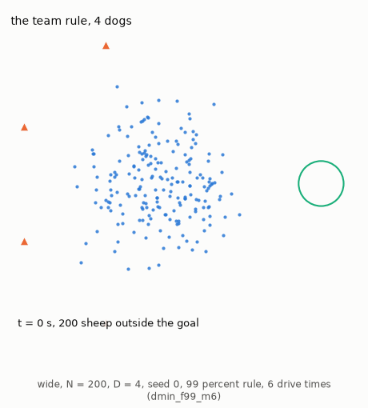
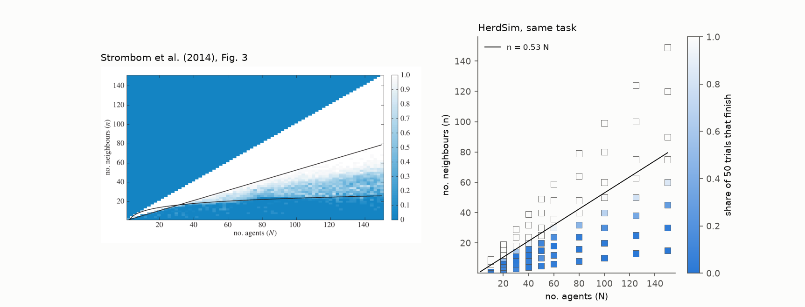

# HerdSim

[](LICENSE)
[](https://www.python.org/downloads/)
[](tests/)
[](docs/report/d_min_report.md#24-the-six-runs)

One sheepdog can bring a flock that stays together into a pen. When the sheep start scattered and the job has a deadline, one dog may not reach every stray in time. HerdSim is a simulator, and a study run with it, that asks how many dogs that task needs. It uses the sheep model of Strombom et al. (2014) with a team rule for several dogs, and counts how often a team of $D$ dogs gets a flock of $N$ sheep into a goal before the deadline.

The question is how $D_{\min}$, the smallest reliable team, grows with $N$, and how the start layout and the deadline change that answer. Results are in the [report](docs/report/d_min_report.md); terms are in the [glossary](docs/glossary.md).

Every team result rests on Strombom's sheep and dog, so HerdSim also reruns the paper's one-dog task through the same trial code ([check against the paper](#check-against-strombom-et-al-2014)).

## Task and methods

HerdSim moves sheep and dogs on an open field one tick at a time. The dogs bring the flock into a circular goal. The deadline is counted in drive times: one drive time is how long a sheep walking straight at 1 m/s needs to cover the drive distance (flock start centre to goal centre). The study uses 12, 6 and 3 drive times.

A trial succeeds under the strict rule when every sheep is in the goal at the same tick, and under the 99% rule when at least $\lceil 0.99 N \rceil$ are, which is every sheep below $N = 100$.

A sheep farther from the flock centre than the collect distance, $2 N^{2/3}$ m, is an outlier. The flock starts in one of four layouts:

1) `compact`: a tight flock.
2) `wide`: a loose flock; about 13% of the sheep start beyond the collect distance.
3) `split`: three compact clusters.
4) `outlier_rich`: a compact flock with 20% of the sheep on a ring beyond the collect distance.

The method `strombom_multi` pairs Strombom's sheep with the team rule. While there are outliers, the Hungarian algorithm assigns dogs to the $D$ farthest outliers at the least total distance, and spare dogs drive the sheep that are already within the collect distance. Once there are no outliers, the dogs stand on an arc behind the flock and drive it to the goal.

A protocol is a YAML recipe for one experiment: which flock sizes, team sizes, layouts, success rule and deadline to try. The id encodes the settings; in `dmin_f99_m6`, `f99` is the 99% rule and `m6` is 6 drive times. Ids without `f99` use the strict rule.


**Figure 1: One trial ($N = 200$, $D = 4$, `wide` start, seed 2026, strict rule, 1500-tick limit) at ticks 0, 55, 139 and 279.** The dogs start on an arc behind the flock, gather it from several sides, then drive it into the goal.

- Marks: blue dots are sheep, orange triangles dogs with their tracks, and the green circle the goal (radius 1.9 times the flock radius $R_f$).



**Animation 1: The stored trial with the same start flock and dogs (99% rule, 6 drive times).** At 278 s 199 of the 200 sheep are in the goal, which the 99% rule counts as success. Figure 1 sizes the field for this one layout; the stored run fits all four, so its goal is 3.7 m farther.

- Marks: as in Figure 1; the bottom-left text gives the time and the sheep outside the goal.

## How the study is organised

Each protocol stores data in three levels:

- Curve: one setup, for example `wide` starts with 200 sheep, tried at each team size.
- Cell: one team size on that curve, "can 3 dogs herd 200 sheep in this setup?"
- Trial: one run of a cell with one random seed.

A cell gets trials in batches of 10 seeds, up to 200. It is reliable when the lower end of its 99% [Clopper-Pearson](https://doi.org/10.1093/biomet/26.4.404) interval for the success rate is at least $\theta = 0.90$ (the success rate is at least 0.90 at 99% confidence), unreliable when the upper end is below 0.90, and undecided while the interval still straddles $\theta$. $D_{\min}$ is the smallest reliable team on a curve.

The six protocols are `dmin_m12`, `dmin_m6` and `dmin_m3` (strict rule, $N = 25$ to 400) and `dmin_f99_m12`, `dmin_f99_m6` and `dmin_f99_m3` (99% rule). The 99% runs at 12 and 6 drive times also use $N = 71$, 141, 283 and 566. No trial ended in an error.

## Results in short

$D_{\min}$ at $N = 400$, from 115,470 trials in the six runs (Table 1). `2-3` means 3 dogs are reliable and 2 still undecided at 200 seeds, `[9]` that no team is reliable yet and at least 9 are needed, and `none` that every team tested, up to 24 dogs, is unreliable ([notation](docs/report/d_min_report.md#23-when-a-team-is-reliable)).

**Table 1: $D_{\min}$ at $N = 400$, strict rule / 99% rule.**

| Deadline | `compact` | `wide` | `split` | `outlier_rich` |
| :---: | :---: | :---: | :---: | :---: |
| 12 drive times | 1 / 1 | 3 / 2 | 3 / 2 | 3 / 2 |
| 6 drive times | 1 / 1 | [9] / 2-3 | none / [5] | none / 3 |
| 3 drive times | 1 / 1 | none / 5-6 | none / none | none / [6] |

- `compact` needs one dog at every size, rule and deadline, through $N = 566$ where tested.
- Up to $N = 50$ one dog is enough on every layout; from $N = 100$ some scattered curves need more.

The [report](docs/report/d_min_report.md) has every size, the brackets, the limits and the log-log slope of $D_{\min}$ against $N$ per layout, rule and deadline ([RQ1](docs/report/d_min_report.md#31-rq1-how-does-d_min-grow-with-n)).

## Check against Strombom et al. (2014)

HerdSim reruns two one-dog studies of the paper with its own trial code, the paper's settings where it gives them and HerdSim's reading where it does not, 5100 trials in all: the paper's Figure 3 task, where each sheep is attracted by its $n$ nearest neighbours, and its study of the distance to the goal. For each, the [check doc](docs/methods/strombom_check.md) gives what the paper states beside what HerdSim measures, with the trial counts, the fit of time against distance and the grid points HerdSim chose.



**Figure 2: Share of the 50 trials that finish at each $N$ and $n$, the paper's Figure 3 and HerdSim (one dog, 8000 time steps, $r_s = 45$ m as in the paper's Figure 3).** By eye the two have the same shape, with the change near the line $n = 0.53 N$.

- Marks: blue is no trial finishing and white is every trial; the black line is $n = 0.53 N$, and the paper's panel also draws its curve $n \approx 3 \log N$.
- Left: the paper's Figure 3.
- Right: HerdSim, one square per grid point.

The check applies the paper's grazing repulsion (sheep push apart with no dog near), which the six study runs leave off; what turning it on changes in two of them is in the [report, limitations](docs/report/d_min_report.md#4-limitations).

## Setup and tests

HerdSim needs Python 3.11 or later and [`uv`](https://docs.astral.sh/uv/):

```bash
git clone https://github.com/lykimq/HerdSim.git
cd HerdSim
make install   # uv sync --extra dev
make check     # ruff, basedpyright and the tests
```

Stored results live in `results/`.

## Running campaigns

A campaign runs one or more protocols and puts extra seeds on [open cells](docs/glossary.md#success-and-reliability), the cells whose answer still needs more trials ([`cli/campaign.py`](docs/guides/cli_reference.md#clicampaignpy-run-protocols)). Each trial is written to `results/<protocol_id>/` as it finishes, so the same command resumes a stopped run. A protocol can take minutes to hours.

```bash
uv run cli/campaign.py plan dmin_m6                          # what a run would do; runs nothing
uv run cli/campaign.py run dmin_m6 --workers 16              # run with 16 worker processes
uv run cli/campaign.py status dmin_m6                        # progress of a run
uv run cli/campaign.py run --workers 20                      # every protocol of the study, skipping finished ones
uv run cli/paper_check.py fig3 --workers 20                  # the check against the paper (also: distance)

# Analysis (reads stored results only)

uv run python -m docs.generate_docs.page record                             # trials, cells, errors and hours per protocol
uv run python -m docs.generate_docs.page dmin dmin_m12 dmin_m6 dmin_m3      # smallest reliable team per layout and N
uv run python -m docs.generate_docs.page paper                              # counts and times of the check against the paper
```

See the [CLI reference](docs/guides/cli_reference.md) for every flag and the usual order of tools.

## Project architecture

`sim/` runs one trial and knows nothing about campaigns. `analysis/` only reads stored files; it never runs the model.

```text
HerdSim/
|-- analysis/               # cell decisions and values read from results
|-- cli/                    # command-line tools
|-- docs/                   # docs; generate_docs/ writes the generated pages and figures
|-- paper_check/            # the paper's one-dog task run through the engine
|-- protocols/configs/      # canonical defaults, the six study protocols and three grazing pilots
|-- records/                # trial row, physics hash, code identity
|-- results/                # one folder per protocol
|-- services/               # campaign: protocols, campaigns, calibration, replays
|-- sim/                    # engine: models, task, start layouts
`-- tests/                  # unit, invariant and regression tests
```

## Documentation

**Results**

- [Report](docs/report/d_min_report.md) - question, decision rule, results and run record (every number in these docs comes from here)
- [Result tables](docs/report/results_tables.md) - tables built from the stored runs
- [Glossary](docs/glossary.md) - terms used in the study

**Methods and task**

- [Strombom sheep](docs/methods/strombom_sheep.md) and the [team rule](docs/methods/strombom_multi.md)
- [Task design](docs/experiments/task_design.md) - field and goal sized by $R_f(N)$, deadlines, sizes and sampling
- [Check against Strombom et al. (2014)](docs/methods/strombom_check.md) - the paper's parameters, and its task run with HerdSim's sheep and dog

**Running experiments**

- [Configuration](docs/guides/configuration.md) - protocol inheritance and result folders
- [CLI reference](docs/guides/cli_reference.md) - commands, flags and defaults
- [Settings](docs/guides/settings.md) and [protocol catalogue](docs/guides/protocols.md) (generated)

**Code**

- [Architecture](docs/codes/architecture.md) - how the code is put together

## References

1) Strombom, D., et al. (2014). *Solving the shepherding problem: heuristics for herding autonomous, interacting agents*. Journal of the Royal Society Interface, 11(100), 20140719. [DOI: 10.1098/rsif.2014.0719](https://doi.org/10.1098/rsif.2014.0719)
