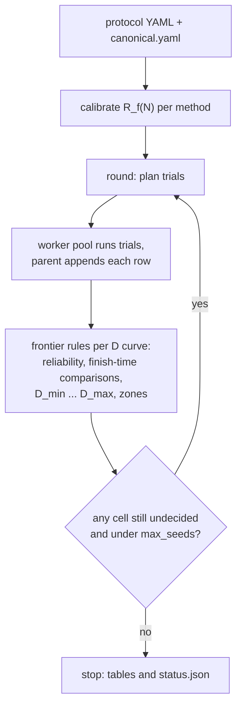
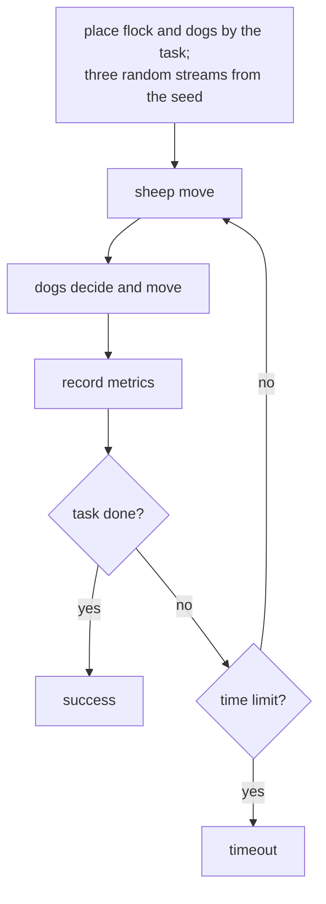

# HerdSim

HerdSim is a multi-agent shepherding simulator: a few dogs move a flock of sheep into a goal. It is used to measure `D_min`, the fewest dogs that finish the task reliably within a deadline, and how it depends on the flock size N, the start layout of the flock, the deadline and the dog rule.

Reliable means the success rate is decided to be at least theta = 0.90. The same rules also give the dog count past which extra dogs stop making the task faster (`D_sat`) and counts where it gets slower or fails again (`D_crowd`, `D_overcrowd`), which are kept as side output. By default (`decide_finish_times: false`) seeds are spent only to decide `D_min`, and a side-output value whose comparison is still open is flagged undecided.

Status: the code, tests and bench are built, and the planned protocols have been run (16 protocols, no trial errors); `dmin_fat` is not written yet. The research plan and its settings are in `docs/science/design_version2/plan_dmin.md` when that folder is present locally.

## Quick start

```bash
make install     # uv sync --extra dev
make check       # ruff + basedpyright + tests
make bench       # miniature real campaigns read for sense, about 1 minute; run before a campaign session

uv run cli/campaign.py plan   --protocol dmin_m6                          # what a run would do; runs nothing
uv run cli/campaign.py run    --protocol dmin_pilot --workers 16
uv run cli/campaign.py status --protocol dmin_pilot
uv run cli/dmin_report.py     --protocol dmin_pilot --folder results/dmin_pilot --multiples 3 6 12
```

## How a campaign runs

A **protocol** is one YAML file in `protocols/configs/protocols/`. It names the methods, layouts, flock sizes N and dog counts D. Every combination of method, layout and N is a **D curve** (a group). A curve at one D is a **cell**, and one seed of a cell is a **trial**.

`campaign.py run` runs one protocol into one folder, in rounds:



Each round:

1. A cell with fewer than one batch of seeds (`batch_seeds`, 10) is filled up to one batch.
2. A cell whose reliability, or a finish-time comparison that can still change one of its curve's values, is undecided gets seeds up to the end of its next batch, up to `max_seeds` (200).
3. Where the zone changes between two neighbouring D more than `refine_min_gap` (1) apart, the D halfway between is added to the curve.

Above a confirmed saturation (`D_sat` decided and the next reliable D the same speed), a cell gets no more seeds when its dogs were copies of each other: mean `dog_overlap` at least `prune_overlap` (0.9), and the cell neither slower nor unreliable. These cells are marked `pruned` in `frontier_cells.csv`.

The run stops when no cell needs seeds, or after `budget_hours` (72) of this run. Seed i of every cell is `master_seed + i` (2026 + i), so cells are compared on the same start flocks.

Stopping and resuming are safe. A trial is saved as soon as it finishes, and a rerun of the same command continues from the folder. A second run on the same folder is refused while the first holds its lock. A folder written with different physics (any setting that changes a trial) or by another protocol is refused too; use a new `--output`.

A trial that raises an exception is logged in `errors.jsonl`, and its cell gets no more seeds and is never marked reliable. A deterministic simulation that raises has a bug, so the fix is in the code.

### Calibration

Lengths in a task scale with the flock radius `R_f(N)`: the radius of the flock while one dog drives it. At the start of a run each method is calibrated at every flock size of the protocol, and the result is saved in `calibration.json`. Calibration fails when the radius has not settled or depends on the start size. For Strombom sheep it holds up to N = 400, so N stops there. `campaign.py calibrate` prints the table without running a campaign.

### Deadline

A method's time limit is one of:

| Key | Meaning |
|-----|---------|
| `time_limit_ticks` | a fixed number of ticks |
| `time_limit_seconds` | model seconds, converted with the method's dt |
| `time_limit_drive_multiple` | m times the drive time, the drive length over the top sheep speed, so it grows with N and asks the same of every flock size |

A trial succeeds when `success_fraction` of the sheep are inside the goal (1, every sheep, by default; 0.99 lets one or two stragglers go). It stops only on success or at its limit; a failure runs to the deadline. `cli/dmin_report.py` reads the trials of a run at tighter deadlines, since a trial that finishes inside a tighter deadline also succeeds under it.

## Inside one trial

One trial runs tick by tick until success or the time limit:



The layout, the sheep noise and the dog noise each draw from their own random stream, so a seed gives the same start flock and the same sheep draws at every D. Every dog knows the position of every sheep and of every other dog. There is no boundary: agents may leave the field rectangle, which only places the start, as in the Strombom and Kubo papers. The failure label of a failed trial is worked out after the run from its metric history (see [Failure labels](#failure-labels)).

## What the frontier rules decide

All of this is in `analysis/frontier.py`.

A cell is **reliable** when the two-sided 99% Clopper-Pearson interval of its success rate lies at or above theta (0.90), **unreliable** when it lies below, and **undecided** otherwise. At least 51 straight successes are needed for reliable. Two cells are compared on finish time by a paired bootstrap (4000 resamples) of the median per-seed difference, relative to the slower median: **faster**, **slower**, **same** (within 5%) or **undecided**.

Per D curve:

| Value | Meaning |
|-------|---------|
| `D_min` | smallest reliable D (`D_min_low`: smallest D whose upper bound reaches theta) |
| `D_overcrowd` | smallest D above `D_min` where it and the next tested D are both unreliable |
| `D_max` | largest reliable D below `D_overcrowd`, or the largest reliable D |
| `D_best` | smallest reliable D not slower than the fastest reliable D |
| `D_sat` | smallest reliable D that no larger reliable D is faster than |
| `D_crowd` | smallest reliable D above `D_best` that is slower than `D_best` |

`D_best`, `D_sat` and `D_crowd` use only the reliable D from `D_min` to `D_max`. Each of them has an `_undecided` flag, set when an open comparison could still move it. `d_min_above_grid` means no D on the grid is reliable, `d_max_at_grid_top` means the top of the grid is still reliable, and `still_improving_at_top` means `D_sat` is the top of the grid, so the real value may lie above it.

Zone of each cell:

| Zone | Cell |
|------|------|
| `too_few` | unreliable, below `D_min` |
| `improving` | reliable, below `D_sat` |
| `saturated` | reliable, from `D_sat` up, not slower than `D_best` |
| `crowded` | reliable and slower than `D_best` |
| `unreliable_dip` | unreliable, between `D_min` and `D_overcrowd` |
| `collapse` | unreliable, from `D_overcrowd` up |
| `recovered` | reliable again above `D_overcrowd` |
| `undecided` | reliability, or the comparison with `D_best`, still open |

## Configuration

Settings are layered; later layers win:

1. `protocols/configs/canonical.yaml`: shared defaults, each with a short comment.
2. The protocol YAML, which may `extends:` another protocol (a child key replaces the parent's whole value).
3. `--output` on the command line.

Method parameters (r_a, speeds, Kubo gains) live once in `sim/methods/*/config.py`. A protocol overrides them per method under `params`.

### Protocol keys

| Key | Meaning |
|-----|---------|
| `protocol_id` | name; also recorded in the folder, which then belongs to this protocol |
| `output` | results folder, under `results/` when inside the repo |
| `canonical` | path of the canonical file |
| `extends` | optional parent protocol |
| `methods` | per method: one time limit key (see [Deadline](#deadline)) and optional `params` |
| `layouts`, `flock_sizes`, `shepherd_counts` | the grid |
| `factors` | optional; each key's list of levels makes its own D curves |
| any canonical key | overrides that value for the whole protocol |

A factor is a canonical setting. A method parameter cannot be a factor, because the flock radius is calibrated once per method without factors, so every level would run on the radius of the default flock; run each level as its own protocol. Whole-protocol settings (`task`, `master_seed`, the `calibration_*` keys, `settled_tolerance`, `start_agreement`) and the strategy keys that only steer the adaptive run (`reliability_theta`, `confidence`, `batch_seeds`, `max_seeds`, `time_margin`, `min_pairs`, `bootstrap_resamples`, `timeseries_seeds`, `budget_hours`, `refine_min_gap`, `prune_overlap`, `decide_finish_times`) cannot be swept either. Unknown keys and bad grids fail when the protocol loads.

The scattered layouts are sized by the collect distance r_a N^(2/3), so a protocol that changes `r_a` of a Strombom method must set `separation_scale` to the same value, and the loader refuses it otherwise. The field-matched sheep set of `dmin_s_matched` (r_a 1, noise 0.1, reaction distance 75) does this.

### Protocols

| Protocol | Purpose |
|----------|---------|
| `dmin_pilot` | one run at 12 drive times, 10 seeds per cell, read at tighter deadlines to choose the main deadlines and grid |
| `dmin_m12`, `dmin_m6`, `dmin_m3` | the D_min table for `strombom_multi` at 12, 6 and 3 drive times; they differ only in the deadline |
| `dmin_kubo` | the same question for the Kubo model, compact start, N up to 100 |
| `dmin_s_base` | the reference of the sensitivity runs: wide and outlier_rich, N 100 200 400, D 1 to 16, 6 drive times |
| `dmin_s_matched`, `dmin_s_handler`, `dmin_s_ring`, `dmin_s_goal`, `dmin_s_gap`, `dmin_s_dogspeed` | the same grid as `dmin_s_base` with one change each: field-matched sheep set, dogs start at one handler point, dogs start on a ring, a tighter goal, the dog start gap, a slower dog |
| `dmin_f99_m12`, `dmin_f99_m6`, `dmin_f99_m3` | the grids of `dmin_m12`, `dmin_m6` and `dmin_m3` with `success_fraction` 0.99, on the same seeds |
| `dmin_f99_s_base`, `dmin_f99_s_matched`, `dmin_f99_s_dogspeed` | `dmin_s_base`, `dmin_s_matched` and `dmin_s_dogspeed` with `success_fraction` 0.99 |

`cli/run_queue.py` runs the protocols in order, resumes unfinished folders and skips finished ones.

Each file's header comment gives its reasons.

## What you can vary

### Methods

| Method | Sheep model | Dogs |
|--------|-------------|------|
| `strombom_multi` | Strombom 2014 | one dog is the paper shepherd. With more dogs every dog gets its own job (see [Team rule](#team-rule-of-strombom_multi)) |
| `fat` | Strombom 2014 | each dog aims r_a behind the sheep farthest from the goal, with the Strombom step; no coordination |
| `kubo` | Kubo 2022 | Kubo force dogs: each targets the farthest sheep and moves under the paper forces |

`fat` borrows the target choice of Kubo's farthest-individual rule but not its forces or speeds, so it is a HerdSim construction. Its dogs are independent: they all aim at the same sheep, so they become copies once they meet, which `dog_overlap` shows.

### Team rule of strombom_multi

The paper's shepherd is one dog. HerdSim's multi-dog layer makes sure an added dog is never a copy of one already there:

- Collecting: the D farthest outliers each get one dog, matched by distance (the assignment with the least total walk). With one dog that is the paper's farthest outlier. Dogs left over when there are more dogs than outliers drive the core of the flock (the sheep within f(N)).
- Driving: the dogs stand on an arc behind the flock at the paper drive distance, spread evenly over the angle that covers the flock's width, with the paper drive point in the middle.
- Dogs keep their side: they are matched to drive slots by their angle around the flock.
- Several dogs push a sheep as one: the unit pushes of the dogs within reach are added and rescaled to length 1, so the sheep feel a push from the mean direction, as with one dog.

### Start layouts

| Layout | Shape |
|--------|-------|
| `compact` | one Gaussian, sigma = 0.5 R_f, cut at 3 sigma |
| `wide` | one Gaussian, sigma = 0.5 x the Strombom collect distance 2 N^(2/3), cut at 3 sigma |
| `split` | 2 (N < 12) or 3 compact clusters on a ring at the collect distance |
| `outlier_rich` | 80% in a compact core, 20% at 1.1 to 1.6 x the collect distance |

Where the dogs stand at tick 0 is set by `dog_start`, a convention with no real-world rule behind it:

| `dog_start` | Placement |
|-------------|-----------|
| `arcs` (base) | half circles behind the flock, away from the goal, spread evenly: dog j of D at -90 + 180 (j + 0.5) / D degrees from straight behind, so one dog starts on the drive line and every added dog has its own station |
| `ring` | full circles round the flock, goal side included: dog j of D at 360 j / D degrees from straight behind |
| `handler` | every dog at one point straight behind the flock, as if released from a handler's post; the team rule then sends each to its own target |

The first circle is `dog_start_gap` (30) units beyond the farthest possible start sheep. A circle takes as many dogs as fit `dog_start_spacing` (5) apart; more dogs go on circles 5 units farther out. Kubo runs compact starts only, because the scattered layouts are sized by Strombom's collect distance.

## Metrics

### Per tick

Every trial records these every tick. The first `timeseries_seeds` (3) seeds of every cell keep the full history as Parquet.

| Metric | Meaning |
|--------|---------|
| `gcm_goal` | distance from the flock centroid to the goal |
| `gcm_in_goal`, `sheep_in_goal` | centroid inside the goal (0/1); number of sheep inside the goal |
| `dogs_goal_side` | fraction of dogs between the flock and the goal |
| `cohesion`, `extent` | mean and RMS distance of the sheep to their centroid |
| `aspect_ratio`, `perimeter`, `hull_area`, `flock_density` | flock shape |
| `fragmentation` | largest group / N, sheep within `measurement_radius` linked |
| `lost_sheep` | sheep farther than 2.5 R_f from the centroid |
| `min_separation` | closest two sheep |
| `shepherd_path` | distance the dogs' controllers walked so far (commanded velocity) |
| `min_dog_separation` | closest two dogs |
| `dog_overlap` | fraction of dogs with another dog within `dog_overlap_distance` (2): dogs doing the same work as a twin |
| `dogs_stopped` | fraction of dogs with zero commanded velocity |
| `i_dir` | 1 - length of the summed unit headings of the moving dogs / their number |
| `coverage` | fraction of outer sheep (beyond the median centroid distance) within a dog's reaction reach |

### Per trial

One row per trial in `trials.csv`:

| Group | Columns |
|-------|---------|
| Identity | `trial_key`, `cell_key`, `group_key`, `task`, `method`, `initial_layout`, `n_sheep`, `n_shepherds`, `seed_index`, `seed`, the factor columns |
| What it ran with | `flock_radius`, `time_limit_ticks`, `time_limit_seconds`, `dt` |
| Task geometry and end state | `goal_radius`, `drive_distance`, `world_width`, `world_height`, `final_gcm_goal`, `final_sheep_in_goal`, `seconds_to_90pct_in_goal`, `seconds_to_95pct_in_goal`, `seconds_to_99pct_in_goal` (first arrival of that fraction of the flock, NaN if never; success needs `success_fraction` of the sheep, every sheep by default) |
| Outcome | `success`, `total_ticks`, `stop_reason`, `finish_ticks`, `finish_seconds`, `dog_ticks`, `shepherd_path`, `path_per_dog` |
| Summaries | `mean_*`, `min_*`, `max_*` of every per-tick metric |
| Failure | `failure_mode`, `failure_hints` |

Times compare across methods only in seconds: a Strombom tick is 1 s, a Kubo tick 0.05 s.

### Failure labels

A failed drive trial gets the first label that matches, in this order. Every match is kept in `failure_hints`.

`dogs_out_of_range` (coverage low while no sheep is lost), `flock_escaped` (ended farther from the goal than it started), `split` (largest group under 55%), `scatter` (RMS radius above 2 R_f), `oscillation` (swinging toward and away from the goal), `stuck` (moved less than one goal radius). `timeout` if none match; `none` for a success.

## What a run writes

```text
results/<protocol>/
|-- protocol.yaml         merged protocol and canonical values, plus every method parameter
|-- provenance.json       protocol id and physics hash
|-- calibration.json      R_f per method and N
|-- trials.jsonl          one line per finished trial, appended as trials finish
|-- errors.jsonl          one line per trial that raised
|-- trials.csv            table form of trials.jsonl, rewritten after each round
|-- frontier_cells.csv    per cell: counts, success interval, reliability, finish times, zone, pruned
|-- frontier_groups.csv   per D curve: D_min, D_min_low, D_best, D_sat, D_crowd, D_overcrowd, D_max, flags
|-- status.json           progress of the adaptive run
|-- .lock                 held by the running campaign
`-- timeseries/           per-tick Parquet for the first seeds of every cell
```

Generated YAML, CSV and JSONL files start with an AUTO-GENERATED notice line, and JSON files carry it as their first key; read the CSVs with `pd.read_csv(path, skiprows=1)`.

## Project structure

```text
HerdSim/
|-- sim/
|   |-- core/               tick loop, state, method catalog, run config, world (arena, start layouts)
|   |-- methods/            paper math and parameters: strombom, kubo
|   `-- plugins/
|       |-- sheep/          sheep models
|       |-- dogs/           dog controllers
|       |-- scenarios/      tasks: setup, success, task metrics, row columns, failure labels
|       `-- metrics/        metrics for every task
|-- services/               protocol loading, cells, calibration, adaptive run, store, workers
|-- analysis/               frontier rules, D_min at a deadline, result tables
|-- protocols/
|   |-- configs/            canonical.yaml and one YAML per protocol
|   `-- packaging/          trial row, provenance, generated-file notice
|-- cli/                    campaign.py (run, plan, calibrate, status), run_queue.py, dmin_report.py, dmin_tables.py
|-- tests/                  sim, services, analysis; bench/ for the miniature campaigns
`-- docs/                   architecture, papers
```

## Adding things

- A method: add its sheep model to `sim/plugins/sheep/`, its dog controller to `sim/plugins/dogs/` (or reuse existing ones), and one entry in `sim/core/methods.py`. Its defaults must include `dt`; a missing key or an unknown plugin name fails at import. A sheep model's `prepare` checks its own parameters and returns any keys it derives.
- A task: one module in `sim/plugins/scenarios/` with the pieces listed in that package's docstring (setup, checks, world, starts, success, task metrics, row columns, failure labels), and one entry in its table. The protocol picks it with `task:`.
- A metric for every task: a function of the tick view in `sim/plugins/metrics/` and one entry in its table. A metric that needs a task's geometry goes in that task's metrics instead.
- A new sweep on existing settings: a new protocol file, with no code change.

## Tests

`make test` runs the unit, invariant and regression tests (about 25 s). The golden tests in `tests/sim/test_golden.py` pin short real trials; change their values only with a behaviour change, and say why in the same change.

`make bench` (about 1 minute) runs miniature real campaigns through the whole pipeline (calibration, rounds, workers, store, frontier rules) and reads their tables. It checks bounds that follow from the model (no flock beats the sheep speed), properties of the machinery (a rerun adds nothing, the worker count changes no trial) and orderings the design should produce (a compact flock needs no collecting, a tight deadline asks a scattered flock for more dogs). Nothing in it is pinned to a stored number, so a failure means the printed numbers need a look. The bench protocols are in `tests/bench/protocols/`.

## Tech stack

Python 3.11+, NumPy, SciPy, pandas, PyArrow, PyYAML; uv for the environment; pytest, Ruff and basedpyright for checks.

## Further reading

[docs/codes/architecture.md](docs/codes/architecture.md) explains how the system is designed and why, and what each choice costs.
