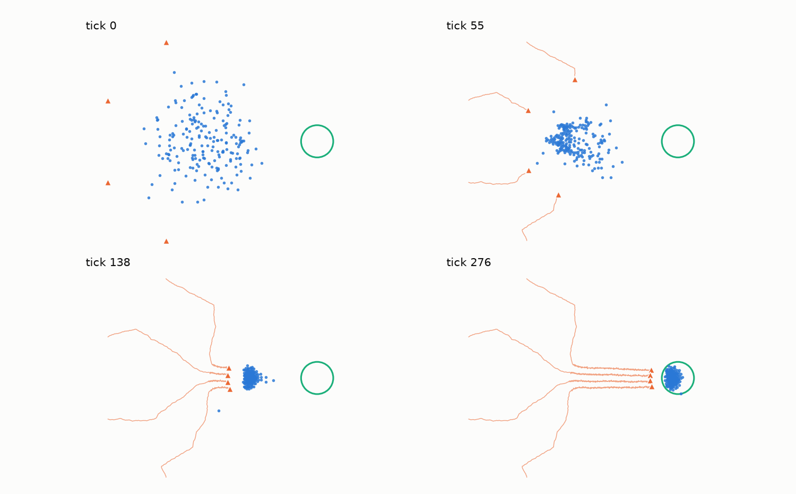
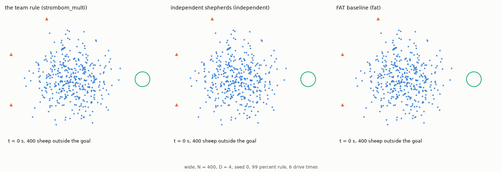
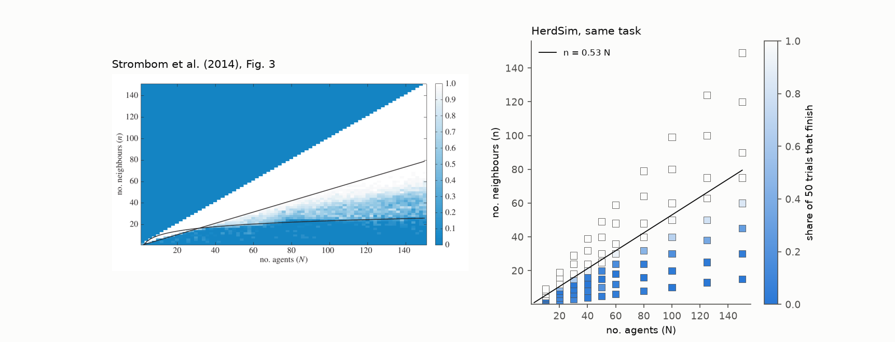

# HerdSim

[](LICENSE)
[](https://www.python.org/downloads/)
[](tests/)
[](docs/report/d_min_report.md)
[](docs/methods/strombom_check.md)

HerdSim simulates a team of dogs herding sheep into a goal, and asks how many dogs a flock of $N$ sheep needs. The answer, $D_{\min}$, is the smallest team that gets the flock into the goal in at least 90% of trials, at 99% confidence ([how this is decided](#study-runs-and-how-reliability-is-decided)). The sheep follow the model of Strombom et al. (2014). The study varies the flock size ($N = 25$ to 566), how scattered the flock starts, the deadline, and how the dogs coordinate ([how a trial works](#how-a-trial-works)).

With `strombom_multi`, one dog is enough for a compact flock at every size tested. A scattered flock needs more dogs as it grows and as the deadline gets shorter. With 400 sheep on `wide` and `outlier_rich` (6 drive times, 99% rule), only the rule that gives each dog its own stray sheep has a reliable team ([main results](#main-results)). Every study trial is stored with its seed and can be replayed exactly.

The full results are in the [report](docs/report/d_min_report.md), and project terms are in the [glossary](docs/glossary.md).

## Main results

Table 1 gives $D_{\min}$ at $N = 400$, the largest flock size that every run tests. The [glossary](docs/glossary.md#team-sizes) explains the notation: `3` is a decided value, `2-3` a range left open after 200 trials, `[9]` a lower bound, and `none` means every tested team up to 24 dogs is unreliable. The layouts, the two success rules and drive times are defined in [how a trial works](#how-a-trial-works), and the three dog rules [below](#three-dog-rules).

**Table 1: $D_{\min}$ at $N = 400$, strict rule / 99% rule.**

| Dog rule, deadline | `compact` | `wide` | `split` | `outlier_rich` |
| :--- | :---: | :---: | :---: | :---: |
| `strombom_multi`, 12 drive times | 1 / 1 | 3 / 2 | 3 / 2 | 3 / 2 |
| `strombom_multi`, 6 drive times | 1 / 1 | [9] / 2-3 | none / [5] | none / 3 |
| `strombom_multi`, 3 drive times | 1 / 1 | none / 5-6 | none / none | none / [6] |
| `independent`, 6 drive times | - / 1 | - / none | - / none | - / none |
| `fat`, 6 drive times | none / [12] | none / none | none / none | none / none |

`-` means not tested: `independent` was run under the 99% rule only. In short:

- Small or compact flocks: at $N = 25$ and 50, one dog is reliable on every layout, rule, deadline and dog rule. On `compact`, one `strombom_multi` dog is reliable at every size, rule and deadline tested.
- Deadline: with `strombom_multi` on the scattered layouts, $D_{\min}$ stays at 3 or less at 12 drive times up to $N = 400$. Under the 99% rule it rises most between 6 and 3 drive times; under the strict rule, already between 12 and 6. At 3 drive times under the strict rule, no team up to 24 dogs is reliable on a scattered layout from $N = 200$.
- Dog rules, at 6 drive times: `fat` has no reliable team on any scattered layout from $N = 200$, under either rule. Under the 99% rule, `independent` is reliable on every layout up to $N = 200$ and has `none` on the scattered layouts at $N = 400$. `strombom_multi` is reliable on `wide` and `outlier_rich` through $N = 566$ (2-3 and 3 dogs at $N = 400$), while `split` at $N = 400$ has only the lower bound `[5]`.
- Growth with $N$: on `wide` and `outlier_rich` at 12 and 6 drive times (99% rule, $N = 25$-566), a power law and a curve that levels off fit $D_{\min}$ equally well, so the data cannot tell whether the need for dogs keeps growing.

## How a trial works

HerdSim moves $N$ sheep and $D$ dogs on an open 2D field, one tick (1 s) at a time. A trial ends when enough sheep are inside the goal at the same tick, or when the deadline passes. Figure 1 shows one trial.



**Figure 1: One trial ($N = 200$, $D = 4$, `wide` start, seed 2026, strict rule, 1500-tick limit) at ticks 0, 55, 139 and 279.** The dogs start behind the flock, collect outliers from several sides at once, then drive the flock into the goal.

- Marks: blue dots are sheep, orange triangles are dogs with their tracks, and the green circle is the goal.

The flock starts in one of four layouts. A sheep farther than the collect distance $2 N^{2/3}$ m from the flock centre is an outlier, which the dogs go to fetch:

- `compact`: a tight flock, all within the collect distance.
- `wide`: a loose flock, with about 13% of the sheep beyond the collect distance.
- `split`: three separate compact clusters.
- `outlier_rich`: a compact flock plus 20% of the sheep on a ring beyond the collect distance.

A trial succeeds under one of two rules:

- Strict rule: all $N$ sheep are inside the goal at the same tick.
- 99% rule: at least $\lceil 0.99 N \rceil$ sheep are inside the goal at the same tick (the same as the strict rule below $N = 100$).

The field grows with the flock. Before a run, calibration measures the flock radius $R_f(N)$, the radius $N$ sheep settle to while one dog drives them. The goal radius is $1.9\,R_f$. The drive distance from the start to the goal is at least $13\,R_f$; from $N = 200$ it is longer, on every layout, so that it fits the widest start layout.

Deadlines are counted in drive times: one drive time is the time a sheep walking straight at 1 m/s needs to cover the drive distance. The study tests 12, 6 and 3 drive times. Flock sizes double from 25 to 400; two runs add the steps of $\sqrt{2}$ in between and go up to 566 ([flock size](docs/experiments/task_design.md#flock-size)). The [task design](docs/experiments/task_design.md) gives all the formulas and limits.

## Three dog rules

The study compares three rules for the dogs, each adding one layer to the one before (Table 2). `independent` dogs each run Strombom's one-dog rule (collect the farthest outlier while there is one, otherwise drive the flock), so all dogs pick the same target. `strombom_multi` pairs dogs with outliers by the least total walking distance.

**Table 2: The three dog rules.**

| Dog rule | Collect or drive switch | Outlier assignment | Driving formation | Details |
| :--- | :--- | :--- | :--- | :--- |
| `fat` | No | None: all dogs chase the sheep farthest from the goal | None: all dogs aim at the same point | [fat.md](docs/methods/fat.md) |
| `independent` | Yes | None: all dogs chase the same outlier | None: all dogs aim at the same point | [independent.md](docs/methods/independent.md) |
| `strombom_multi` | Yes | One outlier per dog | $D$ evenly spaced points on an arc behind the flock | [strombom_multi.md](docs/methods/strombom_multi.md) |

Animation 1 runs the three rules on the same start flock.



**Animation 1: Three dog rules on the same start flock (`wide`, $N = 400$, $D = 4$, seed 0, 99% rule, 6 drive times).** Only `strombom_multi` brings the flock in; both baselines fail when time is up.

- Marks: blue dots are sheep, orange triangles are dogs and the green circle is the goal; the bottom-left text gives the time and the number of sheep outside the goal.
- Left: `strombom_multi` gives each dog its own outlier, then drives from an arc, and succeeds at 569 s.
- Middle: the `independent` dogs all chase the same outlier and fail at 1241 s with no sheep in the goal.
- Right: the `fat` dogs aim behind the sheep farthest from the goal and fail at 1241 s with no sheep in the goal.

## Study runs and how reliability is decided

The study has nine runs (protocols), 145,790 trials in total, with no simulation errors:

- `strombom_multi`, strict rule (`dmin_m12`, `dmin_m6`, `dmin_m3`): $N = 25$, 50, 100, 200, 400 at 12, 6 and 3 drive times.
- `strombom_multi`, 99% rule (`dmin_f99_m12`, `dmin_f99_m6`, `dmin_f99_m3`): the same sizes, plus $N = 71$, 141, 283, 566 at 12 and 6 drive times.
- `fat` at 6 drive times (`dmin_fat`, `dmin_f99_fat`): strict and 99% rules, $N = 25$, 50, 100, 200, 400.
- `independent` at 6 drive times (`dmin_f99_indep`): 99% rule, $N = 25$, 50, 100, 200, 400.

Each setup (layout, $N$, $D$) is a cell. A cell gets trials in batches of 10 seeds, up to 200. After each batch, the 99% Clopper-Pearson interval of its success rate decides:

- Reliable: the lower end is at least 0.90.
- Unreliable: the upper end is below 0.90.
- Otherwise: one more batch; after 200 seeds the cell stays undecided.

Some cells get seeds for other reasons or stop earlier: a reliable cell may get more seeds to compare finish times, and a cell whose dogs only crowd each other can be pruned ([adaptive sampling](docs/experiments/task_design.md#3-adaptive-sampling)).

$D_{\min}$ is the smallest reliable team among the cells of one layout and $N$ ([stopping rule](docs/experiments/task_design.md#stopping-early-with-the-99-clopper-pearson-interval)).

## Check against Strombom et al. (2014)

To check the one-dog engine, HerdSim reruns two one-dog experiments of Strombom et al. (2014), 5100 trials in total:

- The paper's Figure 3 (4000 trials): 80 points over ten flock sizes ($N = 10$ to 150) and eight values of $n$, the number of nearest neighbours that attract each sheep, with 50 trials per point. All 30 points with $n \ge 0.6 N$ finish 50 of 50, as in the paper, and success falls at smaller $n$. These trials use $r_s = 45$ m from the paper's Figure 3 caption; the study and the distance check use 65 m, the paper's Table 1 value.
- Distance to the goal (1100 trials): 100 trials at each of 11 distances ($l = 10$ to 500 m) with $N = 46$; all finish, and the mean time grows linearly with distance.

The [paper check](docs/methods/strombom_check.md) gives the setup and all results. Figure 2 sets the paper's Figure 3 next to HerdSim's run:



**Figure 2: Share of 50 trials that finish at each $N$ and $n$, the paper's Figure 3 and HerdSim (one dog, 8000 time steps, $r_s = 45$ m).** Set side by side, the two maps have the same shape.

- Marks: blue is no trial finishing and white is every trial; the black line is $n = 0.53 N$.
- Left: the paper's Figure 3 over every integer pair $(N, n)$ for $N = 2$ to 150.
- Right: HerdSim, one square at each of the 80 grid points ($N = 10$ to 150).

## Setup and tests

HerdSim needs Python 3.11 or later and [`uv`](https://docs.astral.sh/uv/):

```bash
git clone https://github.com/lykimq/HerdSim.git
cd HerdSim
make install   # uv sync --extra dev
make check     # ruff, basedpyright and pytest
```

Stored trials and cell decisions are in `results/`.

## Running campaigns

A campaign runs one protocol: it gives batches of seeds to the open cells until each is decided or has 200 seeds. Each finished trial is written at once to `results/<protocol_id>/`, so running the same command again resumes an interrupted campaign:

```bash
uv run cli/campaign.py plan dmin_m6                          # preview grid and cost without running
uv run cli/campaign.py run dmin_m6 --workers 16              # run one protocol with 16 worker processes
uv run cli/campaign.py status dmin_m6                        # check progress of a protocol
uv run cli/campaign.py run --workers 20                      # run all nine study protocols in queue order
uv run cli/paper_check.py fig3 --workers 20                  # run paper check (fig3 or distance)
```

These commands read the stored results without running the simulation:

```bash
uv run python -m docs.generate_docs.page record                             # trials, cells, errors and hours
uv run python -m docs.generate_docs.page dmin dmin_m12 dmin_m6 dmin_m3      # D_min table per layout and N
uv run python -m docs.generate_docs.page paper                              # trial counts and times for paper check
```

The [CLI reference](docs/guides/cli_reference.md) lists all flags and workflows.

## Project layout

```text
HerdSim/
|-- analysis/               # cell decisions, brackets and growth fits read from results/
|-- cli/                    # command-line entry points (campaign, calibration_check, paper_check)
|-- docs/                   # documentation, figures, animations and doc generators
|-- paper_check/            # one-dog validation tasks against Strombom et al. (2014)
|-- protocols/configs/      # canonical defaults, nine study protocols and three grazing pilots
|-- records/                # trial record schema, physics hash and code identity
|-- results/                # stored trials, calibration data and cell decisions per protocol
|-- services/               # protocol loader, adaptive campaign runner, calibration and replay
|-- sim/                    # simulation engine: sheep and dog models, arena task, start layouts
`-- tests/                  # unit, physics invariant and stored-replay regression tests
```

## Documentation

- Results: [report](docs/report/d_min_report.md), [result tables](docs/report/results_tables.md), [glossary](docs/glossary.md).
- Methods: [Strombom sheep](docs/methods/strombom_sheep.md), [`strombom_multi`](docs/methods/strombom_multi.md), [`independent`](docs/methods/independent.md), [`fat`](docs/methods/fat.md), [task design](docs/experiments/task_design.md), [paper check](docs/methods/strombom_check.md).
- Guides and code: [CLI reference](docs/guides/cli_reference.md), [configuration](docs/guides/configuration.md), [protocol catalogue](docs/guides/protocols.md), [settings](docs/guides/settings.md), [architecture](docs/codes/architecture.md).
- Contributing: [CONTRIBUTING.md](CONTRIBUTING.md) sets the rules for using AI tools in a contribution; [AIUSE.md](AIUSE.md) lists the AI tools the maintainer used and who reviewed the work.

## References

1. Strombom, D., et al. (2014). *Solving the shepherding problem: heuristics for herding autonomous, interacting agents*. Journal of the Royal Society Interface, 11(100), 20140719, [10.1098/rsif.2014.0719](https://doi.org/10.1098/rsif.2014.0719).
2. Nalepka, P., Kallen, R. W., Chemero, A., Saltzman, E., & Richardson, M. J. (2017). *Herd those sheep: Emergent multiagent coordination and behavioral-mode switching*. Psychological Science, 28(5), 630-650, [10.1177/0956797617692107](https://doi.org/10.1177/0956797617692107).
3. Auletta, F., Fiore, D., Richardson, M. J., & di Bernardo, M. (2022). *Herding stochastic autonomous agents via local control rules and online target selection strategies*. Autonomous Robots, 46, 469-481, [10.1007/s10514-021-10033-6](https://doi.org/10.1007/s10514-021-10033-6).
