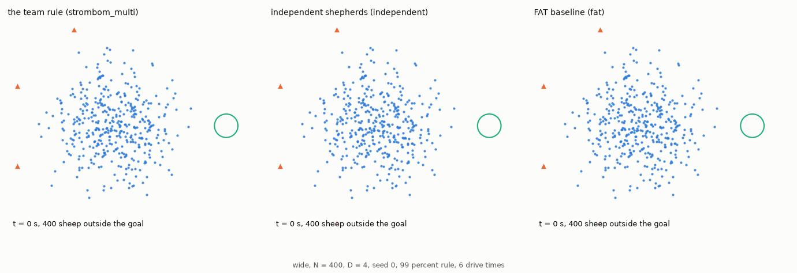

# HerdSim

[](LICENSE)
[](https://www.python.org/downloads/)
[](tests/)
[](docs/report/d_min_report.md)
[](docs/methods/strombom_check.md)

HerdSim is a Python simulator and experimental framework for multi-dog sheepherding. When a flock starts compact, one sheepdog can gather and drive it into a goal, but when sheep start scattered and the task has a deadline, a single dog cannot collect every stray in time. HerdSim investigates how team size $D_{\min}$, the smallest reliable number of dogs, scales with flock size $N$ (from 25 to 566 sheep), initial layout, and deadline across 145,790 deterministic simulation trials.

Full findings are in the [report](docs/report/d_min_report.md), detailed tables in [result tables](docs/report/results_tables.md), and project terms in the [glossary](docs/glossary.md).

## Three levels of shepherd coordination

To evaluate what coordination mechanisms allow multi-dog herding to scale, HerdSim investigates three controller levels on top of the local-interaction sheep model of Strombom et al. (2014):

- Level 0 (`fat`, uncoordinated baseline): every dog aims $r_a = 2$ m behind the single sheep farthest from the goal ($P_{\mathrm{FAT}}$). It has no collect/drive mode switch, no role assignment, and no driving formation.
- Level 1 (`independent`, mode switching without team assignment): each dog runs Strombom's single-dog heuristic on the whole flock, switching between gathering outliers and driving the flock. Without team coordination, all dogs pursue the same target point at every tick.
- Level 2 (`strombom_multi`, full multi-agent coordination): Strombom's collect/drive switch paired with optimal outlier assignment via the Hungarian algorithm (assigning dogs to distinct stragglers at minimum total distance) and an arc-shaped driving formation.

**Table 1: Controller hierarchy.**

| Level | Method | Collect/drive switch | Outlier assignment | Driving formation | Method guide |
| :---: | :--- | :---: | :---: | :---: | :--- |
| 0 | `fat` | No | None (all chase farthest sheep) | None (all crowd $P_{\mathrm{FAT}}$) | [`docs/methods/fat.md`](docs/methods/fat.md) |
| 1 | `independent` | Yes | None (all chase single outlier) | None (all crowd point $P_d$) | [`docs/methods/independent.md`](docs/methods/independent.md) |
| 2 | `strombom_multi` | Yes | Hungarian matching ($D$ outliers) | Arc of $D$ slots behind flock | [`docs/methods/strombom_multi.md`](docs/methods/strombom_multi.md) |

## Task and physical scaling

HerdSim steps $N$ sheep and $D$ dogs on an open 2D field one tick (1 s) at a time. The field, goal and drive distance (flock start centre to goal centre) are sized by the calibrated flock radius $R_f(N)$, the radius a driven flock of $N$ sheep settles to. Deadlines are expressed in drive times: one drive time is the duration a sheep walking straight at 1 m/s needs to cover the drive distance. The study tests deadlines of 12, 6 and 3 drive times.

A trial succeeds when the goal condition holds at a single tick before the deadline under one of two rules:

- Strict rule: every sheep ($N$ of $N$) is inside the goal at the same tick.
- 99% rule: at least $\lceil 0.99 N \rceil$ sheep are inside the goal at the same tick (every sheep below $N = 100$).

Each trial places the initial flock in one of four start layouts:

- `compact`: a tight flock within the collect distance ($2 N^{2/3}$ m).
- `wide`: a loose flock where about 13% of sheep start beyond the collect distance.
- `split`: three separate compact clusters.
- `outlier_rich`: a compact flock with 20% of sheep placed on a ring beyond the collect distance.

Figure 1 illustrates a full trial with `strombom_multi`, and Animation 1 compares all three controllers side by side on the same start flock:


**Figure 1: One trial ($N = 200$, $D = 4$, `wide` start, seed 2026, strict rule, 1500-tick limit) at ticks 0, 55, 139 and 279.** The dogs start behind the flock, collect outliers from several sides in parallel, then drive the flock into the goal.

- Marks: blue dots are sheep, orange triangles dogs with their tracks, and the green circle the goal (radius 1.9 times the flock radius $R_f$).



**Animation 1: Three dog rules on the same start flock (`wide`, $N = 400$, $D = 4$, seed 0, 99% rule, 6 drive times).** Only the team rule brings the flock in; both baselines fail when time is up.

- Marks: blue dots are sheep, orange triangles dogs, the green circle the goal; bottom-left text gives the time and sheep outside the goal.
- Left: the team rule (`strombom_multi`) assigns each dog its own outlier, drives from an arc, and succeeds at 569 s.
- Middle: independent dogs (`independent`) all chase the same outlier, crowd together, and fail at 1241 s with 298 sheep outside.
- Right: uncoordinated FAT dogs (`fat`) aim behind the sheep farthest from the goal, omit lateral stragglers, and fail at 1241 s.

## Study organisation

The study comprises nine protocols across three deadlines, totaling 145,790 trials with zero simulation errors:

- Strict rule, `strombom_multi` (`dmin_m12`, `dmin_m6`, `dmin_m3`): tested at $N = 25, 50, 100, 200, 400$.
- 99% rule, `strombom_multi` (`dmin_f99_m12`, `dmin_f99_m6`, `dmin_f99_m3`): tested at $N = 25, 50, 100, 200, 400$, plus $N = 71, 141, 283, 566$ at 12 and 6 drive times.
- Uncoordinated `fat` baseline at 6 drive times (`dmin_fat`, `dmin_f99_fat`): strict and 99% rules at $N = 25, 50, 100, 200, 400$, calibrated with `strombom_multi` so both share the same $R_f(N)$, start flocks, goal and deadline.
- Independent paper shepherds at 6 drive times (`dmin_f99_indep`): 99% rule at $N = 25, 50, 100, 200, 400$, calibrated with `strombom_multi` to test Strombom's single-dog rule without multi-dog assignment.

Each cell $(layout, N, D)$ receives trials in batches of 10 seeds, up to 200. A cell is classified as reliable when the lower bound of its two-sided 99% Clopper-Pearson confidence interval for success rate is at least $\theta = 0.90$, unreliable when the upper bound is below 0.90, and undecided otherwise. $D_{\min}$ is the smallest reliable team size on a curve.

## Results: the three levels in action

Across all nine study runs, Table 2 summarizes $D_{\min}$ at $N = 400$, the largest flock size shared by the protocols. A single number such as `3` means 3 dogs are reliable and smaller teams are unreliable, a bracket `2-3` means 3 dogs are reliable and 2 remains undecided at 200 seeds, a lower bound `[9]` means no tested team is reliable yet and at least 9 dogs are needed, and `none` means every tested team up to 24 dogs is unreliable:

**Table 2: $D_{\min}$ at $N = 400$, strict rule / 99% rule.**

| Level, method, deadline | `compact` | `wide` | `split` | `outlier_rich` |
| :--- | :---: | :---: | :---: | :---: |
| Level 2: `strombom_multi`, 12 drive times | 1 / 1 | 3 / 2 | 3 / 2 | 3 / 2 |
| Level 2: `strombom_multi`, 6 drive times | 1 / 1 | [9] / 2-3 | none / [5] | none / 3 |
| Level 2: `strombom_multi`, 3 drive times | 1 / 1 | none / 5-6 | none / none | none / [6] |
| Level 1: `independent`, 6 drive times | - / 1 | - / none | - / none | - / none |
| Level 0: `fat`, 6 drive times | none / [12] | none / none | none / none | none / none |

- Compact flocks need only one dog: on `compact`, one dog ($D_{\min} = 1$) is reliable across all three controllers up to $N = 200$, and for `strombom_multi` through $N = 566$ at all deadlines.
- Small flocks need only one dog: at $N = 25$ and $50$, one dog is reliable on every layout, rule, deadline and controller.
- Level 0 (`fat`) collapses from $N = 200$: without a collect/drive switch, dogs bunch on the same sheep (median overlap 0.73 vs 0.15 for `strombom_multi`). No team up to 24 dogs is reliable on any scattered layout from $N = 200$ upward, and at $N = 400$ even `compact` degrades to `[12]`.
- Level 1 (`independent`) succeeds at medium scale, collapses at large scale: keeping the collect/drive switch restores reliability up to $N = 200$ on all scattered layouts (`wide` needs 2-3 dogs, `outlier_rich` 3, `split` 1-3). But at $N = 400$, lacking Hungarian assignment causes every scattered layout to reach `none` because all dogs pursue the same straggler.
- Level 2 (`strombom_multi`) scales reliably to large flocks: combining mode switching with Hungarian outlier assignment and driving slots keeps $D_{\min}$ at 2-3 dogs on `wide` and `outlier_rich` at $N = 400$ under the 99% rule, and scales through $N = 566$.
- Scientific takeaway: mode switching is necessary to gather scattered flocks, but multi-agent role assignment is strictly required for large-scale herding.

## Check against Strombom et al. (2014)

To verify the single-dog engine, HerdSim reproduces two one-dog experiments from Strombom et al. (2014) across 5100 trials:

- Figure 3 grid sweep (4000 trials): samples an 80-point grid across ten flock sizes ($N = 10$ to $150$) and eight neighbour fractions, with 50 trials per point. It confirms all three regimes of the paper (always successful, transition around $n = 0.53 N$, and rare success).
- Goal-distance scaling study (1100 trials): 100 trials at each of 11 target distances ($l = 10$ to $500$ m) for $N = 46$ sheep.

The [validation doc](docs/methods/strombom_check.md) gives full measurements and linear distance fits. Figure 2 compares the Figure 3 sweep:


**Figure 2: Share of 50 trials that finish at each $N$ and $n$, the paper's Figure 3 and HerdSim (one dog, 8000 time steps, $r_s = 45$ m).**

- Marks: blue is no trial finishing and white is every trial; black line is $n = 0.53 N$.
- Left: the paper's Figure 3 over every integer pair $(N, n)$ for $N = 2$ to $150$.
- Right: HerdSim, one square at each of the 80 sampled grid points ($N = 10$ to $150$).

## Setup and tests

HerdSim requires Python 3.11 or later and [`uv`](https://docs.astral.sh/uv/):

```bash
git clone https://github.com/lykimq/HerdSim.git
cd HerdSim
make install   # uv sync --extra dev
make check     # ruff, basedpyright and pytest
```

Stored trial data and cell decisions live in `results/`.

## Running campaigns

A campaign allocates seed batches to open cells under the protocol's stopping rule. Each finished trial is written immediately to `results/<protocol_id>/`, so rerunning resumes an interrupted campaign:

```bash
uv run cli/campaign.py plan dmin_m6                          # preview grid and cost without running
uv run cli/campaign.py run dmin_m6 --workers 16              # run one protocol with 16 worker processes
uv run cli/campaign.py status dmin_m6                        # check progress of a protocol
uv run cli/campaign.py run --workers 20                      # run all nine study protocols in queue order
uv run cli/paper_check.py fig3 --workers 20                  # run paper check (fig3 or distance)

# Analysis commands (read stored results without running simulation)
uv run python -m docs.generate_docs.page record                             # trials, cells, errors and hours
uv run python -m docs.generate_docs.page dmin dmin_m12 dmin_m6 dmin_m3      # D_min table per layout and N
uv run python -m docs.generate_docs.page paper                              # trial counts and times for paper check
```

See the [CLI reference](docs/guides/cli_reference.md) for all flags and workflows.

## Project architecture

```text
HerdSim/
|-- analysis/               # cell decisions, brackets and growth fits read from results/
|-- cli/                    # command-line entry points (campaign, calibration_check, paper_check)
|-- docs/                   # documentation, figures, animations and doc generators
|-- paper_check/            # one-dog validation tasks against Strombom et al. (2014)
|-- protocols/configs/      # canonical defaults, nine study protocols and three grazing pilots
|-- records/                # trial record schema, physics hash and code identity
|-- results/                # stored trials, calibration data and cell decisions per protocol
|-- services/               # protocol loader, adaptive campaign runner, calibration and replay
|-- sim/                    # simulation engine: sheep and dog models, arena task, start layouts
`-- tests/                  # unit, physics invariant and stored-replay regression tests
```

## Documentation

- Results: [Report](docs/report/d_min_report.md), [Result tables](docs/report/results_tables.md), [Glossary](docs/glossary.md).
- Methods: [Strombom sheep](docs/methods/strombom_sheep.md), [Team rule (`strombom_multi`)](docs/methods/strombom_multi.md), [Independent baseline (`independent`)](docs/methods/independent.md), [FAT baseline (`fat`)](docs/methods/fat.md), [Task design](docs/experiments/task_design.md), [Paper check](docs/methods/strombom_check.md).
- Guides and code: [CLI reference](docs/guides/cli_reference.md), [Configuration](docs/guides/configuration.md), [Architecture](docs/codes/architecture.md).
- Contributing: [CONTRIBUTING.md](CONTRIBUTING.md) covers checks, PRs and the rules for using AI tools; [AIUSE.md](AIUSE.md) lists the AI tools the maintainer used and who reviewed the work.

## References

1. Strombom, D., et al. (2014). *Solving the shepherding problem: heuristics for herding autonomous, interacting agents*. Journal of the Royal Society Interface, 11(100), 20140719, [10.1098/rsif.2014.0719](https://doi.org/10.1098/rsif.2014.0719).
2. Nalepka, P., Kallen, R. W., Chemero, A., Saltzman, E., & Richardson, M. J. (2017). *Herd those sheep: Emergent multiagent coordination and behavioral-mode switching*. Psychological Science, 28(5), 630-650, [10.1177/0956797617692107](https://doi.org/10.1177/0956797617692107).
3. Auletta, F., Fiore, D., Richardson, M. J., & di Bernardo, M. (2022). *Herding stochastic autonomous agents via local control rules and online target selection strategies*. Autonomous Robots, 46, 469-481, [10.1007/s10514-021-10033-6](https://doi.org/10.1007/s10514-021-10033-6).
