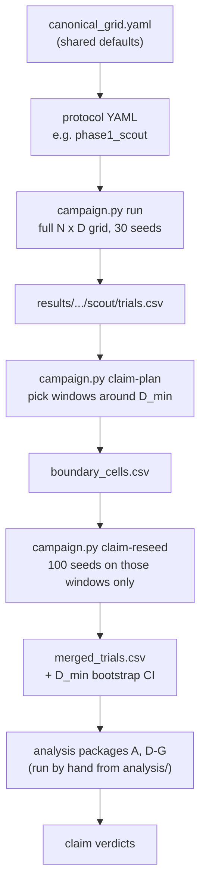
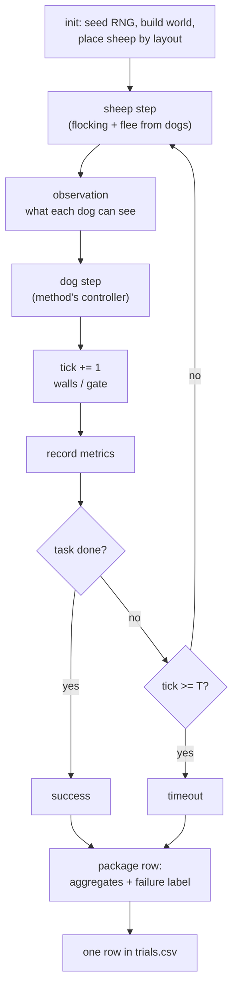

# HerdSim (scaling-cli)

HerdSim is a multi-agent shepherding simulator: a few dogs try to move a flock of sheep somewhere. We use it to answer one question. How many dogs does a flock actually need, and how does that number change when the flock gets bigger, starts in a different shape, is herded by a different dog rule, or the dogs see and share less?

The number we care about most is `D_min`: the fewest dogs that get the job done in at least 90% of seeds (theta = 0.90). We also watch for overcrowding, where adding dogs makes things worse again.

There are two tasks:

- **drive_to_goal** (Phases 1 to 5): push the whole flock into a goal disk.
- **collect_hold_gate** (Phase 8): gather the flock, keep it in a hold area for a while, then push it out through a gate.

This README is meant to be the one place to start. It covers what we found, how a run works, what you can configure, what gets measured, and what lands on disk. The deeper material lives in `docs/` (links at the bottom).

## Results so far

| Phase | Question | Main answer | Claims |
|-------|----------|-------------|--------|
| 1 | Flock size (compact, strombom_multi) | `D_min` = 2 for N <= 10, else 1. No overcrowding anywhere on the grid | C2a rejected, C2b skipped, C6a weak support, C6b support, C7a inconclusive, C7b rejected |
| 2 | Starting shape (4 layouts, N = 50/100/200) | `D_min` = 1 on every layout. Wide and outlier_rich starts cost more dog travel | C1a rejected, C1b inconclusive |
| 4 | Does it transfer to other dog rules? | Kubo matches Strombom for compact mid/large N. FAT never reaches theta for N >= 25. Kubo on wide never reaches theta. Kubo on outlier_rich at N = 200 needs 20 dogs | C4 partly supported |
| 5 | Less information (obs mode, range, comm) | Halving sensing range costs 1 to 2 extra dogs. Past the default range, more range saves nothing | C5a, C5b supported |
| 8 | Collect, hold, exit through a gate | Scout is running now, claim not started | - |

Phases 3, 6 and 7 have no campaigns of their own. They are analysis on top of Phase 1 data (mechanism, scaling fits, early warning).

C3 (mechanism) is inconclusive: with no overcrowding cells, there was nothing to contrast.

For more details see [docs/report/short_report.md](docs/report/short_report.md).

## How a campaign runs

Each experiment is a **protocol**, a YAML file in `protocols/configs/protocols/`. A protocol gets run in two passes. The first is a cheap **scout** over the full grid. The second is a **claim** pass, which spends far more seeds, but only on the cells near the answer.



What `claim-plan` picks for each (layout, N): the scout `D_min` and the grid steps on either side of it. If it sees overcrowding, it also takes the two failing D values plus the last good one. If no D reaches theta at all, it takes the two largest D. Claim rows then replace scout rows on those cells in `merged_trials.csv`.

The CLI is `cli/campaign.py`. It is a thin wrapper that calls `cli/run_grid.py` or `cli/plan_claim_cells.py` as a subprocess.

| Verb | What it does |
|------|--------------|
| `run` | Scout, smoke or factor sweep. Refuses protocols with `seed_mode: claim` |
| `claim-plan` | Reads the upstream scout `trials.csv` and writes the claim windows. Runs no trials |
| `claim-reseed` | Same planning step, then runs claim seeds on the windows and merges |
| `help` | Usage |

Useful flags: `--protocol <id or path>`, `--workers N`, `--output DIR`, `--no-resume`, `--no-timeseries`, `--upstream-trials PATH`. For a quick smoke run you can override the grid with `--methods`, `--layouts`, `--n`, `--d`, `--seeds` and `--max-ticks`.

Runs can be resumed. Each finished cell gets a line in `manifest.jsonl`, and a rerun skips anything already marked `ok`. If a long run dies, start the same command again and it picks up where it stopped.

One rough edge: there is no CLI step for the analysis packages yet. You call the functions in `analysis/` yourself (see [Analysis packages](#analysis-packages)).

## Inside one trial

One trial is one (method, layout, N, D, seed) combination. It runs `SimulationRunner` (`sim/core/simulation_runner.py`) tick by tick:



"Task done" means something different for each task:

- `drive_to_goal`: every sheep is inside the goal disk.
- `collect_hold_gate`: a small phase machine. First collect until every sheep is in the hold disk. Then hold for `hold_ticks` (800) ticks in a row; if a sheep leaves, it drops back to collect. Then exit, which succeeds when every sheep has gone through the gate on the right wall.

Success and timeout (T = 10,000 ticks) are the only things that stop a trial. Failure modes are worked out *after* the run, by looking at the metric history (`protocols/packaging/failure_taxonomy.py`). When more than one matches, the first in this order wins:

`stacking` (dogs piled on each other) > `split` (flock broke apart) > `scatter` (flock spread out) > `oscillation` (back and forth, no progress) > `stuck` (no progress) > `timeout` (none of the above). Successful runs get `none`.

## Configuration

Settings are layered. Later layers win:

1. `protocols/configs/canonical_grid.yaml`: shared defaults, frozen on 2026-09-22 as `scaling_v2`.
2. The protocol YAML. It can `extends:` another protocol; a claim usually extends its scout.
3. CLI overrides (smoke runs only).

### Canonical values that matter

| Setting | Value |
|---------|-------|
| Arena | 500 x 500, reflecting walls |
| Goal | centre (370, 250), radius 15 * sqrt(N / 50) |
| Flock sizes N | 5, 10, 25, 50, 75, 100, 150, 200, 300, 400 |
| Dog counts D | 1, 2, 3, 4, 6, 10, 15, 20, 25, 35 |
| Structure N (Phase 2) | 50, 100, 200 |
| Info-ladder N (Phase 5) | 100, 200 |
| Layouts | compact, wide, split, outlier_rich |
| Reliability theta | 0.90 (sensitivity at 0.5 and 0.7) |
| Time limit T | 10,000 ticks |
| Seeds | 30 scout, 100 claim. Seed i = 2026 + i |
| Bootstrap resamples | 1,000 |
| Base sensing range | 65 |
| Baseline method | strombom_multi |

Some keys in the canonical file aren't read by any code yet (`drive_length`, `time_limit_t1`, `rq7_*`, `transfer_methods`). They are there to record what the plan says.

### Protocol keys

| Key | Meaning |
|-----|---------|
| `protocol_id`, `phase`, `grade` | Name, phase number, SMOKE / SCOUT / CLAIM |
| `output` | Results folder, e.g. `results/phase1/scout`. Must be under `results/` |
| `canonical`, `extends` | Where defaults come from |
| `methods` | Dog methods to run (`method` + `runner: factor` for Phase 5 sweeps) |
| `layouts`, `flock_sizes`, `shepherd_counts` | The grid |
| `seeds`, `seed_mode` | Seeds per cell; `scout` or `claim` |
| `upstream_protocol`, `upstream_trials` | Claim only: which scout to plan from |
| `store_timeseries` | Keep per-tick Parquet per cell (big; needed for Package G) |
| `packages` | Which analysis packages this run feeds |
| `obs_modes`, `sensing_ranges`, `communications` | Phase 5 factor levels |
| `task`, `hold_ticks`, `hold_center`, `hold_radius_*`, `gate_half_width` | Phase 8 only |

Here's a full protocol, the Phase 8 scout, with comments stripped:

```yaml
protocol_id: phase8_size_scout
phase: 8
grade: SCOUT
output: results/phase8/size/scout
canonical: protocols/configs/canonical_grid.yaml
task: collect_hold_gate
hold_ticks: 800
hold_center: [250.0, 250.0]
hold_radius_scale: 2.5      # hold radius = clamp(2.5 * sqrt(N), 23, 27)
hold_radius_min: 23.0
hold_radius_max: 27.0
gate_half_width: 30.0
methods: [strombom_multi]
layouts: [compact]
flock_sizes: [5, 10, 25, 50, 75, 100, 150, 200, 300, 400]
shepherd_counts: [1, 2, 3, 4, 6, 10, 15, 20, 25, 35]
seeds: 30
seed_mode: scout
store_timeseries: false
packages: [A]
```

A claim protocol is usually a few lines: `extends: phase8_size_scout.yaml`, `seeds: 100`, `seed_mode: claim`, `upstream_protocol: phase8_size_scout`.

### Protocols we have

| Phase | Protocol ids |
|-------|--------------|
| 1 size | `phase1_pilot`, `phase1_scout`, `phase1_claim` |
| 2 structure | `phase2_pilot_state`, `phase2_scout`, `phase2_claim` |
| 4 transfer | `phase4_{kubo,fat}_{size,structure}_{scout,claim}` (8 files) |
| 5 information | `phase5_factor_sweep`, `phase5_obs_claim`, `phase5_range_{scout,claim}`, `phase5_comm_{scout,claim}` |
| 8 collect-hold-gate | `phase8_size_scout`, `phase8_size_claim` |

## What you can vary

**Dog methods** (`sim/core/methods.py`)

| Method | Sheep model | How the dogs behave |
|--------|-------------|---------------------|
| `strombom_multi` | strombom | Our baseline. If any sheep is too far out (past r_a * N^(2/3)), the dogs collect: each one goes after an outlier, farthest first. Once the flock is tight, they drive from behind it, opposite the goal |
| `kubo` | kubo | Force-based model from Kubo et al.; dogs and sheep are both moved by summed forces |
| `fat` | strombom | Each dog pushes the farthest sheep it can see toward the goal. Simple, and it doesn't scale |

The paper parameters live in `sim/methods/{strombom,kubo}/`. The Strombom defaults are r_a = 2, r_s = 65, sheep speed 1 and dog speed 1.5.

**Starting layouts** (`sim/core/world/layouts.py`)

| Layout | What it looks like |
|--------|--------------------|
| `compact` | One tight Gaussian blob |
| `wide` | One loose blob, about 7x wider |
| `split` | 2 clusters (N < 12) or 3 clusters |
| `outlier_rich` | 80% in a core, 20% scattered just past the "lost sheep" distance |

**Information ladders** (Phase 5). Each step down gives the dogs less to work with:

| Factor | Levels, best to worst |
|--------|-----------------------|
| Observation | `global` > `local_positions` > `bearing_only` |
| Sensing range | 130, 97.5, 65 (default), 32.5 |
| Communication | `global_shared` > `neighbour_broadcast` > `none` |

Only `strombom_multi` uses the communication setting.

## Metrics

### Per tick

Every tick, these get recorded (`sim/plugins/metrics/`). They're kept in the per-trial timeseries when `store_timeseries` is on:

- `cohesion`: mean distance of sheep to the flock centroid
- `gcm_goal`: centroid distance to the goal
- `success_rate`, `sheep_in_goal`, `time_to_goal`
- `shepherd_path`: total distance the dogs walked, our main effort measure
- `polarization`: how aligned the sheep headings are
- `outlier_count`: sheep past the "lost" distance
- `fragmentation`: largest connected group / N
- `mean_spread`, `extent`, `perimeter`, `hull_area`, `flock_density`, `aspect_ratio`: flock shape
- `min_separation`, `min_dog_separation`
- `i_dir`: how much the dogs pull in different directions
- `coverage`: share of the outer sheep that some dog can see

### Per trial (`trials.csv`)

One row per seed. Columns, grouped:

| Group | Columns |
|-------|---------|
| Identity | `method`, `scenario`, `seed`, `sheep_model`, `dog_controller`, `obs_mode`, `n_sheep`, `n_shepherds`, `initial_layout`, `time_limit`, plus `sensing_range` / `communication` when set |
| Outcome | `success`, `total_ticks`, `first_success_tick` |
| Final values | `final_gcm_goal`, `final_success_rate`, `final_sheep_in_goal`, `time_to_goal`, `shepherd_path`, `final_min_separation` |
| Trajectory stats | `mean_*`, `min_*`, `max_*`, `auc_*` for 13 of the metrics above |
| Efficiency | `control_efficiency` = distance gained toward the goal / dog path |
| Failure | `failure_mode`, `failure_label`, `failure_hints` |
| Bookkeeping | `resolved_config` (JSON), `resume_key` |

### What we compute from the trials

All of these live in `analysis/frontier.py` and `analysis/regimes.py`.

- **R(N, D)**: success rate of a cell.
- **`D_min`**: smallest D with R >= theta.
- **`D_overcrowd`**: first D above `D_min` where R drops below theta and stays there for 2 or more grid steps.
- **`D_max`**: largest reliable D before overcrowding.
- **B\***: the reliable cell with the lowest median dog path. This is the cheapest way to do the job.
- **Bootstrap CI on `D_min`**: 95% interval, from 1,000 resamples of the seeds in each cell.
- **Regimes**, a label for each cell:
  - `under_resourced_failure`: too few dogs.
  - `efficient_operation`: reliable and near B\* effort.
  - `wasteful_overspend`: reliable, but at least 20% more effort than B\*.
  - `overcrowding_collapse`: R falls below theta again at D >= `D_overcrowd`.
  - `hard_failure`: no D on the grid reaches theta.

### Analysis packages

| Pkg | Question | Entry point |
|-----|----------|-------------|
| A | Size / structure map | `analysis.export.export_package_a` |
| D | Transfer across methods | `analysis.transfer.build_transfer_table` |
| E | Information ladders | `analysis.substitution.substitution_curves` |
| F | Scaling fits (constant, linear, power, piecewise) | `analysis.fits.fit_scaling_models` |
| G | Early warning (can we see failure coming?) | `analysis.early_warning.evaluate_early_warning_campaign` |

`analysis.export.export_package_dossier` writes the D to G tables. Package B (state predictors) only survives as old output under `results/phase2/`. Package C was never built.

## What a run writes

Everything under `results/` is written by the code. Don't edit it by hand. The folder comes from the protocol's `output:` key:

```text
results/phase{k}/{slug}/
|-- protocol.yaml                     resolved protocol (extends merged) - replay from this
|-- provenance.json                   protocol hash, seeds, metric ids, timestamps
|-- status.json                       planned / done counts, running flag, elapsed time
|-- manifest.jsonl                    one line per finished cell, used for resume
|-- trials.csv                        one row per trial, the raw table
|-- timeseries/<cell>.parquet         per-tick history (only if store_timeseries; gitignored)
|-- boundary_cells.csv                claim only: which cells get reseeded
|-- boundary_plan.json                claim only: how that list was built
|-- scout_dmin_bootstrap_preview.csv  claim only: D_min bootstrap on scout data
|-- dmin_bootstrap.csv                claim only: D_min bootstrap on claim trials
|-- merged_trials.csv                 claim only: claim rows + scout rows for the rest
|-- merged_dmin_bootstrap.csv         claim only: D_min bootstrap on the merge
`-- packages/<letter>/                analysis output (CSV tables + provenance.json)
```

| File | Written by | When |
|------|-----------|------|
| `protocol.yaml`, `provenance.json` | `run`, `claim-reseed` | Start of the run |
| `status.json` | `run`, `claim-reseed` | Start, after every cell, end |
| `trials.csv`, `manifest.jsonl` | `run`, `claim-reseed` | After every cell, so a crash loses at most one cell |
| `timeseries/` | `run`, `claim-reseed` | After every cell, if enabled |
| `boundary_*`, `scout_dmin_bootstrap_preview.csv` | `claim-plan`, `claim-reseed` | Before any claim trial runs |
| `dmin_bootstrap.csv`, `merged_*` | `claim-reseed` | End of the claim run |
| `packages/<letter>/` | `analysis.export` | Whenever you run the analysis |

Every generated file starts with an `AUTO-GENERATED` notice: a `#` line in CSV / YAML / JSONL, and a `_auto_generated_notice` field in JSON. To load a CSV, use `protocols.packaging.generated_notice.read_csv`, or `pd.read_csv(path, skiprows=1)`. Some older Phase 1 files were written before the notice existed and don't have it.

Phase 8 runs in the background, so `results/phase8/size/logs/` also holds a watchdog script and its logs.

## Tech stack

| Layer | Choice |
|-------|--------|
| Language | Python 3.11+ |
| Numerics / data | NumPy, pandas, SciPy, PyArrow |
| Protocols | YAML (PyYAML) |
| Packaging / env | uv, setuptools |
| Tests | pytest |
| Lint / types | Ruff, basedpyright |

## Project structure

```text
HerdSim/
|-- sim/                 Tick engine
|   |-- core/            Runner, state, observation, config, world
|   |-- plugins/         Sheep, dogs, scenarios, metrics
|   `-- methods/         Paper math (strombom, kubo)
|-- protocols/
|   |-- configs/         canonical_grid.yaml + one YAML per protocol
|   `-- packaging/       Turns a finished trial into a trials.csv row
|-- cli/                 campaign.py and the two scripts it calls
|-- services/            Grid expansion, resume, worker pool, results layout
|-- analysis/            Frontiers, regimes, fits, transfer, early warning, export
|-- results/             Run outputs (generated)
|-- docs/                Architecture, report, figures
`-- tests/
    |-- sim/             Golden regression runs, Phase 8 scenario, core metrics
    |-- services/        Protocol cell expansion and resume keys
    `-- analysis/        Frontier / regimes on toy tables
```

The sim code lives under `sim/`, but it's imported as `core.*`, `plugins.*` and `methods.*`. The mapping is in `pyproject.toml`.

## Setup, tests, running

```bash
make install        # uv sync --extra dev
make test           # pytest
make check          # ruff + basedpyright + pytest
```

```bash
uv run cli/campaign.py help

# scout, then claim
uv run cli/campaign.py run          --protocol phase1_scout --workers 18
uv run cli/campaign.py claim-plan   --protocol phase1_claim
uv run cli/campaign.py claim-reseed --protocol phase1_claim --workers 18

# Phase 5 factor sweep
uv run cli/campaign.py run --protocol phase5_factor_sweep --workers 18

# quick smoke run on a tiny grid, written somewhere throwaway
uv run cli/campaign.py run --protocol phase1_scout --n 25 --d 2 --seeds 2 \
    --max-ticks 2000 --output /tmp/herdsim_smoke --no-resume
```

The full grids are big: 3,000 trials for a 10 x 10 scout. Pick `--workers` to match your cores.

## Further reading

- [docs/codes/architecture.md](docs/codes/architecture.md): how the code is put together, the plugin model, tick order, and where each phase lives in code.
- [docs/report/short_report.md](docs/report/short_report.md): what we asked, how, what we found, and the limits.
