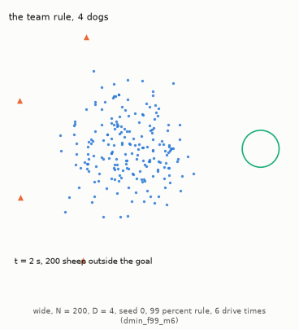

# HerdSim

[](LICENSE)
[](https://www.python.org/downloads/)
[](tests/)
[](results/)

A single sheepdog can gather a cohesive flock and drive it into a pen. When the sheep start scattered and the job has a deadline, one dog cannot be everywhere at once. How many dogs does such a task need, and do more dogs always help?

HerdSim is an open-source simulator and a study built to answer that. It runs the sheep model of Strombom et al. (2014) with a team of dogs and counts how often a team of $D$ dogs brings a flock of $N$ sheep into a goal before a deadline. In 439,120 simulated trials over 41 protocols, with no simulation errors, it covers flocks of 25 to 566 sheep (with runs up to 3200), four start layouts, three deadlines, and variants of the dogs and the sheep. Four numbers describe how success and finish time change with the team size:

- $D_{\min}$: the smallest team that succeeds in at least 90% of trials, with 99% confidence.
- $D_{\mathrm{sat}}$: the team beyond which more dogs no longer make the drive faster.
- $D_{\max}$: the largest team that is still reliable.
- $D_{\mathrm{overcrowd}}$: the team from which two tested team sizes in a row are unreliable.

Figure 1 shows one trial. Other terms (start layouts such as `wide`, drive times, the strict and 99% rules, protocol ids such as `dmin_f99_m6`) are defined in the [glossary](docs/glossary.md).


**Figure 1: One trial in HerdSim ($N = 200$ sheep, $D = 4$ dogs, `wide` start, random seed 2026), at ticks 0, 55, 139 and 279.** The dogs first gather the scattered flock from several sides, then drive it from behind into the goal.

- Marks: the green circle on the right is the goal ($R_{\mathrm{goal}} = 1.9 R_f$); orange triangles are the dogs, with their tracks; blue dots are sheep.
- Panels: the four ticks in a 2 x 2 grid, read left to right, then top to bottom. The dogs start on an arc behind the flock and close in while it gathers.



**Animation 1: One trial from start to goal (`wide` start, N = 200, D = 4, seed 0, 99 percent rule, 6 drive times).** The dogs first collect the outliers of a scattered start, then drive the gathered flock into the goal. It is a replay of a stored trial of `dmin_f99_m6`.

- Marks: blue dots are sheep, orange triangles dogs, and the green circle the goal.

## Key scientific findings

The [report](docs/report/d_min_report.md) holds the full analysis in six parts by topic, with its figures, and [the tables](docs/report/results_tables.md) behind it. Each finding below links to the section with its evidence.

### 1. A flock that starts together needs one dog
When the sheep start close together (`compact`), one dog is reliable at every size of the main grids: $N = 25$ to 400 under both rules and every deadline, and 566 under the 99% rule at 12 and 6 drive times. More dogs do not make the drive faster there, likely because in the model a sheep that reacts to a dog walks at 1 m/s whatever the dogs do ([report, section 3.1](docs/report/part1_growth.md#31-rq1-how-does-d_min-grow-with-n)).

### 2. At the loose deadline the team grows much slower than the flock
When the sheep start scattered (`wide`, `split`, `outlier_rich`), the dogs must first bring the strays back. Even so, at 12 drive times under the 99% rule, $D_{\min}$ grows with a log-log slope of 0.27-0.38 on `wide` and 0.28-0.38 on `outlier_rich` (nine flock sizes); a slope of 0.5 would mean twice the dogs for four times the sheep. This may be because every sheep is drawn to the whole flock, so a stray that a dog turns back walks to the flock by itself; weakening that pull raised the slope on `wide` but not on `outlier_rich` ([report, sections 3.8 and 3.11](docs/report/part1_growth.md#38-rq8-growth-with-n-on-a-denser-grid-d_sat-and-the-shape-of-the-curve)).

### 3. A tight deadline can cost more dogs than a larger flock
Under the 99% rule, cutting the deadline from 12 to 3 drive times raises $D_{\min}$ on a `wide` flock of 400 from 2 dogs to 5-6. Making that flock four times larger (from $N = 100$ to 400) at 12 drive times raises it only from 1 dog to 2 ([report, section 3.3](docs/report/part1_growth.md#33-rq3-how-does-the-deadline-change-d_min)).

### 4. Without coordination, extra dogs do not help on large flocks
In the baseline FAT every dog goes behind the sheep farthest from the goal, so all dogs pick the same sheep. At 6 drive times under the 99% rule FAT has no reliable team at $N \ge 200$ on any scattered layout, where the team rule needs 2 or 3 dogs on `wide` and `outlier_rich`. On those two layouts Strombom's switch between collecting and driving carries a team to $N = 200$ on its own; at $N = 400$ the team layer that assigns dogs to strays is also needed ([report, sections 3.6 and 3.9](docs/report/part4_coordination.md#36-rq6-do-dogs-without-a-team-rule-reach-a-finite-d_min)).

### 5. With large teams, requiring every sheep in the goal mostly measures the last few sheep
When every sheep must be in the goal at once (strict rule), large teams (6 or more dogs) on large flocks mostly fail after the flock has been gathered: at 6 drive times, in 97% of strict failures with 6 or more dogs in the sensitivity base run, 99% of the flock had already been in the goal. Counting a trial as a success when 99% of the sheep are in avoids this, and under that rule (6 drive times, `wide` and `outlier_rich`, $N = 100$ to 400) $D_{\min}$ moves by about one dog at most when the setup changes, except for a smaller goal ([report, sections 3.4 and 3.5](docs/report/part2_success_rule.md#34-rq4-the-success-rule-and-the-last-sheep)).

### 6. Beyond a few dogs, more dogs cost time but rarely hurt
Under the 99% rule at 6 drive times, dogs beyond $D_{\mathrm{sat}}$ make the drive at most about 4% faster (on the 27 curves where $D_{\mathrm{sat}}$ is decided), while the dog time grows with the team. In the three 99% main runs $D_{\max}$ is the top of the grid, 24 dogs, on 84 of the 85 curves that have a $D_{\min}$, so no upper limit was found below 24 dogs. More dogs do hurt in a few follow-up settings, most clearly when the dogs keep 2 m apart and must hold a flock of 400 `outlier_rich` sheep in the goal: success falls from 0.87-0.94 with 3 to 8 dogs (200 trials each) to 0.50-0.77 from 9 dogs up (10 to 70 trials per cell) ([report, sections 3.7 and 3.10](docs/report/part3_beyond_dmin.md#37-rq7-beyond-d_min-enough-dogs-cost-and-pressure-on-the-flock)).

### 7. Whether the team levels off for very large flocks is still open
Under the 99% rule up to $N = 566$, a curve that keeps growing and one that levels off at a largest team fit $D_{\min}$ on `wide` and `outlier_rich` equally well. This model cannot settle it with larger flocks: above about 600 sheep one flock radius no longer describes the flock, and above about 1056 Strombom's drive rule puts the dog out of the sheep's reach. With the drive point capped (99% rule, 12 drive times, flock radius set at the density of the 566 flock), a `wide` flock needs 3 dogs at $N = 800$, 5-9 at 1131 and more than 12 at 1600 ([report, sections 3.8 and 3.13](docs/report/part1_growth.md#38-rq8-growth-with-n-on-a-denser-grid-d_sat-and-the-shape-of-the-curve)).

### 8. With full sight, targets without cohesion follow the square-root law, in HerdSim too
Lama and di Bernardo (2024) study targets that do not attract each other at all. Run inside HerdSim, their model comes close to the threshold in Table I of the paper's Supplementary Material for $R = 50$ and sensing radius 10 ($\sqrt{N} = 8$, 9 and 12 at the 90%, 95% and 99% levels, against the paper's 8, 9 and 11). With full sight its smallest team grows as the square root of the number of targets (exponent 0.52-0.53, $N \ge 100$), steeper than the slopes of finding 2, though the two differ in task, herder rule, flock sizes and how the slope is fitted. With sensing radius 10 the paper's average and HerdSim's count of runs part just above the threshold: at 144 targets the average accepts 11 herders, yet 9 of their 30 runs lose two to four targets (21 of 30 succeed, 99% interval 0.45-0.89), and HerdSim's $D_{\min}$ is the bracket 17-25 ([report, section 3.14](docs/report/part6_square_root_law.md#314-rq14-targets-without-cohesion-the-square-root-law-of-lama-and-di-bernardo-2024)).

## The HerdSim simulation engine

- The sheep model of Strombom et al. (2014):
   Each sheep weighs its previous heading, attraction to the flock, keeping space from close neighbours, running from dogs, and noise. The authors compared the model with GPS data from a real flock and dog ([Strombom et al. 2014](https://doi.org/10.1098/rsif.2014.0719)).
- A team rule for several dogs:
   Strombom's single-dog rule extended to a team: outliers assigned to dogs by the Hungarian algorithm, drive positions spread on an arc behind the flock in angular order, and the push of several dogs on a sheep normalised to the size of one dog's push.
- Tasks sized to the flock:
   There are no walls, and the drive distance, goal radius and deadline are scaled from the calibrated flock radius $R_f(N)$, so a large flock is not helped or hindered by a field that is too small.
- Adaptive sampling:
   After every batch of 10 seeds, each cell's 99% Clopper-Pearson interval decides whether it needs more. Clear cells stop after 10 to 60 seeds; only cells near the threshold continue, up to 200.
- Reproducible and safe to stop:
   Each trial has its own random streams for the start, the sheep and the dogs, so a trial replays exactly from its config and seed on the same machine. Every finished trial is written to disk (`trials.jsonl`) at once, so a run can be stopped and resumed.
- Three source models, two tasks:
   Besides the Strombom flock, HerdSim runs the continuous force model of Kubo et al. (2022) on the same drive task, and the non-cohesive targets and local herders of Lama & di Bernardo (2024) on their own gather task (sheep and dogs start scattered over a disc and the dogs bring the targets into its centre). The Lama model is there to test the published $\sqrt{N}$ law inside the same simulator and statistics ([finding 8](#8-with-full-sight-targets-without-cohesion-follow-the-square-root-law-in-herdsim-too)).

## Quick start & reproducibility

### Installation

HerdSim needs Python 3.11+ and uses [`uv`](https://docs.astral.sh/uv/) to manage dependencies:

```bash
# Clone the repository
git clone https://github.com/lykimq/HerdSim.git
cd HerdSim

# Install development environment and dependencies
make install     # uv sync --extra dev

# Lint, type check and run the 332 tests
make check

# Run the 23 benchmark tests, six small campaigns end to end (about 1.5 minutes)
make bench
```

To run the full campaigns again or check that a trial replays exactly, see the [reproducibility appendix](docs/report/appendix_run_record.md#appendix-c-reproducibility) and the [results tables](docs/report/results_tables.md).

## Running campaigns and workflows

Campaigns are run from the command-line tools in [`cli/`](cli/):

```bash
# 1. Show what a protocol would run: cells, first-round seeds, resumes
uv run cli/campaign.py plan --protocol dmin_m6

# 2. Run a protocol with 16 worker processes
uv run cli/campaign.py run --protocol dmin_m6 --workers 16

# 3. Show the progress of a running or finished protocol
uv run cli/campaign.py status --protocol dmin_m6

# 4. Run the queue of 41 research protocols (finished ones skipped, stopped ones resumed)
uv run cli/run_queue.py --workers 20

# 5. Build Markdown result tables from the result folders
uv run cli/dmin_tables.py record
uv run cli/dmin_tables.py dmin dmin_m12 dmin_m6 dmin_m3
```

For detailed command options and diagnostic replay scripts, see [`docs/guides/cli_reference.md`](docs/guides/cli_reference.md).

## Project architecture

HerdSim is split into layers that only import downward:

```text
HerdSim/
|-- sim/                    # The model: one trial, tick by tick
|   |-- core/               # State, tick loop, world, start layouts
|   |-- methods/            # Models: Strombom (2014), Kubo (2022), Lama (2024)
|   `-- plugins/            # Sheep models, dog controllers, tasks, metrics
|-- services/               # Running things: protocols, campaigns, calibration, replays
|   |-- adaptive.py         # The adaptive campaign: rounds of seeds until every cell is decided
|   |-- calibration.py      # The flock radius R_f(N)
|   `-- runner.py           # Running a batch of trials in worker processes
|-- records/                # A trial as a table row; the physics hash and code identity of a folder
|-- analysis/               # Decision rules (frontier) and the result tables
|-- protocols/configs/      # Protocols (canonical defaults + overrides)
|-- cli/                    # Command-line tools (campaign.py, run_queue.py, dmin_tables.py)
|-- docs/                   # Report, method notes, guides, figures and animations
|-- results/                # Result folders (439,120 trials in the study protocols)
`-- tests/                  # Unit, invariant and regression tests
```

## Documentation index

### Research

- [Report](docs/report/d_min_report.md):
  The study: abstract, questions, decision rules, discussion and conclusions. Its section 3 links the results, in six parts by topic, and the run record.
- [Result tables](docs/report/results_tables.md):
  Every table behind the report, generated from the stored runs.
- [Models](docs/methods/models.md):
  The sheep model, the team rule, the Hungarian assignment, the baselines, and the Kubo and Lama models.
- [Task design](docs/experiments/task_design.md):
  Field and goal sized by $R_f(N)$, deadlines in drive times, why $N$ and $D$ stop where they do, and the gather task.
- [Glossary](docs/glossary.md):
  One short definition of every term the docs use, with a link to where it is explained in full.

### Code

- [Architecture](docs/codes/architecture.md):
  How the code is organised and how to add a model, a controller or a task.
- [Configuration](docs/guides/configuration.md):
  How protocols inherit from each other, the follow-up settings, and the result folders.
- [CLI reference](docs/guides/cli_reference.md):
  Planning and running campaigns, and the diagnostic replays.
- [Command-line tools](cli/README.md):
  Which tool to use for which task, in the order a study uses them.

## References

HerdSim implements the models of three papers:

1. Strombom, D., et al. (2014). *Solving the shepherding problem: heuristics for herding autonomous, interacting agents*. Journal of the Royal Society Interface, 11(100), 20140719. [DOI: 10.1098/rsif.2014.0719](https://doi.org/10.1098/rsif.2014.0719)
2. Kubo, M., Tashiro, M., Sato, H., Yamaguchi, A. (2022). *Herd guidance by multiple sheepdog agents with repulsive force*. Artificial Life and Robotics, 27, 416-427. [DOI: 10.1007/s10015-021-00726-7](https://doi.org/10.1007/s10015-021-00726-7)
3. Lama, A., & di Bernardo, M. (2024). *Shepherding and herdability in complex multiagent systems*. Physical Review Research, 6, L032012. [DOI: 10.1103/PhysRevResearch.6.L032012](https://doi.org/10.1103/PhysRevResearch.6.L032012)

The tables behind [the report](docs/report/results_tables.md), and the full list of works cited in the study is in the [report's references](docs/report/d_min_report.md#references).
