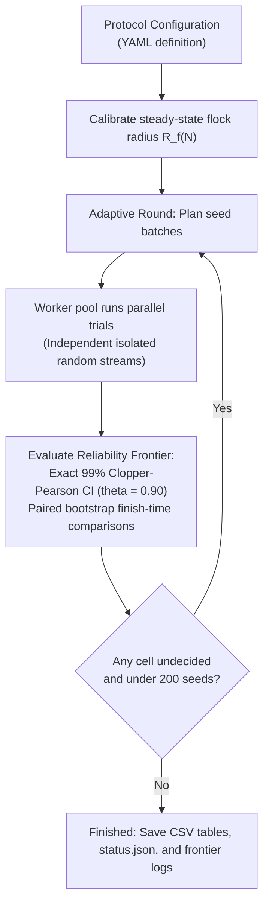

# HerdSim

[](LICENSE)
[](https://www.python.org/downloads/)
[](tests/)
[](results/)

Have you ever watched sheepdogs work a flock across an open field? A single border collie working patiently can eventually round up dozens of sheep. But what happens when the clock is ticking? Or when sheep are scattered across a vast pasture, split into separate groups, or wandering in opposite directions? A single dog simply cannot run in multiple directions at once. To gather the flock before time runs out, dogs must work together as a coordinated team.

That raises a fundamental question in collective animal behavior and autonomous swarm robotics:

> **How many dogs ($D$) does it take to gather a flock of $N$ sheep and drive it into a goal reliably before a deadline: how few will do, how many are enough, and when do more dogs start to hurt?**

**HerdSim** is an open-source simulation laboratory built to answer that question. We map the smallest reliable team (***D*<sub>min</sub>**), the team beyond which more dogs stop making the drive faster (***D*<sub>sat</sub>**), and the conditions under which extra dogs make the task fail. The main grids cover flocks of 25 to 400 sheep across pasture layouts, deadlines and levels of team coordination; follow-up runs extend this to 566 sheep, to the cohesion of the flock, to what each dog can see, and above the model's edge up to 3200 sheep. Sometimes the answer is that no team size works.


**Figure 1:** A live simulation trial (*N* = 200 sheep, *D* = 4 dogs, wide start layout, seed 2026). The dogs fan out in parallel to collect distant strays, assemble them into a cohesive flock, form a driving arc behind them, and steer the collective smoothly into the circular goal.

---

## Table of Contents

- [Core Scientific Findings](#core-scientific-findings)
- [How a Campaign Runs](#how-a-campaign-runs)
- [Task Geometry and Scale Invariance](#task-geometry-and-scale-invariance)
- [Initial Flock Configurations](#initial-flock-configurations)
- [Agent Models and Multi-Dog Coordination](#agent-models-and-multi-dog-coordination)
- [What the Frontier Rules Decide](#what-the-frontier-rules-decide)
- [Sensitivity and Robustness](#sensitivity-and-robustness)
- [Follow-up Settings](#follow-up-settings)
- [Why the Grid Stops Where It Does](#why-the-grid-stops-where-it-does)
- [Quick Start](#quick-start)
- [What a Run Writes](#what-a-run-writes)
- [Project Architecture](#project-architecture)
- [Verification and Benchmarks](#verification-and-benchmarks)
- [References and Further Reading](#references-and-further-reading)

---

## Core Scientific Findings

To map out how team size scales, we conducted **326,870 simulated herding trials** across 37 research protocols (with zero crashes or execution errors). The first 23 protocols (164,740 trials, findings 1 to 7) cover flock sizes from 25 to 400 sheep across four initial pasture layouts, three deadline pressures, and two standards of mission success. The 14 follow-up protocols and three resumed grids (findings 8 to 12) use the 99% rule only.

The complete scientific paper is available in [`docs/report/d_min_report.md`](docs/report/d_min_report.md). All underlying tables can be reproduced directly from the raw data using [`cli/dmin_tables.py`](cli/dmin_tables.py) and are collected in [`docs/report/results_tables.md`](docs/report/results_tables.md).


**Figure 2:** The experimental design. Top: The adaptive sampling loop. Bottom: What each group of runs covers: the first 23 protocols (main scaling grids, uncoordinated FAT baseline, continuous force model, 14 sensitivity sweeps) and the 14 follow-up protocols (independent dogs, the force model up to 24 dogs, holding and spacing, cohesion, sensing, large N).


**Figure 3:** Minimum team size *D*<sub>min</sub> plotted against flock size *N* across three deadlines (12&times;, 6&times;, and 3&times; drive times). Solid lines and circles indicate strict 100% containment; dashed lines and squares show 99% arrival. Shaded bars denote undecided brackets (e.g., [3, 8]), hollow triangles mark lower bounds, and crosses indicate that no team size on our grid met the 90% reliability threshold.

### 1. Cohesive flocks only ever need one dog (*D*<sub>min</sub> = 1)
When sheep start close together in a neat cluster (`compact`), **a single dog is sufficient across all flock sizes ($N = 25$ to $400$) and all deadlines ($12\times$ down to $3\times$ drive times)**. 

**Why?** Sheep are naturally social animals. When they start close together, no sheep are lost or wandering off. The dog never needs to waste time gathering strays—the mission is purely about steering the group forward. 

**Does adding more dogs help?** In our primary model ([Strömbom et al. 2014](https://doi.org/10.1098/rsif.2014.0719)), having 2, 4, or even 24 dogs does not speed up the drive at all (median completion time stays between 1.44 and 1.74 drive times regardless of team size). This is because a walking flock already moves at its natural cruising speed; extra dogs behind them cannot push them any faster without causing unnecessary panic. In the continuous force model of [Kubo et al. (2022)](https://doi.org/10.1007/s10015-021-00726-7), one dog is also sufficient for reliability, though adding dogs does help compress the flock slightly and guide it faster (finish times drop from about 115 s with 1 dog to 29 s with 10 dogs, finding 9).


**Figure 4:** Finish time versus team size *D* on compact starts. Left: Strömbom flock with team coordination (median completion time is invariant to team size). Right: Kubo force model (completion time drops smoothly as more dogs join the drive). Both models achieve 100% success across all team sizes.

### 2. On scattered pastures, *D*<sub>min</sub> grows much slower than flock size
When sheep start scattered across the pasture (`wide`, `split`, `outlier_rich`), dogs must first round up the strays before they can drive the flock to the pen:
- Under a relaxed deadline ($12\times$ drive time), **1 dog** is enough for up to $N = 50$ sheep, and you only need **2 or 3 dogs** for a large flock of $N = 400$ sheep.
- In log-log space ($\log_2 D_{\min}$ vs. $\log_2 N$), the scaling slope on these five flock sizes falls between **0.20 and 0.50** at $12\times$ drive times, and **0.30 and 0.80** at $6\times$ drive times. The denser grid of finding 8 narrows this to 0.27 to 0.38 and 0.38 to 0.61.

**Why does it scale so well?** You might imagine that herding four times as many sheep would require four times as many dogs. But sheep naturally want to stick together. Once a dog nudges a distant stray sheep toward the center, the stray spots its flock-mates and runs back to join them on its own. The flock's natural social attraction does half the gathering work for free!

### 3. Tight deadlines demand more dogs than larger flocks
Time pressure is a far more powerful multiplier than flock size. Under the 99% arrival rule, cutting the deadline from relaxed ($12\times$) to urgent ($3\times$) raises $D_{\min}$ on widely scattered flocks at $N = 400$ from **2 dogs to 5–6 dogs**. 

By comparison, multiplying the flock size fourfold (from *N* = 100 to $400$) under a relaxed deadline only raises the requirement from 1 dog to 2 dogs. 

**Why?** Sheep cannot run indefinitely faster. If you have plenty of time, a single dog can patiently trot over to Stray A, bring it back, then trot over to Stray B, bring it back, and repeat. But when time is short, sequential gathering is too slow. Dogs must divide and conquer—fanning out in parallel so Dog 1 collects Stray A while Dog 2 collects Stray B. Urgency forces teamwork.


**Figure 5:** The impact of time pressure. Left and Middle: Success curves under relaxed (12&times;), intermediate (6&times;), and urgent (3&times;) deadlines. Right: *D*<sub>min</sub> plotted directly against deadline urgency.

### 4. What counts as success? The "Straggler Effect"
How you define a "successful herding mission" fundamentally changes the results:
- **Strict 100% Rule**: Every single sheep must be inside the goal circle at the exact same second.
- **99% Arrival Rule**: At least 99% of the sheep are inside (allowing 1 stray out of 100, 2 out of 200, or 4 out of 400).

When we evaluated large dog packs ($D \ge 6$) on large flocks under the strict rule, they surprisingly failed. When we investigated why, our telemetry revealed a striking behavioral dynamic: **in 95% of those failed trials, the dogs had already guided 99% of the sheep into the goal circle with plenty of time to spare**. 

**Why did they fail?** One or two stubborn stragglers remained outside the circle. The dogs broke formation to chase down that last stray. Because the goal has no physical fence or gate, the dogs charged past the pen entrance at full speed, accidentally terrifying the settled flock and flushing them right back out onto the open pasture!


**Figure 6:** Strict success rate versus 99% arrival rate on identical random seeds. In the shaded region, trials succeed &ge; 90% of the time under the 99% rule but fail under the strict rule.


**Figure 7:** The Straggler Effect. Left: Trials with 6+ dogs reach 99% arrival almost every time, but fail strict 100% containment; slower dogs (*v* = 1.15 m/s) prevent this failure. Right: Flock position over time for an identical starting flock. Fast dogs drive the flock in, chase a straggler, and flush the flock back out. Slower, calmer dogs guide the flock inside in a single clean pass.

When dogs run slightly slower ($v_{\mathrm{dog}} = 1.15$ m/s instead of $1.50$ m/s), they don't overshoot the pen, and strict success jumps from 0% to 100%. In practical farming and robotics, one stubborn animal does not mean the mission failed. Evaluating 99% arrival isolates the true coordination challenge from the boundary artifact of penning animals in an open circle.

### 5. Without teamwork, extra dogs are useless
To test whether multi-dog coordination is truly necessary, we implemented an uncoordinated baseline called **FAT (Farthest-Agent Targeting)**. Under FAT, each dog follows the simplest possible greedy rule: find whichever sheep is farthest from the goal, and chase it. No dog communicates with teammates, negotiates assignments, or avoids colliding with other dogs.

The result is failure: because every dog has the same view of the field, **all dogs pick the exact same sheep**. They sprint toward that single stray, collide into a tight cluster, and move as a single disorganized pack while ignoring all other strays. While FAT works on small flocks ($N \le 100$), it completely fails at $N \ge 200$, achieving 0% reliability on scattered pastures no matter how many dogs you add. Without teamwork, extra dogs are dead weight.


**Figure 8:** Success rate versus team size for coordinated strombom_multi (blue) versus uncoordinated FAT (orange) at 6 drive times. Without coordination, adding dogs produces flat curves and zero scaling benefit.

### 6. What the detailed trial metrics reveal
HerdSim records 19 physical measurements on every single tick of every simulation:
- **Flock spread predicts success**: Across all trials, there is a strong negative correlation ($r = -0.56$ to $-0.81$) between average flock spread and mission success. When sheep stay tightly bunched, herding succeeds; when the flock scatters, success drops.
- **The `split` pasture anomaly**: On flocks split into separate clusters, adding more dogs ($D \ge 4$) surprisingly caused performance to plateau. Why? Our metrics revealed that dogs were freezing in place! Under Strömbom's rule, a dog stops moving if it gets within 6 meters ($3 r_a$) of a sheep to avoid spooking it. In dense clusters, this rule froze up to 25% of the dog pack. In replays, a shorter standoff distance cut completion times by about a fifth at $D \ge 8$, and sending the collecting dogs to outliers far apart halved the time at $D = 4$. With both changes, 8 to 16 dogs are still slower than 2, and at 3 drive times neither change restores success, so part of the cause is still unknown.


**Figure 9:** Detailed trial diagnostics. (a) Negative correlation between flock dispersion and success rate. (b) Percentage of dogs frozen in place under the standoff rule on split versus wide flocks. (c) Pairwise dog overlap.


### 7. Beyond the minimum: enough dogs, and what extra dogs cost
After D_min, a follow-up analysis of the 99% runs (no new campaigns) asked from which team size an extra dog stops helping (D_sat), what dogs beyond it cost, and whether they put more pressure on the sheep:
- **Extra dogs beyond D_sat are pure cost**: at 6 drive times every reliable team larger than a decided D_sat finishes in 0.96 to 1.01 of the D_sat time (189 cells), while total dog time grows in proportion to the number of dogs. On a compact flock, 24 dogs spend about 24 times the dog time of one dog for the same drive.
- **More dogs do not mean more pressure per sheep**: in 164 replayed trials, the seconds each sheep spends fleeing a dog fall from D_min to D_sat and then stay level. More of the flock is in flight at a given moment, but the drive is shorter. Part of this is the model: the push of several dogs is capped at the push of one.
- **Almost no team size made the task fail under the 99% rule**: on the original five flock sizes, none of the eleven 99% folders has a team size that drops back below the reliability threshold after reaching it, up to 24 dogs. On the denser grid of finding 8 one such dip appears (`split` N = 141, D = 4: 0.80). Extra dogs make `split` flocks slower at 12 drive times at every N from 200 to 566 (for example about 700 s from D = 8 against 365 s with 2 dogs at N = 200).
- **D_sat was a range on a third of the scattered curves** in the first runs, because they did not spend seeds on the finish-time comparisons that decide it. The top-up of finding 8 decided most of them; at 6 drive times it stays a range on 5 of 23 scattered curves (`outlier_rich` at N = 50, 283, 400, 566 and `wide` at 566).


**Figure 10:** Dogs beyond D_sat at 6 drive times (99% rule). Left: finish time relative to D_sat stays flat. Right: dog time grows along the line D / D_sat. Details and the pressure replay are in section 3.7 of the [report](docs/report/d_min_report.md).


### 8. A denser grid: how fast the team grows, and what cannot be told yet
Four flock sizes were added (71, 141, 283, 566), so every size above 50 is a step of sqrt(2), up to the largest size at which the model's flock still has a size of its own (about 600):
- **The growth is now pinned down**: the log-log slope of D_min against N is 0.27 to 0.38 at 12 drive times and 0.38 to 0.61 at 6, against 0.5 for targets that do not flock.
- **D_sat grows about twice as fast as D_min** (0.70 to 0.91 on `wide`: 1, 1, 1, 2, 3, 3, 4, 5 dogs from N = 25 to 400), so the team that is as fast as possible pulls away from the team that is merely reliable.
- **Steady growth and levelling off fit equally well up to N = 566**: every curve of either shape that passes through the data allows between 1.5 and 6.7 dogs at N = 1600.


**Figure 11:** D_min against N on nine sizes, and the range each fitted shape allows beyond N = 566.

### 9. Which part of the team rule matters
A team of independent paper shepherds (each dog runs the one-dog rule, with no team layer) reaches a reliable team on every scattered layout up to N = 200, where FAT fails, and fails at N = 400, where the team rule needs 2 to 3 dogs. So the paper's collect/drive switch does the work up to N = 200, and the team layer is what makes N = 400 possible. In the Kubo model, where more dogs do speed up a compact flock, most of the gain comes by 10 dogs (115 s with one, 29 s with ten, 25 s with 24).

### 10. When more dogs make it worse
Two changes look for harm from extra dogs:
- **Holding the flock in the goal** for one drive time works from N = 100 when the dogs back off beyond the sheep's reaction distance (without that, the team drives the flock straight through the goal). At N <= 50 no team holds: a dog backing off stays within 65 m for about 40 s, long enough to push the flock out of a small goal.
- **Dogs that take up room** (never closer than 2 m): on `outlier_rich` N = 400 every team from 9 to 24 dogs is decided unreliable, while 3 to 6 dogs succeed in 93 to 94% of trials. On `wide` the extra dogs simply stand back and do no harm. Point dogs show no decided harm up to 24.


**Figure 12:** Holding task at N = 400. On `outlier_rich`, success falls from D = 9 once dogs take up room.

### 11. Cohesion and what a dog sees
- **Cohesion**: a tighter flock (attraction weight 1.3 to 2.0 instead of 1.05) saves at most one dog. A looser one (each sheep drawn to half the flock) steepens the growth to a slope of 0.40 to 0.70 and makes split flocks much harder. Weaker flocks than that do not hold together under one driving dog.
- **Sensing**: when each dog sees only the sheep within 30 to 100 m, a flock of 200 needs about one more dog; at 15 m extra dogs cannot make up for it. Sharing what all dogs see buys the lost dog back; sharing only with nearby dogs does not.


**Figure 13:** Left: D_min against each dog's sensing range. Right: success at range 65 with and without sharing.

### 12. A limit of the paper's drive rule
The paper places the driving dog r_a sqrt(N) behind the flock. That distance passes the sheep's reaction distance (65 m) at N = (65 / 2)^2, about 1056. Above it the dogs stand where few sheep feel them, and no team of any size drives the flock (checked up to N = 3200 with the flock density held at that of N = 566). Below it, N = 566 and 800 behave as the smaller flocks do. With the drive point capped at 63 m (a labelled variant, not the paper's rule), large flocks can be driven, and a scattered one then needs 3 dogs at N = 800, 5 to 9 at 1131 and more than 12 at 1600, while a compact one needs 1, 1 and 2. The imposed flock size is also looser than the flock the dogs actually drive (0.5 to 0.8 of it), so these numbers hold under both choices.

---

## How a Campaign Runs

If you tested every combination of flock size, team size, starting layout, and deadline with 200 runs each, you would need over 360,000 simulations. Most of that compute would be wasted on obvious outcomes—like running 200 trials to prove that 1 dog cannot herd 400 scattered sheep in 4 minutes, or running 200 trials to prove that 8 dogs easily handle 25 compact sheep.

Instead, HerdSim works like a thoughtful scientist: it uses an **adaptive sequential sampling loop** that spends compute cycles only where the answer is genuinely uncertain.

A **protocol** (configured in [`protocols/configs/protocols/`](protocols/configs/protocols/)) defines the experimental grid. Every unique combination of flock model, layout, and flock size $N$ forms a curve. Each specific dog count $D$ on that curve is a **cell**, and each evaluated seed is a **trial**.



### Summary of Executed Research Campaigns

The first 23 research protocols completed **164,740 simulation trials** (2,291 parameter cells evaluated) with zero crashes or execution errors:

| Campaign Group | Protocols | Trials | Cells | Core Research Objective |
| :--- | :--- | :---: | :---: | :--- |
| **Strict Scaling Grid** | `dmin_m12`, `dmin_m6`, `dmin_m3` | 40,220 | 557 | Maps $D_{\min}(N)$ under strict 100% containment across relaxed ($12\times$), intermediate ($6\times$), and urgent ($3\times$) deadlines. |
| **99% Arrival Grid** | `dmin_f99_m12`, `dmin_f99_m6`, `dmin_f99_m3` | 36,480 | 556 | Maps $D_{\min}(N)$ under practical 99% arrival rule across all 3 deadlines, isolating herding ability from finish-line boundary noise. |
| **Uncoordinated Baseline** | `dmin_fat`, `dmin_f99_fat` | 17,330 | 365 | Evaluates Farthest-Agent Targeting without inter-dog coordination under both success rules at $6\times$ drive time. |
| **Continuous Force Model** | `dmin_kubo` | 1,080 | 18 | Cross-paradigm validation of $D_{\min}$ using continuous potential fields with mutual dog repulsion on compact flocks ($N \le 100$). |
| **Sensitivity Protocols** | 14 protocols (7 pairs: strict + 99%) | 69,630 | 805 | Sweeps dog release points, dog speeds, field-matched GPS sheep parameters, start gaps, and goal radius at $6\times$ drive time. |
| **Total** | **23 Protocols** | **164,740** | **2,291** | **Complete empirical mapping (~7.0 hours wall-clock time)** |

The follow-up campaigns (findings 8 to 12) added 14 protocols and resumed the three 99% grids, another **162,130 trials** with zero errors (37 protocols and 326,870 trials in all):

| Campaign Group | Protocols | Trials | Core Research Objective |
| :--- | :--- | :---: | :--- |
| **Denser grid and finish times** | `dmin_f99_m12`, `dmin_f99_m6`, `dmin_f99_m3` (resumed) | +38,770 | Flock sizes 71, 141, 283, 566 added; finish-time comparisons decided, so D_sat is known. |
| **Parts of the team rule** | `dmin_f99_indep`, `dmin_f99_kubo` | 16,250 | Independent paper shepherds; the Kubo model with up to 24 dogs. |
| **Too many dogs** | `dmin_f99_hold`, `dmin_f99_hold_spacing` | 28,210 | Holding the flock in the goal; dogs that take up room. |
| **Cohesion** | `dmin_f99_c1.3`, `_c1.6`, `_c2.0`, `dmin_f99_k05` | 44,040 | Stronger and weaker cohesion between sheep. |
| **What a dog sees** | `dmin_f99_view_range`, `dmin_f99_view_comm` | 27,930 | Sensing range per dog, and sharing what dogs see. |
| **Large N** | `dmin_f99_big`, `_dense`, `_loose`, `_cap` | 6,930 | Above the model's calibration edge, at an imposed density; a capped drive point. |

### Adaptive Execution Mechanics

Four automated mechanisms decide where simulations are needed:

#### 1. Early stopping with statistical confidence (99% Clopper–Pearson CI)
Each cell begins with a small batch of 10 seeds. After each batch, we calculate the exact two-sided 99% Clopper–Pearson confidence interval $[L, U]$ for the true success probability:
- **Clear failure**: If the upper bound $U < 0.90$ (e.g. failing several trials early), the system knows this team is underpowered. Testing stops immediately to save compute.
- **Clear success**: If a team achieves 60 wins in a row with zero failures, the lower bound crosses $L \ge 0.90$. We are mathematically certain it is reliable, so testing halts early.
- **Borderline cases**: Only cells hovering right around the 90% threshold receive additional batches of 10 seeds, up to a cap of 200 seeds.


**Figure 14:** Sequential refinement. Obvious failures stop after 10–20 seeds; clear successes stop after 60 consecutive wins; only borderline cells continue receiving seeds up to the 200-seed cap.

#### 2. Midpoint densification
If adjacent tested dog counts jump across a behavioral boundary—for instance, if $D = 2$ fails and $D = 4$ succeeds—the engine automatically inserts the midpoint ($D = 3$) into the next round. This pinpoints the exact threshold $D_{\min}$ without having to test every single number up front.


**Figure 15:** Midpoint densification. A detected zone transition between *D* = 2 and *D* = 4 automatically schedules *D* = 3 for evaluation in the following round.

#### 3. Saturation and copycat pruning
Once a team size reaches peak speed (*D*<sub>sat</sub>), if testing even larger dog packs shows that additional dogs simply copy existing dogs (mean `dog_overlap` $\ge 0.90$) without making the drive any faster, the engine marks the cell as **pruned** and stops running further seeds.


**Figure 16:** Saturation pruning. Once completion speed plateaus, cells exhibiting high dog overlap (&ge; 0.90) are pruned to avoid wasted compute.

#### 4. Paired common random numbers
Every seed $i$ uses `master_seed + i` (e.g., $2026 + i$). The initial flock placement and the sheep's random choices are generated from dedicated, isolated random streams. This guarantees that when comparing $D = 2$ dogs against $D = 4$ dogs, both teams face the **exact same starting pasture and the exact same sheep reactions**, eliminating random pasture luck from the comparison.


**Figure 17:** Paired random seeds. Seed 2026 generates the identical initial sheep coordinates across all tested dog counts *D*, isolating the true algorithmic effect of team size.

#### 5. Crash-safe interrupt and resume
Trials are appended to disk immediately upon completion (`trials.jsonl`). Campaigns can be safely stopped (`Ctrl+C` / `SIGINT`) and resumed at any time without lost progress; directory locks prevent multiple processes from corrupting files.

---

## Task Geometry and Scale Invariance

A common flaw in animal and robotic flocking simulations is keeping the arena size fixed while increasing flock size $N$. 

**Why is a fixed arena a problem?** 400 sheep take up vastly more physical space than 25 sheep. If you put 400 sheep into a soccer field, they will be crammed wall-to-wall against the boundaries. The dogs wouldn't need to herd them; the boundaries would do the herding for them! That would corrupt the experiment by confusing *flock size* with *artificial crowding*.

HerdSim enforces **scale invariance** by anchoring all arena dimensions to the **calibrated flock radius $R_f(N)$**: the natural steady-state radius of an $N$-sheep flock when driven by a single dog.


**Figure 18:** Task geometry drawn to scale. Left: Arena layout at *N* = 200. Middle: How drive distance is scaled. Right: Calibrated flock radius *R*<sub>f</sub> and goal radius across flock sizes.

| Parameter | Mathematical Rule | Physical Meaning |
| :--- | :--- | :--- |
| **Flock Radius** $R_f(N)$ | Empirical calibration (e.g., 6.2 m at $N=25$; 11.4 m at $N=400$) | Natural equilibrium radius of an $N$-sheep flock under steady driving. |
| **Drive Distance** $l$ | $\max(13 \cdot R_f(N),\, 80,\, l_{\mathrm{reach}} + R_{\mathrm{goal}} + R_f)$ | Ensures larger flocks must travel proportionally farther to match physical scale. |
| **Goal Radius** $R_{\mathrm{goal}}$ | $1.9 \cdot R_f(N)$ | Maintains consistent containment difficulty across all flock sizes. |
| **Field Clearance** | 80 m beyond the farthest possible starting agent | Keeps all initial agents safely away from coordinate edges. |
| **Open Boundary** | **No walls or reflecting boundaries** | Real pastures don't have pinball walls. Agents roam freely without artificial rebounds. |

### Normalized Deadlines

How do we set a fair deadline? A flock that must travel 200 meters naturally takes longer to walk than a flock traveling 80 meters. If we gave both a fixed 5-minute timer, the larger flock would be unfairly penalized.

HerdSim normalizes deadlines using the **characteristic drive time** ($T_{\mathrm{drive}}$): the minimum time it takes the fastest sheep walking in a straight line to reach the pen:

$$
T_{\mathrm{drive}} = \frac{l}{v_{\mathrm{sheep,max}}}
$$

A compact flock driven by an experienced single dog finishes in roughly 1.44 to 1.74 $\times T_{\mathrm{drive}}$. The main grids use three levels of time pressure:
- **Relaxed ($12\times T_{\mathrm{drive}}$)**: Plenty of time. A single dog has time to gather strays one by one.
- **Intermediate ($6\times T_{\mathrm{drive}}$)**: A standard, realistic working pace.
- **Urgent ($3\times T_{\mathrm{drive}}$)**: Fast and tight. Leaves almost no margin for sequential gathering—dogs must work in parallel.

| Flock Size ($N$) | Flock Radius $R_f$ | Drive Distance $l$ | Drive Time ($T_{\mathrm{drive}}$) | $12\times$ Deadline (Relaxed) | $6\times$ Deadline (Intermediate) | $3\times$ Deadline (Urgent) |
| :---: | :---: | :---: | :---: | :---: | :---: | :---: |
| ***N* = 25** | 6.20 m | 80.6 m | **80.6 s** (~1.3 min) | 967 s (~16.1 min) | 484 s (~8.1 min) | 242 s (~4.0 min) |
| ***N* = 50** | 7.60 m | 98.8 m | **98.8 s** (~1.6 min) | 1,185 s (~19.8 min) | 593 s (~9.9 min) | 296 s (~4.9 min) |
| ***N* = 100** | 9.08 m | 118.1 m | **118.1 s** (~2.0 min) | 1,417 s (~23.6 min) | 708 s (~11.8 min) | 354 s (~5.9 min) |
| ***N* = 200** | 10.47 m | 139.8 m | **139.8 s** (~2.3 min) | 1,678 s (~28.0 min) | 839 s (~14.0 min) | 419 s (~7.0 min) |
| ***N* = 400** | 11.40 m | 206.8 m | **206.8 s** (~3.4 min) | 2,482 s (~41.4 min) | 1,241 s (~20.7 min) | 620 s (~10.3 min) |

The sizes added later (71, 141, 283, 566) calibrate to 8.48, 9.79, 11.01 and 11.82 m. Why the flock sizes, team sizes and seed counts stop where they do is explained in [Why the Grid Stops Where It Does](#why-the-grid-stops-where-it-does).

---

## Initial Flock Configurations

To study the transition from gathering stragglers to driving the flock, HerdSim provides four initial pasture layouts:


**Figure 19:** The four initial flock layouts evaluated at *N* = 200 with *D* = 4 dogs (drawn to identical scale). The dashed circle marks the analytical collection boundary *f*(*N*) = *r*<sub>a</sub> &middot; *N*<sup>2/3</sup>. Any sheep outside this boundary triggers active outlier collection.

1. **`compact`**: Flocks sampled from a tight 2D Gaussian ($\sigma = 0.5 \cdot R_f$). All sheep start close together well within $f(N)$; dogs immediately enter drive mode.
2. **`wide`**: Flocks sampled from a broad Gaussian ($\sigma = 0.5 \cdot 2 N^{2/3}$). Sheep are scattered over a wide area, requiring extensive perimeter rounding.
3. **`split`**: The flock is partitioned into 3 isolated clusters spaced symmetrically on a circle. Dogs must gather the clusters together without fragmenting them further.
4. **`outlier_rich`**: 80% of sheep begin in a dense central core, while 20% are placed as distant stragglers far out on the pasture.

### Shepherd Starting Positions (`dog_start`)

Dogs begin 30 meters behind the flock, arranged in one of three release geometries:
- **`arcs` (default)**: Dogs are spaced evenly along concentric arcs behind the flock. Single dogs start directly on the drive axis; extra dogs take flanking stations.
- **`ring`**: Dogs are distributed uniformly along an open ring surrounding the flock (leaving an opening toward the goal), testing whether encircling the flock helps or hinders gathering.
- **`handler`**: All dogs start from a single coordinate directly behind the flock, mimicking a human handler releasing dogs from a single post.


**Figure 20:** Shepherd release geometries. Top: Default concentric arcs for *D* = 1 to 64 behind an *N* = 100 flock. Bottom: Direct comparison of arcs, ring, and handler release at *N* = 200 with *D* = 8 dogs.

---

## Agent Models and Multi-Dog Coordination

HerdSim simulates individual agent dynamics based on peer-reviewed biology literature, extended with multi-agent coordination.


**Figure 21:** Coordinated multi-dog herding in strombom_multi. Top row: Dispersed collection assignment. The *D* farthest outliers are matched 1-to-1 to the *D* dogs via minimum-distance Hungarian matching. Bottom row: Cohesive parallel driving arc. Dogs spread evenly across an arc behind the flock, maintaining angular station order to prevent crossing paths.

### 1. How Sheep Behave ([Strömbom et al. 2014](https://doi.org/10.1098/rsif.2014.0719))

Derived from empirical GPS tracking of real sheep flocks pursued by shepherd dogs, Strömbom et al. revealed that sheep do not follow complex master plans. Instead, each individual sheep $i$ at 2D coordinate $\mathbf{x}_i = (x_i, y_i)$ balances five competing biological instincts at each discrete time step (tick $t \to t+1$, where 1 tick = 1 second):

#### Active Flight Mode (When Dog Distance < *r*<sub>s</sub>)

When any shepherd dog $j$ at position $\mathbf{y}_j$ comes within threat sensing distance $r_s = 65$ m (the visual detection horizon of domestic sheep), sheep $i$ detects the danger and enters **active flight mode**. It calculates a combined desired heading vector $\mathbf{H}_i'$:

$$
\mathbf{H}_i' = h\,\mathbf{H}_i + c\,\mathbf{C}_i + \rho_a\,\mathbf{R}_{a,i} + \rho_s\,\mathbf{R}_{s,i} + e\,\mathbf{\epsilon}_i
$$

where each component is a normalized **unit vector** scaled by its behavioral weight:

1. **Momentum / Inertia ($\mathbf{H}_i$, weight $h = 0.5$)**:
   - Represents physical inertia: animals cannot change direction instantaneously.
   - $\mathbf{H}_i$ is the unit vector of the sheep's heading from the previous tick: $\mathbf{H}_i = \frac{\mathbf{x}_i^t - \mathbf{x}_i^{t-1}}{\lVert \mathbf{x}_i^t - \mathbf{x}_i^{t-1} \rVert}$.
2. **Social Cohesion ($\mathbf{C}_i$, weight $c = 1.05$)**:
   - Represents the fundamental flocking instinct: safety in numbers. An isolated sheep feels a strong pull toward the center of its group.
   - Defined as the unit vector pointing from sheep $\mathbf{x}_i$ toward the Local Center of Mass ($\mathrm{LCM}_i$) of its $n$ nearest neighbors:

$$
\mathbf{C}_i = \frac{\mathrm{LCM}_i - \mathbf{x}_i}{\lVert \mathrm{LCM}_i - \mathbf{x}_i \rVert}, \quad \text{where } \mathrm{LCM}_i = \frac{1}{n} \sum_{k \in \mathcal{N}_n(i)} \mathbf{x}_k
$$

   - $\mathcal{N}_n(i)$ is the set of $n$ nearest neighbor sheep. In Strömbom's canonical model, each sheep interacts with all other sheep in the flock ($n = N - 1$), creating global cohesion.
3. **Collision Avoidance ($\mathbf{R}_{a,i}$, weight $\rho_a = 2.0$)**:
   - Prevents sheep from trampling or colliding with one another. Notice that $\rho_a = 2.0$ has the highest weight in the equation—avoiding collisions is an animal's highest immediate priority.
   - Any neighbor $j$ closer than personal space $r_a = 2$ m (the physical body buffer of an adult sheep) exerts a repulsive push:

$$
\mathbf{R}_{a,i} = \frac{\sum_{j \ne i, \lVert \mathbf{x}_i - \mathbf{x}_j \rVert < r_a} \frac{\mathbf{x}_i - \mathbf{x}_j}{\lVert \mathbf{x}_i - \mathbf{x}_j \rVert}}{\left\lVert \sum_{j \ne i, \lVert \mathbf{x}_i - \mathbf{x}_j \rVert < r_a} \frac{\mathbf{x}_i - \mathbf{x}_j}{\lVert \mathbf{x}_i - \mathbf{x}_j \rVert} \right\rVert}
$$

   - *Why the fraction?* The term $\frac{\mathbf{x}_i - \mathbf{x}_j}{\lVert \mathbf{x}_i - \mathbf{x}_j \rVert}$ is a unit vector pointing directly away from neighbor $j$ toward sheep $i$. Summing these vectors over all crowded neighbors combines their repulsive directions, and dividing by the total norm normalizes the net repulsion back to unit length.
4. **Predator Escape ($\mathbf{R}_{s,i}$, weight $\rho_s = 1.0$)**:
   - Pushes the sheep directly away from threatening dogs within detection distance $r_s = 65$ m. (See multi-dog blending below).
5. **Random Noise ($\mathbf{\epsilon}_i$, weight $e = 0.3$)**:
   - Represents individual behavioral unpredictability and sensory noise. $\mathbf{\epsilon}_i$ is a unit vector pointing in a random angle drawn uniformly from $[0, 2\pi)$.

#### Position Update
At each tick ($1$ second), sheep $i$ moves forward by distance $\delta = 1$ meter along its normalized heading:

$$
\mathbf{x}_i^{t+1} = \mathbf{x}_i^t + \delta\,\frac{\mathbf{H}_i'}{\lVert \mathbf{H}_i' \rVert}
$$

This caps the sheep's maximum walking/running speed at $\delta = 1.0$ m/s.

#### Grazing Mode (When Dog Distance &ge; *r*<sub>s</sub>)
When all dogs are farther away than threat distance $r_s = 65$ m, sheep feel safe. They ignore social attraction and predator flight, relaxing into **grazing mode**: 95% of the time they stand still chewing grass, and 5% of the time ($p = 0.05$) they take a casual exploratory step in a random direction:

$$
\mathbf{x}_i^{t+1} = \begin{cases}
\mathbf{x}_i^t + \delta\,\mathbf{\epsilon}_{\mathrm{graze}}, & \text{for } p = 0.05 \\
\mathbf{x}_i^t, & \text{for } 1 - p = 0.95
\end{cases}
$$

where $\mathbf{\epsilon}_{\mathrm{graze}}$ is a unit vector with a random angle drawn from $[0, 2\pi)$.

#### Multi-Dog Push Blending (*R*<sub>s,i</sub>)
The original 2014 Strömbom model was designed for **only a single dog**, where the threat vector pointed directly away from that lone shepherd. If you naively add independent dog repulsion vectors for 4 or 8 dogs, the cumulative fear force would multiply up to 8-fold, overpowering the flock's social cohesion ($c = 1.05$) and tearing the flock apart.

HerdSim blends individual dog repulsions and normalizes the sum to unit length:

$$
\mathbf{R}_{s,i} = \frac{\sum_{j \in \mathrm{threat}} \frac{\mathbf{x}_i - \mathbf{y}_j}{\lVert \mathbf{x}_i - \mathbf{y}_j \rVert}}{\left\lVert \sum_{j \in \mathrm{threat}} \frac{\mathbf{x}_i - \mathbf{y}_j}{\lVert \mathbf{x}_i - \mathbf{y}_j \rVert} \right\rVert}
$$

where $\mathrm{threat} = \{j \mid \lVert \mathbf{x}_i - \mathbf{y}_j \rVert < r_s\}$ is the set of all active dogs within threat distance.

**Intuitive Flanking Example:** Imagine a sheep at $(0, 5)$ pursued by two flanking dogs: Dog 1 is stationed at $(-3, 0)$ (back-left) and Dog 2 is at $(3, 0)$ (back-right). 
- Dog 1 pushes the sheep forward and right $(+x, +y)$.
- Dog 2 pushes the sheep forward and left $(-x, +y)$.
- Summing their unit vectors cancels out the lateral sideways pushes while reinforcing forward motion. Normalizing back to unit length yields a resultant push directed straight ahead $(0, 1)$ with normal strength.

### 2. Shepherd Controllers

HerdSim implements four shepherd architectures:

#### Coordinated Architecture: `strombom_multi`
Extends Strömbom's heuristics into an autonomous multi-dog team:

1. **Outlier Detection (*f*(*N*) = *r*<sub>a</sub> &middot; *N*<sup>2/3</sup>)**:
   - **Why *r*<sub>a</sub> &middot; *N*<sup>2/3</sup>?** In 2D close packing of *N* disks of diameter *r*<sub>a</sub>, a solid cluster has radius ~ *N*<sup>1/2</sup>. In 3D spheres, it scales as ~ *N*<sup>1/3</sup>. On open pastures, sheep spread out with fractal cluster density, so the natural boundary where an animal considers itself "separated" scales as *N*<sup>2/3</sup>.
   - If any sheep lies farther than *f*(*N*) from the Global Center of Mass (GCM = 1/*N* &sum;<sub>*k*</sub> **x**<sub>*k*</sub>), the flock is deemed scattered, triggering **Outlier Collection Mode**.
2. **Outlier Target Assignment (Hungarian Matching)**:
   - For each outlier *o*, the dog's target collection point *P*<sub>c</sub> is positioned *r*<sub>a</sub> = 2 m directly behind the stray relative to the herd's center:

$$
P_c = \mathbf{x}_o + r_a \frac{\mathbf{x}_o - \mathrm{GCM}}{\lVert \mathbf{x}_o - \mathrm{GCM} \rVert}
$$

   - This guarantees that when a dog approaches *P*<sub>c</sub>, it pushes the stray back toward the main flock.
   - The *D* farthest outliers are matched 1-to-1 to the *D* dogs using the Hungarian algorithm (`linear_sum_assignment`), minimizing the total running distance of the entire dog team and preventing crossing paths. Extra dogs assist in driving the core flock.
3. **Driving Formation (*P*<sub>d</sub>)**:
   - When all sheep are within *f*(*N*), the flock is cohesive, and dogs switch to **Drive Mode**.
   - The central driving point *P*<sub>d</sub> is placed behind the flock relative to the goal:

$$
P_d = \mathrm{GCM} + r_a \sqrt{N} \frac{\mathrm{GCM} - \mathbf{x}_{\mathrm{goal}}}{\lVert \mathrm{GCM} - \mathbf{x}_{\mathrm{goal}} \rVert}
$$

   - **Why does the driving standoff distance scale with *r*<sub>a</sub>&radic;*N*?** A cohesive flock of *N* sheep forms an approximate disc of radius proportional to *r*<sub>a</sub>&radic;*N*. Placing the driving point at *r*<sub>a</sub>&radic;*N* positions dogs right behind the flock's rear perimeter.
   - Multiple dogs fan out along an arc of radius *R* spanning the flock's angular width (&plusmn; arcsin(*R*<sub>flock</sub> / *R*)). Dogs are assigned slots ordered by their polar angle around the flock, guaranteeing they never cross paths.
4. **Dog Speed and Standoff Rule**:
   - Working speed: *v*<sub>dog</sub> = 1.5 m/s (1.5 times faster than sheep, matching the biological ratio of border collies to sheep).
   - Standoff Rule: If a dog gets closer than 3*r*<sub>a</sub> = 6 m to any sheep, it stops moving (**v**<sub>dog</sub> = 0) to avoid trampling animals or causing localized panic.

#### Uncoordinated Baseline: `fat` (Farthest-Agent Targeting)
An uncoordinated ablation baseline (`dog_controller="fat"`) designed to test whether team coordination is actually necessary.
- **How it works**: Every dog independently targets the single sheep farthest from the goal, aiming $r_a$ behind it.
- **What is missing**: FAT has no Hungarian assignment, no driving arc, and no repulsion between dogs.
- **Result**: Every dog picks the exact same sheep. The dogs collapse into a clump, acting like a single dog, and fail to gather dispersed flocks at $N \ge 200$.

#### Independent Paper Shepherds: `independent`
Each dog runs the single-dog rule of Strömbom 2014 on its own: the collect/drive switch is decided on the whole flock and the dog walks to that target with the paper's step, noise and stop rule. There is no outlier assignment and no drive arc, so all dogs pick the same target. With one dog it is the paper's shepherd. It separates the two parts FAT lacks: it has the switch but no team layer (finding 9).


**Figure 22:** FAT baseline. Left: Chasing geometry. Right: Without target assignment, all dogs clump behind the same outlier, exhibiting high overlap.

#### Continuous Potential Force Model: `kubo` ([Kubo et al. 2022](https://doi.org/10.1007/s10015-021-00726-7))

A cross-check using a fundamentally different physics model based on continuous potential fields rather than discrete behavioral states:
- **Kubo Sheep**: Move continuously under four additive forces: inter-sheep collision repulsion ($1/r^2$), velocity alignment, social attraction ($-1/r$), and predator escape ($1/r^3$).
- **Kubo Dogs**: Guided by four continuous potential fields: pulled toward the farthest sheep, repelled when too close to that sheep ($1/r^3$), repelled away from the goal perimeter, and **strongly repelled from other dogs** ($1/r^3$, weight $K_{f4} = 3000$). This mutual dog repulsion acts like like-charged magnets: it naturally fans shepherds out along the flock boundary without needing any centralized coordinator or assignment algorithm.


**Figure 23:** The Kubo et al. (2022) model. Left: Forces on a sheep. Middle: Forces on a dog. Right: Simulation snapshot showing inter-dog repulsion dispersing shepherds around the flock.

**Experimental Setup and Why Kubo Requires Specific Conditions:**
1. **Starting Layout (`compact` only)**:
   - In HerdSim, the dispersed layouts (`wide`, `split`, `outlier_rich`) are sized by Strömbom's collection threshold $f(N) = r_a N^{2/3}$.
   - However, Kubo sheep do not have an outlier-gathering state machine—they only attract each other within a fixed sensing radius of 20 meters. If sheep start scattered beyond 20 meters, they never detect each other and drift apart indefinitely. To evaluate the model fairly as intended by its authors, protocols restrict Kubo to `compact` starts.
2. **Dog Release Geometry (`dog_start: arcs`, gap 30 m, spacing 5 m)**:
   - Dogs start 30 meters behind the flock along concentric arcs, spaced 5 meters apart.
   - **Why `handler` release is physically impossible for Kubo**: Under Kubo's mutual dog repulsion force, the push between two dogs scales as $1/r^3$. If all dogs started at a single handler post (the exact same point $r \to 0$), this $1/r^3$ force would suffer a division-by-zero singularity, exploding into a massive mathematical force that would violently launch the dogs across the field on tick 0. Spacing them 5 meters apart on arcs (`dog_start_spacing = 5.0`) provides a finite, smooth initial repulsion force ($3000 / 5^3 = 24$), allowing the dogs to naturally self-organize into a driving arc.
   - Starting 30 meters behind the flock gives the dogs sufficient breathing room to establish their formation without crashing into the sheep or triggering erratic initial scattering.
3. **Flock Sizes ($N \in [25, 50, 100]$) and Fixed Deadline (500 s)**:
   - Unlike Strömbom flocks whose radius scales naturally with flock size, Kubo sheep pack tightly to an equilibrium radius of $R_f \approx 5.8$ m regardless of $N$. Testing up to *N* = 100 validates model transferability without creating artificial super-dense clusters. The 500-second deadline directly matches Section 4.1 of the original 2022 paper.
4. **Behavioral Outcome: Team Size Accelerates Completion**:
   - On compact starts, **1 dog is sufficient for 100% reliability ($D_{\min} = 1$)**, confirming our primary finding across paradigms.
   - However, unlike Strömbom (where completion time is invariant to team size because sheep walk at a fixed 1 m/s), Kubo sheep feel continuous, additive pushing forces from all nearby dogs. Adding dogs from $D = 1$ to $10$ compresses the flock and steers it progressively faster, cutting completion times from about 115 s to 29 s at $N = 100$; most of the gain comes by 10 dogs (25 s with 24, `dmin_f99_kubo`).

---

## What the Frontier Rules Decide

Statistical classifications are managed by [`analysis/frontier.py`](analysis/frontier.py):

1. **Reliability ($\theta = 0.90$)**: A cell is classified as **reliable** if the lower bound of its 99% Clopper–Pearson interval satisfies $L \ge 0.90$. It is **unreliable** if $U < 0.90$, and **undecided** otherwise.
2. **Finish-Time Comparisons**: Pairwise speed differences between reliable cells are evaluated using a paired bootstrap (4,000 resamples) on per-seed differences relative to the slower median.

### Derived Frontier Metrics

| Metric | Definition |
| :--- | :--- |
| ***D*<sub>min</sub>** | Smallest reliable dog count $D$. ($D_{\min,\mathrm{low}}$: lowest $D$ whose upper bound reaches 0.90). |
| ***D*<sub>sat</sub>** | Smallest reliable $D$ such that adding more dogs yields no statistically significant speedup. |
| ***D*<sub>best</sub>** | Smallest reliable $D$ that is not slower than the fastest reliable count on the curve. |
| ***D*<sub>crowd</sub>** | Smallest reliable $D > D_{\mathrm{best}}$ that is measurably slower due to congestion. |
| ***D*<sub>overcrowd</sub>** | Smallest $D > D_{\min}$ where it and subsequent counts fail reliability (collapse). |
| ***D*<sub>max</sub>** | Largest reliable dog count below *D*<sub>overcrowd</sub>. |

### Behavioral Zones


**Figure 24:** Classification of the dog count axis into behavioral zones based on reliability testing and paired bootstrap speed comparisons.

- `too_few`: Unreliable, below $D_{\min}$.
- `improving`: Reliable, below *D*<sub>sat</sub>; adding dogs provides meaningful speedups.
- `saturated`: Reliable, from *D*<sub>sat</sub> upward; extra dogs maintain reliability but add no speedup.
- `crowded`: Reliable, but slower than *D*<sub>best</sub> due to dog interference.
- `collapse`: Unreliable, at or above *D*<sub>overcrowd</sub>.
- `undecided`, `unreliable_dip`, and `recovered`: Cells that are open, temporary performance dips, or recovered reliability.

---

## Sensitivity and Robustness

To verify that findings reflect real collective behavior rather than arbitrary simulation choices, HerdSim executed systematic sensitivity sweeps across 14 protocols (69,630 trials) on a shared benchmark grid ($N \in \{100, 200, 400\}$, `wide` and `outlier_rich` layouts at $6\times$ drive times).


**Figure 25:** Heatmap of minimum team size *D*<sub>min</sub> across experimental variants. The horizontal dividing line separates strict 100% containment (top) from 99% arrival (bottom). Darker shading indicates more dogs needed; hatched cells ("none") indicate no tested team size reached 90% reliability.

### Understanding the Variants (Vertical Axis)

Each horizontal row in the heatmap tests a specific experimental variation against the baseline:

| Row Label | What Was Changed | Scientific Rationale |
| :--- | :--- | :--- |
| **`base`** | Canonical default settings | Concentric arcs release (`arcs`), gap 30 m, spacing 5 m, goal radius $1.9 R_f$, dog speed 1.50 m/s, theoretical Strömbom sheep parameters ($r_a = 2.0$, threat range 65 m, noise 0.3). |
| **`matched sheep set`** | Real-world GPS collar parameters | Tests whether findings hold for real sheep. Replaces synthetic parameters with empirical field data from GPS tracking collars: tighter collision radius ($r_a = 1.0$ m), expanded interaction range (75 m), and lower noise (0.1). |
| **`handler start`** | Single handler post release | All dogs start grouped at a single coordinate directly behind the flock (`dog_start = handler`), mimicking a human handler releasing dogs from a single post. |
| **`ring start`** | Encircling ring release | Dogs start distributed in an open circle surrounding the flock (`dog_start = ring`), testing whether encircling sheep from the start helps or hinders collection. |
| **`goal 1.5 R_f`** | Tighter goal pen | Shrinks the goal radius from $1.9 R_f$ down to $1.5 R_f$, making containment physically tighter and testing the boundary difficulty of penning. |
| **`gap 15`** | Closer starting distance | Dogs start 15 meters behind the flock (half the standard 30 m gap), testing if closer proximity spooks the flock prematurely. |
| **`gap 60`** | Farther starting distance | Dogs start 60 meters behind the flock (twice the standard gap, near the 65 m detection limit), testing whether extra approach distance slows the drive. |
| **`dog speed 1.15`** | Calmer, slower dogs | Dogs run at $v_{\mathrm{dog}} = 1.15$ m/s instead of $1.50$ m/s, testing whether calmer dogs avoid overshooting the pen at the finish line. |

### How to Read the Heatmap & Key Takeaways

- **Horizontal Dividing Line (Strict vs. 99% Arrival)**:
  - **Top Half (Strict 100% Rule)**: Highly volatile and riddled with `none` (hatched cells) and high dog requirements on large flocks ($N = 200, 400$). Because every single sheep must remain inside an unfenced pen, trials frequently fail due to the **Straggler Effect**—dogs overshoot chasing a lone stray and accidentally flush the rest of the flock back out. Notice that only `dog speed 1.15` reliably rescues strict success at $N = 400$, because calmer dogs do not overshoot the pen!
  - **Bottom Half (99% Arrival Rule)**: Exceptionally solid and consistent. Across almost all variants (GPS parameters, handler start, ring start, gap 15, gap 60, dog speed 1.15), the required team size $D_{\min}$ **remains identical within 1 dog** of the baseline!
- **The Only Parameter That Fundamentally Changes $D_{\min}$**:
  - **`goal 1.5 R_f`** is the single variant that significantly raises $D_{\min}$ across both rules. Why? Because squeezing a flock into a pen with radius $1.5 R_f$ means the flock must be physically compressed below its natural steady-state density, requiring substantially more dogs to maintain tight perimeter pressure.

---

## Follow-up Settings

The follow-up campaigns (findings 8 to 12) use these settings of `protocols/configs/canonical.yaml`. Each is off by default, and at its default it leaves the trial and the physics hash of every earlier folder unchanged.

| Setting | Default | What it does | Used by |
|---|---|---|---|
| `hold_drive_multiple` | 0 | the goal counts only after the required share has stayed inside this many drive times | `dmin_f99_hold`, `dmin_f99_hold_spacing` |
| `hold_withdraw` | false | while the goal is reached, the dogs back off to 65 + 2 m beyond the farthest sheep, so the flock grazes | same |
| `dog_spacing` | 0 | no dog steps to within this distance of another; a dog already that close walks away (dogs move one after another) | `dmin_f99_hold_spacing` |
| `sensing_range` | 0 | each dog knows only the sheep within this range (0: every sheep) | `dmin_f99_view_range` |
| `communication` | none | with a sensing range: also what the dogs in range see (`neighbour`) or what all dogs see (`shared`) | `dmin_f99_view_comm` |
| `impose_radius_above` | 0 | above this N the flock radius is not calibrated but imposed at the density of that N | `dmin_f99_big*` |
| `imposed_radius_scale` | 1 | scales the imposed radius (a density sweep); one protocol per value, since calibration runs once per protocol | `dmin_f99_big_dense`, `_loose` |
| `drive_offset_cap` | 0 | caps the paper's drive distance r_a sqrt(N), a labelled variant of the rule | `dmin_f99_big_cap` |

Method choices: `independent` (each dog an independent copy of the paper shepherd, no team layer) in `dmin_f99_indep`; the sheep attraction weight `c` and the neighbour count `n_neighbors` as method parameters in `dmin_f99_c1.3`, `_c1.6`, `_c2.0` and `dmin_f99_k05`. The calibration dog is always the paper's dog with the full view, whatever these settings say, so every protocol's task is sized from the same reference flock.

Two diagnostic replays (they rerun stored trials and refuse to go on if a replay differs from its stored trial): `uv run cli/diagnostics/pressure_replay.py` (time each sheep spends in flight) and `uv run cli/diagnostics/split_diagnostic.py` (why more dogs slow the split layout). See [cli/README.md](cli/README.md).

---

## Why the Grid Stops Where It Does

Every run stops at some flock size, some number of dogs and some number of seeds. These are the reasons, so the limits of each result can be read off directly.

### Flock size N

| Runs | N | Why it starts and stops there |
| :--- | :--- | :--- |
| Main grids, sensitivity, FAT | 25 to 400 | At N <= 50 every layout needs one dog under every deadline, so smaller flocks would only add more ones. 400 was the largest size calibrated in the first study. |
| 99% grids, resumed | + 71, 141, 283, 566 | Steps of sqrt(2) above N = 50, so every size weighs the same in the growth fits. 566 = 400 sqrt(2) is the last such step inside the model's edge: the flock settles to a size of its own up to N = 600, at 630 a loose start stays 17% larger, at 800 calibration fails. |
| Kubo | 25 to 100 | The Kubo flock packs to a radius of about 5.8 at any N, so a larger N is not a field flock. |
| Sensing range | 50 to 200 | At N = 400 the collect distance (109 m) is larger than a 65 m view, so the local rule cannot see what it should collect. |
| Holding | 25 to 400 | Run in full; at N <= 50 no team holds, for a reason that has nothing to do with team size (finding 10). |
| Weaker cohesion (0.5N) | 50 to 400 | At N = 25 a sheep drawn to 13 neighbours gives no settled flock. |
| Large N | 566 to 3200 | Above the edge the radius is imposed at the density of N = 566, in the same sqrt(2) steps. With the paper's rule nothing is driven above N = 1056. In the capped variant N = 2263 and 3200 were dropped after two hours: a wide trial there runs its full 8,796 ticks, and the run would have taken days. The 3200 trials already run are kept as a lower bound. |

### Number of dogs D

| Runs | D | Why |
| :--- | :--- | :--- |
| Main grids | 1, 2, 3, 4, 6, 8, 12, 16, 24 | Steps of about 1.5, so every doubling of D has at least two points. 24 because the pilot's 16 might not reach the hardest cells (scattered, N = 400). Afterwards: no curve was still getting faster at 24, and the curves without a D_min have flat or falling success, so a larger D would not have changed any answer. |
| All runs | + midpoints | Added automatically where the zone changes between two tested D, and next to a cell still open at the seed cap. |
| Holding, spacing | + 7, 9, 10, 11, 13 | The number of dogs the drive arc holds at 2 m apart is 7, 9, 10, 11, 12 at N = 25 to 400; these values sit around it. The harm found starts at D = 9, inside the grid, so no run past 24 was needed. |
| Kubo | 1 to 24 | The first run stopped at 10 while the finish time was still falling. |
| Sensing range | 1 to 16 | D_min is at most 3 at N <= 200 with a full view. |
| Large N | 1 to 12 | D_min is 2 to 3 at N = 566; a curve that fails at 12 is reported as "none up to 12". |

The largest D sizes the field, so it is part of the physics: raising it always means a new results folder.

### Seeds per cell

- **Batches of 10, cap of 200.** A cell is reliable when its 99% lower bound reaches 0.90, which needs 51 successes in a row (60 trials in batches of 10). A clearly failing cell is decided after 10 to 20 trials.
- **Why 200**: after 200 seeds a cell is decided only if its observed rate is at least 0.955 or at most 0.835. Doubling to 400 narrows that only to 0.94 and 0.86, so halving the open zone costs about four times the seeds. 388 of the 4,773 cells (8.1%) ended open at the cap; the tables show them as brackets ("2-3") or lower bounds ("[5]"), never as a single number.
- **Finish times**: D_min runs spend seeds only on reliability. The runs that ask for D_sat also decide the finish-time comparisons (`decide_finish_times: true`), which cost 5 to 38 percent more trials on the resumed 99% grids (more at looser deadlines).
- **Diagnostics**: the pressure and split replays use 12 seeds per cell and give a direction, not a decided value.

### Deadlines and success rule

The main runs use 12, 6 and 3 drive times; a compact flock with one dog needs 1.44 to 1.74. The follow-up runs use 12 drive times where the growth shape is the question and 6 where team size and cost are, and only the 99% success rule: the strict rule is decided by the last sheep (finding 4).

---

## Quick Start

### Installation

HerdSim requires Python 3.11+ and uses [`uv`](https://docs.astral.sh/uv/) for high-performance dependency management:

```bash
# Clone the repository
git clone https://github.com/lykimq/HerdSim.git
cd HerdSim

# Install development environment and dependencies
make install     # uv sync --extra dev

# Run comprehensive checks (Ruff linter + basedpyright type checker + 313 tests)
make check

# Execute miniature verification campaigns (~1 minute)
make bench
```

### Running Campaigns

Execute single protocols or batch queues using the CLI:

```bash
# Preview the trial plan for a protocol without executing
uv run cli/campaign.py plan --protocol dmin_m6

# Run a campaign with 16 parallel workers
uv run cli/campaign.py run --protocol dmin_pilot --workers 16

# Check the real-time status of an active or completed campaign
uv run cli/campaign.py status --protocol dmin_pilot

# Inspect D_min results across multiple deadlines
uv run cli/dmin_report.py --protocol dmin_pilot --folder results/dmin_pilot --multiples 3 6 12

# Run the complete sequence of research protocols (resumes automatically)
uv run cli/run_queue.py --workers 20

# Generate publication-grade Markdown result tables from results/
uv run cli/dmin_tables.py record
uv run cli/dmin_tables.py dmin dmin_m12 dmin_m6 dmin_m3
```

---

## What a Run Writes

Every executed protocol writes a self-contained, auditable results directory:

```text
results/<protocol_id>/
|-- protocol.yaml         Merged configuration (canonical defaults + protocol overrides)
|-- provenance.json       Protocol id, physics hash, and creation timestamp
|-- calibration.json      Calibrated steady-state flock radius R_f(N) per method
|-- trials.jsonl          Append-only stream of completed trials (safe against crashes)
|-- trials.csv            Consolidated trial results table (rewritten after each round)
|-- frontier_cells.csv    Statistical outcomes per cell (Clopper-Pearson CI, finish times, zone)
|-- frontier_groups.csv   Frontier metrics per D-curve (D_min, D_sat, D_crowd, D_overcrowd)
|-- status.json           Live execution status, round counter, and timing diagnostics
|-- errors.jsonl          Captured execution exceptions (empty in standard runs)
|-- .lock                 File lock held during active execution
`-- timeseries/           Per-tick Parquet files (retained for first 3 seeds per cell)
```

---

## Project Architecture

The codebase is organized into modular decoupled layers:

```text
HerdSim/
|-- sim/                    # Simulation engine and domain logic
|   |-- core/               # State dataclasses, tick runner, arena, and layouts
|   |-- methods/            # Physical models: Strombom (2014) and Kubo (2022)
|   `-- plugins/            # Extensible plugin system
|       |-- sheep/          # Microscopic sheep dynamics (strombom, kubo)
|       |-- dogs/           # Shepherd controllers (collect_drive_multi, independent, fat, kubo_forces)
|       |-- scenarios/      # Task geometry, goal evaluation, failure diagnostics
|       `-- metrics/        # Per-tick and summary geometric measurements
|-- services/               # Campaign orchestration
|   |-- adaptive.py         # Sequential sampling engine and batch planner
|   |-- calibration.py      # Automated R_f(N) steady-state calibration
|   |-- cells.py            # Parameter grid combinations and D-curves
|   |-- protocol.py         # YAML protocol loading, schema checks, inheritance
|   `-- runner.py           # Worker pool management and trial dispatch
|-- analysis/               # Statistical evaluation
|   |-- frontier.py         # Clopper-Pearson CI, paired bootstrap, zone classification
|   |-- dmin.py             # D_min of a finished run at tighter deadlines or 99% arrival
|   |-- dmin_tables.py      # Table generators for empirical reporting
|   |-- growth_fits.py      # Power law against saturating curve for D_min(N)
|   `-- pressure.py         # Replays of stored trials: pressure on the flock
|-- protocols/configs/      # Canonical defaults and protocol definitions
|-- cli/                    # Command-line tools; what each runs and why: cli/README.md
|-- docs/                   # Report, architecture guide, figures and visualization scripts
|-- results/                # Archived empirical datasets (326k+ trials)
`-- tests/                  # Test suites and golden regression benchmarks
```

---

## Verification and Benchmarks

- **Unit & Invariant Tests** (`make test`, 313 tests, ~32 s):
  Verifies vector mathematics, collision avoidance boundaries, exact random stream isolation, and adaptive frontier decision logic.
- **Golden Regression Tests** ([`tests/sim/test_golden.py`](tests/sim/test_golden.py)):
  Verifies that reference simulation trials match recorded baseline trajectories to floating-point precision, ensuring physics parameters never drift silently.
- **Micro-Campaign Benchmarks** (`make bench`, ~60 s):
  Executes miniature end-to-end campaigns validating fundamental invariants:
  - *Speed bound*: No flock centroid moves faster than maximum sheep speed.
  - *Worker invariance*: Execution output is bit-identical whether run on 1 or 4 worker processes.
  - *Idempotency*: Re-running a completed campaign performs zero redundant computations.
  - *Physical orderings*: Compact flocks require zero outlier collection, and tighter deadlines never decrease the required team size.

---

## References and Further Reading

1. **Strömbom, D., et al. (2014)**. *Solving the shepherding problem: heuristics for herding autonomous, interacting agents*. Journal of the Royal Society Interface, 11(100), 20140719. [DOI: 10.1098/rsif.2014.0719](https://doi.org/10.1098/rsif.2014.0719)
2. **Kubo, M., Tashiro, M., Sato, H., Yamaguchi, A. (2022)**. *Herd guidance by multiple sheepdog agents with repulsive force*. Artificial Life and Robotics, 27, 416–427. [DOI: 10.1007/s10015-021-00726-7](https://doi.org/10.1007/s10015-021-00726-7)
3. **Empirical Results Tables**: [`docs/report/results_tables.md`](docs/report/results_tables.md)
4. **Architectural Deep-Dive**: [`docs/codes/architecture.md`](docs/codes/architecture.md)
