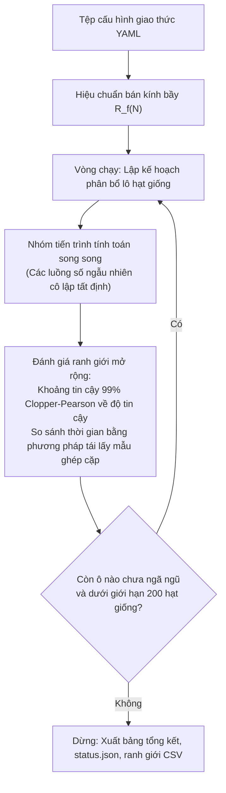
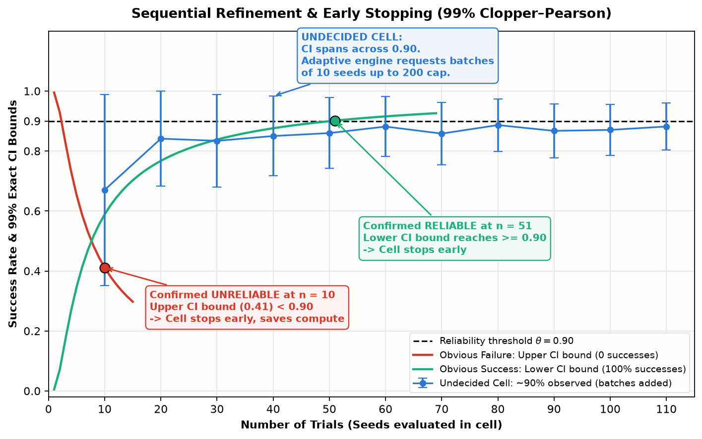
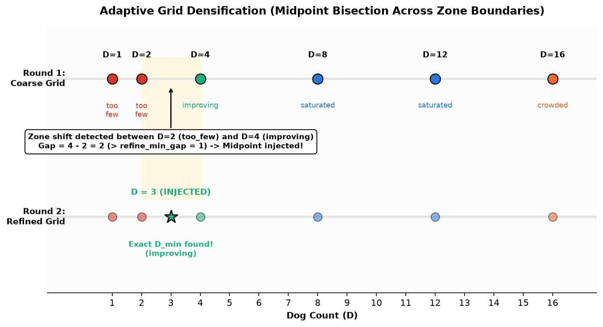
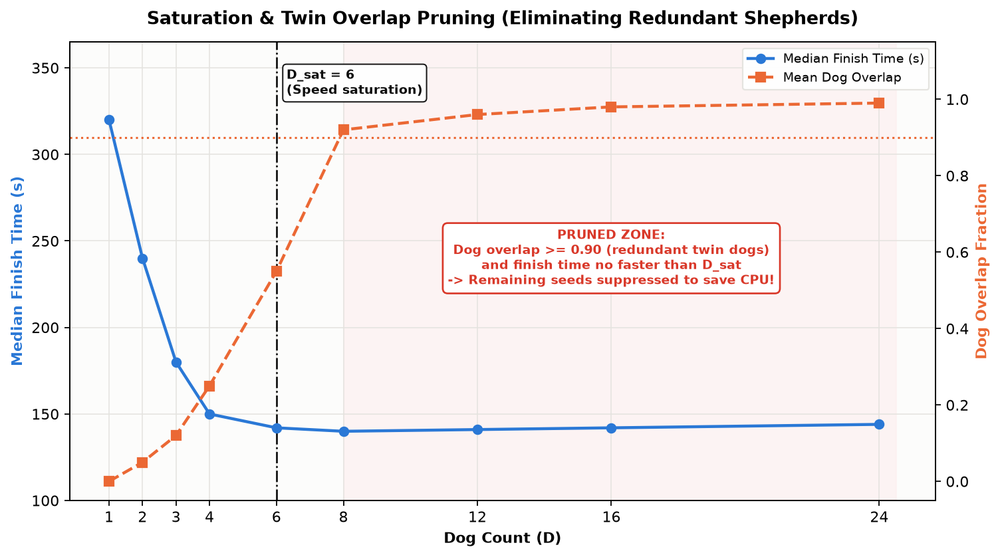
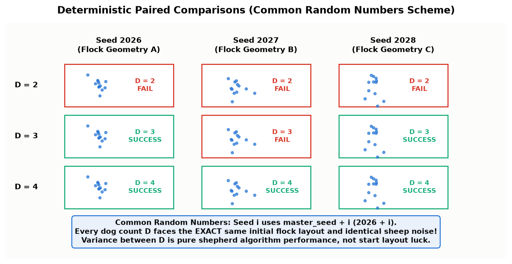
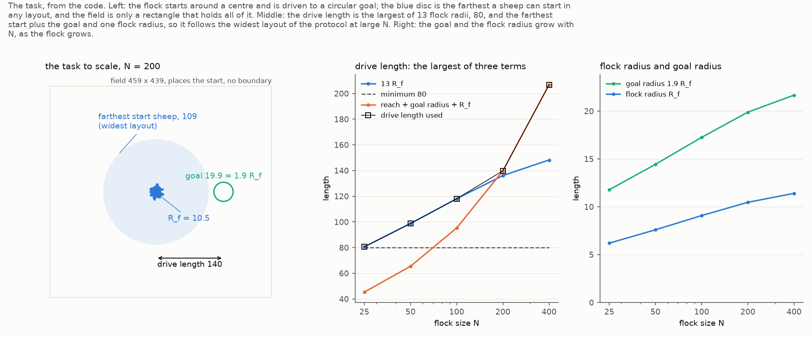
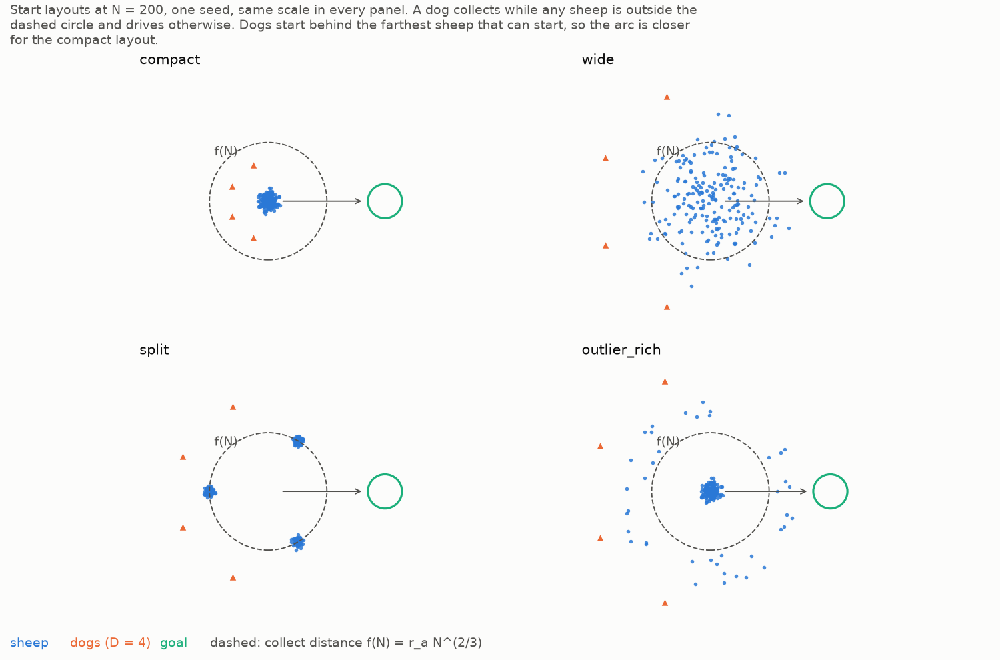
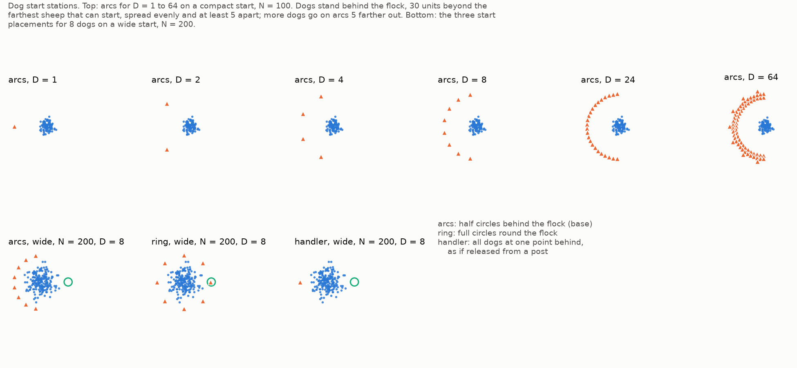
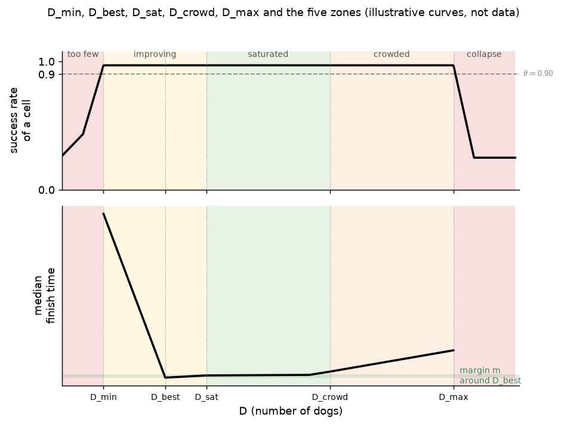

# HerdSim

[**English**](README.md) | [**Tiếng Việt**](README_vi.md)

[](LICENSE)
[](https://www.python.org/downloads/)
[](tests/)
[](results/)

**HerdSim** là một nền tảng mô phỏng đa tác tử và phòng thí nghiệm thực nghiệm phục vụ nghiên cứu hành vi chăn dắt đàn tập thể. Nền tảng tập trung giải quyết câu hỏi nền tảng trong lĩnh vực sinh học hành vi và robot bầy đàn phỏng sinh học:

> **Cần bao nhiêu tác tử chăn dắt tự hành ($D$) để thu gom và lùa một bầy gồm $N$ cá thể cừu về vùng đích chỉ định trong một thời hạn nhất định với độ tin cậy cao, và số lượng tối thiểu này ($D_{\min}$) mở rộng theo quy mô bầy đàn, độ phân tán ban đầu, áp lực thời gian cùng các quy tắc phối hợp như thế nào?**

Nếu thời gian là vô hạn, một chú chó chăn dắt duy nhất cuối cùng cũng có thể thu gom và dẫn dắt hầu hết mọi bầy cừu bằng cách tuần tự đuổi theo từng cá thể lạc đàn. Tuy nhiên, khi chịu áp lực thời hạn hữu hạn, việc chăn dắt trở thành một bài toán phối hợp tập thể chủ động: các tác tử phải phân công song song việc thu gom các cá thể tản mác, ngăn chặn bầy đàn bị vỡ cụm, và đồng thời lùa toàn bộ khối đàn mà không làm tán loạn biên hay gây ùn tắc cục bộ.

HerdSim kết hợp mô hình vật lý vi mô độ trung thực cao của từng tác tử (dựa trên các mô hình của [Strömbom et al. 2014](https://doi.org/10.1098/rsif.2014.0719) và [Kubo et al. 2022](https://doi.org/10.1007/s10015-021-00726-7)) với tầng phân công nhiệm vụ đa chó mới, cấu trúc hình học nhiệm vụ bảo đảm tính bất biến theo quy mô, và động cơ thống kê tuần tự thích ứng (kiểm định khoảng tin cậy 99% Clopper–Pearson).


*Hình 1: Diễn biến của một lượt thử nghiệm mô phỏng thực tế ($N = 200$ cừu, $D = 4$ chó, bố cục xuất phát rộng wide, hạt giống 2026). Các chú chó tự động nhận diện các cá thể tản mác ở xa, thực hiện thu gom song song để hợp nhất bầy đàn, sau đó thiết lập đội hình vòng cung phía sau tâm khối bầy để lùa toàn bộ đàn cừu vào mục tiêu hình tròn.*

---

## Mục lục

- [Phát hiện khoa học cốt lõi](#phát-hiện-khoa-học-cốt-lõi)
- [Cơ chế vận hành của một chiến dịch](#cơ-chế-vận-hành-của-một-chiến-dịch)
- [Hình học nhiệm vụ và Tính bất biến theo quy mô](#hình-học-nhiệm-vụ-và-tính-bất-biến-theo-quy-mô)
- [Các cấu hình bầy đàn ban đầu](#các-cấu-hình-bầy-đàn-ban-đầu)
- [Mô hình tác tử và Cơ chế phối hợp đa chó](#mô-hình-tác-tử-và-cơ-chế-phối-hợp-đa-chó)
- [Quy tắc ra quyết định thống kê và Ranh giới](#quy-tắc-ra-quyết-định-thống-kê-và-ranh-giới)
- [Phân tích độ nhạy và Tính bền vững](#phân-tích-độ-nhạy-và-tính-bền-vững)
- [Bắt đầu nhanh](#bắt-đầu-nhanh)
- [Cấu trúc dữ liệu kết quả](#cấu-trúc-dữ-liệu-kết-quả)
- [Kiến trúc dự án](#kiến-trúc-dự-án)
- [Kiểm chứng và Chuẩn thử nghiệm](#kiểm-chứng-và-chuẩn-thử-nghiệm)
- [Tài liệu tham khảo](#tài-liệu-tham-khảo)

---

## Phát hiện khoa học cốt lõi

Qua 23 giao thức thực nghiệm hoàn thành **164.740 lượt mô phỏng độc lập** (không xảy ra bất kỳ lỗi thực thi hay lỗi mô phỏng nào), HerdSim đã lập bản đồ ranh giới mở rộng $D_{\min}(N)$ cho $N \in [25, 400]$ qua nhiều bố cục, mốc thời hạn và các biến thể phối hợp khác nhau.

Toàn bộ các bảng dữ liệu thực nghiệm được trích xuất trực tiếp từ thư mục `results/` thông qua tập lệnh [`cli/dmin_tables.py`](cli/dmin_tables.py) và được tổng hợp trong [`docs/report/results_tables.md`](docs/report/results_tables.md); báo cáo đầy đủ là [`docs/report/d_min_report_vi.md`](docs/report/d_min_report_vi.md). Một ô như "3-8" là một khoảng: $D = 8$ là đội tin cậy nhỏ nhất, nhưng các $D$ từ 3 trở lên vẫn chưa ngã ngũ ở 200 hạt giống, nên $D_{\min}$ thực nằm trong $[3, 8]$.


*Hình 2: Quy luật mở rộng thực nghiệm của D_min theo quy mô bầy đàn N tại ba mốc thời hạn chuẩn hóa (12×, 6× và 3× thời gian lùa tiêu chuẩn). Vòng tròn biểu thị tiêu chí thành công nghiêm ngặt (100% cừu nằm trong đích); hình vuông biểu thị tiêu chí 99% (f99). Đối với bầy cừu co cụm (compact), D_min = 1 ở mọi quy mô. Đối với bầy phân tán, D_min tăng trưởng dưới tuyến tính theo N và chịu sự chi phối mạnh mẽ của áp lực thời hạn.*

### 1. Bầy cừu co cụm có quy luật mở rộng bất biến ($D_{\min} = 1$)
Khi bầy cừu khởi đầu ở trạng thái không gian liên kết chặt chẽ (`compact`), **duy nhất một chú chó là đủ cho mọi quy mô đàn được kiểm tra ($N = 25$ đến $400$) và mọi mốc thời hạn (từ $12\times$ xuống $3\times$ thời gian lùa)**. Do không có con cừu nào nằm ngoài ngưỡng thu gom, nhiệm vụ thuần túy chỉ là lùa đàn theo hướng thẳng. Việc bổ sung thêm chó vào bầy co cụm không đem lại cải thiện nào về độ tin cậy ($D_{\min} = 1$) và nhanh chóng bão hòa thời gian hoàn thành.

### 2. Bầy cừu phân tán tăng trưởng dưới tuyến tính theo $N$
Trên các bố cục phân tán (`wide`, `split`, `outlier_rich`), đội chó phải dành thời gian ban đầu để thu gom các cá thể tản mác ở xa trước khi có thể tiến hành lùa đàn:
- Ở các thời hạn rộng rãi ($12\times$ thời gian lùa), $D_{\min}$ duy trì ở mức 1 cho $N \le 100$, và chỉ tăng nhẹ lên 2 hoặc 3 chó khi $N = 400$.
- Trong không gian log-log ($\log_2 D_{\min}$ so với $\log_2 N$), độ dốc tăng trưởng của các bố cục phân tán nằm trong khoảng **0,2 đến 0,5** ở thời hạn $12\times$ và $6\times$ (một hàng đạt 0,8): tăng gấp đôi quy mô bầy đàn chỉ đòi hỏi 0,2 đến 0,5 lần gấp đôi số chó.

### 3. Thời hạn là tham số chi phối bậc một
Việc rút ngắn thời hạn từ $12\times$ xuống $3\times$ thời gian lùa làm tăng $D_{\min}$ nhiều hơn cả việc tăng quy mô bầy cừu lên gấp bốn lần. Tại thời hạn $3\times$, bầy phân tán rộng ở quy mô $N = 400$ cần 5-6 chó (theo tiêu chí 99%) so với 2 chó ở $12\times$, và không có đội nào trên lưới thu gom tin cậy được các cụm rời ở $N \ge 200$.

### 4. Cơ chế cá thể rớt lại (Hiệu ứng Straggler)
Một hiểu biết sinh học then chốt được khám phá khi đối chiếu tiêu chí thành công nghiêm ngặt (100% cừu nằm trong vòng tròn đích tại một nhịp duy nhất) với tiêu chí ngưỡng 99% ($f_{99}$):


*Hình 3: Hiệu ứng cá thể rớt lại (Straggler Effect). Trái: Trong các lượt thử nghiệm sử dụng từ 6 chó trở lên (bố cục wide và outlier_rich, N thuộc {100, 200, 400}), đàn chó chạy nhanh (tốc độ 1,5) đưa được 99% bầy cừu vào đích trong hầu hết mọi lượt chạy, nhưng tỷ lệ đạt chuẩn nghiêm ngặt 100% lại sụp đổ; đàn chó chạy chậm hơn (tốc độ 1,15) không gặp phải hiện tượng này. Phải: Chuỗi thời gian của cùng một bầy cừu xuất phát (bố cục wide, N = 400, D = 16 chó, hạt giống 2). Đội chó chạy nhanh lùa đàn cừu vào đích chỉ còn sót 1 hoặc 2 con bên ngoài, sau đó bầy bị đẩy ra khỏi đích và rất lâu sau mới quay lại. Bầy của đội chó chạy chậm ở trong đích ngay lượt đầu.*

Hai tiêu chí đo hai điều khác nhau. Tiêu chí 99% hỏi đội chó có đưa được bầy vào đích không; tiêu chí strict còn chấm điểm việc các chó làm gì sau khi bầy đã đến, và quy tắc đội này không có bước nào cho việc đó. Trong các lượt thất bại strict, 99% đến 100% số lượt với từ 6 chó trở lên đã đưa được 99% bầy vào. Dưới tiêu chí strict, các quy ước thiết lập không có giá trị thực tế (khoảng cách xuất phát, vị trí xuất phát, bộ tham số cừu, tốc độ chó) làm $D_{\min}$ thay đổi tới sáu lần; dưới tiêu chí 99% chúng chỉ làm lệch tối đa một chó, và chỉ mục tiêu hẹp hơn mới tác động nhiều hơn. Cả hai tiêu chí được báo cáo song song. Kết quả này ủng hộ việc tách việc bầy đến đích (một tỷ lệ bầy ở bên trong) khỏi việc giữ bầy (thời gian ở bên trong, hoặc một chuồng).

### 5. Sự phối hợp, không phải số lượng chó, làm $D_{\min}$ hữu hạn
Một quy tắc đối chứng không phối hợp (FAT, mọi chó cùng đuổi con cừu xa mục tiêu nhất), chạy trên cùng nhiệm vụ, không cải thiện khi thêm chó: từ $N = 200$ nó không có đội tin cậy nào trên mọi bố cục phân tán dưới cả hai tiêu chí, và trên bầy compact ở $N = 400$ nó thất bại trong khi đội có phối hợp chỉ cần 1 chó. Các chó của nó chọn cùng một con cừu và di chuyển như các bản sao.


*Hình 3b: Tỷ lệ thành công theo D của strombom_multi (xanh) và FAT (cam) trên cùng nhiệm vụ, strict (nét liền) và 99% (nét đứt), thời hạn 6x.*

### 6. Các thước đo theo từng lượt cho thấy gì
Mỗi lượt chạy lưu tóm tắt của 15 thước đo theo từng nhịp về bầy và đàn chó. Hai trong số đó bổ sung cho các phát hiện trên:
- Giữa các ô, thành công giảm khi bầy phân tán: tương quan Spearman từ -0,56 đến -0,81 ở thời hạn $6\times$ và $3\times$ dưới cả hai tiêu chí, gần với -0,70 của bản thảo 2025. Nhân độ phân tán với $N$ chỉ làm tương quan thay đổi tối đa 0,02.
- Trên bầy split ở $N = 200$, khoảng một phần tư số chó đứng yên theo quy tắc dừng từ $D = 4$ trở đi, so với khoảng 1% trên wide, và rút ngắn khoảng dừng làm thời gian hoàn thành giảm khoảng một phần năm. Chỉ riêng việc chen nhau không phải nguyên nhân: các bầy wide có cùng tỷ lệ chó song sinh mà không bị ảnh hưởng.


*Hình 3c: (a) Thành công của ô theo độ phân tán trung bình của bầy. (b) Chó đứng yên và (c) chó có song sinh trong phạm vi 2 đơn vị, theo D, ở $N = 200$ dưới tiêu chí 99%. Chi tiết ở mục 6.10 của [báo cáo](docs/report/d_min_report_vi.md).*

---

## Cơ chế vận hành của một chiến dịch

Thay vì quét ngẫu nhiên theo phương pháp Monte Carlo cố định mẫu gây lãng phí tính toán trên hàng trăm tổ hợp tham số, HerdSim áp dụng **thuật toán thăm dò thích ứng tuần tự**.

Một **giao thức** (được định nghĩa trong thư mục [`protocols/configs/protocols/`](protocols/configs/protocols/)) xác định không gian tham số: mô hình cừu, thuật toán điều khiển chó, quy mô bầy đàn $N$, số lượng chó $D$, bố cục khởi đầu và các mốc thời hạn. Mỗi tổ hợp phương pháp, bố cục và quy mô $N$ tạo thành một **đường cong $D$** (nhóm). Mỗi giá trị số lượng chó $D$ cụ thể trong đường cong đó là một **ô thử nghiệm**, và mỗi hạt giống ngẫu nhiên được đánh giá là một **lượt thử nghiệm**.



### Cơ chế thực thi thích ứng

HerdSim tích hợp bốn cơ chế thống kê tự động nhằm tập trung tài nguyên tính toán chính xác vào các ranh giới ra quyết định:

#### 1. Tinh chỉnh tuần tự & Dừng sớm (Khoảng tin cậy 99% Clopper–Pearson)
Mỗi ô bắt đầu bằng một lô cơ sở (mặc định 10 hạt giống). Nếu khoảng tin cậy 99% Clopper–Pearson xác nhận ô đó đạt độ tin cậy cao (cận dưới CI $\ge 0,90$, đòi hỏi tối thiểu 51 trận thắng liên tiếp) hoặc không tin cậy (cận trên CI $< 0,90$), việc đánh giá dừng lại ngay lập tức. Các ô chưa ngã ngũ nhận thêm từng lô 10 hạt giống cho đến mức trần 200 hạt giống, tập trung năng lực xử lý vào những vùng có phương sai phân loại lớn nhất.


*Hình 4: Tinh chỉnh tuần tự và dừng sớm bằng khoảng tin cậy chính xác 99% Clopper–Pearson. Các trường hợp thất bại rõ ràng dừng ở 10 hạt giống; các trường hợp thành công rõ ràng dừng sau 51 trận thắng liên tiếp; các ô chưa ngã ngũ tiếp tục nhận từng lô 10 hạt giống tới trần 200 hạt giống.*

#### 2. Làm dày lưới thích ứng (Chèn điểm chia đôi)
Khi hai giá trị số chó $D$ liền kề nằm ở hai vùng hành vi khác nhau (ví dụ $D = 2$ thuộc vùng `quá ít` và $D = 4$ thuộc vùng `đang cải thiện`), giá trị nguyên ở điểm giữa ($D = 3$) sẽ tự động được chèn vào đường cong cho vòng chạy kế tiếp để xác định chính xác $D_{\min}$ mà không cần phỏng đoán thô.


*Hình 5: Làm dày lưới thích ứng. Sự chuyển đổi vùng hành vi giữa D = 2 và D = 4 kích hoạt việc tự động chèn điểm D = 3 trong Vòng 2, định vị chuẩn xác ranh giới chuyển tiếp với số lượt thử bổ sung tối thiểu.*

#### 3. Bão hòa & Cắt tỉa trùng lặp
Phía trên điểm bão hòa đã xác nhận ($D_{\text{sat}}$), nếu việc bổ sung thêm chó chỉ tạo ra các bản sao đường đi của nhau (độ trùng lặp trung bình `dog_overlap` $\ge 0,90$) mà không giúp giảm thời gian hoàn thành, các hạt giống tiếp theo cho ô đó sẽ bị ngừng cấp (`cắt tỉa`) để loại bỏ tính toán dư thừa.


*Hình 6: Bão hòa và cắt tỉa trùng lặp. Khi tốc độ hoàn thành nhiệm vụ đạt trạng thái bình nguyên tại D_sat, các ô có độ trùng lặp cao (>= 0,90) được đánh dấu cắt tỉa, tránh lãng phí tài nguyên đánh giá các cá thể dư thừa.*

#### 4. So sánh ghép cặp tất định (Chuỗi số ngẫu nhiên chung)
Mọi hạt giống $i$ được đánh giá qua các ô đều sử dụng `master_seed + i` (mặc định $2026 + i$). Bố cục khởi tạo bầy cừu và các chuỗi nhiễu ngẫu nhiên của cừu được sinh độc lập, bảo đảm rằng phép so sánh giữa $D = 2$ và $D = 4$ đối mặt với **cùng một cấu hình bầy đàn ban đầu và cùng chuỗi quyết định ngẫu nhiên của cừu**, loại bỏ yếu tố may rủi về bố cục không gian khi so sánh các thuật toán chăn dắt.


*Hình 7: Cơ chế số ngẫu nhiên dùng chung. Các hạt giống 2026, 2027 và 2028 sinh ra cấu trúc hình học bầy đàn ban đầu và chuỗi nhiễu cừu đồng nhất qua mọi số lượng chó D được thử nghiệm, phân lập hoàn toàn hiệu quả thực chất của thuật toán điều khiển.*

#### 5. Khả năng tạm dừng và khôi phục an toàn
Mỗi lượt thử nghiệm được ghi nhận trực tiếp xuống ổ đĩa ngay khi kết thúc (`trials.jsonl` và `trials.csv`). Chiến dịch có thể tạm dừng an toàn (`SIGINT`) và tiếp tục chạy tiếp tục mà không làm mất tiến độ; khóa tệp ngăn ngừa xung đột ghi đồng thời từ nhiều tiến trình.

---

## Hình học nhiệm vụ và Tính bất biến theo quy mô

Một thiếu sót phổ biến trong các mô phỏng chăn dắt tác tử là việc cố định kích thước sàn đấu trong khi thay đổi quy mô bầy đàn $N$. Do 400 con cừu chiếm diện tích vật lý tự nhiên lớn hơn nhiều so với 25 con cừu, kích thước cố định sẽ tạo ra sự giam cầm nhân tạo và làm sai lệch mật độ không gian với số lượng cá thể.

HerdSim bảo đảm **tính bất biến theo quy mô (scale invariance)** bằng cách neo toàn bộ kích thước không gian và thời gian vào **bán kính bầy cân bằng đã hiệu chuẩn $R_f(N)$**: bán kính ổn định của bầy gồm $N$ cá thể cừu khi được lùa bởi một chú chó duy nhất.


*Hình 8: Hình học nhiệm vụ vẽ theo đúng tỷ lệ từ mã nguồn mô phỏng. Trái: Cấu trúc không gian tại N = 200. Vòng tròn đích, cự ly lùa đàn và biên đấu trường mở rộng tương ứng với R_f(N). Giữa: Công thức khoảng cách lùa đàn. Phải: Tốc độ tăng trưởng đã hiệu chuẩn của bán kính bầy R_f và bán kính đích R_goal theo N.*

| Tham số | Biểu thức toán học | Cơ sở vật lý |
|---|---|---|
| **Bán kính bầy** $R_f(N)$ | Đo đạc thực nghiệm (ví dụ: 3,14 tại $N=5$, 9,08 tại $N=100$, 11,4 tại $N=400$) | Phản ánh khoảng cách cân bằng tự nhiên giữa các cá thể dưới áp lực lùa đàn. |
| **Khoảng cách lùa đàn** | $\max(13 \cdot R_f(N), 80, \text{reach} + R_{\text{goal}} + R_f)$ | Đảm bảo bầy lớn phải di chuyển quãng đường dài hơn tương ứng với quy mô vật lý. |
| **Bán kính đích** $R_{\text{goal}}$ | $1{,}9 \cdot R_f(N)$ | Chuẩn hóa độ khó gom giữ đàn qua các quy mô bầy cừu khác nhau. |
| **Khoảng cách lề đấu trường** | 80 đơn vị tính từ tác tử khởi đầu xa nhất | Đặt các thực thể ban đầu an toàn cách xa các biên tọa độ. |
| **Biên mở** | **Hoàn toàn không có tường phản xạ** | Tường phản xạ hoạt động như công cụ gom cừu nhân tạo làm thổi phồng tỷ lệ thành công. Tác tử được tự do di chuyển. |

### Chuẩn hóa thời hạn

Thời hạn được xác định là bội số $m$ của **thời gian lùa đàn đặc trưng**:

$$
T_{\text{drive}} = \frac{\text{Khoảng cách lùa đàn}}{v_{\text{cừu,tối đa}}}
$$

Một lượt thử nghiệm đánh giá tại $m = 6$ yêu cầu đội chó phải thu gom và lùa bầy cừu vào đích trong vòng 6 lần thời gian di chuyển tối thiểu theo lý thuyết của con cừu nhanh nhất. Một bầy cừu co cụm được lùa bởi một chú chó tối ưu hoàn thành nhiệm vụ trong khoảng từ $1,45$ đến $1,74 \times T_{\text{drive}}$; vì vậy các giá trị $m \in \{12, 6, 3\}$ cung cấp một thang đo thực tế từ thời gian thoải mái đến áp lực gấp gáp.

| Quy mô đàn ($N$) | Bán kính bầy $R_f$ | Khoảng cách lùa $l$ | Thời gian lùa ($T_{\text{drive}}$) | Thời hạn 12× (Rộng rãi) | Thời hạn 6× (Trung bình) | Thời hạn 3× (Gấp gáp) |
| :---: | :---: | :---: | :---: | :---: | :---: | :---: |
| **$N = 25$** | 6,20 m | 80,6 m | **80,6 s** (~1,3 phút) | 967 s (~16,1 phút) | 484 s (~8,1 phút) | 242 s (~4,0 phút) |
| **$N = 50$** | 7,60 m | 98,8 m | **98,8 s** (~1,6 phút) | 1.185 s (~19,8 phút) | 593 s (~9,9 phút) | 296 s (~4,9 phút) |
| **$N = 100$** | 9,08 m | 118,1 m | **118,1 s** (~2,0 phút) | 1.417 s (~23,6 phút) | 708 s (~11,8 phút) | 354 s (~5,9 phút) |
| **$N = 200$** | 10,47 m | 139,8 m | **139,8 s** (~2,3 phút) | 1.678 s (~28,0 phút) | 839 s (~14,0 phút) | 419 s (~7,0 phút) |
| **$N = 400$** | 11,40 m | 206,8 m | **206,8 s** (~3,4 phút) | 2.482 s (~41,4 phút) | 1.241 s (~20,7 phút) | 620 s (~10,3 phút) |

*Ghi chú: Khoảng cách lùa đàn $l = \max(13 \cdot R_f, 80, \text{reach} + R_{\text{goal}} + R_f)$. Tại quy mô $N = 400$, số hạng khoảng cách khởi đầu chiếm ưu thế (206,8 m) vì bán kính phân tán ban đầu của bố cục rời rạc tăng theo $N^{2/3}$ trong khi $R_f$ tăng dưới tuyến tính, bảo đảm vùng đích không bao giờ chồng lấn lên vị trí ban đầu của cừu.*

---

## Các cấu hình bầy đàn ban đầu

Để nghiên cứu quá trình chuyển tiếp giữa giai đoạn thu gom và lùa đàn, HerdSim cung cấp bốn cấu hình hình học không gian ban đầu:


*Hình 9: Bốn bố cục bầy cừu ban đầu được đánh giá tại N = 200 với D = 4 chó (trên cùng một tỷ lệ không gian). Vòng tròn nét đứt màu xám đánh dấu ranh giới thu gom giải tích f(N) = r_a · N^(2/3). Bất kỳ con cừu nào nằm ngoài vòng tròn này sẽ kích hoạt quy tắc thu gom chủ động.*

1. **`compact` (co cụm)**: Bầy cừu được lấy mẫu từ phân phối Gauss 2D ($\sigma = 0,5 \cdot R_f$, cắt cụt tại $3\sigma$). Toàn bộ cừu xuất phát nằm gọn trong $f(N)$; đàn chó lập tức tiến hành lùa đàn.
2. **`wide` (phân tán rộng)**: Bầy cừu lấy mẫu từ phân phối Gauss rộng ($\sigma = 0,5 \cdot 2 N^{2/3}$). Cừu rải rác trên diện rộng, đòi hỏi đội chó phải quét gom vòng ngoài đáng kể.
3. **`split` (cụm phân tách)**: Bầy cừu được chia thành 3 cụm co cụm nhỏ (2 cụm nếu $N < 12$) đặt đối xứng trên vòng tròn bán kính $2 N^{2/3}$. Chó phải tiếp cận từng cụm riêng lẻ mà không làm phân tán chúng thêm.
4. **`outlier_rich` (nhiều cá thể tản mác)**: 80% số cừu nằm trong lõi co cụm dày đặc, trong khi 20% cá thể phân tán rải rác từ $1,1$ đến $1,6 \times 2 N^{2/3}$.

### Vị trí xuất phát của chó (`dog_start`)

Chó xuất phát ở vị trí cách biên sau của bầy cừu 30 đơn vị, bố trí theo một trong ba hình thức thực nghiệm:
- **`arcs` (vòng cung mặc định)**: Chó đứng cách đều nhau trên các nửa đường tròn đồng tâm phía sau bầy cừu. Chó đơn lẻ xuất phát ngay trên trục lùa đàn; các chú chó bổ sung chiếm các vị trí bọc sườn riêng biệt.
- **`ring` (vòng tròn bao quanh)**: Chó phân bố đều trên đường tròn bao quanh bầy cừu, chừa ra hình nón (nhìn từ tâm bầy) chứa mục tiêu, nhằm kiểm tra xem việc bao vây hỗ trợ hay cản trở việc thu gom ban đầu. Một đường tròn đầy đủ đặt một chó ngay trong mục tiêu với mọi $D$ chẵn từ $N = 200$; lượt chạy ring đầu tiên đó được giữ trong `results/dmin_s_ring_dog_in_goal` và không được sử dụng.
- **`handler` (trạm người điều khiển)**: Toàn bộ đàn chó cùng xuất phát từ một điểm duy nhất phía sau bầy cừu (mô phỏng việc thả đàn chó từ vị trí của người chăn dắt; tại $t = 0$ toàn bộ chó bắt đầu trùng tọa độ tại điểm này trước khi tỏa ra).


*Hình 10: Các cấu hình xuất phát của chó (dog_start). Trên: Cấu hình vòng cung mặc định arcs từ D = 1 đến D = 64 phía sau bầy N = 100 cừu (chó đứng trên các vòng cung đồng tâm cách biên bầy 30 đơn vị). Dưới: So sánh trực tiếp ba cấu hình hình học (arcs, ring, handler) tại N = 200 với D = 8 chó trên bố cục wide (ở chế độ handler, cả 8 chú chó bắt đầu trùng tọa độ tại điểm xuất phát duy nhất).*

**Tại sao cần đánh giá trạm xuất phát tập trung `handler`?** Trong các cuộc thi và thực tế chăn thả gia súc, người điều khiển thả chó từ một vị trí duy nhất phía sau bầy thay vì bố trí sẵn chó rải đều trên đồng cỏ. HerdSim đưa vào cấu hình `handler` như một thử nghiệm kiểm chứng để xác nhận rằng việc bố trí sẵn dạng `arcs` không tạo ra lợi thế nhân tạo cho thuật toán. Việc cho toàn bộ chó bắt đầu tại cùng tọa độ $(x, y)$ tại $t = 0$ loại bỏ sự thiên vị hướng di chuyển trước khi thuật toán phân công chạy; tại $t = 1$, bộ điều phối đội ngũ lập tức tỏa các chú chó đến các mục tiêu được phân công.

---

## Mô hình tác tử và Cơ chế phối hợp đa chó

HerdSim hiện thực hóa các tương tác vật lý vi mô dựa trên tài liệu sinh học thực nghiệm đã được kiểm chứng, mở rộng thêm một tầng phối hợp tập thể nhằm ngăn chặn hành vi bắt chước đường đi lẫn nhau gây lãng phí.


*Hình 11: Cơ chế phối hợp đa chó trong quy tắc strombom_multi. Trái: Phân công thu gom cá thể tản mác. D chú chó được ghép cặp với D cá thể cừu xa nhất thông qua thuật toán gán trọng số khoảng cách Euclidean tối thiểu (tổng quãng đường di chuyển ngắn nhất). Giữa: Đội hình lùa đàn song song. Chó chiếm các vị trí góc cách đều nhau trên vòng cung lùa đàn bao trọn bề rộng bầy cừu, duy trì thứ tự góc để không cắt chéo đường đi. Phải: Hòa trộn lực đẩy đơn vị. Nhiều chú chó áp sát một con cừu kết hợp ảnh hưởng của chúng thành một vector đẩy đơn vị chuẩn hóa.*

### 1. Động lực học chuyển động của cừu ([Strömbom et al. 2014](https://doi.org/10.1098/rsif.2014.0719))

Được xây dựng từ các quan sát sinh học thực nghiệm về hành vi bầy đàn dưới áp lực kẻ săn mồi, hành vi của cừu được điều khiển bởi một máy trạng thái kích hoạt theo mối đe dọa:

#### Trạng thái chạy trốn chủ động ($\min_j \lVert \mathbf{x}_i - \mathbf{y}_j \rVert < r_s$)
Khi có bất kỳ chú chó nào tiến vào trong bán kính đe dọa $r_s$, cừu $i$ tính toán vector hướng di chuyển thô $\mathbf{H}_i'$ cân bằng giữa quán tính, các lực xã hội bầy đàn, lực né tránh chó và nhiễu ngẫu nhiên:

$$
\mathbf{H}_i' = h\,\mathbf{H}_i + c\,\mathbf{C}_i + \rho_a\,\mathbf{R}_{a,i} + \rho_s\,\mathbf{R}_{s,i} + e\,\mathbf{\epsilon}_i
$$

trong đó mỗi thành phần cấu thành là một **vector đơn vị** được điều chỉnh theo trọng số hành vi tương ứng (Bảng 2):
- $\mathbf{H}_i$: Vector đơn vị **hướng đi trước đó** (hướng từ nhịp trước, bằng 0 nếu nhịp trước đứng yên), với trọng số quán tính $h = 0,5$.
- $\mathbf{C}_i$: Vector đơn vị **lực hút co cụm** hướng về tâm khối cục bộ ($\text{LCM}_i$) của $n$ láng giềng gần nhất ($n = N - 1$), với trọng số lực hút $c = 1,05$:

$$
\mathbf{C}_i = \frac{\text{LCM}_i - \mathbf{x}_i}{\lVert \text{LCM}_i - \mathbf{x}_i \rVert}, \quad \text{với } \text{LCM}_i = \frac{1}{n} \sum_{k \in \mathcal{N}_n(i)} \mathbf{x}_k
$$

- $\mathbf{R}_{a,i}$: Vector đơn vị **lực đẩy né tránh giữa các cừu** đẩy xa khỏi các cá thể láng giềng gần hơn khoảng cách va chạm $r_a = 2$, với trọng số lực đẩy $\rho_a = 2,0$:

$$
\mathbf{R}_{a,i} = \frac{\sum_{j \ne i, \lVert \mathbf{x}_i - \mathbf{x}_j \rVert < r_a} \frac{\mathbf{x}_i - \mathbf{x}_j}{\lVert \mathbf{x}_i - \mathbf{x}_j \rVert}}{\left\lVert \sum_{j \ne i, \lVert \mathbf{x}_i - \mathbf{x}_j \rVert < r_a} \frac{\mathbf{x}_i - \mathbf{x}_j}{\lVert \mathbf{x}_i - \mathbf{x}_j \rVert} \right\rVert}
$$

- $\mathbf{R}_{s,i}$: Vector đơn vị **lực hoảng sợ né tránh chó** đẩy xa khỏi những chú chó nằm trong bán kính đe dọa $r_s = 65$, với trọng số lực hoảng sợ $\rho_s = 1,0$.
- $\mathbf{\epsilon}_i$: Vector đơn vị **nhiễu ngẫu nhiên** chỉ theo hướng ngẫu nhiên lấy mẫu đều từ $[0, 2\pi)$, với trọng số nhiễu $e = 0,3$.

Cừu $i$ tiến một bước có độ dài $\delta = 1$ m (vận tốc $\delta = 1$ m/s) theo hướng vector đã chuẩn hóa:

$$
\mathbf{x}_i^{t+1} = \mathbf{x}_i^t + \delta\,\frac{\mathbf{H}_i'}{\lVert \mathbf{H}_i' \rVert}
$$

#### Trạng thái gặm cỏ ($\min_j \lVert \mathbf{x}_i - \mathbf{y}_j \rVert \ge r_s$)
Khi toàn bộ các chú chó nằm ngoài bán kính đe dọa $r_s$, cừu không chịu tác động của lực hút bầy đàn hay lực né tránh; chúng ở trạng thái **gặm cỏ**: đứng yên tại chỗ, hoặc với xác suất $p = 0,05$ bước một bước độ dài $\delta$ theo một hướng ngẫu nhiên đều:

$$
\mathbf{x}_i^{t+1} = \begin{cases}
\mathbf{x}_i^t + \delta\,\mathbf{\epsilon}_{\text{graze}}, & \text{với xác suất } 0{,}05 \\
\mathbf{x}_i^t, & \text{với xác suất } 0{,}95
\end{cases}
$$

#### Hòa trộn lực đẩy đa tác tử ($\mathbf{R}_{s,i}$)

Mô hình gốc của Strömbom et al. (2014) được thiết kế cho **duy nhất 1 chú chó**, trong đó vector đe dọa đơn giản là vector đơn vị chỉ trực tiếp từ chú chó đó xa dần ra: $\frac{\mathbf{x}_i - \mathbf{y}}{\lVert \mathbf{x}_i - \mathbf{y} \rVert}$. Khi mở rộng sang đội hình nhiều chó ($D \ge 2$), việc cộng dồn lực né tránh độc lập một cách đơn giản sẽ làm nhân bội lực hoảng sợ, lấn át hoàn toàn lực liên kết bầy đàn và làm vỡ đàn. HerdSim giải quyết việc mở rộng lực đẩy đa tác tử bằng cách hòa trộn các vector đẩy đơn vị từ từng chú chó và chuẩn hóa tổng này về độ dài 1:

$$
\mathbf{R}_{s,i} = \frac{\sum_{j \in \text{threat}} \frac{\mathbf{x}_i - \mathbf{y}_j}{\lVert \mathbf{x}_i - \mathbf{y}_j \rVert}}{\left\lVert \sum_{j \in \text{threat}} \frac{\mathbf{x}_i - \mathbf{y}_j}{\lVert \mathbf{x}_i - \mathbf{y}_j \rVert} \right\rVert}
$$

trong đó:
- $\mathbf{x}_i$: Vector tọa độ 2D của cừu $i$.
- $\mathbf{y}_j$: Vector tọa độ 2D của chó $j$.
- $\frac{\mathbf{x}_i - \mathbf{y}_j}{\lVert \mathbf{x}_i - \mathbf{y}_j \rVert}$: Vector đơn vị chỉ thẳng từ chó $j$ ra xa về phía cừu $i$ (hướng thoát ly thuần túy khỏi chó $j$).
- $\text{threat}$: Tập hợp toàn bộ các chú chó hiện đang nằm trong tầm đe dọa của cừu $i$ ($\lVert \mathbf{x}_i - \mathbf{y}_j \rVert < r_s$).

**Ví dụ trực quan:**
Giả sử một con cừu ở tọa độ $(0, 5)$ bị kẹp giữa hai chú chó ở hai bên sườn: Chó 1 ở vị trí $(-3, 0)$ (phía sau bên trái) và Chó 2 ở vị trí $(3, 0)$ (phía sau bên phải).
- Chó 1 tạo ra lực đẩy chéo về phía trước sang phải.
- Chó 2 tạo ra lực đẩy chéo về phía trước sang trái.
- Việc cộng hai vector đơn vị làm triệt tiêu thành phần đẩy ngang sang hai bên, trong khi các thành phần hướng về phía trước được cộng hưởng. Việc chuẩn hóa về độ dài đơn vị tạo ra một lực đẩy tổng hợp hướng thẳng về phía trước $(0, 1)$.

Cơ chế này cho phép đội chó phối hợp điều hướng và bao quát bầy cừu một cách nhịp nhàng thông qua thế gọng kìm hình học mà không tạo ra "siêu lực" phi vật lý hay làm tan vỡ bầy đàn một cách nhân tạo.

### 2. Các bộ điều khiển chó chăn dắt và Mô hình đối chứng

Để đánh giá mức độ cần thiết của cơ chế phối hợp đa tác tử tường minh, HerdSim cài đặt ba kiến trúc điều khiển chó chăn dắt:

#### Kiến trúc phối hợp: `strombom_multi`
- **Chế độ thu gom (Outlier Mode)**: Khi có bất kỳ con cừu nào nằm cách tâm bầy xa hơn $f(N) = r_a \cdot N^{2/3}$, $D$ cá thể cừu tản mác xa nhất được nhận diện. Các chú chó được ghép cặp với từng cá thể cừu này thông qua thuật toán gán tuyến tính (tối thiểu hóa tổng khoảng cách di chuyển Euclidean). Những chú chó dôi dư sẽ tham gia hỗ trợ lùa đàn chính.
- **Chế độ lùa đàn (Drive Mode)**: Khi bầy cừu đã co cụm liên kết, đàn chó dàn thành một hàng vòng cung phía sau bầy ở khoảng cách $r_d$, bao trọn bề rộng góc của bầy. Chó được sắp xếp theo vị trí góc tương đối quanh bầy, bảo đảm chúng không bao giờ cắt chéo đường đi của nhau khi di chuyển vào vị trí lùa được chỉ định.

#### Mô hình đối chứng không phối hợp: `fat` (Farthest-Agent Targeting)

Nhằm kiểm chứng chặt chẽ câu hỏi khoa học: *Liệu sự phối hợp đa tác tử (multi-agent coordination) có thực sự bắt buộc hay không, hay chỉ cần tăng số lượng chó hoạt động độc lập là đủ?*, HerdSim đề xuất và thiết kế mô hình triệt tiêu đối chứng **FAT (Farthest-Agent Targeting)** (`dog_controller="fat"`).

- **Mối liên hệ với các phương pháp trước**: FAT kế thừa cơ chế chọn mục tiêu từ [Kubo et al. (2022)](https://doi.org/10.1007/s10015-021-00726-7) (trong đó mỗi chú chó nhắm vào cá thể cừu ở xa mục tiêu nhất, tiếp cận điểm cách con cừu đó một khoảng $r_a$) và thực hiện bằng bước di chuyển rời rạc của [Strömbom et al. (2014)](https://doi.org/10.1098/rsif.2014.0719).
- **Thiết kế triệt tiêu (ablation)**: Điểm mấu chốt là FAT cố ý loại bỏ **cả hai** cơ chế phân tách không gian đa tác tử:
  1. Không có phép gán cừu tản mác (tổng quãng đường nhỏ nhất) và các vị trí lùa của `strombom_multi`.
  2. Không có lực đẩy giữa các chú chó như trong Kubo et al. (2022).
- **Cùng nhiệm vụ**: $R_f$, vốn quyết định mục tiêu và quãng lùa, được hiệu chuẩn cho FAT bằng người chăn dắt của bài báo trên cùng bầy cừu (`calibrate_as: strombom_multi`), nên `dmin_fat` chạy đúng nhiệm vụ của `dmin_m6` và chỉ khác quy tắc chó.
- **Kết quả**: mọi chó chọn cùng một con cừu và di chuyển như các bản sao (trên bầy compact ở $N \ge 200$, 73% đến 82% số chó FAT có một chó khác trong phạm vi 2 đơn vị), và tỷ lệ thành công không tăng theo $D$. Từ $N = 200$, FAT không có đội tin cậy trên mọi bố cục phân tán dưới cả hai tiêu chí.


*Hình 12: Mô hình đối chứng không phối hợp FAT (Farthest-Agent Targeting). Trái: Hình học của hành vi lùa không phối hợp khi toàn bộ chó cùng săn đuổi con cừu duy nhất ở xa mục tiêu nhất. Phải: Do thiếu cơ chế phân công mục tiêu và lực đẩy giãn cách, đàn chó co cụm lại thành một đám đông hỗn loạn phía sau cùng một cá thể tản mác, dẫn đến độ trùng lặp dog_overlap rất cao và thất bại trong việc gom bầy phân tán.*

#### Kiến trúc trường lực liên tục đa mô hình: `kubo` ([Kubo et al. 2022](https://doi.org/10.1007/s10015-021-00726-7))
Để chứng minh rằng các quy luật mở rộng quy mô không phải là sản phẩm phụ của quy tắc suy nghiệm rời rạc Strömbom, HerdSim tích hợp mô hình trường thế năng liên tục hoàn chỉnh của Kubo et al. (2022), bao gồm cả **cừu Kubo** và **chó Kubo**:
- **Động lực học cừu Kubo**: Vận tốc cừu được cập nhật liên tục qua 4 lực cộng dồn trong tầm nhìn của cừu:
  1. *Lực đẩy giữa các cừu* ($1/r^2$): Ngăn ngừa va chạm và giẫm đạp.
  2. *Căn chỉnh vận tốc*: Đồng bộ hướng di chuyển với các láng giềng xung quanh.
  3. *Lực hút giữa các cừu* ($-1/r$): Gắn kết bầy đàn lại với nhau.
  4. *Trốn chạy khỏi chó* ($1/r^3$): Lực đẩy cự ly gần rất mạnh ra xa khỏi chó.
- **Bộ điều khiển chó Kubo**: Khác với `strombom_multi`, chó Kubo không sử dụng máy trạng thái rời rạc hay bài toán phân công tổ hợp. Thay vào đó, mỗi chú chó di chuyển theo 4 trường thế năng liên tục:
  1. *Lực hút mục tiêu*: Bị hút về phía con cừu ở xa đích nhất.
  2. *Khoảng cách an toàn với mục tiêu* ($1/r^3$): Bị đẩy ra khi tiến quá sát con cừu mục tiêu đó.
  3. *Khoảng cách an toàn với đích*: Bị đẩy ra xa khỏi chu vi vùng đích để tránh lùa cừu ngược ra ngoài.
  4. *Lực đẩy giữa các chó* ($1/r^3$): Các chú chó đẩy nhau rất mạnh, tự động tỏa đều ra dọc theo biên bầy đàn mà không cần giao tiếp tường minh.
- **Vai trò trong HerdSim (`dmin_kubo`)**: Được đánh giá trên bầy cừu co cụm ($N \in \{25, 50, 100\}$, $D \in \{1 \dots 10\}$), mô hình Kubo xác nhận độc lập rằng $D_{\min} = 1$ trên các đàn liên kết, kiểm chứng tính bất biến theo quy mô trên nền tảng các định luật vật lý hoàn toàn khác biệt.


*Hình 13: Mô hình trường lực liên tục của Kubo et al. (2022). Trái: Bốn vector lực tác động lên một con cừu (lực đẩy, căn chỉnh hướng, lực hút, trốn chạy chó). Giữa: Bốn vector lực tác động lên một chú chó (hút về mục tiêu, an toàn mục tiêu, né đích, đẩy giữa các chó). Phải: Quỹ đạo mô phỏng cho thấy lực đẩy giữa các chó tự động buộc chúng phân tán đều dọc theo chu vi bầy đàn.*

---

## Quy tắc ra quyết định thống kê và Ranh giới

Các quyết định thống kê được quản trị bởi mô-đun [`analysis/frontier.py`](analysis/frontier.py). Đối với mỗi ô thử nghiệm (một phương pháp, bố cục, quy mô $N$, và số chó $D$ xác định):

1. **Độ tin cậy ($\theta = 0,90$)**:
   Một ô được phân loại là **tin cậy (reliable)** nếu cận dưới của khoảng tin cậy nhị thức hai phía 99% Clopper–Pearson thỏa mãn $p_{\text{lower}} \ge 0,90$. Ô được phân loại là **không tin cậy (unreliable)** nếu $p_{\text{upper}} < 0,90$, và **chưa ngã ngũ (undecided)** trong các trường hợp còn lại. Cần tối thiểu 51 trận thắng liên tiếp không có trận thua nào để xác lập độ tin cậy ở mức ý nghĩa thống kê 99%.
2. **So sánh thời gian hoàn thành**:
   Các so sánh thời gian hoàn thành theo cặp giữa các ô tin cậy được thực hiện bằng phương pháp tái lấy mẫu ghép cặp (paired bootstrap với 4.000 lần lấy mẫu) trên độ chênh lệch từng hạt giống so với trung vị chậm hơn. Một ô được phân loại là **nhanh hơn (faster)**, **chậm hơn (slower)**, hoặc **tương đương (same)** (trong biên độ dung sai 5%).

### Các chỉ số ranh giới mở rộng phái sinh

| Chỉ số ranh giới | Định nghĩa |
|---|---|
| **$D_{\min}$** | Số lượng chó tin cậy nhỏ nhất $D$. ($D_{\min\_\text{low}}$: giá trị $D$ thấp nhất có cận trên chạm tới ngưỡng $\theta$). |
| **$D_{\text{sat}}$** | Giá trị $D$ tin cậy nhỏ nhất sao cho không có giá trị $D$ lớn hơn nào nhanh hơn một cách có ý nghĩa thống kê. |
| **$D_{\text{best}}$** | Giá trị $D$ tin cậy nhỏ nhất không bị chậm hơn giá trị nhanh nhất trên cùng đường cong. |
| **$D_{\text{crowd}}$** | Giá trị $D > D_{\text{best}}$ tin cậy nhỏ nhất bị chậm hơn rõ rệt so với $D_{\text{best}}$ (ùn tắc). |
| **$D_{\text{overcrowd}}$** | Giá trị $D > D_{\min}$ nhỏ nhất mà tại đó cả nó và giá trị thử nghiệm kế tiếp đều không tin cậy (sụp đổ). |
| **$D_{\max}$** | Số lượng chó tin cậy lớn nhất nằm dưới ngưỡng $D_{\text{overcrowd}}$. |

### Phân vùng hành vi của ô thử nghiệm


*Hình 14: Phân chia trục số lượng chó thành các vùng hành vi được xác định bởi kiểm định độ tin cậy (ngưỡng theta = 0,90) và so sánh thời gian hoàn thành bằng phương pháp tái lấy mẫu ghép cặp đối chiếu với D_best.*

- `too_few`: Không tin cậy, nằm dưới $D_{\min}$.
- `improving`: Tin cậy, nằm dưới $D_{\text{sat}}$; bổ sung thêm chó mang lại sự rút ngắn thời gian có ý nghĩa thống kê.
- `saturated`: Tin cậy, từ $D_{\text{sat}}$ trở lên; bổ sung thêm chó vẫn giữ độ tin cậy nhưng không làm giảm thêm thời gian hoàn thành.
- `crowded`: Tin cậy, nhưng chậm hơn $D_{\text{best}}$ do các chú chó cản trở lẫn nhau.
- `collapse`: Không tin cậy, từ $D_{\text{overcrowd}}$ trở lên; số lượng chó quá mức làm vỡ cụm hoặc liên tục lùa bầy cừu vọt qua khỏi đích.

---

## Phân tích độ nhạy và Tính bền vững

Để khẳng định các phát hiện phản ánh bản chất động lực học tập thể thay vì lựa chọn tham số ngẫu nhiên, HerdSim thực hiện các lượt quét độ nhạy có hệ thống:


*Hình 15: Phân tích độ nhạy của D_min qua các biến thể thực nghiệm (N thuộc {100, 200, 400}, bố cục wide và outlier_rich tại mốc thời hạn 6× thời gian lùa). Các hàng phía trên vạch ngăn cách kiểm tra tiêu chí nghiêm ngặt; các hàng phía dưới kiểm tra tiêu chí 99% (f99). Các hàng cơ sở ("strict: base" và "99%: base") sử dụng các tham số mặc định: tốc độ chó 1,5, xuất phát dạng vòng cung arcs, khoảng cách lùi gap 30, và bán kính đích 1,9 R_f. Ô sáng là chưa ngã ngũ: một khoảng "lo-hi" hoặc một cận dưới "[n]".*

Mọi biến thể được chạy dưới cả hai tiêu chí. Dưới tiêu chí strict các biến thể phân tán tới sáu lần; dưới tiêu chí 99% mọi biến thể trừ mục tiêu hẹp đều nằm trong phạm vi một chó so với cơ sở.

1. **Hình thức xuất phát**: Dưới tiêu chí strict, với từ 8 chó trở lên ở $N = 400$, ring cho tỷ lệ thành công cao nhất và trạm handler thấp nhất. Dưới tiêu chí 99%, cả ba cho cùng $D_{\min}$ trong phạm vi các khoảng; handler vẫn chậm nhất vì mọi chó rời từ một điểm.
2. **Vận tốc của chó (Cơ sở 1,5 so với 1,15)**: Dưới tiêu chí strict, chó chậm cần ít chó hơn trên bầy lớn (outlier_rich $N = 400$: 6 so với không có). Cả hai tốc độ đưa 99% bầy vào đích cùng lúc, và dưới tiêu chí 99% lợi thế này biến mất. Khác biệt nằm ở bước con cừu cuối cùng, không ở việc lùa đàn.
3. **Bộ tham số thực địa**: Bộ tham số đối chiếu thực địa của bài báo ($r_a = 1,0$, khoảng cách phản xạ 75, nhiễu 0,1) làm giảm một nửa khoảng cách thu gom. Dưới tiêu chí strict đây là thiết lập khó nhất; dưới tiêu chí 99% nó cần số chó bằng hoặc ít hơn cơ sở.
4. **Kích thước mục tiêu**: Mục tiêu $1,5 R_f$ là biến thể duy nhất cần nhiều chó hơn dưới cả hai tiêu chí (99%: 5-6 chó ở wide $N = 400$ so với 2-3).

---

## Bắt đầu nhanh

### Cài đặt

HerdSim yêu cầu Python 3.11+ và sử dụng công cụ quản lý gói [`uv`](https://docs.astral.sh/uv/):

```bash
# Sao chép kho mã nguồn
git clone https://github.com/lykimq/HerdSim.git
cd HerdSim

# Cài đặt môi trường phát triển và các gói phụ thuộc
make install     # uv sync --extra dev

# Chạy kiểm tra toàn diện (Ruff linter + kiểm tra kiểu basedpyright + 268 bài kiểm thử)
make check

# Chạy các chiến dịch thu nhỏ để kiểm chứng quy chuẩn (~1 phút)
make bench
```

### Chạy các chiến dịch thực nghiệm

Chạy từng giao thức riêng lẻ hoặc hàng đợi hàng loạt thông qua giao diện dòng lệnh (CLI):

```bash
# Xem trước kế hoạch phân bổ lượt thử cho một giao thức mà không cần thực thi
uv run cli/campaign.py plan --protocol dmin_m6

# Chạy một chiến dịch với 16 tiến trình tính toán song song
uv run cli/campaign.py run --protocol dmin_pilot --workers 16

# Kiểm tra trạng thái trực tiếp của một chiến dịch đang chạy hoặc đã hoàn thành
uv run cli/campaign.py status --protocol dmin_pilot

# Kiểm tra kết quả D_min qua nhiều mốc thời hạn
uv run cli/dmin_report.py --protocol dmin_pilot --folder results/dmin_pilot --multiples 3 6 12

# Chạy toàn bộ chuỗi các giao thức nghiên cứu (tự động tiếp tục khi bị gián đoạn)
uv run cli/run_queue.py --workers 20

# Tạo các bảng kết quả Markdown phục vụ công bố từ thư mục results/
uv run cli/dmin_tables.py record
uv run cli/dmin_tables.py dmin dmin_m12 dmin_m6 dmin_m3
```

---

## Cấu trúc dữ liệu kết quả

Mỗi giao thức khi thực thi sẽ ghi dữ liệu vào một thư mục kết quả khép kín và có thể kiểm tra độc lập:

```text
results/<protocol_id>/
|-- protocol.yaml         Cấu hình hợp nhất (cấu hình chuẩn canonical + ghi đè của giao thức)
|-- provenance.json       Mã giao thức, mã băm vật lý và thời điểm tạo
|-- calibration.json      Bán kính bầy ổn định đã hiệu chuẩn R_f(N) theo từng phương pháp
|-- trials.jsonl          Luồng ghi nối tiếp các lượt thử hoàn thành (an toàn khi gặp sự cố dừng)
|-- trials.csv            Bảng tổng hợp kết quả các lượt thử (được cập nhật sau mỗi vòng chạy)
|-- frontier_cells.csv    Kết quả thống kê từng ô (CI Clopper-Pearson, thời gian, phân vùng)
|-- frontier_groups.csv   Các chỉ số ranh giới theo đường cong D (D_min, D_sat, D_crowd, D_overcrowd)
|-- status.json           Trạng thái thực thi trực tiếp, bộ đếm vòng chạy và chẩn đoán thời gian
|-- errors.jsonl          Nhật ký ngoại lệ thực thi (luôn rỗng trong các đợt chạy chuẩn)
|-- .lock                 Khóa tệp duy trì trong suốt thời gian tiến trình đang chạy
`-- timeseries/           Tệp dữ liệu Parquet ghi nhận từng nhịp (lưu cho 3 hạt giống đầu mỗi ô)
```

Toàn bộ các bảng CSV đều bao gồm phần tiêu đề siêu dữ liệu chuẩn hóa, có thể đọc trực tiếp bằng `pd.read_csv(path, skiprows=1)`.

---

## Kiến trúc dự án

Mã nguồn được tổ chức thành các tầng chức năng phân tách rõ ràng:

```text
HerdSim/
|-- sim/                    # Động cơ mô phỏng và logic nghiệp vụ cốt lõi
|   |-- core/               # Các lớp dữ liệu trạng thái, bộ chạy nhịp, đấu trường và bố cục
|   |-- methods/            # Các mô hình vật lý: Strombom (2014) và Kubo (2022)
|   `-- plugins/            # Hệ thống tiện ích mở rộng
|       |-- sheep/          # Động lực học vi mô của cừu (strombom, kubo)
|       |-- dogs/           # Các bộ điều khiển chó chăn dắt (collect_drive_multi, fat, kubo_forces)
|       |-- scenarios/      # Hình học nhiệm vụ, đánh giá đích, chẩn đoán thất bại
|       `-- metrics/        # Các phép đo hình học theo từng nhịp và tổng kết
|-- services/               # Điều phối và quản lý chiến dịch
|   |-- adaptive.py         # Động cơ lấy mẫu tuần tự và lập kế hoạch phân bổ lô hạt giống
|   |-- calibration.py      # Tự động hiệu chuẩn bán kính bầy ổn định R_f(N)
|   |-- cells.py            # Kết hợp lưới tham số và quản lý các đường cong D
|   |-- protocol.py         # Nạp giao thức YAML, kiểm tra lược đồ và kế thừa cấu hình
|   `-- runner.py           # Quản lý nhóm tiến trình và phân phối lượt thử nghiệm
|-- analysis/               # Đánh giá và phân tích thống kê
|   |-- frontier.py         # CI Clopper-Pearson, tái lấy mẫu ghép cặp, phân loại vùng hành vi
|   |-- dmin.py             # D_min của một lượt chạy đã xong ở thời hạn chặt hơn hoặc ở mốc 99%
|   `-- dmin_tables.py      # Trình tạo bảng biểu phục vụ báo cáo thực nghiệm
|-- protocols/configs/      # Cấu hình chuẩn mặc định và định nghĩa các giao thức thực nghiệm
|-- cli/                    # Công cụ giao diện dòng lệnh (campaign, run_queue, dmin_report, dmin_tables)
|-- docs/                   # Báo cáo, tài liệu kiến trúc, đồ thị và các tập lệnh vẽ đồ thị
|-- results/                # Dữ liệu thực nghiệm lưu trữ (hơn 164 nghìn lượt thử nghiệm)
`-- tests/                  # Bộ kiểm thử đơn vị và bộ kiểm chứng hồi quy chuẩn
```

---

## Kiểm chứng và Chuẩn thử nghiệm

HerdSim áp dụng quy trình kiểm chứng nghiêm ngặt ở mọi tầng kiến trúc:

- **Kiểm thử đơn vị & Bất biến vật lý** (`make test`, 268 bài kiểm thử, ~24 giây):
  Kiểm tra tính bảo toàn vật lý của các vector chuyển động cừu, tính chính xác của các công thức khoảng cách Euclidean, và tính độc lập cô lập của các luồng số ngẫu nhiên.
- **Kiểm thử hồi quy chuẩn vàng** ([`tests/sim/test_golden.py`](tests/sim/test_golden.py)):
  Cố định chính xác quỹ đạo dấu phẩy động của các lượt thử nghiệm tham chiếu qua nhiều hạt giống để ngăn chặn việc thay đổi vô tình trong mô hình vật lý.
- **Chuẩn thử nghiệm chiến dịch thu nhỏ** (`make bench`, ~60 giây):
  Chạy các chiến dịch thu nhỏ hoàn chỉnh từ đầu đến cuối nhằm kiểm tra các bất biến cốt lõi của mô hình:
  - *Giới hạn vận tốc*: Không có tâm khối bầy cừu nào di chuyển nhanh hơn vận tốc tối đa của cá thể cừu.
  - *Tính bất biến theo số tiến trình*: Kết quả đầu ra đồng nhất tuyệt đối dù chạy với 1 hay 20 tiến trình song song.
  - *Tính lũy đẳng*: Chạy lại một thư mục đã hoàn thành không phát sinh bất kỳ tính toán dư thừa nào.
  - *Thứ tự vật lý*: Bầy co cụm hoàn toàn không tốn thời gian thu gom; thời hạn ngặt nghèo hơn luôn đòi hỏi số lượng chó bằng hoặc lớn hơn.

---

## Tài liệu tham khảo

1. **Strömbom, D., et al. (2014)**. *Solving the shepherding problem: heuristics for herding autonomous, interacting agents*. Journal of the Royal Society Interface, 11(100), 20140719. [DOI: 10.1098/rsif.2014.0719](https://doi.org/10.1098/rsif.2014.0719)
2. **Kubo, M., Tashiro, M., Sato, H., Yamaguchi, A. (2022)**. *Herd guidance by multiple sheepdog agents with repulsive force*. Artificial Life and Robotics, 27, 416-427. [DOI: 10.1007/s10015-021-00726-7](https://doi.org/10.1007/s10015-021-00726-7)
3. **Bảng kết quả thực nghiệm**: [`docs/report/results_tables.md`](docs/report/results_tables.md)
4. **Báo cáo kết quả nghiên cứu tiếng Việt**: [`docs/report/d_min_report_vi.md`](docs/report/d_min_report_vi.md)
5. **Báo cáo kết quả nghiên cứu tiếng Anh**: [`docs/report/d_min_report.md`](docs/report/d_min_report.md)
6. **Kiến trúc phần mềm chi tiết**: [`docs/codes/architecture.md`](docs/codes/architecture.md)
