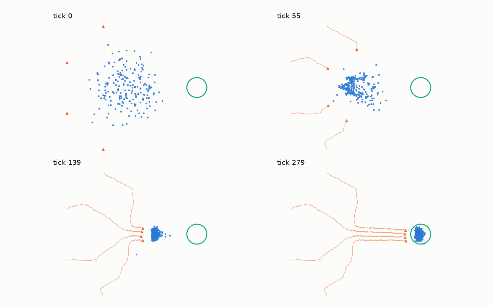
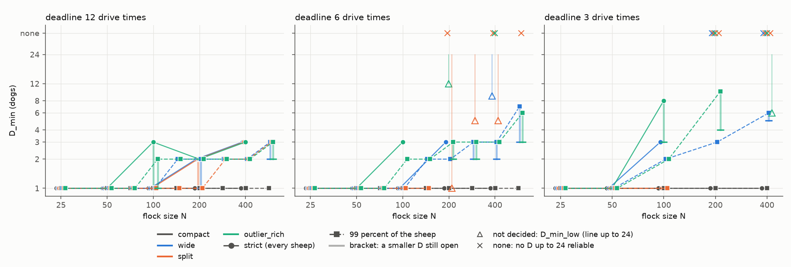
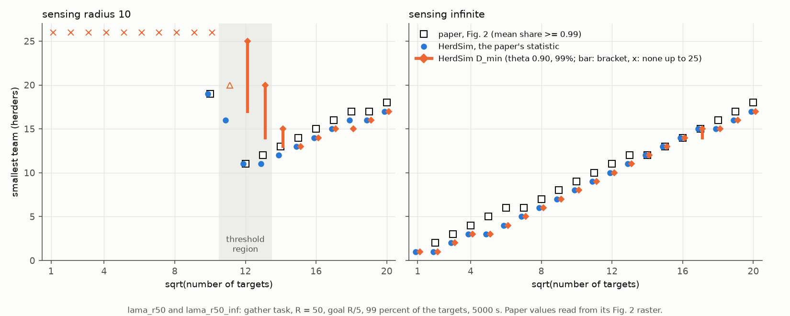

# HerdSim

[](LICENSE)
[](https://www.python.org/downloads/)
[](tests/)
[](results/)

Bạn đã bao giờ quan sát những chú chó chăn cừu làm việc trên một đồng cỏ rộng lớn chưa? Một chú chó chăn cừu kiên nhẫn làm việc một mình cuối cùng cũng có thể gom được hàng chục con cừu. Nhưng điều gì sẽ xảy ra khi đồng hồ đang đếm ngược từng giây? Hoặc khi đàn cừu bị tản mác khắp cánh đồng, tách thành nhiều cụm riêng biệt, hay chạy theo các hướng ngược nhau? Một chú chó đơn độc không thể nào chạy về bốn phương tám hướng cùng một lúc. Để hoàn thành nhiệm vụ trước khi hết giờ, chúng bắt buộc phải làm việc cùng nhau như một đội ngũ được phối hợp nhịp nhàng.

Thực tế này đặt ra một câu hỏi nền tảng trong lĩnh vực hành vi tập thể và robot bầy đàn tự hành:

> **Cần bao nhiêu chú chó ($D$) để gom một đàn $N$ con cừu và lùa đàn vào vùng đích một cách tin cậy trước thời hạn: tối thiểu là bao nhiêu ($D_{\min}$), bao nhiêu thì đủ ($D_{\mathrm{sat}}$), và từ khi nào thêm chó lại làm hỏng việc?**

**HerdSim** vừa là một công trình nghiên cứu khoa học, vừa là một phòng thí nghiệm mô phỏng mã nguồn mở hiệu năng cao được xây dựng để trả lời câu hỏi đó. Chúng tôi xác định đội hình nhỏ nhất đạt độ tin cậy ($D_{\min}$), quy mô bão hòa mà từ đó thêm chó không giúp lùa nhanh hơn ($D_{\mathrm{sat}}$), và các điều kiện khiến hiện tượng quá tải đàn chó làm nhiệm vụ thất bại.

Trải qua **367.150 lượt mô phỏng** với 0 lỗi thực thi, HerdSim thiết lập các quy luật mở rộng (scaling laws) của bài toán chăn thả đa tác tử trên các quy mô đàn từ 25 đến 566 con cừu (mở rộng lên tới 3.200 con), dưới nhiều mức áp lực thời hạn, bố cục bãi cỏ, mức độ gắn kết bầy và giới hạn tầm nhìn.


**Hình 1: Một lượt mô phỏng trực tiếp trong HerdSim ($N = 200$ cừu, $D = 4$ chó, bố cục xuất phát tản mác wide, hạt giống 2026).**
*Cách đọc hình ảnh:* Vòng tròn hở ở góc phải đại diện cho chuồng đích ($R_{\mathrm{goal}} = 1.9 R_f$). Bốn chú chó chăn cừu (điểm màu đỏ kèm vệt đường đi) phối hợp tự hành hoàn toàn: hai chú chó tỏa ra hai bên cánh để gom các cá thể cừu lạc xa nhất, trong khi các chú chó phía sau dồn chúng về phía trọng tâm đàn. Khi đàn cừu đã kết nối thành một khối gắn kết, các chú chó tự động dàn thành một vòng cung lùa phía sau bầy cừu, điều khiển cả đàn tiến êm ả vào đích mà không làm chúng hoảng loạn tản ra.

---

## Mục lục

- [Các Phát hiện Khoa học Cốt lõi](#các-phát-hiện-khoa-học-cốt-lõi)
- [Động cơ Mô phỏng HerdSim](#động-cơ-mô-phỏng-herdsim)
- [Bắt đầu Nhanh (Quick Start)](#bắt-đầu-nhanh-quick-start)
- [Vận hành Chiến dịch và Quy trình Lệnh](#vận-hành-chiến-dịch-và-quy-trình-lệnh)
- [Kiến trúc Mã nguồn Dự án](#kiến-trúc-mã-nguồn-dự-án)
- [Bản đồ Tài liệu (Documentation Index)](#bản-đồ-tài-liệu-documentation-index)
- [Tài liệu Tham khảo và Trích dẫn](#tài-liệu-tham-khảo-và-trích-dẫn)

---

## Các Phát hiện Khoa học Cốt lõi

Toàn bộ báo cáo chuyên khảo khoa học và các tập dữ liệu thực nghiệm có tại [`docs/report/d_min_report_vi.md`](docs/report/d_min_report_vi.md) (bản tiếng Anh: [`docs/report/d_min_report.md`](docs/report/d_min_report.md)) và [`docs/report/results_tables.md`](docs/report/results_tables.md). Dưới đây là tóm tắt các phát hiện quan trọng nhất:


**Hình 2: Quy mô đội tối thiểu $D_{\min}$ theo số cừu $N$ ở ba mức thời hạn và bốn bố cục xuất phát.**
*Cách đọc biểu đồ:* Trục hoành là quy mô đàn cừu $N$; trục tung là số chó tối thiểu $D_{\min}$ đạt độ tin cậy $\ge 90$%. Các cột đại diện cho 4 bố cục bãi cỏ (`compact`, `split`, `wide`, `outlier_rich`); các hàng đại diện cho 3 mức thời hạn (thong thả $12\times$, trung bình $6\times$, khẩn cấp $3\times$). Đường nét liền là tiêu chí tuyệt đối 100%; đường nét đứt là tiêu chí đưa 99% đàn cừu vào đích. Hãy chú ý thấy bố cục tập trung `compact` luôn nằm phẳng ở mức $D_{\min} = 1$ trên mọi điều kiện, trong khi thời hạn khẩn cấp đẩy đường cong trên các bãi cỏ tản mác lên rất cao.

### 1. Đàn cừu tập trung chỉ cần duy nhất một chú chó ($D_{\min} = 1$)
Khi đàn cừu bắt đầu gần nhau trong một cụm gọn gàng (`compact`), **một chú chó duy nhất là đủ cho mọi quy mô đàn ($N = 25$ đến $400$) và mọi mức thời hạn (từ $12\times$ xuống tới $3\times$ thời gian lùa)**. Khi không có cừu lạc, người chăn dắt không bao giờ phải mất thời gian đi gom—nhiệm vụ lúc này chỉ thuần túy là lùa bầy. Thêm vào đó, việc bố trí thêm nhiều chó phía sau một đàn cừu đang đi bộ không hề làm giảm thời gian lùa: cừu di chuyển ở vận tốc đi bộ tự nhiên ($1\text{ m/s}$), thêm chó phía sau không thể ép chúng chạy nhanh hơn mà chỉ gây hoảng loạn.

### 2. Trên đồng cỏ tản mác, $D_{\min}$ tăng chậm hơn nhiều so với quy mô đàn
Khi cừu xuất phát rải rác (`wide`, `split`, `outlier_rich`), chó bắt buộc phải đi gom cừu lạc trước khi có thể lùa cả bầy. Trong không gian log-log ($\log_2 D_{\min}$ so với $\log_2 N$), hệ số góc tăng trưởng chỉ rơi vào khoảng **0.27 đến 0.38** ở thời hạn thong thả ($12\times$) và 0.38 đến 0.61 ở $6\times$ (tăng trưởng dưới tuyến tính).
*Tại sao lại tăng chậm như vậy?* Cừu có bản năng gắn kết xã hội bầy đàn tự nhiên. Khi một chú chó lùa con cừu lạc hướng về phía trung tâm, con cừu đó sẽ nhìn thấy bầy và tự động chạy nhanh về nhập đàn. Lực hút tự nhiên của đàn cừu đã làm giúp một nửa khối lượng công việc hoàn toàn miễn phí!

### 3. Áp lực thời hạn đòi hỏi nhiều chó hơn là quy mô đàn cừu
Áp lực thời gian là một hệ số nhân mạnh mẽ hơn nhiều so với việc tăng số lượng cừu. Dưới tiêu chí 99%, việc rút ngắn thời hạn từ thong thả ($12\times$) xuống khẩn cấp ($3\times$) trên đàn tản mác lớn ($N = 400$) làm số chó tối thiểu tăng vọt từ **2 chú chó lên 5–6 chú chó**. Trong khi đó, việc tăng gấp 4 lần quy mô đàn (từ $N = 100$ lên $400$) dưới thời hạn thong thả chỉ khiến yêu cầu tăng từ 1 lên 2 chú chó. Sự khẩn cấp ngăn cản việc gom tuần tự; đàn chó bắt buộc phải chia để trị song song.

### 4. Nếu không có tinh thần đồng đội, thêm chó chỉ vô ích
Để chứng minh xem thuật toán phối hợp có thực sự cần thiết hay không, chúng tôi đánh giá mô hình đối chứng tham lam **FAT (Farthest-Agent Targeting)**, nơi mỗi chú chó độc lập tìm con cừu xa đích nhất để đuổi theo. Vì tất cả các chú chó đều có cùng góc nhìn, **chúng đều chọn chung đúng một con cừu lạc**, dồn vào thành một đám đông hỗn loạn hoạt động vụng về như một con chó duy nhất. Thuật toán FAT không có quy mô đội tin cậy nào trên các bãi cỏ tản mác khi $N \ge 200$: quá hai chó, tỷ lệ thành công của nó ở quanh hoặc dưới 0.5, nên thêm chó không tạo ra việc làm song song.

### 5. Tiêu chí nào quyết định thành công? "Hiệu ứng cá thể lạc đàn" (Straggler Effect)
Dưới tiêu chí tuyệt đối 100% (toàn bộ 100% cừu phải nằm trong chuồng cùng một thời điểm), các đội nhiều chó ($D \ge 6$) lại bất ngờ thất bại trên các đàn cừu lớn. Tại sao? Trong 97% các lượt bị tính là thất bại đó, đàn chó thực ra đã đưa được 99% bầy cừu vào đích trước thời hạn. Trong một lượt chạy mẫu, đàn chó khi đuổi theo con cừu lạc cuối cùng đã đứng chắn giữa bầy và đích, lùa cả đàn đã vào chuồng ngược ra ngoài. Cho chó chạy chậm hơn, điềm tĩnh hơn ($v_{\mathrm{dog}} = 1.15\text{ m/s}$) hoặc đánh giá theo tiêu chí thực tế **99% cừu vào đích** giúp đo lường chính xác năng lực điều phối tập thể mà không bị sai lệch bởi hiện tượng biên ở cửa chuồng mở.

### 6. Mục tiêu không gắn kết theo quy luật căn bậc hai, cả trong HerdSim
Chạy trong HerdSim trên nhiệm vụ gom riêng của nó, mô hình không gắn kết của Lama & di Bernardo (2024) tái lập bản đồ của bài báo theo từng ô (sai khác trung vị 0,034 về tỷ lệ mục tiêu được gom với bán kính cảm nhận 10, và 0,003 với cảm nhận vô hạn). Khi người chăn nhìn thấy mọi thứ, đội nhỏ nhất tăng theo $\sqrt{N}$ (số mũ 0,52–0,53 trên 100 đến 400 mục tiêu): 8 người chăn cho 100 mục tiêu, 17 cho 400. Mức này dốc hơn 0,27–0,38 của bầy Strömbom gắn kết ở thời hạn thong thả, dù hai loạt chạy còn khác nhau cả về nhiệm vụ và quy tắc người chăn. Với bán kính cảm nhận 10, không đội nào tới 25 người chăn gom tin cậy được 81 mục tiêu trở xuống; ngay trên ngưỡng đó, trung bình của bài báo đạt 99% trong khi các lượt mất một hai mục tiêu vẫn thường gặp, nên quy tắc tin cậy của HerdSim cần nhiều người chăn hơn hẳn ở đó (17–25 thay vì 11 ở 144 mục tiêu).


**Hình 3: Đội nhỏ nhất theo số mục tiêu trong mô hình Lama & di Bernardo, so với Hình 2 của bài báo.** Hình vuông là giá trị của bài báo, hình tròn là thống kê của bài báo trên các lượt của HerdSim, hình thoi là $D_{\min}$ của HerdSim (thanh là khoảng; dấu chéo là không có đội tin cậy nào tới 25). Trái: bán kính cảm nhận 10. Phải: cảm nhận vô hạn.

👉 *Đọc toàn bộ phân tích khoa học chi tiết, các kiểm tra độ nhạy và dẫn xuất lý thuyết tại [docs/report/d_min_report_vi.md](docs/report/d_min_report_vi.md).*

---

## Động cơ Mô phỏng HerdSim

HerdSim được thiết kế từ gốc như một nền tảng nghiên cứu hiệu năng cao và có tính tất định tuyệt đối:

1. **Vật lý bám sát thực nghiệm sinh học**:
   Động lực học của từng cá thể cừu được xây dựng từ dữ liệu thực tế thu thập qua vòng cổ GPS tần số cao ([Strömbom et al. 2014](https://doi.org/10.1098/rsif.2014.0719)), cân bằng giữa quán tính, lực hút bầy đàn, tránh va chạm và trốn chạy kẻ săn mồi.
2. **Điều phối đa tác tử tự hành**:
   Mở rộng các quy tắc kinh nghiệm một-chó bằng thuật toán phân công mục tiêu Hungarian tối ưu, đội hình vòng cung lùa phân bố góc cực, và cơ chế chuẩn hóa vector lực đẩy đa chó giúp ngăn chặn hiện tượng áp lực sợ hãi bị nhân đôi phi lý.
3. **Tính bất biến quy mô thực sự**:
   Khác với các nghiên cứu nhốt bầy cừu lớn vào sân bóng cố định gây chèn ép nhân tạo, HerdSim tự động co giãn cự ly lùa, bán kính chuồng đích và thời hạn nhiệm vụ theo bán kính trạng thái dừng tự nhiên của đàn cừu $R_f(N)$.
4. **Lấy mẫu thích ứng tuần tự (Adaptive Sequential Sampling)**:
   Hệ sinh thái chạy thử nghiệm tự động tính toán khoảng tin cậy Clopper-Pearson 99%, dừng sớm các trường hợp chắc chắn thắng/thua chỉ sau 10–20 hạt giống và dồn tài nguyên tính toán vào các ô ranh giới chưa ngã ngũ lên tới mức trần 200 hạt giống.
5. **Tính tất định và khả năng phục hồi khi dừng đột ngột**:
   Các dòng ngẫu nhiên độc lập đảm bảo khả năng tái lập kết quả chính xác đến từng bit. Mọi lượt thử nghiệm sau khi hoàn thành đều ghi nối tiếp ngay vào đĩa (`trials.jsonl`), cho phép dừng (`Ctrl+C`) và chạy tiếp bất kỳ lúc nào mà không mất dữ liệu.
6. **Ba mô hình nguồn, hai nhiệm vụ**:
   Ngoài bầy cừu Strömbom, HerdSim chạy mô hình lực liên tục của Kubo et al. (2022) trên cùng nhiệm vụ lùa, và mô hình mục tiêu không gắn kết cùng người chăn cảm nhận cục bộ của Lama & di Bernardo (2024) trên nhiệm vụ gom riêng (cừu và chó xuất phát rải đều trong một đĩa và chó đưa mục tiêu vào tâm). Mô hình Lama được thêm vào để kiểm tra quy luật $\sqrt{N}$ đã công bố ngay trong cùng một mô phỏng và cùng một lớp thống kê (phát hiện 6).

---

## Bắt đầu Nhanh (Quick Start)

### Cài đặt môi trường

HerdSim yêu cầu Python 3.11+ và sử dụng [`uv`](https://docs.astral.sh/uv/) để quản lý gói phụ thuộc với tốc độ tối đa:

```bash
# Nhân bản mã nguồn từ GitHub
git clone https://github.com/lykimq/HerdSim.git
cd HerdSim

# Cài đặt môi trường phát triển và toàn bộ phụ thuộc
make install     # uv sync --extra dev

# Chạy toàn bộ kiểm thử mã nguồn (Ruff linter + kiểm tra kiểu + 343 bài test)
make check

# Chạy kiểm chứng các chiến dịch thu nhỏ (~1 phút)
make bench
```

---

## Vận hành Chiến dịch và Quy trình Lệnh

Toàn bộ các chiến dịch mô phỏng được điều hành qua bộ công cụ dòng lệnh trong [`cli/`](cli/):

```bash
# 1. Xem trước kế hoạch thực thi của một protocol (không chạy mô phỏng)
uv run cli/campaign.py plan --protocol dmin_m6

# 2. Chạy chiến dịch protocol với 16 tiến trình xử lý song song
uv run cli/campaign.py run --protocol dmin_m6 --workers 16

# 3. Kiểm tra tiến độ thời gian thực của một chiến dịch đang chạy hoặc đã xong
uv run cli/campaign.py status --protocol dmin_m6

# 4. Chạy toàn bộ hàng đợi 37 protocol nghiên cứu (tự động bỏ qua các phần đã xong)
uv run cli/run_queue.py --workers 20

# 5. Xuất các bảng số liệu Markdown tiêu chuẩn từ kết quả thô
uv run cli/dmin_tables.py record
uv run cli/dmin_tables.py dmin dmin_m12 dmin_m6 dmin_m3
```

Để xem chi tiết các tùy chọn tham số và kịch bản chạy replay chẩn đoán, xem tại [`docs/guides/cli_reference.md`](docs/guides/cli_reference.md).

---

## Kiến trúc Mã nguồn Dự án

HerdSim được tổ chức thành các tầng module độc lập, tách rời:

```text
HerdSim/
├── sim/                    # Vật lý lõi mô phỏng và logic miền
│   ├── core/               # Lớp trạng thái, bộ chạy tick, hình học bãi cỏ, bố cục
│   ├── methods/            # Các mô hình: Strömbom (2014), Kubo (2022), Lama (2024)
│   └── plugins/            # Hệ thống plugin: cừu, chó, kịch bản nhiệm vụ, đo lường
├── services/               # Điều phối chiến dịch và động cơ lấy mẫu thích ứng
│   ├── adaptive.py         # Lấy mẫu tuần tự & dừng sớm Clopper-Pearson 99%
│   ├── calibration.py      # Tự động hiệu chuẩn bán kính bầy R_f(N)
│   └── runner.py           # Quản lý nhóm worker và phân phối lượt chạy song song
├── analysis/               # Đánh giá ranh giới thống kê & tạo bảng kết quả
├── protocols/configs/      # Định nghĩa protocol (kế thừa canonical.yaml)
├── cli/                    # Công cụ dòng lệnh (campaign.py, run_queue.py, dmin_tables.py)
├── docs/                   # Báo cáo khoa học, tài liệu kỹ thuật và biểu đồ
├── results/                # Lưu trữ các bộ dữ liệu thực nghiệm (367.150 lượt chạy)
└── tests/                  # Bộ kiểm thử đơn vị và kiểm thử hồi quy độ chính xác số học
```

---

## Bản đồ Tài liệu (Documentation Index)

HerdSim duy trì hệ thống tài liệu chuyên sâu được phân loại rõ ràng theo từng chủ đề:

| Tài liệu | Mô tả |
| :--- | :--- |
| **Báo cáo Khoa học Đầy đủ**<br>[`docs/report/d_min_report_vi.md`](docs/report/d_min_report_vi.md) ([EN](docs/report/d_min_report.md)) | Chuyên khảo nghiên cứu toàn diện: tất cả 12 phát hiện, bảng số liệu, đường cong tăng trưởng và thảo luận. |
| **Mô hình Tác tử & Thuật toán**<br>[`docs/methods/models_vi.md`](docs/methods/models_vi.md) ([EN](docs/methods/models.md)) | Công thức toán học của cừu, thuật toán phối hợp đa chó Hungarian matching, vòng cung lùa, các mô hình đối chứng, và hai mô hình Kubo và Lama. |
| **Thiết kế Thực nghiệm & Vì sao chọn $N, D$**<br>[`docs/experiments/task_design_vi.md`](docs/experiments/task_design_vi.md) ([EN](docs/experiments/task_design.md)) | Tính bất biến quy mô $R_f(N)$, chuẩn hóa deadline $T_{\mathrm{drive}}$, lấy mẫu thích ứng và cơ sở lựa chọn các giới hạn $N, D$, và nhiệm vụ gom. |
| **Hướng dẫn Cấu hình & Protocol**<br>[`docs/guides/configuration.md`](docs/guides/configuration.md) | Cơ chế kế thừa file YAML, giải thích các cờ tham số mở rộng và cấu trúc thư mục lưu trữ kết quả. |
| **Sổ tay Dòng lệnh CLI**<br>[`docs/guides/cli_reference.md`](docs/guides/cli_reference.md) | Hướng dẫn sử dụng các lệnh CLI để lập kế hoạch, chạy chiến dịch và thực thi replay chẩn đoán. |
| **Kiến trúc Mã nguồn Phần mềm**<br>[`docs/codes/architecture.md`](docs/codes/architecture.md) | Hướng dẫn chuyên sâu về thiết kế codebase, hệ sinh thái plugin và cách mở rộng các bộ điều khiển mới. |

---

## Tài liệu Tham khảo và Trích dẫn

Nếu bạn sử dụng HerdSim trong nghiên cứu của mình, vui lòng trích dẫn:

1. **Strömbom, D., et al. (2014)**. *Solving the shepherding problem: heuristics for herding autonomous, interacting agents*. Journal of the Royal Society Interface, 11(100), 20140719. [DOI: 10.1098/rsif.2014.0719](https://doi.org/10.1098/rsif.2014.0719)
2. **Kubo, M., Tashiro, M., Sato, H., Yamaguchi, A. (2022)**. *Herd guidance by multiple sheepdog agents with repulsive force*. Artificial Life and Robotics, 27, 416–427. [DOI: 10.1007/s10015-021-00726-7](https://doi.org/10.1007/s10015-021-00726-7)
3. **Lama, A., & di Bernardo, M. (2024)**. *Shepherding control and herdability in complex multiagent systems*. Physical Review Research, 6, L032012. [DOI: 10.1103/PhysRevResearch.6.L032012](https://doi.org/10.1103/PhysRevResearch.6.L032012)
4. **Bảng Số liệu Thực nghiệm**: [`docs/report/results_tables.md`](docs/report/results_tables.md)

Danh sách đầy đủ các công trình được trích dẫn trong nghiên cứu nằm ở [phần tài liệu tham khảo của báo cáo](docs/report/d_min_report_vi.md#tài-liệu-tham-khảo).
