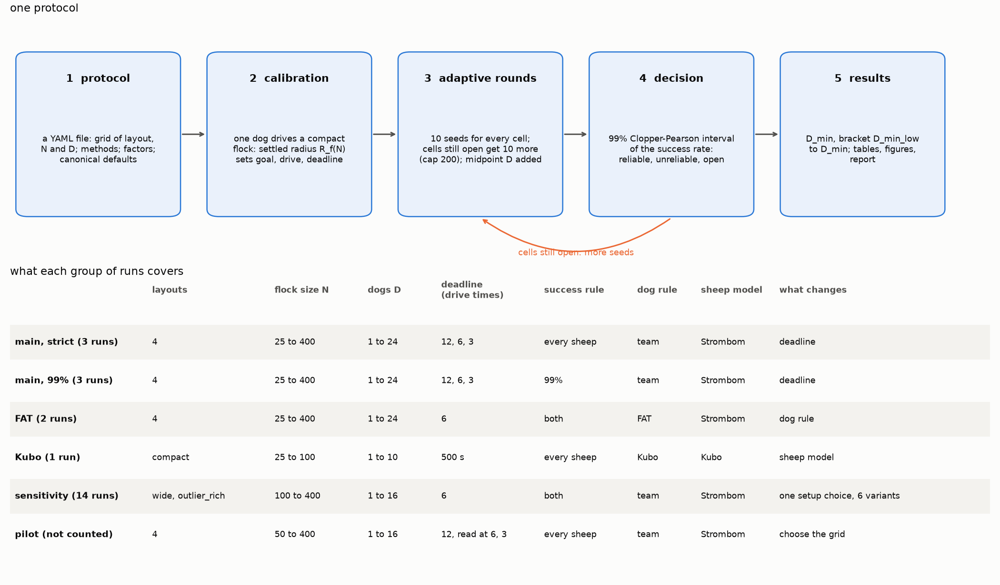
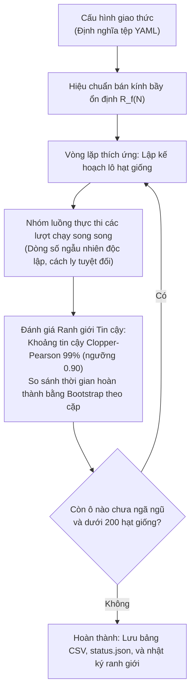

# HerdSim

[**English**](README.md) | [**Tiếng Việt**](README_vi.md)

[](LICENSE)
[](https://www.python.org/downloads/)
[](tests/)
[](results/)

Bạn đã bao giờ quan sát những chú chó chăn cừu làm việc trên một đồng cỏ rộng lớn chưa? Một chú chó chăn cừu kiên nhẫn làm việc một mình cuối cùng cũng có thể gom được hàng chục con cừu. Nhưng điều gì sẽ xảy ra khi đồng hồ đang đếm ngược từng giây? Hoặc khi đàn cừu bị tản mác khắp cánh đồng, tách thành nhiều cụm riêng biệt, hay chạy theo các hướng ngược nhau? Một chú chó đơn độc không thể nào chạy về bốn phương tám hướng cùng một lúc. Để hoàn thành nhiệm vụ trước khi hết giờ, chúng bắt buộc phải làm việc cùng nhau như một đội ngũ được phối hợp nhịp nhàng.

Thực tế này đặt ra một câu hỏi nền tảng trong lĩnh vực hành vi tập thể và robot bầy đàn tự hành:

> **Cần tối thiểu bao nhiêu chú chó ($D$) để gom một đàn gồm $N$ con cừu và lùa chúng vào chuồng một cách tin cậy trước thời hạn quy định?**

**HerdSim** là một phòng thí nghiệm mô phỏng mã nguồn mở được xây dựng để trả lời câu hỏi đó. Chúng tôi nghiên cứu quy mô đội hình tối thiểu này (gọi là **$D_{\min}$**) thay đổi như thế nào khi đàn cừu tăng từ 25 lên đến 400 con, trên nhiều bố cục bãi cỏ khác nhau, dưới các mức áp lực thời gian từ thong thả đến gấp rút, và với các chiến lược phối hợp đội hình khác nhau.


*Hình 1: Một lượt mô phỏng trực tiếp ($N = 200$ cừu, $D = 4$ chó, bố cục xuất phát tản mác wide, hạt giống ngẫu nhiên 2026). Các chú chó tỏa ra song song để gom những con cừu lạc xa nhất, kết nối chúng thành một đàn thống nhất, dàn thành vòng cung lùa phía sau và điều khiển cả đàn tiến êm ả vào mục tiêu hình tròn.*

---

## Mục lục

- [Phát hiện khoa học cốt lõi](#phát-hiện-khoa-học-cốt-lõi)
- [Một chiến dịch chạy như thế nào](#một-chiến-dịch-chạy-như-thế-nào)
- [Hình học nhiệm vụ và tính bất biến theo quy mô](#hình-học-nhiệm-vụ-và-tính-bất-biến-theo-quy-mô)
- [Các cấu hình bầy ban đầu](#các-cấu-hình-bầy-ban-đầu)
- [Mô hình tác tử và phối hợp nhiều chó](#mô-hình-tác-tử-và-phối-hợp-nhiều-chó)
- [Các quy tắc ranh giới quyết định điều gì](#các-quy-tắc-ranh-giới-quyết-định-điều-gì)
- [Độ nhạy và tính bền vững](#độ-nhạy-và-tính-bền-vững)
- [Bắt đầu nhanh](#bắt-đầu-nhanh)
- [Một lần chạy ghi ra những gì](#một-lần-chạy-ghi-ra-những-gì)
- [Kiến trúc dự án](#kiến-trúc-dự-án)
- [Kiểm chứng và chuẩn thử nghiệm](#kiểm-chứng-và-chuẩn-thử-nghiệm)
- [Tài liệu tham khảo](#tài-liệu-tham-khảo)

---

## Phát hiện khoa học cốt lõi

Để xác định chính xác quy luật mở rộng của đội hình, chúng tôi đã tiến hành **164.740 lượt mô phỏng** qua 23 giao thức nghiên cứu khác nhau (với 0 lỗi thực thi hay dừng đột ngột). Nghiên cứu khảo sát các quy mô đàn từ 25 đến 400 con cừu trên bốn bố cục bãi cỏ ban đầu, ba mức thời hạn và hai tiêu chí đánh giá thành công.

Báo cáo khoa học đầy đủ có tại [`docs/report/d_min_report_vi.md`](docs/report/d_min_report_vi.md) (bản tiếng Anh: [`docs/report/d_min_report.md`](docs/report/d_min_report.md)). Toàn bộ các bảng dữ liệu gốc có thể tái tạo trực tiếp bằng [`cli/dmin_tables.py`](cli/dmin_tables.py) và được tổng hợp tại [`docs/report/results_tables.md`](docs/report/results_tables.md).


*Hình 2: Thiết kế thực nghiệm. Trên: Vòng lặp lấy mẫu thích ứng. Dưới: Phạm vi bao phủ của 23 giao thức (lưới mở rộng chính, mô hình đối chứng không phối hợp FAT, mô hình lực liên tục Kubo và 14 biến thể kiểm tra độ nhạy).*


*Hình 3: Quy mô đội tối thiểu $D_{\min}$ theo số cừu $N$ ở ba mức thời hạn ($12\times$, $6\times$, và $3\times$ thời gian lùa). Đường liền và vòng tròn biểu thị tiêu chí tuyệt đối 100%; đường đứt và hình vuông biểu thị tiêu chí đưa được 99% đàn cừu vào đích. Vùng tô bóng là khoảng chặn chưa ngã ngũ (ví dụ: [3, 8]), tam giác rỗng là cận dưới, và dấu chéo biểu thị không có số lượng chó nào trên lưới đạt ngưỡng tin cậy 90%.*

### 1. Đàn cừu tập trung chỉ cần duy nhất một chú chó ($D_{\min} = 1$)
Khi đàn cừu bắt đầu gần nhau trong một cụm gọn gàng (`compact`), **một chú chó duy nhất là đủ cho mọi quy mô đàn ($N = 25$ đến $400$) và mọi mức thời hạn (từ $12\times$ xuống tới $3\times$ thời gian lùa)**.

**Tại sao?** Cừu là loài động vật có tập tính bầy đàn tự nhiên. Khi chúng đã ở gần nhau, không có con cừu nào bị lạc ra ngoài. Người chăn dắt không bao giờ phải mất thời gian đi gom cừu lạc—nhiệm vụ lúc này chỉ đơn thuần là đứng sau và lùa cả đàn tiến về phía trước.

**Thêm chó có giúp nhanh hơn không?** Đáng ngạc nhiên là trong mô hình hành vi chính của chúng tôi ([Strömbom et al. 2014](https://doi.org/10.1098/rsif.2014.0719)), việc có 2, 4, hay thậm chí 24 chú chó hoàn toàn không làm giảm thời gian lùa đàn (trung vị thời gian hoàn thành luôn duy trì trong khoảng 1,44 đến 1,74 lần thời gian lùa lý thuyết, bất kể số lượng chó). Lý do là vì một đàn cừu khi đi bộ đã di chuyển ở tốc độ tự nhiên ổn định; thêm nhiều chó phía sau không thể đẩy chúng đi nhanh hơn mà chỉ gây hoảng loạn không cần thiết. Trong mô hình lực liên tục của [Kubo et al. (2022)](https://doi.org/10.1007/s10015-021-00726-7), một chó cũng đủ để đạt độ tin cậy, mặc dù thêm chó có giúp nén đàn cừu chặt hơn một chút và dẫn đường nhanh hơn (thời gian giảm từ ~110 giây với 1 chó xuống ~30 giây với 10 chó).


*Hình 4: Thời gian hoàn thành theo số chó $D$ trên bố cục xuất phát gọn compact. Trái: Đàn cừu Strömbom với quy tắc đội phối hợp (thời gian hoàn thành trung vị không đổi theo số chó). Phải: Mô hình lực Kubo (thời gian hoàn thành giảm dần khi có thêm chó tham gia lùa). Cả hai mô hình đều đạt tỉ lệ thành công 100% trên mọi quy mô đội.*

### 2. Trên đồng cỏ tản mác, số lượng chó cần thiết tăng chậm hơn nhiều so với quy mô đàn
Khi cừu xuất phát rải rác trên đồng cỏ (`wide`, `split`, `outlier_rich`), các chú chó bắt buộc phải đi gom những con lạc đàn trước khi có thể lùa cả bầy về đích:
- Dưới thời hạn thong thả ($12\times$ thời gian lùa), **1 chú chó** là đủ cho đàn lên đến $N = 50$ con, và chỉ cần **2 hoặc 3 chú chó** cho một đàn lớn gồm $N = 400$ con cừu.
- Trong không gian log-log ($\log_2 D_{\min}$ so với $\log_2 N$), hệ số góc tăng trưởng chỉ rơi vào khoảng **0,20 đến 0,50** ở thời hạn $12\times$, và **0,30 đến 0,80** ở thời hạn $6\times$.

**Tại sao lại tăng chậm như vậy?** Bạn có thể nghĩ rằng gấp 4 lần số cừu thì phải cần gấp 4 lần số chó. Nhưng cừu luôn có bản năng tìm về đồng loại. Khi một chú chó đuổi một con cừu lạc hướng về phía trung tâm, con cừu đó sẽ nhìn thấy đàn và tự động chạy nhanh về nhập bọn. Lực hút xã hội tự nhiên của bầy cừu đã làm giúp một nửa khối lượng công việc gom đàn hoàn toàn miễn phí!

### 3. Áp lực thời hạn đòi hỏi nhiều chó hơn là quy mô đàn cừu
Áp lực thời gian là một hệ số nhân mạnh mẽ hơn nhiều so với việc tăng thêm số lượng cừu. Dưới tiêu chí 99%, việc rút ngắn thời hạn từ thong thả ($12\times$) xuống gấp rút ($3\times$) làm số chó tối thiểu trên đàn cừu tản mác $N = 400$ tăng vọt từ **2 chú chó lên 5–6 chú chó**.

Trong khi đó, việc tăng số lượng cừu gấp bốn lần (từ 100 lên 400 con) dưới thời hạn thong thả chỉ khiến yêu cầu tăng từ 1 lên 2 chú chó.

**Tại sao?** Tốc độ chạy của cừu có giới hạn vật lý. Nếu có dư dả thời gian, một chú chó có thể thong thả chạy đến gom con cừu A, dẫn về, rồi lại chạy đi gom con cừu B, dẫn về, cứ thế lần lượt từng con. Nhưng khi thời gian cạn dần, việc gom tuần tự trở nên quá chậm. Các chú chó bắt buộc phải chia để trị—tỏa ra song song để Chó 1 gom Cừu A trong khi Chó 2 gom Cừu B cùng một lúc. Sự gấp rút bắt buộc phải có tinh thần đồng đội.


*Hình 5: Tác động của áp lực thời gian. Trái và Giữa: Đường cong tỉ lệ thành công dưới các mức thời hạn thong thả ($12\times$), trung bình ($6\times$) và khẩn cấp ($3\times$). Phải: $D_{\min}$ được vẽ trực tiếp theo mức độ khẩn cấp của thời hạn.*

### 4. Tiêu chí nào quyết định thành công? "Hiệu ứng cá thể lạc đàn" (Straggler Effect)
Cách bạn định nghĩa một "lượt chăn dắt thành công" sẽ làm thay đổi hoàn toàn kết quả thực nghiệm:
- **Tiêu chí tuyệt đối (Strict 100%)**: Toàn bộ 100% số cừu phải nằm trọn vẹn bên trong vòng tròn đích tại cùng một thời điểm.
- **Tiêu chí đưa đàn đến nơi (99% Arrival)**: Có ít nhất 99% số cừu đã vào bên trong đích (chấp nhận 1 con ở ngoài với đàn 100 con, 2 con với đàn 200 con, hoặc 4 con với đàn 400 con).

Khi chúng tôi quan sát thấy các đội nhiều chó ($D \ge 6$) lại thất bại bất ngờ trên các đàn cừu lớn dưới tiêu chí tuyệt đối 100%, chúng tôi đã kiểm tra dữ liệu đo đạc từng tích tắc và phát hiện một hiện tượng rất thú vị: **trong 95% các lượt bị tính là thất bại đó, các chú chó thực ra đã lùa được 99% đàn cừu vào trong đích an toàn từ rất sớm**.

**Vậy tại sao chúng lại thất bại?** Nguyên nhân là do còn 1 hoặc 2 con cừu cứng đầu vẫn thơ thẩn ngay ngoài cửa đích. Thấy vậy, các chú chó phá vỡ đội hình lùa, lao hết tốc lực đuổi theo con cừu lạc cuối cùng đó. Vì vòng tròn đích không hề có hàng rào hay cửa đóng, các chú chó lao vụt qua cửa đích, vô tình làm cả đàn cừu đang nghỉ ngơi bên trong hoảng loạn chạy tán loạn ngược trở lại cánh đồng trống!


*Hình 6: Tỉ lệ thành công tuyệt đối (Strict) so với tỉ lệ đạt 99% trên cùng các hạt giống ngẫu nhiên. Trong vùng tô bóng, các lượt chạy thành công $\ge 90\%$ dưới tiêu chí 99% nhưng lại bị đánh trượt dưới tiêu chí tuyệt đối.*


*Hình 7: Hiệu ứng cá thể lạc đàn. Trái: Các lượt chạy với từ 6 chó trở lên hầu như luôn đưa được 99% cừu vào đích, nhưng trượt tiêu chí tuyệt đối; chó chạy chậm hơn ($v = 1,15$) khắc phục được hiện tượng này. Phải: Quỹ đạo vị trí đàn cừu theo thời gian trên cùng một bầy xuất phát. Chó chạy nhanh lùa cừu vào, đuổi theo một con lạc và làm cả bầy chạy bung ra ngoài. Chó chạy chậm hơn, điềm tĩnh hơn lùa bầy vào đích gọn gàng ngay trong một lượt.*

Khi cho chó chạy chậm lại một chút ($v_{\text{dog}} = 1,15$ m/s thay vì $1,50$ m/s), chúng không bị chạy quá đà qua cửa đích, và tỉ lệ thành công tuyệt đối nhảy vọt từ 0% lên 100%. Trong chăn thả thực tế cũng như điều khiển robot, một cá thể bướng bỉnh không có nghĩa là nhiệm vụ đã thất bại. Việc đánh giá theo tiêu chí 99% giúp đo lường chính xác năng lực điều phối tập thể mà không bị sai lệch bởi hiện tượng biên ở cửa chuồng mở.

### 5. Nếu không có tinh thần đồng đội, thêm chó chỉ vô ích
Để chứng minh xem khả năng phối hợp đồng đội có thực sự cần thiết hay không, chúng tôi đã xây dựng một thuật toán đối chứng không phối hợp mang tên **FAT (Farthest-Agent Targeting)**. Dưới cơ chế FAT, mỗi chú chó hành động hoàn toàn ích kỷ: nó chỉ đơn giản nhìn khắp cánh đồng, tìm con cừu nào đang xa đích nhất và cắm đầu đuổi theo. Không hề có việc giao tiếp, phân chia nhiệm vụ hay tránh va chạm giữa các chú chó.

Kết quả là một sự thất bại toàn diện: vì các chú chó đều có cùng góc nhìn về cánh đồng, **tất cả các chú chó đều chọn chung đúng một con cừu lạc**. Chúng cùng lao vào một chỗ, đâm sầm vào nhau thành một đám đông hỗn loạn, và hành động không khác gì một con chó duy nhất trong khi bỏ mặc tất cả những con cừu lạc khác. Trong khi FAT có thể xử lý được các đàn nhỏ ($N \le 100$), nó thất bại 100% khi đàn cừu tăng lên $N \ge 200$ trên các đồng cỏ tản mác, bất kể bạn thả vào bao nhiêu chú chó đi nữa.


*Hình 8: Tỉ lệ thành công theo số chó của quy tắc phối hợp đội strombom_multi (xanh dương) so với quy tắc không phối hợp FAT (cam) ở thời hạn 6 lần thời gian lùa. Không có sự phối hợp, việc thêm chó mang lại đường cong nằm ngang và không tạo ra bất kỳ lợi ích mở rộng quy mô nào.*

### 6. Các thước đo chi tiết trong từng lượt chạy hé lộ điều gì
HerdSim ghi lại 19 phép đo vật lý chính xác trong từng nhịp chuyển động của mỗi lượt mô phỏng:
- **Độ tản mác của đàn dự báo khả năng thành công**: Trên tất cả các lượt chạy, có một mối tương quan nghịch rất mạnh ($r = -0,56$ đến $-0,81$) giữa độ tản mác trung bình của đàn cừu và khả năng hoàn thành nhiệm vụ. Khi cừu giữ được khối liên kết chặt chẽ, đàn chó sẽ thành công; khi cừu bị xé lẻ tản mác, tỉ lệ thành công sụt giảm nghiêm trọng.
- **Hiện tượng đàn chó bị "đóng băng" trên bãi cỏ chia cụm (`split`)**: Khi cừu xuất phát thành 3 cụm riêng biệt, việc tăng thêm số lượng chó ($D \ge 4$) bất ngờ không mang lại hiệu quả tăng tốc. Tại sao? Số liệu vi mô của chúng tôi cho thấy các chú chó đã bị... đứng yên bất động! Theo mô hình sinh học của Strömbom, chó sẽ tự động dừng bước nếu tiến lại gần cừu hơn 6 mét ($3 r_a$) nhằm tránh làm cừu hoảng sợ. Trong các cụm cừu dày đặc, quy tắc này đã làm đóng băng tới 25% quân số của đội chó. Khi chúng tôi rút ngắn khoảng cách dừng này trong các thử nghiệm mô phỏng lại, các chú chó đã chuyển động linh hoạt trở lại và rút ngắn thời gian lùa đàn khoảng ~22%.


*Hình 9: Chẩn đoán chi tiết theo từng lượt chạy. (a) Tương quan nghịch giữa độ tản mác của đàn và tỉ lệ thành công. (b) Tỉ lệ phần trăm chó bị đóng băng theo quy tắc giữ khoảng cách trên đàn split so với đàn wide. (c) Mức độ chồng lấn vị trí giữa các cặp chó.*


### 7. Vượt quá mức tối thiểu: đủ chó, và chó thêm tốn gì
Sau D_min, một phân tích tiếp theo trên các lượt chạy 99% (không chạy chiến dịch mới) hỏi: từ quy mô đội nào thì thêm một con chó không còn giúp ích (D_sat), chó vượt quá nó tốn gì, và chúng có gây thêm áp lực lên cừu không:
- **Chó vượt quá D_sat chỉ là chi phí**: mọi đội đạt độ tin cậy lớn hơn D_sat hoàn thành trong 0,90 đến 1,02 lần thời gian tại D_sat, trong khi tổng thời gian chó tăng tỉ lệ với số chó. Trên bầy compact, 24 con chó tốn khoảng 24 lần thời gian chó của một con cho cùng một lần lùa.
- **Nhiều chó hơn không có nghĩa là nhiều áp lực hơn lên mỗi con cừu**: trong 164 lượt chạy lại, số giây mỗi con cừu chạy trốn khỏi chó giảm từ D_min đến D_sat rồi giữ nguyên. Tại mỗi thời điểm có nhiều cừu chạy trốn hơn, nhưng quãng lùa ngắn hơn. Một phần là do mô hình: lực đẩy của nhiều chó bị giới hạn bằng lực đẩy của một con.
- **Theo tiêu chí 99%, không quy mô đội nào làm nhiệm vụ thất bại**: trong mười một thư mục 99%, không có quy mô đội nào rơi trở lại dưới ngưỡng tin cậy sau khi đã đạt, đến 24 con chó. Chó thêm chỉ làm bầy `split` ở N = 200 chậm hơn (khoảng 700 s từ D = 8 so với 365 s với 2 con).
- **D_sat vẫn còn là một khoảng trên một phần ba các đường cong phân tán**, vì các lượt chạy này không dành hạt giống cho các phép so sánh thời gian hoàn thành quyết định nó. Giai đoạn tiếp theo sẽ bổ sung.


*Hình 10: Chó vượt quá D_sat ở 6 thời gian lùa (tiêu chí 99%). Trái: thời gian hoàn thành so với D_sat giữ ngang. Phải: thời gian chó tăng theo đường D / D_sat. Chi tiết và phần chạy lại đo áp lực nằm ở mục 3.7 của [báo cáo](docs/report/d_min_report_vi.md).*

---

## Một chiến dịch chạy như thế nào

Nếu bạn muốn kiểm tra mọi tổ hợp của quy mô đàn cừu, số lượng chó, bố cục xuất phát và thời hạn với 200 lượt chạy cho mỗi trường hợp bằng cách vét cạn thủ công, bạn sẽ cần hơn 360.000 lượt mô phỏng. Phần lớn số tính toán đó sẽ bị lãng phí vào những tình huống có kết quả hiển nhiên—ví dụ như chạy 200 lượt chỉ để chứng minh 1 chú chó không thể gom 400 con cừu rải rác trong 4 phút, hoặc chạy 200 lượt để chứng minh 8 chú chó dễ dàng lùa 25 con cừu đã đứng sát nhau.

Thay vào đó, HerdSim hoạt động như một nhà khoa học thực thụ: hệ thống sử dụng một **vòng lặp lấy mẫu tuần tự thích ứng** nhằm tập trung tài nguyên tính toán vào đúng những vùng tham số mà kết quả còn đang giằng co.

Một **giao thức** (được cấu hình trong [`protocols/configs/protocols/`](protocols/configs/protocols/)) xác định lưới thực nghiệm. Mỗi tổ hợp giữa mô hình đàn cừu, bố cục và số lượng cừu $N$ tạo thành một đường cong. Mỗi số lượng chó $D$ trên đường cong đó là một **ô** (cell), và mỗi lượt kiểm tra với một hạt giống ngẫu nhiên là một **lượt chạy** (trial).



### Bảng tổng hợp các chiến dịch nghiên cứu thực nghiệm

Qua 23 giao thức nghiên cứu, HerdSim đã hoàn thành tổng cộng **164.740 lượt mô phỏng** (đánh giá 2.291 ô tham số) với 0 lỗi thực thi:

| Nhóm chiến dịch | Giao thức | Số lượt chạy | Số ô đánh giá | Mục tiêu nghiên cứu cốt lõi |
| :--- | :--- | :---: | :---: | :--- |
| **Lưới mở rộng quy mô Tuyệt đối** | `dmin_m12`, `dmin_m6`, `dmin_m3` | 40.220 | 557 | Xác định $D_{\min}(N)$ dưới tiêu chí tuyệt đối 100% qua 3 mức thời hạn: thong thả ($12\times$), trung bình ($6\times$) và gấp rút ($3\times$). |
| **Lưới mở rộng quy mô Đưa đàn đến nơi** | `dmin_f99_m12`, `dmin_f99_m6`, `dmin_f99_m3` | 36.480 | 556 | Xác định $D_{\min}(N)$ dưới tiêu chí thực tế 99% cừu vào đích qua cả 3 mức thời hạn, tách biệt năng lực lùa đàn khỏi nhiễu cửa đích. |
| **Mô hình đối chứng Không phối hợp** | `dmin_fat`, `dmin_f99_fat` | 17.330 | 365 | Đánh giá thuật toán đuổi cá thể xa nhất FAT khi các chú chó không phối hợp với nhau, dưới cả hai tiêu chí ở thời hạn $6\times$. |
| **Mô hình lực thế liên tục** | `dmin_kubo` | 1.080 | 18 | Kiểm chứng chéo $D_{\min}$ qua trường phái vật lý trường thế liên tục với lực đẩy giữa các chú chó trên bầy compact ($N \le 100$). |
| **Các giao thức Kiểm tra độ nhạy** | 14 giao thức (7 cặp: strict + 99%) | 69.630 | 805 | Khảo sát vị trí xuất phát của chó, tốc độ chó, thông số cừu đo đạc từ GPS thực tế, khoảng cách xuất phát và kích thước chuồng đích ở thời hạn $6\times$. |
| **Tổng cộng** | **23 Giao thức** | **164.740** | **2.291** | **Bản đồ thực nghiệm hoàn chỉnh (~7,0 giờ tính toán)** |

### Cơ chế thực thi thích ứng thông minh

Bốn cơ chế tự động giúp điều phối tài nguyên tính toán chuẩn xác:

#### 1. Dừng sớm dựa trên khoảng tin cậy thống kê (Khoảng tin cậy 99% Clopper–Pearson)
Mỗi ô bắt đầu bằng một lô nhỏ gồm 10 hạt giống. Sau mỗi lô, hệ thống tính toán khoảng tin cậy 99% hai phía Clopper–Pearson $[L, U]$ cho xác suất thành công thực sự:
- **Thất bại rõ ràng**: Nếu cận trên $U < 0,90$ (ví dụ thua nhiều trận ngay từ đầu), hệ thống biết chắc đội hình này quá yếu. Thử nghiệm dừng lại ngay lập tức để tiết kiệm thời gian.
- **Thành công vững chắc**: Nếu một đội hình thắng liên tiếp 60 trận mà không thua trận nào, cận dưới $L \ge 0,90$. Chúng ta có bằng chứng toán học vững chắc rằng đội hình này đạt chuẩn tin cậy, và ô này được kết luận sớm.
- **Trường hợp giằng co**: Chỉ những ô mà khoảng tin cậy còn bao trùm ngưỡng 0,90 mới được cấp thêm các lô 10 hạt giống tiếp theo, cho đến khi chạm trần tối đa 200 hạt giống.


*Hình 11: Tinh chỉnh tuần tự. Những ô thất bại rõ ràng dừng sau 10–20 lượt chạy; những ô thành công vượt trội dừng sau 60 trận thắng liên tiếp; chỉ những ô ở ranh giới mới tiếp tục chạy đến mức tối đa 200 hạt giống.*

#### 2. Thử nghiệm điểm giữa (Midpoint densification)
Nếu hai số lượng chó liền kề nhảy vọt qua ranh giới hành vi—chẳng hạn $D = 2$ thất bại nhưng $D = 4$ thành công—hệ thống sẽ tự động chèn điểm nằm giữa ($D = 3$) vào vòng chạy tiếp theo. Điều này giúp định vị chính xác ngưỡng $D_{\min}$ mà không cần phải chạy thử mọi số lượng chó ngay từ đầu.


*Hình 12: Làm dày điểm giữa. Phát hiện bước chuyển giữa $D = 2$ và $D = 4$ sẽ tự động kích hoạt lượt đánh giá cho $D = 3$ trong vòng tiếp theo.*

#### 3. Cắt tỉa khi bão hòa và xuất hiện hiện tượng trùng lặp
Khi một quy mô đội đã đạt tốc độ tối đa ($D_{\text{sat}}$), nếu việc thử nghiệm các đội chó đông hơn cho thấy các chú chó chỉ đơn thuần chạy bám đuôi đồng đội (độ trùng lặp trung bình `dog_overlap` $\ge 0,90$) mà không giúp lùa cừu nhanh hơn, hệ thống sẽ đánh dấu ô đó là **đã cắt tỉa** (pruned) và ngừng chạy thêm hạt giống.


*Hình 13: Cắt tỉa bão hòa. Khi tốc độ hoàn thành chạm ngưỡng trần, các ô có độ trùng lặp cao ($\ge 0,90$) sẽ được dừng lại để tránh lãng phí năng lực xử lý.*

#### 4. So sánh công bằng với hạt giống ngẫu nhiên ghép cặp
Mỗi hạt giống $i$ sử dụng một luồng ngẫu nhiên độc lập cố định `master_seed + i` (ví dụ: $2026 + i$). Tọa độ ban đầu của từng con cừu và mọi quyết định rẽ hướng ngẫu nhiên của chúng đều được giữ nguyên vẹn tuyệt đối. Khi so sánh đội 2 chú chó với đội 4 chú chó, cả hai đội đều phải đối mặt với **chính xác cùng một bãi cỏ và cùng những phản ứng của đàn cừu**. Điều này triệt tiêu hoàn toàn yếu tố may rủi, đảm bảo kết quả chỉ phản ánh năng lực của chiến thuật và quy mô đội chó.


*Hình 14: Ghép cặp hạt giống. Cùng một hạt giống 2026 sẽ tạo ra các vị trí cừu ban đầu giống hệt nhau trên mọi quy mô đội chó $D$, cô lập chính xác hiệu ứng của số lượng chó.*

#### 5. Tự động lưu trữ an toàn, có thể tạm dừng và tiếp tục bất kỳ lúc nào
Mỗi lượt chạy được ghi ngay lập tức vào ổ đĩa (`trials.jsonl`). Bạn có thể bấm `Ctrl+C` để tạm dừng chiến dịch bất kỳ lúc nào và tiếp tục lại sau đó mà không làm mất dù chỉ một lượt chạy; cơ chế khóa tệp ngăn các tiến trình chạy song song ghi đè làm hỏng dữ liệu.

---

## Hình học nhiệm vụ và tính bất biến theo quy mô

Một sai lầm rất phổ biến trong các mô hình mô phỏng bầy đàn là giữ nguyên kích thước bãi cỏ khi tăng số lượng cá thể $N$. 

**Tại sao việc giữ nguyên kích thước sân bãi là sai lầm?** Đơn giản vì 400 con cừu chiếm thể tích không gian lớn hơn rất nhiều so với 25 con cừu. Nếu bạn nhốt 400 con cừu vào một sân bóng đá, chúng sẽ bị nén chặt sát vào nhau và ép vào các góc sân. Đàn chó lúc này thậm chí chẳng cần chăn dắt; các đường biên của sân bãi đã làm việc đó thay cho chúng! Điều đó sẽ làm sai lệch bản chất của thí nghiệm vì đã đánh đồng *quy mô bầy* với *sự chật chội nhân tạo*.

HerdSim bảo đảm **tính bất biến theo quy mô** (scale invariance) bằng cách gắn toàn bộ kích thước của đồng cỏ vào **bán kính đàn ổn định đã hiệu chuẩn $R_f(N)$**: tức bán kính cân bằng tự nhiên của một đàn $N$ con cừu khi đang được dẫn dắt nhịp nhàng bởi một chú chó.


*Hình 15: Kích thước nhiệm vụ được vẽ đúng tỉ lệ. Trái: Bố cục sân bãi ở $N = 200$. Giữa: Cách xác định cự ly lùa. Phải: Bán kính đàn $R_f$ và bán kính đích qua các quy mô đàn cừu.*

| Tham số | Quy tắc toán học | Ý nghĩa vật lý |
| :--- | :--- | :--- |
| **Bán kính đàn** $R_f(N)$ | Hiệu chuẩn thực nghiệm (ví dụ: 6,2 m ở $N=25$; 11,4 m ở $N=400$) | Bán kính cân bằng tự nhiên của một đàn $N$ con cừu khi đang di chuyển ổn định. |
| **Khoảng cách lùa** $l$ | $\max(13 \cdot R_f(N),\, 80,\, \text{tầm vươn} + R_{\text{đích}} + R_f)$ | Đảm bảo đàn cừu lớn hơn phải vượt qua quãng đường dài hơn tương ứng với tầm vóc vật lý của chúng. |
| **Bán kính đích** $R_{\text{goal}}$ | $1,9 \cdot R_f(N)$ | Giữ cho độ khó của việc chứa đàn cừu vào đích là tương đương trên mọi quy mô bầy. |
| **Khoảng trống an toàn** | Cách tác tử xa nhất ít nhất 80 m | Đảm bảo các tác tử ban đầu không bao giờ bị áp sát mép tọa độ. |
| **Biên mở hoàn toàn** | **Không có tường chắn hay biên dội ngược** | Đồng cỏ thực tế không có những bức tường vô hình. Động vật tự do di chuyển trong không gian mở. |

### Các mức thời hạn chuẩn hóa

Làm thế nào để đặt ra một thời hạn công bằng? Một đàn cừu phải đi bộ 200 mét rõ ràng cần nhiều thời gian hơn một đàn cừu chỉ đi 80 mét. Nếu bạn ấn định một mức thời gian cố định 5 phút cho cả hai, đàn cừu lớn hơn sẽ bị xử ép một cách bất công.

HerdSim chuẩn hóa thời hạn bằng cách lấy bội số $m$ của **thời gian lùa đặc trưng** ($T_{\text{drive}}$): tức khoảng thời gian tối thiểu để con cừu chạy nhanh nhất đi thẳng từ điểm xuất phát đến đích:

$$
T_{\text{drive}} = \frac{\text{Khoảng cách lùa}}{v_{\text{cừu, tối đa}}}
$$

Một đàn cừu gọn gàng được lùa bởi một chú chó thuần thục sẽ về đích trong khoảng 1,44 đến 1,74 $\times T_{\text{drive}}$. Do đó, chúng tôi khảo sát ba mức áp lực thời gian rất thực tế:
- **Thong thả ($12\times T_{\text{drive}}$)**: Rất nhiều thời gian. Một chú chó có thể kiên nhẫn đi gom từng con cừu lạc một.
- **Trung bình ($6\times T_{\text{drive}}$)**: Nhịp độ làm việc tiêu chuẩn và thực tế.
- **Gấp rút ($3\times T_{\text{drive}}$)**: Rất gấp gáp. Hầu như không có thời gian cho việc gom tuần tự—đòi hỏi đàn chó phải phối hợp làm việc song song.

| Quy mô đàn ($N$) | Bán kính đàn $R_f$ | Cự ly lùa $l$ | Thời gian lùa ($T_{\text{drive}}$) | Thời hạn $12\times$ (Thong thả) | Thời hạn $6\times$ (Trung bình) | Thời hạn $3\times$ (Gấp rút) |
| :---: | :---: | :---: | :---: | :---: | :---: | :---: |
| **$N = 25$** | 6,20 m | 80,6 m | **80,6 s** (~1,3 phút) | 967 s (~16,1 phút) | 484 s (~8,1 phút) | 242 s (~4,0 phút) |
| **$N = 50$** | 7,60 m | 98,8 m | **98,8 s** (~1,6 phút) | 1.185 s (~19,8 phút) | 593 s (~9,9 phút) | 296 s (~4,9 phút) |
| **$N = 100$** | 9,08 m | 118,1 m | **118,1 s** (~2,0 phút) | 1.417 s (~23,6 phút) | 708 s (~11,8 phút) | 354 s (~5,9 phút) |
| **$N = 200$** | 10,47 m | 139,8 m | **139,8 s** (~2,3 phút) | 1.678 s (~28,0 phút) | 839 s (~14,0 phút) | 419 s (~7,0 phút) |
| **$N = 400$** | 11,40 m | 206,8 m | **206,8 s** (~3,4 phút) | 2.482 s (~41,4 phút) | 1.241 s (~20,7 phút) | 620 s (~10,3 phút) |

### Tại sao lại chọn quy mô đàn $N \in [25, 400]$ và số lượng chó $D \in [1, 24]$?

Một câu hỏi rất tự nhiên là: *Tại sao chúng tôi lại chọn đàn từ 25 đến 400 con cừu, và đội từ 1 đến 24 chú chó, mà không phải là các con số khác?*

1. **Quy mô đàn cừu ($N = 25, 50, 100, 200, 400$)**:
   - **Tăng trưởng hình học (Gấp đôi $2\times$)**: Việc nhân đôi quy mô đàn cừu qua từng bước tạo thành một lưới logarit chuẩn xác ($\log_2 N \in [4,64; 8,64]$). Điều này cho phép chúng tôi đo lường các quy luật mở rộng (hệ số góc tăng trưởng $\Delta \log_2 D_{\min} / \Delta \log_2 N$) một cách liền mạch, không bị sai lệch khoảng cách, trên một dải quy mô bầy rộng gấp 16 lần.
   - **Tại sao bắt đầu từ $N = 25$ (Cận dưới)?**: Đàn cừu nhỏ hơn 20–25 con không thể hiện được tính chất bầy đàn tập thể vĩ mô thực sự. Trong các nhóm quá nhỏ, sự lang thang ngẫu nhiên của từng cá thể sẽ lấn át tính gắn kết xã hội, và các bố cục không gian có cấu trúc—chẳng hạn như việc chia đàn làm 3 cụm trên bãi cỏ `split` (đòi hỏi mỗi cụm có ít nhất 8 con cừu)—sẽ mất đi ý nghĩa vật lý.
   - **Tại sao dừng lại ở $N = 400$ (Cận trên)?**:
     - *Giới hạn ổn định sinh học của bầy*: Qua quá trình hiệu chuẩn thực nghiệm, các quy tắc gắn kết xã hội của Strömbom đạt tới một bán kính cân bằng $R_f(N)$ ổn định tối đa đến $N = 400$. Vượt quá 400 con, xung đột va chạm nội bộ sẽ khiến một đàn cừu không có hàng rào tự động bị xé rách và phân mảnh ngay cả khi không có chó đuổi.
     - *Thực tế chăn thả gia súc*: Các đàn từ 25 đến 400 con cừu phản ánh chính xác quy mô chăn thả thương mại thông thường do một đội chó chăn cừu quản lý trên đồng cỏ mở.
     - *Độ phức tạp tính toán*: Tương tác từng cặp giữa các con cừu tăng theo hàm bậc hai $\mathcal{O}(N^2)$ trong mỗi nhịp tick. Việc khảo sát đến 400 con cừu qua 164.740 lượt mô phỏng là một ngưỡng chặn trên chặt chẽ, vừa bảo đảm tính khả thi về mặt thời gian tính toán, vừa phản ánh trọn vẹn xu hướng phi tuyến tính của bài toán.

2. **Số lượng chó chăn cừu ($D \in [1, 24]$)**:
   - **Điểm xuất phát chuẩn tắc ($D = 1$)**: Bắt đầu từ 1 chú chó là chuẩn mực cơ sở trong y văn sinh học (Strömbom 2014), nhằm xác định năng lực giới hạn của một cá thể trước khi bổ sung thêm đồng đội.
   - **Tiến trình tăng dần trên lưới**: Chúng tôi khảo sát có hệ thống $D \in \{1, 2, 3, 4, 6, 8, 10, 12, 16, 24\}$. Đội hình nhỏ ($D = 2, 3, 4$) giúp bắt trọn bước chuyển tiếp sang làm việc song song; trong khi các đội chó đông đảo ($D \ge 8$) giúp định vị các ngưỡng giới hạn trên: bão hòa tốc độ ($D_{\text{sat}}$), chen chúc vướng chân nhau ($D_{\text{crowd}}$), và hỗn loạn vỡ trận ($D_{\text{overcrowd}}$).
   - **Làm dày điểm giữa thích ứng**: Nếu hai số lượng chó liền kề có sự nhảy vọt về kết quả (ví dụ $D = 4$ thất bại nhưng $D = 6$ thành công), HerdSim sẽ tự động chèn điểm nằm giữa ($D = 5$) vào vòng chạy sau để tìm ra chính xác ngưỡng $D_{\min}$ mà không cần phải vét cạn từng số nguyên một.

---

## Các cấu hình bầy ban đầu

Để nghiên cứu bước chuyển tiếp từ giai đoạn gom cừu lạc sang giai đoạn lùa cả đàn về đích, HerdSim cung cấp bốn bố cục không gian ban đầu:


*Hình 16: Bốn bố cục bãi cỏ ban đầu ở quy mô $N = 200$ cừu với $D = 4$ chó (được vẽ cùng tỉ lệ). Vòng tròn nét đứt đánh dấu ranh giới gom cừu lý thuyết $f(N) = r_a \cdot N^{2/3}$. Bất kỳ con cừu nào nằm ngoài vòng tròn này sẽ kích hoạt chế độ gom cừu lạc của bầy chó.*

1. **`compact` (Gọn gàng)**: Cừu được tạo ngẫu nhiên từ phân phối Gaussian hẹp ($\sigma = 0,5 \cdot R_f$). Tất cả cừu đều nằm gọn bên trong khoảng cách kết nối tự nhiên $f(N)$; bầy chó có thể lập tức bắt đầu lùa thẳng về đích.
2. **`wide` (Rải rác)**: Cừu phân bố trên diện rộng ($\sigma = 0,5 \cdot 2 N^{2/3}$). Cừu nằm rải rác khắp nơi, đòi hỏi bầy chó phải lượn quanh chu vi để gom chúng lại.
3. **`split` (Chia cụm)**: Đàn cừu bị tách làm 3 cụm riêng biệt nằm đối xứng trên một vòng tròn. Bầy chó phải khéo léo gom các cụm lại mà không làm chúng hoảng loạn tản ra xa hơn.
4. **`outlier_rich` (Nhiều cá thể lạc)**: 80% số cừu bắt đầu trong một cụm trung tâm dày đặc, nhưng 20% còn lại bị phân tán thành các cá thể lạc đàn rất xa trên bãi cỏ.

### Vị trí xuất phát của bầy chó (`dog_start`)

Đàn chó xuất phát cách đàn cừu 30 mét về phía sau, theo một trong ba dạng đội hình:
- **`arcs` (Mặc định - Cung tròn)**: Các chú chó được xếp đều trên các cung tròn đồng tâm phía sau đàn cừu. Nếu chỉ có một chó, nó sẽ đứng ngay trên trục lùa; các chú chó bổ sung sẽ chiếm các vị trí bọc sườn hai bên.
- **`ring` (Vòng tròn bao quanh)**: Các chú chó được rải đều trên một vòng tròn hở bao quanh đàn cừu (chừa hướng mở về phía đích), nhằm kiểm tra xem việc vây quanh có giúp gom cừu nhanh hơn hay không.
- **`handler` (Điểm xuất phát duy nhất)**: Toàn bộ đàn chó cùng xuất phát từ một tọa độ duy nhất phía sau bầy cừu, mô phỏng việc người chăn thả chó ra từ một vị trí cố định.


*Hình 17: Các kiểu bố trí xuất phát của đàn chó. Trên: Đội hình cung tròn mặc định cho $D = 1$ đến $64$ phía sau đàn $N = 100$ cừu. Dưới: So sánh trực tiếp giữa ba kiểu xuất phát arcs, ring, và handler ở quy mô $N = 200$ với $D = 8$ chó.*

---

## Mô hình tác tử và phối hợp nhiều chó

HerdSim mô phỏng động lực học của từng cá thể dựa trên các công trình nghiên cứu sinh học uy tín đã qua bình duyệt, kết hợp với tầng điều phối bầy đàn thông minh.


*Hình 18: Cơ chế chăn dắt phối hợp trong strombom_multi. Hàng trên: Phân công gom cừu phân tán. $D$ cá thể cừu lạc xa nhất được ghép cặp 1-1 với $D$ chú chó thông qua thuật toán Hungarian nhằm tối thiểu hóa tổng quãng đường chạy. Hàng dưới: Vòng cung lùa song song nhịp nhàng. Các chú chó dàn đều thành vòng cung phía sau đàn cừu, giữ vững thứ tự vị trí góc để không bao giờ đâm chéo đường chạy của nhau.*

### 1. Hành vi của từng con cừu ([Strömbom et al. 2014](https://doi.org/10.1098/rsif.2014.0719))

Được rút ra từ việc theo dõi qua vòng cổ GPS chuyển động thực tế của các đàn cừu bị chó chăn đuổi, Strömbom và các cộng sự đã chỉ ra rằng cừu không hề có một kế hoạch tổng thể phức tạp nào. Thay vào đó, mỗi cá thể cừu $i$ tại tọa độ 2D $\mathbf{x}_i = (x_i, y_i)$ tự động cân bằng giữa năm bản năng sinh học cạnh tranh nhau trong từng nhịp thời gian rời rạc (nhịp tick $t \to t+1$, với 1 tick = 1 giây):

#### Chế độ tháo chạy chủ động ($\min_j \lVert \mathbf{x}_i - \mathbf{y}_j \rVert < r_s$)

Khi có bất kỳ chú chó $j$ nào tại vị trí $\mathbf{y}_j$ tiến vào cự ly đe dọa $r_s = 65$ m (giới hạn tầm nhìn phát hiện kẻ săn mồi của cừu trên đồng cỏ mở), con cừu $i$ phát hiện nguy hiểm và bước vào **chế độ tháo chạy chủ động**. Nó tính toán hướng chạy mong muốn $\mathbf{H}_i'$:

$$
\mathbf{H}_i' = h\,\mathbf{H}_i + c\,\mathbf{C}_i + \rho_a\,\mathbf{R}_{a,i} + \rho_s\,\mathbf{R}_{s,i} + e\,\mathbf{\epsilon}_i
$$

trong đó mỗi thành phần là một **véc-tơ đơn vị** đã được chuẩn hóa độ dài, nhân với trọng số hành vi tương ứng:

1. **Quán tính di chuyển ($\mathbf{H}_i$, trọng số $h = 0{,}5$)**:
   - Phản ánh quán tính vật lý: động vật không thể đổi hướng đột ngột trong tích tắc.
   - $\mathbf{H}_i$ là véc-tơ đơn vị chỉ hướng di chuyển từ nhịp trước: $\mathbf{H}_i = \frac{\mathbf{x}_i^t - \mathbf{x}_i^{t-1}}{\lVert \mathbf{x}_i^t - \mathbf{x}_i^{t-1} \rVert}$.
2. **Gắn kết bầy đàn ($\mathbf{C}_i$, trọng số $c = 1{,}05$)**:
   - Phản ánh bản năng bầy đàn cốt lõi: số đông là an toàn. Một con cừu đứng tách biệt luôn cảm nhận một lực hút rất mạnh kéo nó quay về trung tâm đàn.
   - Được định nghĩa là véc-tơ đơn vị hướng từ con cừu $\mathbf{x}_i$ về Khối tâm Cục bộ ($\text{LCM}_i$) của $n$ người hàng xóm gần nhất:

$$
\mathbf{C}_i = \frac{\text{LCM}_i - \mathbf{x}_i}{\lVert \text{LCM}_i - \mathbf{x}_i \rVert}, \quad \text{với } \text{LCM}_i = \frac{1}{n} \sum_{k \in \mathcal{N}_n(i)} \mathbf{x}_k
$$

   - $\mathcal{N}_n(i)$ là tập hợp chỉ số của $n$ con cừu lân cận gần nhất. Trong mô hình chuẩn tắc của Strömbom, mỗi con cừu tương tác với toàn bộ các con cừu còn lại trong bầy ($n = N - 1$), tạo nên lực hút gắn kết toàn cục.
3. **Tránh va chạm dẫm đạp ($\mathbf{R}_{a,i}$, trọng số $\rho_a = 2{,}0$)**:
   - Ngăn cản cừu đâm sầm hoặc dẫm đạp lên nhau. Trọng số $\rho_a = 2{,}0$ có giá trị cao nhất trong toàn bộ công thức—tránh va chạm luôn là ưu tiên sinh học sống còn tức thời của động vật.
   - Bất kỳ con cừu hàng xóm $j$ nào tiến gần hơn khoảng không gian riêng tư $r_a = 2$ m (vùng đệm cơ thể của một con cừu trưởng thành) sẽ phát sinh lực đẩy lùi:

$$
\mathbf{R}_{a,i} = \frac{\sum_{j \ne i, \lVert \mathbf{x}_i - \mathbf{x}_j \rVert < r_a} \frac{\mathbf{x}_i - \mathbf{x}_j}{\lVert \mathbf{x}_i - \mathbf{x}_j \rVert}}{\left\lVert \sum_{j \ne i, \lVert \mathbf{x}_i - \mathbf{x}_j \rVert < r_a} \frac{\mathbf{x}_i - \mathbf{x}_j}{\lVert \mathbf{x}_i - \mathbf{x}_j \rVert} \right\rVert}
$$

   - *Tại sao lại có phép chia véc-tơ?* Đại lượng $\frac{\mathbf{x}_i - \mathbf{x}_j}{\lVert \mathbf{x}_i - \mathbf{x}_j \rVert}$ là một véc-tơ đơn vị chĩa thẳng từ con cừu $j$ sang con cừu $i$ (đẩy $i$ ra xa khỏi $j$). Việc cộng tổng tất cả các véc-tơ này sẽ tổng hợp hướng đẩy lùi từ mọi con cừu xung quanh, và chia cho độ dài tổng sẽ chuẩn hóa hướng đẩy thành một véc-tơ đơn vị.
4. **Trốn chạy chó săn ($\mathbf{R}_{s,i}$, trọng số $\rho_s = 1{,}0$)**:
   - Đẩy con cừu chạy thẳng ra xa khỏi các chú chó đang ở trong tầm phát hiện $r_s = 65$ m (xem cơ chế hòa trộn lực đẩy dưới đây).
5. **Nhiễu ngẫu nhiên ($\mathbf{\epsilon}_i$, trọng số $e = 0{,}3$)**:
   - Thể hiện sự khó đoán trước trong hành vi cá thể và sự dao động cảm giác. $\mathbf{\epsilon}_i$ là một véc-tơ đơn vị có hướng góc ngẫu nhiên lấy đều từ $[0, 2\pi)$.

#### Cập nhật vị trí
Tại mỗi nhịp tick ($1$ giây), con cừu $i$ tiến một bước có độ dài $\delta = 1$ mét theo hướng đã chuẩn hóa:

$$
\mathbf{x}_i^{t+1} = \mathbf{x}_i^t + \delta\,\frac{\mathbf{H}_i'}{\lVert \mathbf{H}_i' \rVert}
$$

Quy tắc này giới hạn tốc độ di chuyển tối đa của cừu là $\delta = 1{,}0$ m/s.

#### Chế độ gặm cỏ thư thái ($\min_j \lVert \mathbf{x}_i - \mathbf{y}_j \rVert \ge r_s$)
Khi tất cả các chú chó đều ở ngoài tầm đe dọa $r_s = 65$ m, cừu cảm thấy hoàn toàn an toàn. Chúng bỏ qua lực hút bầy đàn và phản xạ trốn chạy, thư thái bước vào **chế độ gặm cỏ**: 95% thời gian chúng đứng yên, và 5% thời gian ($p = 0{,}05$) chúng bước một bước ngẫu nhiên tò mò về một hướng bất kỳ:

$$
\mathbf{x}_i^{t+1} = \begin{cases}
\mathbf{x}_i^t + \delta\,\mathbf{\epsilon}_{\text{graze}}, & \text{với xác suất } p = 0{,}05 \\
\mathbf{x}_i^t, & \text{với xác suất } 1 - p = 0{,}95
\end{cases}
$$

trong đó $\mathbf{\epsilon}_{\text{graze}}$ là một véc-tơ đơn vị với góc ngẫu nhiên lấy từ $[0, 2\pi)$.

#### Quy tắc hòa trộn lực đẩy từ nhiều chú chó ($\mathbf{R}_{s,i}$)
Mô hình gốc năm 2014 của Strömbom chỉ được thiết kế cho **duy nhất một chú chó**, khi đó véc-tơ đe dọa chỉ đơn giản chĩa thẳng ra xa khỏi chú chó đó. Nếu bạn cộng độc lập các lực đẩy của 4 hay 8 chú chó, tổng lực sợ hãi sẽ bị nhân lên gấp 4 đến 8 lần, lấn át hoàn toàn lực gắn kết bầy đàn ($c = 1{,}05$) và xé nát đàn cừu thành từng mảnh hỗn loạn.

HerdSim giải quyết vấn đề này bằng cơ chế **hòa trộn lực đẩy**: chúng tôi cộng hợp hướng đẩy từ toàn bộ các chú chó trong tầm đe dọa, nhưng sau đó chuẩn hóa độ dài tổng về đúng một véc-tơ đơn vị:

$$
\mathbf{R}_{s,i} = \frac{\sum_{j \in \text{threat}} \frac{\mathbf{x}_i - \mathbf{y}_j}{\lVert \mathbf{x}_i - \mathbf{y}_j \rVert}}{\left\lVert \sum_{j \in \text{threat}} \frac{\mathbf{x}_i - \mathbf{y}_j}{\lVert \mathbf{x}_i - \mathbf{y}_j \rVert} \right\rVert}
$$

với $\text{threat} = \{j \mid \lVert \mathbf{x}_i - \mathbf{y}_j \rVert < r_s\}$ là tập hợp tất cả các chú chó đang nằm trong cự ly đe dọa.

**Ví dụ trực quan về bọc sườn:** Hãy tưởng tượng một con cừu ở tọa độ $(0, 5)$ đang bị hai chú chó kẹp sườn phía sau: Chó 1 ở $(-3, 0)$ (sau-trái) và Chó 2 ở $(3, 0)$ (sau-phải).
- Chó 1 đẩy con cừu tiến lên phía trước và lệch sang phải $(+x, +y)$.
- Chó 2 đẩy con cừu tiến lên phía trước và lệch sang trái $(-x, +y)$.
- Khi cộng hai véc-tơ lại, hai lực đẩy ngang sang bên triệt tiêu lẫn nhau, trong khi lực đẩy tiến lên phía trước được củng cố. Việc chuẩn hóa về độ dài đơn vị tạo ra một lực đẩy êm ái chĩa thẳng về phía trước $(0, 1)$ với cường độ chuẩn mực.

### 2. Các thuật toán điều khiển đàn chó

HerdSim cung cấp ba cơ chế điều khiển chó chăn cừu:

#### Kiến trúc phối hợp đội ngũ: `strombom_multi`
Mở rộng các quy tắc kinh nghiệm của Strömbom thành một đội ngũ tự hành thông minh:

1. **Phát hiện cá thể lạc đàn ($f(N) = r_a \cdot N^{2/3}$)**:
   - *Tại sao lại là $r_a \cdot N^{2/3}$?* Nếu nén $N$ hình tròn đường kính $r_a$ trên mặt phẳng 2D, bán kính cụm đặc tăng theo $\sim N^{1/2}$. Với hình cầu 3D, bán kính tăng theo $\sim N^{1/3}$. Trên đồng cỏ mở thực tế, cừu phân bố theo dạng cụm fractal, do đó ranh giới tự nhiên mà cừu tự coi là "bị tách rời khỏi bầy" mở rộng theo tỉ lệ $N^{2/3}$.
   - Nếu có bất kỳ con cừu nào nằm cách Khối tâm Toàn thể ($\text{GCM} = \frac{1}{N} \sum_k \mathbf{x}_k$) xa hơn khoảng cách $f(N)$, đàn cừu bị coi là tản mác, kích hoạt **Chế độ Gom cừu lạc**.
2. **Phân công gom cừu lạc (Thuật toán Hungarian)**:
   - Với mỗi con cừu lạc $o$, điểm đích của chú chó $P_c$ được đặt lùi $r_a = 2$ m ngay phía sau con cừu đó so với tâm bầy:
     $$P_c = \mathbf{x}_o + r_a \frac{\mathbf{x}_o - \text{GCM}}{\lVert \mathbf{x}_o - \text{GCM} \rVert}$$
     Điều này đảm bảo khi chú chó áp sát điểm $P_c$, sự hiện diện của nó sẽ đẩy con cừu lạc chạy ngược trở lại khối chính.
   - $D$ con cừu lạc xa nhất được ghép cặp 1-1 với $D$ chú chó thông qua thuật toán Hungarian (`linear_sum_assignment`), giúp tối thiểu hóa tổng quãng đường chạy của cả đội và ngăn chặn hoàn toàn việc các đường chạy đan chéo vào nhau. Những chú chó còn dư sẽ hỗ trợ giữ nhịp khối chính.
3. **Đội hình lùa bầy về đích ($P_d$)**:
   - Khi toàn bộ cừu đã nằm gọn trong bán kính $f(N)$, bầy cừu đã kết nối thành một khối, đàn chó chuyển sang **Chế độ Lùa bầy**.
   - Điểm lùa trung tâm $P_d$ được đặt phía sau bầy so với đích:
     $$P_d = \text{GCM} + r_a \sqrt{N} \frac{\text{GCM} - \mathbf{x}_{\text{goal}}}{\lVert \text{GCM} - \mathbf{x}_{\text{goal}} \rVert}$$
     *Tại sao lại là $r_a \sqrt{N}$?* Một đàn gồm $N$ con cừu đứng gần nhau tạo thành một hình tròn có bán kính xấp xỉ $\propto r_a \sqrt{N}$. Đặt điểm lùa ở cự ly $r_a \sqrt{N}$ giúp chó đứng ngay sát mép sau của đàn cừu để đẩy đàn tiến thẳng về đích.
   - Khi có nhiều chó, chúng dàn thành một vòng cung bán kính $R$ ôm trọn bề ngang góc nhìn của đàn cừu ($\pm \arcsin(R_{\text{flock}} / R)$). Các chú chó được chia vị trí cố định theo thứ tự góc cực, bảo đảm không bao giờ vướng chân hay cắt mặt nhau.
4. **Vận tốc và Quy tắc dừng giữ khoảng cách của chó**:
   - Vận tốc làm việc: $v_{\text{dog}} = 1{,}5$ m/s (nhanh gấp 1,5 lần cừu, phản ánh đúng tương quan vận tốc giữa giống chó Border Collie và cừu nhà).
   - Quy tắc phanh dừng: Nếu chó đến gần bất kỳ con cừu nào hơn $3 r_a = 6$ m, nó sẽ lập tức phanh dừng lại ($\mathbf{v}_{\text{dog}} = 0$) để tránh giẫm đạp hoặc làm đàn cừu hoảng sợ hỗn loạn.

#### Mô hình đối chứng không phối hợp: `fat` (Farthest-Agent Targeting)
Một thuật toán đối chứng (`dog_controller="fat"`) nhằm chứng minh tầm quan trọng của việc tổ chức đội ngũ.
- **Cách thức hoạt động**: Mỗi chú chó hành động hoàn toàn độc lập, chỉ chăm chăm nhắm vào con cừu nào đang xa đích nhất và chạy về phía sau con cừu đó một khoảng $r_a$.
- **Điểm khiếm khuyết**: FAT không hề có thuật toán phân công việc, không có vòng cung lùa, và không có lực đẩy tránh va chạm giữa các chú chó.
- **Hậu quả**: Tất cả các chú chó đều chọn chung một con cừu. Chúng lao vào nhau thành một cục, hoạt động không khác gì một con chó duy nhất, và thất bại hoàn toàn trong việc gom đàn cừu tản mác khi $N \ge 200$.


*Hình 19: Thuật toán đối chứng FAT. Trái: Hình học săn đuổi. Phải: Do thiếu cơ chế phân chia mục tiêu, toàn bộ đàn chó co cụm lại sau cùng một con cừu lạc, dẫn đến mức độ trùng lặp vị trí rất cao.*

#### Mô hình lực thế liên tục: `kubo` ([Kubo et al. 2022](https://doi.org/10.1007/s10015-021-00726-7))

Một cách tiếp cận vật lý hoàn toàn khác để đối chiếu chéo, dựa trên các trường lực thế liên tục thay vì máy trạng thái hành vi rời rạc:
- **Cừu Kubo**: Di chuyển liên tục dưới bốn lực cộng gộp: lực đẩy tránh va chạm giữa các con cừu ($1/r^2$), lực cân bằng vận tốc, lực hút bầy đàn ($-1/r$), và lực đẩy trốn chạy chó ($1/r^3$).
- **Chó Kubo**: Được dẫn dắt bởi bốn trường thế liên tục: bị hút về phía con cừu xa nhất, bị đẩy lùi nếu đến quá gần con cừu đó ($1/r^3$), bị đẩy ra xa khỏi vòng tròn đích, và **bị đẩy cực mạnh ra xa khỏi các chú chó khác** ($1/r^3$, trọng số $K_{f4} = 3000$). Lực đẩy tương hỗ này hoạt động như các nam châm cùng cực đẩy nhau: nó tự động dàn đều các chú chó dọc theo đuôi đàn cừu một cách tự nhiên mà không cần bất kỳ bộ não chỉ huy trung tâm hay thuật toán phân công nào.


*Hình 20: Mô hình Kubo et al. (2022). Trái: Các lực tác động lên một con cừu. Giữa: Các lực tác động lên một chú chó. Phải: Ảnh chụp mô phỏng cho thấy lực đẩy giữa các chú chó tự động tản đàn chó đều ra phía sau bầy cừu.*

**Thiết lập thực nghiệm và lý do Kubo đòi hỏi các điều kiện đặc thù:**
1. **Bố cục bãi cỏ (Chỉ chạy trên xuất phát `compact`):**
   - Trong HerdSim, các bố cục tản mác (`wide`, `split`, `outlier_rich`) được định cỡ dựa trên ngưỡng gom cừu lạc $f(N) = r_a N^{2/3}$ của Strömbom.
   - Tuy nhiên, cừu Kubo không có máy trạng thái đi gom cừu lạc—chúng chỉ có lực hút đồng loại trong phạm vi cố định 20 mét. Nếu thả cừu tản mác ra xa ngoài 20 mét, chúng không bao giờ cảm nhận được nhau và sẽ trôi dạt vô tận. Để đánh giá mô hình Kubo một cách khách quan và công bằng đúng như thiết kế của các tác giả, giao thức nghiên cứu chỉ cho Kubo chạy trên bố cục gọn gàng `compact`.
2. **Hình học xuất phát của bầy chó (`dog_start: arcs`, khoảng cách 30 m, giãn cách 5 m):**
   - Đàn chó xuất phát cách đàn cừu 30 mét về phía sau trên các cung tròn đồng tâm, cách nhau 5 mét.
   - **Tại sao Kubo không thể dùng kiểu xuất phát `handler` (tất cả chó đứng chung một điểm):** Dưới quy luật lực đẩy giữa các chó tỷ lệ nghịch với lập phương khoảng cách ($1/r^3$), nếu tất cả các chú chó xuất phát tại cùng một điểm tọa độ ($r \to 0$), lực đẩy tương hỗ sẽ chạm điểm kỳ dị (chia cho số 0) và bùng nổ thành một lực vô hạn, bắn tung các chú chó văng khắp sân ngay ở nhịp tick đầu tiên. Việc xếp các chú chó cách nhau 5 mét trên các cung tròn (`dog_start_spacing = 5.0`) giúp lực đẩy ban đầu là một số hữu hạn êm dịu ($3000 / 5^3 = 24$), cho phép đàn chó tự điều hòa đội hình một cách mượt mà.
   - Cự ly xuất phát 30 mét phía sau đàn cừu tạo ra một khoảng không gian đệm cần thiết để đàn chó ổn định đội hình trước khi tiếp cận bầy cừu, tránh làm cừu hoảng sợ hỗn loạn ngay từ giây đầu tiên.
3. **Quy mô bầy ($N \in [25, 50, 100]$) và thời hạn cố định (500 s):**
   - Khác với cừu Strömbom có bán kính đàn mở rộng tự nhiên theo số cừu, cừu Kubo bị nén rất chặt vào một bán kính cân bằng cố định ($R_f \approx 5,8$ m) ở mọi $N$. Khảo sát đến $N = 100$ là đủ để kiểm chứng tính chuyển giao của mô hình mà không tạo ra các khối cừu dày đặc phi thực tế. Thời hạn 500 giây được giữ nguyên bản theo đúng Mục 4.1 trong bài báo gốc của Kubo et al. (2022).
4. **Kết quả hành vi: Thêm chó giúp tăng tốc độ lùa:**
   - Trên xuất phát compact, **1 chú chó Kubo là đủ để đạt độ tin cậy 100% ($D_{\min} = 1$)**, tái khẳng định phát hiện cốt lõi của chúng tôi trên một trường phái vật lý hoàn toàn khác.
   - Tuy nhiên, khác với Strömbom (nơi thời gian lùa không đổi khi thêm chó do cừu đi bộ ở vận tốc cố định 1 m/s), cừu Kubo chịu các lực đẩy cộng dồn liên tục từ tất cả các chú chó xung quanh. Việc tăng số lượng chó từ $D = 1$ lên $10$ nén đàn cừu chặt hơn và đẩy đàn di chuyển nhanh hơn hẳn, rút ngắn thời gian hoàn thành từ ~116 giây xuống chỉ còn ~30 giây.

---

## Các quy tắc ranh giới quyết định điều gì

Các phân loại thống kê được tính toán tự động bởi [`analysis/frontier.py`](analysis/frontier.py):

1. **Độ tin cậy ($\theta = 0,90$)**: Một ô được xác nhận là **đạt độ tin cậy** nếu cận dưới của khoảng tin cậy 99% Clopper–Pearson thỏa mãn $L \ge 0,90$. Ô bị xem là **không đạt độ tin cậy** nếu $U < 0,90$, và là **chưa ngã ngũ** nếu nằm ở khoảng giữa.
2. **So sánh thời gian hoàn thành**: Sự chênh lệch tốc độ giữa các ô đạt độ tin cậy được đánh giá bằng phương pháp ghép cặp Bootstrap (4.000 lần lấy mẫu lại) trên độ chênh lệch từng hạt giống so với trung vị chậm hơn.

### Các chỉ số ranh giới phái sinh

| Chỉ số | Định nghĩa |
| :--- | :--- |
| **$D_{\min}$** | Số lượng chó nhỏ nhất đạt chuẩn tin cậy. ($D_{\min,\text{low}}$: số chó nhỏ nhất có cận trên chạm tới 0,90). |
| **$D_{\text{sat}}$** | Ngưỡng bão hòa: Số chó nhỏ nhất đạt độ tin cậy mà việc bổ sung thêm chó không còn mang lại sự gia tăng tốc độ có ý nghĩa thống kê. |
| **$D_{\text{best}}$** | Số chó nhỏ nhất đạt tốc độ nhanh tương đương với đội hình nhanh nhất trên đường cong. |
| **$D_{\text{crowd}}$** | Ngưỡng chen chúc: Số chó nhỏ nhất ($> D_{\text{best}}$) bị chậm đi rõ rệt do các chú chó cản trở lẫn nhau. |
| **$D_{\text{overcrowd}}$** | Ngưỡng quá tải vỡ trận: Số chó nhỏ nhất ($> D_{\min}$) mà từ đó trở đi đội hình mất hẳn độ tin cậy. |
| **$D_{\max}$** | Số chó lớn nhất đạt độ tin cậy trước khi chạm ngưỡng quá tải. |

### Các vùng hành vi của đội hình


*Hình 21: Phân loại trục số lượng chó thành các vùng hành vi dựa trên kiểm định độ tin cậy và so sánh tốc độ bằng paired bootstrap.*

- `too_few` (Quá ít): Chưa đạt độ tin cậy, nằm dưới $D_{\min}$.
- `improving` (Đang cải thiện): Đạt độ tin cậy, nằm dưới $D_{\text{sat}}$; thêm chó sẽ giúp lùa nhanh hơn rõ rệt.
- `saturated` (Bão hòa): Đạt độ tin cậy, từ $D_{\text{sat}}$ trở lên; thêm chó vẫn hoàn thành tốt nhưng không làm tăng thêm tốc độ.
- `crowded` (Bắt đầu chen chúc): Đạt độ tin cậy, nhưng chậm hơn $D_{\text{best}}$ do các chú chó vướng chân nhau.
- `collapse` (Vỡ trận): Mất độ tin cậy, tại hoặc trên ngưỡng $D_{\text{overcrowd}}$.
- `undecided`, `unreliable_dip`, và `recovered`: Các ô chưa ngã ngũ, tụt phong độ tạm thời hoặc phục hồi độ tin cậy.

---

## Độ nhạy và tính bền vững

Để bảo đảm các kết luận phản ánh đúng hành vi tập thể thực tế chứ không phải là sản phẩm ngẫu nhiên của các thiết lập phần mềm, HerdSim đã thực hiện các kiểm tra độ nhạy toàn diện qua 14 giao thức (69.630 lượt chạy) trên cùng một lưới đối chứng ($N \in \{100, 200, 400\}$, trên hai bố cục `wide` và `outlier_rich` ở thời hạn $6\times$).


*Hình 22: Biểu đồ nhiệt của quy mô đội tối thiểu $D_{\min}$ qua các biến thể thực nghiệm. Vạch kẻ ngang màu đen phân chia giữa tiêu chí tuyệt đối 100% (nửa trên) và tiêu chí 99% cừu vào đích (nửa dưới). Màu càng sẫm biểu thị số chó cần thiết càng lớn; ô gạch chéo ("none") biểu thị không có số lượng chó nào đạt ngưỡng tin cậy 90%.*

### Ý nghĩa của các biến thể thực nghiệm (Trục đứng bên trái)

Mỗi hàng ngang trong biểu đồ nhiệt kiểm tra một biến thể thiết lập cụ thể so với cấu hình gốc:

| Tên biến thể (Hàng) | Nội dung thay đổi | Ý nghĩa và mục đích khoa học |
| :--- | :--- | :--- |
| **`base`** | Cấu hình chuẩn tắc mặc định | Chó xuất phát cung tròn (`arcs`), cách bầy 30 m, giãn cách 5 m, bán kính đích $1,9 R_f$, vận tốc chó 1,50 m/s, bộ tham số cừu Strömbom lý thuyết ($r_a = 2,0$, tầm đe dọa 65 m, nhiễu 0,3). |
| **`matched sheep set`** | Tham số cừu đo từ GPS thực tế | Kiểm tra xem kết luận có đúng với cừu thật ngoài đời hay không. Thay thông số lý thuyết bằng dữ liệu thực nghiệm gắn vòng cổ GPS: cự ly tránh va chạm hẹp hơn ($r_a = 1,0$ m), cự ly tương tác rộng hơn (75 m), và độ nhiễu thấp hơn (0,1). |
| **`handler start`** | Xuất phát từ trạm người chăn | Toàn bộ đàn chó cùng xuất phát từ một điểm tọa độ duy nhất phía sau bầy cừu (`dog_start = handler`), mô phỏng người chăn thả chó ra từ cổng trại. |
| **`ring start`** | Xuất phát bao quanh bầy cừu | Các chú chó được rải đều trên một vòng tròn hở bao quanh đàn cừu ngay từ đầu (`dog_start = ring`), kiểm tra xem việc vây quanh từ sớm có giúp gom cừu nhanh hơn hay không. |
| **`goal 1.5 R_f`** | Chuồng đích hẹp hơn | Thu nhỏ bán kính đích từ $1,9 R_f$ xuống $1,5 R_f$, khiến không gian chứa cừu chật chội hơn hẳn, thử thách độ khó giữ bầy ở giai đoạn kết thúc. |
| **`gap 15`** | Xuất phát gần hơn | Đàn chó xuất phát cách đàn cừu 15 mét (bằng một nửa khoảng cách chuẩn 30 m), kiểm tra xem việc đứng quá gần có làm bầy cừu giật mình hoảng sợ sớm hay không. |
| **`gap 60`** | Xuất phát xa hơn | Đàn chó xuất phát cách đàn cừu 60 mét (gấp đôi khoảng cách chuẩn, gần chạm giới hạn nhìn thấy 65 m), kiểm tra xem quãng đường chạy tiếp cận dài có làm trễ nhiệm vụ hay không. |
| **`dog speed 1.15`** | Chó chạy điềm tĩnh, chậm hơn | Giảm vận tốc tối đa của chó từ 1,50 m/s xuống 1,15 m/s, kiểm tra xem chó di chuyển điềm tĩnh có khắc phục được hiện tượng chạy quá đà qua cửa chuồng hay không. |

### Cách đọc biểu đồ nhiệt và Những phát hiện then chốt

- **Đường phân cách ngang (Tiêu chí Tuyệt đối so với Tiêu chí 99%)**:
  - **Nửa trên (Tiêu chí Tuyệt đối 100%)**: Biến động cực kỳ thất thường, xuất hiện rất nhiều ô gạch chéo `none` (thất bại hoàn toàn) và đòi hỏi số lượng chó rất lớn trên các đàn lớn ($N = 200, 400$). Do phải nhốt trọn vẹn 100% số cừu vào một chiếc chuồng không có cửa chắn, các thử nghiệm thường xuyên thất bại vì **Hiệu ứng cá thể lạc đàn**—chó chạy quá đà đuổi theo 1 con lạc và vô tình làm bung cả bầy cừu ra ngoài. Lưu ý rằng chỉ duy nhất biến thể `dog speed 1.15` là cứu được tiêu chí tuyệt đối ở $N = 400$, vì chó chạy chậm hơn sẽ không bị quán tính lao qua cửa đích!
  - **Nửa dưới (Tiêu chí 99% Đưa đàn đến nơi)**: Cực kỳ ổn định và vững chắc. Qua hầu hết các biến thể (dữ liệu GPS thực tế, trạm người chăn, vòng tròn bao quanh, cự ly 15m, cự ly 60m, tốc độ 1.15), quy mô đội chó tối thiểu $D_{\min}$ **hoàn toàn giữ nguyên (chênh lệch không quá 1 chú chó)** so với cấu hình chuẩn gốc!
- **Biến thể duy nhất thực sự làm thay đổi bản chất $D_{\min}$**:
  - **`goal 1.5 R_f`** là biến thể duy nhất khiến $D_{\min}$ tăng vọt dưới cả hai tiêu chí. Lý do: Để nhốt vừa một đàn cừu vào một chiếc chuồng chỉ rộng $1,5 R_f$, đàn cừu buộc phải bị nén chặt hơn rất nhiều so với mật độ tự nhiên của chúng, đòi hỏi đàn chó phải đông hơn hẳn để duy trì áp lực vây ép liên tục xung quanh chu vi.

---

## Bắt đầu nhanh

### Cài đặt môi trường

HerdSim yêu cầu Python 3.11+ và sử dụng công cụ quản lý gói tốc độ cao [`uv`](https://docs.astral.sh/uv/):

```bash
# Nhân bản mã nguồn về máy
git clone https://github.com/lykimq/HerdSim.git
cd HerdSim

# Cài đặt môi trường phát triển và các thư viện phụ thuộc
make install     # uv sync --extra dev

# Chạy toàn bộ các bước kiểm tra (linter Ruff + type checker basedpyright + 268 kiểm thử)
make check

# Chạy chiến dịch kiểm chứng mini (~1 phút)
make bench
```

### Chạy các chiến dịch mô phỏng

Thực thi từng giao thức đơn lẻ hoặc xếp hàng chạy tự động thông qua giao diện dòng lệnh (CLI):

```bash
# Xem trước kế hoạch số lượt chạy của một giao thức mà không cần thực thi
uv run cli/campaign.py plan --protocol dmin_m6

# Chạy một chiến dịch với 16 luồng xử lý song song
uv run cli/campaign.py run --protocol dmin_pilot --workers 16

# Kiểm tra trạng thái tiến độ thời gian thực của chiến dịch đang chạy hoặc đã xong
uv run cli/campaign.py status --protocol dmin_pilot

# Đọc kết quả D_min qua nhiều mức thời hạn khác nhau
uv run cli/dmin_report.py --protocol dmin_pilot --folder results/dmin_pilot --multiples 3 6 12

# Chạy toàn bộ hàng đợi các giao thức nghiên cứu (tự động tiếp tục nếu bị ngắt quãng)
uv run cli/run_queue.py --workers 20

# Tạo các bảng kết quả Markdown chất lượng cao trực tiếp từ thư mục results/
uv run cli/dmin_tables.py record
uv run cli/dmin_tables.py dmin dmin_m12 dmin_m6 dmin_m3
```

---

## Một lần chạy ghi ra những gì

Mỗi giao thức khi thực thi sẽ tạo ra một thư mục kết quả độc lập, minh bạch và có thể kiểm tra chéo:

```text
results/<protocol_id>/
|-- protocol.yaml         Cấu hình hoàn chỉnh (kết hợp mặc định gốc và các ghi đè của giao thức)
|-- provenance.json       Mã định danh giao thức, mã băm vật lý (hash), và mốc thời gian tạo
|-- calibration.json      Bán kính bầy ổn định đã hiệu chuẩn R_f(N) theo từng phương pháp
|-- trials.jsonl          Dòng dữ liệu ghi nối tiếp từng lượt chạy hoàn thành (chống mất mát dữ liệu)
|-- trials.csv            Bảng kết quả tổng hợp của toàn bộ các lượt chạy (cập nhật sau mỗi vòng)
|-- frontier_cells.csv    Kết quả thống kê từng ô (Khoảng tin cậy Clopper-Pearson, thời gian, vùng)
|-- frontier_groups.csv   Các chỉ số ranh giới của từng đường cong (D_min, D_sat, D_crowd, D_overcrowd)
|-- status.json           Trạng thái thực thi trực tiếp, số vòng chạy và thời gian chẩn đoán
|-- errors.jsonl          Các ngoại lệ ghi nhận trong quá trình chạy (luôn trống trong các lượt chuẩn)
|-- .lock                 Tệp khóa tránh xung đột khi có nhiều tiến trình cùng truy cập
`-- timeseries/           Tệp dữ liệu Parquet ghi lại từng nhịp mô phỏng (giữ lại cho 3 hạt giống đầu mỗi ô)
```

---

## Kiến trúc dự án

Mã nguồn được tổ chức thành các tầng chức năng độc lập, mạch lạc:

```text
HerdSim/
|-- sim/                    # Lõi mô phỏng và logic bài toán
|   |-- core/               # Lớp dữ liệu trạng thái, bộ chạy nhịp tick, sân bãi và bố cục
|   |-- methods/            # Các mô hình vật lý: Strombom (2014) và Kubo (2022)
|   `-- plugins/            # Hệ thống plugin mở rộng
|       |-- sheep/          # Động lực học vi mô của đàn cừu (strombom, kubo)
|       |-- dogs/           # Bộ điều khiển chó (collect_drive_multi, fat, kubo_forces)
|       |-- scenarios/      # Hình học nhiệm vụ, đánh giá đích, chẩn đoán thất bại
|       `-- metrics/        # Các phép đo hình học theo từng nhịp và tổng hợp
|-- services/               # Điều phối chiến dịch mô phỏng
|   |-- adaptive.py         # Động cơ lấy mẫu thích ứng tuần tự và lập kế hoạch lô hạt giống
|   |-- calibration.py      # Tự động hiệu chuẩn bán kính bầy ổn định R_f(N)
|   |-- cells.py            # Quản lý lưới tham số và các đường cong D
|   |-- protocol.py         # Nạp tệp YAML, kiểm tra cấu trúc schema, kế thừa cấu hình
|   `-- runner.py           # Quản lý nhóm luồng xử lý và phân bổ lượt chạy
|-- analysis/               # Đánh giá thống kê
|   |-- frontier.py         # Tính toán khoảng tin cậy Clopper-Pearson, Bootstrap, phân loại vùng
|   |-- dmin.py             # Trích xuất D_min khi thắt chặt thời hạn hoặc đổi sang tiêu chí 99%
|   `-- dmin_tables.py      # Công cụ tạo bảng kết quả phục vụ báo cáo khoa học
|-- protocols/configs/      # Các định nghĩa giao thức và giá trị mặc định chuẩn tắc
|-- cli/                    # Công cụ dòng lệnh (campaign, run_queue, dmin_report, dmin_tables)
|-- docs/                   # Báo cáo khoa học, hướng dẫn kiến trúc, hình ảnh và mã tạo đồ thị
|-- results/                # Kho lưu trữ dữ liệu thực nghiệm đã chạy (hơn 164.000 lượt chạy)
`-- tests/                  # Bộ kiểm thử đơn vị và các bài kiểm tra hồi quy chuẩn vàng
```

---

## Kiểm chứng và chuẩn thử nghiệm

- **Kiểm thử đơn vị và tính bất biến** (`make test`, 268 bài kiểm thử, ~24 giây):
  Kiểm tra chặt chẽ các phép toán véc-tơ, ranh giới tránh va chạm, tính cô lập tuyệt đối của các dòng ngẫu nhiên và logic ra quyết định của thuật toán thích ứng.
- **Kiểm thử hồi quy chuẩn vàng (Golden Tests)** ([`tests/sim/test_golden.py`](tests/sim/test_golden.py)):
  Bảo đảm các lượt chạy mẫu luôn khớp chính xác từng số thực dấu phẩy động với quỹ đạo chuẩn đã lưu, ngăn chặn tuyệt đối hiện tượng các tham số vật lý bị trôi lệch âm thầm.
- **Chiến dịch thử nghiệm mini (Benchmarks)** (`make bench`, ~60 giây):
  Thực thi các chiến dịch thu nhỏ từ đầu đến cuối nhằm bảo đảm các tính chất vật lý bất biến:
  - *Giới hạn vận tốc*: Khối tâm đàn cừu không bao giờ di chuyển nhanh hơn tốc độ tối đa của con cừu.
  - *Tính bất biến đa luồng*: Dữ liệu đầu ra khớp nhau từng bit bất kể chạy trên 1 luồng hay 4 luồng song song.
  - *Tính lũy nhàn (Idempotency)*: Chạy lại một chiến dịch đã hoàn thành sẽ không thực hiện bất kỳ phép tính thừa nào.
  - *Thứ tự vật lý hợp lý*: Đàn cừu compact không bao giờ kích hoạt chế độ đi gom cừu lạc, và thời hạn gấp rút hơn không bao giờ làm giảm số lượng chó cần thiết.

---

## Tài liệu tham khảo

1. **Strömbom, D., et al. (2014)**. *Solving the shepherding problem: heuristics for herding autonomous, interacting agents*. Journal of the Royal Society Interface, 11(100), 20140719. [DOI: 10.1098/rsif.2014.0719](https://doi.org/10.1098/rsif.2014.0719)
2. **Kubo, M., Tashiro, M., Sato, H., Yamaguchi, A. (2022)**. *Herd guidance by multiple sheepdog agents with repulsive force*. Artificial Life and Robotics, 27, 416–427. [DOI: 10.1007/s10015-021-00726-7](https://doi.org/10.1007/s10015-021-00726-7)
3. **Báo cáo nghiên cứu khoa học D_min**: [`docs/report/d_min_report_vi.md`](docs/report/d_min_report_vi.md) ([Bản tiếng Anh](docs/report/d_min_report.md))
4. **Bảng tổng hợp dữ liệu thực nghiệm**: [`docs/report/results_tables.md`](docs/report/results_tables.md)
5. **Hướng dẫn chi tiết về kiến trúc mã nguồn**: [`docs/codes/architecture.md`](docs/codes/architecture.md)
