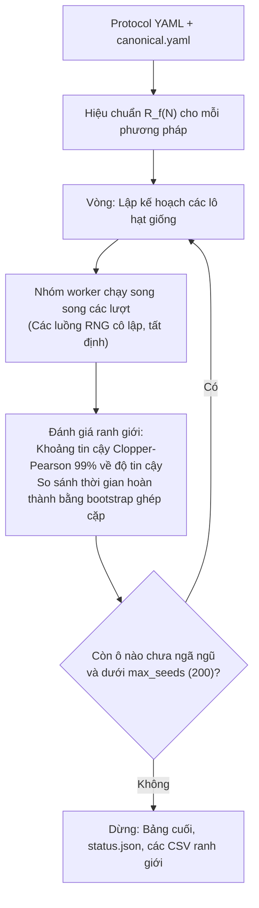

# HerdSim

[**English**](README.md) | [**Tiếng Việt**](README_vi.md)

[](LICENSE)
[](https://www.python.org/downloads/)
[](tests/)
[](results/)

**HerdSim** là một khung mô phỏng đa tác tử cho việc chăn dắt tập thể. Dự án đặt ra một câu hỏi:

> **Cần bao nhiêu chó (D) để gom một bầy N cừu và lùa vào đích một cách đạt độ tin cậy trong một thời hạn, và số tối thiểu này (D_min) phụ thuộc thế nào vào quy mô bầy, bố cục xuất phát, thời hạn, tiêu chí thành công và quy tắc của chó?**

Nếu có thời gian không giới hạn, một con chó cuối cùng cũng có thể gom và dẫn gần như mọi bầy cừu bằng cách đuổi từng cá thể lạc đàn một. Với thời hạn hữu hạn, các chó phải gom song song những con cừu tản mác, giữ cho bầy không bị tách ra, và lùa bầy đến đích trong thời gian còn lại.

HerdSim kết hợp các mô hình tác tử của [Strombom et al. 2014](https://doi.org/10.1098/rsif.2014.0719) và [Kubo et al. 2022](https://doi.org/10.1007/s10015-021-00726-7) với một tầng điều phối đội nhiều chó, các độ dài của nhiệm vụ gắn với bán kính bầy đã đo, và một động cơ thống kê tuần tự thích ứng (khoảng tin cậy Clopper-Pearson 99%). Cừu và chó là các mô hình mô phỏng; các con số cho biết mô hình này và quy tắc đội này làm được gì, không cho biết một người chăn cần bao nhiêu chó.


*Hình 1: Một lượt chạy (N = 200 cừu, D = 4 chó, xuất phát wide, hạt giống 2026). Các chó đến chỗ những con cừu ở rìa, đưa chúng vào, xếp hàng sau bầy và lùa bầy vào đích hình tròn. Lượt chạy kết thúc sau 279 nhịp, khoảng hai thời gian lùa.*

---

## Mục lục

- [Phát hiện khoa học cốt lõi](#phát-hiện-khoa-học-cốt-lõi)
- [Một chiến dịch chạy như thế nào](#một-chiến-dịch-chạy-như-thế-nào)
- [Hình học nhiệm vụ và tính bất biến theo quy mô](#hình-học-nhiệm-vụ-và-tính-bất-biến-theo-quy-mô)
- [Các cấu hình bầy ban đầu](#các-cấu-hình-bầy-ban-đầu)
- [Mô hình tác tử và phối hợp nhiều chó](#mô-hình-tác-tử-và-phối-hợp-nhiều-chó)
- [Các quyết định thống kê và ranh giới](#các-quy-tắc-ranh-giới-quyết-định-điều-gì)
- [Độ nhạy và tính bền vững](#độ-nhạy-và-tính-bền-vững)
- [Bắt đầu nhanh](#bắt-đầu-nhanh)
- [Một lần chạy ghi ra những gì](#một-lần-chạy-ghi-ra-những-gì)
- [Kiến trúc dự án](#kiến-trúc-dự-án)
- [Kiểm chứng và chuẩn thử nghiệm](#kiểm-chứng-và-chuẩn-thử-nghiệm)
- [Tài liệu tham khảo](#tài-liệu-tham-khảo)

---

## Phát hiện khoa học cốt lõi

Qua 23 giao thức chiến dịch và **164,740 lượt mô phỏng** (không có lỗi thực thi), HerdSim đã lập bản đồ D_min(N) cho N từ 25 đến 400 trên bốn bố cục xuất phát, ba thời hạn và hai tiêu chí thành công. Bản viết đầy đủ là [`docs/report/d_min_report.md`](docs/report/d_min_report.md).

Các bảng được tạo từ `results/` bằng [`cli/dmin_tables.py`](cli/dmin_tables.py) và được tập hợp trong [`docs/report/results_tables.md`](docs/report/results_tables.md). Một mục như "3-8" là một khoảng chặn (bracket): D = 8 là đội nhỏ nhất đạt độ tin cậy, nhưng các D từ 3 trở lên vẫn chưa ngã ngũ ở 200 hạt giống (seed), nên D_min thực nằm trong [3, 8]. "[9]" là một cận dưới mà chưa có D nào đạt độ tin cậy, và "none" nghĩa là không có D nào trên lưới đạt độ tin cậy.


*Hình 2: Thiết kế. Trên: các bước của một giao thức. Dưới: mỗi nhóm lượt chạy bao phủ những gì; 14 lượt chạy độ nhạy gồm một cấu hình gốc và sáu biến thể, mỗi cái chạy dưới cả hai tiêu chí thành công.*


*Hình 3: D_min theo N ở ba thời hạn. Vòng tròn và nét liền: thành công strict (mọi con cừu trong đích); hình vuông và nét đứt: 99% số cừu trong đích. Các thanh tô bóng là khoảng chặn, tam giác rỗng là cận dưới, dấu chéo là "none"; compact bằng 1 ở mọi nơi.*

### 1. Bầy compact chỉ cần một chó
Khi bầy xuất phát compact, **một chó là đủ ở mọi quy mô bầy đã thử (N = 25 đến 400) và mọi thời hạn (từ 12 xuống 3 thời gian lùa)**: không có con cừu nào xuất phát ngoài khoảng cách gom, nên nhiệm vụ chỉ là lùa. Với cừu Strombom, thêm chó không đổi thời gian hoàn thành (trung vị là 1.44 đến 1.74 thời gian lùa với mọi D từ 1 đến 24). Mô hình Kubo cũng chỉ cần một chó, nhưng thời gian hoàn thành của nó giảm theo D, từ 102-116 s với một chó xuống khoảng 30 s với mười chó.


*Hình 4: Thời gian hoàn thành theo D trên xuất phát compact. Trái: cừu Strombom với quy tắc đội, trung vị thời gian hoàn thành chia cho thời gian lùa. Phải: mô hình Kubo, trung vị thời gian hoàn thành tính bằng giây. Tỉ lệ thành công là 1.00 ở mọi ô.*

### 2. Trên các bố cục tản mác, D_min tăng chậm theo N
Các bố cục tản mác (`wide`, `split`, `outlier_rich`) trước hết cần gom các cừu lạc đàn:
- Ở 12 thời gian lùa, D_min là 1 với N <= 50 (1 đến 3 ở N = 100 trên `outlier_rich`) và 2 hoặc 3 ở N = 400.
- Độ dốc log-log của D_min theo N (log2 D_min so với log2 N) là 0.2 đến 0.5 ở 12 thời gian lùa, và 0.3 đến 0.8 ở 6 thời gian lùa tại những nơi D_min được xác định ở ba quy mô trở lên. Các quy mô đó dừng trước N = 400 dưới tiêu chí strict, nơi D_min ít nhất là 9 trên `wide`, nên độ dốc strict đánh giá thấp mức tăng ở đó.

### 3. Thời hạn làm D_min thay đổi nhiều như quy mô bầy
Dưới tiêu chí 99%, siết thời hạn từ 12 xuống 3 thời gian lùa nâng D_min trên `wide` ở N = 400 từ 2 lên 5-6 chó, trong khi tăng N gấp bốn lần ở 12 thời gian lùa chỉ nâng nó từ 1 lên 2. Dưới tiêu chí strict, nhiều ô trong số này chưa ngã ngũ. Ở 3 thời gian lùa, không đội nào trên lưới gom được các cụm `split` một cách đạt độ tin cậy ở N >= 200 dưới cả hai tiêu chí.


*Hình 5: Trái và giữa: tỉ lệ thành công theo D ở 12, 6 và 3 thời gian lùa (tiêu chí 99%, khoảng tin cậy 99%). Phải: D_min theo thời hạn cho bốn ô.*

### 4. Hai tiêu chí thành công đo hai điều khác nhau
Tiêu chí strict cần mọi con cừu nằm trong đích tại một nhịp; tiêu chí 99% cần tất cả trừ 1, 2 hoặc 4 con cừu ở N = 100, 200 hoặc 400 (ở N <= 50 hai tiêu chí là một). Trong các lượt thất bại strict của đội từ sáu chó trở lên trên `wide` và `outlier_rich` (N >= 100), 95% đã đưa 99% số cừu vào đích tại một nhịp nào đó, và 92% kết thúc với ít hơn một nửa số cừu ở trong: bầy đã đến và sau đó bị lùa ra. Dưới tiêu chí strict có mười một ô ở N >= 200 không có D_min xác định, sáu trong số đó được tiêu chí 99% xác định.


*Hình 6: Tỉ lệ thành công của cùng các ô dưới hai tiêu chí, trên cùng các hạt giống. Các ô trong vùng tô bóng thấp hơn 0.90 dưới tiêu chí strict và bằng hoặc cao hơn 0.90 dưới tiêu chí 99%.*


*Hình 7: Trái: tỉ lệ các lượt chạy với 6 chó trở lên (gộp chung) thành công dưới tiêu chí strict, đạt 99% số cừu trong đích tại một nhịp nào đó, và thành công với chó chậm hơn (tốc độ 1.15). Phải: một bầy xuất phát (wide, N = 400, 16 chó, hạt giống 2), khoảng cách từ tâm bầy đến đích và số cừu ngoài đích. Bầy của chó nhanh hơn đến với một con cừu ở ngoài, bị lùa ra và quay lại; bầy của chó chậm hơn ở trong đích ngay lượt đi qua đầu tiên.*

Tiêu chí làm thay đổi mức độ lớn của các ảnh hưởng thiết lập. Dưới tiêu chí strict, các quy ước thiết lập không có giá trị thực tế (khoảng cách xuất phát, vị trí xuất phát của chó, bộ tham số cừu, tốc độ chó) làm D_min thay đổi gấp ba lần trở lên ở một số ô; dưới tiêu chí 99% cùng các quy ước đó giữ nó trong phạm vi một chó so với khoảng chặn gốc, và chỉ một đích hẹp hơn làm nó thay đổi nhiều hơn (trên `wide` và `outlier_rich` ở 6 thời gian lùa). Cả hai tiêu chí được báo cáo song song. Với một quy tắc đội không có bước cuối nhiệm vụ, kết quả gợi ý tách việc bầy đến nơi (một phần của bầy ở trong) khỏi việc giữ bầy (một khoảng thời gian ở trong, hoặc một chuồng); quy tắc giữ bầy chưa được thử.

### 5. Một quy tắc không có tầng điều phối đội không đạt D_min hữu hạn nào
FAT (mọi chó nhắm vào phía sau con cừu xa đích nhất) không có tầng điều phối đội và không có việc chuyển đổi giữa gom và lùa. Chạy trên cùng nhiệm vụ, nó không cải thiện khi thêm chó: từ N = 200 nó không có đội nào đạt độ tin cậy trên mọi bố cục tản mác dưới cả hai tiêu chí, và trên bầy compact ở N = 400 nó thất bại trong khi quy tắc đội chỉ cần một chó. Các chó của nó chọn cùng một con cừu và di chuyển như các bản sao. Chưa tách được phần nào trong hai phần bị thiếu là quan trọng: một đội gồm các bản sao độc lập của người chăn trong bài báo chưa được chạy.


*Hình 8: Tỉ lệ thành công theo D của quy tắc đội (xanh dương) và FAT (cam) trên cùng nhiệm vụ, strict (nét liền) và 99% (nét đứt), 6 thời gian lùa. Dấu rỗng là ô có ít hơn 30 lượt chạy.*

### 6. Các thước đo theo từng lượt cho thấy gì
Mỗi lượt chạy lưu tóm tắt của 19 thước đo theo từng nhịp về bầy, các chó và đích. Hai trong số đó bổ sung cho các phát hiện trên:
- Giữa các ô, thành công giảm khi bầy tản ra: tương quan Spearman từ -0.56 đến -0.81 ở 6 và 3 thời gian lùa dưới cả hai tiêu chí thành công, gần với -0.70 của bản thảo về mở rộng quy mô năm 2025. Gia quyền độ tản theo N chỉ làm thay đổi nó tối đa 0.02. Đó là một tương quan: thêm chó cũng làm bầy chặt lại.
- Trên bầy `split` ở N = 200, khoảng một phần tư số chó đứng yên theo quy tắc dừng từ D = 4 trở đi, so với khoảng 1% trên `wide`, và trong một lần chạy lại với 12 hạt giống, rút ngắn khoảng cách dừng làm giảm thời gian hoàn thành khoảng một phần năm. Riêng việc chen chúc không phải nguyên nhân: các bầy `wide` có cùng tỉ lệ chó có bản sao và không bị ảnh hưởng.


*Hình 9: (a) Thành công của ô theo độ tản trung bình của bầy. (b) Chó đứng yên và (c) chó có bản sao trong phạm vi 2 đơn vị, theo D, ở N = 200 dưới tiêu chí 99%. Chi tiết ở mục 6.10 của [báo cáo](docs/report/d_min_report.md).*

---

## Một chiến dịch chạy như thế nào

Thay vì dùng số hạt giống cố định cho mọi ô, HerdSim thêm hạt giống theo từng vòng và dùng chúng ở những ô còn chưa ngã ngũ.

Một **giao thức** (được định nghĩa trong [`protocols/configs/protocols/`](protocols/configs/protocols/)) xác định không gian tham số: mô hình cừu, thuật toán người chăn, quy mô bầy N, số chó D, bố cục xuất phát và thời hạn. Mỗi tổ hợp duy nhất của phương pháp, bố cục và N tạo thành một **đường cong D** (nhóm). Mỗi số chó D cụ thể trong đường cong đó là một **ô**, và mỗi hạt giống được đánh giá là một **lượt chạy**.



### Cơ chế thực thi thích ứng

Bốn cơ chế quyết định hạt giống được dùng ở đâu:

#### 1. Tinh chỉnh tuần tự và dừng sớm (khoảng tin cậy Clopper-Pearson 99%)
Mỗi ô bắt đầu bằng một lô cơ sở (`batch_seeds`, mặc định 10). Nếu khoảng tin cậy Clopper-Pearson 99% xác nhận ô đạt độ tin cậy (cận dưới của khoảng tin cậy >= 0.90, cần ít nhất 51 lượt thành công liên tiếp, nên 60 lượt chạy với lô 10) hoặc không đạt (cận trên của khoảng tin cậy < 0.90), việc đánh giá dừng ngay. Các ô chưa ngã ngũ nhận thêm các lô 10 hạt giống cho đến `max_seeds` (200), nên phần lớn tài nguyên tính toán dồn vào các ô gần ranh giới.


*Hình 10 (minh họa): Tinh chỉnh tuần tự với khoảng tin cậy Clopper-Pearson 99% chính xác. Các thất bại rõ ràng dừng sau 10 hạt giống, các thành công rõ ràng dừng sau 60, và các ô chưa ngã ngũ nhận các lô 10 cho đến mức trần 200 hạt giống.*

#### 2. Làm dày tại điểm giữa
Khi hai số chó D đã thử liền kề vượt qua ranh giới giữa các vùng hành vi (ví dụ D = 2 là `too_few` và D = 4 là `improving`) với khoảng cách lớn hơn `refine_min_gap` (1), điểm giữa (D = 3) được thêm vào đường cong cho vòng kế tiếp. Một điểm giữa cũng được thêm bên cạnh một ô vẫn chưa ngã ngũ ở mức trần 200 hạt giống, nên lưới mịn hơn ở nơi câu trả lời còn mở.


*Hình 11 (minh họa): Một thay đổi vùng giữa D = 2 và D = 4 thêm D = 3 ở vòng kế tiếp. Các điểm giữa khác được thêm trong cùng vòng ở nơi các ô lân cận đổi vùng.*

#### 3. Cắt tỉa theo bão hòa và theo bản sao
Phía trên một điểm bão hòa đã xác nhận (D_sat), một ô bị cắt tỉa khi tỉ lệ trung bình các chó có bản sao (`dog_overlap`) là >= 0.90 trong các lượt chạy của nó. Một ô bị cắt tỉa không nhận thêm hạt giống hay điểm giữa nào.


*Hình 12 (minh họa): Khi thời gian hoàn thành ngừng cải thiện ở D_sat, các ô có tỉ lệ bản sao từ 0.90 trở lên được đánh dấu bị cắt tỉa.*

#### 4. Hạt giống ghép cặp
Mọi hạt giống i được đánh giá qua các ô dùng `master_seed + i` (mặc định 2026 + i). Bố cục xuất phát và nhiễu của cừu được rút từ các luồng riêng của hạt giống đó, nên các lượt chạy so sánh D = 2 với D = 4 xuất phát từ cùng một bầy và dùng cùng các giá trị nhiễu của cừu. Hành động của các chó sau đó làm thay đổi việc cừu làm, nên các lượt chạy tách ra sau nhịp đầu tiên.


*Hình 13 (minh họa): Các hạt giống 2026, 2027 và 2028 cho cùng bầy xuất phát và cùng các giá trị nhiễu của cừu ở mọi D.*

#### 5. Ngắt và tiếp tục an toàn
Mỗi lượt chạy xong được nối ngay vào `trials.jsonl`; `trials.csv` được ghi lại sau mỗi vòng. Một chiến dịch có thể bị ngắt (`SIGINT`) và tiếp tục từ các lượt chạy đã lưu, và một tệp khóa ngăn hai lần chạy ghi vào cùng một thư mục. Một lần chạy tiếp tục sẽ từ chối tiếp tục nếu các thiết lập vật lý đã đổi (mã băm bao gồm các thiết lập, không bao gồm mã nguồn).

---

## Hình học nhiệm vụ và tính bất biến theo quy mô

Nếu sân giữ nguyên trong khi N tăng, một bầy lớn sẽ bị sân làm chật và quy mô bầy bị trộn lẫn với mật độ. HerdSim định kích thước nhiệm vụ từ **bán kính bầy đã hiệu chuẩn R_f(N)**, bán kính của một bầy N cừu được lùa bởi một chó, nên đích và quãng lùa tăng theo N. Sự khớp này chỉ một phần: các bố cục tản mác được định cỡ bằng 2 N^(2/3), còn khoảng cách xuất phát, khoảng cách giữa các cá thể, khoảng trống và bán kính cừu r_s là các độ dài tuyệt đối. Từ N = 200, tầm với của các điểm xuất phát tản mác quyết định quãng lùa.


*Hình 14: Hình học nhiệm vụ vẽ đúng tỉ lệ. Trái: bố cục ở N = 200. Giữa: cách đặt quãng lùa. Phải: R_f và bán kính đích theo N.*

| Tham số | Công thức toán học | Cơ sở vật lý |
|---|---|---|
| **Bán kính bầy** R_f(N) | Hhhiệu chuẩn thực nghiệm (ví dụ: 3.14 tại N=5, 9.08 tại N=100, 11.4 tại N=400) | Đo với một chó lùa bầy. |
| **Quãng lùa** | max(13 * R_f(N), 80, reach + R_goal + R_f) | Số hạng thứ ba giữ đích cách xa con cừu xuất phát xa nhất. |
| **Bán kính đích** R_goal | 1.9 * R_f(N) | Cùng kích thước đích tương đối ở mọi N. |
| **Khoảng trống của sân** | 80 đơn vị vượt quá vị trí xuất phát xa nhất | Giữ các điểm xuất phát cách xa mép sân. |
| **Biên mở** | **Không có tường hay biên phản xạ** | Mép sân không được động lực học dùng đến; các tác tử có thể rời khỏi sân. |

### Thời hạn chuẩn hóa

Thời hạn được cho dưới dạng bội số m của **thời gian lùa** đặc trưng:

$$
T_{\text{drive}} = \frac{\text{Drive Distance}}{v_{\text{sheep,max}}}
$$

Một lượt chạy được đánh giá ở m = 6 đòi hỏi đội chó gom và lùa bầy trong 6 lần thời gian di chuyển tối thiểu theo lý thuyết của con cừu nhanh nhất. Một bầy compact được một chó lùa theo quy tắc Strombom hoàn thành trong 1.46 đến 1.74 x T_drive (trung vị); vì vậy m thuộc {12, 6, 3} chạy từ một thời hạn rộng rãi đến một thời hạn có ít chỗ thừa.

| Quy mô bầy (N) | Bán kính bầy R_f | Quãng lùa l | Thời gian lùa (T_drive) | Thời hạn 12x (rộng rãi) | Thời hạn 6x (trung bình) | Thời hạn 3x (gấp gáp) |
| :---: | :---: | :---: | :---: | :---: | :---: | :---: |
| **N = 25** | 6.20 m | 80.6 m | **80.6 s** (~1.3 phút) | 967 s (~16.1 phút) | 484 s (~8.1 phút) | 242 s (~4.0 phút) |
| **N = 50** | 7.60 m | 98.8 m | **98.8 s** (~1.6 phút) | 1,185 s (~19.8 phút) | 593 s (~9.9 phút) | 296 s (~4.9 phút) |
| **N = 100** | 9.08 m | 118.1 m | **118.1 s** (~2.0 phút) | 1,417 s (~23.6 phút) | 708 s (~11.8 phút) | 354 s (~5.9 phút) |
| **N = 200** | 10.47 m | 139.8 m | **139.8 s** (~2.3 phút) | 1,678 s (~28.0 phút) | 839 s (~14.0 phút) | 419 s (~7.0 phút) |
| **N = 400** | 11.40 m | 206.8 m | **206.8 s** (~3.4 phút) | 2,482 s (~41.4 phút) | 1,241 s (~20.7 phút) | 620 s (~10.3 phút) |

*Ghi chú: Quãng lùa l = max(13 * R_f, 80, reach + R_goal + R_f). Ở N = 400, số hạng khoảng trống của sân chiếm ưu thế (206.8 m) vì tầm với của các điểm xuất phát tản mác tăng theo N^(2/3) trong khi R_f tăng chậm hơn, nên đích không chồng lên con cừu xuất phát nào.*

---

## Các cấu hình bầy ban đầu

Để nghiên cứu sự chuyển tiếp giữa gom và lùa, HerdSim cung cấp bốn hình học không gian ban đầu khác nhau:


*Hình 15: Bốn bố cục bầy ban đầu được đánh giá ở N = 200 với D = 4 chó (cùng tỉ lệ). Vòng tròn đứt nét màu xám đánh dấu ranh giới gom giải tích f(N) = r_a * N^(2/3). Mọi con cừu nằm ngoài vòng tròn này kích hoạt các quy tắc gom chủ động.*

1. **`compact`**: Bầy được lấy mẫu từ phân phối Gauss 2D (sigma = 0.5 * R_f, cắt tại 3 sigma). Mọi con cừu bắt đầu rất gần trong f(N); các chó vào chế độ lùa ngay.
2. **`wide`**: Bầy được lấy mẫu từ một phân phối Gauss rộng (sigma = 0.5 * 2 N^(2/3)). Cừu tản rộng, đòi hỏi quét chu vi ban đầu đáng kể.
3. **`split`**: Bầy được chia thành 3 cụm nhỏ compact (2 cụm khi N < 12) đặt đối xứng trên một đường tròn bán kính 2 N^(2/3). Các chó phải xử lý từng nhóm riêng lẻ mà không làm chúng tản thêm.
4. **`outlier_rich`**: 80% số cừu nằm trong một lõi compact dày, còn 20% phân bố thành các cừu lạc đàn ở xa, trong khoảng 1.1 đến 1.6 x 2 N^(2/3).

### Cấu hình thả chó (`dog_start`)

Các chó bắt đầu cách con cừu xa nhất có thể xuất phát 30 đơn vị, bố trí theo một trong ba kiểu thực nghiệm:
- **`arcs` (mặc định)**: Các chó được đặt cách đều dọc các cung nửa đường tròn đồng tâm sau bầy. Một chó đơn xuất phát ngay trên trục lùa; các chó thêm vào chiếm các vị trí hai bên riêng biệt.
- **`ring`**: Các chó phân bố đều trên một đường tròn bao quanh bầy, bỏ trống hình nón (nhìn từ tâm bầy) chứa đích, để kiểm tra việc bao vây giúp hay cản trở việc gom ban đầu. Một đường tròn đầy đủ đặt một chó vào trong đích với mọi D chẵn từ N = 200; lần chạy ring đầu tiên đó được giữ trong `results/dmin_s_ring_dog_in_goal` và không được dùng.
- **`handler`**: Tất cả các chó xuất phát từ một điểm duy nhất ngay sau bầy (mô phỏng việc người chăn thả đồng thời từ vị trí của mình; tại $t = 0$ mọi chó chồng lên nhau tại tọa độ duy nhất này trước khi tỏa ra).


*Hình 16: Các cấu hình thả chó (dog_start). Trên: Mở rộng của hình học arcs mặc định từ D = 1 đến D = 64 sau một bầy N = 100 (các cung đồng tâm cách con cừu xuất phát xa nhất 30 đơn vị). Dưới: So sánh trực tiếp ba hình học bố trí (arcs, ring, handler) ở N = 200 với D = 8 chó trên xuất phát wide (ở chế độ handler, cả 8 chó bắt đầu chồng lên nhau tại một tọa độ thả duy nhất).*

**Vì sao có một điểm `handler` duy nhất?** Một người chăn có thể thả các chó từ một chỗ sau bầy thay vì dàn chúng ra trước. Kiểu xuất phát `handler` kiểm tra xem kiểu xuất phát `arcs` dàn sẵn giúp được bao nhiêu: mọi chó bắt đầu ở một điểm và quy tắc đội đưa chúng đến mục tiêu từ nhịp đầu tiên.

---

## Mô hình tác tử và phối hợp nhiều chó

Cừu theo quy tắc của Strombom et al. (2014), các chó theo một phần mở rộng nhiều chó của cùng bài báo, và một mô hình cừu và chó thứ hai (Kubo et al. 2022) dùng để kiểm tra chéo.


*Hình 17: Quy tắc đội trong strombom_multi, trong lưới 2 x 4 ô. Các cột: D = 1, 2, 4, 8. Hàng trên: một bầy wide (N = 200), nơi D con cừu lạc đàn xa nhất mỗi con nhận một chó, ghép theo tổng quãng đường đi ít nhất. Hàng dưới: một bầy compact, nơi các chó chiếm các vị trí trên một cung sau bầy, theo thứ tự góc của chúng quanh bầy.*

### 1. Động lực học của cừu ([Strömbom et al. 2014](https://doi.org/10.1098/rsif.2014.0719))

Xuất phát từ các quan sát thực nghiệm về tập tính bầy đàn dưới sự săn mồi, hành vi của cừu được điều khiển bởi một máy trạng thái kích hoạt theo mối đe dọa:

#### Chế độ chạy trốn chủ động ($\min_j \lVert \mathbf{x}_i - \mathbf{y}_j \rVert < r_s$)
Khi có bất kỳ chó nào trong khoảng cách đe dọa $r_s$, cừu $i$ tính một vector hướng thô $\mathbf{H}_i'$ cân bằng quán tính, lực xã hội, né chó và nhiễu:

$$
\mathbf{H}_i' = h\,\mathbf{H}_i + c\,\mathbf{C}_i + \rho_a\,\mathbf{R}_{a,i} + \rho_s\,\mathbf{R}_{s,i} + e\,\mathbf{\epsilon}_i
$$

trong đó mỗi thành phần là một **vector đơn vị** nhân với trọng số hành vi của nó (Bảng 2):
- $\mathbf{H}_i$: Vector đơn vị **hướng trước đó** (hướng từ nhịp trước, bằng không nếu đứng yên), với trọng số quán tính $h = 0.5$.
- $\mathbf{C}_i$: Vector đơn vị **lực hút kết bầy** hướng về tâm khối cục bộ ($\text{LCM}_i$) của $n$ láng giềng gần nhất ($n = N - 1$), với trọng số hút $c = 1.05$:

$$
\mathbf{C}_i = \frac{\text{LCM}_i - \mathbf{x}_i}{\lVert \text{LCM}_i - \mathbf{x}_i \rVert}, \quad \text{where } \text{LCM}_i = \frac{1}{n} \sum_{k \in \mathcal{N}_n(i)} \mathbf{x}_k
$$

- $\mathbf{R}_{a,i}$: Vector đơn vị **lực đẩy giữa các cừu** đẩy ra xa các láng giềng gần hơn khoảng cách va chạm $r_a = 2$, với trọng số đẩy $\rho_a = 2.0$:

$$
\mathbf{R}_{a,i} = \frac{\sum_{j \ne i, \lVert \mathbf{x}_i - \mathbf{x}_j \rVert < r_a} \frac{\mathbf{x}_i - \mathbf{x}_j}{\lVert \mathbf{x}_i - \mathbf{x}_j \rVert}}{\left\lVert \sum_{j \ne i, \lVert \mathbf{x}_i - \mathbf{x}_j \rVert < r_a} \frac{\mathbf{x}_i - \mathbf{x}_j}{\lVert \mathbf{x}_i - \mathbf{x}_j \rVert} \right\rVert}
$$

- $\mathbf{R}_{s,i}$: Vector đơn vị **lực thoát khỏi người chăn** đẩy ra xa các người chăn trong khoảng cách đe dọa $r_s = 65$, với trọng số thoát $\rho_s = 1.0$.
- $\mathbf{\epsilon}_i$: Vector đơn vị **nhiễu** chỉ theo một hướng ngẫu nhiên rút đều từ $[0, 2\pi)$, với trọng số nhiễu $e = 0.3$.

Cừu $i$ tiến một khoảng $\delta = 1$ m (tốc độ $\delta = 1$ m/s) dọc theo vector hướng đã chuẩn hóa:

$$
\mathbf{x}_i^{t+1} = \mathbf{x}_i^t + \delta\,\frac{\mathbf{H}_i'}{\lVert \mathbf{H}_i' \rVert}
$$

#### Chế độ gặm cỏ ($\min_j \lVert \mathbf{x}_i - \mathbf{y}_j \rVert \ge r_s$)
Khi mọi chó nằm ngoài tầm đe dọa $r_s$, cừu không chịu lực hút hay lực đẩy xã hội; chúng **gặm cỏ**: đứng yên, hoặc với xác suất $p = 0.05$ bước một bước dài $\delta$ theo một hướng ngẫu nhiên đều:

$$
\mathbf{x}_i^{t+1} = \begin{cases}
\mathbf{x}_i^t + \delta\,\mathbf{\epsilon}_{\text{graze}}, & \text{with probability } 0.05 \\
\mathbf{x}_i^t, & \text{with probability } 0.95
\end{cases}
$$

#### Trộn lực đẩy của nhiều chó ($\mathbf{R}_{s,i}$)

Mô hình gốc của Strömbom et al. (2014) được xây dựng cho **chỉ một chó**, khi đó vector đe dọa đơn giản là vector đơn vị chỉ thẳng ra xa người chăn duy nhất đó: $\frac{\mathbf{x}_i - \mathbf{y}}{\lVert \mathbf{x}_i - \mathbf{y} \rVert}$. Khi mở rộng sang các đội nhiều chó ($D \ge 2$), cộng các lực đẩy của các chó sẽ làm lực đẩy tăng theo số chó ở gần một con cừu. HerdSim cộng các vector đơn vị hướng ra xa từng chó trong tầm và chuẩn hóa tổng về độ dài 1:

$$
\mathbf{R}_{s,i} = \frac{\sum_{j \in \text{threat}} \frac{\mathbf{x}_i - \mathbf{y}_j}{\lVert \mathbf{x}_i - \mathbf{y}_j \rVert}}{\left\lVert \sum_{j \in \text{threat}} \frac{\mathbf{x}_i - \mathbf{y}_j}{\lVert \mathbf{x}_i - \mathbf{y}_j \rVert} \right\rVert}
$$

trong đó:
- $\mathbf{x}_i$: Vector vị trí 2D của cừu $i$.
- $\mathbf{y}_j$: Vector vị trí 2D của chó $j$.
- $\frac{\mathbf{x}_i - \mathbf{y}_j}{\lVert \mathbf{x}_i - \mathbf{y}_j \rVert}$: Vector đơn vị chỉ thẳng ra xa chó $j$ về phía cừu $i$ (hướng thoát thuần túy khỏi chó $j$).
- $\text{threat}$: Tập mọi chó hiện đang trong tầm đe dọa của cừu $i$ ($\lVert \mathbf{x}_i - \mathbf{y}_j \rVert < r_s$).

**Ví dụ trực quan:**
Hình dung một con cừu ở $(0, 5)$ bị hai chó hai bên sườn đuổi: Chó 1 đứng ở $(-3, 0)$ (sau bên trái) và Chó 2 đứng ở $(3, 0)$ (sau bên phải).
- Chó 1 tạo một lực đẩy chéo về phía trước bên phải.
- Chó 2 tạo một lực đẩy chéo về phía trước bên trái.
- Cộng hai vector đơn vị làm các thành phần ngang triệt tiêu nhau trong khi các thành phần hướng tới tăng cường nhau. Chuẩn hóa về độ dài đơn vị cho một lực đẩy tổng hợp hướng thẳng về phía trước $(0, 1)$.

Vì vậy lực đẩy lên một con cừu có cùng độ lớn dù có bao nhiêu chó trong tầm, và chỉ hướng của nó phụ thuộc vào chỗ các chó đứng.

### 2. Các bộ điều khiển người chăn và các mô hình đối chứng

Có ba bộ điều khiển chó được cài đặt:

#### Kiến trúc có phối hợp: `strombom_multi`
- **Chế độ cừu lạc đàn (Outlier Mode)**: Khi có con cừu nào nằm xa tâm bầy hơn $f(N) = r_a \cdot N^{2/3}$, $D$ con cừu lạc đàn xa nhất được xác định. Các chó được gán cho các con cừu lạc đàn riêng biệt bằng phép gán tuyến tính (tổng quãng đường di chuyển Euclid nhỏ nhất). Các chó còn dư hỗ trợ lùa phần lõi của bầy.
- **Chế độ lùa (Drive Mode)**: Khi bầy đã kết dính, các chó lập một cung sau bầy ở khoảng cách $r_d$, trải theo bề rộng góc của bầy. Các chó được sắp theo vị trí góc tương đối quanh bầy, bảo đảm chúng không bao giờ cắt ngang đường nhau khi di chuyển đến các vị trí lùa được gán.

#### Đối chứng không phối hợp: `fat` (Farthest-Agent Targeting)

Để xem tầng điều phối đội có quan trọng hay không, HerdSim có một đối chứng không có tầng đó, **FAT (Farthest-Agent Targeting)** (`dog_controller="fat"`).

- **Quan hệ với các phương pháp trước**: FAT mượn cách chọn mục tiêu của [Kubo et al. (2022)](https://doi.org/10.1007/s10015-021-00726-7) (mỗi người chăn bị hút về phía con cừu xa đích nhất, nhắm vào điểm cách sau nó $r_a$) và thực hiện nó bằng các bước động học rời rạc của [Strömbom et al. (2014)](https://doi.org/10.1098/rsif.2014.0719).
- **Khác `strombom_multi` ở đâu**: FAT không có phép gán cừu lạc đàn và không có vị trí lùa, và không có lực đẩy giữa các chó như của Kubo et al. (2022). Nó cũng không có bước chuyển giữa gom và lùa: mọi chó luôn đi ra sau con cừu xa đích nhất. Các bản sao độc lập của người chăn trong bài báo chưa được chạy, nên FAT không tách các phần này ra.
- **Cùng nhiệm vụ**: R_f, vốn đặt đích và quãng lùa, được hiệu chuẩn cho FAT bằng người chăn của bài báo trên cùng bầy cừu (`calibrate_as: strombom_multi` trong giao thức), nên `dmin_fat` chạy đúng nhiệm vụ của `dmin_m6` và chỉ khác quy tắc của chó.
- **Kết quả**: mọi chó nhắm cùng một con cừu, các chó di chuyển như các bản sao (trên bầy compact ở N >= 200, 73 đến 82% số chó FAT có một chó khác trong phạm vi 2 đơn vị), và thành công không tăng theo D. Từ N = 200 FAT không có đội nào đạt độ tin cậy trên mọi bố cục tản mác dưới cả hai tiêu chí thành công.


*Hình 18: FAT (3 ô). Các chó nhắm vào phía sau con cừu xa đích nhất, và không có phép gán nên chúng dùng chung một mục tiêu và di chuyển cùng nhau; tỉ lệ chó có bản sao (`dog_overlap`) cao.*

#### Kiến trúc lực liên tục đa mô hình: `kubo` ([Kubo et al. 2022](https://doi.org/10.1007/s10015-021-00726-7))
Để kiểm tra quy tắc Strömbom, HerdSim cũng có mô hình lực liên tục của Kubo et al. (2022), với cả **cừu Kubo** và **chó Kubo**:
- **Động lực học cừu Kubo**: Vận tốc cừu cập nhật liên tục qua bốn lực cộng gộp trong tầm nhìn của mỗi con cừu:
  1. *Lực đẩy giữa các cừu* ($1/r^2$): Ngăn va chạm và chen chúc.
  2. *Căn chỉnh vận tốc*: Khớp hướng với các láng giềng đang chuyển động.
  3. *Lực hút giữa các cừu* ($-1/r$): Gắn bầy lại với nhau.
  4. *Chạy khỏi chó* ($1/r^3$): Lực đẩy mạnh ở cự ly gần, thẳng ra xa các người chăn.
- **Bộ điều khiển người chăn Kubo**: Khác với `strombom_multi`, chó Kubo không dùng máy trạng thái rời rạc hay phép gán tổ hợp. Thay vào đó, mỗi chó di chuyển theo bốn trường thế liên tục:
  1. *Lực hút mục tiêu*: Bị kéo về phía con cừu xa đích nhất.
  2. *Khoảng cách giữ với mục tiêu* ($1/r^3$): Bị đẩy ra khi đến quá gần con cừu mục tiêu đó.
  3. *Khoảng cách giữ với đích*: Bị đẩy ra xa chu vi đích để tránh lùa cừu ngược ra khỏi chuồng.
  4. *Lực đẩy giữa các chó* ($1/r^3$): Các người chăn đẩy nhau mạnh, tự nhiên tỏa ra dọc biên bầy mà không cần giao tiếp tường minh.
- **Vai trò trong HerdSim (`dmin_kubo`)**: Được đánh giá trên các bầy compact ($N \in \{25, 50, 100\}$, $D \in \{1 \dots 10\}$), mô hình Kubo phù hợp với $D_{\min} = 1$ trên xuất phát compact đến N = 100 (thời gian hoàn thành giảm theo D, xem Hình 4). Nó được chạy với một mô hình cừu và quy tắc chó khác và chỉ trên xuất phát compact, nên không kiểm tra các bố cục tản mác.


*Hình 19: Mô hình Kubo et al. (2022). Trái: các số hạng lực lên một con cừu. Giữa: các số hạng lực lên một con chó. Phải: một ảnh chụp đơn của một bầy mô phỏng và các chó của nó.*

---

## Các quy tắc ranh giới quyết định điều gì

Các quyết định thống kê do [`analysis/frontier.py`](analysis/frontier.py) quản lý. Với mỗi ô (một phương pháp, bố cục, N và D cho trước):

1. **Độ tin cậy (theta = 0.90)**:
   Một ô được phân loại là **đạt độ tin cậy (reliable)** nếu cận dưới của khoảng tin cậy nhị thức Clopper-Pearson 99% hai phía thỏa p_lower >= 0.90. Nó được phân loại là **không đạt (unreliable)** nếu p_upper < 0.90, và **chưa ngã ngũ (undecided)** trong các trường hợp còn lại. Cần ít nhất 51 lượt thành công liên tiếp để đạt độ tin cậy ở mức tin cậy 99%, tức là 60 lượt chạy với lô 10.
2. **So sánh thời gian hoàn thành**:
   So sánh thời gian hoàn thành theo cặp giữa các ô đạt độ tin cậy được đánh giá bằng bootstrap ghép cặp (4,000 lần lấy mẫu lại) trên hiệu theo từng hạt giống so với trung vị chậm hơn. Một ô được phân loại là **nhanh hơn (faster)**, **chậm hơn (slower)** hoặc **như nhau (same)** (trong biên 5%).

### Các chỉ số ranh giới dẫn xuất

| Giá trị ranh giới | Định nghĩa |
|---|---|
| **D_min** | Số chó D nhỏ nhất đạt độ tin cậy. (D_min_low: D thấp nhất có cận trên chạm tới theta). |
| **D_sat** | D nhỏ nhất đạt độ tin cậy sao cho không có D đạt độ tin cậy lớn hơn nào nhanh hơn một cách có ý nghĩa thống kê. |
| **D_best** | D nhỏ nhất đạt độ tin cậy mà không chậm hơn số chó đạt độ tin cậy nhanh nhất trên đường cong. |
| **D_crowd** | D nhỏ nhất đạt độ tin cậy lớn hơn D_best mà chậm hơn D_best một cách đo được (ùn tắc). |
| **D_overcrowd** | D nhỏ nhất lớn hơn D_min mà nó và D được thử kế tiếp đều không đạt độ tin cậy (sụp đổ). |
| **D_max** | Số chó đạt độ tin cậy lớn nhất dưới D_overcrowd. |

### Các vùng hành vi của ô


*Hình 20: Chia trục số chó thành các vùng hành vi dựa trên kiểm tra độ tin cậy (theta = 0.90) và so sánh thời gian hoàn thành bằng bootstrap ghép cặp với D_best.*


- `too_few`: Không đạt độ tin cậy, dưới D_min.
- `improving`: Đạt độ tin cậy, dưới D_sat; thêm chó cho mức tăng tốc có ý nghĩa thống kê.
- `saturated`: Đạt độ tin cậy, từ D_sat trở lên; thêm chó giữ nguyên độ tin cậy nhưng không tăng tốc thêm.
- `crowded`: Đạt độ tin cậy, nhưng chậm hơn D_best do các chó cản nhau.
- `collapse`: Không đạt độ tin cậy, tại hoặc trên D_overcrowd.
- `undecided`, `unreliable_dip` và `recovered` đánh dấu các ô còn mở, các ô không đạt độ tin cậy nằm giữa các số chó đạt độ tin cậy, và các ô đạt độ tin cậy trở lại sau một chỗ trũng như vậy.

---

## Độ nhạy và tính bền vững

Để kiểm tra rằng các phát hiện phản ánh động lực học đa tác tử cơ bản chứ không phải các lựa chọn tham số tùy ý, HerdSim đã chạy các lượt quét độ nhạy có hệ thống:


*Hình 21: D_min qua các biến thể độ nhạy (N thuộc {100, 200, 400}, các bố cục wide và outlier_rich, 6 thời gian lùa). Các hàng phía trên đường kẻ ngang kiểm tra thành công strict; các hàng phía dưới kiểm tra ngưỡng đến đích 99% (f99). Các hàng gốc dùng tốc độ chó 1.5, thả arcs, khoảng cách 30 và bán kính đích 1.9 R_f. Các ô sáng là ô còn mở: một khoảng chặn "lo-hi" hoặc một cận dưới "[n]".*

Mọi biến thể đều được chạy dưới cả hai tiêu chí. Dưới tiêu chí strict, một số biến thể làm D_min thay đổi gấp ba lần trở lên; dưới tiêu chí 99%, mọi biến thể trừ đích hẹp hơn đều nằm trong phạm vi một chó so với cấu hình gốc.

1. **Hình học thả chó**: Dưới tiêu chí strict, với 8 chó trở lên ở N = 400, ring có thành công cao nhất và điểm handler thấp nhất. Dưới tiêu chí 99%, cả ba kiểu xuất phát cho cùng D_min trong phạm vi các khoảng chặn; điểm handler vẫn chậm nhất (mọi chó rời đi từ một điểm).
2. **Tốc độ chó (gốc 1.5 so với 1.15)**: Dưới tiêu chí strict, chó chậm hơn cần ít chó hơn trên các bầy lớn (outlier-rich N = 400: 6 so với none). Cả hai tốc độ đưa 99% bầy vào cùng lúc, và dưới tiêu chí 99% lợi thế đó biến mất. Sự khác biệt nằm ở bước con cừu cuối cùng, không phải ở việc lùa.
3. **Bộ tham số khớp thực địa**: Hiệu chuẩn cừu theo bộ tham số khớp thực địa của bài báo (r_a = 1.0, khoảng cách phản ứng 75, nhiễu 0.1) làm khoảng cách gom giảm một nửa. Dưới tiêu chí strict đây là thiết lập khó nhất; dưới tiêu chí 99%, cừu khớp thực địa cần cùng số chó như cấu hình gốc hoặc ít hơn.
4. **Kích thước đích**: Một đích 1.5 R_f là biến thể duy nhất cần nhiều chó hơn dưới cả hai tiêu chí (99%: 5-6 chó trên wide N = 400 so với 2-3).

---

## Bắt đầu nhanh

### Cài đặt

HerdSim cần Python 3.11+ và dùng [`uv`](https://docs.astral.sh/uv/) để quản lý phụ thuộc hiệu năng cao:

```bash
# Clone the repository
git clone https://github.com/lykimq/HerdSim.git
cd HerdSim

# Install development environment and dependencies
make install     # uv sync --extra dev

# Run comprehensive checks (Ruff linter + basedpyright type checker + 268 tests)
make check

# Execute miniature verification campaigns (~1 minute)
make bench
```

### Chạy các chiến dịch

Chạy từng giao thức hoặc hàng đợi theo lô bằng CLI:

```bash
# Preview the trial plan for a protocol without executing
uv run cli/campaign.py plan --protocol dmin_m6

# Run a campaign with 16 parallel workers
uv run cli/campaign.py run --protocol dmin_pilot --workers 16

# Check the real-time status of an active or completed campaign
uv run cli/campaign.py status --protocol dmin_pilot

# Inspect D_min results across multiple deadlines
uv run cli/dmin_report.py --protocol dmin_pilot --folder results/dmin_pilot --multiples 3 6 12

# Run the complete sequence of research protocols (resumes automatically)
uv run cli/run_queue.py --workers 20

# Generate publication-grade Markdown result tables from results/
uv run cli/dmin_tables.py record
uv run cli/dmin_tables.py dmin dmin_m12 dmin_m6 dmin_m3
```

---

## Một lần chạy ghi ra những gì

Mỗi giao thức đã chạy ghi ra một thư mục kết quả tự chứa, có thể kiểm toán:

```text
results/<protocol_id>/
|-- protocol.yaml         Merged configuration (canonical defaults + protocol overrides)
|-- provenance.json       Protocol id, physics hash, and creation time
|-- calibration.json      Calibrated steady-state flock radius R_f(N) per method
|-- trials.jsonl          Append-only stream of completed trials (safe against crashes)
|-- trials.csv            Consolidated trial results table (rewritten after each round)
|-- frontier_cells.csv    Statistical outcomes per cell (Clopper-Pearson CI, finish times, zone)
|-- frontier_groups.csv   Frontier metrics per D-curve (D_min, D_sat, D_crowd, D_overcrowd)
|-- status.json           Live execution status, round counter, and timing diagnostics
|-- errors.jsonl          Captured execution exceptions (empty in standard runs)
|-- .lock                 File lock held during active execution
`-- timeseries/           Per-tick Parquet files (retained for first 3 seeds per cell)
```

Mọi bảng CSV đều có dòng siêu dữ liệu ở đầu, đọc được bằng `pd.read_csv(path, skiprows=1)`.

---

## Kiến trúc dự án

Mã nguồn được tổ chức thành các tầng module tách rời:

```text
HerdSim/
|-- sim/                    # Simulation engine and domain logic
|   |-- core/               # State dataclasses, tick runner, arena, and layouts
|   |-- methods/            # Physical models: Strombom (2014) and Kubo (2022)
|   `-- plugins/            # Extensible plugin system
|       |-- sheep/          # Microscopic sheep dynamics (strombom, kubo)
|       |-- dogs/           # Shepherd controllers (collect_drive_multi, fat, kubo_forces)
|       |-- scenarios/      # Task geometry, goal evaluation, failure diagnostics
|       `-- metrics/        # Per-tick and summary geometric measurements
|-- services/               # Campaign orchestration
|   |-- adaptive.py         # Sequential sampling engine and batch planner
|   |-- calibration.py      # Automated R_f(N) steady-state calibration
|   |-- cells.py            # Parameter grid combinations and D-curves
|   |-- protocol.py         # YAML protocol loading, schema checks, inheritance
|   `-- runner.py           # Worker pool management and trial dispatch
|-- analysis/               # Statistical evaluation
|   |-- frontier.py         # Clopper-Pearson CI, paired bootstrap, zone classification
|   |-- dmin.py             # D_min of a finished run at tighter deadlines or 99% arrival
|   `-- dmin_tables.py      # Table generators for empirical reporting
|-- protocols/configs/      # Canonical defaults and protocol definitions
|-- cli/                    # Command-line tools (campaign, run_queue, dmin_report, dmin_tables)
|-- docs/                   # Report, architecture guide, figures and the scripts that draw them
|-- results/                # Archived empirical datasets (164k+ trials)
`-- tests/                  # Test suites and golden regression benchmarks
```

---

## Kiểm chứng và chuẩn thử nghiệm

Các kiểm tra ở từng tầng:

- **Kiểm thử đơn vị và bất biến** (`make test`, 268 kiểm thử, ~24 s):
  Kiểm tra các quy tắc của cừu và chó, các bố cục, phần thống kê, các vòng thích ứng và mã tạo bảng.
- **Kiểm thử hồi quy chuẩn (golden)** ([`tests/sim/test_golden.py`](tests/sim/test_golden.py)):
  So sánh các lượt chạy tham chiếu với giá trị đã lưu (thành công phải khớp chính xác; số nhịp trong 5%, độ kết bầy, độ dài đường đi và độ phân mảnh trong 10%) và kiểm tra rằng cùng một hạt giống chạy lại cho đúng kết quả cũ.
- **Chuẩn thử nghiệm vi chiến dịch** (`make bench`, ~60 s):
  Chạy các chiến dịch nhỏ từ đầu đến cuối để kiểm chứng các bất biến cốt lõi của mô hình:
  - *Giới hạn tốc độ*: tâm bầy không bao giờ di chuyển nhanh hơn tốc độ tối đa của cừu.
  - *Bất biến theo số worker*: kết quả như nhau với 1 và với 4 tiến trình worker.
  - *Lũy đẳng*: chạy lại một thư mục đã hoàn tất không chạy lượt mới nào.
  - *Thứ tự vật lý*: một bầy compact không cần gom, và thời hạn chặt hơn không làm giảm số chó cần thiết.

---

## Tài liệu tham khảo

1. **Strömbom, D., et al. (2014)**. *Solving the shepherding problem: heuristics for herding autonomous, interacting agents*. Journal of the Royal Society Interface, 11(100), 20140719. [DOI: 10.1098/rsif.2014.0719](https://doi.org/10.1098/rsif.2014.0719)
2. **Kubo, M., Tashiro, M., Sato, H., Yamaguchi, A. (2022)**. *Herd guidance by multiple sheepdog agents with repulsive force*. Artificial Life and Robotics, 27, 416-427. [DOI: 10.1007/s10015-021-00726-7](https://doi.org/10.1007/s10015-021-00726-7)
3. **Báo cáo nghiên cứu D_min**: [`docs/report/d_min_report.md`](docs/report/d_min_report.md) ([Tiếng Việt](docs/report/d_min_report_vi.md))
4. **Các bảng kết quả thực nghiệm**: [`docs/report/results_tables.md`](docs/report/results_tables.md)
5. **Phân tích kiến trúc chuyên sâu**: [`docs/codes/architecture.md`](docs/codes/architecture.md)
