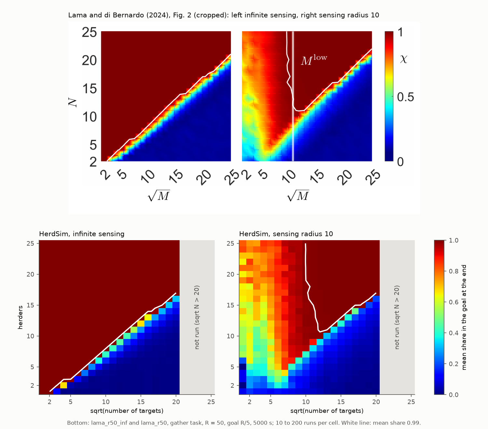

# HerdSim

[](LICENSE)
[](https://www.python.org/downloads/)
[](tests/)
[](results/)

Bạn đã bao giờ quan sát những chú chó chăn cừu làm việc trên một đồng cỏ rộng lớn chưa? Một chú chó chăn cừu kiên nhẫn làm việc một mình cuối cùng cũng có thể gom được hàng chục con cừu. Nhưng điều gì sẽ xảy ra khi đồng hồ đang đếm ngược từng giây? Hoặc khi đàn cừu bị tản mác khắp cánh đồng, tách thành nhiều cụm riêng biệt, hay chạy theo các hướng ngược nhau? Một chú chó đơn độc không thể nào chạy về bốn phương tám hướng cùng một lúc. Để hoàn thành nhiệm vụ trước khi hết giờ, chúng bắt buộc phải làm việc cùng nhau như một đội ngũ được phối hợp nhịp nhàng.

Thực tế này đặt ra một câu hỏi nền tảng trong lĩnh vực hành vi tập thể và robot bầy đàn tự hành:

> **Cần bao nhiêu chú chó ($D$) để gom một đàn $N$ con cừu và lùa đàn vào vùng đích một cách tin cậy trước thời hạn: tối thiểu là bao nhiêu ($D_{\min}$), bao nhiêu thì đủ ($D_{\mathrm{sat}}$), và từ khi nào thêm chó lại làm hỏng việc?**

**HerdSim** là một nghiên cứu và một bộ mô phỏng mã nguồn mở được xây dựng để trả lời câu hỏi đó. Nó xác định đội tin cậy nhỏ nhất ($D_{\min}$), đội mà vượt quá nó thêm chó không còn làm việc lùa nhanh hơn ($D_{\mathrm{sat}}$), và những tình huống mà thêm chó làm nhiệm vụ thất bại.

Qua **367.150 lượt mô phỏng**, không có lỗi mô phỏng nào, HerdSim lập bản đồ quy mô đội tăng thế nào theo quy mô bầy từ 25 đến 566 con (với các lượt chạy đến 3.200 con), dưới các thời hạn, bố cục xuất phát, mức gắn kết và tầm cảm nhận khác nhau.


**Hình 1: Một lượt chạy trong HerdSim ($N = 200$ cừu, $D = 4$ chó, xuất phát `wide`, hạt giống 2026), ở các bước 0, 55, 139 và 279.**
Vòng tròn xanh lá bên phải là đích ($R_{\mathrm{goal}} = 1{,}9 R_f$). Các chó (tam giác cam, kèm vệt đường đi) xuất phát trên một cung sau bầy cừu đang tản mác và khép lại từ nhiều phía trong lúc bầy gom lại. Khi bầy đã liền, chúng lùa bầy từ phía sau vào đích.

---

## Mục lục

- [Các Phát hiện Khoa học Cốt lõi](#các-phát-hiện-khoa-học-cốt-lõi)
- [Động cơ Mô phỏng HerdSim](#động-cơ-mô-phỏng-herdsim)
- [Bắt đầu Nhanh & Khả năng Tái lập Nghiên cứu](#bắt-đầu-nhanh--khả-năng-tái-lập-nghiên-cứu)
- [Vận hành Chiến dịch và Quy trình Lệnh](#vận-hành-chiến-dịch-và-quy-trình-lệnh)
- [Kiến trúc Mã nguồn Dự án](#kiến-trúc-mã-nguồn-dự-án)
- [Bản đồ Tài liệu (Documentation Index)](#bản-đồ-tài-liệu-documentation-index)
- [Tài liệu Tham khảo và Trích dẫn](#tài-liệu-tham-khảo-và-trích-dẫn)

---

## Các Phát hiện Khoa học Cốt lõi

Báo cáo đầy đủ ở [`docs/report/d_min_report_vi.md`](docs/report/d_min_report_vi.md) (bản tiếng Anh: [`docs/report/d_min_report.md`](docs/report/d_min_report.md)), và các bảng số liệu phía sau nó ở [`docs/report/results_tables.md`](docs/report/results_tables.md). Các kết quả chính:


**Hình 2: Quy mô đội tối thiểu $D_{\min}$ theo số cừu $N$ ở ba mức thời hạn và bốn bố cục xuất phát.**
Trục hoành là quy mô bầy $N$; trục tung là đội nhỏ nhất có tỷ lệ thành công ít nhất 0,90 với độ tin cậy 99%. Các cột là các bố cục xuất phát (`compact`, `split`, `wide`, `outlier_rich`); các hàng là các thời hạn (12, 6 và 3 lần thời gian lùa). Đường liền: mọi con cừu phải vào đích (nghiêm ngặt); đường đứt: 99% số cừu. Bố cục `compact` giữ ở $D_{\min} = 1$ ở mọi nơi, còn thời hạn gấp đẩy các đường của bố cục phân tán lên cao.

### 1. Đàn cừu tập trung chỉ cần duy nhất một chú chó ($D_{\min} = 1$)
Khi cừu xuất phát gần nhau (`compact`), **một chó là đủ ở mọi quy mô bầy đã thử ($N = 25$ đến $400$) và mọi thời hạn (từ 12 xuống 3 lần thời gian lùa)**. Không con nào phải đi bắt về, nên chó chỉ việc lùa. Thêm chó cũng không làm việc lùa nhanh hơn: trong mô hình, một con cừu phản ứng với chó luôn đi $1$ m/s, nên chó đổi hướng của bầy chứ không đổi tốc độ.

### 2. Trên đồng cỏ tản mác, $D_{\min}$ tăng chậm hơn nhiều so với quy mô đàn
Khi cừu xuất phát rải rác (`wide`, `split`, `outlier_rich`), chó phải đưa các con lạc về trước khi lùa cả bầy. Trên thang log-log ($\log_2 D_{\min}$ theo $\log_2 N$), độ dốc là **0,27 đến 0,38** ở thời hạn thong thả (12 lần thời gian lùa) và 0,38 đến 0,61 ở 6 lần, nên đội tăng chậm hơn nhiều so với bầy.  
*Vì sao chậm như vậy?* Mỗi con cừu bị hút về bầy. Khi chó đã lùa một con lạc quay lại, nó tự đi về bầy, nên chó không phải đi bắt từng con.

### 3. Áp lực thời hạn đòi hỏi nhiều chó hơn là quy mô đàn cừu
Dưới quy tắc 99%, rút thời hạn từ 12 xuống 3 lần thời gian lùa làm $D_{\min}$ trên một bầy `wide` 400 con tăng từ **2 chó lên 5–6**. Làm bầy đó lớn gấp bốn (từ $N = 100$ lên 400) ở thời hạn thong thả chỉ làm nó tăng từ 1 lên 2. Khi ít thời gian, một chó không thể đưa từng con lạc về lần lượt, nên nhiều chó phải làm cùng lúc.

### 4. Nếu không có tinh thần đồng đội, thêm chó chỉ vô ích
Để kiểm tra xem có cần phối hợp không, chúng tôi chạy một đối chứng không phối hợp, **FAT (nhắm con xa nhất)**: mọi chó đi tới phía sau con cừu xa đích nhất. Mọi chó thấy cùng một bầy, nên **tất cả chọn cùng một con** và dồn thành một cụm hoạt động như một chó duy nhất. FAT không có đội tin cậy nào trên các bố cục phân tán khi $N \ge 200$: quá hai chó, tỷ lệ thành công của nó ở dưới khoảng 0,55, nên thêm chó không tạo ra việc làm song song.

### 5. Thế nào là thành công? Con cừu cuối cùng
Khi mọi con cừu phải ở trong đích cùng một lúc (quy tắc nghiêm ngặt), các đội lớn ($D \ge 6$) thường thất bại trên bầy lớn. Trong 97% số lượt thất bại đó, 99% số cừu đã từng ở trong đích trước thời hạn. Trong một lượt mẫu, các chó đuổi theo con lạc cuối cùng đứng vào giữa bầy và đích, và lùa bầy ra ngoài trở lại. Với chó chậm hơn ($1{,}15$ m/s thay vì $1{,}5$), $D_{\min}$ nghiêm ngặt trên `outlier_rich` $N = 400$ giảm từ không có trên lưới xuống 6. Tính một lượt là thành công khi **99% số cừu** vào đích sẽ tránh được vấn đề này và đo được việc cả đội làm được với bầy.

### 6. Mục tiêu không gắn kết theo quy luật căn bậc hai, cả trong HerdSim
Đàn cừu ở các phát hiện 1 đến 5 luôn bám lấy nhau. Lama & di Bernardo (2024) nghiên cứu trường hợp ngược lại: các mục tiêu hoàn toàn không hút nhau. Mỗi mục tiêu đi lang thang ngẫu nhiên và chỉ chạy ra xa khi có người chăn đến gần. Mục tiêu và người chăn xuất phát rải rác trên một hình tròn, và người chăn phải đưa 99% mục tiêu vào một đích nhỏ ở tâm. Bài báo cho thấy đội nhỏ nhất tăng theo căn bậc hai của số mục tiêu. Chúng tôi chạy mô hình của họ trong HerdSim để kiểm tra quy luật đó với cùng bộ mô phỏng và cùng quy tắc tin cậy đã dùng cho đàn cừu.

Trước hết, HerdSim cho lại đúng kết quả của bài báo. Bài báo công bố bằng số một kết quả là ngưỡng trong Bảng I: với bán kính 10, đội nhỏ nhất chỉ theo quy luật căn bậc hai từ $\sqrt{N} = 8$, 9 và 11 trở lên, ứng với mức gom 90%, 95% và 99%. HerdSim cho 8, 9 và 12. Các kết quả còn lại của bài báo là bản đồ màu ([Hình 2](https://doi.org/10.1103/PhysRevResearch.6.L032012)). Đặt cạnh nhau (Hình 3), bản đồ của HerdSim và của bài báo có cùng hình dạng. Với bán kính 10, khi ít mục tiêu thì không đội nào tới 25 người chăn đạt được, rồi có một ngưỡng rõ, và trên ngưỡng là một dải đội tăng theo căn bậc hai của số mục tiêu. Khi thấy mọi thứ, dải đó kéo dài suốt cả khoảng.


**Hình 3: Bản đồ của bài báo phía trên bản đồ của HerdSim.** Mỗi ô là tỷ lệ mục tiêu trong đích lúc kết thúc, lấy trung bình qua các lượt, cho một số mục tiêu (trục hoành, theo căn bậc hai) và một số người chăn (trục tung); đường trắng đánh dấu mức 0,99. Trái: người chăn thấy mọi thứ. Phải: người chăn thấy trong bán kính 10. Lưới của HerdSim dừng ở 400 mục tiêu ($\sqrt{N} = 20$), nên dải xám từ 21 đến 25 trên trục của bài báo không có dữ liệu. Phạm vi đã chạy đã chứa ngưỡng và đoạn tăng theo căn bậc hai phía trên ngưỡng, đủ để kiểm tra, nên năm quy mô lớn hơn không được chạy; chạy thêm sẽ làm thời gian chạy tăng gần gấp đôi. Có hai khác biệt nhỏ: với bán kính 10 và ít mục tiêu, HerdSim gom được ít hơn bài báo một chút, và đường 0,99 của HerdSim quay lên ở khoảng $\sqrt{N} = 12$, còn của bài báo ở khoảng 10 đến 11.  
*Trên: Hình 2 của Lama và di Bernardo (2024), Phys. Rev. Research 6, L032012, [CC BY 4.0](https://creativecommons.org/licenses/by/4.0/), đã cắt.*

Khi người chăn thấy mọi thứ, quy luật căn bậc hai cũng đúng trong HerdSim: 8 người chăn cho 100 mục tiêu, 17 cho 400 (số mũ 0,52–0,53). Mức này dốc hơn 0,27–0,38 của đàn cừu gắn kết ở thời hạn thong thả.
*Tại sao lại khác?* Ở phát hiện 2, một con cừu lạc tự chạy về đàn khi chó lùa nó quay lại. Ở đây không có gì kéo mục tiêu về, nên người chăn phải đi bắt từng con. Hai loạt chạy còn khác nhau về nhiệm vụ và quy tắc người chăn, nên phép so sánh này chỉ mang tính tham khảo.

Khi người chăn chỉ thấy trong bán kính 10, xuất hiện một ngưỡng. Với 81 mục tiêu trở xuống, các mục tiêu thưa đến mức không đội nào tới 25 người chăn tìm được hết một cách tin cậy. Ngay trên ngưỡng, từ 100 đến 196 mục tiêu, cách tính của bài báo và của HerdSim tách nhau (Hình 4, khung trái). Bài báo lấy trung bình tỷ lệ gom được qua các lượt, và ở 144 mục tiêu mức trung bình đó đạt 99% với 11 người chăn. HerdSim đếm từng lượt, và với 17 đến 25 người chăn vẫn có khoảng một lượt trong mười để sót một hai mục tiêu. Mức trung bình 99% có thể che đi những lượt thất bại đó; đếm từng lượt thì không, nên HerdSim cần nhiều người chăn hơn ở vùng này.


**Hình 4: Đội nhỏ nhất theo số mục tiêu trong mô hình Lama & di Bernardo, theo hai cách tính.** Trục hoành là căn bậc hai của số mục tiêu, trục tung là số người chăn. Khung trái: người chăn chỉ thấy trong bán kính 10. Khung phải: người chăn thấy mọi thứ.

Hai cách chọn "đội nhỏ nhất" khác nhau ở chỗ lấy trung bình hay đếm lượt:

- Cách của bài báo lấy trung bình: một đội là đủ khi trung bình qua các lượt, 99% mục tiêu nằm trong đích lúc kết thúc.
- Cách của HerdSim đếm lượt: một đội là đủ khi ít nhất 90% số lượt kết thúc với 99% mục tiêu trong đích, với độ tin cậy 99%. Đây là $D_{\min}$.

Hình vuông là giá trị bài báo công bố, đọc từ hình của bài báo. Hình tròn là cách của bài báo áp dụng lên các lượt chạy của HerdSim; chỗ nào hình tròn trùng hình vuông là HerdSim cho lại đúng bài báo. Hình thoi là $D_{\min}$ của HerdSim. Thanh dọc là khoảng mà $D_{\min}$ còn có thể nằm trong, tam giác là cận dưới khi chưa đội nào được quyết định là tin cậy, dấu chéo ở trên cùng là không đội nào tới 25 người chăn đủ tin cậy.

Khi thấy mọi thứ, hai cách gần như trùng nhau. Khi chỉ thấy trong bán kính 10, ở dải tô xám ngay trên ngưỡng, trung bình đã đạt 99% với khoảng 11 người chăn nhưng từng lượt vẫn hay sót mục tiêu, nên cách đếm lượt cần 17 đến 25.

👉 *Phân tích đầy đủ, các lượt chạy độ nhạy và các kết quả tiếp theo khác ở [docs/report/d_min_report_vi.md](docs/report/d_min_report_vi.md).*

---

## Động cơ Mô phỏng HerdSim

1. **Mô hình cừu của Strömbom et al. (2014)**:
   Mỗi con cừu cân nhắc hướng cũ, lực hút về bầy, giữ khoảng cách với hàng xóm gần, chạy khỏi chó, và nhiễu. Các tác giả đã so mô hình với dữ liệu GPS của một bầy cừu và một chó thật ([Strömbom et al. 2014](https://doi.org/10.1098/rsif.2014.0719)).
2. **Một quy tắc đội cho nhiều chó**:
   Quy tắc một chó của Strömbom mở rộng cho cả đội: các con lạc được phân cho chó bằng thuật toán Hungarian, vị trí lùa trải trên một vòng cung sau bầy theo thứ tự góc, và lực đẩy của nhiều chó lên một con cừu được chuẩn hóa về độ lớn lực đẩy của một chó.
3. **Nhiệm vụ định cỡ theo bầy**:
   Không có tường, và quãng lùa, bán kính đích và thời hạn được tính theo bán kính bầy đã hiệu chỉnh $R_f(N)$, nên một bầy lớn không được giúp hay bị cản bởi một cánh đồng quá nhỏ.
4. **Lấy mẫu thích ứng**:
   Sau mỗi lô 10 hạt giống, khoảng Clopper-Pearson 99% của từng ô quyết định ô đó có cần thêm hay không. Các ô rõ ràng dừng sau 10 đến 60 hạt giống; chỉ những ô gần ngưỡng mới tiếp tục, đến tối đa 200.
5. **Tái lập được và dừng an toàn**:
   Mỗi lượt có các dòng ngẫu nhiên riêng cho vị trí xuất phát, cho cừu và cho chó, nên một lượt chạy lại chính xác từ cấu hình và hạt giống của nó trên cùng một máy. Mỗi lượt xong được ghi ngay xuống đĩa (`trials.jsonl`), nên có thể dừng (`Ctrl+C`) và chạy tiếp bất cứ lúc nào.
6. **Ba mô hình nguồn, hai nhiệm vụ**:
   Ngoài bầy cừu Strömbom, HerdSim chạy mô hình lực liên tục của Kubo et al. (2022) trên cùng nhiệm vụ lùa, và mô hình mục tiêu không gắn kết cùng người chăn cảm nhận cục bộ của Lama & di Bernardo (2024) trên nhiệm vụ gom riêng (cừu và chó xuất phát rải đều trong một đĩa và chó đưa mục tiêu vào tâm). Mô hình Lama được thêm vào để kiểm tra quy luật $\sqrt{N}$ đã công bố ngay trong cùng một mô phỏng và cùng một lớp thống kê (phát hiện 6).

---

## Bắt đầu Nhanh & Khả năng Tái lập Nghiên cứu

### Cài đặt môi trường

HerdSim cần Python 3.11+ và dùng [`uv`](https://docs.astral.sh/uv/) để quản lý gói phụ thuộc:

```bash
# Nhân bản mã nguồn từ GitHub
git clone https://github.com/lykimq/HerdSim.git
cd HerdSim

# Cài đặt môi trường phát triển và toàn bộ phụ thuộc
make install     # uv sync --extra dev

# Kiểm tra lint, kiểu và chạy 330 bài kiểm thử
make check

# Chạy trọn 23 chiến dịch thu nhỏ (khoảng 1,5 phút)
make bench
```

Để chạy lại toàn bộ các chiến dịch hoặc kiểm tra một lượt chạy lại cho đúng kết quả, xem [phụ lục về khả năng tái lập](docs/report/d_min_report_vi.md#phụ-lục-c-khả-năng-tái-lập) và [các bảng kết quả](docs/report/results_tables.md).

---

## Vận hành Chiến dịch và Quy trình Lệnh

Toàn bộ các chiến dịch mô phỏng được điều hành qua bộ công cụ dòng lệnh trong [`cli/`](cli/):

```bash
# 1. Xem trước kế hoạch thực thi của một protocol (không chạy mô phỏng)
uv run cli/campaign.py plan --protocol dmin_m6

# 2. Chạy chiến dịch protocol với 16 tiến trình xử lý song song
uv run cli/campaign.py run --protocol dmin_m6 --workers 16

# 3. Kiểm tra tiến độ thời gian thực của một chiến dịch đang chạy hoặc đã xong
uv run cli/campaign.py status --protocol dmin_m6

# 4. Chạy toàn bộ hàng đợi 39 protocol nghiên cứu (bỏ qua những protocol đã xong)
uv run cli/run_queue.py --workers 20

# 5. Dựng các bảng kết quả Markdown từ các thư mục kết quả
uv run cli/dmin_tables.py record
uv run cli/dmin_tables.py dmin dmin_m12 dmin_m6 dmin_m3
```

Để xem chi tiết các tùy chọn tham số và kịch bản chạy replay chẩn đoán, xem tại [`docs/guides/cli_reference.md`](docs/guides/cli_reference.md).

---

## Kiến trúc Mã nguồn Dự án

HerdSim được chia thành các tầng chỉ import xuống dưới:

```text
HerdSim/
├── sim/                    # Mô hình: một lượt chạy, từng bước
│   ├── core/               # Trạng thái, vòng lặp bước, thế giới, bố cục xuất phát
│   ├── methods/            # Các mô hình: Strombom (2014), Kubo (2022), Lama (2024)
│   └── plugins/            # Mô hình cừu, bộ điều khiển chó, nhiệm vụ, số đo
├── services/               # Chạy: protocol, chiến dịch, hiệu chỉnh, chạy lại
│   ├── adaptive.py         # Chiến dịch thích ứng: các vòng hạt giống đến khi mọi ô được quyết định
│   ├── calibration.py      # Bán kính bầy R_f(N)
│   └── runner.py           # Chạy một lô lượt trong các tiến trình worker
├── analysis/               # Quy tắc quyết định (frontier) và các bảng kết quả
├── protocols/configs/      # Các protocol (giá trị mặc định canonical + phần ghi đè)
├── cli/                    # Công cụ dòng lệnh (campaign.py, run_queue.py, dmin_tables.py)
├── docs/                   # Báo cáo, ghi chú phương pháp, hướng dẫn và hình
├── results/                # Các thư mục kết quả (367.150 lượt chạy)
└── tests/                  # Kiểm thử đơn vị, bất biến và hồi quy
```

---

## Bản đồ Tài liệu (Documentation Index)

- **Báo cáo** ([`docs/report/d_min_report_vi.md`](docs/report/d_min_report_vi.md) · [EN](docs/report/d_min_report.md))  
  Nghiên cứu: cả 13 kết quả, phân tích phía sau, các phép khớp đường cong và thảo luận.
- **Mô hình** ([`docs/methods/models_vi.md`](docs/methods/models_vi.md) · [EN](docs/methods/models.md))  
  Mô hình cừu, quy tắc đội, phân công Hungarian, các đối chứng, và hai mô hình Kubo và Lama.
- **Thiết kế nhiệm vụ** ([`docs/experiments/task_design_vi.md`](docs/experiments/task_design_vi.md) · [EN](docs/experiments/task_design.md))  
  Cánh đồng và đích định cỡ theo $R_f(N)$, thời hạn tính theo thời gian lùa, vì sao $N$ và $D$ dừng ở những giới hạn đã chọn, và nhiệm vụ gom.
- **Cấu hình** ([`docs/guides/configuration.md`](docs/guides/configuration.md))  
  Cách các protocol kế thừa nhau, các thiết lập ở phần tiếp theo, và các thư mục kết quả.
- **Tài liệu tham chiếu CLI** ([`docs/guides/cli_reference.md`](docs/guides/cli_reference.md))  
  Lập kế hoạch và chạy chiến dịch, và các lượt chạy lại chẩn đoán.
- **Kiến trúc** ([`docs/codes/architecture.md`](docs/codes/architecture.md))  
  Mã được tổ chức thế nào và cách thêm một mô hình, một bộ điều khiển hay một nhiệm vụ.

---

## Tài liệu Tham khảo và Trích dẫn

Nếu bạn sử dụng HerdSim trong nghiên cứu của mình, vui lòng trích dẫn:

1. **Strömbom, D., et al. (2014)**. *Solving the shepherding problem: heuristics for herding autonomous, interacting agents*. Journal of the Royal Society Interface, 11(100), 20140719. [DOI: 10.1098/rsif.2014.0719](https://doi.org/10.1098/rsif.2014.0719)
2. **Kubo, M., Tashiro, M., Sato, H., Yamaguchi, A. (2022)**. *Herd guidance by multiple sheepdog agents with repulsive force*. Artificial Life and Robotics, 27, 416–427. [DOI: 10.1007/s10015-021-00726-7](https://doi.org/10.1007/s10015-021-00726-7)
3. **Lama, A., & di Bernardo, M. (2024)**. *Shepherding control and herdability in complex multiagent systems*. Physical Review Research, 6, L032012. [DOI: 10.1103/PhysRevResearch.6.L032012](https://doi.org/10.1103/PhysRevResearch.6.L032012)
4. **Bảng Số liệu Thực nghiệm**: [`docs/report/results_tables.md`](docs/report/results_tables.md)

Danh sách đầy đủ các công trình được trích dẫn trong nghiên cứu nằm ở [phần tài liệu tham khảo của báo cáo](docs/report/d_min_report_vi.md#tài-liệu-tham-khảo).
