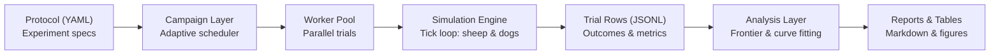
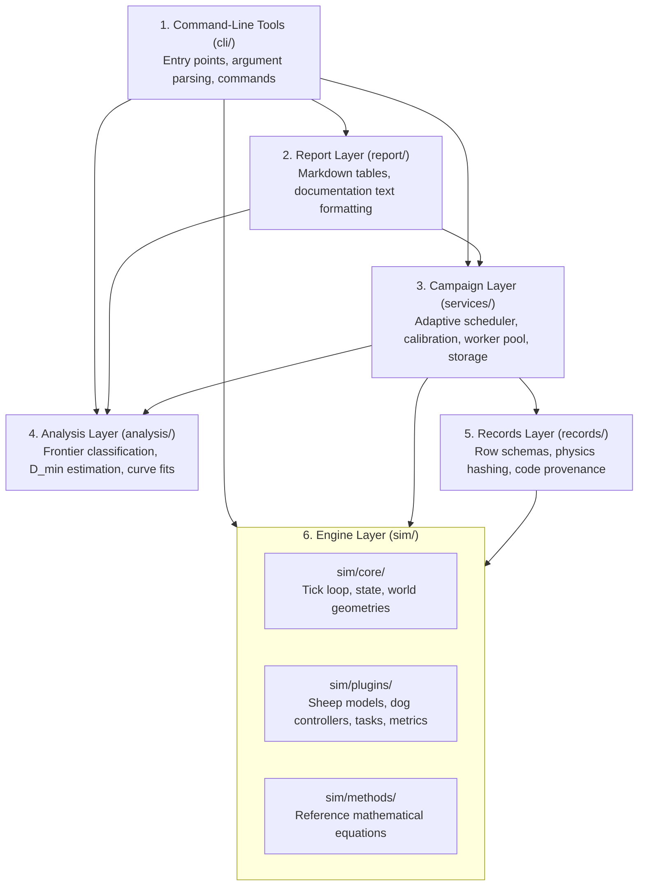
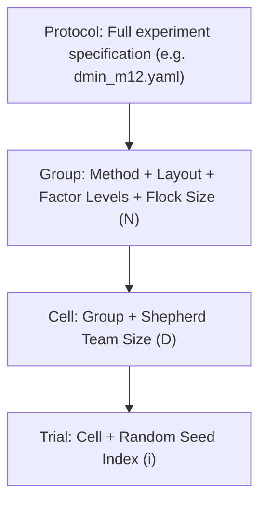

# HerdSim Architecture

HerdSim is a research platform designed to investigate multi-agent coordination in sheep-herding: how many autonomous shepherds ($D$) are required to reliably herd flocks of varying size ($N$) to a target goal under deadlines.

This document serves as the technical and architectural guide for researchers and developers modifying or extending HerdSim. It explains how the system is structured, how data flows across layers, how simulations execute from tick to campaign, and why key engineering decisions were made.

---

## Quick Navigation

- [1. System Overview & Mental Model](#1-system-overview--mental-model)
- [2. Architectural Goals & Constraints](#2-architectural-goals--constraints)
- [3. Building Blocks & Layer Hierarchy](#3-building-blocks--layer-hierarchy)
- [4. Data Hierarchy & Storage Contracts](#4-data-hierarchy--storage-contracts)
- [5. Runtime Lifecycles](#5-runtime-lifecycles)

---

## 1. System Overview & Mental Model

At the highest level, HerdSim bridges fine-grained agent physics with statistical campaign management:



### The Conceptual Pipeline

1. **Protocol (`YAML`)**: A declarative experiment specification that defines agent models, arena setups, parameter sweeps, and stopping criteria.
2. **Campaign Orchestrator**: Manages execution across days or hours. Instead of running fixed seed counts, it dynamically allocates compute to ambiguous conditions using adaptive sequential sampling.
3. **Engine**: Executes single, isolated simulation trials. It simulates sheep panic, dog navigation, multi-agent target assignment, and collision physics on a continuous 2D field.
4. **Trial Results**: Completed trials emit structured record rows (outcomes, durations, and aggregated metrics) appended to immutable log files.
5. **Analysis & Reporting**: Downstream statistical tools read log tables to determine reliability frontiers, critical team size thresholds ($D_{\min}$ and $D_{\mathrm{sat}}$), and scaling curves without rerunning simulations.

---

## 2. Architectural Goals & Constraints

HerdSim's architecture is shaped by five prioritized design goals:

1. **Strictly Fair Comparisons**: Two experimental conditions that differ only in team size ($D$) must be identical in all other respects—sharing the exact same field dimensions, physics parameters, and initial sheep positions.
2. **End-to-End Traceability (Provenance)**: Any metric, plot, or table generated months later must be traceable to the exact code commit, library environment, and configuration parameters that produced it.
3. **Crash & Interruption Resilience**: Campaigns execute tens of thousands of trials over days. Unexpected process kills, machine restarts, or cluster interruptions must never corrupt finished work or require restarting from scratch.
4. **Pluggable Mechanics**: Flocking models (e.g., Strömbom, Kubo, Lama), shepherd controllers, and task scenarios must be swappable without altering the core simulation engine or campaign scheduler.
5. **Decoupled Post-hoc Analysis**: Analysis rules, reliability thresholds, and curve-fitting algorithms must be modifiable and re-runnable in seconds from stored trial rows without re-simulating trials.

### Operational Constraints

- **Single-Node Multiprocessing**: Designed for execution on a single workstation or server using Python's `multiprocessing` process pools (sharing no memory across workers).
- **Git Storage Limits**: Results folders are tracked in git; individual files must remain well below GitHub's 100 MB hard limit (using compressed logs and compact summary rows).
- **Environment-Specific Bit Determinism**: Simulations are fully deterministic for a given seed, Python version, and numeric library stack (NumPy/SciPy), but cross-architecture floating-point reproducibility is treated with bounded tolerances.

---

## 3. Building Blocks & Layer Hierarchy

HerdSim is structured into **six architectural layers**. Dependencies flow strictly downward: higher layers consume lower layers, and lower layers never import higher layers.



### Layer Responsibilities

| Layer | Primary Packages | Key Responsibilities | Architectural Rules |
| :--- | :--- | :--- | :--- |
| **1. CLI Tools** | [`cli/`](../../cli/) | Parses command-line flags, dispatches commands, and prints progress. | No CLI tool may import another CLI tool. |
| **2. Report** | [`report/`](../../report/) | Formats analysis values into Markdown tables and documentation figures. | Never computes experimental outcomes; acts strictly as a presentation formatter. |
| **3. Campaign** | [`services/`](../../services/) | Manages adaptive rounds, calibration, worker pooling, and folder locks. | Decides which seeds/cells to run next using rules from the Analysis layer. |
| **4. Analysis** | [`analysis/`](../../analysis/) | Determines success rates, reliability frontiers, $D_{\min}$ brackets, and fits. | Operates purely on stored result files; completely independent of the simulation engine. |
| **5. Records** | [`records/`](../../records/) | Serializes trial rows, calculates the physics hash, and records git commit hashes. | Bridges the raw simulation output to long-term filesystem storage. |
| **6. Engine** | [`sim/`](../../sim/) | Executes individual trials: tick loop, agent physics, controllers, and tasks. | Completely self-contained. Imports nothing outside `sim/`. Has no concept of batches or campaigns. |

> [!IMPORTANT]
> Layer boundaries are strictly preserved by code review. The Engine never knows about campaigns or worker pools, and the Analysis layer never invokes the simulator.

---

## 4. Data Hierarchy & Storage Contracts

### The Entity Hierarchy

Experimental data is organized into four nested tiers:



1. **Protocol**: The complete experimental design (e.g., [`dmin_m12.yaml`](../../protocols/configs/protocols/dmin_m12.yaml)), defining baseline defaults, method configs, grid sweeps, and sampling bounds.
2. **Group**: A specific physical setup: `(method, layout, factors, flock_size)`. Sizing calibration is performed at the group level.
3. **Cell**: A specific point in the parameter grid: `Group + team_size (D)`. Statistical decisions (e.g., "is this condition reliable?") are made per cell.
4. **Trial**: A single simulation run: `Cell + seed_index (i)`. Yields exactly one row in the dataset.

### Results Folder Structure

A results folder represents the execution artifact of exactly one protocol.

```text
results/<protocol_name>/
├── protocol.yaml              # Snapshot of the protocol at folder initialization
├── physics.hash               # Digest of all parameters affecting physical outcome
├── sittings.jsonl             # Audit log of every campaign run (time, commit, environment)
├── calibration.json           # Calibrated flock radius Rf(N) per flock size
├── trial_log.jsonl            # Append-only log of every completed trial row
├── trial_log.jsonl.gz         # Gzip-compressed archive created on sitting completion
├── trials.parquet             # Clean tabular view of active protocol trials (rewritten each round)
├── cell_decisions.parquet     # Statistical classification per cell (reliable / unreliable / open)
├── errors.jsonl               # Tracebacks of trials that raised unhandled exceptions
└── progress.json              # Real-time round progress, completion percentage, and stop reasons
```

---

## 5. Runtime Lifecycles

### Crash Recovery & Replays

- **Resume After Interruption**: If a campaign is terminated (via `SIGINT`, `kill`, or system failure), the parent's append-only write ensures that at most the very last line of `trial_log.jsonl` was truncated. On restart, any malformed trailing line is discarded. The scheduler tops off incomplete seed batches before planning new rounds.
- **Deterministic Replay**: Any individual trial row can be faithfully re-simulated using [`cli/diagnostics/`](../../cli/diagnostics/). The replay harness verifies that the simulated ticks and success flags match the historical record bit-for-bit before running diagnostic visualizers.
