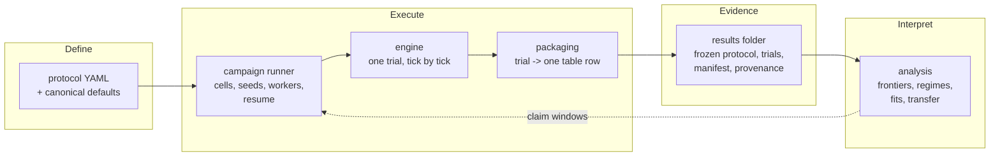
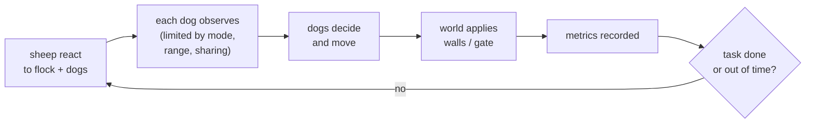
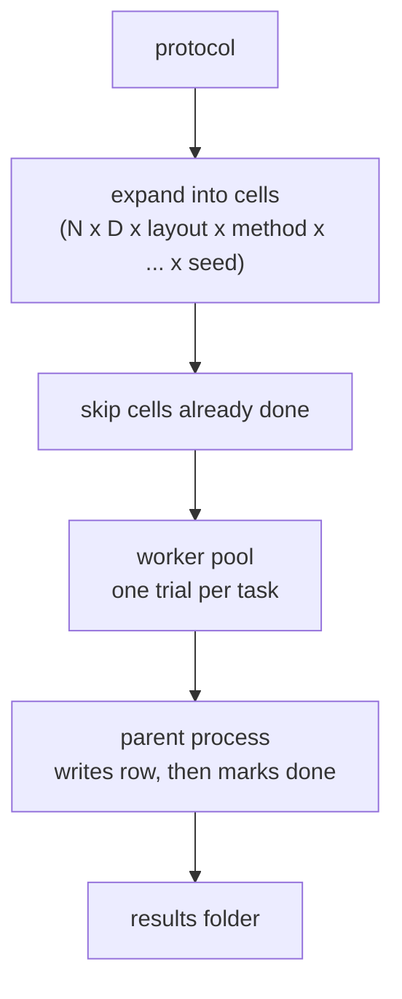

# HerdSim architecture

This document explains how HerdSim is put together and why it's built that way. For what the project does, how to configure it and what files it writes, see the [README](../../README.md).

## What the design has to serve

HerdSim isn't a general-purpose simulator. It exists to run controlled experiments: thousands of short simulations whose results get compared against each other and turned into claims. Most of the design follows from that:

- **Comparisons have to be fair.** Two cells that differ only in dog count must differ only in dog count. Same arena, same parameters, same random seeds.
- **Results have to be traceable.** Months later, you should be able to tell exactly what produced a number, even after the code and configs have moved on.
- **Campaigns are long.** A full grid is thousands of trials, and Phase 8 runs for days. Runs get stopped, crash or need a restart, and none of that should cost finished work.
- **Methods and tasks keep changing.** We swap dog rules, sheep models, observation limits and tasks. That shouldn't mean rewriting the engine or the campaign code each time.
- **Analysis keeps changing too.** We redefine thresholds, fit new models and look at new metrics long after the simulations have run.

## The big picture

There are four stages, and data only flows forward:

1. **Define.** An experiment is a YAML file, not code.
2. **Execute.** The campaign runner turns the protocol into cells and seeds, hands each trial to the engine, and packages the outcome as one row.
3. **Evidence.** Everything lands in a results folder that contains enough to audit the run on its own.
4. **Interpret.** Analysis reads tables and produces the numbers we report.

The one loop back is claim planning. Analysis looks at scout results and tells the runner which cells deserve more seeds.

## Design principles

### The protocol is the experiment

An experiment is described entirely by data: a protocol YAML layered over a shared set of canonical defaults. The grid, the method, the task, the seed depth and the output folder all live there. When a run starts, the resolved protocol is copied into the results folder and hashed.

*Why:* configs drift. If the experiment lived in code or in a file that keeps getting edited, an old result could no longer be tied to what produced it. A frozen copy next to the data makes every results folder self-describing.

*Cost:* the YAML merge is deliberately simple (a child key replaces the parent's whole value), so a protocol has to spell out a list in full to change one entry.

### The engine knows nothing about campaigns

The engine runs exactly one trial: one flock, one set of dogs, one seed, until success or timeout. It doesn't know about grids, seed lists, workers, resume, CSV files or claims. All of that sits in the campaign layer above it.

*Why:* it keeps the engine small and easy to test on its own, and lets the campaign side change (new grid axes, a new claim strategy) without touching the simulation. It also means a single trial can be pulled out and run by hand for debugging.

### Everything that varies is a plugin chosen by name

Sheep behaviour, dog behaviour, what dogs can observe, the task (scenario) and every metric are separate plugins. They're registered under string ids, and a protocol picks them by name. A "method" is just a named pairing of a sheep model and a dog controller, plus their default parameters.

*Why:* the research questions are about swapping one thing at a time: a different dog rule, less information, a harder task. If each of those is a plugin, a new comparison is a new YAML file rather than a code change, and the rest of the system stays the same between the two arms of the comparison.

*Cost:* plugins share one flat config dict. That's easy to pass around but has no schema. A typo in a key just falls back to a default instead of failing.

### Dogs act on what they observe

Each tick, the engine builds an observation for every dog: what that dog can see, given its observation mode, sensing range and any sharing between dogs. Dog controllers are supposed to make decisions from that observation only, not from the full simulation state.

*Why:* this is what makes the information experiments meaningful. Limiting range or switching to bearing-only would be pointless if a controller could quietly read the true positions anyway.

*Cost:* it's a convention, not something the code enforces. A controller still receives the full state, because it needs it to write its own positions.

### One random stream per trial, and the same seeds everywhere

Every trial creates its own random number generator from its seed, and everything random in that trial draws from it. Nothing uses global randomness. Every cell in a campaign uses the same seed list.

*Why:* a trial's result then depends only on its cell and seed. It doesn't matter which worker ran it or in what order, and any single trial can be replayed. Sharing the seed list across cells pairs the comparisons: when D = 2 beats D = 1 at a given N, it's on the same starting flocks.

*Cost:* the dynamics are chaotic, so results are bit-identical only on the same machine and library versions. Across machines they agree within a small tolerance, which is what the regression tests check.

### Spend seeds where the answer is decided

Campaigns run in two passes: a cheap scout over the full grid, then a claim pass with far more seeds on the few cells near the reliability boundary. The claim results replace the scout results on those cells.

*Why:* most cells always succeed or always fail. Precision only matters near `D_min`, so that's where the budget goes. This cuts the cost of a claim-grade map several times over.

*Cost:* the claim depends on the scout having found the boundary roughly right. A scout that misses a boundary entirely won't send seeds there.

### Results are evidence; analysis only reads them

The campaign layer writes results. Analysis never runs the simulation, it only reads tables. Every generated file carries a notice line saying it's machine-written.

*Why:* analysis changes far more often than the simulations. Keeping it read-only means a threshold or a fit can be redone in seconds without re-simulating, and analysis can never silently produce new data. The notice makes it obvious which files must not be edited by hand.

### Survive interruption

Only the parent process writes files. After each finished cell, it writes the trial row first and then marks the cell done in a manifest. On restart, a cell counts as done only if it appears in both.

*Why:* long campaigns get killed, crash or need a reboot. With this ordering, an interruption costs at most the cells that were in flight, and a restart just continues where it stopped.

*Cost:* files are rewritten in place rather than swapped in atomically. A kill in the middle of a write can still damage a file, and a badly timed kill can leave one duplicate row. Both have been rare enough not to fix yet.

### Label failures after the run, not during it

A trial stops only on success or timeout. Why it failed (oscillation, split, scatter, stuck, stacking) is worked out afterwards from the metric history.

*Why:* the engine's stopping rule stays the same for every task and method, so trial lengths are comparable. Failure categories are an interpretation, and they can be refined later without re-running anything.

## A trial, conceptually

Sheep move first, reacting to where the dogs were. Then the dogs look, decide and move. The arena applies its boundaries last, so neither side has to handle walls. Metrics are recorded on the settled state, and the scenario decides whether the task is done. For multi-stage tasks like Phase 8, the scenario also tracks which stage the run is in, and the dogs read it from shared state.

## A campaign, conceptually

The parent process owns every file. Workers get a small description of one cell, run it and send back the result. Because workers share nothing, the pool can be any size, and a single-worker run behaves exactly the same, which is how we debug.

## Trade-offs we accepted

| Choice | What we gave up | Why it's acceptable for now |
|--------|----------------|-----------------------------|
| Plain Python loops over agents | Speed. A tick is roughly quadratic in flock size | Easy to read and check against the papers. Campaigns are parallel, and we're not near the limits yet |
| Flat config dict, no schema | Typos fail silently | Keeps plugins independent. `resolved_config` in every row records what actually ran |
| Rewriting the trials table after each cell | I/O grows with campaign size | Simple and crash-tolerant. Fine at the few thousand rows a campaign produces |
| Layering is by convention, not enforced | Nothing stops a bad import | Small team, small codebase. Easy to add a check later |
| Regression tests use tolerances | Small drifts go unnoticed | Bit-exact comparisons break across machines because the dynamics are chaotic |
| Every metric recorded on every trial | Some wasted compute | Metrics we didn't plan to use turned out to explain results. Recording them is cheap insurance |

## How it's meant to grow

The extension points follow the plugin boundaries:

- **A new dog rule or sheep model** is a new plugin plus a method entry that pairs them. Nothing else changes.
- **A new task** is a new scenario. If dogs need to react to task state, the scenario exposes it through shared state, as Phase 8 does.
- **A new measurement** is a new metric. Every later run picks it up automatically.
- **A new experiment on existing axes** is a new protocol file, with no code change.
- **A new experimental axis** (something that isn't N, D, layout, method or an information setting) is the one change that touches the campaign layer. The cell description, the resume key and the grid expansion all need to know about it.

Some things the current design doesn't handle well yet, and would need real changes:

- Running non-Strombom dog rules on multi-stage tasks. Only one controller currently reads the task stage.
- Recording which stage a failed multi-stage trial got stuck in.
- Much larger flocks, which would need the neighbour searches vectorised.

## Where to look in the code

| Concern | Location |
|---------|----------|
| Single trial, tick loop | `sim/core/simulation_runner.py` |
| State and world | `sim/core/simulation_state.py`, `sim/core/world/` |
| What dogs can see | `sim/core/observation.py` |
| Plugins | `sim/plugins/{sheep,dogs,scenarios,metrics}/` |
| Method pairings and paper parameters | `sim/core/methods.py`, `sim/methods/` |
| How a trial's config is assembled | `sim/core/config/experiment.py` |
| Cells, seeds, workers, resume | `services/runner.py` |
| Protocol loading and output paths | `services/layout.py` |
| Trial row, failure labels, provenance | `protocols/packaging/` |
| Claim windows, frontiers, regimes | `analysis/frontier.py`, `analysis/regimes.py` |
| Regression tests | `tests/sim/test_golden_runs.py` |
