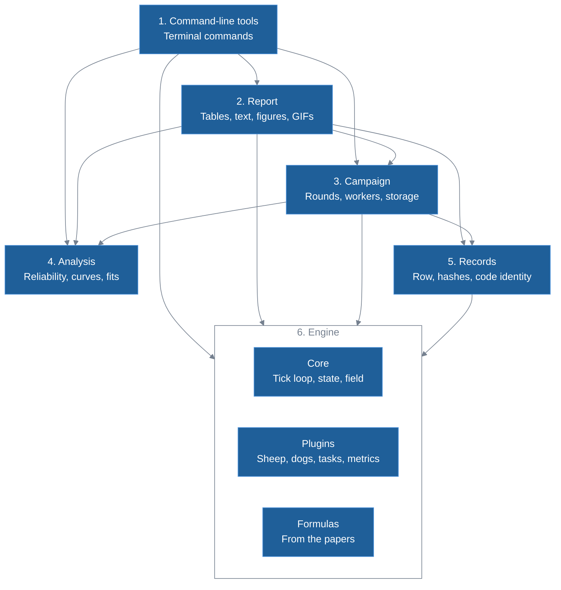
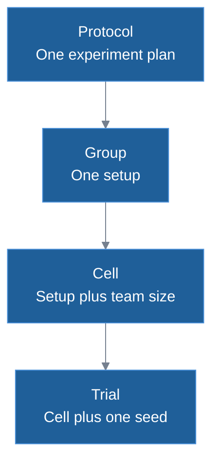

```mermaid
%%{init: {"theme": "base", "themeVariables": {"primaryColor": "#1f5f99", "primaryTextColor": "#ffffff", "primaryBorderColor": "#4a90d9", "lineColor": "#75808f", "tertiaryTextColor": "#75808f", "titleColor": "#75808f", "clusterBkg": "transparent", "clusterBorder": "#75808f", "edgeLabelBackground": "transparent"}}}%%
flowchart LR
    protocol["Protocol (YAML)<br/>Experiment recipe"] --> campaign["Campaign<br/>Experiment manager"]
    campaign --> workers["Worker pool<br/>Parallel processes"]
    workers --> engine["Engine<br/>One trial, tick by tick"]
    engine --> rows["Trial rows (JSONL)<br/>One row per trial"]
    rows --> analysis["Analysis<br/>Decision rules and fits"]
    analysis --> reports["Reports and tables<br/>Text for readers"]
```

# HerdSim architecture

HerdSim answers one question: how many herding dogs ($D$) does it take to bring a flock of $N$ sheep into a goal before a deadline, reliably? This doc explains how the code is organized and why, for a developer or researcher who wants to change it or add to it and knows Python but not herding models. See also the [README](../../README.md) for the study, the [glossary](../glossary.md) for terms, [models](../methods/models.md) for the sheep and dog rules, [task design](../experiments/task_design.md) for the task and decision rules, the [configuration guide](../guides/configuration.md) for settings and the [CLI reference](../guides/cli_reference.md) for commands.

## System overview

HerdSim does two jobs that meet at the stored trial rows:

1. Running simulations: it moves sheep and dogs step by step on a 2D field.
2. Managing large experiments: it runs thousands of simulations across CPU cores, stores each result as it finishes and works out the answers afterwards.

This diagram follows one experiment from start to finish:



The steps are:

1. Protocol: the recipe of an experiment, written as a YAML file. It names the task (the drive task brings a flock into a goal, the gather task follows Lama and di Bernardo 2024), the methods (a method is a sheep model paired with a dog controller), the layouts (how the flock is placed at the start), the flock sizes and team sizes to try, and when to stop.
2. Campaign: the manager that spends extra seeds on undecided cells. A cell is one team size on one setup, and a seed is the number that fixes the random streams of one run of it. After each round (one pass that plans and runs the seeds still needed) the campaign checks the results. A team is reliable when the lower end of a two-sided 99% Clopper-Pearson interval on its success rate is at least 0.90, the default. That takes at least 51 straight successes, so a cell that always succeeds soon needs no more seeds while a borderline one can get up to 200.
3. Engine: a sandbox that runs one trial and knows nothing of campaigns. Each tick (one time step) the sheep model moves the sheep, the dog controller moves the dogs and the task checks whether the trial has ended. The field is continuous with no walls, and there is no pathfinding. There is no collision step either, except that a dog cannot step within the optional dog spacing of another when that setting is above its default of 0.
4. Trial rows: the worker process turns each finished trial into one summary row (which trial it was, its outcome, the mean, minimum and maximum of each metric, and a [failure label](../glossary.md) for how it ended), and the campaign process appends the row to the folder's trial log.
5. Analysis and reports: analysis reads stored files and never runs the model. It finds the smallest reliable team ($D_{\min}$) and the smallest reliable team that no larger reliable team beats on finish time by more than 5% ($D_{\mathrm{sat}}$). A changed rule can be recomputed in seconds with no new simulation, though some cells may then need more seeds, because the seeds were spent under the old rule.

## Goals and constraints

Five goals shape the design:

1. Fair comparisons: when you compare 2 dogs with 3 dogs, everything else must match. Cells of one group (one setup across team sizes) share the field, the goal and the task, and seed $i$ of every cell starts from the same flock. The sheep also see the same random noise until the dogs start to act differently, which reduces the part luck plays in a comparison but does not remove it.
2. A record of each run: a folder records the physics settings (everything that changes a trial's outcome) it ran on and, if it has a run log, the code. That limits how far a result can be traced ([what a folder records](#what-a-folder-records)).
3. Surviving interruptions: a protocol can run tens of thousands of trials over hours, and the default budget allows 72 hours. An interruption costs little, and the same command resumes the run ([recovery](#recovery-after-an-interruption)).
4. Replaceable parts: a new sheep model, dog controller, method (such as Strömbom, Kubo or Lama) or task is new code plus one entry in a table. The tick loop and the campaign scheduler do not change.
5. Analysis at any time: the simulations take hours and the analysis takes seconds. The stored rows can be reread under a changed threshold, decision rule or curve fit without simulating. Only the first 3 seeds of each cell keep the per-tick history by default, so failure labels cannot be recomputed for the rest.

### Working constraints

- One machine, many cores: trials run in a pool of worker processes on one workstation or server. A single campaign defaults to one worker per CPU core and the queue of protocols to 20. Workers share no memory and each uses one numeric-library thread.
- File sizes that suit git: results folders are tracked in git, and GitHub refuses files over 100 MB. The uncompressed trial log can pass that limit, so git tracks its compressed copy instead. The per-tick histories stay out of git altogether, so a fresh clone cannot use them.
- Reproducible numbers: the same seed on the same machine with the same Python and library versions gives the same trial, bit for bit. Across CPUs and NumPy builds the last floating-point bits differ, and they grow over a few hundred ticks because the dynamics are chaotic. The regression tests therefore compare whole-trial summaries with small tolerances per field.

## Layers

HerdSim has six layers. A layer may import only higher-numbered layers, and analysis imports none. This diagram shows the layers and who imports whom:



Each layer has one job and one rule ([Table 1](#where-to-look-in-the-code) says where each one lives):

1. Command-line tools: they read arguments, run commands and print progress as plain text lines, and the status command says how far a run has got and whether it is still running. They import the engine for its table of tasks and, in the diagnostics, its layouts and dog rules. One tool never imports another.
2. Report: it writes analysis values as Markdown tables and text, and produces the generated pages, figures and GIFs. The command-line tools import its tables and text, so the terminal and the docs show the same cells. It never decides a result. Some figures run trials and the GIFs replay stored ones to draw them, but no stored result comes from these scripts.
3. Campaign: it runs the rounds, the worker pool, calibration and the replays, and writes the results folder. It holds a lock on the folder for the whole run, so a second campaign on it is refused. It uses the analysis layer to decide what to run next, and no sheep or dog rule lives here.
4. Analysis: it works out success rates, reliable teams, $D_{\min}$ and curve fits from trial rows. It imports nothing from the other layers and never runs the model.
5. Records: it builds the trial row from a finished trial, hashes the physics settings, records the code identity and writes the notice on generated files. It connects engine output to what is stored; the campaign layer does the writing of rows.
6. Engine: it advances time tick by tick, moves the agents, and detects success, the task's own end rule and the time limit. It imports only from inside its own folder, apart from third-party libraries such as NumPy, and has no idea that campaigns or batches exist.

The engine only deals with the sheep and dogs of the current trial, and analysis only sees rows of numbers. During a campaign, analysis receives the rows so far from the campaign layer after each round and decides which cells still need seeds.

## Data levels and storage

### How an experiment is broken down

Data has four levels, from the whole experiment down to one run:



1. Protocol: one experiment plan, such as `dmin_m12`, the main run with a deadline of 12 [drive times](../experiments/task_design.md#deadlines-in-drive-times). It lists the methods, layouts, flock sizes, team sizes and stopping rules.
2. Group: one setup, given by the method, the layout, any swept settings (settings a protocol tries at several values) and the flock size $N$. The group's cells form one curve of results against team size.
3. Cell: one team size on one setup, which asks a question such as "can 3 dogs herd 200 sheep in this setup?". Decisions such as "is this team reliable?" are made per cell.
4. Trial: one run of that cell with one seed. The seed sets where the sheep start and the random noise of the sheep and dogs. On the drive task the dog starts are fixed by the setup and team size; only the gather task draws them from the seed. The run goes until success, the task's own end rule or the time limit, and produces exactly one row.

### Calibration

Calibration is a short run at the start of a campaign that sizes the task, per method and flock size. On the drive task, one dog drives a tight flock toward a goal it cannot reach, and the radius the flock settles to, $R_f(N)$, then sizes the goal and the drive. It uses one dog and no swept settings, so every level of a method is compared on a task sized to the same reference flock. The gather task sizes itself and has no calibration, and a protocol may impose the radius above a chosen flock size.

### Results folder

Each protocol writes to its own folder, unless the command names another place. The files are:

```text
results/<protocol_id>/
|-- protocol.yaml         merged protocol as the folder was created, with every method parameter
|-- provenance.json       protocol id, physics hash and creation time, checked at every start
|-- runs.jsonl            one line per sitting: time, code identity, merged protocol (newer folders only)
|-- calibration.json      R_f(N) per method, with the physics hash it belongs to (not for the gather task)
|-- trials.jsonl          the trial log: one line per finished trial, appended as trials finish (not in git)
|-- trials.jsonl.gz       compressed copy for git, written when a campaign closes the folder
|-- trials.csv            the rows of the groups the protocol lists, rewritten after each round
|-- trials.csv.gz         compressed copy, written when a campaign closes the folder
|-- frontier_cells.csv    per cell: reliability, finish times, zone, errored trials, whether it needs seeds
|-- frontier_groups.csv   per group: D_min, D_sat and the other team sizes, with flags
|-- errors.jsonl          one line per trial that raised an exception (only if one did)
|-- status.json           the run's progress and why it stopped
|-- timeseries/           per-tick history of the first seeds of each cell (not in git)
|   `-- <method>__<layout>__N-<N>__D-<D>__seed-<seed>.parquet
`-- .lock                 the lock a running campaign holds (not in git)
```

### What a folder records

The physics hash covers the task, the default settings other than sampling, each method's parameters and time limit, the set of layouts and the largest team size. A later start with different physics in the same folder is refused, while more flock sizes, smaller or intermediate team sizes, or more seeds can be added.

The protocol copy holds the merged protocol (the protocol file over its default settings) as the folder was created. It does not always show the settings a later run used, and neither it nor the hash can separate runs on different code.

A sitting is one start of a campaign on a folder, and each sitting appends to the run log. The log holds the start time, the trial count so far, the merged protocol, a hash of the trial code that catches uncommitted edits, the git commit, whether the trial code had uncommitted changes, and the versions of Python, NumPy, SciPy, pandas and PyArrow. If the code hash differs from the last sitting the campaign warns and carries on, because a refactor changes the hash too. Folders last run before this log existed have none.

## Runtime behaviour

### One campaign round

Each round does three things:

1. It fills every new or partial cell up to a whole batch. A batch is 10 seeds by default, and a cell is left partial by an interrupted run or the budget.
2. It gives each cell the rules mark as undecided its next batch, up to the maximum (200 seeds by default). By default the rules decide reliability only. A protocol can also ask them to decide finish-time comparisons (whether one team is faster than another on the same seeds).
3. It adds the team size halfway between two tested sizes whose answers differ and that are more than a set gap apart.

Some cells far above $D_{\mathrm{sat}}$ stop early, because an added dog that duplicates another cannot change the answer. Such a cell lies above the first larger team that also counts as saturated, is itself saturated or undecided, and has dogs that are copies of each other. It is still filled to a whole batch but gets no further batches.

A trial that raises an exception is logged and the batch goes on, but its cell gets no more seeds and is never reliable, because an exception in a deterministic simulation is a bug. The run stops when no cell needs seeds or when the time budget is spent.

### Recovery after an interruption

Only the campaign process appends to the trial log, one line at a time, so a killed process leaves at worst a cut last line. On restart that line is dropped and its trial runs again, as do the trials that were in progress. The campaign then tops each cell up to a whole batch and continues, so a resumed run stays on the same seed boundaries as an uninterrupted one. A worker that dies also stops the batch, and the same resume applies. A resumed run gets a new time budget.

Appends are not forced to disk, so a power cut can also lose finished rows still in the operating system's cache, and those trials then run again. We reasoned this from the code and have not tested it.

### Replaying a trial

A trial depends only on its configuration and seed, so it can be run again. The replay tools rebuild the configuration from the protocol file and refuse the run if that file is gone or now gives different physics. An unchanged replay is compared with the stored row on success and tick count, and raises an error if they differ, because a replay that is a different trial says nothing about the stored results. A diagnostic either replays a trial unchanged to take extra measures or changes one setting and compares. Three of the four diagnostic tools work this way; the fourth looks only at start layouts. The GIFs are drawn from replays too.

## Where to look in the code

Table 1 maps each part of the design to its place in the repository.

**Table 1: Where each part lives.**

| Part | Location |
| :--- | :--- |
| Command-line tools | [`cli/`](../../cli/) |
| Diagnostic tools and replay | [`cli/diagnostics/`](../../cli/diagnostics/), [`services/replay.py`](../../services/replay.py) |
| Report tables and text | [`docs/generate_docs/report/`](../generate_docs/report/) |
| Generated pages, figures and GIFs | [`docs/generate_docs/`](../generate_docs/) |
| Campaign rounds | [`services/adaptive.py`](../../services/adaptive.py) |
| Worker pool and batches | [`services/pool.py`](../../services/pool.py), [`services/runner.py`](../../services/runner.py) |
| Calibration | [`services/calibration.py`](../../services/calibration.py) |
| Protocol loading, groups, cells and seeds | [`services/protocol.py`](../../services/protocol.py), [`services/cells.py`](../../services/cells.py) |
| Results folder, lock and resume | [`services/store.py`](../../services/store.py) |
| Analysis | [`analysis/`](../../analysis/) |
| Decision rules | [`analysis/frontier.py`](../../analysis/frontier.py) |
| Trial row | [`records/trial_row.py`](../../records/trial_row.py) |
| Physics hash and code identity | [`records/provenance.py`](../../records/provenance.py) |
| Generated-file notice | [`records/generated_notice.py`](../../records/generated_notice.py) |
| Engine | [`sim/`](../../sim/) |
| Tick loop, state and field | [`sim/core/`](../../sim/core/) |
| Table of methods | [`sim/core/methods.py`](../../sim/core/methods.py) |
| Sheep models, dog controllers, tasks and metrics | [`sim/plugins/`](../../sim/plugins/) |
| Formulas from the papers | [`sim/methods/`](../../sim/methods/) |
| Protocol files | [`protocols/configs/protocols/`](../../protocols/configs/protocols/) |
| Regression test for trials | [`tests/sim/test_golden.py`](../../tests/sim/test_golden.py) |
