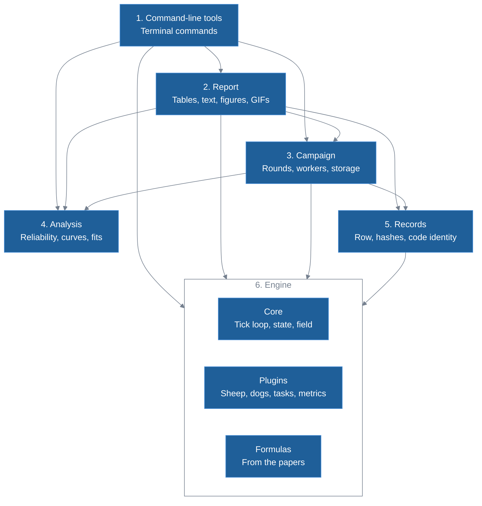
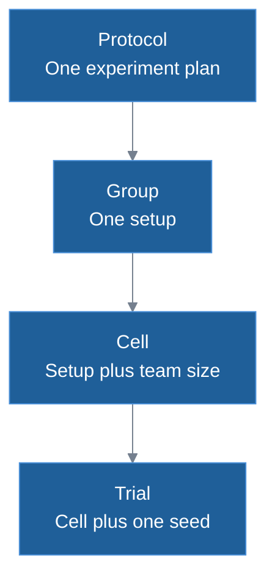

# HerdSim architecture

How the HerdSim code is organized and why, for a developer or researcher who knows Python but not herding models and wants to change or extend it. HerdSim asks how many herding dogs ($D$) it takes to bring a flock of $N$ sheep into a goal before a deadline, reliably. See also the [README](../../README.md) for the study, the [glossary](../glossary.md) for terms, [models](../methods/models.md) for the sheep and dog rules, [task design](../experiments/task_design.md) for the task and decision rules, the [configuration guide](../guides/configuration.md) for settings and the [CLI reference](../guides/cli_reference.md) for commands.

## System overview

HerdSim does two jobs that meet at the stored trial rows. It moves sheep and dogs step by step (one step is a [tick](../glossary.md#trials-and-experiments)) on a 2D field, and it manages large experiments: thousands of simulations run across CPU cores, each result is stored as it finishes, and the answers are worked out afterwards. This diagram follows one experiment from start to finish:

1. Protocol: the recipe of an experiment, a YAML file naming the task (the [drive task](../glossary.md#the-drive-task), where dogs bring a flock into a goal before a deadline, or the [gather task](../glossary.md#the-gather-task) of Lama and di Bernardo 2024), the [methods](../glossary.md#trials-and-experiments), the [start layouts](../glossary.md#start-layouts-and-dog-starts), flock and team sizes, and when to stop.
2. Campaign: the manager that spends extra seeds on undecided cells (a cell is one team size on one setup; a seed fixes the random streams of one run). A cell that always succeeds is [reliable](../glossary.md#success-and-reliability) at the earliest after 60 trials (60 of 60, with decisions after each batch of 10); a borderline one can get up to 200 seeds.
3. Engine: a sandbox that runs one trial and knows nothing of campaigns. Each tick the sheep model moves the sheep, the dog controller moves the dogs and the task checks for the end.
4. Trial rows: the worker turns each finished trial into one summary row (which trial, its outcome, the mean, minimum and maximum of each metric, and a [failure label](../experiments/task_design.md#how-failed-trials-end)), and the campaign process appends it to the trial log.
5. Analysis and reports: analysis reads stored files and never runs the model. It finds $D_{\min}$, $D_{\mathrm{sat}}$ and the other [team sizes](../glossary.md#team-sizes).

## Goals and constraints

Five goals shape the design:

1. Fair comparisons: cells of one group (one setup across team sizes) share the field, goal and task, and seed $i$ of every cell starts from the same flock. The sheep also see the same noise until the dogs act differently, which reduces the part luck plays in a comparison but does not remove it.
2. A record of each run: a folder records the physics settings it ran on (everything that changes an outcome) and, if it has a run log, the code ([what a folder records](#what-a-folder-records)).
3. Surviving interruptions: a protocol can run tens of thousands of trials, with a default budget of 72 hours. The same command resumes an interrupted run at little cost ([recovery](#recovery-after-an-interruption)).
4. Replaceable parts: a new sheep model, dog controller, method or task is new code plus one table entry; the tick loop and the scheduler do not change.
5. Analysis at any time: stored rows can be reread under a changed threshold, rule or fit in seconds, without simulating, though some cells may then need more seeds, because the seeds were spent under the old rule. By default only the first 3 seeds of each cell keep their per-tick history, so failure labels cannot be recomputed for the rest.

### Working constraints

- One machine, many cores: trials run in a pool of worker processes. A campaign defaults to one worker per CPU core and the protocol queue (the command that runs the protocols of the study one after another) to 20. Workers share no memory and each uses one numeric-library thread.
- File sizes that suit git: results folders are in git, which on GitHub refuses files over 100 MB, so git tracks a compressed copy of the trial log. Per-tick histories stay out of git, so a fresh clone does not have them.
- Reproducible numbers: the same seed with the same machine, Python and library versions gives the same trial bit for bit. Across CPUs and NumPy builds the last bits differ. This may be why trials then drift apart within a few hundred ticks (the dynamics may amplify small differences); we have not measured it. So the regression tests compare whole-trial summaries with small tolerances.

## Layers

HerdSim has six layers. A layer imports only higher-numbered layers, and analysis imports none. This diagram shows who imports whom:

Each layer has one job ([Table 1](#where-to-look-in-the-code) says where each lives):

1. Command-line tools: run commands and print progress as plain lines; the status command says how far a run has got and whether it is still running. They use the engine for its table of tasks and, in the diagnostics, for start layouts, the simulation state and one Strömbom formula. No tool imports another.
2. Report: writes analysis values as Markdown tables and text, and produces the generated pages, figures and GIFs. The tools use its tables, so the terminal and the docs show the same cells. It never decides a result: some figures run trials and the GIFs replay stored ones, but no stored result comes from them.
3. Campaign: runs the rounds, worker pool, calibration and replays, and writes the results folder. It locks the folder for the whole run, so a second campaign on it is refused. After each round it hands the rows so far to analysis, which decides which cells still need seeds; no sheep or dog rule lives here.
4. Analysis: works out success rates, reliable teams, $D_{\min}$ and curve fits from trial rows.
5. Records: builds the trial row, hashes the physics settings, records the code identity and writes the notice on generated files. The campaign layer writes the rows.
6. Engine: advances time, moves the agents, and detects success, the task's own end rule and the time limit. The field is continuous, with no walls, pathfinding or collisions, except that a dog cannot step within the optional dog spacing of another when that setting is above its default of 0. Apart from third-party libraries such as NumPy it imports only from its own folder.

## Data levels and storage

### How an experiment is broken down

Data has four levels, from the whole experiment down to one run:

1. Protocol: one experiment plan, such as the main run with a deadline of 12 [drive times](../experiments/task_design.md#deadlines-in-drive-times).
2. Group: one setup (method, layout, levels of any swept settings, flock size $N$), whose cells form one curve against team size.
3. Cell: one team size on one setup, asking "can 3 dogs herd 200 sheep in this setup?". Reliability is decided per cell.
4. Trial: one run of that cell with one seed, which sets the sheep starts and the noise of sheep and dogs. Drive-task dog starts follow from the setup and team size; only the gather task draws them from the seed. A trial runs until success, the task's own end rule or the time limit, and gives one row (a trial that raises an exception gives only a line in the error log).

### Calibration

At the start of a campaign, calibration sizes the drive task per method and flock size: one dog drives a tight flock toward a goal it cannot reach, and the radius the flock settles to, $R_f(N)$, sizes the goal and the drive. It uses one dog and no swept settings, so every level of a method runs on a task sized to the same reference flock. The gather task sizes itself, and a protocol may impose the radius above a chosen flock size.

### Results folder

Each protocol writes to its own results folder unless the command names another. The folder holds:

- The merged protocol as the folder was created, and a provenance record with the physics hash, checked at every start.
- The run log (one line per sitting; newer folders only) and the calibrated flock radius per method (not for the gather task).
- The trial log, one line per finished trial, appended as trials finish and not in git, with a compressed copy for git written when a campaign closes the folder.
- A table of the rows of the groups the protocol lists, rewritten after each round.
- Decision tables per cell (reliability, finish times, zone, errored trials, whether it needs seeds) and per group ($D_{\min}$, $D_{\mathrm{sat}}$ and the other team sizes, with flags).
- A log of trials that raised an exception (only if one did) and the run's progress and why it stopped.
- Per-tick histories of the first seeds of each cell (not in git) and the lock a running campaign holds (not in git).

The [configuration guide, section 3](../guides/configuration.md#3-what-a-simulation-run-writes) lists the files.

### What a folder records

The [physics hash](../glossary.md#records) covers the task, the settings that change an outcome (not sampling, and not another task's or a follow-up's settings left at their neutral value), each method's parameters and time limit, the set of layouts and the largest team size. A later start with different physics in the same folder is refused; more flock sizes, smaller or intermediate team sizes, or more seeds can be added.

The protocol copy is the merged protocol (the file over its defaults) as the folder was created, so it may not show the settings a later run used. Neither it nor the hash tells runs on different code apart.

The run log does: each sitting (one start of a campaign on the folder) adds the start time, the trial count so far, the merged protocol, a hash of the trial code that catches uncommitted edits, the git commit, an uncommitted-changes flag, and the versions of Python, NumPy, SciPy, pandas and PyArrow. A changed code hash gives a warning and the run goes on, because a refactor changes the hash too. Folders last run before this log existed have none.

## Runtime behaviour

### One campaign round

Each round does three things:

1. It fills every new or partial cell (cut short by an interruption or the budget) up to a whole batch, 10 seeds by default.
2. It gives each undecided cell its next batch, up to 200 seeds by default. By default only reliability is decided; a protocol can also ask for finish-time comparisons (whether one team is faster than another on the same seeds).
3. It adds the team size halfway between two tested sizes whose answers differ and that are more than a set gap apart.

Some cells far above $D_{\mathrm{sat}}$ are filled to a whole batch and then get no more ([pruning](../experiments/task_design.md#pruning-above-saturation)). Such a cell lies above the first team above $D_{\mathrm{sat}}$ that is also zoned saturated (more dogs no longer shorten the drive; [zones](../experiments/task_design.md#zones)), is itself saturated or undecided, and has a mean dog overlap of at least 0.9 (the share of dogs standing within 2 m of another dog). This may be because such a dog acts as a copy of its neighbour and cannot change the answer; we have not tested it.

A trial that raises an exception is logged and the batch goes on, but its cell gets no more seeds and is never reliable: an exception in a deterministic simulation is a bug. The run stops when no cell needs seeds or the time budget is spent.

### Recovery after an interruption

Only the campaign process appends to the trial log, one line at a time, so a killed process leaves at worst a cut last line. On restart that line is dropped and its trial runs again, with the trials that were in progress. Each cell is then topped up to a whole batch, so a resumed run keeps the seed boundaries of an uninterrupted one. A dead worker stops the batch, with the same resume. A resumed run gets a new time budget.

Appends are not forced to disk, so a power cut can also lose finished rows still in the operating system's cache, and those trials then run again. We reasoned this from the code and have not tested it.

### Replaying a trial

A trial depends only on its configuration and seed, so it can be run again. The replay tools rebuild the configuration from the protocol file and refuse to run if that file is gone or now gives different physics. An unchanged replay that differs from the stored row in success or tick count raises an error, because a different trial says nothing about the stored results. A diagnostic either replays a trial unchanged to take extra measures, or changes one setting and compares; one diagnostic tool looks only at start layouts. The GIFs are drawn from replays too.

## Where to look in the code

Table 1 maps each part of the design to its place in the repository.

**Table 1: Where each part lives.**

| Part | Location |
| :--- | :--- |
| Command-line tools | [`cli/`](../../cli/) |
| Diagnostic tools and replay | [`cli/diagnostics/`](../../cli/diagnostics/), [`services/replay.py`](../../services/replay.py) |
| Report tables and text | [`docs/generate_docs/report/`](../generate_docs/report/) |
| Generated pages, figures and GIFs | [`docs/generate_docs/`](../generate_docs/) |
| Sections and commands of the result tables page | [`docs/generate_docs/report/results_page.py`](../generate_docs/report/results_page.py) |
| Campaign rounds | [`services/adaptive.py`](../../services/adaptive.py) |
| Worker pool and batches | [`services/pool.py`](../../services/pool.py), [`services/runner.py`](../../services/runner.py) |
| Calibration | [`services/calibration.py`](../../services/calibration.py) |
| Protocol loading, groups, cells and seeds | [`services/protocol.py`](../../services/protocol.py), [`services/cells.py`](../../services/cells.py) |
| Results folder, lock and resume | [`services/store.py`](../../services/store.py) |
| Analysis | [`analysis/`](../../analysis/) |
| Decision rules | [`analysis/frontier.py`](../../analysis/frontier.py) |
| Trial row | [`records/trial_row.py`](../../records/trial_row.py) |
| Physics hash and code identity | [`records/provenance.py`](../../records/provenance.py) |
| Generated-file notice | [`records/generated_notice.py`](../../records/generated_notice.py) |
| Engine | [`sim/`](../../sim/) |
| Tick loop, state and field | [`sim/core/`](../../sim/core/) |
| Table of methods | [`sim/core/methods.py`](../../sim/core/methods.py) |
| Sheep models, dog controllers, tasks and metrics | [`sim/plugins/`](../../sim/plugins/) |
| Formulas from the papers | [`sim/methods/`](../../sim/methods/) |
| Protocol files | [`protocols/configs/protocols/`](../../protocols/configs/protocols/) |
| Regression test for trials | [`tests/sim/test_golden.py`](../../tests/sim/test_golden.py) |
