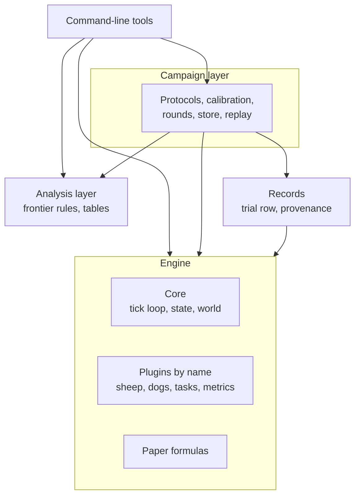
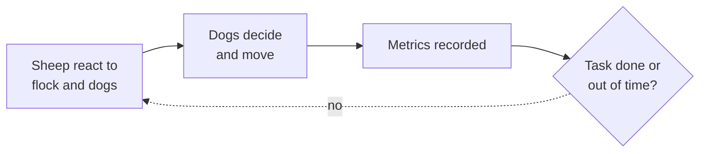
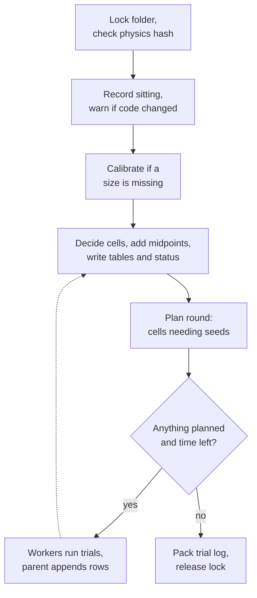

# HerdSim architecture

This document describes how HerdSim is built and why: its parts, the data they exchange, what happens when a campaign runs, and the decisions behind it. It is written for someone who will change the code, for example to add a herding method, a metric or a task. What the project studies is in the [README](../../README.md); the models in [models.md](../methods/models.md); the task, sampling and frontier rules in [task_design.md](../experiments/task_design.md); settings and output files in the [configuration guide](../guides/configuration.md); commands in the [CLI reference](../guides/cli_reference.md).

## Contents

1. [Goals and constraints](#goals-and-constraints)
2. [Building blocks](#building-blocks)
3. [Data and folder contracts](#data-and-folder-contracts)
4. [Runtime](#runtime)
5. [Cross-cutting concepts](#cross-cutting-concepts)
6. [Design decisions](#design-decisions)
7. [Trade-offs and known risks](#trade-offs-and-known-risks)
8. [Extension points and limits](#extension-points-and-limits)
9. [Glossary](#glossary)
10. [Where to look in the code](#where-to-look-in-the-code)

## Goals and constraints

HerdSim runs controlled experiments: many short simulations whose results are compared with each other and turned into claims about team size. The design serves five goals, in this order of priority:

1. Fair comparisons: two cells that differ only in team size must differ only in team size, with the same field, the same parameters and the same start flocks.
2. Traceable results: months later it must be possible to tell what produced a number, including the settings and the code.
3. Long campaigns that survive interruption: a campaign is thousands of trials over hours or days; a kill, crash or restart must not cost finished trials.
4. Methods and tasks that change: sheep models, dog rules and tasks are swapped often, without rewriting the engine or the campaign code.
5. Analysis that changes: thresholds and summaries are redefined long after the simulations ran, without running them again.

The constraints are those of a research codebase. Everything runs on one machine, in Python, with a pool of worker processes. Results are exact only on the same machine with the same library versions. Results folders are committed to git, so no committed file may pass GitHub's 100 MB limit.

## Building blocks

The code is in five layers. The diagram shows them and the direction of every import between them.

- The engine runs one trial. Its core holds the tick loop, the state, the world and start layouts, the assembly of a trial's config and the catalog of methods. The plugins are the sheep models, dog controllers, tasks and metrics, each registered under a name. The paper formulas are the equations of each source paper, kept apart from the plugins that call them so that they can be checked against the paper on their own. The engine imports nothing outside itself.
- Records turns one trial's result into one table row and computes the hashes that tie a results folder to its settings and code.
- The analysis layer reads results folders and decides: reliability, comparisons, the team-size values and zones, and the tables. It imports nothing else in the project and works on the files alone, so every rule can be rerun without the simulator.
- The campaign layer runs things: it loads protocols, calibrates, plans rounds, runs trials in workers, owns the results folder, and replays stored trials. It uses the analysis layer's rules to decide which cells need more seeds.
- The tools parse arguments, call the layers below and print. No tool imports another.

Between layers, imports point only downward in the diagram; inside the engine, the core, the plugins and the formulas import each other. Nothing enforces the layering; it is kept by review.

## Data and folder contracts

### Protocol

An experiment is a protocol: a YAML file layered over the canonical defaults. It names the methods with their time limits, the task, the grid (layouts, flock sizes, team sizes), optional factors (canonical settings swept over several values), the sampling strategy and the output folder. A protocol may extend another; a key the child names replaces the parent's whole value, lists and mappings included. A time limit is given in exactly one form. Unknown keys stop the load. The full list of settings is in the [configuration guide](../guides/configuration.md#1-configuration-architecture).

### Keys

Every trial has a text key built from its group (method, layout, factor levels, flock size), its team size and its seed index. A cell key is the trial key without the seed; a group key is the cell key without the team size. One module defines the format, building and splitting every key; the campaign and the analysis both go through it, since the format is stored in every results folder. A factor value containing the separator would still break it.

### Trial row

One finished trial is one row. It holds the trial's identity (method, layout, factor levels, flock size, team size, seed), the task's setup values (flock radius, goal, drive length, time limit), the outcome (success, ticks, time, a failure label with its hints) and, for every metric, its mean, minimum and maximum over the trial. A task may add columns of its own. The per-tick history is not in the row; by default it is kept as a separate file for the first three seeds of every cell.

### Results folder

A results folder belongs to one protocol. Table 1 lists what it holds and who reads each part; the file names are in the [configuration guide](../guides/configuration.md#3-what-a-simulation-run-writes).

**Table 1: Contents of a results folder.**

| Part | Written | Read by |
| :--- | :--- | :--- |
| The protocol as first run, with every method parameter | Once, when the folder is created | People |
| One record per run sitting: start time, trials already in the log, code identity, the merged protocol of that sitting | At the start of each sitting | People, and the code-change warning |
| Protocol id and physics hash | Once | The campaign on resume, replays |
| Calibrated flock radius per method and flock size | When a size is missing; every size is then measured again | The campaign, replays |
| Trial log, one line per finished trial | Appended as trials finish | The campaign on resume, the status command |
| The same log, gzip-compressed | When a sitting closes the folder | Git; unpacked when a clone has only this copy |
| Trial table | After every round | Every analysis tool and replay |
| Errors, one line per trial that raised | As trials fail | The campaign |
| Cell and group decisions | After every round | Analysis tools |
| Progress and stop reason | After every round | The status command |
| Per-tick history of the first seeds of each cell | By the worker that ran the trial | Figure scripts; not committed |

The trial log is the record the campaign resumes from. The trial table is what every reader uses; it lists only the groups the current protocol still names, so trials of a dropped group stay in the log and leave the table.

## Runtime

### One trial

Each tick runs the same four steps.

Sheep move first, reacting to where the dogs were; then the dogs decide and move. Under the default team rule each dog knows every sheep and every other dog, and a protocol can limit a dog to the sheep within a range and say whether dogs share what they see; the gather task's herders sense within a radius their method sets. Metrics are recorded on the new state, and the task decides whether the trial is over: on success, on the time limit, or when the task's own end rule fires.

### One campaign sitting

A sitting is one run of the campaign command on a folder, from start to stop.

1. The folder is locked, so a second campaign on it is refused, and its physics hash is compared with the protocol's.
2. The sitting is recorded with its code identity and merged protocol. If the trial code changed since the last sitting, the run logs a warning.
3. If any flock size lacks a calibrated radius, every size is calibrated again and the stored radii are replaced, a known risk listed below.
4. Each round starts by deciding every cell from the rows so far, adding midpoint team sizes where the rules ask for them, and writing the tables and the status.
5. The round's trials are planned: new cells and cells that still need seeds. The sitting stops when nothing is planned (every cell decided, at the seed cap or errored) or when its time budget is spent. The budget counts from the end of calibration, so a resumed sitting gets a new one.
6. Otherwise the trials go to the pool. Each worker gets a small description of one trial, runs it and returns its row; only the parent writes the log and the tables. The parent keeps a few trials queued per worker and stops queueing at the deadline.
7. When the sitting ends, normally or by an error, the trial log is packed and the lock released.

Workers share nothing, so the pool can be any size and a one-worker run gives the same rows.

### Resume and replay

On resume the campaign reads the trial log, drops a line cut by a kill, ignores trials of groups the protocol no longer lists, and continues. Seed counts stay on whole batches: a cell cut short by a kill is filled to its batch first.

A replay runs a stored trial again, to measure something the row does not hold or to test a change. Its config is rebuilt from today's protocol file, so a replay is refused when that file now gives a different physics hash than the folder ran. An unchanged replay must reproduce the stored success and tick count, or it stops with an error. Most diagnostic tools are built on replays.

## Cross-cutting concepts

### Determinism

Every trial draws its start layout, its sheep noise and its dog noise from three random streams derived from its seed, and seed i is the same number in every cell of a campaign. A trial's result then depends only on its cell and seed, not on the worker or the order. Because the start and sheep streams do not depend on the team size, cells that differ only in team size start from the same flocks, which pairs their finish times and lets small differences be decided with few seeds. The bootstrap in the frontier rules is seeded from the campaign's seed, so the decisions are deterministic too. The dynamics are chaotic, so results are bit-identical only on the same machine with the same library versions.

### Provenance

Three records tie a result to what produced it. The physics hash covers everything in the settings that changes a trial: the task, the canonical settings that are not sampling strategy, each method's full parameter set and time limit, the layouts and the largest team size. It leaves out the strategy settings, the flock sizes, the smaller team sizes, the factor levels, settings still at the value that reproduces older behaviour, and the settings of tasks that did not run, so a campaign can grow and still resume. The code identity is a hash of the source that decides a trial and its row, the commit, whether that source had uncommitted changes, and the versions of Python and the numeric libraries. The sitting record keeps, per sitting, the code identity, how many trials the log held when it began, and the merged protocol, because a folder grows and the protocol written at creation no longer describes it. Folders last run before the sitting record existed have only the first two records.

The physics hash refuses a resume under changed settings. A code change is only warned about, because a refactor changes the code hash as well; since trials are appended in order, the sitting records tell which trials ran on which code.

### Errors and interruption

A trial that raises is logged with its error, its cell gets no further seeds, and the cell is never marked reliable. The simulation is deterministic, so the error would happen again on the same seed; counting it as a failure would hide a bug inside a result.

Only the parent writes the shared files, and it appends each row as soon as it returns. A kill cuts at most the last line, which is dropped on the next start. A worker that dies breaks the whole pool: the sitting stops, every running trial is lost, and those trials are rerun on resume.

### Settings and plugins

Every setting has one source: task setup comes from the protocol and the canonical defaults, behaviour parameters from the method definition. Plugins keep no fallback copies, except four defaults that switch a feature off or set a fixed threshold. Plugins share one flat set of settings without a schema; unknown keys are refused at load, but a plugin can still read a key nobody set and fail only when it runs.

Every generated table and record in a results folder carries a notice that it is machine-written (a first line, or a first field in JSON), so that nobody edits a file the next round overwrites. Per-tick Parquet files, diagnostic outputs and the study's queue log do not carry it.

## Design decisions

### The protocol is the experiment

An experiment is described entirely by data, and the merged protocol is stored with the results. Configs drift; an experiment that lived in code or in an edited file could not be tied to old results. The cost is the simple merge: a protocol must restate a whole list to change one entry.

### A results folder belongs to one protocol and one physics

A folder refuses another protocol or changed physics, but accepts more seeds, flock sizes and intermediate team sizes. A campaign can grow without mixing incomparable trials. The cost is that any physical change, even to one default, needs a new folder; a setting added later is left out of the hash while it sits at the value that reproduces the old behaviour, so older folders keep their hash.

### The engine knows nothing about campaigns

The engine runs one trial and knows nothing of grids, seeds, workers or tables. It stays small and testable, the campaign side can change without touching it, and one trial can be run by hand for debugging.

### Lengths follow the measured flock

The goal radius, the compact start spread and the drive length are multiples of the flock radius, measured per method and flock size by a short calibration in which one all-seeing dog drives a compact flock; the drive has a floor of 80 m, and the scattered layouts are sized by the paper's collect distance. Fixed lengths would make the task easier or harder as the flock grows for reasons that have nothing to do with the dogs. Calibration refuses a flock size whose radius does not settle.

Calibration uses the paper's single dog for the canonical dog settings, but a method's own dog parameters do reach it, so a method variant with a different dog is calibrated on that dog. Two methods that should share one task can be calibrated with the same dog. Above the largest size that settles, a protocol may impose the radius. A task whose agents do not flock, such as the gather task, sizes itself from its own settings and skips calibration. The details are in [task_design.md](../experiments/task_design.md#sizing-by-the-calibrated-flock-radius).

### Open field and time limit

The source papers have no boundary, so HerdSim has none: a wall would stop sheep the dogs failed to stop and lower the team size for a reason that is not about the dogs. With unlimited time one dog herds almost any flock, so team size only means something under a deadline. The drive protocols of the study give the limit as a multiple of the drive time, so every flock size is asked the same. A protocol may instead give a fixed limit in seconds or ticks; the Kubo comparison and the gather protocols do, the latter with the 5000 s maximum of the gather paper's supplementary material.

### Each added dog has its own work

The default team rule gives every dog its own target, and a per-tick measure records how often two dogs end up on top of each other. With identical dogs aimed at one point, every team size would repeat the same trial. Two simpler rules are kept as baselines on the same task: one in which every dog chases the same sheep, and one in which every dog follows the paper's single-dog rule alone. Together they separate what the paper's collect-and-drive switch contributes from what the team layer contributes. The rules are described in [models.md](../methods/models.md#2-shepherd-controllers).

### Success readings are kept apart

The source papers disagree on when a trial is won. HerdSim keeps the every-sheep rule as the default and runs share-based rules (99% of the flock, for example) and a holding rule as separate protocols on the same seeds, so cells they share can be compared seed by seed. The cost is that a question asked under several rules runs several times.

### Seeds go where the answer is open

There is no fixed seed depth. Every cell starts with one batch and gets more only while the rules cannot decide it; by default that means its reliability, and a protocol may also ask for finish-time comparisons to be decided. Precision matters only near the boundaries, so that is where the budget goes. A cell whose true rate is close to the threshold stays undecided at the seed cap, and its value is reported as a range. The rules are in [task_design.md](../experiments/task_design.md#3-adaptive-sequential-sampling-engine).

### Failure labels come from the history, in the worker

Why a failed trial failed is computed when the trial ends, from its per-tick history (every tick, or every k-th when the protocol records fewer), by rules the task provides. The labels are an interpretation and are kept apart from the stop rule, which is fixed per task. Since only the first seeds keep their history, a changed label rule can be applied to the row summaries, or to other trials by replaying them.

### Results are evidence; the rules only read them

The campaign writes results and the rules only read rows, so thresholds and comparisons can be redone in seconds and the rules can never produce new data. Metrics are recorded every tick by default; a method with a small time step may record every k-th tick, while the stop checks still run every tick.

## Trade-offs and known risks

Table 2 lists the trade-offs the design accepts; Table 3 lists known risks, each with a way out.

**Table 2: Trade-offs accepted.**

| Choice | What it gives up | Reason |
| :--- | :--- | :--- |
| Flat settings, no schema | Presence and type checks happen per plugin | Plugins stay independent; unknown keys are refused at load |
| Tables rewritten every round | Write time grows with the campaign | The trial log is the record; tables are views of it |
| Layering by review only | Nothing stops a wrong import | The codebase is small |
| Regression tests with tolerances | Small drifts go unnoticed | Bit-exact checks fail across machines |
| Every metric on every trial | Some compute per tick | A metric nobody planned to use can be read later without rerunning |
| Imposed radius above the calibration edge | Results there depend on a chosen density | The model has no flock size of its own there; the density is a swept setting |

**Table 3: Known risks.**

| Risk | Effect | Way out |
| :--- | :--- | :--- |
| Adding a flock size recalibrates every size and overwrites the stored radii | Existing cells could get a new task size within one folder | Calibrate only the missing sizes |
| A new canonical setting must be sorted by hand into the hash and strategy lists (dog team settings come from one table) | A miss changes every folder's hash | One category tag per setting, lists derived from it |
| Keys are plain text with a separator | A factor value with the separator breaks them | Refuse such values when a protocol loads |
| The trial table of a large protocol approaches the 100 MB limit | A push is refused, as happened with the trial log | Compress it like the log, or stop committing it |
| Some archived folders have no protocol file left | They cannot be replayed | Keep their protocol, or mark them archived |
| Single-threaded numeric libraries are set only by the campaign tools | Replay pools may oversubscribe the CPU | Set it in the pool |

## Extension points and limits

Most changes follow the plugin boundaries. Each needs a few steps that are easy to miss.

- A new dog rule or sheep model is a plugin plus a method entry that pairs them, with default parameters. The catalog is checked at load, so a missing plugin or setting fails before any run. Decide whether its dog parameters should reach calibration, and add a regression test only if results will rest on it.
- A new task is one plugin with its setup, checks, success rule, end rule, metrics, row columns and failure rules, registered by name. Decide whether it calibrates or sizes itself; its own settings are hashed only when it runs.
- A new metric is registered once and adds a mean, minimum and maximum column to every later row. Older rows in a resumed folder lack those columns while the hash stays the same.
- A new setting goes into the canonical defaults with a note on its source, and into the right lists: physics or strategy, swept or whole-protocol, whether it is neutral for the hash, and, for a dog team setting, an entry in the team settings table, which gives its type and the off value calibration and the hash use.
- A new experiment on existing settings is a new protocol file. Any canonical setting that changes a trial can be swept as a factor, except the task, the base seed and settings that act only through calibration.

The design does not yet handle:

- More than one goal: the world has one circular goal; gates, pens or several stages need a more general world and start geometry.
- Roles beyond collecting, driving and backing off, such as flanking or holding a gap; they would be new jobs in the team layer.
- Much larger flocks, which would need the per-dog loops vectorised. Research limits of the drive rule at large flocks are in the [report](../report/d_min_report.md).

## Glossary

- Batch: the number of seeds a cell gets at a time.
- Calibration: the short run that measures the flock radius for a method and flock size.
- Cell: one method, layout, factor levels, flock size and team size; it collects one trial per seed.
- Curve or group: the cells of one method, layout, factor levels and flock size, over team size.
- D: the team size, the number of dogs or herders.
- Factor: a canonical setting a protocol sweeps over several values.
- Frontier rules: the rules that decide reliability, comparisons and the team-size values from the rows.
- Layout: how the flock starts (compact, wide, split, outlier-rich, or a task's own).
- Round: one pass of planning and running trials in a sitting.
- Seed cap: the most seeds a cell can get.
- Sitting: one run of the campaign command on a folder.
- Theta: the success rate a cell must reach, at the stated confidence, to be reliable.
- Zone: the label of a cell along its curve (for example improving, saturated or crowded); defined in [task_design.md](../experiments/task_design.md#zones).

## Where to look in the code

Table 4 maps each concern to the code that holds it.

**Table 4: Code map.**

| Concern | Location |
| :--- | :--- |
| Single trial, tick loop | `sim/core/simulation_runner.py` |
| State, world, start layouts | `sim/core/simulation_state.py`, `sim/core/world/` |
| Method catalog and paper parameters | `sim/core/methods.py`, `sim/methods/` (`strombom/`, `kubo/`, `lama/`) |
| Plugins and their registries | `sim/plugins/{sheep,dogs,scenarios,metrics}/` |
| Tasks and what they share | `sim/plugins/scenarios/drive_to_goal.py` with its failure rules in `drive_failures.py`, `gather.py`; shared `goal.py`, `failures.py`, `team_settings.py` |
| Trial config assembly and checks | `sim/core/config/experiment.py` |
| Canonical defaults and protocol files | `protocols/configs/` |
| Trial row, physics hash, code identity | `records/` |
| Protocol loading and checks | `services/protocol.py` |
| Groups, cells, trial configs | `services/cells.py` |
| The text keys of groups, cells and trials | `analysis/keys.py` |
| Calibration | `services/calibration.py` |
| Rounds, worker batches, pool, results folder | `services/adaptive.py`, `services/runner.py`, `services/pool.py`, `services/store.py` |
| Replays of stored trials | `services/replay.py` |
| Frontier rules | `analysis/frontier.py` |
| Reading a results folder, Markdown tables | `analysis/results.py` |
| D_min and its tables, growth fits, the paper's herdability reading | `analysis/dmin.py`, `analysis/dmin_tables.py`, `analysis/growth_fits.py`, `analysis/herdability.py` |
| Start spread and where failed drives ended | `analysis/dispersion_burden.py` |
| Diagnostics built on replays | `cli/diagnostics/` (`pressure_replay.py`, `split_diagnostic.py`, `hold_walk.py`), `analysis/pressure.py` |
| Check of the local flock-centre estimate on start layouts (no replay) | `cli/diagnostics/gradient_validation.py` |
| One protocol, the study queue | `cli/campaign.py`, `cli/run_queue.py`, `protocols/configs/study_queue.yaml` |
| Command-line entry points | `cli/` (see `cli/README.md`) |
| Regression tests | `tests/sim/test_golden.py` |
