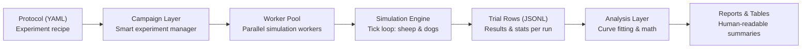
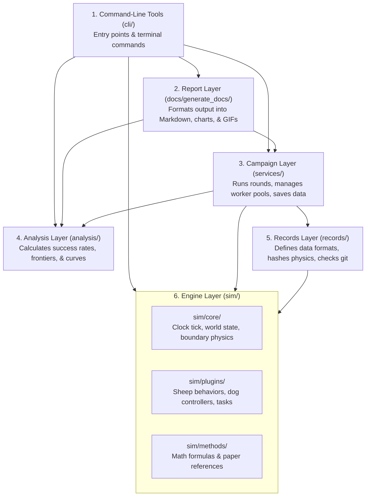
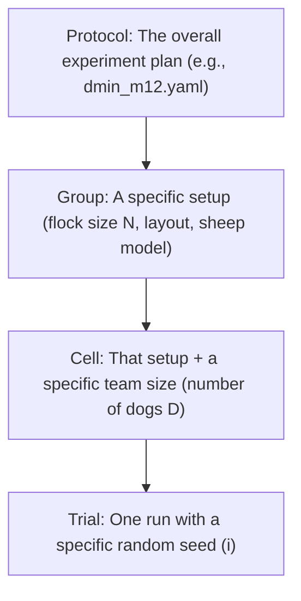

# HerdSim Architecture

HerdSim is a research platform built to answer a simple question: **How many shepherd dogs ($D$) do you actually need to herd a flock of sheep ($N$) into a pen before time runs out?**

If you're reading this, you're probably looking to understand how the code is organized, change how something works, or add your own features. This guide walks you through the big picture, how the parts fit together, and why things are built the way they are.

---

## Quick Navigation

- [1. System Overview & Mental Model](#1-system-overview--mental-model)
- [2. Architectural Goals & Constraints](#2-architectural-goals--constraints)
- [3. Building Blocks & Layer Hierarchy](#3-building-blocks--layer-hierarchy)
- [4. Data Hierarchy & Storage Contracts](#4-data-hierarchy--storage-contracts)
- [5. Runtime Lifecycles](#5-runtime-lifecycles)

---

## 1. System Overview & Mental Model

Think of HerdSim as doing two main jobs that meet in the middle:
1. **Running physics simulations:** moving sheep and dogs around a 2D field step by step.
2. **Managing large experiments:** running thousands of simulation runs efficiently, keeping clean logs, and crunching the numbers at the end.

Here is the entire journey of an experiment from start to finish:



### The Step-by-Step Flow

1. **Protocol (`YAML`)**: This is the experiment's recipe book. You describe what you want to test-which sheep and dog behaviors to use, the field layout, which parameter values to sweep, and when to stop.
2. **Campaign Orchestrator**: The smart manager. Instead of blindly running 100 trials for every single case, it checks results as it goes. If a test case is obvious (say, 10 dogs easily herding 5 sheep), it doesn't waste CPU time there. It directs extra runs to the tricky, borderline cases where the outcome is still uncertain.
3. **Engine**: The sandbox. It runs one single simulation run at a time in isolation. It handles sheep flocking and panicking, dog pathfinding, teamwork, and collision physics on a continuous 2D field.
4. **Trial Results**: Whenever a run finishes, the engine spits out a single summary row (did they succeed? how long did it take? summary statistics) and appends it to an immutable log file.
5. **Analysis & Reporting**: Once runs are recorded, downstream tools read the log files to find the tipping points - like the minimum number of dogs needed ($D_{\min}$) or where adding more dogs stops helping ($D_{\mathrm{sat}}$). You can tweak your analysis and redraw graphs anytime in seconds without having to rerun the simulations.

---

## 2. Architectural Goals & Constraints

Five simple rules guide how HerdSim is built:

1. **Fair comparisons above all else**: If you are comparing 2 dogs vs. 3 dogs, everything else must be identical - the field size, the physics, and where the sheep start. Otherwise, you can't be sure if the extra dog made the difference or just luck.
2. **Clear paper trail (provenance)**: If you look at a chart six months from now, you should be able to trace it back to the exact git commit, python libraries, and config settings that generated it.
3. **Crash resilience**: Experiments often run tens of thousands of trials over several days. If a power cut happens or someone kills the process, HerdSim should pick up right where it left off. Finished work is never lost or corrupted.
4. **Plug-and-play components**: Want to test a new sheep behavior model (like Strömbom, Kubo, or Lama) or a new dog steering strategy? You can drop it in as a plugin without touching the campaign scheduler or the core physics loop.
5. **Analyze anytime without re-simulating**: Running the physics takes hours or days; analyzing the numbers takes seconds. The data you save is rich enough that you can change your threshold definitions or curve-fitting math later without re-running simulations.

### Working Realities (Constraints)

- **One machine, multiple cores**: HerdSim uses Python's `multiprocessing` to run trials across all CPU cores on a single workstation or server. Workers don't share memory, keeping things clean and crash-safe.
- **Git-friendly file sizes**: Experiment folders are saved directly in git repositories. We keep logs compressed and records compact so files stay well under GitHub's 100 MB limit.
- **Reproducible numbers**: Give the simulator the same random seed, Python version, and library versions (NumPy/SciPy), and you'll get the exact same run every time. Across different CPU chips, floating-point math can vary slightly, so we account for small numerical tolerances.

---

## 3. Building Blocks & Layer Hierarchy

HerdSim is organized like a tall building with **six distinct floors (layers)**. 

The most important rule here: **you can only look down, never up**. A higher layer can use the layers below it, but a lower layer never knows what's above it.



### What Each Layer Does

| Layer | Where to find it | What it's responsible for | Golden Rule |
| :--- | :--- | :--- | :--- |
| **1. CLI Tools** | [`cli/`](../../cli/) | Reads command-line arguments, runs commands, and shows progress bars in your terminal. | Keep commands independent: one CLI tool never imports another CLI tool. |
| **2. Report** | [`docs/generate_docs/`](../generate_docs/) | Takes analyzed data and turns it into clean Markdown tables, summary text, graphs, and visual GIFs. | Strictly formats presentation. It never calculates experimental outcomes. |
| **3. Campaign** | [`services/`](../../services/) | The coordinator. Manages worker processes, schedules rounds, checks file locks, and decides which simulation runs to do next. | Uses the Analysis layer to decide what to run; never contains physics logic. |
| **4. Analysis** | [`analysis/`](../../analysis/) | The mathematician. Reads finished trial logs to figure out success percentages, find reliability boundaries, and calculate $D_{\min}$. | Works strictly on saved data files. It never calls or runs the simulator. |
| **5. Records** | [`records/`](../../records/) | The clerk. Formats trial data rows, checks git commit hashes, and hashes physics settings to detect accidental parameter drift. | Connects live simulation data to long-term storage on disk. |
| **6. Engine** | [`sim/`](../../sim/) | The sandbox. Advances time tick-by-tick, calculates agent movement, runs controllers, and detects goals or timeouts. | Completely self-contained. It only imports from inside `sim/`. It has no idea campaigns or batches even exist. |

> [!IMPORTANT]
> **Strict layer boundaries**:
> The **Engine** only cares about sheep and dogs moving right now - it has no clue it is running inside a campaign. Similarly, the **Analysis** layer only looks at numbers in files - it never launches a simulation. Keeping them apart makes the codebase much easier to maintain, test, and debug.

---

## 4. Data Hierarchy & Storage Contracts

### How Experiments Are Broken Down

Whenever you run an experiment, data is organized into four levels, from the biggest picture down to an individual run:



1. **Protocol**: The full study blueprint (e.g., [`dmin_m12.yaml`](../../protocols/configs/protocols/dmin_m12.yaml)). It lists all the methods, field layouts, parameter ranges, and stopping rules.
2. **Group**: A specific physical setup: `(method, layout, settings, flock size N)`. Before herding begins, we calibrate things like how much space a flock of size $N$ naturally occupies at this level.
3. **Cell**: A specific question to answer: `Group + team size (D)`. For example: *"Can 3 dogs reliably herd 40 sheep under setup X?"* Decisions like "is this condition reliable enough to stop testing?" happen at the cell level.
4. **Trial**: One single simulation run: `Cell + random seed index (i)`. This gives sheep and dogs their starting positions, runs until success or timeout, and produces exactly one row of data.

### Inside a Results Folder

Every time a protocol runs, it creates a dedicated folder under `results/`. Here is what lives inside:

```text
results/<protocol_name>/
├── protocol.yaml              # Exact copy of the experiment protocol used
├── physics.hash               # A fingerprint of all physics settings (detects accidental changes)
├── sittings.jsonl             # Log of every run session (who ran it, when, git commit, machine info)
├── calibration.json           # Measurements like natural flock size Rf(N) before dogs enter
├── trial_log.jsonl            # The main log: every finished trial appends a line here
├── trial_log.jsonl.gz         # A compressed archive of the trial log created when a sitting ends
├── trials.parquet             # Clean, fast-to-read table of all active trials (updated every round)
├── cell_decisions.parquet     # Verdict per cell (is it reliable, unreliable, or still needs more runs?)
├── errors.jsonl               # Error tracebacks if any trial crashed unexpectedly
└── progress.json              # Live snapshot of current round, percent done, and why things stopped
```

---

## 5. Runtime Lifecycles

### Crash Recovery & Replays

Two design choices ensure you never lose sleep over a long-running campaign:

- **Picking up after an interruption**:
  If your computer shuts down or you press `Ctrl+C`, don't worry. Trials are saved one line at a time to an append-only file (`trial_log.jsonl`). The worst that can happen is the very last line was cut off mid-write. When you restart the campaign, HerdSim automatically drops that broken half-line, checks what's missing, finishes any partially completed rounds, and picks right back up.

- **Replaying any run exactly**:
  Notice a weird or interesting trial in your results? You can replay that exact trial visually using [`cli/diagnostics/`](../../cli/diagnostics/). The replay tool re-runs the simulation with the recorded seed and verifies that every single tick and outcome matches the historical record bit-for-bit before opening up visual debuggers.
