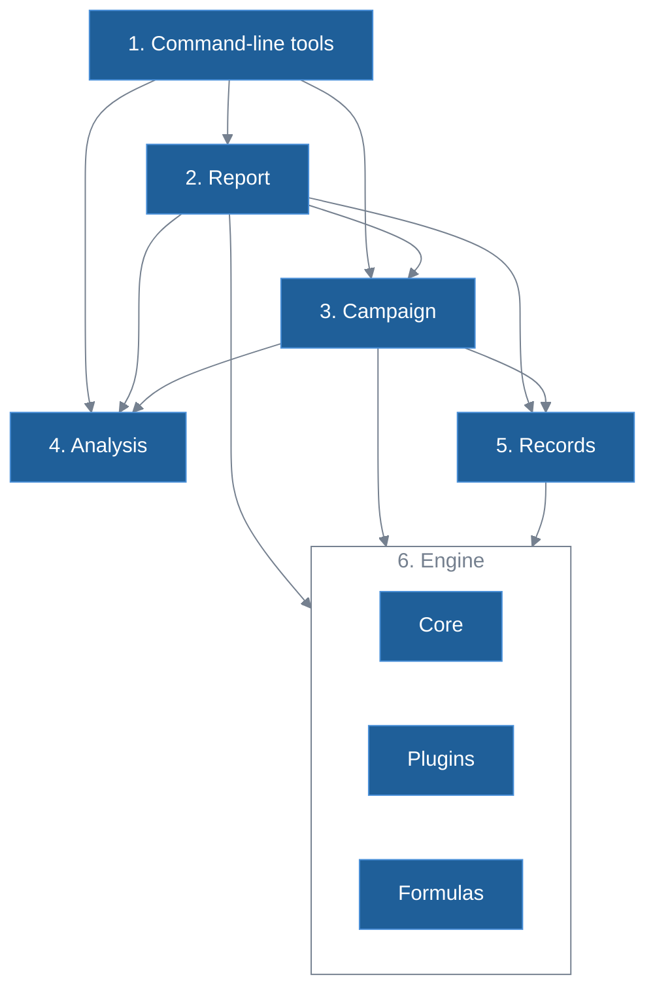
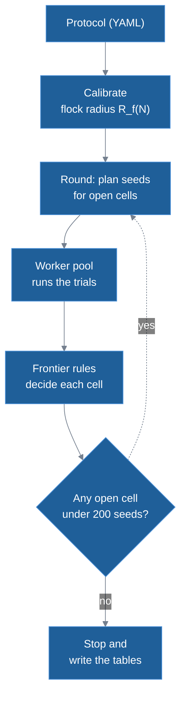

# HerdSim architecture

## System overview

HerdSim moves sheep and dogs step by step (one step is a [tick](../glossary.md#trials-and-experiments)) on a 2D field, and runs large experiments: thousands of trials across CPU cores, each stored as it finishes, with the answers worked out afterwards. This diagram follows one experiment from its [protocol](#how-an-experiment-is-broken-down) to the tables; [layers](#layers) describes each part:

## Goals and constraints

Five goals shape the design:

1) Paired comparisons: cells of one [curve](#how-an-experiment-is-broken-down) share the field, goal and task, and seed $i$ of every cell starts from the same flock ([paired random streams](../experiments/task_design.md#paired-random-streams)). This reduces the part luck plays in a comparison but does not remove it.
2) A record of each run: a folder records the physics settings it ran on (everything that changes an outcome) and, if it has a run log, the code ([what a folder records](#what-a-folder-records)).
3) Resuming after an interruption: a protocol can run tens of thousands of trials, and the same command resumes an interrupted run at little cost ([recovery](#recovery-after-an-interruption)).
4) New parts by table entry: the engine looks its parts up in five tables, of sheep models, dog controllers, methods, tasks and metrics. A new part is new code plus one table entry; the tick loop and the scheduler do not change.
5) Analysis without rerunning: stored rows can be reread under a changed threshold, rule or fit, though some cells may then need more seeds, because the seeds were spent under the old rule. By default only the first 3 seeds of each cell keep their per-tick history, so failure labels cannot be recomputed for the rest.

### Working constraints

1) One machine, many cores: trials run in a pool of worker processes, by default one per CPU core. Workers share no memory and each uses one numeric-library thread.
2) File sizes that suit git: results folders are in git, which on GitHub refuses files over 100 MB, so git tracks a compressed copy of the trial log ([results folder](#results-folder)). Per-tick histories stay out of git, so a fresh clone does not have them.
3) Reproducible numbers: the same seed with the same machine, Python and library versions gives the same trial bit for bit. Across CPUs and NumPy builds the last bits differ, and trials can drift apart within a few hundred ticks; we have not measured why. The regression tests therefore compare whole-trial summaries with small tolerances.

## Layers

HerdSim has six layers. A layer imports only higher-numbered layers, and analysis imports none. This diagram shows the imports:

Each layer has one job ([Table 1](#where-to-look-in-the-code) says where each lives):

1) Command-line tools: start protocols and other commands and print progress as plain lines; the status command says how far a run has got and whether it is still running. They import the campaign and report layers only. No tool imports another.
2) Report: writes analysis values as Markdown tables and text, and produces the generated pages, figures and GIFs. The tools use its tables, so the terminal and the docs show the same table values. Figures and GIFs may run or replay trials, but no stored result comes from them.
3) Campaign: the manager that spends extra [seeds](#how-an-experiment-is-broken-down) on undecided [cells](#how-an-experiment-is-broken-down). It runs the rounds, calibration and replays, sends trials to the worker pool, separate processes that run trials in parallel, and writes the [results folder](#results-folder). After each round it hands the rows so far to analysis, which decides which cells still need seeds; no sheep or dog rule lives here.
4) Analysis: reads stored files and never runs the model. From the trial rows it works out success rates, reliable teams, $D_{\min}$ (the smallest reliable team), $D_{\mathrm{sat}}$ and the other [team sizes](../glossary.md#team-sizes), and curve fits.
5) Records: builds the trial row, one summary per finished trial (which trial, its outcome, the mean, minimum and maximum of each metric, and a [failure label](../experiments/task_design.md#how-failed-trials-end)). A worker builds the row and the campaign appends it to the trial log. This layer also hashes the physics settings, records the code identity and writes the notice on generated files.
6) Engine: a sandbox that runs one trial and knows nothing of campaigns. Each tick the sheep model moves the sheep, the dog controller moves the dogs and the task checks for success, its own end rule or the time limit. Its core runs the tick loop and holds the state and the field. Its plugins, the entries of its tables, call the formulas, which hold the paper's equations and parameter values. Apart from third-party libraries such as NumPy the engine imports only from its own folder.

## Data levels and storage

### How an experiment is broken down

Data has four levels:

1) Protocol: one experiment plan, such as the main run with a deadline of 12 [drive times](../experiments/task_design.md#deadlines-in-drive-times). This recipe of an experiment is a YAML file naming the [task](../glossary.md#the-drive-task), [method](../glossary.md#trials-and-experiments), [start layouts](../glossary.md#start-layouts-and-dog-starts), flock and team sizes, and when to stop.
2) Curve: one setup (method, layout, levels of any swept settings, flock size $N$), tested across team sizes.
3) Cell: one team size on one setup, asking "can 3 dogs herd 200 sheep in this setup?". Reliability is decided per cell.
4) Trial: one run of that cell with one seed, which sets the sheep starts and the noise of sheep and dogs. The dog starts follow from the setup and team size. A trial runs until success, the task's own end rule or the time limit, and gives one row.

### Results folder

Each protocol writes to its own results folder unless the command names another. The [configuration guide](../guides/configuration.md#what-a-simulation-run-writes) lists every file; five of them follow from design choices:

1) Provenance record: holds the physics hash, which is checked at every start ([what a folder records](#what-a-folder-records)).
2) Run log: a separate file with one line per sitting, one start of a campaign on the folder, and the code it ran (same section).
3) Protocol copy: the merged protocol (the file over its defaults) as the folder was created.
4) Trial log: one line per finished trial, appended as trials finish. Git tracks only its compressed copy, written when a campaign closes the folder; a fresh clone unpacks it the first time a command opens the folder.
5) Lock: held by a running campaign for the whole run, so a second campaign on the folder is refused.

### What a folder records

The [physics hash](../glossary.md#records) covers every setting that changes an outcome ([what it covers and leaves out](../guides/configuration.md#physics-hash)), and a start with different physics in the same folder is refused.

The protocol copy is written only when the folder is created, so it may not show the settings a later run used. Neither it nor the hash tells runs on different code apart.

The run log does. Each sitting adds the start time, the trial count so far, the merged protocol and the [code identity](../glossary.md#records): a hash of the trial code that catches uncommitted edits, the commit and the library versions. A changed code hash gives a warning and the run goes on, because a refactor changes the hash too.

## Runtime behaviour

### Calibration

At the start of a campaign, calibration measures the flock radius that sizes the drive task ([sizing](../experiments/task_design.md#sizing-by-the-calibrated-flock-radius)). It uses one dog and no swept settings, so every level of a method runs on a task sized to the same reference flock.

### One campaign round

A campaign calibrates once, then runs rounds until every open cell has 200 seeds or the time budget (72 h by default) is spent. A cell is open while its reliability is undecided or, in a protocol that decides finish times (off by default), while a finish-time comparison that could still change one of its curve's [frontier values](../experiments/task_design.md#frontier-values) is undecided. This diagram shows the loop; the statistical rules are in [task design](../experiments/task_design.md#3-adaptive-sampling):

A round also adds team sizes where neighbouring answers differ ([midpoint densification](../experiments/task_design.md#midpoint-densification)). Seeds go out in whole batches ([recovery](#recovery-after-an-interruption) says why).

Pruning stops seeds for cells far above $D_{\mathrm{sat}}$ whose extra dogs stand on top of others:

1) When it starts: $D_{\mathrm{sat}}$ is decided, a larger tested team is also classed as [saturated](../experiments/task_design.md#zones) (reliable and not slower than [$D_{\mathrm{best}}$](../experiments/task_design.md#frontier-values)), and the curve is not still improving at the top of its grid.
2) What it prunes: above that confirming team, a cell that is saturated or undecided and in which, averaged over ticks and trials, at least 90% of the dogs had another dog within 2 m.
3) What it never prunes: unreliable cells and cells slower than $D_{\mathrm{best}}$, since they are the answers being measured.

A pruned cell is filled to a whole batch, then gets no more seeds and adds no midpoints. The rule assumes that a dog standing on another acts as its copy and cannot change the answer; we have not tested that.

### Recovery after an interruption

Only the campaign process appends to the trial log, one line at a time, so a killed process, including one stopped with `Ctrl+C`, leaves at worst a cut last line. On restart with the same command that line is dropped, and that trial, and the ones in progress, run again. Each cell is then topped up to a whole batch, so a resumed run keeps the seed boundaries of an uninterrupted one. A dead worker stops the batch, with the same resume. A resumed run gets a new time budget.

A trial that raises an exception is not resumed: it gives no row, only a line in the error log, and the batch goes on. Its cell gets no more seeds and is never reliable, because an exception in a deterministic simulation is a bug.

Appends are not forced to disk, so a power cut can also lose finished rows still in the operating system's cache, and those trials then run again. We reasoned this from the code and have not tested it.

### Replaying a trial

A trial depends only on its configuration and seed. The replay service rebuilds the configuration from the protocol file and refuses to run if that file is gone or now gives different physics. An unchanged replay that differs from the stored row in success or tick count raises an error, because a different trial says nothing about the stored results. The animations replay stored trials this way.

## Where to look in the code

Table 1 maps each part of the design to its place in the repository, grouped by layer.

**Table 1: Where each part lives.**

| Layer | Part | Location |
| :--- | :--- | :--- |
| 1. Command-line tools | Commands | [`cli/`](../../cli/) |
| 2. Report | Tables, text, generated pages, figures and GIFs | [`docs/generate_docs/`](../generate_docs/) |
| 3. Campaign | Campaign rounds | [`services/adaptive.py`](../../services/adaptive.py) |
| 3. Campaign | Worker pool and batches | [`services/pool.py`](../../services/pool.py), [`services/runner.py`](../../services/runner.py) |
| 3. Campaign | Calibration | [`services/calibration.py`](../../services/calibration.py) |
| 3. Campaign | Replay | [`services/replay.py`](../../services/replay.py) |
| 3. Campaign | Protocol loading, curves, cells and seeds | [`services/protocol.py`](../../services/protocol.py), [`services/cells.py`](../../services/cells.py) |
| 3. Campaign | Results folder, lock and resume | [`services/store.py`](../../services/store.py) |
| 4. Analysis | Decision rules | [`analysis/frontier.py`](../../analysis/frontier.py) |
| 5. Records | Trial row | [`records/trial_row.py`](../../records/trial_row.py) |
| 5. Records | Physics hash and code identity | [`records/provenance.py`](../../records/provenance.py) |
| 5. Records | Generated-file notice | [`records/generated_notice.py`](../../records/generated_notice.py) |
| 6. Engine | Engine | [`sim/`](../../sim/) |
| 6. Engine | Core: tick loop, state and field | [`sim/core/`](../../sim/core/) |
| 6. Engine | Table of methods | [`sim/core/methods.py`](../../sim/core/methods.py) |
| 6. Engine | Plugins: sheep models, dog controllers, tasks and metrics | [`sim/plugins/`](../../sim/plugins/) |
| 6. Engine | Formulas from the papers | [`sim/methods/`](../../sim/methods/) |
| Not code | Protocol files | [`protocols/configs/protocols/`](../../protocols/configs/protocols/) |
