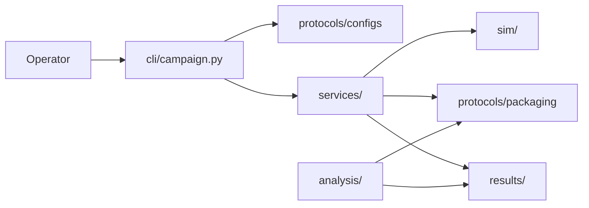
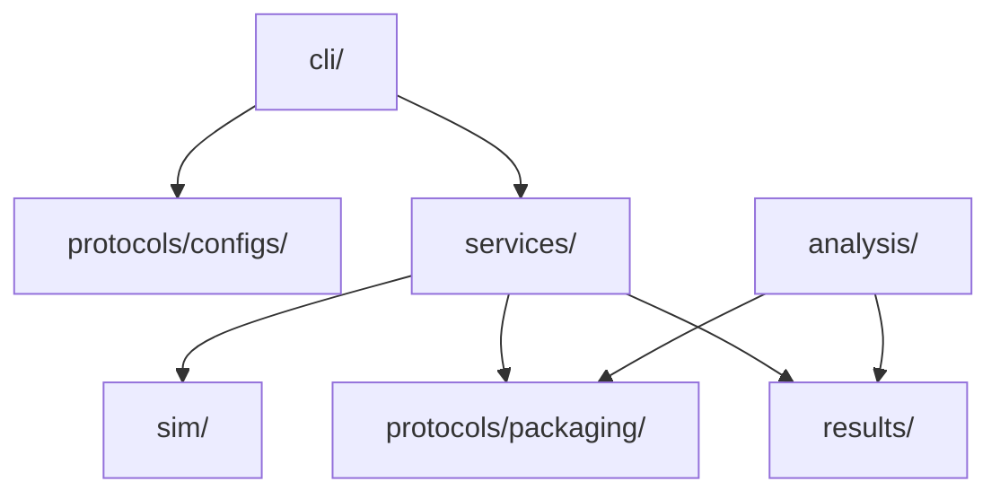
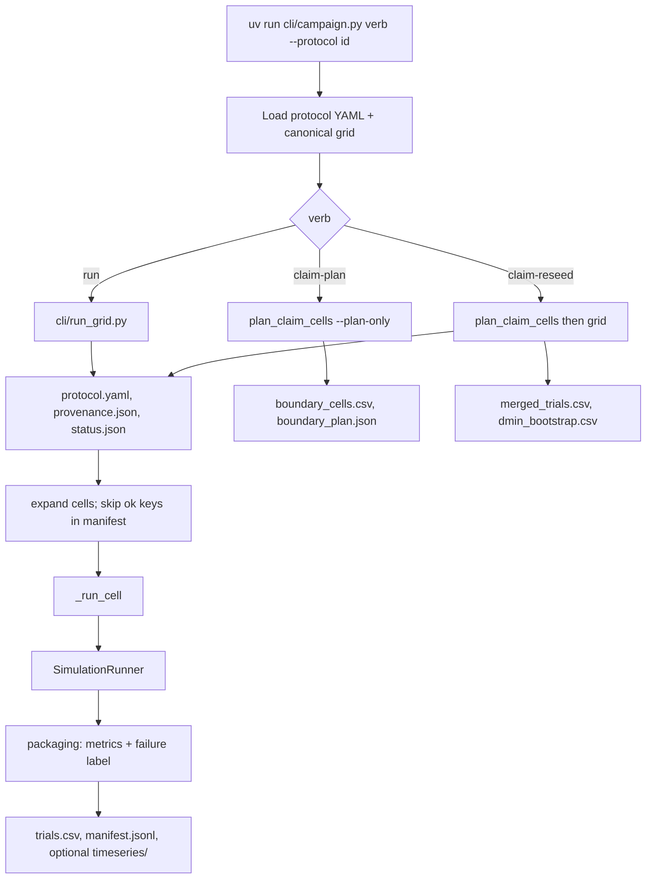
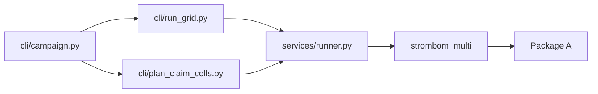

# HerdSim Architecture (scaling-cli)

Batch research campaigns over a tick-level multi-agent shepherding simulator. Dogs drive sheep to a goal (Phases 1 to 7) or collect, hold, and push them out a gate (Phase 8); campaigns measure control demand (`D_min` and related frontiers) under frozen protocols.

Import map: code lives under `sim/` on disk, but setuptools remaps imports to `core`, `plugins`, and `methods` (no `sim.` prefix). Protocol YAMLs live under `protocols/configs/`. Analysis must not step the simulator; claim planners may still call `analysis.frontier` helpers to choose reseed windows.

## Context



Quality attributes:

- Resumable grids via `manifest.jsonl` cell keys
- Protocol freeze: resolved YAML copied into the run folder; content hash in `provenance.json`
- Deterministic seeds from `master_seed + i`
- Reproducible trial rows in `trials.csv` (flushed after each finished cell)

## Logical layers



## Components

| Piece | Path | Role |
|-------|------|------|
| Tick engine | `sim/core/simulation_runner.py` | Step loop until success or timeout |
| Config resolve | `sim/core/config/experiment.py` | `resolve_experiment_config` |
| Method catalog | `sim/core/methods.py` | Sheep x dog pairs + default params |
| Registries | `sim/core/registry.py` (class), `sim/core/plugin_registry.py`, `sim/plugins/{metrics,scenarios}/registry.py` | Sheep, dogs, observation; metrics; scenarios |
| Campaign CLI | `cli/campaign.py` | Verbs: `run`, `claim-plan`, `claim-reseed` |
| Grid / factor runner | `cli/run_grid.py` | Expand cells from protocol (`runner: factor` adds RQ5 axes) |
| Claim planner | `cli/plan_claim_cells.py` | Windows then optional reseed |
| Orchestration | `services/runner.py`, `services/layout.py` | Resume, status, `_run_cell` |
| Packaging | `protocols/packaging/` | Failure labels, trial fields, provenance stamp |
| Analysis | `analysis/` | Frontiers, regimes, fits, transfer, export |

### Methods

| Method | Sheep | Dog | Role |
|--------|-------|-----|------|
| `strombom_multi` | strombom | collect_drive_multi | RQ baseline |
| `kubo` | kubo | kubo_forces | RQ4 transfer |
| `fat` | strombom | fat | RQ4 transfer |

Campaign scenarios: `drive_to_goal` (Phases 1 to 7); `collect_hold_gate` (Phase 8). Registered metrics are written into each trial row.

### Plugin model

Registries (one generic `core.registry.Registry`) bind string ids to implementations:

- Sheep dynamics (`plugins/sheep/`) and dog controllers (`plugins/dogs/`): `core/plugin_registry.py`
- Observation models `global`, `local_positions`, `bearing_only` (`core/observation.py`): `core/plugin_registry.py`
- Scenarios (`plugins/scenarios/`): `plugins/scenarios/registry.py`
- Metrics (`plugins/metrics/`): `plugins/metrics/registry.py`; every metric is recorded every tick

The run config for one trial is a flat dict from `resolve_experiment_config`:
world defaults, then sheep / dog / method params, then scenario world keys, then
the cell's parameters (`algorithm_params`, `world_overrides`, agent counts).

## Protocol configs

Layout:

```text
protocols/
|-- configs/
|   |-- canonical_grid.yaml
|   `-- protocols/           # one YAML per stage id
`-- packaging/
```

YAML keys:

- `protocol_id`: id matching the filename stem (and usually the results folder slug)
- `canonical`: path to frozen defaults (normally `protocols/configs/canonical_grid.yaml`)
- `extends`: optional parent protocol YAML; child keys override
- `grade`: `SCOUT` / `CLAIM` (seed depth convention)
- `output`: destination under `results/`
- `seed_mode`: `scout` for `run`; `claim` for claim-reseed
- `methods` (grid) or `method` (factor), `layouts`, `flock_sizes`, `shepherd_counts`, `seeds`: the cell grid
- `runner: factor` (RQ5): one method and layout; adds `obs_modes`, optional `sensing_ranges` / `communications`
- `task`: scenario id (`drive_to_goal` from canonical; `collect_hold_gate` for Phase 8 with `hold_*` / `gate_half_width`)
- `upstream_protocol` / `upstream_trials`: claim inputs
- `store_timeseries`: write `timeseries/*.parquet` when true
- `phase`, `grade`, `packages`: metadata only (kept in `protocol.yaml`)

## Runtime

### Campaign flow



### One cell

`_run_cell` builds a config via `resolve_experiment_config`, then steps until success or timeout.

### Tick order

```text
state(t)
  -> sheep_dynamics.step
  -> observation.observe_all
  -> dog_controller.step
  -> walls (right-wall gate for collect_hold_gate)
  -> metrics(state(t+1))
```

### Artifacts under `results/phase{k}/{slug}/`

| Artifact | When written |
|----------|--------------|
| `protocol.yaml` | Start of run / claim (resolved freeze) |
| `provenance.json` | Start of grid (hash, seeds, metric ids); grid / claim runs hash canonical + spec, factor sweeps hash canonical only |
| `status.json` | Start, each cell, finish |
| `trials.csv` | After each finished cell |
| `manifest.jsonl` | After each ok cell (resume keys) |
| `timeseries/*.parquet` | After each cell if `store_timeseries` |
| `boundary_cells.csv`, `boundary_plan.json`, `scout_dmin_bootstrap_preview.csv` | Claim plan / start of claim-reseed |
| `merged_trials.csv`, `*dmin_bootstrap.csv` | End of claim-reseed |
| `packages/{a,b,d-g}/` | Separate analysis export (not the campaign runner; B is historical) |
| `README.md` | Handwritten notes |

## Phase and RQ code map

| Results folder | RQ | Question | Primary method |
|----------------|----|----------|----------------|
| `phase1/` | RQ2 | Size map: how `D_min` changes with N | `strombom_multi` |
| `phase2/` | RQ1 | Structure: does start layout move `D_min`? | `strombom_multi` |
| `phase4/` | RQ4 | Transfer across kubo / fat | `kubo`, `fat` |
| `phase5/` | RQ5 | Information ladders | `strombom_multi` + factors |
| (analyse on RQ2) | RQ6 | Scaling curve fits | Package F |
| (analyse on RQ2) | RQ7 | Early warning | Package G |
| `phase8/` | RQ2 reopen / RQ3 unlock | Collect-hold-gate size map (harder task) | `strombom_multi` |

### RQ2 size (phase1)

Protocols: `phase1_scout`, `phase1_claim`.

```bash
uv run cli/campaign.py run --protocol phase1_scout --workers 16
uv run cli/campaign.py claim-plan --protocol phase1_claim
uv run cli/campaign.py claim-reseed --protocol phase1_claim --workers 16
```

Code path:



| Step | Path / symbols |
|------|----------------|
| Runner | `expand_scaling_grid`, `run_scaling_grid`, `_run_cell` |
| Method | `plugins/dogs/collect_drive_multi.py`, `methods/strombom/heuristics.py` |
| Package A | `analysis/frontier.py`, `regimes.py`, `export.py` |

### RQ1 structure (phase2)

Protocols: `phase2_scout`, `phase2_claim`.

Extra modules: `core/world/layouts.py`. Layout frontiers use `extract_frontier(group_cols=["initial_layout"])`. Package B (state-vs-(N, D) predictors) was removed: its `early_*` inputs are no longer produced; past outputs stay under `results/`.

### RQ4 transfer (phase4)

Protocols: `phase4_{kubo,fat}_{size,structure}_{scout,claim}`.

```bash
uv run cli/campaign.py run --protocol phase4_kubo_size_scout --workers 16
uv run cli/campaign.py claim-reseed --protocol phase4_kubo_size_claim --workers 16
```

Analysis: `analysis/transfer.py` (`build_transfer_table`, Package D).

### RQ5 information (phase5)

Protocols: `phase5_factor_sweep`, `phase5_obs_claim`, `phase5_range_{scout,claim}`, `phase5_comm_{scout,claim}`.

Code path: `cli/run_grid.py` (protocol `runner: factor`), observation modes in `core/observation.py`, Package E in `analysis/substitution.py`. Ladder stages: `uv run cli/campaign.py` with `phase5_*` protocols.

### RQ6 fits / RQ7 early warning (analyse)

- RQ6: `analysis/fits.py` (`fit_scaling_models`) on phase1 claim frontier
- RQ7: `analysis/early_warning.py` on claim timeseries when stored

### Phase 8 collect-hold-gate

Second task track. Keep the draft idea (collect / hold 800 ticks / exit through a gate). Adapt geometry for HerdSim continuous space. Scout and claim only for the first size map.

Scenario id: `collect_hold_gate`.

Phase machine:

1. Collect / drive until the flock is inside the hold disk.
2. Hold: containment must stay true for `hold_ticks` (800) consecutive ticks; leaving resets the timer.
3. Exit: drive through the right-wall gate; success when every sheep has crossed the gate plane by `T0 = 10000`.
4. Failure: timeout or existing packaging failure labels.

Geometry freeze (protocol keys):

| Key | Value | Role |
|-----|-------|------|
| `hold_ticks` | 800 | Draft hold duration |
| `hold_center` | `[250, 250]` | Field midpoint |
| `hold_radius_*` | `clamp(2.5 * sqrt(N), 23, 27)` | Draft containment scale |
| `gate_half_width` | 30 | Opening on `x = world_width` |
| Arena | 500 x 500 continuous | Same scaling field as Phases 1 to 7 |

Protocols: `phase8_size_scout`, `phase8_size_claim` (under `protocols/configs/protocols/`). Output: `results/phase8/size/{scout,claim}/`.

```bash
uv run cli/campaign.py run --protocol phase8_size_scout --workers 18
uv run cli/campaign.py claim-plan --protocol phase8_size_claim
uv run cli/campaign.py claim-reseed --protocol phase8_size_claim --workers 18
```

Code (reuses campaign CLI, packaging, frontier, Package A, Strombom heuristics):

| Piece | Path | Role |
|-------|------|------|
| Scenario | `sim/plugins/scenarios/collect_hold_gate.py` | Hold disk, gate, spawn, success, phase checks |
| Registry | `sim/plugins/scenarios/registry.py` | Register beside `drive_to_goal` |
| Runner | `services/runner.py` | Scenario id from protocol `task`; hold geometry on `ScalingCell` |
| Dogs | `plugins/dogs/collect_drive_multi.py` | Exit phase drives toward the gate |
| Tests | `tests/sim/test_collect_hold_gate.py` | Hold radius, hold timer reset, gate success, registry |

Few tests only. No parallel campaign stack, no new analysis package letter.

Out of scope for the first Phase 8 campaign: structure layouts, Kubo/FAT on this task, information ladders, pilot YAML.

### Analysis packages A, D-G (no B or C)

| Pkg | RQ | Module | Entry |
|-----|----|--------|-------|
| A | RQ2 / size maps | `export.py`, frontier, regimes | `export_package_a` |
| D | RQ4 | `transfer.py` | `build_transfer_table` |
| E | RQ5 | `substitution.py` | `substitution_curves(factor=...)` |
| F | RQ6 | `fits.py` | `fit_scaling_models` |
| G | RQ7 | `early_warning.py` | `evaluate_early_warning_campaign` |

### How to trace a run

1. Open the protocol YAML under `protocols/configs/protocols/`.
2. Note `output`, grids, and any `upstream_protocol`.
3. Run the matching `uv run cli/campaign.py` verb.
4. Sims end in `services.runner._run_cell` -> method bundle -> plugins.
5. Analysis ends in `analysis/` and `results/.../packages/`.

Example:

```bash
uv run cli/campaign.py run --protocol phase1_scout --workers 16
# cli/campaign.py -> cli/run_grid.py -> services.runner -> _run_cell
# out: results/phase1/scout/trials.csv
```

## Design decisions

- Protocol YAML is the source of truth; each run freezes a resolved copy as `protocol.yaml`
- Resume identity is `_cell_key(ScalingCell)` in `manifest.jsonl`; completed `status=ok` keys are skipped
- Scout maps broadly; claim-plan selects windows; claim-reseed deepens seeds and merges
- Analysis is post-hoc on CSVs/timeseries and must not step the simulation (frontier helpers may be reused by claim planners)
- Provenance stamp stores hash, seed list, and metric ids (not a second full protocol body)

## Extension points

| Add | Where |
|-----|-------|
| Method bundle | `sim/core/methods.py` + sheep/dog plugins + optional `sim/methods/<name>/` |
| Sheep dynamics | `sim/plugins/sheep/` + registry |
| Dog controller | `sim/plugins/dogs/` + registry |
| Metric | `sim/plugins/metrics/` + registry |
| Protocol stage | `protocols/configs/protocols/<id>.yaml` |
| Analysis package | `analysis/` module + export helper |

## Operator entry

```bash
make install
make test
make help
uv run cli/campaign.py help
uv run cli/campaign.py run --protocol phase1_scout --workers 18
uv run cli/campaign.py claim-plan --protocol phase1_claim
uv run cli/campaign.py claim-reseed --protocol phase1_claim --workers 18
```
