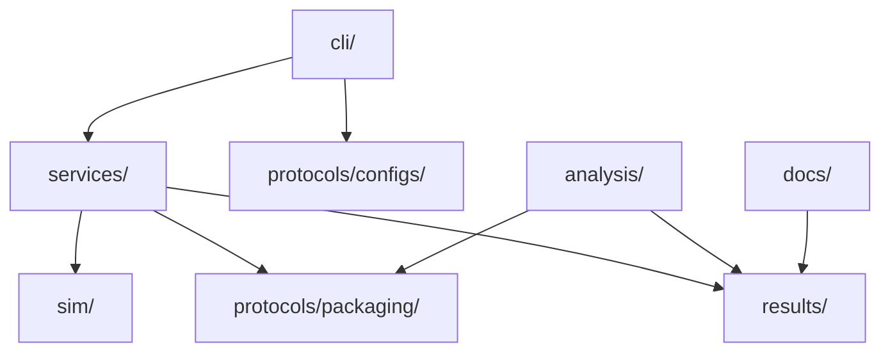
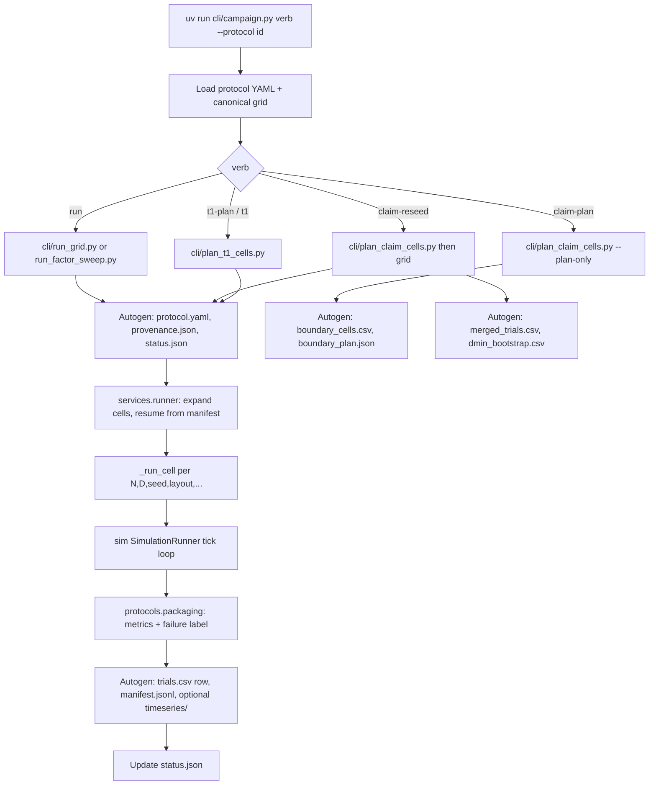

# HerdSim Architecture (scaling-cli)

Purpose-split tree for scaling research. Platform GUI is on `main`.

## Layout

```text
HerdSim/
|-- sim/                 Tick engine
|   |-- core/            Runner, state, observation, config, world
|   |-- plugins/         Sheep, dogs, scenarios, metrics
|   `-- methods/         Paper math (strombom, kubo)
|-- protocols/           Protocol definition
|   |-- configs/         Canonical grid + protocol YAMLs
|   `-- packaging/       Failure labels, aggregates, provenance
|-- cli/                 Campaign entry (campaign.py, planners, runners)
|-- services/            Layout, resume, cell runner
|-- analysis/            Frontiers, regimes, plots, export
|-- results/             Trial artifacts (data)
|-- docs/
|   |-- science/
|   |-- codes/
|   |-- figures/
|   `-- report/
`-- tests/
    |-- sim/
    |-- services/
    |-- protocols/
    `-- analysis/
```


## Dependencies



Arrows mean "depends on" (imports or reads). `analysis` must not import `SimulationRunner`.

## Run flow

Operator entry: `uv run cli/campaign.py help` (also listed in `make help`).



### One simulation tick

Every `_run_cell` builds a config via `resolve_experiment_config`, then steps until success or timeout:

```text
state(t)
  -> environment updates / failure factors
  -> sheep_dynamics.step
  -> observation.observe_all
  -> dog_controller.step
  -> constraints / walls
  -> metrics(state(t+1))
```

### Autogenerated vs handwritten

Under `results/phase{k}/{slug}/`:

| Artifact | When written | Notes |
|----------|--------------|-------|
| `protocol.yaml` | Start of run / claim / t1 | Resolved protocol freeze (copied) |
| `provenance.json` | Start of grid | Hash, seed list, metric ids |
| `status.json` | Start, each cell, finish | Planned / done counts, running flag |
| `trials.csv` | After each finished cell | Resume-safe flush |
| `manifest.jsonl` | After each ok cell | Resume keys |
| `timeseries/*.parquet` | After each cell if `store_timeseries` | Stem = cell key |
| `boundary_cells.csv`, `boundary_plan.json` | `claim-plan` / start of `claim-reseed` | From scout trials |
| `merged_trials.csv`, `*dmin_bootstrap.csv` | End of `claim-reseed` | Scout + claim merge |
| `t1_cells.csv`, `t1_plan.json` | `t1-plan` / start of `t1` | Overcrowding windows |
| `packages/{a-g}/` | Separate analysis export | Not written by the campaign runner |
| `README.md` | Handwritten | Folder notes |

`docs/figures/` and `docs/report/` are curated report assets, not campaign outputs.

## Import rules

- `sim` packages keep historical names (`core`, `plugins`, `methods`) via package-dir maps.
- Campaign code imports as `services.*` and `protocols.packaging`.
- `analysis` may read `results/` and import math helpers; it must not step the simulation.

