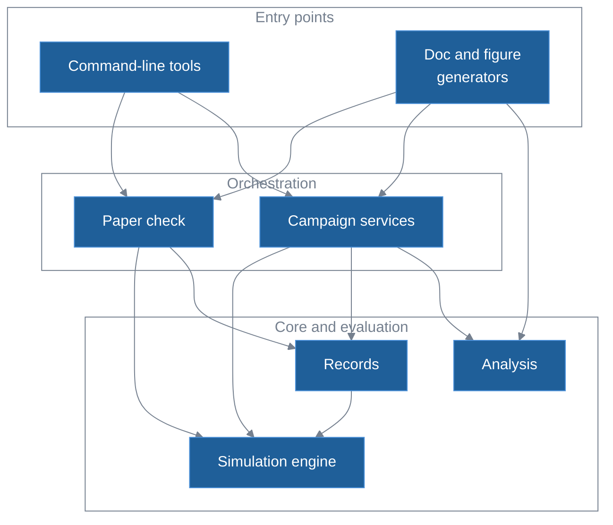
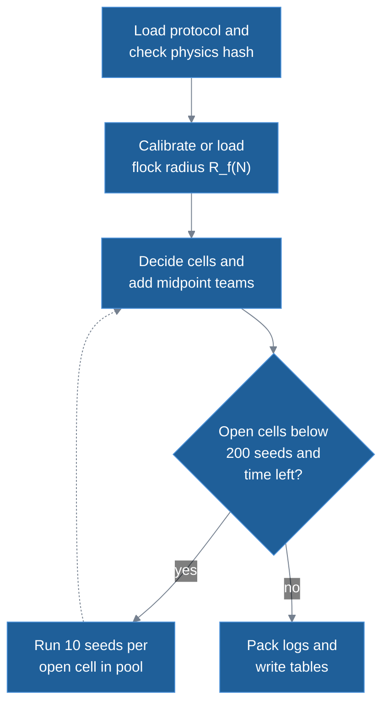

# HerdSim architecture

How HerdSim is put together: the design rules, the code layers, how a campaign runs and resumes, and where to find each part in the codebase.

## Design rules

Six rules shape the code:

- Paired seeds: every [cell](../glossary.md#trials-and-experiments) on a curve uses the same arena, and seed $i$ starts from the same flock at every team size and in all nine study protocols.
- Exact replay: a trial is fixed by its settings and seed. Replaying a stored trial on the same machine and library build gives the exact same outcome and tick count.
- Safe resume: a protocol takes thousands of trials, so each trial is saved as soon as it finishes and the same command resumes a stopped run.
- Offline analysis: analysis reads stored files and never runs the simulator, so tables and fits can be rebuilt without rerunning trials.
- Process pool: one worker process per CPU core runs one trial at a time, with single-threaded numeric libraries inside each worker so processes do not fight over threads.
- Small git files: result folders live in git, so trial logs are gzip-compressed with zeroed headers (unchanged trials give no git diff) and per-tick histories are kept only for the first three seeds per cell.

## Layers

Lower layers never import higher layers. The engine imports nothing outside its own folder, and analysis imports no other project code:

- Command-line tools: start campaigns, calibration checks and paper checks, and print progress.
- Doc and figure generators: read stored runs through analysis to write Markdown tables, figures and animations.
- Campaign services: load protocols, calibrate the [flock radius $R_f(N)$](../glossary.md#the-drive-task), lock the results folder, send batches to workers and run the adaptive loop.
- Paper check: runs the one-dog experiments of Strombom et al. (2014) directly on the engine over fixed grids ([paper check](../methods/strombom_check.md)).
- Analysis: reads stored files to compute confidence intervals, cell decisions, $D_{\min}$ (the smallest reliable team size) and curve fits.
- Records: builds the trial row, hashes the physics settings, logs code identity and stamps generated files.
- Simulation engine: a sandbox that steps sheep and dogs through one trial and checks when it ends. It knows nothing about campaigns or storage.

## How a campaign runs

Before running trials, the campaign checks the results folder: if the folder already exists, its stored [physics hash](../glossary.md#records) must match the protocol's hash and no other process may hold the lock. It then calibrates $R_f(N)$ (or loads saved radii) and loops in rounds ([adaptive sampling](../experiments/task_design.md#3-adaptive-sampling)):

Each round decides which cells are reliable, adds midpoint team sizes where reliability changes across a gap, and gives every remaining [open cell](../glossary.md#success-and-reliability) below 200 seeds its next batch of 10 seeds.

### Stopping, resuming and replaying

Only the parent campaign process appends rows to the trial log, one line per finished trial. Stopping the process with an interrupt or a kill leaves at worst a cut last line; on restart, that line is dropped, finished seeds are skipped, and cut cells are topped back up to a full batch of 10 seeds. If a worker process is killed by the OS, the batch stops without logging a trial error and a restart reruns the trials that were in flight. If a trial raises a Python exception, the error is logged and that cell gets no more seeds, because an exception in a deterministic model is a bug. Replaying a trial rebuilds its settings from the protocol and checks its physics hash; if the replay does not match the stored success and tick count, it raises an error so figures and animations never show a drifted run.

## Where to look in the code

Table 1 maps each part of the design to its folder or file:

**Table 1: Where to look in the code.**

| Part | Path | What it does |
| :--- | :--- | :--- |
| Simulation engine | `sim/trial.py`, `sim/state.py` | Single-trial tick loop, random streams and stop checks |
| Sheep and dog rules | `sim/strombom/` | Strombom sheep model, one-dog decision rule, `strombom_multi` team rule, `fat` baseline and `independent` baseline |
| Arena task and layouts | `sim/drive_task/`, `sim/metrics/` | Arena sizing from $R_f(N)$, start layouts, goal check, failure labels and metrics |
| Records | `records/` | Trial row, physics hash, code identity and generated-file notice |
| Campaign services | `services/` | Protocol loader, $R_f(N)$ calibration, adaptive rounds, worker pool, folder store and replay |
| Analysis | `analysis/` | Clopper-Pearson intervals, cell decisions, $D_{\min}$ brackets, growth fits and run comparisons |
| Paper check | `paper_check/` | Fixed-grid reproduction of Strombom et al. (2014) Figure 3 and distance study |
| CLI and docs | `cli/`, `docs/generate_docs/` | Command-line tools and scripts that write tables, figures and animations |
