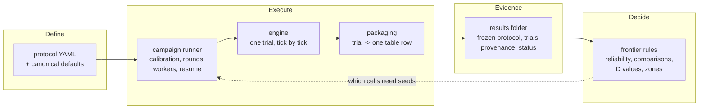
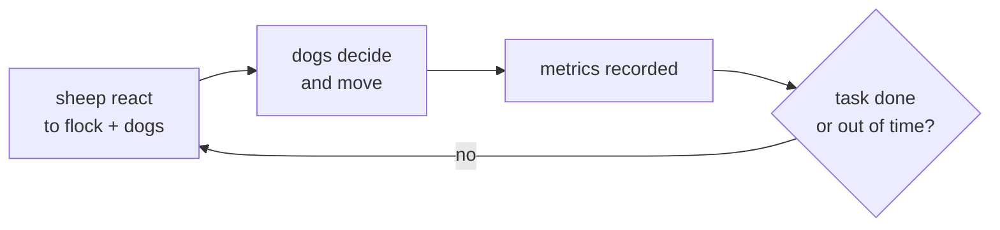
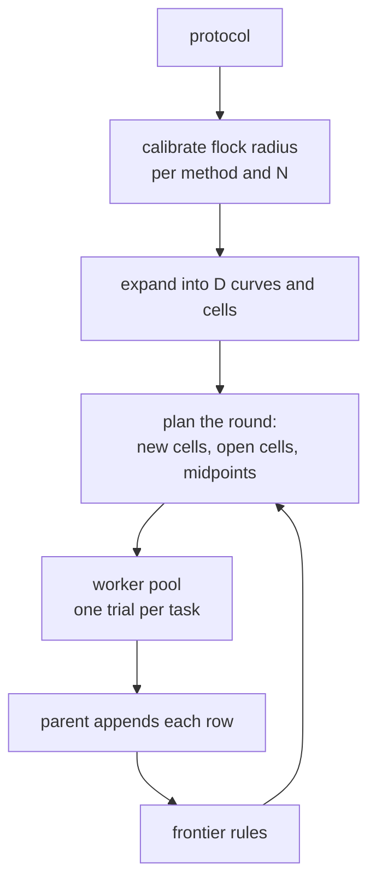

# HerdSim architecture

This document explains how HerdSim is put together and why it's built that way. For what the project does, how to configure it and what files it writes, see the [README](../../README.md).

## What the design has to serve

HerdSim isn't a general-purpose simulator. It exists to run controlled experiments: thousands of short simulations whose results get compared against each other and turned into claims. Most of the design follows from that:

- Comparisons have to be fair. Two cells that differ only in dog count must differ only in dog count: same field, same parameters, same start flocks.
- Results have to be traceable. Months later you should be able to tell exactly what produced a number, even after the code and configs have moved on.
- Campaigns are long. A grid is thousands of trials and can run for days. Runs get stopped, crash or need a restart, and none of that should cost finished work.
- Methods and tasks keep changing. We swap dog rules, sheep models and tasks, and that shouldn't mean rewriting the engine or the campaign code each time.
- Analysis keeps changing too. Thresholds and summaries get redefined long after the simulations have run.

## The big picture

There are four stages:

1. Define. An experiment is a YAML file, not code.
2. Execute. The campaign runner turns the protocol into D curves, cells and seeds, hands each trial to the engine, and packages the outcome as one row.
3. Evidence. Everything lands in a results folder that holds enough to audit the run on its own.
4. Decide. The frontier rules read the rows and say, per curve, which values are decided and which cells still need seeds.

The loop back from the rules to the runner is the adaptive part: the runner keeps adding seeds, and dog counts between neighbours, until the rules have nothing left to decide.

## Design principles

### The protocol is the experiment

An experiment is described entirely by data: a protocol YAML layered over a shared set of canonical defaults. The grid, the methods, the factors, the task and the output folder all live there. When a run starts, the merged protocol and every method parameter it runs with are copied into the results folder, and everything that changes a trial's outcome is hashed.

*Why:* configs drift. If the experiment lived in code or in a file that keeps getting edited, an old result could no longer be tied to what produced it. A frozen copy next to the data makes every results folder self-describing.

*Cost:* the YAML merge is deliberately simple (a child key replaces the parent's whole value), so a protocol has to spell out a list in full to change one entry.

### A results folder belongs to one protocol and one physics

The hash covers the task, every setting that changes a trial, each method's full parameter set and time limit, and the parts of the grid that size the field. It leaves out the strategy settings (theta, seed depth, budget) and the flock sizes and smaller dog counts. A folder records its protocol and hash, and refuses to be reused by another protocol or under different physics.

*Why:* a campaign can then grow (more seeds, more flock sizes, intermediate dog counts) and still resume into the same folder, but a change that would make old and new trials incomparable cannot slip in.

*Cost:* changing anything physical, even a small change to one default, needs a new folder.

### The engine knows nothing about campaigns

The engine runs exactly one trial: one flock, one set of dogs, one seed, until success or the time limit. It doesn't know about grids, seed lists, workers, resume or tables. All of that sits in the campaign layer above it.

*Why:* it keeps the engine small and easy to test on its own, and lets the campaign side change without touching the simulation. A single trial can be pulled out and run by hand for debugging.

### Everything that varies is a plugin chosen by name

Sheep behaviour, dog behaviour, the task and every metric are separate plugins, listed under string ids. A method is a named pairing of a sheep model and a dog controller, plus their default parameters. A protocol picks methods and the task by name.

Each plugin owns what is specific to it. A sheep model checks its own parameters and derives the values it needs from them. A task owns its setup, its success rule, the metrics that only make sense for it, the columns it adds to a trial row, and the rules that label a failed trial. The engine, the packaging and the campaign layer call these through the task's entry and never name a task or a method themselves. The catalog of methods is checked when it is loaded, so a method that names a missing plugin or leaves out a setting the engine reads fails before any run starts.

*Why:* the research questions are about swapping one thing at a time: a different dog rule, less information, a harder task. If each is a plugin that carries its own checks and outputs, a new comparison is a new YAML file or one new module, and the rest of the system stays the same between the two arms of the comparison.

*Cost:* plugins share one flat config dict. Unknown keys are refused when a protocol loads and when a config is built, but the dict has no schema, so a plugin can still read a key no one set and fail only when it runs.

### Each setting has one source

Task setup comes only from the protocol and the canonical defaults. Behaviour parameters come only from the method definition. Plugins keep no fallback copies of either, and every canonical value carries a note saying where its number comes from.

*Why:* when the same number lives in several places, changing it means finding every copy, and a missed copy changes results without anyone noticing. With one source, a protocol that leaves out a setting fails at the start of the run instead of quietly picking up an old default.

### Lengths follow the measured flock

Goal size, start spread, lost-sheep distance and drive length are multiples of the flock radius, measured per method and flock size by a short calibration at the start of every campaign: one all-seeing dog drives a compact flock for a fixed time, and the settled radius is the scale. Calibration refuses a flock size whose radius has not settled or depends on its start.

*Why:* fixed lengths make the task easier or harder as N grows for reasons that have nothing to do with the dogs. Tying them to the real flock keeps "every sheep in the goal" meaning the same thing at every N and for every sheep model.

*Cost:* each method gets a task sized to its own flock, so methods are compared on equivalent tasks, not on one shared field. Calibration always uses the drive task, whatever task the protocol runs.

### The field is open and the deadline scales with the task

The papers the sheep and dog rules come from have no boundary, so HerdSim has none: agents may leave the field, and the field rectangle only places the start. A reflecting wall was tried and measured. It rescued trials that would time out, mostly in the hardest cells, so it lowered the dog count for a reason that has nothing to do with the dogs.

The time allowed is a multiple of the drive time, the drive length over the top sheep speed. With unlimited time one dog eventually herds almost any flock, so the number of dogs only has content once time is bounded. Writing the bound as a multiple of the drive time asks the same of every flock size.

*Why:* a result about the number of dogs should come from the dogs, the flock and the deadline, and from nothing else in the setup.

*Cost:* a bounded paddock, a fence or an obstacle is a different question. It needs a fence model that acts on sheep the way a real fence does, and it would be added as its own setting.

### Every added dog has its own work

A dog count is only worth simulating if the extra dog can change something. So the multi-dog layer never gives two dogs the same job when another is open: dogs start at their own stations spread over the half circle behind the flock, collecting dogs are matched one to one with the farthest outliers by distance, dogs left over drive the core, and driving dogs share out the flock's back edge. A per-tick measure records how often two dogs still end up on top of each other, so a wasted dog shows in the data, not only in a finish time that didn't improve.

*Why:* with identical dogs aimed at one point, a curve over D measures the same trial again at every D, and the campaign pays for it. Giving each dog distinct work makes the D axis a real experimental axis, and the overlap measure separates "the dogs had nothing more to do" from "the dogs got in each other's way".

*Cost:* the team rule is HerdSim's, not the paper's, so multi-dog results are results about this rule. Dogs use each other's positions to share out the work, which is a form of coordination.

### Conventions are tested, not argued

Some setup choices have no rule behind them in the source papers or in field data: where the dogs stand at the start, how roomy the goal is, how fast a dog is compared with a sheep. HerdSim picks a value for each and writes down that it is a convention. The campaign then repeats one small grid with one such choice changed at a time, next to a reference run on the same seeds, and a conclusion counts only where the reference and the variants agree. Where the source papers offer a second parameter set that was matched to a real flock, it is one of the variants.

*Why:* a result about the number of dogs should not depend on a choice nobody can defend. Testing the choice is cheaper and more honest than arguing for it.

*Cost:* the sensitivity grid is small, so a claim that rests on it is limited to the layouts and flock sizes it covers. It also adds runs.

### Separate random streams, shared seeds

Every trial draws its start layout, its sheep noise and its dog noise from three streams spawned from its seed. Seed i is the same number in every cell of a campaign.

*Why:* a trial's result then depends only on its cell and seed, whichever worker ran it and in whatever order. Because the layout and sheep streams don't depend on the dog count, cells at different D start from the same flocks and see the same sheep draws until the dogs change what the sheep do. That pairs the finish-time comparisons, which is what lets small differences be decided with few seeds.

*Cost:* the dynamics are chaotic, so results are bit-identical only on one machine and library versions. Across machines they agree within a tolerance, which is what the regression tests check.

### Spend seeds where the answer is still open

There is no fixed seed depth. Every cell starts with one batch; after each round the frontier rules mark the cells whose reliability, or a finish-time comparison that could still move one of the curve's values, is undecided, and only those get another batch. Where the zone changes between two dog counts that are far apart, the count halfway between is added. Comparisons that cannot change any value never ask for seeds. Above a confirmed saturation, dog counts whose dogs were measured to be copies of each other get no more seeds either; a dog count that is slower or failing is always kept, because that is a measured harm.

*Why:* most cells always succeed or always fail, and most comparisons are clear after one batch. Precision only matters near the boundaries, so that's where the budget goes, and the stop rule is "nothing left to decide" instead of a depth fixed before anyone saw the data.

*Cost:* a cell whose true rate sits right at theta stays undecided up to the seed cap, and is reported as undecided. That is by design, but it means some values come out as intervals of "not decided" rather than a single number.

### Survive interruption

Only the parent process writes files, and a folder lock keeps a second campaign out. Each finished trial is appended as one line the moment it returns; a kill can at worst cut the last line, which is dropped on the next start and rerun. Seed counts stay on whole batches across restarts, so a resumed run seeds every cell as an uninterrupted one would. A worker that dies takes its in-flight trials with it, and they are rerun on resume rather than logged as errors.

*Why:* long campaigns get killed, crash or need a reboot. With append-only rows, an interruption costs at most the trials in flight, and a restart just continues.

### An error is a bug, not a failure

A trial that raises is logged, its cell gets no further seeds, and that cell is never marked reliable. The run reports which cells had errors.

*Why:* the simulation is deterministic, so an exception will happen again on the same seed. Averaging it away as noise, or counting it as a plain failure, would hide a bug inside a result.

### Label failures after the run, not during it

A trial stops only on success or the time limit. Why it failed (dogs out of range, flock escaped, split, scatter, oscillation, stuck) is worked out afterwards from the metric history, by rules the task provides.

*Why:* the stopping rule stays the same for every task and method, so trial lengths are comparable. Failure categories are an interpretation, and they can be refined later without re-running anything.

### Results are evidence; the rules only read them

The campaign layer writes results. The frontier rules never run the simulation, they only read rows. Every generated file carries a notice saying it is machine-written.

*Why:* thresholds and comparisons can then be redone in seconds without re-simulating, and the rules can never silently produce new data.

## A trial, conceptually

Sheep move first, reacting to where the dogs were. Then the dogs, who know every sheep and every other dog, decide and move. Metrics are recorded on the resulting state, and the task decides whether it is done.

## A campaign, conceptually

Workers get a small description of one trial, run it and send back its row. Because workers share nothing, the pool can be any size, and a one-worker run gives the same rows, which is how we debug.

## Trade-offs we accepted

| Choice | What we gave up | Why it's acceptable for now |
|--------|----------------|-----------------------------|
| Flat config dict, no schema | Type and presence checks happen per plugin, not in one schema | Keeps plugins independent. Unknown keys are refused at load, and the folder records every parameter that ran |
| Tables rewritten after each round | Write cost grows with campaign size | The append-only trial log is the source of truth; the tables are views of it |
| Layering by convention | Nothing stops a bad import | Small codebase, and the type checker flags import cycles |
| Regression tests use tolerances | Small drifts go unnoticed | Bit-exact comparisons break across machines because the dynamics are chaotic |
| Every metric recorded on every trial | Some compute per tick | Metrics we didn't plan to use have explained results before. Recording them is cheap insurance |
| Calibration always on the drive task | A task with its own flock behaviour can't calibrate its own scale | The flock radius is a property of the sheep model under a driving dog, which every current task builds on |

## How it's meant to grow

The extension points follow the plugin boundaries:

- A new dog rule or sheep model is a new plugin plus a method entry that pairs them.
- A new task is one module with its setup, checks, success rule, metrics, row columns and failure rules, and one entry in the task table.
- A new measurement is a new metric. Every later run picks it up, along with its trial-row summaries.
- A new experiment on existing settings is a new protocol file. Any canonical setting that changes a trial can be swept as a factor, so most new axes need no code.

Some things the current design doesn't handle yet, and would need real changes:

- The world has one circular goal, and the start layouts, the field sizing and the dog start arcs assume a single drive from a start toward that goal. A task with a gate, a holding area or several stages needs a more general world and its own start geometry.
- The multi-dog collect/drive controller reads the flock's start position from the task setup, and its dogs share out the work using each other's positions. Roles beyond collect and drive (flanking, holding a gap) would be new jobs in that layer.
- The failure-label type lives with the drive task's rules; a second task would move it to a shared place.
- Much larger flocks would need the per-dog loops in the controllers vectorised.

## Where to look in the code

| Concern | Location |
|---------|----------|
| Single trial, tick loop | `sim/core/simulation_runner.py` |
| State, world, start layouts | `sim/core/simulation_state.py`, `sim/core/world/` |
| Method catalog and paper parameters | `sim/core/methods.py`, `sim/methods/` |
| How a trial's config is assembled and checked | `sim/core/config/experiment.py` |
| Plugins | `sim/plugins/{sheep,dogs,scenarios,metrics}/` |
| Protocol loading and checks | `services/protocol.py` |
| Groups, cells, run configs | `services/cells.py` |
| Calibration of the flock radius | `services/calibration.py` |
| Adaptive rounds, worker batches, results folder | `services/adaptive.py`, `services/runner.py`, `services/store.py` |
| Trial row, provenance | `protocols/packaging/` |
| Frontier rules | `analysis/frontier.py` |
| Regression tests | `tests/sim/test_golden.py` |
