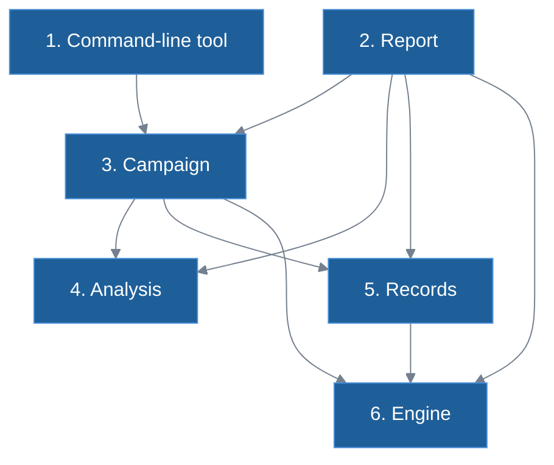
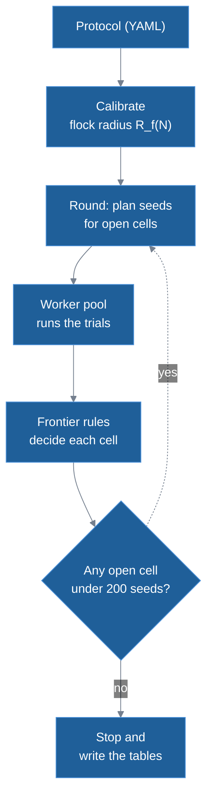

# HerdSim architecture

How HerdSim is built: the layers, the levels an experiment is split into, and how a run is stored and resumed. The statistical rules are in [task design](../experiments/task_design.md).

## Overview

HerdSim moves sheep and dogs tick by tick on a 2D field and runs thousands of trials across CPU cores. Each trial is stored as it finishes, and the answers are worked out afterwards from the stored rows.

## Goals and constraints

1) Paired comparisons: the cells of one curve share the field, goal and task, and seed $i$ of every cell starts from the same flock. This lowers the part luck plays in a comparison but does not remove it.
2) Replayable trials: a trial is fixed by its configuration and seed. The same seed on the same machine, Python and library versions gives the same trial bit for bit. Across CPUs and NumPy builds the last bits differ and trials can drift apart within a few hundred ticks; we have not measured why. The regression tests replay three stored study trials and require the same success and tick count, so they catch a setup that drifts on those trials.
3) Resuming: a protocol can run tens of thousands of trials, and the same command resumes an interrupted run.
4) Analysis without rerunning: stored rows can be reread under a changed threshold, rule or fit, though some cells may then need more seeds. By default only the first 3 seeds of each cell keep their per-tick history, so failure labels cannot be recomputed for the rest.
5) One machine, many cores: workers are separate processes, by default one per core, each with one numeric-library thread.
6) Sizes that suit git: results folders are in git, which on GitHub refuses files over 100 MB, so git tracks a compressed copy of the trial log and no per-tick histories.

## Layers

A layer imports only higher-numbered layers, and analysis imports none.

1) Command-line tool: plans, starts and checks protocols, and prints progress as plain lines.
2) Report: writes analysis values as Markdown tables, and produces the generated pages, figures and GIFs. Figures and GIFs may replay trials, but no stored result comes from them.
3) Campaign: the manager that spends extra seeds on undecided cells. It calibrates, runs the rounds, sends trials to the worker pool, appends the rows and hands them to analysis after each round. No sheep or dog rule lives here.
4) Analysis: reads stored files and never runs the model. It works out success rates, reliable teams, $D_{\min}$ (the smallest reliable team), the other team sizes and curve fits.
5) Records: builds the trial row, hashes the physics settings, records the code identity and writes the notice on generated files.
6) Engine: a sandbox that runs one trial and knows nothing of campaigns. Each tick the sheep model moves the sheep, the dog controller moves the dogs and the task checks for success, its own end rule or the time limit. Apart from third-party libraries it imports only from its own folder.

## How an experiment is broken down

A protocol, the recipe of one experiment, splits into curves (one setup tested across team sizes), cells (one team size on one setup) and trials (one cell with one seed). Reliability is decided per cell. The [glossary](../glossary.md#trials-and-experiments) defines each level.

## Results folder

Each protocol writes to its own folder. The [configuration guide](../guides/configuration.md#what-a-simulation-run-writes) lists every file; five follow from design choices:

1) Provenance record: the physics hash, which covers every setting that changes an outcome. A start with different physics in the same folder is refused.
2) Protocol copy: the merged protocol as the folder was created. It is written once, so it may not show what a later run used.
3) Run log: one line per sitting (one start of a campaign on the folder) with the code identity, so runs on different code can be told apart.
4) Trial log: one line per finished trial, appended as it finishes.
5) Lock: held by a running campaign, so a second campaign on the folder is refused.

## How a campaign runs

The campaign calibrates the flock radius $R_f(N)$ once, then runs rounds until every open cell has 200 seeds or the time budget (72 h by default) is spent. [Task design](../experiments/task_design.md#3-adaptive-sampling) gives the rules.

### Recovery after an interruption

Only the campaign process appends to the trial log, one line at a time, so a killed process, including one stopped with `Ctrl+C`, leaves at worst a cut last line. On restart with the same command that line is dropped, and that trial and the ones in progress run again. Each cell is then topped up to a whole batch, so a resumed run keeps the seed boundaries of an uninterrupted one. A dead worker stops the batch, with the same resume.

A trial that raises an exception gives no row, only a line in the error log, and the batch goes on. Its cell gets no more seeds and is never reliable, because an exception in a deterministic simulation is a bug.

Appends are not forced to disk, so a power cut can also lose finished rows still in the operating system's cache; those trials run again. We reasoned this from the code and have not tested it.

### Replaying a trial

The replay service rebuilds a trial's configuration from the protocol file and refuses to run if that file is gone or now gives different physics. A replay that differs from the stored row in success or tick count raises an error, because a different trial says nothing about the stored results. The animations replay stored trials this way.
