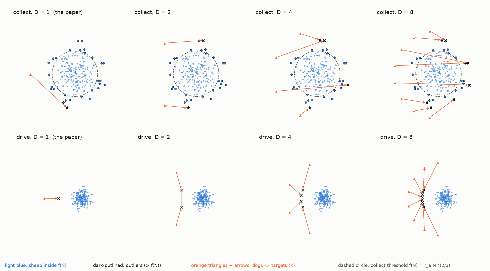
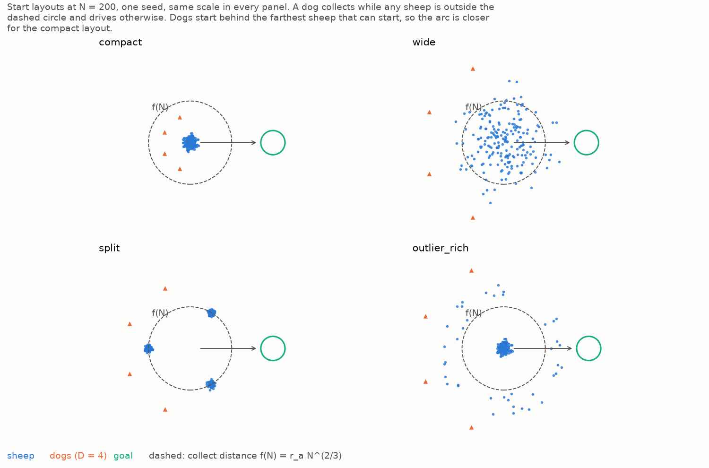
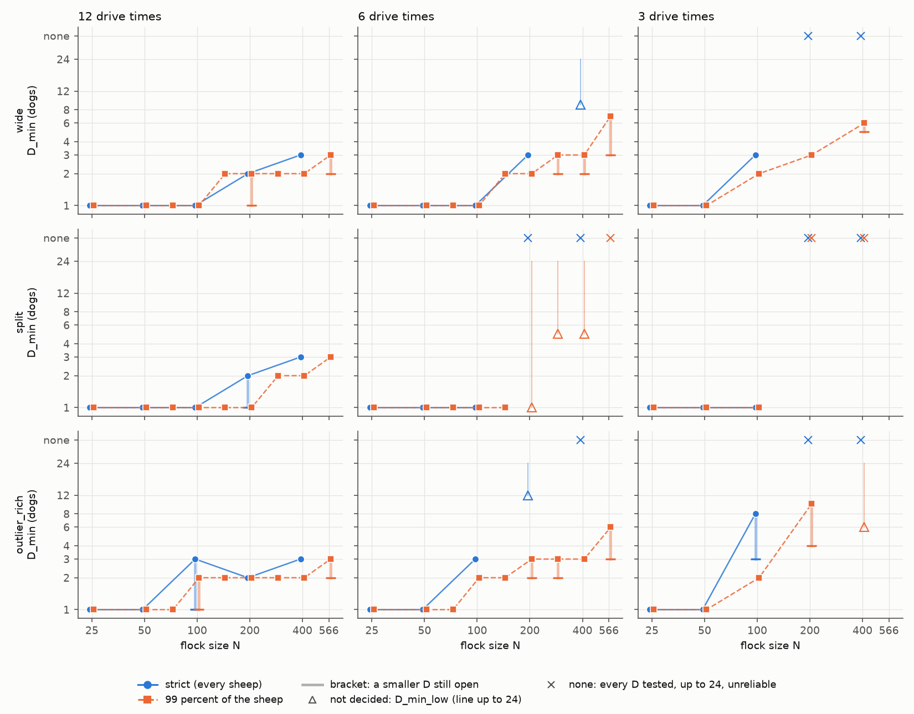
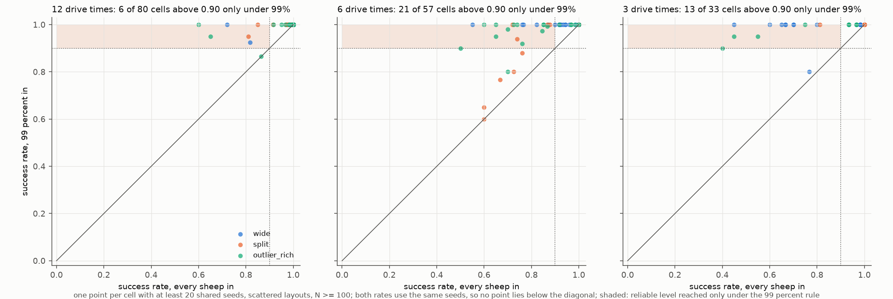
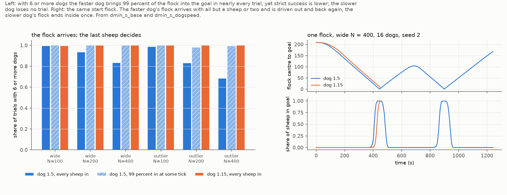
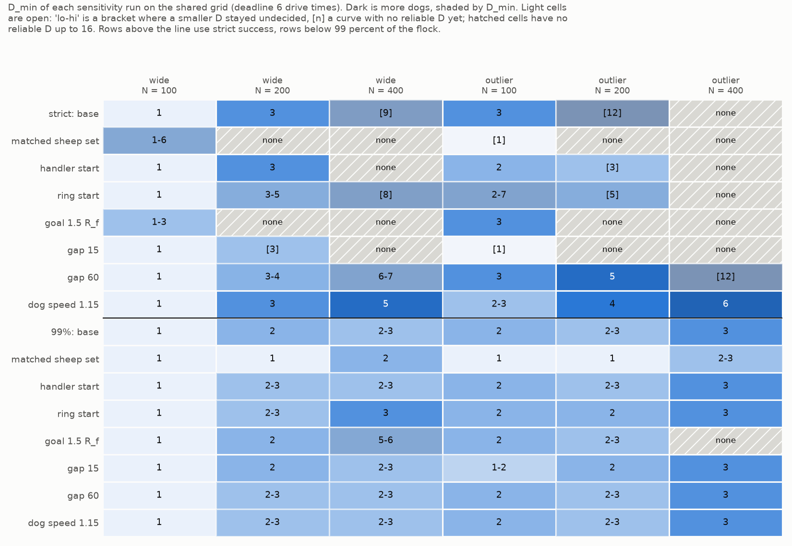
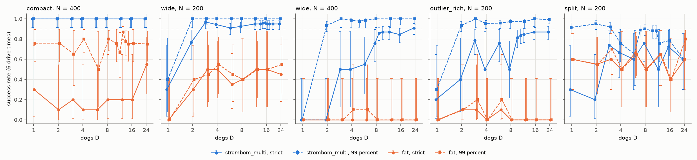
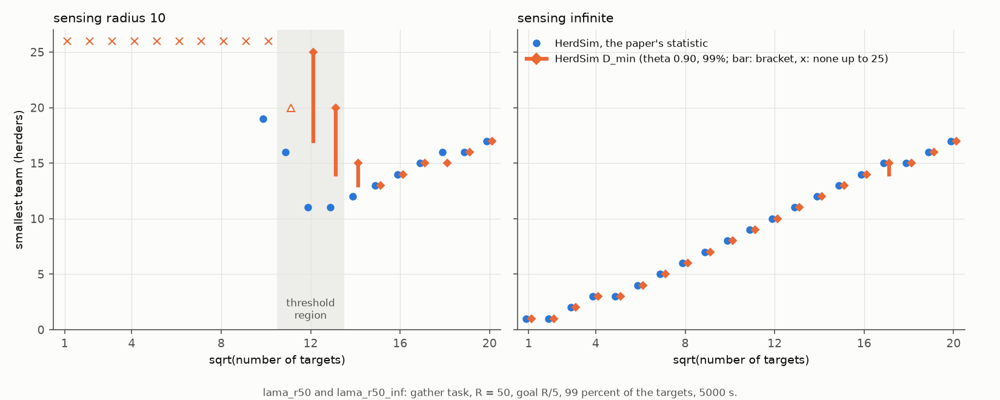

# Sizing Shepherding Teams by Reliability: How the Minimum Team Grows with Flock Size, Deadline and the Success Rule

[Author names and affiliations]

## Abstract

How many shepherding agents does it take to bring a flock into a goal before a deadline? We define the minimum team $D_{\min}$ as the smallest team whose success rate is at least 0.90 with 99% confidence. With an adaptive sampler and 259,460 trials of the sheep model of Strömbom et al. (2014) and a coordinated dog team, we map $D_{\min}$ over 25 to 566 sheep, four start layouts and three deadlines. A trial succeeds when 99% of the sheep, or under a strict rule every sheep, reach the goal. A flock that starts as one tight group needs one dog up to 400 sheep. On the three scattered layouts (a wide spread, three clusters, a core with a ring of outliers), $D_{\min}$ grows more slowly than the square root of flock size at the loosest deadline, and on large flocks the tightest deadline adds several dogs. The strict rule ties $D_{\min}$ to the last few sheep and to arbitrary setup choices. In 40,280 trials of the non-cohesive targets of Lama and di Bernardo (2024) we recover their square-root law with infinite sensing; under an averaged success criterion, a team that finishes only 21 of 30 runs can pass.

**Keywords:** shepherding, multi-agent systems, swarm robotics, team size, sequential testing, scaling laws.

## 1 Introduction

Shepherding, in which a few agents steer a larger group of agents that react to them, is studied as a model of sheepdog work and as a control problem for robot and drone swarms (Strömbom et al. 2014; Long et al. 2020). A designer who deploys such a team has to fix its size before the run. Too few agents fail the task; more agents than needed cost hardware, energy and, with animals, stress.

Earlier multi-agent work studied fixed team sizes or targets that do not flock (Pierson and Schwager 2015; Kubo et al. 2022; Lama and di Bernardo 2024). Lama and di Bernardo (2024) found that for non-cohesive targets the smallest sufficient team grows as the square root of the number of targets, with infinite sensing and, with limited sensing, above a critical number of targets. We read their criterion as an average: a team is sufficient when the share of targets gathered, averaged over runs, reaches 0.99. A team can pass that test and still fail in many of its runs ([Section 5.6](#56-non-cohesive-targets-two-criteria)).

This paper sizes teams by reliability. A team is sufficient when its success rate is at least $\theta = 0.90$ with 99% confidence; we call the smallest such team $D_{\min}$, estimate it with an adaptive sequential sampler, and report it as a single value, as a bracket (a range of team sizes that still contains it), or as a lower bound when the data do not decide it. We apply the rule to the cohesive sheep of Strömbom et al. (2014) driven by a coordinated team of dogs, and to the targets of Lama and di Bernardo (2024) in the same simulator.

The contributions are:

1. A reliability-based definition of the minimum team, with an adaptive estimator that decides each team size at 99% confidence or reports it as open ([Section 4.4](#44-reliability-and-the-minimum-team)).
2. A map of $D_{\min}$ for cohesive flocks over flock size, start layout and deadline ([Section 5.1](#51-minimum-team-against-flock-size) and [Section 5.2](#52-effect-of-the-deadline)).
3. Evidence that the success rule changes the answer ([Section 5.3](#53-strict-and-99-rules) and [Section 5.6](#56-non-cohesive-targets-two-criteria)).
4. An ablation that separates the single-dog choice between collecting stray sheep and driving the flock from coordination between the dogs ([Section 5.4](#54-which-part-of-the-controller-matters)).
5. A reproduction of the square-root law of Lama and di Bernardo (2024) ([Section 5.6](#56-non-cohesive-targets-two-criteria)).

## 2 Related work

Strömbom et al. (2014) proposed a heuristic for one dog and compared it with GPS data of a sheepdog and a flock. In their rule, for a flock of $N$ sheep, the dog collects the sheep farthest from the flock centre while any sheep lies beyond $f(N) = r_a N^{2/3}$, where $r_a$ is the distance within which sheep repel each other, and otherwise drives the flock from a point behind it. Their model underlies much later work, reviewed by Long et al. (2020). Jadhav et al. (2024) tracked a real flock responding to a border collie.

Robotic shepherding began with rule-based planners. Lien et al. (2004) steered a flock along roadmaps and regrouped members that had separated, and Lien et al. (2005) let several shepherds cooperate without communication. Control-theoretic work then proved convergence for herds of non-cooperative agents: Pierson and Schwager (2015, 2018) for a herd driven by several robots, Licitra et al. (2019) for one herder that regulates several targets with uncertain dynamics, and Sebastián et al. (2022) for robots that herd heterogeneous evaders with an adaptive implicit controller. Auletta et al. (2022) and Lama and di Bernardo (2024) gave herders local rules for collecting and containing non-flocking stochastic targets.

Learning-based work trains the herder: Go et al. (2016) reproduced the Strömbom behaviour with SARSA, Zhi and Lien (2021) trained shepherds to herd among obstacles with deep reinforcement learning, Hussein et al. (2022) used a curriculum and report a success rate of about 96%, Hasan et al. (2022) trained coordinated shepherds for flock navigation, and Napolitano et al. (2026) learned a hierarchical policy for the targets of Lama and di Bernardo. In the air, Paranjape et al. (2018) herded birds out of an airspace with one unmanned aerial vehicle, Wang et al. (2024) coordinated several drones with multi-task reinforcement learning, and Yaxley et al. (2021) measured how drone approach parameters affect the stress and movement of sheep. Li et al. (2025) showed that swarm shepherding can work from bearing-only measurements.

Few studies ask how many herders a task needs. Kubo et al. (2022) gave several sheepdog agents repulsive forces between them and compared fixed team sizes. El-Fiqi et al. (2020) varied the number of sheepdogs as one of four factors of task difficulty and found that the obstacle density at which reactive shepherding breaks down rises from 0.2% for one shepherd to 5% for ten. Hasan et al. (2022) and Li et al. (2023, 2025) report that performance improves as shepherds are added, and Hasan et al. see diminishing returns beyond three to four shepherds on a flock of 100. Lama and di Bernardo (2024) are, as far as we know, the only authors to state a scaling law, the square-root law above. Each of these studies judges a team by an average or a trend over runs; none sizes it by a success rate with a confidence bound.

We do not propose a new controller. We measure, for given models and a given controller, the smallest team that is reliable at a stated confidence, and how that answer depends on the flock, the deadline and the success rule.

## 3 Models

### 3.1 Sheep

We use the sheep model of Strömbom et al. (2014) with its published parameters. Time advances in steps of 1 s; the paper gives speeds per time step ("m ts$^{-1}$") with no time unit, so the 1 s step is our reading. A sheep reacts when a dog is within its reaction distance $r_s = 65$ m. Its new heading is then the weighted sum of five directions: its previous heading ($h = 0.5$), the direction to the centre of its $n$ nearest neighbours ($c = 1.05$), the direction away from neighbours closer than $r_a = 2$ m ($\rho_a = 2$), the direction away from the dogs ($\rho_s = 1$) and noise ($e = 0.3$). It then moves 1 m along that heading. With no dog within $r_s$ it grazes: it stays still with probability 0.95 and otherwise takes a 1 m step in a random direction. In the base case $n = N - 1$, so every reacting sheep is drawn to the centre of the whole flock; a grazing sheep is not.

The model defines the push of one dog. With $D$ dogs we add the unit vectors pointing away from every dog within $r_s$ and normalise the sum to unit length, so more dogs change only the direction of the push. We never ran the unnormalised sum, under which two dogs less than 116.7 deg apart, seen from a sheep, would push harder than the flock's attraction $c = 1.05$ and could push the sides of a flock apart.

### 3.2 Dog controllers

Dogs, like sheep, are points with no size, so any number of them fits behind a flock. In the base settings all dogs move 1.5 m per step, the value of Strömbom et al. (2014), with the sheep's noise $e$, since their text says the shepherd "experiences the same noise as the agents". A dog stands still while any sheep is within $3 r_a = 6$ m; we call this the stop rule. We compare three controllers.

The team controller extends the single-dog rule to $D$ dogs (Figure 1). An outlier is a sheep farther than $f(N)$ from the flock centre. While there is any outlier the dogs collect: the $D$ farthest outliers are assigned one to a dog by the Hungarian algorithm (Kuhn 1955), which minimises the total distance from the dogs to points $r_a$ behind each outlier, and dogs left over drive the core of the flock, the sheep within $f(N)$ of the centre. The assignment is recomputed every step.

When every sheep is within $f(N)$, the dogs drive; we call this choice the collect/drive switch. The dogs spread over an arc around the flock centre that passes through Strömbom's drive point, $r_a\sqrt{N}$ behind the centre on the side away from the goal. The arc covers the flock's sides, and the dogs keep their angular order on it so that their paths do not cross. The assignment and the arc together are the team layer.

The independent controller gives every dog Strömbom's single-dog rule with no team layer; since every dog sees the same flock, all make the same choice. The farthest-agent targeting controller (FAT) sends every dog behind the sheep farthest from the goal, with no collect/drive switch and no assignment.

**Figure 1.** The team controller with $D = 1, 2, 4, 8$ dogs at $N = 200$. Top: collecting on a scattered start; the $D$ farthest outliers are assigned one to a dog (crosses mark the collect points). Bottom: driving a compact flock; the dogs spread over an arc behind the flock in angular order.

### 3.3 Non-cohesive targets

For the comparison in [Section 5.6](#56-non-cohesive-targets-two-criteria) we implemented the model of Lama and di Bernardo (2024) from the paper's text. Here $N$ is the number of targets; the paper writes $M$ for targets and $N$ for herders. Targets move by a random walk and are pushed away by herders closer than $\lambda = 2.5$. They do not attract each other. Each herder chases the target farthest from the goal among those it senses, within a sensing radius of 10 or without limit, and leaves out any target that is closer to another sensed herder. Targets and herders start uniformly on a disc of radius $R = 50$ around a goal of radius $R/5$. A run lasts at most 5000 s: the caption of their Supplementary Fig. S8 states "$R = 50$, $\xi = 10$, $t_{\max} = 5.0 \times 10^3$", where $\xi$ is the sensing radius, with no unit, and we read their time unit as one second. Where the text is silent we chose that the push points away from the herder, that a run ends when every herder is inside the goal and none senses a target outside it, and that targets and herders are moved from the same state.

## 4 Methods

### 4.1 Task geometry

The task is to gather the flock and drive it into a circular goal before a deadline, on a field with no walls. All lengths scale with the calibrated flock radius $R_f(N)$, the radius a flock of $N$ sheep settles to while one dog drives it: $\sqrt{2}$ times the RMS distance from the flock centre over the last 90 s of a 300 s drive, as a median over 3 seeds and two start sizes. It is 6.2 m at $N = 25$ and 11.4 m at $N = 400$. The goal radius is $1.9 R_f$. The drive distance $l$ from the flock's start centre to the goal centre is the largest of $13 R_f$, 80 m, and the distance that keeps the goal clear of every start position. Above about 600 sheep a flock started loose keeps part of its start size and $R_f$ is no longer defined, so we stop at $N = 566$.

Deadlines are multiples of the drive time $T_{\mathrm{drive}} = l / (1\ \mathrm{m/s})$, the time a sheep walking straight needs to cover the drive: 12, 6 and 3 $T_{\mathrm{drive}}$. Even the tightest is longer than the median finish time of every team of 1 to 24 dogs on a compact flock of 25 to 400 sheep (every sheep in the goal, 6 $T_{\mathrm{drive}}$).

### 4.2 Start layouts and dog starts

Four start layouts (Figure 2) range from a flock that needs no collecting to one that needs a lot. The three scattered layouts are sized by Strömbom's collect distance $L = f(N)$, so that a scattered start means the same at every $N$:

- `compact`: one tight group, a Gaussian with $\sigma = 0.5 R_f$, cut at $3\sigma$;
- `wide`: a Gaussian with $\sigma = 0.5 L$, cut at $3\sigma$, so about 13% of the sheep start beyond $L$;
- `split`: three compact clusters with centres on a circle of radius $L$;
- `outlier_rich`: 80% of the sheep in a compact core and 20% on a ring between $1.1 L$ and $1.6 L$.

The dogs start on half circles behind the flock, on the side away from the goal. The first circle lies 30 m beyond the farthest point any sheep can start; we call this distance the start gap. Dogs on a circle stand at least 5 m apart, and further dogs go on a circle 5 m farther out.

**Figure 2.** The four start layouts at $N = 200$ with $D = 4$ dogs, to the same scale. The dashed circle is the collect distance $f(N) = r_a N^{2/3}$.

### 4.3 Success rules

A trial succeeds when, at some step before the deadline, enough sheep are inside the goal at once. Under the strict rule every sheep must be inside. Under the 99%-of-flock rule, the 99% rule from here on, at least $\lceil 0.99 N \rceil$ must be inside, so the two rules coincide below $N = 100$. One sheep may stay outside at $N = 100$, and four (1% of 400) at $N = 400$.

### 4.4 Reliability and the minimum team

A cell is one combination of model, controller, layout, $N$, deadline, success rule and team size $D$. As an example, one cell asks whether 3 dogs bring 200 sheep on `wide` into the goal within 6 drive times under the 99% rule. For $m$ trials with $k$ successes, $[p_{\mathrm{lo}}, p_{\mathrm{hi}}]$ is the exact two-sided 99% Clopper-Pearson interval (Clopper and Pearson 1934) of the success rate, with $\alpha = 0.01$. With $\theta = 0.90$, a cell is reliable when $p_{\mathrm{lo}} \ge \theta$, unreliable when $p_{\mathrm{hi}} < \theta$, and undecided otherwise. A curve is the set of cells that differ only in $D$. For one curve,

$$
D_{\min} = \min \lbrace D \mid \text{cell } D \text{ is reliable} \rbrace .
$$

We report $D_{\min}$ in four forms:

- a single value, when every smaller tested $D$ is unreliable;
- a bracket (for example 2-3), when a smaller $D$ is still undecided at the cap of 200 trials;
- a lower bound ([5]), when no $D$ is reliable yet;
- "none", when every tested $D$ up to the top of the grid is unreliable (24 in the main grids, 16 in the sensitivity runs; [Section 4.5](#45-experimental-design)).

Each cell starts with 10 trials, and the interval is checked again after every further batch of 10; an undecided cell gets another batch, up to 200 trials. A cell with no failure is reliable after 51 successes, the shortest unbroken record whose 99% lower bound reaches 0.90, so with a check every 10 trials the earliest decision is at 60 of 60. Clearly unreliable cells usually stop after 10 to 20 trials. At 200 trials a cell is decided only with at least 191 successes or at most 167. The interval holds for a single check, and a cell can be checked up to 20 times. The Clopper-Pearson interval is conservative, but we do not correct for repeated checks and have not measured the false-decision rate they give.

When two neighbouring tested team sizes are more than one apart and in different classes (reliable, undecided, unreliable), the next round adds the size halfway between: with 2 dogs reliable and 4 unreliable, for example, it adds 3. An undecided neighbour below the cap first gets its own trials.

Seed $i$ of every cell is the same base seed plus $i$, and the start positions, sheep noise and dog noise come from three separate streams. Cells that differ only in $D$ therefore start from the same flock with the same sheep noise, and their finish times can be compared seed by seed. Above $D_{\min}$ we use two more definitions:

- Faster and slower: two reliable cells are compared with a paired bootstrap of the per-seed differences of their finish times (at least 5 shared successful seeds, 4000 resamples, 99% interval); one is faster or slower when the whole interval of the median difference, relative to the slower cell's median, lies more than 5% from zero.
- $D_{\mathrm{sat}}$: the smallest reliable team that no larger reliable team is faster than, counting only teams below the first two unreliable sizes in a row. While a comparison with a larger reliable team is still open, it is a bracket from that value to the largest reliable team.

Two rules change where seeds go. Runs that also decide finish times give reliable cells more batches while one of their finish-time comparisons is open, and add midpoints where neighbours differ in such a comparison. Above a confirmed $D_{\mathrm{sat}}$, an undecided cell, or a reliable one no slower than the fastest team, in which at least 90% of the dogs, averaged over steps and trials, have another dog within 2 m gets no more seeds.

The growth of $D_{\min}$ with $N$ is summarised by the least-squares slope of $\log_2 D_{\min}$ against $\log_2 N$. Where some $D_{\min}$ are brackets, the slope is reported as the range of slopes the bracket endpoints allow.

### 4.5 Experimental design

An experiment is set by a protocol, one configuration file that fixes the models, controller, layouts, flock sizes, deadlines, success rules and team sizes. This paper uses 29 protocols in five groups (Table 1). The main grids cover flock size, layout, deadline and rule. The sensitivity runs change one setup choice at a time on the seeds of a base run, the sensitivity base run. The 29 protocols ran 299,740 trials with no simulation errors. The full study ran 439,120 trials in 41 protocols; of the 12 left out (the sheep model of Kubo et al. 2022, a holding task, limited dog sight, and flocks above 566 sheep), this paper uses the two Kubo runs ([Section 5.5](#55-the-reliable-team-and-the-fastest-team)) and the capped large-flock run ([Section 6.4](#64-limitations)). The team grid is $D \in \{1, 2, 3, 4, 6, 8, 12, 16, 24\}$, about two values per doubling, plus the midpoints the sampler adds. The Lama protocols test every herder count from 1 to 25, in steps of one herder as in the original study.

**Table 1.** Protocols used in this paper, 29 of the study's 41.

| Group | Protocols | Grid | Trials |
| :--- | :---: | :--- | :---: |
| Main grids | 6 | $N = 25$-400, 4 layouts, deadlines 12, 6, 3 $T_{\mathrm{drive}}$, strict and 99% rule; the 99% grids at 12 and 6 $T_{\mathrm{drive}}$ extended to $N = 71, 141, 283, 566$ | 115,470 |
| Controller ablation | 3 | FAT (strict and 99%), independent (99%), at 6 $T_{\mathrm{drive}}$ | 30,320 |
| Sensitivity | 14 | At 6 $T_{\mathrm{drive}}$, `wide` and `outlier_rich`, $N = 100$-400, $D$ up to 16: a base run and six variants under each of the two rules | 69,630 |
| Cohesion | 4 | Attraction weight $c = 1.3, 1.6, 2.0$ ($N = 25$-400); attraction to half the flock ($n = 0.5N$, $N = 50$-400); 99% rule, 12 $T_{\mathrm{drive}}$ | 44,040 |
| Non-cohesive targets | 2 | Lama and di Bernardo (2024) model, sensing radius 10 and infinite, up to 400 targets | 40,280 |
| Total | 29 | | 299,740 |

The sensitivity variants are: dogs released from one point, dogs on a full ring, a start gap of 15 or 60 m (30 m in the base), a goal radius of $1.5 R_f$, a dog speed of 1.15 m/s, or field-matched parameters. The field-matched run uses $r_a = 1$ m, $e = 0.1$ and $r_s = 75$ m, which Strömbom et al. (2014) set to mimic real sheep and sheepdogs, and halves the spread of the scattered starts. One noise setting serves sheep and dogs, so the dogs also get 0.1, which keeps the paper's rule that the shepherd has the same noise as the sheep.

## 5 Results

### 5.1 Minimum team against flock size

A compact flock needs one dog at every flock size up to 400, at every deadline and under both rules (Table 2), and at $N = 566$ under the 99% rule at 12 and 6 drive times, the only rule and deadlines run there. Up to $N = 50$ one dog is also enough on every scattered layout and deadline. This may be because a dog at the drive point reaches almost every sheep at once: at $N = 50$ the farthest sheep starts at most 43 m from the flock centre (on `outlier_rich`), so a dog $r_a\sqrt{50} = 14$ m behind the centre is at most about 57 m from it, inside the 65 m at which sheep react. We have not tested it.

On scattered flocks of 100 or more, $D_{\min}$ grows, but slowly: at 12 drive times under the 99% rule it is 2 dogs at $N = 400$ on every scattered layout. On the nine flock sizes of the extended grids (Table 3, Figure 3) the slope of $D_{\min}$ against $N$ is 0.27-0.38 on `wide` and 0.28-0.38 on `outlier_rich` at 12 drive times, and 0.38-0.61 and 0.40-0.58 at 6. Up to $N = 566$ two curves fit the data equally well: a power law $D = a N^b$, and a curve $D = 1 + (D_\infty - 1) N / (N + K)$ that levels off at $D_\infty$ dogs and is halfway there at $N = K$. The data therefore do not tell steady growth from saturation.

**Table 2.** $D_{\min}$ under the strict rule / the 99% rule, at deadlines of 12, 6 and 3 drive times (12x, 6x, 3x). A bracket means a smaller team is still undecided at 200 trials; a value in square brackets is a lower bound; none means no reliable team up to 24.

| Deadline | Layout | $N = 25$ | $N = 50$ | $N = 100$ | $N = 200$ | $N = 400$ |
| :---: | :--- | :---: | :---: | :---: | :---: | :---: |
| 12x | `compact` | 1 / 1 | 1 / 1 | 1 / 1 | 1 / 1 | 1 / 1 |
| 12x | `wide` | 1 / 1 | 1 / 1 | 1 / 1 | 2 / 1-2 | 3 / 2 |
| 12x | `split` | 1 / 1 | 1 / 1 | 1 / 1 | 1-2 / 1 | 3 / 2 |
| 12x | `outlier_rich` | 1 / 1 | 1 / 1 | 1-3 / 1-2 | 2 / 2 | 3 / 2 |
| 6x | `compact` | 1 / 1 | 1 / 1 | 1 / 1 | 1 / 1 | 1 / 1 |
| 6x | `wide` | 1 / 1 | 1 / 1 | 1 / 1 | 3 / 2 | [9] / 2-3 |
| 6x | `split` | 1 / 1 | 1 / 1 | 1 / 1 | none / [1] | none / [5] |
| 6x | `outlier_rich` | 1 / 1 | 1 / 1 | 3 / 2 | [12] / 2-3 | none / 3 |
| 3x | `compact` | 1 / 1 | 1 / 1 | 1 / 1 | 1 / 1 | 1 / 1 |
| 3x | `wide` | 1 / 1 | 1 / 1 | 3 / 2 | none / 3 | none / 5-6 |
| 3x | `split` | 1 / 1 | 1 / 1 | 1 / 1 | none / none | none / none |
| 3x | `outlier_rich` | 1 / 1 | 1 / 1 | 3-8 / 2 | none / 4-10 | none / [6] |

**Table 3.** $D_{\min}$ on nine flock sizes (99% rule), and $D_{\mathrm{sat}}$ on `wide` at 6 drive times.

| $N$ | 25 | 50 | 71 | 100 | 141 | 200 | 283 | 400 | 566 | Slope |
| :--- | :---: | :---: | :---: | :---: | :---: | :---: | :---: | :---: | :---: | :---: |
| `wide`, 12x | 1 | 1 | 1 | 1 | 2 | 1-2 | 2 | 2 | 2-3 | 0.27-0.38 |
| `outlier_rich`, 12x | 1 | 1 | 1 | 1-2 | 2 | 2 | 2 | 2 | 2-3 | 0.28-0.38 |
| `wide`, 6x | 1 | 1 | 1 | 1 | 2 | 2 | 2-3 | 2-3 | 3-7 | 0.38-0.61 |
| `outlier_rich`, 6x | 1 | 1 | 1 | 2 | 2 | 2-3 | 2-3 | 3 | 3-6 | 0.40-0.58 |
| $D_{\mathrm{sat}}$ `wide`, 6x | 1 | 1 | 1 | 2 | 3 | 3 | 4 | 5 | 7-24 | 0.70-0.91 |

**Figure 3.** $D_{\min}$ against flock size on log-log axes, one panel per deadline (12, 6 and 3 drive times). Solid lines with circles: strict rule; dashed lines with squares: 99% rule. Shaded bars are brackets, hollow triangles lower bounds, crosses no reliable team up to 24.

### 5.2 Effect of the deadline

Under the 99% rule on `wide` and `outlier_rich`, 12 drive times instead of 6 save at most one dog up to $N = 400$ (at 566 the brackets leave it open). At $N = 400$ the step from 6 to 3 drive times costs 2 to 4 dogs on `wide` (from 2-3 to 5-6) and at least 3 on `outlier_rich` (from 3 to [6]).

Deadline and flock size compound. Under the 99% rule on `wide`, $D_{\min}$ is 1 at $N = 100$ and 12 drive times, 2 when either the deadline falls to 3 drive times or the flock grows to 400, and 5-6 when both change. On `compact`, and at $N \le 50$, neither changes it. A shorter deadline also steepens the growth: on the five sizes of Table 2, the only ones of the 3-drive-time grid, the 99% slope is 0.30-0.42 on `wide` and 0.42-0.48 on `outlier_rich` at 6 drive times, and 0.62-0.68 and 0.70-1.10 at 3 (on `outlier_rich` over $N \le 200$, where it is decided).

At $N = 400$ and 3 drive times the two layouts fail differently. On `wide`, success climbs with the team, from 45 of 60 runs with 4 dogs to 189 of 200 with 5 and 79 of 80 with 6; a small team may have to bring outliers back one after another where a larger one collects on several sides at once, though we have not tested this. On `outlier_rich` success levels off at 0.60-0.86 from 5 dogs up. From 6 dogs the share of failed runs there is close to the share of late arrivals at 12 drive times, runs in which the last 9% of the flock arrive more than a minute after the first 90% (the 12-dog share rests on 8 of 20 runs). The failures may be these late arrivals, which more dogs do not remove; no run has checked it.

A shorter deadline only cuts the same runs short. Every trial that two deadlines share (same cell and seed; 26,620 trials between 12 and 6 drive times under the 99% rule) succeeds at the shorter deadline exactly when it finished within that limit at the longer one, at the same second.

The `split` layout behaves differently. At 6 drive times under the 99% rule, every team of 4 or more dogs succeeds in 0.60-0.90 of trials at $N = 200$ and 0.70-0.92 at $N = 400$, and none is reliable; at 3 drive times no team up to 24 is.

To look for causes we replayed stored `split` trials at $N = 200$ (12 seeds per cell, 99% rule) with one change to the team controller at a time. The controller takes the $D$ outliers farthest from the flock centre whatever their cluster, so every collecting dog can end up in one cluster while another drifts. When the dogs instead took the farthest outliers at least $f(N)$ apart, the median finish over successful seeds at $D = 4$ and 6 drive times fell from 631 s (11 of 12 seeds succeeded) to 317.5 s (10 of 12). Many dogs also stand still: at $N = 200$ and $D \ge 4$ (6 drive times), the median share of dogs with zero commanded speed is about 25% on `split`, against about 1% on `wide` and 3% to 4% on `outlier_rich`, though this share says neither where those dogs stand nor which rule stopped them. With the stop distance cut from 6 m to $r_a = 2$ m, the median finish was 21-24% faster at $D = 8$ and 16.

Twelve seeds cannot show that a cell is reliable, so the cause is not established. At 3 drive times they can show the opposite at $N = 200$: with 4, 8 and 16 dogs no version succeeds in more than 7 of 12 seeds (99% upper bound 0.897). With 2 dogs the spread change, alone or with the shorter stop distance, gives 11 of 12, which leaves the cell undecided.

### 5.3 Strict and 99% rules

In all 34 scattered curves where both rules give a reliable team, the 99% rule needs the same or fewer dogs (Table 2, Figure 4); where both are decided and differ in the main grids, it needs one dog fewer. Six large-flock curves with no reliable team under the strict rule have one under the 99% rule (two decided, four brackets).

Under the strict rule large teams mostly fail at the goal. In the sensitivity base run (`wide` and `outlier_rich`, $N = 100$-400, up to 16 dogs, 6 drive times), 99% of the flock had been inside the goal before the deadline in 367 of the 379 strict failures with 6 or more dogs (97%; Figure 5), and at the step with the most sheep in, 362 of these 367 had only one or two sheep outside. Among the strict failures with 6 or more dogs in the main grid at 6 drive times (four layouts, $N = 25$-400, up to 24 dogs), the share is 499 of 550 (91%), lower because only 41 of 78 on `split` had 99% in. In one trial (Figure 5, right) the dogs twice drive the flock back out of the goal while chasing the last sheep.

Slower dogs avoid most of these failures. At 1.15 m/s, 1.15 times the sheep's speed and the ratio of the mean dog and flock speeds (1.5 and 1.3 m/s) in the field data of Jadhav et al. (2024), the strict $D_{\min}$ at $N = 400$ drops from none up to 16 to 6 on `outlier_rich`, and from [9] to 5 on `wide`. Slower dogs also gather differently, so this supports the reading that the strict failures arise at the goal without proving it.

The rules also differ in how much setup choices with no real-world value move $D_{\min}$ (Figure 6). Under the 99% rule, releasing the dogs from one point or from a full ring, a start gap of 15 or 60 m, slower dogs and field-matched sheep each move $D_{\min}$ by at most one dog for certain; on `outlier_rich` $N = 200$ the field-matched sheep may lower it by two, from 2-3 to 1. Only a goal radius of $1.5 R_f$ instead of $1.9 R_f$ moves it more, and only at $N = 400$: from 2-3 to 5-6 on `wide` and from 3 to none on `outlier_rich`. A settled flock of 400 may only just fit in the smaller goal; we have not tested that. Under the strict rule the same changes move $D_{\min}$ a lot, in both directions: `wide` $N = 200$ goes from 3 to none with the field-matched sheep, and a start gap of 60 m takes `wide` $N = 400$ from [9] to 6-7. These swings may come from how the last sheep comes in, as the slower dogs suggest, but no run tests that for the other changes.

**Figure 4.** Strict against 99% success rate, cell by cell on the same seeds, for scattered layouts at $N \ge 100$, one panel per deadline. Only cells shared by the two rules with at least 20 seeds are shown. The shaded upper left holds the 40 such cells, 32 of them at $N \ge 200$, whose 99% rate is at least 0.90 while the strict rate is below it.

**Figure 5.** Left: share of trials with 6 or more dogs in the sensitivity base run (`wide` and `outlier_rich`, $N = 100$-400, strict rule, 6 drive times) in which every sheep got in, in which 99% were in at some step, and in which every sheep got in with dogs at 1.15 m/s. Right: one trial (`wide`, $N = 400$, 16 dogs, seed index 2 of the cell) in which the dogs bring 399 sheep in and then drive the flock out twice while chasing the last one; slower dogs finish in one pass.

**Figure 6.** $D_{\min}$ for each setup change at 6 drive times; top half strict rule, bottom half 99% rule, `wide` and `outlier_rich` at $N = 100$, 200 and 400. Under the 99% rule most rows match the base within one dog. Cells marked none have no reliable team up to 16 dogs, the top of these grids.

### 5.4 Which part of the controller matters

FAT is reliable on flocks of up to 100 but has no reliable team at $N \ge 200$ on any scattered layout, under either rule (Table 4, Figure 7). On a compact flock of 400 it has none under the strict rule and only a lower bound of 12 under the 99% rule (12 dogs undecided at 174 of 200 trials), where the team controller needs one dog. Every FAT dog chases the same sheep, and the dogs bunch: the median share of dogs with another dog within 2 m (averaged over a trial; strict rule, 6 drive times, teams of 2 or more, $N = 200$ and 400 pooled) is 0.86 on `compact`, mostly from $N = 200$, and 0.79 on `split`. On `wide` and `outlier_rich` they bunch less, 0.46 and 0.30 in the same pool; only with two dogs (99% rule, 10 trials each) is the share near zero, 0.00-0.005.

The independent controller keeps the collect/drive switch but has no team layer. At 6 drive times under the 99% rule it is reliable on every scattered layout up to $N = 200$: 2-3 dogs on `wide`, 3 on `outlier_rich` and 1-3 on `split`, where the team controller has only the lower bound [1] (Table 4). FAT has none there, but it also aims at a different sheep, so its failure cannot be put on the missing switch alone. At $N = 400$ the independent dogs have no reliable team up to 24 on `wide` and `outlier_rich`, where the team controller needs 2-3 and 3 dogs, so on these two layouts the team layer is needed at 400. Without assignment the dogs may keep going after the same sheep while other parts of a large flock spread; we have not checked this. On `compact` $N = 400$ the independent dogs are reliable from one dog (60 of 60 trials). On `split` $N = 400$ neither controller has a reliable team, and the team controller has the lower bound [5].

**Table 4.** $D_{\min}$ for the three controllers at 6 drive times, 99% rule (team / independent / FAT).

| Layout | $N = 200$ | $N = 400$ |
| :--- | :---: | :---: |
| `wide` | 2 / 2-3 / none | 2-3 / none / none |
| `outlier_rich` | 2-3 / 3 / none | 3 / none / none |
| `split` | [1] / 1-3 / none | [5] / none / none |

**Figure 7.** Success against team size for the team controller (blue) and FAT (orange) at 6 drive times, on `compact` $N = 400$, `wide` $N = 200$ and 400, `outlier_rich` $N = 200$ and `split` $N = 200$. FAT reaches $\theta$ at no team size in any panel. Solid: strict rule; dashed: 99% rule; dotted: $\theta = 0.90$.

### 5.5 The reliable team and the fastest team

$D_{\mathrm{sat}}$ grows faster with $N$ than $D_{\min}$. On `wide` at 6 drive times its slope over the nine sizes is 0.70 with 7 dogs at 566 and 0.91 with 24, the ends of the bracket there (Table 3). Over the brackets that is between 1.15 and 2.4 times the slope of $D_{\min}$ on the same curve, and about 1.6 times at their midpoints. Beyond $D_{\mathrm{sat}}$ more dogs add cost and no speed. In all 189 reliable cells above a decided $D_{\mathrm{sat}}$ at 6 drive times (99% rule), the finish time is 0.96 to 1.01 times that of the $D_{\mathrm{sat}}$ cell, while the total dog time ($D$ times the finish time) grows in proportion to $D$.

$D_{\mathrm{sat}}$ does not depend on the deadline until the deadline is tight. It is the same at 12 and 6 drive times on every curve with a $D_{\min}$ at both (on `outlier_rich` $N = 566$ the two brackets, 8-24 and 8-12, overlap). At 3 drive times $D_{\min}$ reaches $D_{\mathrm{sat}}$ on `wide` at $N = 100$ and 200, and its bracket includes it at 400, but not on `outlier_rich` or `split` at $N = 100$.

A larger team can also be unreliable where a smaller one was reliable; we call this a dip. Under the 99% rule there is one dip in all the main grids, at 6 drive times on the nine-size grid (`split` $N = 141$, $D = 4$, success 0.80). Under the strict rule there are two more, both on `split` $N = 100$ between a reliable 1 and a reliable 5 dogs: 2 to 4 dogs are unreliable at 3 drive times, and 3 dogs (36 of 50) at 6.

No upper limit on the team was found under the 99% rule. In its three main grids, 84 of the 85 curves with a $D_{\min}$ are still reliable at 24 dogs, the top of the grid. The exception, `outlier_rich` $N = 566$ at 6 drive times, stops at 12 only because 16 and 24 dogs are still undecided (188 and 189 of 200 runs).

Extra dogs do slow some flocks, though the task still succeeds. On `split` $N = 400$ at 12 drive times the median finish time is 950-1040 s for $D \ge 9$ against 839 s at $D = 5$. The flock then arrives in two parts: teams from 3 dogs up bring 90% of it in and take a median 316-519 s for the next 9%.

The flat finish time beyond $D_{\mathrm{sat}}$ follows from the sheep model: a reacting sheep walks 1 m per step whatever the team size ([Section 3.1](#31-sheep)). In the model of Kubo et al. (2022) sheep speed up under a stronger push, up to 5 m/s, a cap Kubo et al. do not state and we take from a public MATLAB port of their method. In our Kubo runs (compact flocks, a fixed limit of 500 s) one dog is enough at $N = 25$ to 100, and more dogs shorten the drive overall, though not at every step. Under the 99% rule the median finish at $N = 100$ is 115 s with one dog, 76.3 s with two, 29 s with ten and 25 s with 24, but it rises from 26.5 s with 15 dogs to 26.8 s with 16. At $N = 25$ it rises from 66.8 s with two dogs to 69.1 s with three under both rules, which coincide there. Under the strict rule (up to 10 dogs) the median at $N = 100$ is 115 s with one dog and with two.

### 5.6 Non-cohesive targets: two criteria

Run in our simulator, the model of Lama and di Bernardo (2024) comes close to the numbers the paper states. The paper finds "$N^* \propto \sqrt{M}$", where $N^*$ is the smallest sufficient team and $M$ the number of targets, with infinite sensing, and with limited sensing "only above a critical threshold $M > M_{\mathrm{low}}$" (Fig. 2 caption). Its Supplementary Table I gives "Values of $\sqrt{M_{\mathrm{low}}}(\chi^*)$, with $\chi^* \in \{0.90, 0.95, 0.99\}$, for different values of $R$ and $\xi$", where $\chi^*$ is the share of targets that must be herded; in the row $R = 50$, $\xi = 10$, the only one we ran, they are 8, 9 and 11. We obtain 8, 9 and 12: the first $\sqrt{N}$ from which the smallest team stays in the band that grows with $\sqrt{N}$, read by eye from the stored smallest team per size. The 95% value depends on how much the band may wobble: from $\sqrt{N} = 7$ the smallest team at 95% reads 25, 24, 9, 8, 10, 10 and 11, so a rule that never lets it fall would give 10. The paper's value is a threshold above which the law holds and ours the first size at which it holds, so the two are not read in quite the same way. The paper's other results are colour maps, and ours have the same shape by eye: at sensing radius 10 no team up to 25 succeeds on few targets, and above a threshold a band of teams grows with $\sqrt{N}$; with infinite sensing the band runs over the whole range.

We read the same trials with two criteria. The paper's criterion, as we compute it, calls a team sufficient when the share of targets gathered, averaged over runs, is at least 0.99 (the average over runs and the "at least" are our reading). Our rule calls it sufficient when at least 90% of runs end with 99% of the targets and every herder in the goal, at 99% confidence. With infinite sensing the two agree at almost every size (8 herders for 100 targets, 13 for 225, 17 for 400), with exponents of 0.52 (average) and 0.53 (reliability) on the 11 sizes from 100 targets up, and 0.52 and 0.51 on the 10 from 121. With sensing radius 10 the exponents on the 6 sizes from 225 targets up are 0.42 and 0.41, but so few sizes do not tell the sensing settings apart: on the same 6 sizes infinite sensing gives 0.41 and 0.49.

With sensing radius 10 the two criteria give different teams from 100 to 196 targets, around the threshold (Figure 8), and at 324 targets, where the average gives 16 herders and $D_{\min}$ is 15. At 100 targets the average accepts 19 herders, while no team up to 25 is reliable. At 144 targets, 11 herders gather on average 99.2% of the targets, so the average accepts them, yet only 21 of their 30 runs end with 99% of the targets in (99% interval of the success rate 0.45-0.89). The 9 failed runs lose two to four of the 144 targets, and the runs that lose one or none lift the average above 0.99. Our rule gives the bracket 17-25, 6 to 14 herders more. For 81 targets or fewer both find no sufficient team up to 25.

**Figure 8.** The smallest team for each number of targets in the model of Lama and di Bernardo (2024). Left: sensing radius 10, with $\sqrt{N}$ from 10.5 to 13.5 shaded as the region around the threshold; right: infinite sensing. Circles apply the averaged criterion, diamonds are $D_{\min}$ (bars brackets, triangles lower bounds, crosses no sufficient team up to 25).

## 6 Discussion

### 6.1 Cohesion and the square-root law

At the loose deadline the minimum team for the cohesive flock grows more slowly than the square-root law ([Section 5.1](#51-minimum-team-against-flock-size)) that our Lama runs reproduce with infinite sensing ([Section 5.6](#56-non-cohesive-targets-two-criteria)). One reason may be that outliers rejoin the flock without a dog: every reacting Strömbom sheep is drawn to the centre of the whole flock, so an outlier that a dog has turned back can walk to the flock by itself, while a non-cohesive target has to be fetched. No run tests this directly.

The cohesion runs test it only in part. On `wide`, a more cohesive flock ($c = 1.3$, 1.6, 2.0) gives a slope of 0.20, against 0.20-0.30 with $c = 1.05$ on the same sizes ($N = 25$-400). A weaker flock, in which each sheep is drawn to the centre of its nearest half of the flock, raises it to 0.40-0.70, a range that includes 0.5; that slope is fitted on $N = 50$-400, because at $N = 25$ the weaker flock had no settled size. On `outlier_rich` the weaker flock gives 0.30 on $N = 50$-400, the value the original flock gives on $N = 25$-400, so the effect is not seen there. On `split` the weaker flock costs dogs: $D_{\min}$ at $N = 200$ goes from 1 to 3-4, and one dog fails in 6 of 10 trials at $N = 200$ (at $N = 400$ one dog fails 10 of 10 with either flock). Perhaps the weaker flock comes apart under one dog; we have not checked.

The Lama runs and the sheep runs differ in the targets, the herder rule and the task at once, so how much of the gap in exponents is due to cohesion is not measured. Running each controller on the other model's targets would separate the factors, but each controller reads quantities the other model lacks (a collect distance that has no meaning without cohesion, and a goal far from the flock in the drive task), so each crossing needs its own design.

### 6.2 Dependence on the success criterion

Two of our results concern the criterion more than the flock. A designer who reads the strict-rule $D_{\min}$ of a large flock as the team the flock needs would overestimate it, or find none ([Section 5.3](#53-strict-and-99-rules)). One who uses the averaged criterion would accept teams that often fail ([Section 5.6](#56-non-cohesive-targets-two-criteria)). We therefore suggest that studies of team size report the success rate per run, with an interval, alongside any average, and state how many agents may be left out. The adaptive sampler keeps the cost of this low: clear cells stop after 10 to 60 trials, and only cells near the threshold run toward 200.

### 6.3 What depends on the model

Normalising the push of several dogs is our choice, and whether real sheep flee harder from more dogs is open. In the Kubo model, whose sheep speed up under a stronger push, more dogs shorten the drive overall ([Section 5.5](#55-the-reliable-team-and-the-fastest-team)); this may be because they push those sheep harder, which no run has isolated. $D_{\min}$ is a property of the sheep model, the controller (our extension of a single-dog rule) and the task together. The ablation ([Section 5.4](#54-which-part-of-the-controller-matters)) shows how much it moves between three controllers of one family; a controller of another design could move it further.

### 6.4 Limitations

Sheep and dogs are points that turn instantly and do not tire, the field has no fences, and dogs know the position of every sheep. Cells whose true success rate is close to 0.90 stay undecided at 200 trials and are reported as brackets. Above $N = 1056$ Strömbom's drive point lies beyond the sheep's reaction distance ($r_a\sqrt{N} > r_s$), so larger flocks need a changed drive rule. In a study run with the drive point capped at 63 m behind the flock centre (99% rule, 12 drive times, flock radius set to keep the density of the 566-sheep flock), one dog drives compact flocks of 800 and 1131 sheep and two are needed at 1600. The Lama model was rebuilt from the paper's text, and its results other than Supplementary Table I were compared with the published figures by eye.

Every trial is stored with its seed. Of the study's diagnostic replays that reran a stored setup unchanged, 590 had the original trial stored, and each reproduced its success and step count on the same machine with the locked dependencies and one BLAS thread per process. On other hardware the last floating-point bits can differ, which can change rare trials that end at the deadline.

## 7 Conclusion

For the cohesive flock of Strömbom et al. (2014) driven by a coordinated team, a compact flock needs one dog up to 400 sheep under both rules, and up to 566 under the 99% rule. At a loose deadline a scattered flock needs a team that grows more slowly than the square root of the flock size, and on large scattered flocks a tight deadline adds several dogs. At 400 sheep on `wide` and `outlier_rich` (6 drive times, 99% rule), the team controller is the only one of the three controllers tested with a reliable team. Requiring every sheep ties the answer to the last few sheep, and averaging over runs accepts teams that fail often near a threshold; a success rate per run with its interval shows those failures.

Three lines of future work follow:

- an assignment that accounts for clusters, which the `split` layout calls for;
- a sheep that estimates the flock centre from its neighbours, which would test how much of the slow growth comes from global attraction;
- field data with several dogs or drones, which would test whether more herders push a flock harder.

## 8 Code and data

The code and data are public. Each protocol is a YAML file; each run stores every trial and every cell decision, and every $D_{\min}$ and $D_{\mathrm{sat}}$ in Tables 2-4 is read from the stored cell decisions. The repository URL and archive are still to be added.

## References

Auletta F, Fiore D, Richardson MJ, di Bernardo M (2022) Herding stochastic autonomous agents via local control rules and online target selection strategies. Autonomous Robots 46(3):469-481. https://doi.org/10.1007/s10514-021-10033-6

Clopper CJ, Pearson ES (1934) The use of confidence or fiducial limits illustrated in the case of the binomial. Biometrika 26(4):404-413

El-Fiqi H, Campbell B, Elsayed S, Perry A, Singh HK, Hunjet R, Abbass HA (2020) The limits of reactive shepherding approaches for swarm guidance. IEEE Access 8:214658-214671. https://doi.org/10.1109/ACCESS.2020.3037325

Go CK, Lao B, Yoshimoto J, Ikeda K (2016) A reinforcement learning approach to the shepherding task using SARSA. In: International Joint Conference on Neural Networks (IJCNN), pp 3833-3836. https://doi.org/10.1109/IJCNN.2016.7727694

Hasan Y, Baxter JEG, Salcedo CA, Delgado E, Tapia L (2022) Flock navigation by coordinated shepherds via reinforcement learning. In: Algorithmic Foundations of Robotics XV (WAFR 2022). Springer Proceedings in Advanced Robotics, pp 454-469. https://doi.org/10.1007/978-3-031-21090-7_27

Hussein A, Petraki E, Elsawah S, Abbass HA (2022) Autonomous swarm shepherding using curriculum-based reinforcement learning. In: Proceedings of the 21st International Conference on Autonomous Agents and Multiagent Systems (AAMAS), pp 633-641

Jadhav V, Pasqua R, Zanon C, Roy M, Tredan G, Bon R, Guttal V, Theraulaz G (2024) Collective responses of flocking sheep (*Ovis aries*) to a herding dog (border collie). Communications Biology 7:1543

Kubo M, Tashiro M, Sato H, Yamaguchi A (2022) Herd guidance by multiple sheepdog agents with repulsive force. Artificial Life and Robotics 27:416-427

Kuhn HW (1955) The Hungarian method for the assignment problem. Naval Research Logistics Quarterly 2(1-2):83-97

Lama A, di Bernardo M (2024) Shepherding and herdability in complex multiagent systems. Physical Review Research 6(3):L032012. https://doi.org/10.1103/PhysRevResearch.6.L032012

Li A, Ogura M, Wakamiya N (2023) Communication-free shepherding navigation with multiple steering agents. Frontiers in Control Engineering 4:989232. https://doi.org/10.3389/fcteg.2023.989232

Li A, Ogura M, Wakamiya N (2025) Swarm shepherding using bearing-only measurements. Philosophical Transactions of the Royal Society A 383(2289):20240145. https://doi.org/10.1098/rsta.2024.0145

Licitra RA, Bell ZI, Dixon WE (2019) Single-agent indirect herding of multiple targets with uncertain dynamics. IEEE Transactions on Robotics 35(4):847-860. https://doi.org/10.1109/TRO.2019.2911799

Lien J-M, Bayazit OB, Sowell RT, Rodriguez S, Amato NM (2004) Shepherding behaviors. In: IEEE International Conference on Robotics and Automation (ICRA), pp 4159-4164. https://doi.org/10.1109/ROBOT.2004.1308924

Lien J-M, Rodriguez S, Malric J-P, Amato NM (2005) Shepherding behaviors with multiple shepherds. In: IEEE International Conference on Robotics and Automation (ICRA), pp 3402-3407. https://doi.org/10.1109/ROBOT.2005.1570636

Long NK, Sammut K, Sgarioto D, Garratt M, Abbass HA (2020) A comprehensive review of shepherding as a bio-inspired swarm-robotics guidance approach. IEEE Transactions on Emerging Topics in Computational Intelligence 4(4):523-537. https://doi.org/10.1109/TETCI.2020.2992778

Napolitano I, Covone S, Lama A, De Lellis F, di Bernardo M (2026) Hierarchical learning-based control for multiagent shepherding of stochastic autonomous agents. IEEE Transactions on Control Systems Technology 34(5):2179-2190. https://doi.org/10.1109/TCST.2026.3691156

Paranjape AA, Chung S-J, Kim K, Shim DH (2018) Robotic herding of a flock of birds using an unmanned aerial vehicle. IEEE Transactions on Robotics 34(4):901-915. https://doi.org/10.1109/TRO.2018.2853610

Pierson A, Schwager M (2015) Bio-inspired non-cooperative multi-robot herding. In: IEEE International Conference on Robotics and Automation (ICRA)

Pierson A, Schwager M (2018) Controlling noncooperative herds with robotic herders. IEEE Transactions on Robotics 34(2):517-525. https://doi.org/10.1109/TRO.2017.2776308

Sebastián E, Montijano E, Sagüés C (2022) Adaptive multirobot implicit control of heterogeneous herds. IEEE Transactions on Robotics 38(6):3622-3635. https://doi.org/10.1109/TRO.2022.3183537

Strömbom D, Mann RP, Wilson AM, Hailes S, Morton AJ, Sumpter DJT, King AJ (2014) Solving the shepherding problem: heuristics for herding autonomous, interacting agents. Journal of the Royal Society Interface 11(100):20140719

Wang G, Peng J, Guan C, Chen J, Guo B (2024) Multi-drone collaborative shepherding through multi-task reinforcement learning. IEEE Robotics and Automation Letters 9(11):10311-10318. https://doi.org/10.1109/LRA.2024.3468155

Yaxley KJ, Joiner KF, Abbass H (2021) Drone approach parameters leading to lower stress sheep flocking and movement: sky shepherding. Scientific Reports 11:7803

Zhi J, Lien J-M (2021) Learning to herd agents amongst obstacles: training robust shepherding behaviors using deep reinforcement learning. IEEE Robotics and Automation Letters 6(2):4163-4168. https://doi.org/10.1109/LRA.2021.3068955

## Open items

To close before submission:

- Authors (header): names and affiliations are not settled; add them once the author list is agreed.
- Comparison figure ([Section 5.6](#56-non-cohesive-targets-two-criteria)): whether the side-by-side figure with the paper's Fig. 2 (CC BY 4.0) goes in the paper or a supplement depends on the journal's figure limit; decide once the journal is chosen.
- Repository and archive ([Section 8](#8-code-and-data)): the version used for the paper is not fixed; when it is tagged, give the repository URL and archive that version on Zenodo.
- Hasan et al. (2022) reference: the third author's name and the volume number are unconfirmed; check them against the publisher's record.
