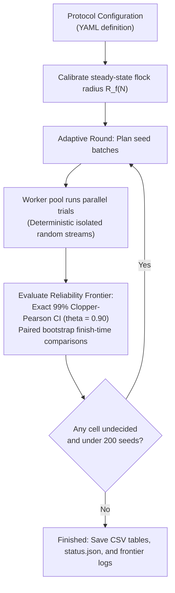

# Task Design and Experimental Methodology

This document details the experimental methodology, task geometry, statistical decision rules, and parameter sizing rationale used in **HerdSim**.

---

## Table of Contents

- [1. Task Geometry and Scale Invariance](#1-task-geometry-and-scale-invariance)
  - [The Fatal Flaw of Fixed Arenas](#the-fatal-flaw-of-fixed-arenas)
  - [Anchoring to Calibrated Flock Radius *R*f(*N*)](#anchoring-to-calibrated-flock-radius-r_fn)
  - [Normalized Deadlines and Drive Time](#normalized-deadlines-and-drive-time)
- [2. Initial Pasture and Shepherd Configurations](#2-initial-pasture-and-shepherd-configurations)
  - [Flock Starting Layouts](#flock-starting-layouts)
  - [Shepherd Starting Geometries](#shepherd-starting-geometries)
- [3. Adaptive Sequential Sampling Engine](#3-adaptive-sequential-sampling-engine)
  - [The Adaptive Sampling Loop](#the-adaptive-sampling-loop)
  - [Exact 99% Clopper-Pearson Early Stopping](#exact-99-clopper-pearson-early-stopping)
  - [Midpoint Densification](#midpoint-densification)
  - [Saturation and Overlap Pruning](#saturation-and-overlap-pruning)
  - [Paired Common Random Streams](#paired-common-random-streams)
  - [Crash-Safe Appending and Resumption](#crash-safe-appending-and-resumption)
- [4. Why the Grid Stops Where It Does (Parameter Sizing Rationale)](#4-why-the-grid-stops-where-it-does-parameter-sizing-rationale)
  - [Flock Size *N*](#flock-size-n)
  - [Dog Pack Size *D*](#dog-pack-size-d)
  - [Seeds per Cell (Cap of 200)](#seeds-per-cell-cap-of-200)
  - [Deadlines and Success Criteria](#deadlines-and-success-criteria)
- [5. Statistical Frontier Rules and Behavioral Zones](#5-statistical-frontier-rules-and-behavioral-zones)
  - [Frontier Metric Definitions](#frontier-metric-definitions)
  - [Behavioral Zones](#behavioral-zones)
- [6. The Gather Task (Lama and di Bernardo 2024)](#6-the-gather-task-lama-and-di-bernardo-2024)

---

## 1. Task Geometry and Scale Invariance

### The Fatal Flaw of Fixed Arenas

A common pitfall in animal flocking and swarm robotics simulations is evaluating scaling by increasing flock size $N$ inside a fixed-size arena. 

400 sheep occupy vastly more physical area than 25 sheep. In a fixed arena, a 400-sheep flock would be pressed wall-to-wall against the boundaries. The dogs would not need to herd the animals; the arena boundaries would do the herding for them! That introduces severe confounding artifacts, confusing *flock size* with *artificial boundary confinement*.

HerdSim enforces rigorous **physical scale invariance** by expanding the arena dimensions proportionally to the natural size of the flock.

*Figure 1: Task geometry drawn to physical scale. Left: Arena layout at* $N = 200$ *sheep. Middle: How drive distance* $l$ *scales relative to flock radius. Right: Calibrated flock radius* $R_f(N)$ *and goal radius across flock sizes, ensuring identical packing density and steering challenge.*

### Anchoring to Calibrated Flock Radius $R_f(N)$

All geometric dimensions are mathematically tied to the **calibrated steady-state flock radius $R_f(N)$**: the empirical equilibrium radius observed when a flock of $N$ sheep is driven by an experienced shepherd dog.

| Parameter | Mathematical Rule | Physical Meaning |
| :--- | :--- | :--- |
| **Flock Radius** $R_f(N)$ | Empirical calibration (e.g., $6.2\text{ m}$ at $N=25$; $11.4\text{ m}$ at $N=400$) | Natural steady-state radius of an $N$-sheep flock under steady driving. |
| **Drive Distance** $l$ | $\max(13 \cdot R_f(N),\thinspace 80,\thinspace l_{\mathrm{reach}} + R_{\mathrm{goal}} + R_f)$ | Ensures larger flocks travel proportionally farther to maintain realistic scale. |
| **Goal Radius** $R_{\mathrm{goal}}$ | $1.9 \cdot R_f(N)$ | Maintains consistent containment density and entry difficulty across flock sizes. |
| **Field Clearance** | $80\text{ m}$ beyond the farthest possible starting agent | Prevents boundary clipping. |
| **Open Boundary** | **No walls or reflecting boundaries** | Animals roam freely without bouncing off artificial edges. |

### Normalized Deadlines and Drive Time

Giving a fixed 5-minute timer to all flock sizes would unfairly penalize larger flocks, which must travel over $200\text{ m}$ compared to $80\text{ m}$ for small flocks. 

HerdSim normalizes all deadlines using the **characteristic drive time** ($T_{\mathrm{drive}}$): the minimum time required for the fastest sheep walking in a straight line at cruising speed ($v_{\mathrm{sheep,max}} = 1.0\text{ m/s}$) to traverse the drive distance:

$$
T_{\mathrm{drive}} = \frac{l}{v_{\mathrm{sheep,max}}}
$$

A compact flock driven smoothly by a single dog completes the drive in approximately $1.44$ to $1.74 \times T_{\mathrm{drive}}$. The benchmark protocols evaluate three normalized deadlines:
- **Relaxed ($12\times T_{\mathrm{drive}}$)**: Plentiful time. A single dog has margin to collect strays sequentially.
- **Intermediate ($6\times T_{\mathrm{drive}}$)**: Standard working tempo.
- **Urgent ($3\times T_{\mathrm{drive}}$)**: Fast and tight. Sequential gathering is too slow; dogs must fan out in parallel.

| Flock Size ($N$) | Flock Radius $R_f$ | Drive Distance $l$ | Drive Time ($T_{\mathrm{drive}}$) | $12\times$ Deadline (Relaxed) | $6\times$ Deadline (Intermediate) | $3\times$ Deadline (Urgent) |
| :---: | :---: | :---: | :---: | :---: | :---: | :---: |
| **$N = 25$** | $6.20\text{ m}$ | $80.6\text{ m}$ | **$80.6\text{ s}$** ($\sim 1.3\text{ min}$) | $967\text{ s}$ ($\sim 16.1\text{ min}$) | $484\text{ s}$ ($\sim 8.1\text{ min}$) | $242\text{ s}$ ($\sim 4.0\text{ min}$) |
| **$N = 50$** | $7.60\text{ m}$ | $98.8\text{ m}$ | **$98.8\text{ s}$** ($\sim 1.6\text{ min}$) | $1,185\text{ s}$ ($\sim 19.8\text{ min}$) | $593\text{ s}$ ($\sim 9.9\text{ min}$) | $296\text{ s}$ ($\sim 4.9\text{ min}$) |
| **$N = 100$** | $9.08\text{ m}$ | $118.1\text{ m}$ | **$118.1\text{ s}$** ($\sim 2.0\text{ min}$) | $1,417\text{ s}$ ($\sim 23.6\text{ min}$) | $708\text{ s}$ ($\sim 11.8\text{ min}$) | $354\text{ s}$ ($\sim 5.9\text{ min}$) |
| **$N = 200$** | $10.47\text{ m}$ | $139.8\text{ m}$ | **$139.8\text{ s}$** ($\sim 2.3\text{ min}$) | $1,678\text{ s}$ ($\sim 28.0\text{ min}$) | $839\text{ s}$ ($\sim 14.0\text{ min}$) | $419\text{ s}$ ($\sim 7.0\text{ min}$) |
| **$N = 400$** | $11.40\text{ m}$ | $206.8\text{ m}$ | **$206.8\text{ s}$** ($\sim 3.4\text{ min}$) | $2,482\text{ s}$ ($\sim 41.4\text{ min}$) | $1,241\text{ s}$ ($\sim 20.7\text{ min}$) | $620\text{ s}$ ($\sim 10.3\text{ min}$) |

---

## 2. Initial Pasture and Shepherd Configurations

### Flock Starting Layouts

HerdSim provides four standardized starting distributions to isolate the transition from stray gathering to flock steering:

*Figure 2: The four starting flock layouts evaluated at* $N = 200$ *with* $D = 4$ *dogs (drawn to identical physical scale). The dashed circle marks the analytical collection boundary* $f(N) = r_a N^{2/3}$*. Any sheep starting outside this circle triggers active outlier collection.*

1. **`compact`**: Flocks sampled from a tight 2D Gaussian ($\sigma = 0.5 \cdot R_f$). All sheep start within $f(N)$; dogs immediately enter drive mode.
2. **`wide`**: Flocks sampled from a broad Gaussian ($\sigma = 0.5 \cdot 2 N^{2/3}$). Sheep scatter widely, requiring extensive perimeter rounding.
3. **`split`**: The flock is partitioned into 3 isolated clusters placed symmetrically on a circle. Dogs must consolidate separate groups without fragmenting them further.
4. **`outlier_rich`**: 80% of sheep start in a dense central core, while 20% are positioned as isolated strays far out on the pasture.

### Initial Dispersion Burden ($S_0 \times N$) and Two-Phase Dynamics

The operational difficulty of collective shepherding is governed not merely by headcount $N$, but fundamentally by the product of initial spatial dispersion $S_0$ (mean squared distance from the flock centroid) and flock size $N$:

$$
\mathcal{B}_{\mathrm{disp}} = S_0 \times N
$$

This product quantifies the **geometric compaction work** the canine pack must perform during Phase 1 (Stray Gathering) before collective cohesion is established to enable Phase 2 (Cohesive Driving):
- On **`compact`** pastures, $S_0 \approx 0 \implies S_0 \times N \approx 0$. All sheep initially reside inside the analytical collection radius $f(N)$, completely bypassing Phase 1. This mechanical economy explains why $D_{\min} = 1$ remains constant from $N = 25$ through $N = 1131$.
- On dispersed layouts (**`wide`**, **`split`**, **`outlier_rich`**), large $S_0$ causes the dispersion burden $S_0 \times N$ to explode with increasing $N$. Under strict time budgets, a solitary dog must traverse excessive round-trip distances to retrieve stragglers sequentially, during which the flock's natural diffusive drift outpaces collection. Consequently, multi-agent parallel rounding ($D_{\min} > 1$) becomes mathematically mandatory to partition the spatial perimeter.

| Layout | Flock Size $N$ | Initial Spread $S_0$ | Dispersion Burden $S_0 \times N$ | Gathering Phase Operational Demand |
| :--- | :---: | :---: | :---: | :--- |
| `compact` | 25 | $3.59\text{ m}$ | **89.9** | Completely bypassed; immediate cohesive drive |
| `compact` | 100 | $5.67\text{ m}$ | **567.2** | Completely bypassed; immediate cohesive drive |
| `compact` | 400 | $7.68\text{ m}$ | **3,073.5** | Completely bypassed; immediate cohesive drive |
| `wide` | 400 | $8.11\text{ m}$ | **3,242.3** | High perimeter rounding; requires parallel flankers |
| `split` | 400 | $8.81\text{ m}$ | **3,524.2** | Multi-cluster consolidation; requires cluster coverage |
| `outlier_rich` | 400 | $10.16\text{ m}$ | **4,065.6** | Maximal burden; mandatory multi-agent rounding |

### Shepherd Starting Geometries

Dogs begin $30\text{ m}$ behind the flock in one of three release geometries:

*Figure 3: Shepherd release geometries. Top: Default concentric arcs for* $D = 1$ *to* $64$ *behind an* $N = 100$ *flock. Bottom: Direct comparison of arcs, ring, and handler release at* $N = 200$ *with* $D = 8$ *dogs.*

- **`arcs` (default)**: Concentric arcs behind the flock. Single dogs start on the drive axis; additional dogs take balanced flanking stations.
- **`ring`**: Dogs distributed along an open circle surrounding the flock (leaving an opening toward the goal).
- **`handler`**: All dogs originate from a single coordinate directly behind the flock, mimicking a human handler releasing dogs from a post.

---

## 3. Adaptive Sequential Sampling Engine

Running full grids with 200 trials per cell across all parameter combinations would require hundreds of thousands of redundant simulations (e.g., proving that 1 dog fails on 400 scattered sheep in 4 minutes, or that 12 dogs easily herd 25 compact sheep).

HerdSim employs an **adaptive sequential sampling loop** that allocates compute cycles exclusively to parameter cells where the outcome is genuinely uncertain.

### The Adaptive Sampling Loop

### Exact 99% Clopper-Pearson Early Stopping

Each cell evaluates an initial batch of 10 seeds. After each batch, HerdSim computes the exact two-sided 99% Clopper-Pearson confidence interval $[L, U]$ for the true success probability:
- **Early Failure Halt**: If the upper bound $U \lt 0.90$, the team is mathematically proven underpowered with 99% confidence. Testing halts immediately.
- **Early Success Halt**: If a team achieves 60 wins in a row with zero failures, the lower bound crosses $L \ge 0.90$. We are certain it meets reliability; testing halts early.
- **Borderline Cells**: Only cells hovering near the 90% reliability threshold receive additional batches of 10 seeds, up to a cap of 200 seeds.

*Figure 4: Early stopping in action. Clear failures halt after 10–20 seeds; clear successes halt after 60 consecutive wins; only borderline cells continue testing up to the 200-seed cap.*

### Midpoint Densification

When adjacent dog counts span a behavioral boundary (e.g., $D = 2$ fails and $D = 4$ succeeds), the engine automatically inserts the midpoint ($D = 3$) into the next evaluation round. This pinpoints $D_{\min}$ without exhaustive search.

*Figure 5: Midpoint densification. A detected zone transition between* $D = 2$ *and* $D = 4$ *automatically schedules* $D = 3$ *for evaluation in the following round.*

### Saturation and Overlap Pruning

Once completion speed plateaus ($D_{\mathrm{sat}}$), if larger dog packs show that additional dogs simply copy existing dogs (mean pairwise overlap $\ge 0.90$) without accelerating the drive, the engine marks the cell as **pruned** and halts further testing.

*Figure 6: Saturation pruning. Once drive time plateaus, cells exhibiting high dog overlap (*$\ge 0.90$*) are pruned to save compute.*

### Paired Common Random Streams

Every seed $i$ uses `master_seed + i` (e.g., $2026 + i$). Initial flock coordinates and individual sheep random decisions are generated from dedicated, isolated random streams. 

When comparing $D = 2$ dogs against $D = 4$ dogs, both teams face the **identical starting sheep coordinates and identical stochastic sheep reactions**, eliminating pasture luck from the comparison.

*Figure 7: Paired random seeds. Seed 2026 generates the identical initial sheep coordinates across all tested dog counts* $D$*, isolating the true algorithmic effect of team size.*

### Crash-Safe Appending and Resumption

All simulation runs append completed trials immediately to `trials.jsonl`. Campaigns can be interrupted at any time (`Ctrl+C` / `SIGINT`) and resumed without losing progress; file locks prevent concurrent writer corruption.

---

## 4. Why the Grid Stops Where It Does (Parameter Sizing Rationale)

Every simulation campaign must bound its search space. Below are the physical and mathematical reasons governing where HerdSim sets its parameter limits:

### Flock Size $N$

| Setting | Range | Scientific & Physical Rationale |
| :--- | :--- | :--- |
| **Main Grids & Sensitivity** | $25$ to $400$ | At $N \le 50$, every layout succeeds with 1 dog under every deadline, so testing smaller sizes adds no new insight. $N = 400$ was the calibration ceiling for initial studies. |
| **Dense Resumed Grids** | $+ 71, 141, 283, 566$ | Multiplicative steps of $\sqrt{2}$ above $N = 50$, ensuring uniform geometric weight in power-law fitting. $N = 566 = 400\sqrt{2}$ is the maximum size before the biological model's steady-state radius breaks down (above $N \approx 600$, loose flocks fail to settle). |
| **Kubo Model** | $25$ to $100$ | Kubo flocks pack tightly to $R_f \approx 5.8\text{ m}$ regardless of $N$. Exceeding $N = 100$ creates unphysically dense crowding. |
| **Sensing Range** | $50$ to $200$ | At $N = 400$, the collection radius ($109\text{ m}$) exceeds the sheep's $65\text{ m}$ vision, preventing local rules from identifying strays. |
| **Gather Task (`lama`)** | $1$ to $400$ targets, as perfect squares | The paper's own grid: $\sqrt{N} = 1$ to $20$ on its axis, so the validation reads the same cells (section 6). |
| **Large $N$ Variants** | $566$ to $3200$ | Investigates whether large flocks can be herded by imposing constant flock density. Identifies the mathematical singularity where the paper's drive offset exceeds sheep reaction distance at $N = 1056$. |

### Dog Pack Size $D$

- **Main Grids ($1, 2, 3, 4, 6, 8, 12, 16, 24$)**: Geometric steps of $\approx 1.5\times$ ensure at least two test points per doubling of team size. $D = 24$ was chosen because no curve was still accelerating at $24$; curves that failed at $24$ had flat or falling success.
- **Gather Task ($1$ to $25$, every count)**: The paper's grid of herders, at its resolution of one herder, so its minimum team can be read without interpolation.
- **Holding with Dog Spacing ($+ 7, 9, 10, 11, 13$)**: The maximum number of physical dogs the driving arc can accommodate at $2\text{ m}$ spacing is $7, 9, 10, 11, 12$ across $N = 25$ to $400$. Testing around these values detects the exact onset of geometric overcrowding.

### Seeds per Cell (Cap of 200)

- **Batches of 10, cap of 200**: To reach $L \ge 0.90$ with a 99% Clopper-Pearson interval requires 51 consecutive successes ($60$ trials in batches of 10).
- **Why 200**: After 200 seeds, a cell is decided only if its observed success rate is $\ge 0.955$ or $\le 0.835$. Doubling to 400 seeds only narrows this undecided band to $0.94$ and $0.86$, quadrupling compute for marginal statistical gain. Across all 4,773 evaluated cells, only 8.1% ended open at the cap, reported transparently as brackets (e.g., `[2, 3]`).

### Deadlines and Success Criteria

- **Deadlines**: $12\times, 6\times, 3\times$ drive times span relaxed, working, and emergency time pressure.
- **Success Criteria**: 
  - *Strict 100%*: Every sheep inside the pen simultaneously. Fails on large dog packs due to the boundary artifact known as the **Straggler Effect** (chasing one stray flushes the penned herd).
  - *99% Arrival*: At least 99% inside. Isolates multi-agent coordination from pen boundary noise.

---

## 5. Statistical Frontier Rules and Behavioral Zones

Statistical classifications are governed by [`analysis/frontier.py`](../../analysis/frontier.py):

*Figure 8: Behavioral zone classification along the dog count axis* $D$*. Cells are segmented into distinct regimes based on Clopper-Pearson reliability bounds and paired bootstrap speed comparisons.*

### Frontier Metric Definitions

| Metric | Definition |
| :--- | :--- |
| **$D_{\min}$** | Smallest reliable dog count $D$ ($L \ge 0.90$). |
| **$D_{\mathrm{sat}}$** | Smallest reliable $D$ such that adding more dogs yields no statistically significant speedup. |
| **$D_{\mathrm{best}}$** | Smallest reliable $D$ that is not slower than the fastest reliable team size on the curve. |
| **$D_{\mathrm{crowd}}$** | Smallest reliable $D \gt D_{\mathrm{best}}$ that is measurably slower due to congestion. |
| **$D_{\mathrm{overcrowd}}$** | Smallest $D \gt D_{\min}$ where it and subsequent counts fail reliability (collapse). |
| **$D_{\max}$** | Largest reliable dog count below $D_{\mathrm{overcrowd}}$. |

### Behavioral Zones

- `too_few`: Unreliable, below $D_{\min}$.
- `improving`: Reliable, below $D_{\mathrm{sat}}$; adding dogs speeds up the drive.
- `saturated`: Reliable, from $D_{\mathrm{sat}}$ upward; extra dogs add no speedup.
- `crowded`: Reliable, but slower than $D_{\mathrm{best}}$ due to dog interference.
- `collapse`: Unreliable, at or above $D_{\mathrm{overcrowd}}$.

### Failure Taxonomy: Structural vs Boundary/Temporal Failures

When analyzing the root causes of failed simulation trials, HerdSim distinguishes between two fundamentally different physical failure regimes:
1. **Structural Failures**:
   - Occur during the **Stray Gathering Phase** when shepherd count falls below the minimum viable frontier ($D < D_{\min}$).
   - The spatial geometry of the canine pack cannot contain the flock's diffusive drift on open pastures. Herders become trapped in a perpetual cycle of chasing distant stragglers; extending trial deadlines cannot rescue these runs because the rate of outward dispersion strictly exceeds the sequential collection rate.
2. **Boundary and Temporal Failures**:
   - Occur during the **Drive Phase or Terminal Penning**. The pack successfully gathers the herd into a cohesive body and steers it across the pasture, delivering $\ge 99\%$ of animals into the goal, but times out due to deadline expiry or boundary geometry artifacts (the Straggler Effect).
   - This distinction provides the rigorous mechanical justification for adopting the **99% arrival criterion** ($\chi = 0.99$): 99% arrival isolates fundamental collective coordination capacity, whereas strict 100% containment is dominated by microscopic boundary noise.

### Dual-Regime Overcrowding Collapse

Overcrowding collapse ($D \ge D_{\mathrm{overcrowd}}$) is not a singular phenomenon but emerges at two opposite geometric extremes:
- **Large Flocks ($N \ge 400$) - Driving Arc Packing Saturation**:
  - When flocks are large and shepherds possess non-zero physical exclusion footprints ($2\text{ m}$), packing excessive dogs ($D > D_{\mathrm{cap}} \approx 12$) along the rear driving arc induces severe spatial contention. Dogs block each other's paths and activate mutual freezing standoffs, causing catastrophic deceleration of the drive.
- **Small Flocks ($N \le 10$) - Encirclement Escape-Corridor Collapse**:
  - When the ratio of shepherds to prey is high ($D/N \gg 1$), a large canine pack completely encircles the tiny flock across all $360^\circ$ azimuths. The flock loses its forward escape corridor; simultaneous threat vectors from all sides tear the herd apart, scattering prey outward in all directions.

---

## 6. The Gather Task (Lama and di Bernardo 2024)

Everything above describes the drive task (`drive_to_goal`), used by every Strömbom and Kubo protocol. The `lama` method runs in a second task, `gather`, which reproduces the setting of [Lama & di Bernardo (2024)](https://doi.org/10.1103/PhysRevResearch.6.L032012) instead (models: [`docs/methods/models.md`](../methods/models.md#lama--di-bernardo-2024-non-cohesive-targets)). It is selected in a protocol with `task: gather`.

**Status:** validated against the paper's Fig. 2 and run on the paper's grid (40,280 trials); results in report section 3.14.

### Geometry: a disc round the goal

| Parameter | Rule | Source |
| :--- | :--- | :--- |
| **Start disc** $R$ | `gather_start_radius`, $50$ | The paper's main case (Fig. 2) |
| **Goal radius** | `gather_goal_fraction` $\times R$ $= R/5 = 10$ | The paper's $r^{\ast} = R/5$ |
| **Start** (layout `uniform`) | Sheep and dogs uniform over the disc, goal included | The paper's $\Omega_0$ |
| **Required share** | `success_fraction` $= 0.99$ | The paper's $\chi^{\ast} = 0.99$ |
| **Time limit** | $166{,}667$ ticks $= 5000$ s at $\Delta t = 0.03$ | The paper's $t_{\max}$ (Fig. S8) |
| **Open boundary** | No walls | As in the drive task |

The targets do not flock, so there is no driven flock radius to calibrate: the task is sized by $R$, and `calibrate` has nothing to do. Sheep are drawn before dogs, so a seed gives the same targets whatever the dog count, and cells at different $D$ stay paired as in the drive task.

### When a trial ends and what counts as success

- **Success**: at least 99% of the targets are inside the goal at the moment every herder is inside it. This is the paper's stop ("the simulation is stopped when all the herders are inside $\Omega_G$").
- **Early end (a failure)**: every herder is inside the goal and none of them senses a target outside it. The herders have brought in everything they can see, and the rest is lost. Taken literally, the paper's rule would end a one-herder trial at the first tick whenever that herder starts inside the goal; the extra clause removes that case.
- **Otherwise**: the trial runs to the time limit.

Failures are labelled `targets_lost` (some targets were out of every herder's sight at the end) or `outnumbered` (every target was seen, but the share was not reached in time). Every row also keeps the share inside at the end (`final_in_goal_fraction`), so the paper's own statistic (the mean of that share over the seeds) can be computed next to HerdSim's reliability rule.

### Two statistics

| | Paper | HerdSim |
| :--- | :--- | :--- |
| A team size works when | the mean share inside at the end, over 50 runs, is at least $0.99$ | the 99% Clopper-Pearson interval of the success rate lies at or above $0.90$ |
| Seeds | 50 per cell | adaptive, 10 to 200 per cell |

Both are read from the same rows. The validation uses the paper's statistic on 50 seeds per cell; the campaigns report HerdSim's rule, the one every other HerdSim result uses, with the paper's beside it.

### Metrics recorded every 10 ticks

At $\Delta t = 0.03$ a failing trial runs $166{,}667$ ticks, and the per-tick metrics cost more than the model itself. The gather protocols therefore set `metrics_stride: 10` (one record every $0.3$ s). Success, the early end and the time limit are still checked every tick, and the last tick is always recorded, so the outcome of a trial does not depend on the stride. Only the first-arrival times are read from the recorded ticks, so they are never earlier than the exact time and can be later (a share reached and lost again between two records is missed).

### Protocols

| Protocol | Sensing radius $\xi$ | Paper figure |
| :--- | :---: | :--- |
| `lama_r50` | $10$ | Fig. 2b, Table I |
| `lama_r50_inf` | infinite | Fig. 2a |
