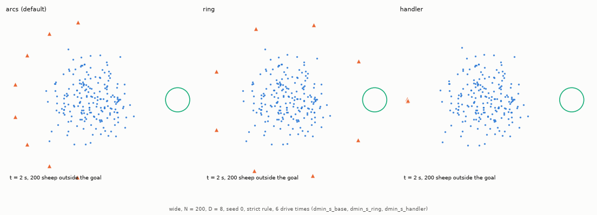
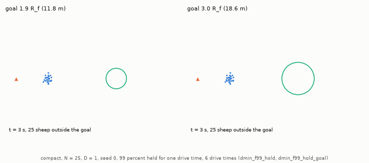
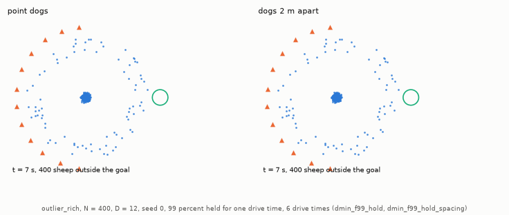
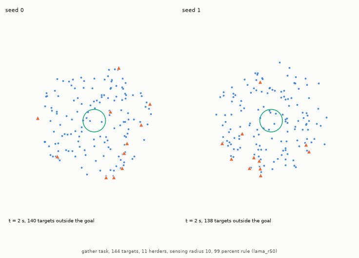

# Task design and experimental method

## Contents

- [1. Task geometry and scale](#1-task-geometry-and-scale)
- [2. Start layouts and dog starts](#2-start-layouts-and-dog-starts)
- [3. Adaptive sampling](#3-adaptive-sampling)
- [4. Flock and team sizes tested](#4-flock-and-team-sizes-tested)
- [5. Frontier rules and zones](#5-frontier-rules-and-zones)
- [6. Task variants](#6-task-variants)
- [7. The gather task (Lama and di Bernardo 2024)](#7-the-gather-task-lama-and-di-bernardo-2024)

## 1. Task geometry and scale

### Why the field grows with the flock

A goal of fixed radius holds a flock of 25 with room to spare and a flock of 400 not at all, and a fixed 100 m drive is sixteen flock radii for the small flock and nine for the large one. HerdSim has no walls, as none of the source models has one, and a wall would stop sheep that the dogs failed to stop. So HerdSim sizes the task by the **calibrated flock radius $R_f(N)$**, the radius a flock of $N$ sheep settles to while one dog drives it. The drive distance, from the start centre to the goal centre, and the goal radius are multiples of $R_f(N)$, so the task has the same shape at every $N$ (Figure 1).

**Figure 1: Task geometry drawn to scale.** The drive distance is the largest of three terms, and the flock and goal radii grow slowly with $N$.

- Marks: lengths are in m, although the axes say "units"; in the middle and right panels each dot is one of the five main flock sizes.
- Left: the field at $N = 200$, with the flock radius $R_f$, the goal of $1.9 R_f$, the farthest start sheep of the widest [start layout](#flock-start-layouts) and the drive distance.
- Middle: the drive distance $l$ against $N$, with its three terms (Table 1); the largest, in grey, is used.
- Right: the calibrated flock radius $R_f(N)$ and the goal radius $1.9 R_f$.

### Sizing by the calibrated flock radius

The radius of a flock is $\sqrt{2}$ times the RMS (root mean square) distance of its sheep from the flock centre, the radius of a uniform disc with that RMS. Calibration measures $R_f(N)$ once per method and $N$ when a campaign starts ([calibration](../codes/architecture.md#calibration)):

- One dog that knows where every sheep is drives the flock for 300 s toward a goal too far away to reach.
- The flock starts as the calibration start flock, a Gaussian with $\sigma = 0.5\,s\sqrt{N/\pi}$ cut at $3\sigma$, for a spacing $s$ between sheep of 1 m and of 3 m (each sheep then has about $s^2$ of ground).
- $R_f$ is the radius averaged over the last 90 s, the median over 3 seeds and both spacings.

If at some $N$ the radius still changes by more than 15% between the last two 90 s windows, or differs by more than 25% between the two spacings, the campaign stops with an error, because the flock has no single size there to scale the task by ([calibration settings](../guides/settings.md#calibration-of-r_f)).

Table 1 lists each length; $l_{\mathrm{reach}}$ is the farthest any sheep can start from the flock centre, over every [start layout](#flock-start-layouts) of the protocol.

**Table 1: Lengths of the drive task.**

| Quantity | Rule (lengths in m) |
| :--- | :--- |
| Flock radius $R_f(N)$ | Calibrated (Table 2) |
| Drive distance $l$, start centre to goal centre | $\max(13\,R_f(N),\ 80,\ l_{\mathrm{reach}} + R_{\mathrm{goal}} + R_f)$ |
| Goal radius $R_{\mathrm{goal}}$ | $1.9\,R_f(N)$ |

On the main [grids](../glossary.md#trials-and-experiments), the layouts, flock sizes and team sizes a protocol tests, the 80 m floor never sets the drive, as $13\,R_f$ is already 80.6 m at $N = 25$. It does where the calibrated radius is smaller. The runs with stronger [cohesion](../methods/strombom_sheep.md#attraction-to-the-flock) raise the attraction weight $c$ from 1.05, and there the floor sets the drive at $N = 25$ for $c = 1.3$, and at $N = 25$ and 50 for $c = 1.6$ and 2.0. More Kubo sheep pack the flock denser, so its radius stays at 5.9-6.2 m over $N = 25$-100 and the floor sets the Kubo drive at 50 and 100.

The reach term keeps the goal clear of every start. The scattered start layouts spread as $N^{2/3}$, much faster than $R_f(N)$, so on the main grids the reach term sets the drive from $N = 200$ for every layout, `compact` included: at $N = 400$ the drive is 18 $R_f$ instead of 13. The multiples 13 and 1.9 are conventions; the [sensitivity runs](../glossary.md#trials-and-experiments), which change one choice at a time, test a goal of $1.5\,R_f$.

### Success rules

A trial succeeds when enough sheep are in the goal at the same tick:

- Strict: every sheep. Large teams often fail on the last sheep ([report, section 3.4](../report/part2_success_rule.md#34-rq4-the-success-rule-and-the-last-sheep)).
- 99%: at least $\lceil 0.99\,N \rceil$ sheep. Below $N = 100$ that is every sheep, so the rules are the same there; one straggler is allowed from $N = 100$, and four at $N = 400$.

### Deadlines in drive times

A fixed 5-minute limit would be unfair to large flocks, driven over 200 m against 80 m for small ones. Deadlines are therefore given in **drive times** $T_{\mathrm{drive}} = l / v_{\mathrm{sheep,max}}$, the time a sheep walking straight at top speed needs for the drive. A Strömbom sheep has one speed, 1.0 m/s, so $T_{\mathrm{drive}}$ in s equals $l$ in m.

The main protocols use 3, 6 and 12 drive times. Each doubles the one before, and even the tightest is longer than the median finish time of every team of 1 to 24 dogs on a [`compact`](#flock-start-layouts) flock of 25 to 400 sheep, under the strict rule at 6 drive times ([report, section 3.7](../report/part3_beyond_dmin.md#1-when-more-dogs-stop-helping) gives those times). At 12 drive times one dog has time to collect [outliers](../methods/strombom_multi.md#when-to-collect) one after another, and at 3 the team needed grows ([report, section 3.3](../report/part1_growth.md#33-rq3-how-does-the-deadline-change-d_min)). The Kubo protocols use the fixed 500 s of Kubo et al. (2022), about 31 times the 16 s a Kubo sheep at its top speed of 5 m/s needs for the 80 m drive ($N = 25$ to 100).

Table 2 gives the deadlines of the main grids (`dmin_m12` and its variants). Each is rounded up to whole 1 s ticks from the unrounded drive distance, so it can be 1 s above the multiple shown ($3 \times 98.8 = 296.4$ s gives 297 s at $N = 50$).

**Table 2: Deadlines of the main grids.**

| $N$ | $R_f$ (m) | $l$ (m) and $T_{\mathrm{drive}}$ (s) | 12x (s) | 6x (s) | 3x (s) |
| :---: | :---: | :---: | :---: | :---: | :---: |
| 25 | 6.20 | 80.6 | 968 | 484 | 242 |
| 50 | 7.60 | 98.8 | 1186 | 593 | 297 |
| 100 | 9.08 | 118.1 | 1417 | 709 | 355 |
| 200 | 10.47 | 139.8 | 1678 | 839 | 420 |
| 400 | 11.40 | 206.8 | 2482 | 1241 | 621 |

## 2. Start layouts and dog starts

### Flock start layouts

How spread out the flock starts decides how much the dogs must collect before they can drive. The four start layouts go from no outliers to many (Figure 2, Animation 1). The scattered ones are sized by the [collect distance](../methods/strombom_multi.md#when-to-collect) $f(N) \propto N^{2/3}$: a sheep farther than $f(N)$ from the flock centre is an outlier, which the dogs fetch back before they drive the flock. So a fixed share of the sheep starts where the dogs must collect at every $N$.

- `compact`: a Gaussian with $\sigma = 0.5\,R_f$, cut at $3\sigma$. Every sheep starts within $f(N)$, so the dogs drive at once.
- `wide`: a Gaussian with $\sigma = 0.5\,f(N)$, cut at $3\sigma$, so about 13% of the sheep start beyond $f(N)$ at every $N$ ($e^{-2}$ before the cut).
- `split`: $k$ compact clusters centred on a circle of radius $f(N)$, with $k = 3$, or 2 when $N < 12$. Each is a Gaussian with $\sigma = 0.5\,R_f / \sqrt{k}$, so a cluster is as dense as a `compact` flock.
- `outlier_rich`: 80% of the sheep in a compact core and 20% on a ring between $1.1\,f(N)$ and $1.6\,f(N)$ from it.

**Figure 2: The four start layouts ($N = 200$, $D = 4$, same scale).** A sheep that starts outside the collect distance has to be collected before the flock can be driven.

- Marks: the dashed circle is the collect distance $f(N)$.
- Panels: one per layout, named above each.

**Animation 1: The same team on the four start layouts ($N = 200$, $D = 4$, seed 0, 99% rule, 6 drive times).** On `compact` the dogs drive at once; on the scattered layouts they collect first, and `split` takes longest (`dmin_f99_m6`).

- Marks: blue dots are sheep, orange triangles dogs, the green circle the goal; bottom left, the time and the number of sheep outside the goal.
- Panels: `compact`, `wide`, `split` and `outlier_rich`, left to right. The flock is in at 236, 278, 631 and 277 s.

### Start spread and difficulty

A more spread-out start is not always harder: at $N = 400$, under the strict rule at 6 drive times, `outlier_rich` starts less spread than `wide` yet succeeds less often ([report, section 4.4](../report/part5_failures.md#44-start-spread)).

### Dog starts

The first dog circle lies 30 m (`dog_start_gap`) beyond the farthest point any sheep of that layout can start, so no dog starts among the sheep. A sheep [reacts to a dog](../methods/strombom_sheep.md) within $r_s = 65$ m, so the nearest sheep react from the first tick. Dogs on one circle stand at least 5 m apart (`dog_start_spacing`), and those that do not fit go on a circle 5 m farther out. Both are conventions; the sensitivity runs test gaps of 15 and 60 m. There are three patterns (Figure 3, Animation 2):

- `arcs` (default): half circles on the side away from the goal, dogs evenly spread. With an odd count one dog starts on the drive axis, the line through the flock and goal centres.
- `ring`: full circles, leaving out the cone, seen from the flock centre, that holds the goal. Its half-angle is $\arcsin(R_{\mathrm{goal}} / l)$, about 8 deg when $l = 13\,R_f$.
- `handler`: every dog at one point straight behind the flock, at the first arc's distance, as for dogs sent out from one spot.

**Figure 3: Dog starts.** The default arcs behind the flock, and the ring and handler starts the sensitivity runs test.

- Marks: as in Animation 1.
- Top: the default arcs for $D = 1$ to 64 behind an $N = 100$ flock.
- Bottom: arcs, ring and handler at $N = 200$ with $D = 8$.

**Animation 2: Three dog starts on the same flock (`wide`, $N = 200$, $D = 8$, seed 0, strict rule, 6 drive times).** All three bring every sheep in, at 272, 290 and 271 s (`dmin_s_base`, `dmin_s_ring`, `dmin_s_handler`).

- Marks: as in Animation 1.
- Panels: `arcs`, `ring` and `handler`, left to right. Handler dogs spread out from one point before the flock is gathered.

## 3. Adaptive sampling

A [cell](../codes/architecture.md#how-an-experiment-is-broken-down) asks a question such as "can 3 dogs herd 200 sheep in this setup?", and each seed gives it one trial; a [curve](../codes/architecture.md#how-an-experiment-is-broken-down) is one setup tested across team sizes. Most cells need far fewer than the cap of 200 seeds (one dog against 400 scattered sheep at a tight deadline, or twelve dogs on 25 compact sheep), so HerdSim adds trials only where the answer is still open. In the end each cell gets a zone, which says what its place on the curve means, such as too few dogs or no faster than a smaller team ([section 5](#5-frontier-rules-and-zones)).

### The adaptive sampling loop

A campaign runs in rounds. Each gives every open cell, one whose reliability is still undecided, another batch of seeds, and then the [frontier rules](#5-frontier-rules-and-zones) decide each cell from its trials. With finish-time decisions on (`decide_finish_times`, off by default), a cell also stays open while a finish-time comparison that could change a [frontier value](#frontier-values) is undecided. [Architecture](../codes/architecture.md#one-campaign-round) describes the rounds, the time budget and resuming.

### Stopping early with the 99% Clopper-Pearson interval

A cell gets its trials in batches of 10 seeds. After each batch (a look) HerdSim computes the exact two-sided 99% Clopper-Pearson interval of the success rate, with lower bound $L$ and upper bound $U$, and compares it with the threshold $\theta = 0.90$ (Figure 4). The cell is then:

- Unreliable: $U < 0.90$, usually after 10 to 20 trials. No more seeds.
- Reliable: $L \ge 0.90$, a success rate of at least 0.90 at 99% confidence. This needs at least 51 straight successes, and looks come every 10 trials, so the earliest decision is 60 of 60.
- Undecided: another batch of 10, up to 200.

The exact interval is conservative for one look. Repeated looks are not corrected for, and the false-decision rate has not been measured ([report, limitations](../report/d_min_report.md#6-limitations)).

**Figure 4: Stopping early.** Clear failures stop after 10 to 20 trials, clear successes at 60 trials, and only cells near the threshold go on toward 200.

- Marks: an illustration, not stored runs. Red is the interval's upper bound when no trial succeeds, green its lower bound when all succeed, blue an undecided cell after each batch of 10; the dashed line is $\theta = 0.90$.

The cap of 200 seeds is a cost choice. A cell of 200 trials stays undecided with 168 to 190 successes; at 400 trials the band would be 344 to 375, about a third narrower in rate.

### Midpoint densification

The protocol lists a coarse set of team sizes, and HerdSim fills in counts where the answer changes, so $D_{\min}$, the smallest reliable team, is found without testing every count. The next round adds the count halfway between two neighbouring tested counts on a curve when (Figure 5):

- their zones differ; without finish-time decisions, this means their reliability labels (reliable, unreliable, undecided) differ;
- they are more than `refine_min_gap` = 1 apart;
- neither is a [pruned](#pruning-above-saturation) cell, nor an undecided cell below the cap, which first waits for its own seeds.

**Figure 5: Midpoint densification.** A change of zone between $D = 2$ and $D = 4$ adds $D = 3$ to the next round.

- Marks: an illustration, not stored runs. Dots are tested $D$, coloured by zone; top row the first round, bottom row the next, with the added $D = 3$ as a star.

### Pruning above saturation

Above a confirmed [$D_{\mathrm{sat}}$](#frontier-values), the team from which more dogs stop helping, cells whose dogs mostly stand on top of each other get no more seeds and are marked `pruned` in `frontier_cells.csv` (Figure 6); the full rule is in [architecture](../codes/architecture.md#one-campaign-round).

**Figure 6: Pruning.** Above a confirmed saturation, [saturated](#zones) or undecided cells get no more seeds once their dog overlap, the share of dogs with another dog within 2 m averaged over ticks and trials, is at least 0.90.

- Marks: an illustration, not stored runs. Blue is the median finish time (left axis), orange the mean dog overlap (right axis); the dotted line is 0.90 overlap and the shaded region is pruned.

### Paired random streams

To compare 2 dogs with 4 fairly, both teams should face the same flock. Seed $i$ of every cell is `master_seed + i` (for example $2026 + i$), and a trial draws the start positions and the sheep's and dogs' random choices from three separate streams. Seed $i$ thus gives every team the same start flock (Figure 7) and the same sheep noise until the dogs act differently, so the finish-time difference at a seed, which the [paired bootstrap](#frontier-values) compares, is mostly the team's effect. A shorter deadline only cuts the same trial short, as the stored runs confirm ([report, section 3.3](../report/part1_growth.md#33-rq3-how-does-the-deadline-change-d_min)).

**Figure 7: Paired seeds.** Seed 2026 gives the same start flock at every team size $D$.

- Marks: an illustration, not stored runs. Columns are seeds 2026 to 2028, rows team sizes 2 to 4.

## 4. Flock and team sizes tested

### Flock size

Each setting tests the flock sizes its question needs (Table 3). The six main runs are the strict and 99% rules at 12, 6 and 3 drive times.

**Table 3: Flock sizes by setting.**

| Setting | Flock sizes $N$ | Notes |
| :--- | :--- | :--- |
| Main grids | 25, 50, 100, 200, 400 | Doublings. |
| Sensitivity | 100, 200, 400 | Where $D$ matters; `wide` and `outlier_rich`, $D = 1$ to 16, 6 drive times. |
| Added sizes (99% grids at 12 and 6 drive times) | 71, 141, 283, 566 | Steps of $\sqrt{2}$, even in $\log N$, so small sizes do not dominate the fit. |
| Kubo model | 25, 50, 100 | Compact starts only. |
| Sensing range (dogs see 15 to 100 m, or everything as control) | 50, 100, 200 | At $N = 200$ the collect distance (68 m) already reaches $r_s$; larger $N$ would mix that limit into the sensing effect. |
| Large $N$ | 566, 800, 1131, 1600, 2263, 3200 | Large flocks, and the [limit](../methods/strombom_multi.md#driving-and-its-limit-for-large-flocks) where Strömbom's drive point passes $r_s$. |

Above about $N = 600$ a driven flock no longer settles to one radius, so calibration cannot size the task there: 566 = $400\sqrt{2}$ is the last added size below it, and the strict-rule grids stop at 400. The large-$N$ runs calibrate $N = 566$ and impose $R_f$ on every larger flock at the density of the 566 flock. Two runs on `wide` at $N = 566$ and 800, `dmin_f99_big_dense` and `dmin_f99_big_loose`, scale the imposed radius at 800 by $1/\sqrt{2}$ and $\sqrt{2}$; their 566 flock keeps its calibrated radius.

### Team size

The main grids test 1, 2, 3, 4, 6, 8, 12, 16 and 24 dogs: from 2 on, steps of 1.33x and 1.5x in turn, two per doubling, so that each answer falls between two tested counts. 24 is well above every decided $D_{\min}$ of the main grids. The other protocols' team sizes are in the [protocol catalogue](../guides/protocols.md).

## 5. Frontier rules and zones

The frontier rules ([`analysis/frontier.py`](../../analysis/frontier.py)) turn a curve's cells into answers: the smallest team that works, the fastest, and where more dogs stop helping or start to hurt. Figure 8 shows the zones along $D$, and Table 4 defines the team sizes marked on it.

**Figure 8: Zones along the team size $D$.** The zones follow from each cell's reliability and the paired finish-time comparisons.

- Marks: illustrative curves. Coloured bands are the five main [zones](#zones), from `too_few` to `collapse`; the team sizes of Table 4 are marked below.
- Top: success rate against $D$; the dashed line is $\theta = 0.90$.
- Bottom: median finish time against $D$; the shaded band is the margin around $D_{\mathrm{best}}$.

### Frontier values

The finish-time values look only at the working teams, the reliable $D$ from $D_{\min}$ to $D_{\max}$ (Table 4). Two cells are compared on finish time with a paired bootstrap:

1. Pairs: the per-seed finish-time differences on the seeds both cells succeeded on (at least 5).
2. Bootstrap: 4000 resamples give a 99% interval for the median difference, relative to the slower cell's median.
3. Verdict: faster or slower when the whole interval lies beyond $\pm 5$% (`time_margin`), the same when it lies within, undecided otherwise.

**Table 4: Frontier values.**

| Value | Definition |
| :--- | :--- |
| $D_{\min}$ | Smallest reliable $D$. |
| $D_{\min,\mathrm{low}}$ | Smallest $D$ with $U \ge 0.90$: the lowest team that may still be reliable. When $D_{\min}$ hangs on an undecided cell, the two give a bracket such as `2-3`. |
| $D_{\mathrm{overcrowd}}$ | Smallest $D$ above $D_{\min}$ where it and the next tested $D$ are both unreliable; it takes two, because one can be a sampling dip. |
| $D_{\max}$ | Largest reliable $D$ below $D_{\mathrm{overcrowd}}$; when there is no $D_{\mathrm{overcrowd}}$, the largest reliable $D$. |
| $D_{\mathrm{best}}$ | Smallest working $D$ with the verdict "same" or "faster" against the fastest working $D$, the one with the smallest median finish time. |
| $D_{\mathrm{sat}}$ | Smallest working $D$ that no larger working $D$ is faster than by the verdict; above it more dogs stop helping. |
| $D_{\mathrm{crowd}}$ | Smallest working $D$ above $D_{\mathrm{best}}$ that is slower than $D_{\mathrm{best}}$. |

On a curve with no reliable $D$, the search for $D_{\mathrm{overcrowd}}$ starts above $D_{\min,\mathrm{low}}$, so two failing teams above an undecided one still mark too many dogs.

Table 5 works through an invented curve: $D_{\min} = 2$, $D_{\mathrm{best}} = D_{\mathrm{sat}} = 4$, $D_{\mathrm{crowd}} = 6$, $D_{\mathrm{overcrowd}} = 7$ and $D_{\max} = 6$. Four dogs are the same as the fastest team, five, and no larger team beats them. $D_{\mathrm{best}}$ and $D_{\mathrm{sat}}$ can part when a verdict is undecided: $D_{\mathrm{best}}$ needs a team shown to be as fast as the fastest, $D_{\mathrm{sat}}$ only that no larger team is shown to be faster.

**Table 5: An invented curve, as an example.**

| $D$ | Reliable | Median finish (s) | Verdict | Zone |
| :---: | :--- | :---: | :--- | :--- |
| 1 | No | - | - | `too_few` |
| 2 | Yes | 400 | Slower than 4 | `improving` |
| 3 | Yes | 300 | Slower than 4 | `improving` |
| 4 | Yes | 250 | Same as 5 | `saturated` |
| 5 | Yes | 245 | Fastest | `saturated` |
| 6 | Yes | 290 | Slower than 4 | `crowded` |
| 7 | No | - | - | `collapse` |
| 8 | No | - | - | `collapse` |

### Zones

Each cell gets one zone:

- `too_few`: unreliable, below $D_{\min}$ (below $D_{\min,\mathrm{low}}$ on a curve with no reliable $D$).
- `improving`: reliable, below $D_{\mathrm{sat}}$, not slower than $D_{\mathrm{best}}$.
- `saturated`: reliable, from $D_{\mathrm{sat}}$ up, not slower than $D_{\mathrm{best}}$.
- `crowded`: reliable, above $D_{\mathrm{best}}$ and slower than it, below or above $D_{\mathrm{sat}}$.
- `unreliable_dip`: unreliable, between $D_{\min}$ (or $D_{\min,\mathrm{low}}$) and $D_{\mathrm{overcrowd}}$.
- `collapse`: unreliable, from $D_{\mathrm{overcrowd}}$ up.
- `recovered`: reliable again above $D_{\mathrm{overcrowd}}$, outside the working teams.
- `undecided`: reliability, or the comparison with $D_{\mathrm{best}}$, still open.

### How failed trials end

Each failed drive trial gets one label from its metric history (Table 6). Rules 1 to 4 look at the second half of the trial, and rules 5 and 6 compare its two halves; when several match, the first in the table wins. The failure label `split`, a flock broken into groups, is unrelated to the `split` start layout; the code uses one word for both. The report also sorts failures by whether the flock centre ended near the goal ([report, section 4.3](../report/part5_failures.md#43-how-failed-trials-end)).

**Table 6: Failure labels of the drive task, in order of precedence.**

| Order | Label | Pattern |
| :---: | :--- | :--- |
| 1 | `dogs_out_of_range` | On average fewer than 10% of the outer half of the flock (the sheep beyond the median distance from its centre) are within $r_s$ of a dog, and fewer than one sheep on average is farther than $2.5\,R_f$ from the flock centre. Kubo uses 5% and its 20 m view. |
| 2 | `flock_escaped` | The flock centre is on average farther from the goal than at the start. |
| 3 | `split` | The largest group of sheep linked within 5 m holds less than 55% of the flock. |
| 4 | `scatter` | The flock's RMS radius is above $2 R_f$. |
| 5 | `oscillation` | `stuck`, and the flock centre's distance to the goal, averaged over a moving 200 s window, changes direction at least 3 times, each leg longer than one goal radius. |
| 6 | `stuck` | The flock centre's mean distance to the goal differs by less than one goal radius between the two halves. |
| 7 | `timeout` | None of the above. |

The cut-offs (10%, 55%, 5 m, $2 R_f$, $2.5 R_f$, 200 s and 3 swings) are HerdSim's choices; no paper sets them.

## 6. Task variants

Two variants of the drive task ask when more dogs hurt: dogs that must also hold the flock in the goal, and dogs that take up room.

### The holding task

In the holding task the dogs must also keep the flock in the goal once it is there. In [`dmin_f99_hold`](../guides/protocols.md) and `dmin_f99_hold_spacing` a trial succeeds only once 99% of the flock has stayed in the goal for one drive time. Meanwhile the dogs withdraw to $r_s + r_a = 67$ m beyond the farthest sheep, where $r_a = 2$ m is the [spacing sheep keep](../methods/strombom_sheep.md#keeping-space), so every sheep grazes. A dog that only stopped would still be within $r_s$ of the nearest sheep, which keeps reacting and can walk out of the goal. `dmin_f99_hold_goal` and `dmin_f99_hold_share` vary the goal radius and the share held at $N = 25$, 50 and 100.

A larger goal holds a small `compact` flock (Animation 3). This may be because the flock keeps walking while the dogs withdraw and walks out of a small goal; we have not tested it. The measurements are in [report, section 3.10](../report/part3_beyond_dmin.md#310-rq10-when-do-more-dogs-hurt-holding-the-flock-and-dogs-that-take-up-room).

**Animation 3: Holding a small flock (`compact`, $N = 25$, one dog, seed 0, 99% held for one drive time).** Only the larger goal holds the flock (`dmin_f99_hold`, `dmin_f99_hold_goal`).

- Marks: as in Animation 1.
- Left: in a goal of $1.9 R_f$ (11.8 m) the flock ends outside the goal, so the hold fails.
- Right: in a goal of $3.0 R_f$ (18.6 m) the flock stays inside.

### Crowding with dogs that take up room

In the main runs the dogs are points (point dogs), as in the source models, so two can stand at one spot. The setting `dog_spacing` gives them room; it is 0 by default and 2 m in `dmin_f99_hold_spacing`. A dog already within 2 m of another then walks straight away at its speed, and one whose step would end that close does not move that tick. In the holding task on `outlier_rich` $N = 400$ this makes large teams fail (Animation 4; [report, section 3.10](../report/part3_beyond_dmin.md#310-rq10-when-do-more-dogs-hurt-holding-the-flock-and-dogs-that-take-up-room)).

**Animation 4: Twelve point dogs against twelve dogs kept 2 m apart, holding the same flock (`outlier_rich`, $N = 400$, seed 0, 99% held for one drive time, 6 drive times).** Only the point dogs bring the flock in and hold it; the spaced dogs never get 99% of the flock into the goal before the deadline (`dmin_f99_hold`, `dmin_f99_hold_spacing`).

- Marks: as in Animation 1.
- Left: point dogs. The hold is met at 1162 s with every sheep in.
- Right: spaced dogs. At the 1241 s deadline, 289 sheep are outside the goal.

## 7. The gather task (Lama and di Bernardo 2024)

The `lama` method runs in a second task, `gather` (`task: gather` in a protocol), which reproduces the setting of [Lama and di Bernardo (2024)](https://doi.org/10.1103/PhysRevResearch.6.L032012). As in the paper, this section calls the sheep targets and the dogs herders ([the model in the Lama method](../methods/lama.md#lama-and-di-bernardo-2024-non-cohesive-targets)). The targets start scattered over a disc, and the herders must bring them into a goal at its centre; each herder senses only within its sensing radius $\xi$ ([the herder rule in the Lama method](../methods/lama.md#lama-herders)). Two protocols run the task: `lama_r50` with $\xi = 10$ m (the paper's Fig. 2b and Supplementary Table I) and `lama_r50_inf` with infinite sensing (Fig. 2a).

The runs cover $N$ = 1 to 400 targets in perfect squares, up to $\sqrt{N} = 20$. That range holds the threshold in the $R = 50$, $\xi = 10$ row of the paper's Supplementary Table I ($\sqrt{N} = 8$, 9 and 11 at the 90%, 95% and 99% levels) and the square-root rise above it ([report, section 3.14](../report/part6_square_root_law.md#314-rq14-targets-without-cohesion-the-square-root-law-of-lama-and-di-bernardo-2024)).

### Geometry of the gather task

Table 7 gives the geometry; Fig. S8 is in the paper's Supplementary Material. The paper gives lengths with no unit; HerdSim reads them as metres.

**Table 7: Geometry of the gather task.**

| Quantity | Setting and value | Source |
| :--- | :--- | :--- |
| Start disc $R$ | `gather_start_radius`, 50 m | The paper's main case (Fig. 2) |
| Goal radius | `gather_goal_fraction` $\times R = R/5 = 10$ m | The paper's goal region $\Omega_G$, of radius $r^{\ast} = R/5$ |
| Start (layout `uniform`) | Targets and herders uniform over the disc, goal included | The paper's start region $\Omega_0$ |
| Required share | `success_fraction` = 0.99 | The paper's required share $\chi^{\ast} = 0.99$ |
| Time limit | 166,667 ticks of 0.03 s (about 5000 s) | The paper's run length $t_{\max} = 5.0 \times 10^3$ (Fig. S8), given with no unit and read as seconds |

With no flocking there is no flock radius to calibrate, so $R$ sizes the task. Targets are drawn before herders, so a seed gives the same targets at every team size, as in the drive task.

### When a trial ends and what counts as success

A gather trial ends in one of three ways:

- Success: at least 99% of the targets are in the goal at a tick when every herder is inside it, the paper's stop ("the simulation is stopped for $t_{\mathrm{end}} < t_{\max}$ when all the herders are inside $\Omega_G$", Supplementary Fig. S8).
- Early end, a failure: every herder is inside the goal and none senses a target outside it, so the targets left outside are never gathered. The second condition is HerdSim's; read literally, the paper's stop would end a one-herder trial at the first tick whenever the herder starts inside.
- Otherwise: the trial runs to the time limit.

Failures are labelled `targets_lost` (some targets beyond every herder's sensing radius at the end) or `outnumbered` (all sensed, but the share not reached in time). Every row keeps the final share inside (`final_in_goal_fraction`) for the [paper's statistic](#two-statistics). Outcomes are checked every tick, but the gather protocols record metrics only every 10th tick, so a first-arrival time can come slightly late ([configuration guide](../guides/configuration.md#settings-added-after-the-first-study)). Animation 5 shows a success and a `targets_lost` run in a cell just above the paper's threshold.

**Animation 5: Two ways a gather run ends (144 targets, 11 herders, $\xi = 10$ m).** One run succeeds; the other ends early with targets lost (`lama_r50`).

- Marks: blue dots are targets, orange triangles herders, the green circle the goal; bottom left, the time and the number of targets outside the goal.
- Left: seed 0, the trial of [Animation 1 in the Lama method](../methods/lama.md#lama-herders), succeeds under the 99% rule at 437 s with 1 target outside.
- Right: seed 1 leaves two targets beyond every herder's sensing radius; the herders walk back into the goal and the run ends early as `targets_lost`.

### Two statistics

The paper and HerdSim judge "enough herders" differently, from the same trial rows (Table 8).

**Table 8: Paper and HerdSim statistics.**

| Item | Paper | HerdSim |
| :--- | :--- | :--- |
| Statistic | The share of targets inside at the end, $\chi$; HerdSim averages it over a cell's runs | The success rate of the cell's trials |
| Rule | "At least a certain fraction", written $\chi > \chi^{\ast}$ with $\chi^{\ast} = 0.99$; HerdSim reads it as a mean of at least 0.99 | The 99% Clopper-Pearson interval of the success rate lies at or above 0.90 |
| Runs | 50 per cell | Adaptive, 10 to 200 per cell |
