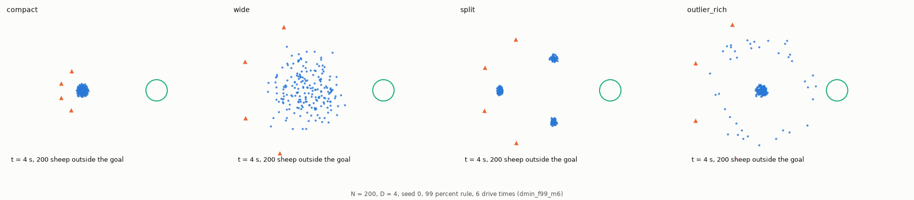
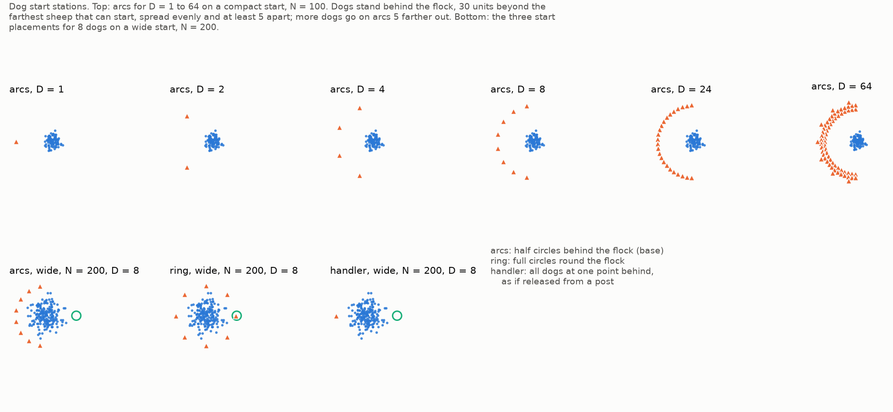
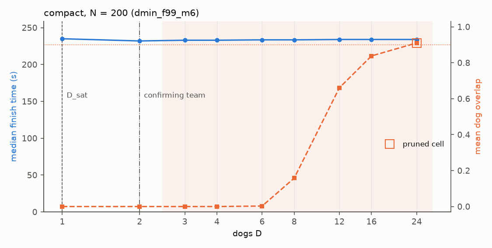
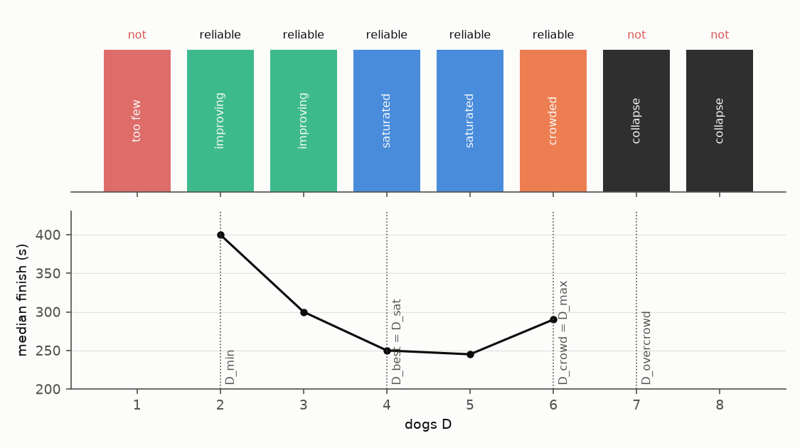

# Task design and experimental method

This doc explains how HerdSim sets up the herding task and why: how the field is sized, where the flock and dogs start, how many trials each case gets, and how a curve of trials becomes a critical team size. The models are in [`docs/methods/`](../methods/strombom_multi.md), and the results are in the [report](../report/d_min_report.md).

## 1. Task geometry and scale

### Why the field grows with the flock

As in Strombom et al. (2014), the field is open, with no walls; it only fixes where the flock starts and where the goal is. A goal of fixed size would be far too large for 25 sheep and too small to hold 400. HerdSim therefore sizes the goal and the drive distance by the calibrated flock radius $R_f(N)$: the radius a flock of $N$ sheep settles to while one dog drives it (Figure 1, Table 1).

**Figure 1: Task geometry drawn to scale.** The flock and goal radii grow slowly with $N$, and the drive distance is the largest of three terms.

- Marks: each dot in the middle and right panels is one of the five main flock sizes ($N = 25, 50, 100, 200, 400$).
- Left: the field at $N = 200$. It shows the settled flock circle ($R_f = 10.5$ m, solid black ring around the flock centre `+`), the farthest start of any sheep over the four [start layouts](#flock-start-layouts) ($l_{\mathrm{reach}} = 109.4$ m, the outer ring of `outlier_rich`, dashed blue circle), the goal ($R_{\mathrm{goal}} = 19.9$ m, green circle) and the drive distance $l = 139.8$ m between the two centres.
- Middle: the drive distance $l$ against $N$, with its three terms from Table 1; the largest (grey) sets $l$.
- Right: $R_f(N)$ and the goal radius $1.9\,R_f$.

### Sizing by the calibrated flock radius

Before a campaign runs, calibration measures $R_f(N)$ once for each flock size $N$. The radius is $\sqrt{2}$ times the root-mean-square (RMS) distance of the sheep from the flock centre, which is the radius of a uniform disc with the same RMS.

To measure it, one dog drives a compact flock for 300 s toward a goal it cannot reach. The flock starts from two Gaussian spacings ($s = 1$ m and $s = 3$ m, $\sigma = 0.5\,s\sqrt{N/\pi}$, cut at $3\sigma$), with 3 seeds each. $R_f(N)$ is the median, over seeds and spacings, of the mean radius in the last 90 s. Calibration stops with an error if any of these holds ([calibration settings](../guides/settings.md#calibration-of-r_f)):

- The radius changes by more than 5% between the last two 90 s windows.
- The two start spacings give radii more than 5% apart.
- The flock centre comes within $2\,R_f$ of the goal.

Table 1 gives the lengths of the task. Two of them use $l_{\mathrm{reach}}$, the farthest any sheep can start from the flock centre over the layouts of the protocol:

**Table 1: Lengths of the drive task.**

| Quantity | Rule (lengths in m) |
| :--- | :--- |
| Flock radius $R_f(N)$ | Calibrated per $N$ ([values](#deadlines-in-drive-times)) |
| Goal radius $R_{\mathrm{goal}}$ | $1.9\,R_f(N)$, an area $1.9^2 = 3.61$ times that of the settled flock |
| Drive distance $l$ (start centre to goal centre) | $\max(13\,R_f(N),\ 80,\ l_{\mathrm{reach}} + R_{\mathrm{goal}} + R_f)$ |

The third term of $l$ keeps the start area and the goal apart: the farthest sheep starts $l_{\mathrm{reach}}$ from the flock centre, and a settled flock in the goal reaches $R_{\mathrm{goal}}$ plus $R_f$ beyond it, so no sheep can start inside the goal.

Up to $N = 141$, $13\,R_f(N)$ is the largest term (blue curve in Figure 1, middle, which shows the five main sizes). It is 80.6 m at $N = 25$, so the 80 m floor never applies. From $N = 200$ on (orange curve), the widest layout (`outlier_rich`, $l_{\mathrm{reach}} = 1.6\,f(N)$, which grows with $N^{2/3}$) grows faster than $R_f(N)$. The third term then takes over and reaches $18\,R_f$ at $N = 400$.

### Worked example at N = 200

Table 2 follows the rules of Table 1 for $N = 200$, where $R_f = 10.47$ m. The collect distance of the dog rule is $f(200) = 2 \times 200^{2/3} = 68.40$ m ([collect distance](../methods/strombom_multi.md#when-to-collect)). Each layout sets its own farthest start; the formulas are in [section 2](#flock-start-layouts).

**Table 2: Lengths at N = 200.**

| Quantity | Calculation | Value (m) |
| :--- | :--- | :---: |
| Goal radius $R_{\mathrm{goal}}$ | $1.9 \times 10.47$ | 19.9 |
| Farthest start, `compact` | $3 \times 0.5\,R_f$ | 15.7 |
| Farthest start, `wide` | $3 \times 0.5\,f(N)$ | 102.6 |
| Farthest start, `split` | $f(N) + 3 \times 0.5\,R_f/\sqrt{3}$ | 77.5 |
| Farthest start, `outlier_rich` (the largest: $l_{\mathrm{reach}}$) | $1.6\,f(N)$ | 109.4 |
| First term of $l$ | $13 \times 10.47$ | 136.1 |
| Third term of $l$ (the largest: $l$) | $109.4 + 19.9 + 10.5$ | 139.8 |

### Success rules

A trial succeeds at the first tick, before the deadline, at which enough sheep are inside the goal:

- Strict rule: all $N$ sheep are inside the goal at the same tick.
- 99% rule: at least $\lceil 0.99\,N \rceil$ sheep are inside the goal at the same tick. This is all $N$ sheep below $N = 100$, and allows 1 sheep outside at $N = 100$, 2 at $N = 200$, 4 at $N = 400$ and 5 at $N = 566$.
- Flock-centre rule: the flock centre is within the goal radius. It is used only in the [paper check](../methods/strombom_check.md).

### Deadlines in drive times

Larger flocks are driven farther (206.8 m at $N = 400$, 80.6 m at $N = 25$), so a deadline in seconds would be harder for large flocks. Deadlines are instead counted in drive times. One drive time is $T_{\mathrm{drive}} = l / v_{\mathrm{sheep}}$, the time a sheep walking straight at $v_{\mathrm{sheep}} = 1.0$ m/s needs to cover $l$. With $v_{\mathrm{sheep}} = 1.0$ m/s, $T_{\mathrm{drive}}$ in seconds equals $l$ in metres. The study tests 12, 6 and 3 drive times, rounded up to whole 1 s ticks from the unrounded $l$ (Table 3):

**Table 3: Calibrated radii, drive distances and deadlines at the five main flock sizes.**

| $N$ | $R_f$ (m) | $l$ (m) and $T_{\mathrm{drive}}$ (s) | 12x (s) | 6x (s) | 3x (s) |
| :---: | :---: | :---: | :---: | :---: | :---: |
| 25 | 6.20 | 80.6 | 968 | 484 | 242 |
| 50 | 7.60 | 98.8 | 1186 | 593 | 297 |
| 100 | 9.08 | 118.1 | 1417 | 709 | 355 |
| 200 | 10.47 | 139.8 | 1678 | 839 | 420 |
| 400 | 11.40 | 206.8 | 2482 | 1241 | 621 |

## 2. Start layouts and dog starts

### Flock start layouts

In the dog rule, a sheep farther than the [collect distance](../methods/strombom_multi.md#when-to-collect) $f(N) = 2\,N^{2/3}$ m from the flock centre is an outlier, and the dogs collect it before they drive. The scattered layouts are sized by $f(N)$, so the share of sheep that start as outliers is about the same at every $N$ (Figure 2, Animation 1):

- `compact`: a Gaussian with $\sigma = 0.5\,R_f$. All sheep start inside $f(N)$, so the dogs drive at once.
- `wide`: a Gaussian with $\sigma = 0.5\,f(N)$. About 13% of the sheep start beyond $f(N)$ at every $N$.
- `split`: $k = 3$ compact clusters ($k = 2$ when $N < 12$) centred on a circle of radius $f(N)$. Each cluster is a Gaussian with $\sigma = 0.5\,R_f / \sqrt{k}$, so it has the density of `compact`.
- `outlier_rich`: 80% of the sheep in a `compact` core and 20% on a ring between $1.1\,f(N)$ and $1.6\,f(N)$ from the centre.

Every Gaussian is cut at $3\sigma$: a sheep drawn farther out is drawn again. A 2D Gaussian has 98.9% of its sheep within $3\sigma$ ($1 - e^{-4.5}$), so the cut changes the shape very little. It gives each layout a hard outer edge, which sets $l_{\mathrm{reach}}$ and the dog starts.

**Figure 2: The four start layouts ($N = 200$, $D = 4$, same scale).** Sheep outside the dashed collect circle are outliers that must be gathered first.

- Marks: blue dots are sheep, orange triangles are dogs, the green circle is the goal and the dashed circle is the collect distance $f(N)$.
- Panels: one layout per panel, named in its title.

**Animation 1: The same team on the four start layouts ($N = 200$, $D = 4$, seed 0, 99% rule, 6 drive times).** On `compact` the dogs drive at once; on the scattered layouts they collect first, and `split` takes longest (`dmin_f99_m6`).

- Marks: blue dots are sheep, orange triangles are dogs and the green circle is the goal; the bottom-left label shows the elapsed time and the number of sheep outside the goal.
- Panels: `compact`, `wide`, `split` and `outlier_rich`, finishing at 236, 278, 631 and 277 s.

### Dog starts

Dogs start behind the flock, so that none starts among the sheep (Figure 3). The inner arc is 30 m beyond the farthest start of any sheep of that layout. At $N = 200$ on `outlier_rich`, this is $109.4 + 30 = 139.4$ m from the flock centre. Dogs are at least 5 m apart along the arc, so this arc holds 87 dogs; any further dogs go on a second arc 5 m farther out.

All study protocols use `arcs`: semicircles on the side away from the goal. The engine also has `ring` (full circles without the cone toward the goal) and `handler` (all dogs at one point behind the flock).

**Figure 3: Dog start patterns.** Dogs start on semicircular arcs behind the flock and move to a second arc once the first is full.

- Marks: blue dots are sheep, orange triangles are dogs and the green circle is the goal.
- Top: the default `arcs` for $D = 1$ to 64 behind an $N = 100$ flock.
- Bottom: `arcs`, `ring` and `handler` at $N = 200$ with $D = 8$.

## 3. Adaptive sampling

A [cell](../glossary.md#trials-and-experiments) asks one question, such as "can 3 dogs herd 200 `wide` sheep within 6 drive times?". Most cells are decided well before the cap of 200 seeds. The campaign, the manager that runs a protocol, therefore runs seeds in batches of 10 and adds batches only to [open cells](../glossary.md#success-and-reliability) ([architecture](../codes/architecture.md#how-a-campaign-runs)). Four rules shape the sampling; Figures 4 to 7 show each on stored cells of `dmin_f99_m6` (99% rule, 6 drive times).

The protocol setting `decide_finish_times` changes what the campaign spends seeds on. When it is on, the campaign also spends seeds to decide which team sizes finish faster ([frontier values](#frontier-values)), not only which are reliable.

### Stopping early with the 99% Clopper-Pearson interval

After each batch, HerdSim computes the 99% Clopper-Pearson interval $[L, U]$ of the cell's success rate: the range that holds the true rate with 99% confidence, given the successes so far. It compares the interval with the threshold $\theta = 0.90$ (Figure 4):

- Unreliable ($U < 0.90$): the cell stops. With 0 successes this happens after 10 trials ($U = 0.411$).
- Reliable ($L \ge 0.90$): the cell stops. $L$ reaches 0.90 only after 51 successes in 51 trials, and the check runs every 10 seeds, so the earliest reliable decision is at 60 of 60 ($L = 0.915$).
- Undecided ($L < 0.90 \le U$): the cell gets another batch of 10 seeds, up to 200. At 200 seeds, a cell with 168 to 190 successes stays undecided.

**Figure 4: Early stopping with the 99% Clopper-Pearson interval after each 10-seed batch.** A cell with no successes stops at 10 seeds and one with all successes stops at 60; `wide`, $N = 400$, $D = 2$ stays near 0.93 and is undecided at 200 seeds (187 of 200).

- Marks: red is the upper bound $U$ for zero successes, green the lower bound $L$ for all successes, blue the stored cell's rate and interval, and the dashed line is $\theta = 0.90$.

### Midpoint densification

A protocol lists a coarse grid of team sizes. Where two neighbouring tested sizes $D_1$ and $D_2$ land in different [zones](#zones), the campaign adds the midpoint $\lfloor(D_1 + D_2)/2\rfloor$ (Figure 5). When `decide_finish_times` is off, a different reliability label triggers it instead of a different zone. It does so only if $D_2 - D_1$ is greater than 1 (`refine_min_gap`) and neither neighbour is [pruned](#pruning-above-saturation) or undecided below 200 seeds.

**Figure 5: Midpoint densification on `wide`, $N = 400$.** The zone changes between $D = 4$ (`improving`) and $D = 6$ (`saturated`), so the campaign added $D = 5$.

- Marks: dots are the team sizes of the protocol and the star is the midpoint added by the campaign, coloured by final zone.

### Pruning above saturation

Pruning stops seeds on large teams that only crowd each other: once adding dogs no longer makes the team faster, a still larger team whose dogs stand on top of each other is not worth more trials. The campaign checks it after every round, and it applies when all of these hold:

- [$D_{\mathrm{sat}}$](#frontier-values) is decided, and a larger team is already zoned `saturated`, which confirms it.
- The curve is not still improving at the top of the grid.

Then each reliable cell above the confirming team (zoned `saturated`, or undecided on finish time) gets no more seeds if, on average, at least 90% of its dogs have another dog within 2 m (`dog_overlap`). Such a cell is marked `pruned` (Figure 6). Unreliable cells, cells undecided on reliability, and `crowded` cells are never pruned.

**Figure 6: Overlap pruning on `compact`, $N = 200$, 99% rule, 6 drive times.** The median finish time of every team is 232 to 235 s ($D_{\mathrm{sat}} = 1$, confirmed at $D = 2$); above $D = 2$, only $D = 24$ passes 0.90 overlap (0.91) and is pruned.

- Marks: blue is the median finish time (left axis), orange the mean dog overlap (right axis), the dotted line the 0.90 threshold, the shaded area the teams above the confirming team, and the hollow square the pruned cell.

### Paired random streams

Cells with the same flock size and layout use the same seeds, so team sizes can be compared trial by trial (Figure 7). Seed index $i$ of every cell is `master_seed + i` ($2026 + i$ by default). Each seed splits into three separate random streams: one for the start positions, one for sheep noise and one for dog noise. Every team size $D$ therefore faces the same start flock, and the same sheep noise until the dogs' paths differ.

**Figure 7: Paired seeds on `wide`, $N = 400$, seeds 2026 to 2028, $D = 2$ to $4$.** Each seed gives the same start flock for every team size (seed 2028 fails at $D = 2$ and succeeds at $D = 3$ and 4).

- Marks: blue dots are sheep and orange triangles are dogs at tick 0; a green border means success and a red border failure.
- Panels: columns are seeds, rows are team sizes.

## 4. Flock and team sizes tested

### Flock size

All nine study runs test $N = 25, 50, 100, 200, 400$, each double the last. The 99% runs at 12 and 6 drive times add the steps in between, $N = 71, 141, 283, 566$ (factors of $\sqrt{2}$), so the points are evenly spaced on a log-log axis.

The largest size, $N = 566$, is set by the calibration edge: the smallest tested size at which calibration fails its 5% limits ([calibration settings](../guides/settings.md#calibration-of-r_f)). With either setting of `graze_repulsion`:

- With 3 seeds per start spacing, as in the study runs: the radius changes by at most 1.9% between windows up to $N = 566$ and by 2.7-2.8% at $N = 600$, then by 5.7-5.9% at $N = 630$. The 3-seed edge is $N = 630$.
- With 20 seeds per start spacing: the change is at most 0.52% up to $N = 400$, 1.4-1.7% at 566, 2.2% at 600, 3.4% at 630 and 4.1-5.6% at $N = 660$, where the two start spacings also differ by 11-13%. The 20-seed edge is $N = 660$.

The study therefore stops at $N = 566 = 400\sqrt{2}$, the last $\sqrt{2}$ step below the edge.

### Team size

All nine study protocols start with $D \in \{1, 2, 3, 4, 6, 8, 12, 16, 24\}$: two steps per doubling above $D = 2$, alternately 1.5x and 1.33x. [Midpoint densification](#midpoint-densification) adds sizes in between where needed.

The grid stops at $D = 24$ because larger teams no longer fit behind the flock. While driving, the dogs stand on an arc of radius $r_a\sqrt{N}$ that is as wide as the flock ([driving arc](../methods/strombom_multi.md#driving-and-its-limit-for-large-flocks)). For a flock at its calibrated radius $R_f$, this arc is about 13 m long at $N = 25$ and 23 m at $N = 400$, so only 7 to 12 dogs fit on it at least 2 m apart (2 m is the distance at which the overlap measure counts two dogs as overlapping). With 24 dogs on it, neighbours are 0.58 to 1.01 m apart.

## 5. Frontier rules and zones

The frontier rules turn each curve of cells (one flock size and layout, all team sizes) into critical team sizes (Table 4) and a [zone](#zones) for each cell (Figure 8). The [report](../report/d_min_report.md) uses $D_{\min}$, its bracket or lower bound, and $D_{\min,\mathrm{stable}}$: on a curve where a larger team is unreliable again, the smallest reliable team above the last unreliable one. The other values guide midpoint densification and pruning, and are saved with each run's curve results.

**Figure 8: Zones and frontier values on the example curve of Table 5.** Each team size gets a [zone](#zones) from its reliability and from finish-time comparisons with other teams.

- Marks: bars are coloured by zone, and dotted vertical lines mark the frontier team sizes of Table 4.
- Top: zone label and reliability per team size $D$.
- Bottom: median finish time of the reliable team sizes.

### Frontier values

Finish times are compared only between working teams, the reliable cells from $D_{\min}$ to $D_{\max}$. Two teams are compared on the seeds where both succeeded (at least 5 shared seeds), with 4000 bootstrap resamples of the difference of their median finish times. The verdict depends on where the 99% interval of that difference lies, relative to $\pm 5\%$ of the slower median (`time_margin`):

- Faster or slower: the interval lies entirely outside $\pm 5\%$.
- Same: the interval lies entirely inside $\pm 5\%$.
- Undecided: otherwise.

Table 4 defines the frontier values, and Table 5 shows them on an example curve:

**Table 4: Frontier values.**

| Value | Definition |
| :--- | :--- |
| $D_{\min}$ | Smallest reliable $D$. |
| $D_{\min,\mathrm{low}}$ | Smallest $D$ with $U \ge 0.90$ (the lowest team not yet ruled unreliable). When $D_{\min}$ sits above an undecided cell, the two form the bracket `D_min,low - D_min`. |
| $D_{\mathrm{overcrowd}}$ | Smallest $D$ above $D_{\min}$ (or above $D_{\min,\mathrm{low}}$ if no $D$ is reliable) where both $D$ and the next tested team size are unreliable. |
| $D_{\max}$ | Largest reliable $D$ below $D_{\mathrm{overcrowd}}$ (or the largest reliable $D$ if there is no $D_{\mathrm{overcrowd}}$). |
| $D_{\mathrm{best}}$ | Smallest working $D$ judged "same" or "faster" than the working team with the lowest median finish time. |
| $D_{\mathrm{sat}}$ | Smallest working $D$ that no larger working team is judged "faster" than. |
| $D_{\mathrm{crowd}}$ | Smallest working $D$ above $D_{\mathrm{best}}$ judged "slower" than $D_{\mathrm{best}}$. |

**Table 5: Example curve ($D_{\min} = 2$, $D_{\mathrm{best}} = D_{\mathrm{sat}} = 4$, $D_{\mathrm{crowd}} = D_{\max} = 6$, $D_{\mathrm{overcrowd}} = 7$).**

| $D$ | Reliable | Median finish (s) | Verdict | Zone |
| :---: | :--- | :---: | :--- | :--- |
| 1 | No | - | - | `too_few` |
| 2 | Yes | 400 | Slower than 4 | `improving` |
| 3 | Yes | 300 | Slower than 4 | `improving` |
| 4 | Yes | 250 | Same as 5 | `saturated` |
| 5 | Yes | 245 | Fastest | `saturated` |
| 6 | Yes | 290 | Slower than 4 | `crowded` |
| 7 | No | - | - | `collapse` |
| 8 | No | - | - | `collapse` |

### Zones

Each cell on a curve gets one zone from Table 6:

**Table 6: Cell zones.**

| Zone | Condition |
| :--- | :--- |
| `too_few` | Unreliable, below $D_{\min}$ (or below $D_{\min,\mathrm{low}}$ if no cell is reliable) |
| `improving` | Reliable, below $D_{\mathrm{sat}}$ and not slower than $D_{\mathrm{best}}$ |
| `saturated` | Reliable, at or above $D_{\mathrm{sat}}$ and not slower than $D_{\mathrm{best}}$ |
| `crowded` | Reliable, above $D_{\mathrm{best}}$ and slower than $D_{\mathrm{best}}$ |
| `unreliable_dip` | Unreliable, alone between $D_{\min}$ (or $D_{\min,\mathrm{low}}$) and $D_{\mathrm{overcrowd}}$ |
| `collapse` | Unreliable, at or above $D_{\mathrm{overcrowd}}$ |
| `recovered` | Reliable again above $D_{\mathrm{overcrowd}}$ |
| `undecided` | Undecided on reliability, or reliable above $D_{\mathrm{best}}$ with an undecided finish-time comparison |

### How failed trials end

Every failed trial gets one `failure_mode` label from its per-tick measurements. The rules in Table 7 are checked in order, and the first that matches gives the label. Rules 1 to 4 look at the second half of the trial; rules 5 and 6 compare its two halves. All thresholds are HerdSim's choices. The failure label `split` (the flock breaks apart) is not the `split` start layout.

**Table 7: Failure labels in the order they are checked.**

| Order | Label | Condition |
| :---: | :--- | :--- |
| 1 | `dogs_out_of_range` | On average fewer than 10% of the outer half of the flock is within the detection radius $r_s = 65$ m of a dog, and fewer than 1 sheep is beyond $2.5\,R_f$ from the flock centre. |
| 2 | `flock_escaped` | The mean distance from the flock centre to the goal is larger than at the start. |
| 3 | `split` | The largest group of sheep linked within 5 m holds less than 55% of the flock. |
| 4 | `scatter` | The mean RMS distance of the sheep from the flock centre (without the $\sqrt{2}$ factor of $R_f$) is larger than $2\,R_f$. |
| 5 | `oscillation` | Matches `stuck`, and the 200 s moving average of the goal distance changes direction at least 3 times by more than $R_{\mathrm{goal}}$. |
| 6 | `stuck` | The mean distance from the flock centre to the goal changes by less than $R_{\mathrm{goal}}$ between the two halves of the trial. |
| 7 | `timeout` | Any failed trial that matches none of rules 1 to 6. |
