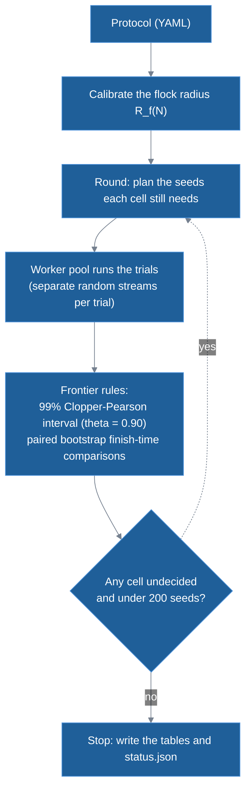

# Task design and experimental method

This doc explains how HerdSim sets up the job the dogs are given and how it decides, from many runs, which team sizes are enough. It is for a developer or researcher who knows Python but not herding models or this code.

It covers the geometry of the task, where sheep and dogs start, how seeds are spent, the decision rules and why each grid stops where it does. The sheep and dog rules are in [models](../methods/models.md), and every term, such as protocol, seed and tick, has a short definition in the [glossary](../glossary.md).

Most of this doc is about the drive task: $D$ dogs must bring a flock of $N$ sheep into a round goal before a deadline. The main sheep model is that of Strömbom et al. (2014); HerdSim also runs a second one on this task, the force model of Kubo et al. (2022). Three distances of the Strömbom model come up throughout:

- $r_a = 2$ m: the distance below which sheep push each other apart.
- $r_s = 65$ m: the reaction distance, within which a sheep reacts to a dog. A sheep with no dog that close grazes: it mostly stands still and now and then takes a step in a random direction.
- Collect distance $f(N) = r_a N^{2/3}$: Strömbom's dogs collect while any sheep is farther than this from the flock centre, fetching it back to the flock. Otherwise they drive, pushing the whole flock toward the goal from behind.

The gather task of Lama and di Bernardo (2024) is described on its own in [section 6](#6-the-gather-task-lama-and-di-bernardo-2024).

## Contents

- [1. Task geometry and scale](#1-task-geometry-and-scale)
- [2. Start layouts and dog starts](#2-start-layouts-and-dog-starts)
- [3. Adaptive sampling](#3-adaptive-sampling)
- [4. Why the grid stops where it does](#4-why-the-grid-stops-where-it-does)
- [5. Frontier rules and zones](#5-frontier-rules-and-zones)
- [6. The gather task (Lama and di Bernardo 2024)](#6-the-gather-task-lama-and-di-bernardo-2024)

## 1. Task geometry and scale

### Why the field grows with the flock

A task of fixed size would not be the same task for a small and a large flock. A goal of fixed radius holds a flock of 25 with room to spare and a flock of 400 not at all. A fixed drive of 100 m is sixteen flock radii for the small flock and nine for the large one.

HerdSim has no walls. A wall would stop sheep that the dogs failed to stop, and neither source model has one. Without walls the field is only the area drawn around the start, so HerdSim scales the task itself: it sets the drive distance and the goal radius as multiples of the flock's own size, so the task has the same shape at every $N$ (Figure 1).

**Figure 1: Task geometry drawn to scale.** The drive distance is the largest of three terms, and the flock and goal radii grow slowly with $N$.

- Marks: lengths are in m (the figure's "units"); in the middle and right panels each dot is one of the five main flock sizes.
- Left: the field at $N = 200$ sheep, with the flock radius $R_f$, the goal of $1.9 R_f$, the farthest start sheep of the widest layout and the drive distance.
- Middle: the drive distance $l$ against $N$, with each of its three terms (Table 1) and, in grey, the largest, which is the one used.
- Right: the calibrated flock radius $R_f(N)$ and the goal radius $1.9 R_f$ across flock sizes.

### Sizing by the calibrated flock radius

Every length of the drive task is a multiple of one measured size, the **calibrated flock radius $R_f(N)$**: how big a flock of $N$ sheep is once one dog has been driving it for a while. It is measured as follows:

- Run: one dog that knows where every sheep is drives the flock for 300 s, and the last 90 s are averaged.
- Radius: $\sqrt{2}$ times the RMS (root mean square) distance of the sheep from the flock centre, which is the radius of a uniform disc with that RMS.
- Repeats: the median over 3 seeds and two start sizes, a tight and a loose start flock (start radius $s\sqrt{N/\pi}$ with $s$ = 1 and 3 m).

It is measured once per method and $N$ at the start of a campaign, not per trial. A size whose radius has not settled, or depends on how big the flock started, is refused. Table 1 lists the rule for each length.

**Table 1: Lengths of the drive task.**

| Quantity | Rule | Meaning |
| :--- | :--- | :--- |
| Flock radius $R_f(N)$ | Calibrated (for example $6.2$ m at $N = 25$, $11.4$ m at $N = 400$) | The size of an $N$-sheep flock under one driving dog. |
| Drive distance $l$ | $\max(13\,R_f(N),\ 80,\ l_{\mathrm{reach}} + R_{\mathrm{goal}} + R_f)$ | From the flock's start centre to the goal centre. Larger flocks are driven farther. The floor of 80 m keeps a small flock from a drive of a few metres; on the Strömbom grids it never decides ($13\,R_f$ is already 80.6 m at $N = 25$), while on the Kubo grid it sets the drive at $N = 50$ and 100. The third term keeps the goal clear of every start ($l_{\mathrm{reach}}$ is the farthest any sheep can start, over every layout of the protocol). |
| Goal radius $R_{\mathrm{goal}}$ | $1.9\,R_f(N)$ | The goal holds the settled flock with the same margin at every $N$. The multiples 13 and 1.9 are conventions; the sensitivity runs test a goal of $1.5\,R_f$. |
| Field clearance | $80$ m around everything placed at the start (flock, dog stations, goal) | Only sizes the field; nothing stops the animals there. |
| Boundary | None | Animals can move anywhere, as in Strömbom et al. (2014) and Kubo et al. (2022). |

### Success rules

A trial succeeds when enough sheep are in the goal at once. HerdSim has two rules for "enough":

- Strict: every sheep inside the goal at the same tick. Large teams often fail on the last sheep ([report, section 3.4](../report/part2_success_rule.md#34-rq4-the-success-rule-and-the-last-sheep)).
- 99%: at least $\lceil 0.99\,N \rceil$ sheep inside at the same tick. Below $N = 100$ that is every sheep, so the two rules are the same there. From $N = 100$ one straggler is allowed, and four at $N = 400$.

### Deadlines in drive times

A fixed 5-minute limit for every flock size would be unfair to large flocks, which are driven over 200 m against 80 m for small ones.

HerdSim instead writes each deadline as a multiple of the **drive time** $T_{\mathrm{drive}}$: the time a sheep walking straight at its top speed $v_{\mathrm{sheep,max}}$ needs to cover the drive distance. A Strömbom sheep has only one speed, $1.0$ m/s.

$$
T_{\mathrm{drive}} = \frac{l}{v_{\mathrm{sheep,max}}}
$$

For a compact flock under the strict rule at 6 drive times (`dmin_m6`), the median finish time is 1.44 to $1.74\,T_{\mathrm{drive}}$, for every team of 1 to 24 dogs at $N = 25$ to 400 ([report, section 3.1](../report/part1_growth.md#31-rq1-how-does-d_min-grow-with-n)). The main protocols use deadlines of 3, 6 and 12 $T_{\mathrm{drive}}$, about two, four and eight times that finish time, each double the last.

The loose deadline leaves one dog time to collect outliers one after another; the tight one does not. How many dogs each deadline needs is a result ([report, section 3.3](../report/part1_growth.md#33-rq3-how-does-the-deadline-change-d_min)). The Kubo protocols use the fixed limit of 500 s of Kubo et al. (2022) instead.

Table 2 gives the deadlines of the main grids (protocol `dmin_m12` and its variants, four layouts). Each deadline is rounded up to whole ticks (1 s) from the unrounded drive distance, so it can be 1 s above the multiple of the rounded drive time shown: at $N = 50$, $3 \times 98.8 = 296.4$ s, and the deadline is 297 s.

**Table 2: Deadlines of the main grids.**

| Flock size ($N$) | Flock radius $R_f$ | Drive distance $l$ | Drive time $T_{\mathrm{drive}}$ | $12\times$ deadline | $6\times$ deadline | $3\times$ deadline |
| :---: | :---: | :---: | :---: | :---: | :---: | :---: |
| $N = 25$ | $6.20$ m | $80.6$ m | $80.6$ s (about 1.3 min) | $968$ s (about 16.1 min) | $484$ s (about 8.1 min) | $242$ s (about 4.0 min) |
| $N = 50$ | $7.60$ m | $98.8$ m | $98.8$ s (about 1.6 min) | $1186$ s (about 19.8 min) | $593$ s (about 9.9 min) | $297$ s (about 4.9 min) |
| $N = 100$ | $9.08$ m | $118.1$ m | $118.1$ s (about 2.0 min) | $1417$ s (about 23.6 min) | $709$ s (about 11.8 min) | $355$ s (about 5.9 min) |
| $N = 200$ | $10.47$ m | $139.8$ m | $139.8$ s (about 2.3 min) | $1678$ s (about 28.0 min) | $839$ s (about 14.0 min) | $420$ s (about 7.0 min) |
| $N = 400$ | $11.40$ m | $206.8$ m | $206.8$ s (about 3.4 min) | $2482$ s (about 41.4 min) | $1241$ s (about 20.7 min) | $621$ s (about 10.3 min) |

The scattered layouts ([section 2](#flock-start-layouts)) grow as $N^{2/3}$, while $R_f(N)$ grows much more slowly. From $N = 200$ the reach term therefore wins, and the drive is longer than $13\,R_f$ (18 $R_f$ at $N = 400$). Because the deadline is in drive times, a longer drive also gets a longer deadline. Measured in flock radii, though, the dogs on a large scattered flock still drive farther than on a small one.

### The holding task

In the plain drive task the trial ends the moment enough sheep are in. The holding task asks whether the dogs can also keep them there. Two follow-up protocols (`dmin_f99_hold`, `dmin_f99_hold_spacing`) change the end of the drive so that a trial succeeds only once 99% of the flock has stayed inside the goal for one drive time.

While the flock is in, the dogs withdraw to $r_s + r_a = 67$ m beyond the farthest sheep. No sheep then has a dog within $r_s$, so every sheep grazes. A dog that only stopped would stay within $r_s$ of the nearest sheep, which would keep moving away from it and could leave through the far side of the goal.

Two more protocols vary the goal and the share at $N = 25$, 50 and 100. `dmin_f99_hold_goal` tries goals of 1.9, 2.5 and $3.0\,R_f$. `dmin_f99_hold_share` crosses goals of 1.9 to $2.5\,R_f$ with shares of 99%, 95% and 90%.

A larger goal holds a small flock (Animation 1). This may be because the flock keeps walking while the dogs withdraw and walks out of a small goal; we have not tested it. The measurements are in [report, section 3.10](../report/part3_beyond_dmin.md#310-rq10-when-do-more-dogs-hurt-holding-the-flock-and-dogs-that-take-up-room).

**Animation 1: Holding a small flock (`compact`, $N = 25$, one dog, seed 0, 99% held for one drive time).** The flock keeps walking after the dog withdraws, and only the larger goal holds it. Both start from the same flock (the `compact` layout of [section 2](#flock-start-layouts)), and each replay reproduces its stored trial (`dmin_f99_hold`, `dmin_f99_hold_goal`).

- Marks: blue dots are sheep, the orange triangle is the dog and the green circle is the goal; the text at the bottom left gives the time and how many sheep are outside the goal.
- Left: in a goal of $1.9 R_f$ (11.8 m) the flock walks on and leaves the goal, so the hold fails.
- Right: in a goal of $3.0 R_f$ (18.6 m) the same walk ends inside and the flock is held.

## 2. Start layouts and dog starts

### Flock start layouts

How the flock is spread at the start decides how much collecting the dogs must do before they can drive. HerdSim has four start layouts, from a flock that needs no gathering to one that needs a lot (Figure 2):

**Figure 2: The four start layouts ($N = 200$, $D = 4$, drawn to the same scale).** A sheep that starts outside Strömbom's collect distance has to be collected before the flock can be driven.

- Marks: the dashed circle is the collect distance $f(N) = r_a N^{2/3}$.
- Panels: one per layout, named above each.

The scattered layouts are sized by Strömbom's collect distance $L = f(N) = 2\,N^{2/3}$ (with $r_a = 2$). Sizing by $L$ makes "scattered" mean the same at every $N$: a fixed share of the sheep starts beyond the distance at which the dogs must collect rather than drive. The four layouts are:

- `compact`: a Gaussian with $\sigma = 0.5\,R_f$, cut at $3\sigma$. Every sheep starts within $f(N)$, so the dogs start by driving.
- `wide`: a Gaussian with $\sigma = 0.5\,L$, cut at $3\sigma$, so about 13% of the sheep start beyond $L$ at every $N$ ($e^{-2}$ before the cut).
- `split`: three clusters of the compact density ($\sigma = 0.5\,R_f / \sqrt{3}$ each; two clusters below $N = 12$) with their centres on a circle of radius $L$ around the flock centre.
- `outlier_rich`: 80% of the sheep in a compact core and 20% on a ring between $1.1\,L$ and $1.6\,L$ from it.

Animation 2 runs one team on each layout. On `compact` the dogs drive at once; on the others they collect first.

**Animation 2: The same team on the four start layouts ($N = 200$, $D = 4$, seed 0, 99% rule, 6 drive times).** On `compact` the dogs drive at once. On the scattered layouts they collect first, and `split`, whose clusters start apart, takes longest. Each replay reproduces its stored trial (`dmin_f99_m6`).

- Marks: blue dots are sheep, orange triangles are dogs and the green circle is the goal; the text at the bottom left gives the time and how many sheep are outside the goal.
- Panels: `compact`, `wide`, `split` and `outlier_rich` from left to right. The flock is in at 236, 278, 631 and 277 s.

### Why the layouts are not ordered by spread

One could size the layouts by their start spread, the RMS radius of the flock at the start. HerdSim sizes them by the collect distance instead, because spread alone does not put them in order of difficulty.

At $N = 400$, `outlier_rich` starts less spread out than `wide` (66.2 m against 74.8 m), yet it succeeds less often: 55% of the trials against 84%, pooled over every tested team of `dmin_m6` (strict rule, 6 drive times). This may be because where the outliers lie matters as well as how far out they start; we have not tested it. The start spreads and the analysis are in [report, section 4.3](../report/part5_failures.md#43-how-failed-trials-end-and-the-start-spread).

### Dog starts

The dogs start outside the flock, behind it. The first dog circle lies $30$ m (`dog_start_gap`) beyond the farthest point any sheep of that layout can start, so no dog starts among the sheep. The gap is less than $r_s = 65$ m, so the sheep nearest the dogs react from the first tick.

Dogs on one circle stand at least $5$ m (`dog_start_spacing`) apart along it, and dogs that do not fit go on a circle $5$ m farther out. The gap and the spacing are conventions, and the sensitivity runs test gaps of 15 and 60 m. HerdSim has three start patterns (Figure 3):

**Figure 3: Dog starts.** By default the dogs start on arcs behind the flock; the ring and handler starts are the alternatives the sensitivity runs test.

- Marks: blue dots are sheep, orange triangles are dogs and the green circle is the goal.
- Top: the default arcs for $D = 1$ to $64$ behind an $N = 100$ flock.
- Bottom: arcs, ring and handler start compared at $N = 200$ with $D = 8$ dogs.

The three patterns are:

- `arcs` (default): half circles behind the flock, on the side away from the goal, with the dogs spread evenly over each. When the count is odd, one dog starts on the drive axis, the line through the flock centre and the goal centre.
- `ring`: full circles round the flock, leaving out the cone that holds the goal.
- `handler`: every dog at one point straight behind the flock, at the distance of the first arc. It stands for dogs sent out together from one spot.

Animation 3 runs one flock from each of the three starts.

**Animation 3: Three dog starts on the same flock (`wide`, $N = 200$, $D = 8$, seed 0, strict rule, 6 drive times).** All three starts bring every sheep in, at 272, 290 and 271 s. Each replay reproduces its stored trial (`dmin_s_base`, `dmin_s_ring`, `dmin_s_handler`).

- Marks: blue dots are sheep, orange triangles are dogs and the green circle is the goal; the text at the bottom left gives the time and how many sheep are outside the goal.
- Left: `arcs`, the default. The dogs start behind the flock and close in from that side.
- Middle: `ring`. The dogs start all round the flock, except toward the goal.
- Right: `handler`. The dogs start at one point behind the flock and spread out round it before it is gathered.

## 3. Adaptive sampling

The question for each setup is whether a team is reliable, and most cells are decided before the cap of 200 seeds. Over the 41 protocols, 499 of the 6,845 cells are still open at the cap ([section 4](#seeds-per-cell-cap-of-200)). Running every cell to 200 trials would spend most of the time on cells whose answer is obvious, such as one dog against 400 scattered sheep at a tight deadline, or twelve dogs on 25 compact sheep. HerdSim instead runs in rounds and adds trials only where the answer is still open.

The terms used below are in the [glossary](../glossary.md#trials-and-experiments):

- Cell: one method, layout, $N$ and $D$ within one protocol. It asks a question such as "can 3 dogs herd 200 sheep in this setup?", and holds its trials, one per seed.
- Curve: the cells of one method, layout and $N$, taken over $D$.
- Reliable: a cell is reliable when its success rate is at least $\theta = 0.90$ with 99% confidence.
- Zone: what a cell's place on its curve says, such as too few dogs or no faster than a smaller team. The zones, and $D_{\mathrm{sat}}$ and $D_{\mathrm{best}}$, which the pruning rule uses, are defined in [section 5](#5-frontier-rules-and-zones).

### The adaptive sampling loop

The diagram shows one run. The flock radius is calibrated once, then rounds repeat until no cell is both undecided and under 200 seeds:

Each round plans the seeds every cell still needs, runs them in a pool of worker processes and then applies the frontier rules, the decision rules of [section 5](#5-frontier-rules-and-zones). The subsections below give each rule.

### Stopping early with the 99% Clopper-Pearson interval

Each cell starts with a batch of 10 seeds. After each batch HerdSim computes the exact two-sided 99% Clopper-Pearson interval $[L, U]$ of the success rate, an interval for a rate from a count of successes; $L$ is its lower end and $U$ its upper end (this $L$ is unrelated to the collect distance of section 2). The cell is then in one of three states:

- Unreliable: $U < 0.90$. This is usually decided after 10 to 20 trials, and the cell gets no more seeds.
- Reliable: $L \ge 0.90$. The smallest sample that reaches this is 51 straight successes, so the earliest a cell is called reliable is the end of its 60-trial batch.
- Undecided: otherwise. The cell gets another batch of 10, up to 200.

The interval is recomputed after each batch (Figure 4), and the 99% holds for each look on its own. The repeated looks are not corrected for, so the chance of a wrong decision over a cell's whole run is somewhat above 1% ([report, limitations](../report/d_min_report.md#6-limitations)).

**Figure 4: Stopping early.** Clear failures stop after 10 to 20 seeds; clear successes once 51 successes in a row are in, at the end of the 60-trial batch; only cells near the threshold continue toward 200.

- Marks: an illustration, not drawn from stored runs. The red curve is the upper bound of the 99% Clopper-Pearson interval when no trial succeeds, the green curve the lower bound when every trial succeeds, and the blue points an undecided cell with its interval after each batch of 10. The dashed line is $\theta = 0.90$.

### Midpoint densification

The protocol lists a coarse set of team sizes, and HerdSim fills in counts only where the answer changes. Take $D = 2$ unreliable and $D = 4$ reliable: the next round adds $D = 3$ (Figure 5). $D_{\min}$, the smallest reliable team, is then found without testing every count.

The rule is that when two tested counts next to each other on a curve are in different zones and differ by more than `refine_min_gap` $= 1$, the next round adds the count halfway between. When finish times are not decided, "different zones" means that one is reliable and the other not. An undecided neighbour waits for its own seeds first, unless it has reached the 200-seed cap; a pruned cell (next subsection) adds no midpoint.

**Figure 5: Midpoint densification.** A change of zone between $D = 2$ and $D = 4$ adds $D = 3$ to the next round.

- Marks: an illustration, not drawn from stored runs. Each dot is a tested $D$, coloured by its zone; the top row is the first round and the bottom row the next, with the added $D = 3$ as a star.

### Pruning above saturation

Well above the point where more dogs stop helping, most dogs of a large team can end up within 2 m of another dog. A dog that close to another acts as a copy of it, so the cell repeats the one below it and more seeds would not change its zone. HerdSim stops spending seeds there (Figure 6).

The rule needs $D_{\mathrm{sat}}$ to be decided and some larger tested count to be zoned saturated as well; this does not apply when $D_{\mathrm{sat}}$ is the top of the grid and still improving. Every cell above that confirming count is then pruned when at least 90% of its dogs, averaged over ticks and trials, had another dog within 2 m (`prune_overlap`).

Only cells zoned saturated or undecided are pruned, never an unreliable cell or one slower than $D_{\mathrm{best}}$. Such cells are marked `pruned` in `frontier_cells.csv`.

**Figure 6: Pruning.** Above saturation, cells whose dogs overlap (at least 0.90) get no more seeds.

- Marks: an illustration, not drawn from stored runs. Blue is the median finish time (left axis) and orange the mean dog overlap (right axis); the dotted line is an overlap of 0.90, and the shaded region is pruned.

### Paired random streams

To compare 2 dogs with 4 dogs fairly, both teams should face the same flock. Seed $i$ of every cell is `master_seed + i` (for example $2026 + i$). Each trial draws the start positions, the sheep's random choices and the dogs' random choices from three separate streams.

The time limit plays no part in a trial until it is reached, so a shorter deadline only cuts the same trial short, which the stored runs confirm ([report, section 3.3](../report/part1_growth.md#33-rq3-how-does-the-deadline-change-d_min)).

So seed $i$ gives $D = 2$ and $D = 4$ the same start flock (Figure 7), and their sheep draw noise from the same stream, so they see the same noise until the dogs act differently. The finish-time difference at that seed is then mostly the effect of the team. The paired bootstrap of [section 5](#5-frontier-rules-and-zones) compares these per-seed differences.

**Figure 7: Paired seeds.** Seed 2026 gives the same start flock at every team size $D$.

- Marks: an illustration, not drawn from stored runs. Columns are seeds 2026 to 2028 and rows team sizes 2 to 4; the flock in each column is the same at every $D$, so only the team differs.

### Saving trials and resuming

A run can take hours, so it must survive being stopped. Every finished trial is appended to `trials.jsonl` at once. A run can be stopped at any time (`Ctrl+C`) and resumed with the same command without losing finished trials. A lock on the folder stops a second run from writing to it at the same time.

Git keeps a gzip copy, `trials.jsonl.gz`, because the plain file of a large protocol passes GitHub's 100 MB limit. A run writes the copy when it ends, and a fresh clone unpacks it the first time the folder is opened.

## 4. Why the grid stops where it does

### Flock size

Each setting tests a range of flock sizes $N$ chosen for its own question. Table 3 gives each range and the reason it stops there:

**Table 3: Flock sizes by setting.**

| Setting | Range | Reason |
| :--- | :---: | :--- |
| Main grids | $25$ to $400$ | At $N \le 50$ every layout needs one dog at every deadline, so smaller sizes add nothing. $N = 400$ is the top of the strict-rule grids; larger flocks are covered by the added sizes of the 99% grids (next row) and by the large-$N$ runs. |
| Sensitivity | $100$ to $400$ | The part of the main range where $D$ matters, on the `wide` and `outlier_rich` starts, with $D = 1$ to $16$ at 6 drive times. |
| Added sizes (99% grids at 12 and 6 drive times) | $71, 141, 283, 566$ | Steps of $\sqrt{2}$, evenly spaced in $\log N$, so the fit is not dominated by the small sizes. $566 = 400\sqrt{2}$ is the last such step below about $N = 600$, above which a driven flock no longer settles to one radius, so one $R_f(N)$ no longer describes it. |
| Kubo model | $25$ to $100$ | The Kubo flock packs to a radius of about $6$ m ($5.9$ to $6.2$) at any $N$, so larger $N$ only makes it denser. |
| Sensing range | $50$ to $200$ | Each dog's sensing range is varied from 15 to 100 m around the sheep's reaction distance $r_s$ ($65$ m), with full sight as the control. The flock sizes stop at 200, where the collect distance $f(N) = 68$ m already reaches that distance; at larger $N$ the sweep would measure that limit as well as the sensing effect. |
| Gather task (`lama`) | $1$ to $400$ targets, perfect squares | The paper's cells up to $\sqrt{N} = 20$, with $N$ the number of targets; its axis runs to 25. That range holds the threshold of Table I in its Supplementary Material ($\sqrt{N} = 8$, 9 and 11 at the 90%, 95% and 99% levels) and the square-root rise above it, which are the results compared ([section 6](#6-the-gather-task-lama-and-di-bernardo-2024)). The five larger sizes would about double the run time and add nothing to the check. |
| Large $N$ | $566$ to $3200$ | Tests large flocks, and the limit where Strömbom's drive point passes the sheep's reaction distance ($N \approx 1056$). Above $N = 566$, $R_f$ is imposed from the density of the calibrated 566 flock, since above about 600 the calibration gives no single radius. |

### Team size

The team sizes $D$ are spaced so that each setting can find its answer between two tested counts:

- Main grids ($1, 2, 3, 4, 6, 8, 12, 16, 24$): steps of about $1.5\times$, so at least two counts per doubling. $D = 24$ is well above every decided $D_{\min}$ of the main grids.
- Gather task ($1$ to $25$, every count): the grid of Lama and di Bernardo (2024), at its resolution of one herder.
- Holding (`dmin_f99_hold`, and `dmin_f99_hold_spacing`, which keeps its grid; adds $7, 9, 10, 11, 13$): the arc behind the flock holds about $7, 9, 10, 11, 12$ dogs 2 m apart at $N = 25$ to $400$. The main grid already has 12, so the added counts put a tested team at each of these sizes and one just above the largest (13), which shows where crowding starts.
- Holding small flocks, goal and share (`dmin_f99_hold_share`, $1, 2, 4, 8, 24$): the question is the goal and the share, so the team grid is thinned. The largest $D$ stays 24 so the dog starts match `dmin_f99_hold`. `dmin_f99_hold_goal` uses the main grid ($1$ to $24$), also with 24 as its largest $D$.

### Seeds per cell (cap of 200)

The cap is 200 because at 200 seeds a cell is decided only if its success rate is at least $0.955$ or at most $0.835$. Doubling to 400 narrows that band only to $0.94$ and $0.86$, for twice the trials.

Over the 41 protocols the folders hold 6,845 cells, and 499 of them are open at the cap ([appendix A](../report/appendix_run_record.md#appendix-a-protocol-run-record)). An open cell is one still undecided on reliability or, in a [sitting](../glossary.md#trials-and-experiments) (one run of the campaign command on a folder) that decides finish times, on a finish-time comparison ([open cell](../glossary.md#success-and-reliability)). The count takes each folder's last sitting. Pruned cells and cells with an error are never counted open. Appendix A shows how both totals follow from its two run-record tables.

A curve whose $D_{\min}$ depends on a cell undecided on reliability is reported as a bracket, a range of team sizes instead of one value (for example `2-3`).

## 5. Frontier rules and zones

Once a curve's cells have their trials, the frontier rules turn them into answers: the smallest team that works, the fastest one, and where more dogs stop helping or start to hurt. The rules are in [`analysis/frontier.py`](../../analysis/frontier.py); Figure 8 shows the zones along $D$:

**Figure 8: Zones along the team size $D$.** The zones follow from the reliability of each cell and the paired finish-time comparisons.

- Marks: illustrative curves, not data. The coloured bands are the five main zones, from too few to collapse (the list in [Zones](#zones) adds the dip, recovered and undecided cases), with $D_{\min}$, $D_{\mathrm{best}}$, $D_{\mathrm{sat}}$, $D_{\mathrm{crowd}}$ and $D_{\max}$ marked below (Table 4).
- Top: the success rate of a cell against $D$; the dashed line is $\theta = 0.90$.
- Bottom: the median finish time against $D$; the shaded band is the margin around $D_{\mathrm{best}}$.

### Frontier values

The finish-time values only look at the working range: the reliable $D$ from $D_{\min}$ up to $D_{\max}$ (Table 4). $D_{\mathrm{best}}$ answers which team is as fast as the fastest. $D_{\mathrm{sat}}$ answers from which team on more dogs stop helping.

Two cells are compared on finish time with a paired bootstrap:

1. Pairs: take the seeds both cells succeeded on (at least 5) and the per-seed differences of their finish times.
2. Bootstrap: resample those differences 4000 times; the median difference, relative to the slower cell's median, gives a 99% interval.
3. Verdict: the cell is faster or slower when the whole interval lies beyond $\pm 5$% (`time_margin`), the same when it lies within, and undecided otherwise.

Table 4 defines the values:

**Table 4: Frontier values.**

| Value | Definition |
| :--- | :--- |
| $D_{\min}$ | Smallest reliable $D$ ($L \ge 0.90$). |
| $D_{\min,\mathrm{low}}$ | Smallest $D$ whose upper bound reaches $\theta$ ($U \ge 0.90$): the lowest team that may still be reliable, and the low end of a bracket. |
| $D_{\mathrm{overcrowd}}$ | Smallest $D$ above $D_{\min}$ where it and the next tested $D$ are both unreliable; two in a row, because one unreliable cell can be a sampling dip near the threshold. On a curve with no reliable $D$ yet, the search starts above $D_{\min,\mathrm{low}}$, so teams that fail above one that may still be reliable count as too many, not too few. |
| $D_{\max}$ | Largest reliable $D$ below $D_{\mathrm{overcrowd}}$ (or the largest reliable $D$). |
| $D_{\mathrm{best}}$ | Smallest working $D$ whose paired comparison with the fastest working $D$ is decided same or faster. |
| $D_{\mathrm{sat}}$ | Smallest working $D$ that no larger working $D$ is faster than. |
| $D_{\mathrm{crowd}}$ | Smallest working $D$ above $D_{\mathrm{best}}$ that is slower than $D_{\mathrm{best}}$. |

### Zones

Each cell gets one zone from these values:

- `too_few`: unreliable, below $D_{\min}$ (below $D_{\min,\mathrm{low}}$ on a curve with no reliable $D$).
- `improving`: reliable, below $D_{\mathrm{sat}}$; more dogs finish sooner.
- `saturated`: reliable, from $D_{\mathrm{sat}}$ up, and not slower than $D_{\mathrm{best}}$.
- `crowded`: reliable, but slower than $D_{\mathrm{best}}$.
- `unreliable_dip`: unreliable, between $D_{\min}$ (or $D_{\min,\mathrm{low}}$) and $D_{\mathrm{overcrowd}}$.
- `collapse`: unreliable, from $D_{\mathrm{overcrowd}}$ up.
- `recovered`: reliable again above $D_{\mathrm{overcrowd}}$, outside the working range.
- `undecided`: its reliability, or its comparison with $D_{\mathrm{best}}$, is still open.

A working cell above $D_{\mathrm{best}}$ that is slower than $D_{\mathrm{best}}$ is `crowded` whether it lies below or above $D_{\mathrm{sat}}$; `improving` and `saturated` apply only to cells that are not slower.

### How failed trials end

Failed drive trials are split by where the flock ended, far from the goal or near it (`analysis/dispersion_burden.py`). The definition and the counts are in [report, section 4.3](../report/part5_failures.md#43-how-failed-trials-end-and-the-start-spread).

### Crowding with dogs that take up room

In the main runs the dogs have no size (point dogs), so two can stand at one point. One setting was tested where extra dogs get in each other's way: dogs that take up room, with no dog allowed to step within 2 m of another. A dog whose step would end that close does not move that tick.

This was run in the holding task, where on `outlier_rich` $N = 400$ it makes large teams fail (Animation 4). The results are in [report, section 3.10](../report/part3_beyond_dmin.md#310-rq10-when-do-more-dogs-hurt-holding-the-flock-and-dogs-that-take-up-room).

**Animation 4: Twelve point dogs against twelve dogs kept 2 m apart, holding the same flock (`outlier_rich`, $N = 400$, seed 0, 99% held for one drive time, 6 drive times).** Only the point dogs bring the flock in and hold it; the spaced dogs never get 99% of the flock into the goal before the deadline. Each replay reproduces its stored trial (`dmin_f99_hold`, `dmin_f99_hold_spacing`).

- Marks: blue dots are sheep, orange triangles are dogs and the green circle is the goal; the text at the bottom left gives the time and how many sheep are outside the goal.
- Left: point dogs, which have no size, as in the main runs, so two can stand at one point. The hold is met at 1162 s with every sheep in.
- Right: dogs kept 2 m apart, so a dog whose step would end closer to another does not move that tick. At the deadline of 1241 s, 289 sheep are outside the goal.

## 6. The gather task (Lama and di Bernardo 2024)

Everything above describes the drive task (`drive_to_goal`), used by every Strömbom and Kubo protocol. The `lama` method runs in a second task, `gather`, which reproduces the setting of [Lama and di Bernardo (2024)](https://doi.org/10.1103/PhysRevResearch.6.L032012) (model: [`docs/methods/models.md`](../methods/models.md#lama--di-bernardo-2024-non-cohesive-targets)). A protocol selects it with `task: gather`.

In this task the sheep are called targets and the dogs herders, as in the paper; this section uses those words. The targets do not flock and start scattered over a disc, and the herders must bring them into a goal at its centre. Each herder senses targets only within its sensing radius $\xi$. Figure 8 of the [models document](../methods/models.md#local-herders-lama_herders) shows the herder rule and one real gather trial from start to end.

The runs cover the paper's grid up to $\sqrt{N} = 20$, with $N$ the number of targets (40,280 trials). The results are in [report, section 3.14](../report/part6_square_root_law.md#314-rq14-targets-without-cohesion-the-square-root-law-of-lama-and-di-bernardo-2024).

### Geometry of the gather task

Table 5 lists the geometry. Fig. and Table numbers refer to the paper; Table I and Fig. S8 are in its Supplementary Material. The paper gives lengths with no unit, and HerdSim reads them as metres. $\Delta t$ is the time step of one tick.

**Table 5: Geometry of the gather task.**

| Quantity | Setting and value | Source |
| :--- | :--- | :--- |
| Start disc $R$ | `gather_start_radius`, $50$ m | The paper's main case (Fig. 2) |
| Goal radius | `gather_goal_fraction` $\times R = R/5 = 10$ m | The paper's $r^{\ast} = R/5$ |
| Start (layout `uniform`) | Targets and herders uniform over the disc, goal included | The paper's $\Omega_0$ |
| Required share | `success_fraction` $= 0.99$ | The paper's $\chi^{\ast} = 0.99$ |
| Time limit | $166{,}667$ ticks $= 5000$ s at $\Delta t = 0.03$ s | The paper's $t_{\max} = 5.0 \times 10^3$ (Fig. S8), given with no unit and read as seconds |
| Boundary | None | As in the drive task |

The targets do not flock, so there is no driven flock radius to calibrate, and the task is sized by $R$. Targets are drawn before herders, so a seed gives the same targets whatever the team size, and cells at different $D$ stay paired as in the drive task.

### When a trial ends and what counts as success

A gather trial ends in one of three ways:

- Success: at least 99% of the targets are inside the goal at a tick when every herder is inside it. This is the paper's stop ("the simulation is stopped when all the herders are inside $\Omega_G$").
- Early end (a failure): the paper stops a trial when every herder is inside the goal. Read literally, that ends a one-herder trial at the first tick whenever the herder starts inside. HerdSim therefore ends a trial early only when every herder is inside and none of them senses a target outside it. The herders have then brought in every target they can sense, and the rest is lost.
- Otherwise: the trial runs to the time limit.

Failures are labelled `targets_lost` (some targets were beyond every herder's sensing radius at the end) or `outnumbered` (every target was sensed, but the share was not reached in time). Every row also keeps the share inside at the end (`final_in_goal_fraction`), so the paper's statistic, the mean of that share over the seeds, can be computed next to HerdSim's reliability rule.

Animation 5 shows one run of each kind, in a cell just above the paper's threshold.

**Animation 5: Two ways a gather run ends (144 targets, 11 herders, $\xi = 10$ m).** One run succeeds; the other ends early with targets lost. Each replay reproduces its stored trial (`lama_r50`).

- Marks: blue dots are targets, orange triangles are herders and the green circle is the goal; the text at the bottom left gives the time and how many targets are outside the goal.
- Left: seed 0 gathers all but one target and succeeds under the 99% rule.
- Right: seed 1 ends with two targets beyond every herder's sensing radius. Each herder, sensing no target, walks back into the goal, and the run ends early as `targets_lost`.

### Two statistics

The paper and HerdSim judge "enough herders" differently. Table 6 sets the two side by side:

**Table 6: Paper and HerdSim statistics.**

| Question | Paper | HerdSim |
| :--- | :--- | :--- |
| A team is enough when | the mean share inside at the end, over 50 runs, is at least $0.99$ | the 99% Clopper-Pearson interval of the success rate lies at or above $0.90$ |
| Seeds | 50 per cell | adaptive, 10 to 200 per cell |

Both are read from the same trial rows.

### Metrics recorded every 10 ticks

At $\Delta t = 0.03$ s a failing trial runs $166{,}667$ ticks, and the per-tick metrics cost more than the model itself. The gather protocols therefore set `metrics_stride: 10`, one record every $0.3$ s. Success, the early end and the time limit are still checked every tick, and the last tick is always recorded, so the outcome of a trial does not depend on the stride.

Only the first-arrival times are affected. A first-arrival time is the first tick at which a given share of the targets is inside, and it is read from the recorded ticks. It is therefore never earlier than the exact time and can be later: a share reached and lost again between two records is missed.

### Protocols

Table 7 lists the gather protocols:

**Table 7: Gather protocols.**

| Protocol | Sensing radius $\xi$ (m) | Paper figure |
| :--- | :---: | :--- |
| `lama_r50` | $10$ | Fig. 2b, Table I |
| `lama_r50_inf` | infinite | Fig. 2a |
