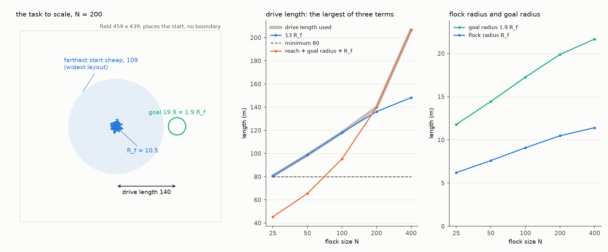
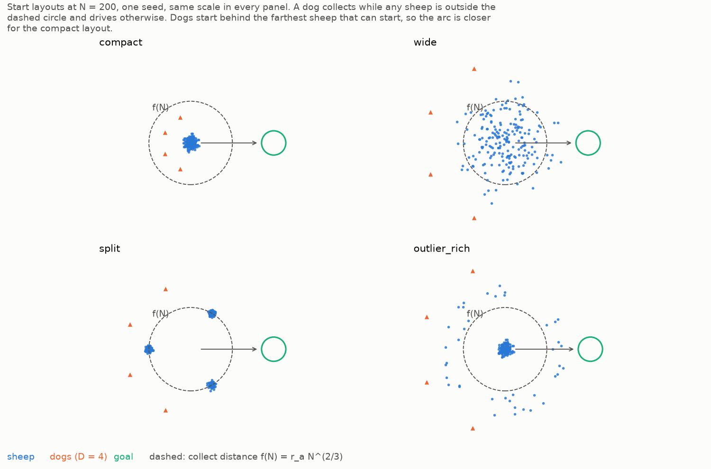
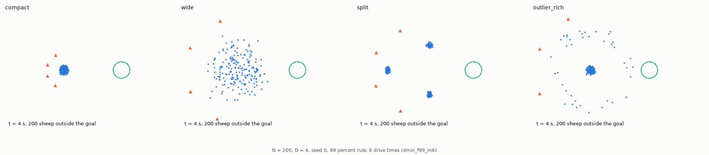
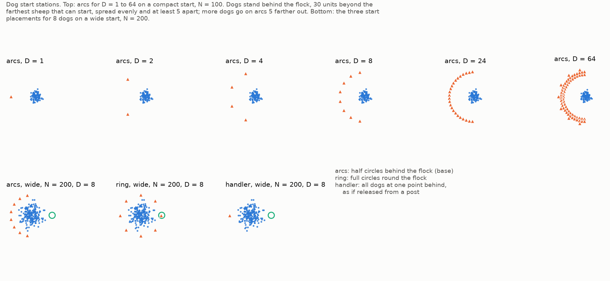
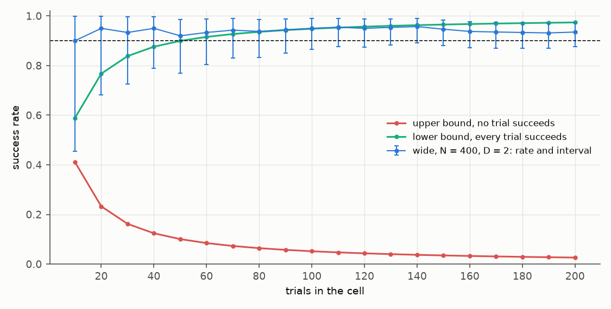
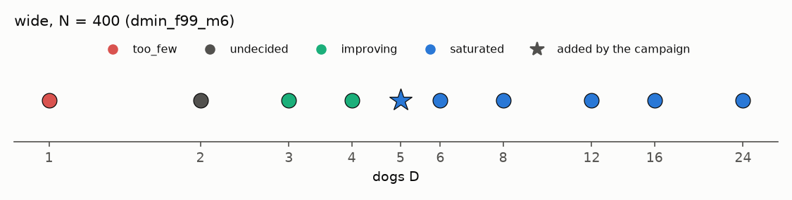
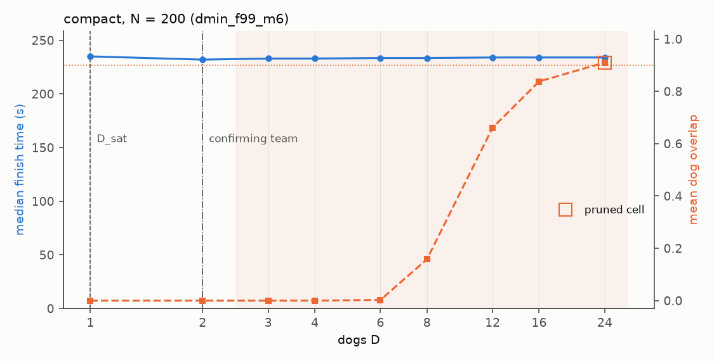
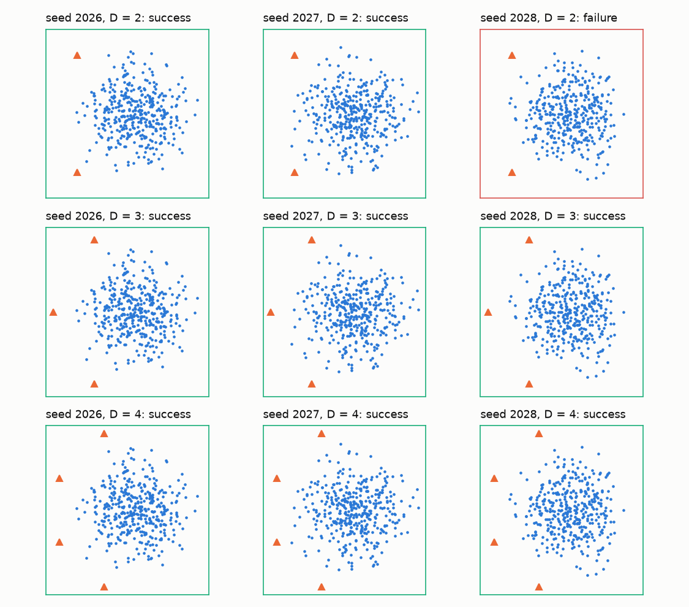
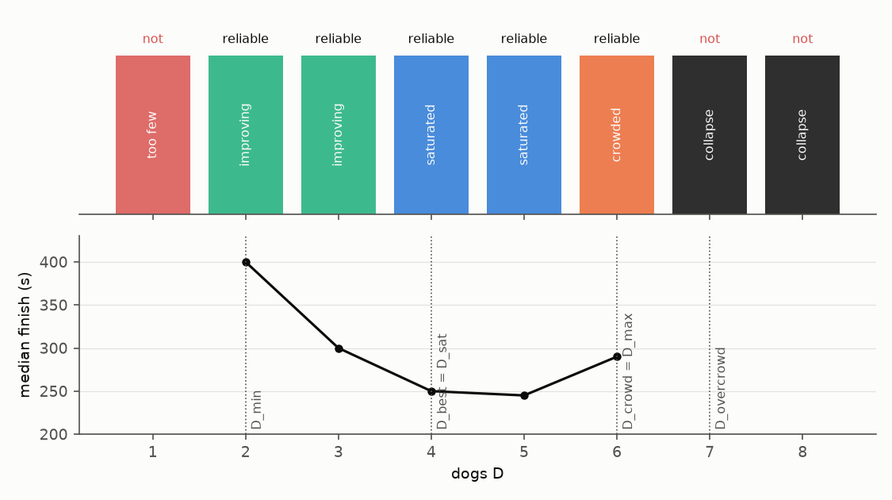

# Task design and experimental method

What the sheep-herding task looks like, how HerdSim samples it, and how a curve of results is turned into answers. Terms such as cell, curve and campaign are in the [glossary](../glossary.md), and the code layers are in the [architecture](../codes/architecture.md).

## 1. Task geometry and scale

### Why the field grows with the flock

A goal of fixed radius holds a flock of 25 with room to spare and a flock of 400 not at all. HerdSim has no walls, as the source model has none, and a wall would stop sheep that the dogs failed to stop. So it sizes the task by the calibrated flock radius $R_f(N)$, the radius a flock of $N$ sheep settles to while one dog drives it. The drive distance, from the start centre to the goal centre, and the goal radius are multiples of $R_f(N)$, so the task has the same shape at every $N$ up to 141; from $N = 200$ the widest start sets a longer drive (Table 1, Figure 1).

**Figure 1: Task geometry drawn to scale.** The flock and goal radii grow slowly with $N$, and the drive distance is the largest of three terms.

- Left: the field at $N = 200$, with $R_f$, the goal of $1.9 R_f$, the farthest start sheep of the widest [start layout](#flock-start-layouts) and the drive distance.
- Middle: the drive distance $l$ against $N$ with its three terms (Table 1); the largest, in grey, is used.
- Right: $R_f(N)$ and the goal radius $1.9 R_f$.

In the middle and right panels each dot is one of the five main flock sizes.

### Sizing by the calibrated flock radius

The radius of a flock is $\sqrt{2}$ times the RMS (root mean square) distance of its sheep from the flock centre, the radius of a uniform disc with that RMS. Calibration measures $R_f(N)$ once per $N$ when a campaign starts. One dog that knows where every sheep is drives the flock for 300 s toward a goal too far away to reach. The flock starts as a Gaussian with $\sigma = 0.5\,s\sqrt{N/\pi}$ cut at $3\sigma$, for a spacing $s$ between sheep of 1 m and of 3 m (each sheep then has about $s^2$ of ground). $R_f$ is the radius averaged over the last 90 s, the median over 3 seeds and both spacings.

If the radius still changes by more than 5% between the last two 90 s windows, differs by more than 5% between the two spacings, or the flock centre comes within twice the flock's measured radius of the goal during those windows, the campaign stops with an error: the flock has no single size to scale the task by, or it reached the goal instead of being driven ([calibration settings](../guides/settings.md#calibration-of-r_f)).

**Table 1: Lengths of the drive task.** $l_{\mathrm{reach}}$ is the farthest any sheep can start from the flock centre, over every [start layout](#flock-start-layouts) of the protocol.

| Quantity | Rule (lengths in m) |
| :--- | :--- |
| Flock radius $R_f(N)$ | Calibrated (Table 2) |
| Drive distance $l$, start centre to goal centre | $\max(13\,R_f(N),\ 80,\ l_{\mathrm{reach}} + R_{\mathrm{goal}} + R_f)$ |
| Goal radius $R_{\mathrm{goal}}$ | $1.9\,R_f(N)$ |

On the study's grids the 80 m floor never sets the drive, as $13\,R_f$ is already 80.6 m at $N = 25$. The reach term keeps the goal clear of every start. The scattered layouts spread as $N^{2/3}$, much faster than $R_f(N)$, so the reach term sets the drive from $N = 200$ for every layout, `compact` included: at $N = 400$ the drive is 18 $R_f$ instead of 13. The multiples 13 and 1.9 are conventions.

### Success rules

A trial succeeds when enough sheep are in the goal at the same tick. Under the strict rule that is every sheep. Under the 99% rule it is at least $\lceil 0.99\,N \rceil$ sheep; below $N = 100$ that is every sheep, so the rules are the same there, and one straggler is allowed from $N = 100$ and four at $N = 400$. The engine has a second rule, the flock centre inside the goal, used only with the paper's box start in the [check against the paper](../methods/strombom_check.md).

### Deadlines in drive times

A fixed 5-minute limit would be unfair to large flocks, driven over 200 m against 80 m for small ones. Deadlines are therefore given in drive times $T_{\mathrm{drive}} = l / v_{\mathrm{sheep,max}}$, the time a sheep walking straight at top speed needs for the drive. A Strombom sheep has one speed, 1.0 m/s, so $T_{\mathrm{drive}}$ in s equals $l$ in m.

The study uses 3, 6 and 12 drive times, each double the one before. The tighter the deadline, the larger the team needed ([report, section 3.3](../report/d_min_report.md#33-rq3-how-does-the-deadline-change-d_min)). Each deadline is rounded up to whole 1 s ticks from the unrounded drive distance, so it can be 1 s above the multiple shown ($3 \times 98.8 = 296.4$ s gives 297 s at $N = 50$).

**Table 2: Deadlines at the five main flock sizes.**

| $N$ | $R_f$ (m) | $l$ (m) and $T_{\mathrm{drive}}$ (s) | 12x (s) | 6x (s) | 3x (s) |
| :---: | :---: | :---: | :---: | :---: | :---: |
| 25 | 6.20 | 80.6 | 968 | 484 | 242 |
| 50 | 7.60 | 98.8 | 1186 | 593 | 297 |
| 100 | 9.08 | 118.1 | 1417 | 709 | 355 |
| 200 | 10.47 | 139.8 | 1678 | 839 | 420 |
| 400 | 11.40 | 206.8 | 2482 | 1241 | 621 |

## 2. Start layouts and dog starts

### Flock start layouts

How spread out the flock starts decides how much the dogs must collect before they can drive. The scattered layouts are sized by the [collect distance](../methods/strombom_multi.md#when-to-collect) $f(N) \propto N^{2/3}$: a sheep farther than $f(N)$ from the flock centre is an outlier, which the dogs fetch back before they drive the flock. So a fixed share of the sheep starts where the dogs must collect at every $N$. The four layouts go from no outliers to many (Figure 2, Animation 1):

1) `compact`: a Gaussian with $\sigma = 0.5\,R_f$, cut at $3\sigma$. Every sheep starts within $f(N)$, so the dogs drive at once.
2) `wide`: a Gaussian with $\sigma = 0.5\,f(N)$, cut at $3\sigma$, so about 13% of the sheep start beyond $f(N)$ at every $N$ ($e^{-2}$ before the cut).
3) `split`: $k$ compact clusters centred on a circle of radius $f(N)$, with $k = 3$, or 2 when $N < 12$. Each is a Gaussian with $\sigma = 0.5\,R_f / \sqrt{k}$, so a cluster is as dense as a `compact` flock.
4) `outlier_rich`: 80% of the sheep in a compact core and 20% on a ring between $1.1\,f(N)$ and $1.6\,f(N)$ from it.

**Figure 2: The four start layouts ($N = 200$, $D = 4$, same scale).** A sheep that starts outside the collect distance has to be collected before the flock can be driven.

- Marks: blue dots are sheep, orange triangles dogs, the green circle the goal and the dashed circle the collect distance.
- Panels: one layout each, named above it.

**Animation 1: The same team on the four start layouts ($N = 200$, $D = 4$, seed 0, 99% rule, 6 drive times).** On `compact` the dogs drive at once; on the scattered layouts they collect first, and `split` takes longest (`dmin_f99_m6`).

- Marks: blue dots are sheep, orange triangles dogs and the green circle the goal; bottom left are the time and the number of sheep outside the goal.
- Panels: `compact`, `wide`, `split` and `outlier_rich`, left to right. The flock is in at 236, 278, 631 and 277 s.

### Dog starts

The first dog circle lies 30 m beyond the farthest point any sheep of that layout can start, so no dog starts among the sheep. A sheep [reacts to a dog](../methods/strombom_sheep.md) within $r_s = 65$ m; on the scattered layouts some starts have every sheep farther than that from the dogs, which then walk in first. Dogs on one circle stand at least 5 m apart along the circle, and those that do not fit go on a circle 5 m farther out. Both are conventions.

The study uses `arcs`: half circles on the side away from the goal, with the dogs evenly spread. With an odd count one dog starts on the drive axis, the line through the flock and goal centres. Two other patterns are implemented but not used: `ring`, full circles that leave out the cone holding the goal, and `handler`, every dog at one point straight behind the flock (Figure 3).

**Figure 3: Dog starts.** Dogs start on half circles behind the flock, on a second circle once the first is full.

- Marks: as in Animation 1.
- Top: the default arcs for $D = 1$ to 64 behind an $N = 100$ flock.
- Bottom: arcs, ring and handler at $N = 200$ with $D = 8$.

## 3. Adaptive sampling

Most [cells](../glossary.md#trials-and-experiments) need far fewer than the cap of 200 seeds (one dog against 400 scattered sheep at a tight deadline, or twelve dogs on 25 compact sheep), so HerdSim adds trials only to the [open cells](../glossary.md#success-and-reliability), those that still ask for seeds. In the end each cell gets a zone, which says what its place on the curve means ([section 5](#5-frontier-rules-and-zones)). How the rounds, the time budget and resuming work is in the [architecture](../codes/architecture.md#how-a-campaign-runs). Figures 4 to 7 show stored cells of `dmin_f99_m6` (99% rule, 6 drive times); Figure 4 also draws the interval bounds for all failures and all successes.

### Stopping early with the 99% Clopper-Pearson interval

A cell gets its trials in batches of 10 seeds. After each batch (a look) HerdSim computes the exact two-sided 99% Clopper-Pearson interval of the success rate, with lower bound $L$ and upper bound $U$, and compares it with the threshold $\theta = 0.90$ (Figure 4):

1) $U < 0.90$: the cell is unreliable and gets no more seeds, usually after 10 to 20 trials.
2) $L \ge 0.90$: the cell is reliable, a success rate of at least 0.90 at 99% confidence. That needs at least 51 straight successes, and looks come every 10 trials, so the earliest decision is 60 of 60.
3) Otherwise the cell is undecided and gets another batch of 10, up to 200.

The exact interval is conservative for one look. Repeated looks are not corrected for; the exact decision rates over all looks are in the [report, limitations](../report/d_min_report.md#4-limitations). The cap of 200 seeds is a cost choice: a cell of 200 trials stays undecided with 168 to 190 successes, and at 400 trials the band would be 344 to 375, about a third narrower in rate.

**Figure 4: Stopping early, 99% interval after each batch of 10.** A cell with no success stops after 10 trials and one with every success after 60; `wide`, $N = 400$, $D = 2$ stays near 0.93 and is still undecided at 200 (187 of 200).

- Marks: red is the upper bound when no trial succeeds, green the lower bound when every trial succeeds, blue the stored cell's rate with its interval; the dashed line is $\theta = 0.90$.

### Midpoint densification

The protocol lists a coarse set of team sizes, and HerdSim fills in counts where the answer changes, so $D_{\min}$, the smallest reliable team, is found without testing every count. The next round adds the count halfway between two neighbouring tested counts on a curve when three things hold (Figure 5):

1) their zones differ; without finish-time decisions, this means their reliability labels (reliable, unreliable, undecided) differ;
2) they are more than 1 apart (`refine_min_gap`);
3) neither is a [pruned](#pruning-above-saturation) cell, nor an undecided cell below the cap, which first waits for its own seeds.

**Figure 5: Midpoint densification, `wide`, $N = 400$.** The zone changes between $D = 4$ (`improving`) and $D = 6$ (`saturated`), so the campaign added $D = 5$.

- Marks: a dot is a team size of the protocol and the star one the campaign added, coloured by the zone stored at the end of the run.

### Pruning above saturation

Above a confirmed [$D_{\mathrm{sat}}$](#frontier-values), the team from which more dogs stop helping, cells whose dogs mostly stand on top of each other get no more seeds and are marked `pruned` in `frontier_cells.csv` (Figure 6).

1) When it starts: $D_{\mathrm{sat}}$ is decided, a larger tested team is also classed as saturated (reliable and not slower than $D_{\mathrm{best}}$), and the curve is not still improving at the top of its grid.
2) What it prunes: above that confirming team, a saturated cell, or a reliable cell whose speed against $D_{\mathrm{best}}$ is still undecided, in which, averaged over ticks and trials, at least 90% of the dogs had another dog within 2 m.
3) What it never prunes: unreliable cells, cells whose reliability is undecided, and cells slower than $D_{\mathrm{best}}$, since they are the answers being measured.

A pruned cell is filled to a whole batch, then gets no more seeds and adds no midpoints. The rule assumes that a dog standing on another acts as its copy and cannot change the answer; we have not tested that.

**Figure 6: Pruning, compact, $N = 200$, 99% rule, 6 drive times.** Every team finishes in 232 to 235 s, so $D_{\mathrm{sat}} = 1$ and $D = 2$ confirms it; of the teams above 2, only $D = 24$ reaches 0.90 overlap (0.91) and is pruned.

- Marks: blue is the median finish time (left axis) and orange the mean dog overlap (right axis), the share of dogs with another dog within 2 m averaged over ticks and trials. The dotted line is 0.90 overlap, the shaded region holds the teams above the confirming one, and the hollow square marks the pruned cell.

*Data:* `results/dmin_f99_m6/`, drawn by `docs/generate_docs/make_result_figures.py`.

### Paired random streams

To compare 2 dogs with 4 fairly, both teams should face the same flock. Seed $i$ of every cell is `master_seed + i` (for example $2026 + i$), and a trial draws the start positions and the random choices of sheep and dogs from three separate streams. Seed $i$ thus gives every team the same start flock (Figure 7) and the same sheep noise until the dogs act differently, so the finish-time difference at a seed, which the [paired bootstrap](#frontier-values) compares, is mostly the team's effect. A shorter deadline only cuts the same trial short, as the stored runs confirm.

**Figure 7: Paired seeds, `wide`, $N = 400$, seeds 2026 to 2028, $D$ = 2 to 4.** Each seed starts the same flock at every $D$; only the dogs and the outcome differ (seed 2028 fails with 2 dogs and succeeds with 3 and 4).

- Marks: blue dots are sheep and orange triangles dogs at tick 0; a green frame is a success and a red one a failure, all on one scale.
- Panels: columns are seeds, rows team sizes.

## 4. Flock and team sizes tested

### Flock size

All six runs test $N$ = 25, 50, 100, 200 and 400, doublings. The 99% runs at 12 and 6 drive times add 71, 141, 283 and 566, steps of $\sqrt{2}$ that are even in $\log N$, so small sizes do not dominate a log-log fit. The radius of a driven flock changes between the last two 90 s windows of calibration ([sizing](#sizing-by-the-calibrated-flock-radius)), and with 20 seeds per start that change grows with $N$ above 400. Over both settings of the paper's [repulsion between grazing sheep](../methods/strombom_sheep.md#grazing), it is at most 0.52% up to 400, 1.4-1.7% at 566, 2.2% at 600, 3.4% at 630 and 4.1-5.6% at 660 with 20 seeds, where the two start sizes also differ by 11-13%. With the 3 seeds the runs use, over both settings, it is at most 1.9% up to 566, 2.7-2.8% at 600 and 5.7-5.9% at 630, and it does not grow steadily ([measurement](../guides/settings.md#calibration-of-r_f)). Calibration stops a run when that change, or the difference between the two start sizes, is above 5%. With 3 seeds every tested size up to 600 passes and 630, the next tested size, fails, so 630 is the calibration edge (660 with 20 seeds); sizes between 600 and 630 are untested. The study stops at 566 = $400\sqrt{2}$, the last $\sqrt{2}$ step below the edge, and the strict-rule grids stop at 400.

### Team size

The grids test 1, 2, 3, 4, 6, 8, 12, 16 and 24 dogs: from 2 on, steps of 1.33x and 1.5x in turn, two per doubling, so that each answer falls between two tested counts. 24 is well above every decided $D_{\min}$.

## 5. Frontier rules and zones

The frontier rules turn a curve's cells into answers: the smallest team that works, the fastest, and where more dogs stop helping or start to hurt. The report uses only $D_{\min}$, its bracket or lower bound, and $D_{\min,\mathrm{stable}}$; the other values steer the campaign (midpoints and pruning) and are stored in `frontier_groups.csv`. Figure 8 shows the zones along $D$, and Table 3 defines the team sizes marked on it.

**Figure 8: Zones and frontier values of the invented curve of Table 4.** Reliability and finish time together set each cell's [zone](#zones).

- Top: one bar per $D$, coloured and labelled by zone, with its reliability above.
- Bottom: median finish time of the reliable teams; dotted lines mark the frontier values of Table 3.

### Frontier values

The finish-time values look only at the working teams, the reliable $D$ from $D_{\min}$ to $D_{\max}$ (Table 3). Two cells are compared on finish time with a paired bootstrap:

1) Pairs: the per-seed finish-time differences on the seeds both cells succeeded on (at least 5).
2) Bootstrap: 4000 resamples give a 99% interval for the median difference, relative to the slower cell's median.
3) Verdict: faster or slower when the whole interval lies beyond $\pm 5$% (`time_margin`), the same when it lies within, undecided otherwise.

**Table 3: Frontier values.**

| Value | Definition |
| :--- | :--- |
| $D_{\min}$ | Smallest reliable $D$. |
| $D_{\min,\mathrm{low}}$ | Smallest $D$ with $U \ge 0.90$: the lowest team that may still be reliable. When $D_{\min}$ hangs on an undecided cell, the two give a bracket such as `2-3`. |
| $D_{\mathrm{overcrowd}}$ | Smallest $D$ above $D_{\min}$ where it and the next tested $D$ are both unreliable; it takes two, because one can be a sampling dip. |
| $D_{\max}$ | Largest reliable $D$ below $D_{\mathrm{overcrowd}}$; when there is no $D_{\mathrm{overcrowd}}$, the largest reliable $D$. |
| $D_{\mathrm{best}}$ | Smallest working $D$ with the verdict "same" or "faster" against the fastest working $D$, the one with the smallest median finish time. |
| $D_{\mathrm{sat}}$ | Smallest working $D$ that no larger working $D$ is faster than by the verdict; above it more dogs stop helping. |
| $D_{\mathrm{crowd}}$ | Smallest working $D$ above $D_{\mathrm{best}}$ that is slower than $D_{\mathrm{best}}$. |

On a curve with no reliable $D$, the search for $D_{\mathrm{overcrowd}}$ starts above $D_{\min,\mathrm{low}}$, so two failing teams above an undecided one still mark too many dogs.

Table 4 works through an invented curve: $D_{\min} = 2$, $D_{\mathrm{best}} = D_{\mathrm{sat}} = 4$, $D_{\mathrm{crowd}} = 6$, $D_{\mathrm{overcrowd}} = 7$ and $D_{\max} = 6$. Four dogs are the same as the fastest team, five, and no larger team beats them. $D_{\mathrm{best}}$ and $D_{\mathrm{sat}}$ can part when a verdict is undecided: $D_{\mathrm{best}}$ needs a team shown to be as fast as the fastest, $D_{\mathrm{sat}}$ only that no larger team is shown to be faster.

**Table 4: An invented curve, as an example.**

| $D$ | Reliable | Median finish (s) | Verdict | Zone |
| :---: | :--- | :---: | :--- | :--- |
| 1 | No | - | - | `too_few` |
| 2 | Yes | 400 | Slower than 4 | `improving` |
| 3 | Yes | 300 | Slower than 4 | `improving` |
| 4 | Yes | 250 | Same as 5 | `saturated` |
| 5 | Yes | 245 | Fastest | `saturated` |
| 6 | Yes | 290 | Slower than 4 | `crowded` |
| 7 | No | - | - | `collapse` |
| 8 | No | - | - | `collapse` |

### Zones

Each cell gets one zone, set by its reliability and its place among the frontier values (Table 5).

**Table 5: Zones.**

| Zone | Cell |
| :--- | :--- |
| `too_few` | Unreliable, below $D_{\min}$ (below $D_{\min,\mathrm{low}}$ on a curve with no reliable $D$) |
| `improving` | Reliable, below $D_{\mathrm{sat}}$, not slower than $D_{\mathrm{best}}$ |
| `saturated` | Reliable, from $D_{\mathrm{sat}}$ up, not slower than $D_{\mathrm{best}}$ |
| `crowded` | Reliable, above $D_{\mathrm{best}}$ and slower than it, below or above $D_{\mathrm{sat}}$ |
| `unreliable_dip` | Unreliable, between $D_{\min}$ (or $D_{\min,\mathrm{low}}$) and $D_{\mathrm{overcrowd}}$ |
| `collapse` | Unreliable, from $D_{\mathrm{overcrowd}}$ up |
| `recovered` | Reliable again above $D_{\mathrm{overcrowd}}$, outside the working teams |
| `undecided` | Reliability, or the comparison with $D_{\mathrm{best}}$, not decided |

### How failed trials end

Each failed trial gets one label from its metric history (Table 6), stored as `failure_mode` in its row. Rules 1 to 4 look at the second half of the trial, and rules 5 and 6 compare its two halves; when several match, the first in the table wins. The failure label `split`, a flock broken into groups, is unrelated to the `split` start layout.

**Table 6: Failure labels, in order of precedence.**

| Order | Label | Pattern |
| :---: | :--- | :--- |
| 1 | `dogs_out_of_range` | On average fewer than 10% of the outer half of the flock (the sheep beyond the median distance from its centre) are within $r_s$ of a dog, and fewer than one sheep on average is farther than $2.5\,R_f$ from the flock centre. |
| 2 | `flock_escaped` | The flock centre is on average farther from the goal than at the start. |
| 3 | `split` | The largest group of sheep linked within 5 m holds less than 55% of the flock. |
| 4 | `scatter` | The flock's RMS radius is above $2 R_f$. |
| 5 | `oscillation` | `stuck`, and the flock centre's distance to the goal, averaged over a moving 200 s window, changes direction at least 3 times, each leg longer than one goal radius. |
| 6 | `stuck` | The flock centre's mean distance to the goal differs by less than one goal radius between the two halves. |
| 7 | `timeout` | None of the above. |

The cut-offs (10%, 55%, 5 m, $2 R_f$, $2.5 R_f$, 200 s and 3 swings) are HerdSim's choices; no paper sets them.
