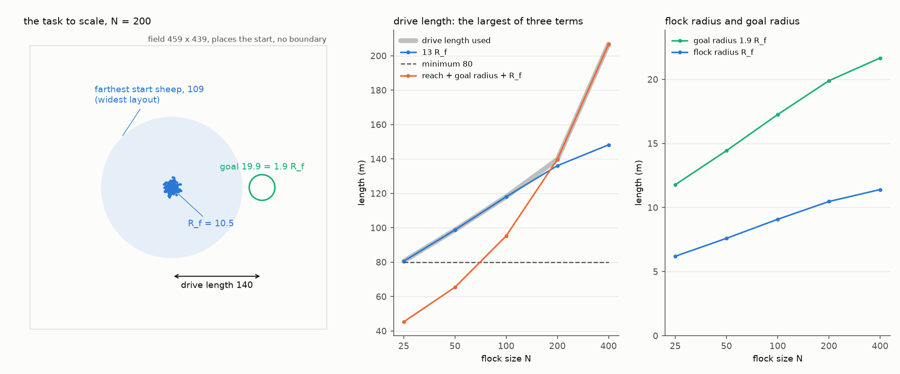
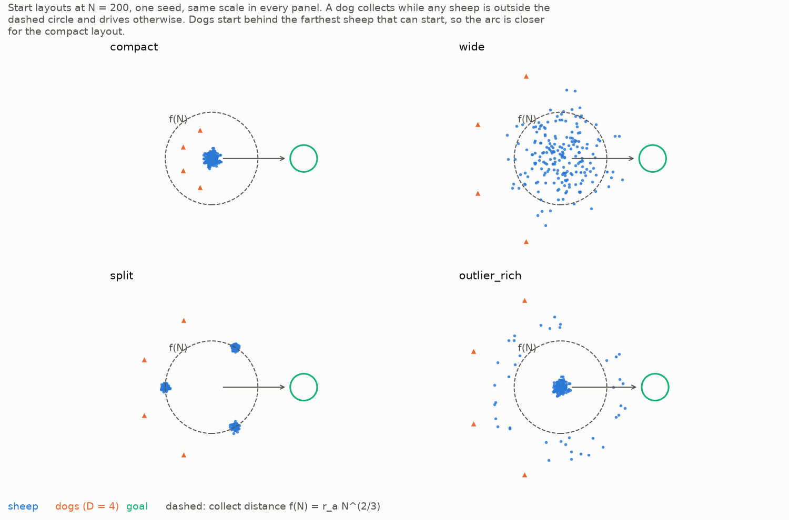
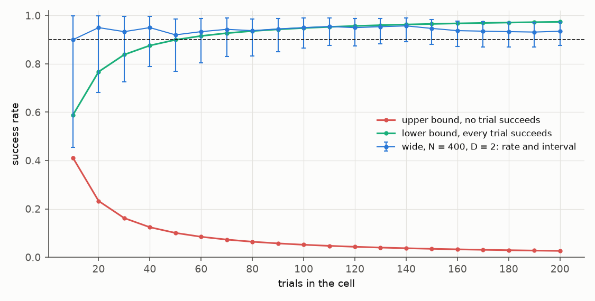

# Task design and experimental method

How HerdSim sizes the herding task, places the flock and dogs, samples cells adaptively, and turns each curve of trials into critical team sizes and zones.

## 1. Task geometry and scale

### Why the field grows with the flock

As in Strombom et al. (2014), the field is open and has no walls or boundaries; it only sets the start and goal coordinates. Because a fixed goal radius would be oversized for $N = 25$ and too small to hold $N = 400$, HerdSim scales the goal and drive distance by the calibrated flock radius $R_f(N)$, the radius a flock of $N$ sheep settles to when driven by one dog (Figure 1, Table 1).

**Figure 1: Task geometry drawn to scale.** The flock and goal radii grow slowly with $N$, and the drive distance is the largest of three terms.

- Marks: each dot in the middle and right panels is one of the five main flock sizes ($N = 25, 50, 100, 200, 400$).
- Left: the field at $N = 200$, showing the settled flock circle ($R_f = 10.5$ m, solid black ring around the flock centre `+`), the maximum start radius across all four [start layouts](#flock-start-layouts) ($l_{\mathrm{reach}} = 109.4$ m, outer ring of `outlier_rich`, dashed blue circle), the goal ($R_{\mathrm{goal}} = 19.9$ m, green circle), and the drive distance $l = 139.8$ m between centres.
- Middle: the drive distance $l$ against $N$ with its three terms from Table 1; the largest (grey) sets $l$.
- Right: $R_f(N)$ and the goal radius $1.9 R_f$.

### Sizing by the calibrated flock radius

At the start of a campaign, calibration measures $R_f(N)$ once for each flock size $N$, defined as $\sqrt{2}$ times the root-mean-square (RMS) distance of the sheep from the flock centre (the radius of a uniform disc with the same RMS). One dog drives a compact flock for 300 s toward an unreachable goal from two Gaussian start spacings ($s = 1$ m and $s = 3$ m, $\sigma = 0.5\,s\sqrt{N/\pi}$ truncated at $3\sigma$) and 3 seeds each, and $R_f(N)$ is the median over seeds and spacings of the mean radius during the last 90 s. Calibration stops with an error if the radius drifts by more than 5% between the last two 90 s windows, differs by more than 5% between the two start spacings, or if the flock centre comes within $2\,R_f$ of the goal ([calibration settings](../guides/settings.md#calibration-of-r_f)).

Table 1 gives the arena lengths computed from $R_f(N)$ and $l_{\mathrm{reach}}$ (the farthest distance any sheep can start from the flock centre across the protocol's layouts):

**Table 1: Lengths of the drive task.**

| Quantity | Rule (lengths in m) |
| :--- | :--- |
| Flock radius $R_f(N)$ | Calibrated per $N$ (Table 2) |
| Goal radius $R_{\mathrm{goal}}$ | $1.9\,R_f(N)$ |
| Drive distance $l$ (start centre to goal centre) | $\max(13\,R_f(N),\ 80,\ l_{\mathrm{reach}} + R_{\mathrm{goal}} + R_f)$ |

Up to $N = 141$ (blue curve in Figure 1, middle), $13\,R_f(N)$ is the largest term ($80.6$ m at $N = 25$, so the 80 m floor never binds), giving $l = 13\,R_f(N)$. From $N = 200$ on (orange curve), the widest start layout (`outlier_rich`, $l_{\mathrm{reach}} = 1.6\,f(N) \propto N^{2/3}$) grows faster than $R_f(N)$, so the clearance term $l_{\mathrm{reach}} + R_{\mathrm{goal}} + R_f$ takes over and reaches $18\,R_f$ at $N = 400$.

#### Step-by-step numerical breakdown at $N = 200$ (as annotated in Figure 1):

To clarify how the numbers in Figure 1 are derived ($R_f = 10.5$ m, $R_{\mathrm{goal}} = 19.9$ m, $l_{\mathrm{reach}} = 109.4$ m, and $l = 139.8$ m):

1. **Calibrated resting flock radius $R_f(200) = 10.47$ m (rounded to $10.5$ m):**
   Measured empirically from a 300 s drive calibration of an unforced $N=200$ flock under mutual attraction and repulsion (Table 2).

2. **Goal radius $R_{\mathrm{goal}} = 19.9$ m:**
   Calculated as $R_{\mathrm{goal}} = 1.9\,R_f$:
   $$R_{\mathrm{goal}} = 1.9 \times 10.4725\text{ m} = 19.898\text{ m} \approx 19.9\text{ m}$$
   The multiplier $1.9$ provides an area $(1.9)^2 \approx 3.61$ times that of the natural resting flock, preventing driven sheep from jostling against the goal boundary.

3. **Maximum start reach $l_{\mathrm{reach}} = 109.4$ m:**
   The Strömbom collect distance at $N=200$ is $f(200) = 2 \cdot (200)^{2/3} \approx 68.40$ m. Comparing the maximum sheep spawn radius across all 4 layouts:
   - `compact`: Truncated at $3\sigma = 3 \times (0.5\,R_f) = 1.5 \times 10.47 = 15.7$ m.
   - `wide`: Truncated at $3\sigma = 3 \times (0.5\,f(N)) = 1.5 \times 68.40 = 102.6$ m.
   - `split`: 3 cluster centres at $f(N)$ with radius $3\sigma = 3 \times (0.5\,R_f / \sqrt{3}) \approx 9.1$ m $\rightarrow \max = 68.40 + 9.1 = 77.5$ m.
   - `outlier_rich`: 20% of sheep placed on an outer ring between $1.1\,f(N)$ and $1.6\,f(N)$:
     $$l_{\mathrm{reach}} = 1.6 \times f(200) = 1.6 \times 68.3995\text{ m} = 109.439\text{ m} \approx 109.4\text{ m}$$
   `outlier_rich` determines the maximum extent across all layouts, giving $l_{\mathrm{reach}} = 109.4$ m.

4. **Drive distance $l = 139.8$ m:**
   Following Table 1, $l$ is the maximum of three candidate terms:
   - Term 1 (flock scale): $13\,R_f = 13 \times 10.4725 = 136.14$ m.
   - Term 2 (minimum floor): $80.0$ m.
   - Term 3 (clearance constraint): $l_{\mathrm{reach}} + R_{\mathrm{goal}} + R_f = 109.44 + 19.90 + 10.47 = 139.81\text{ m} \approx 139.8\text{ m}$.
   
   Because $139.81 > 136.14 > 80.0$, the clearance term governs:
   $$l = \max(136.14,\ 80.0,\ 139.81) = 139.81\text{ m} \approx 139.8\text{ m}$$
   *Physical rationale:* If $l \le l_{\mathrm{reach}} + R_{\mathrm{goal}}$, the goal circle would overlap with initial sheep spawn locations (sheep starting already inside the goal). The additional $+ R_f$ guarantees that the settled herd at the goal is fully detached from any start positions.

### Success rules

A trial succeeds at the first tick before the deadline where enough sheep are inside the goal:

- Strict rule: all $N$ sheep are inside the goal at the same tick.
- 99% rule: at least $\lceil 0.99\,N \rceil$ sheep are inside the goal at the same tick (all $N$ sheep below $N = 100$, allowing 1 straggler at $N = 100$ and 4 at $N = 400$).
- Flock-centre rule: the flock centre lies within the goal radius, used only in the [paper check](../methods/strombom_check.md).

### Deadlines in drive times

Because larger flocks are driven farther (206.8 m at $N = 400$ versus 80.6 m at $N = 25$), deadlines are scaled by the drive time $T_{\mathrm{drive}} = l / v_{\mathrm{sheep}}$, the time a sheep walking straight at $v_{\mathrm{sheep}} = 1.0$ m/s needs to cover the drive distance $l$. The study tests deadlines of 12, 6 and 3 drive times, rounded up to whole 1 s ticks from the unrounded drive distance (Table 2):

**Table 2: Calibrated radii, drive distances and deadlines at the five main flock sizes.**

| $N$ | $R_f$ (m) | $l$ (m) and $T_{\mathrm{drive}}$ (s) | 12x (s) | 6x (s) | 3x (s) |
| :---: | :---: | :---: | :---: | :---: | :---: |
| 25 | 6.20 | 80.6 | 968 | 484 | 242 |
| 50 | 7.60 | 98.8 | 1186 | 593 | 297 |
| 100 | 9.08 | 118.1 | 1417 | 709 | 355 |
| 200 | 10.47 | 139.8 | 1678 | 839 | 420 |
| 400 | 11.40 | 206.8 | 2482 | 1241 | 621 |

*Data:* `results/diagnostics/calibration_dmin_f99_m6.csv` and `results/dmin_m6/calibration.json`.

## 2. Start layouts and dog starts

### Flock start layouts

A sheep farther than the [collect distance](../methods/strombom_multi.md#when-to-collect) $f(N) = 2\,N^{2/3}$ m from the flock centre is an outlier that must be collected before driving. Scaling the scattered layouts by $f(N)$ keeps the initial outlier fraction consistent across $N$ (Figure 2, Animation 1):

- `compact`: a Gaussian with $\sigma = 0.5\,R_f$, truncated at $3\sigma$, where all sheep start inside $f(N)$ so the dogs drive immediately.
- `wide`: a Gaussian with $\sigma = 0.5\,f(N)$, truncated at $3\sigma$, placing about 13% of the sheep beyond $f(N)$ at every $N$.
- `split`: $k = 3$ compact clusters ($k = 2$ when $N < 12$) centred on a circle of radius $f(N)$, each a Gaussian with $\sigma = 0.5\,R_f / \sqrt{k}$ so each cluster has the density of `compact`.
- `outlier_rich`: 80% of the sheep in a `compact` core and 20% on a ring between $1.1\,f(N)$ and $1.6\,f(N)$ from the centre.

#### Why Gaussian layouts are truncated at $3\sigma$

Start layouts based on Gaussians are truncated at a hard outer radius $r_{\max} = 3\sigma$. The mathematical and experimental rationale is as follows:

**1. Cumulative probability in 2D isotropic space:**
In a 2D plane with independent coordinate distributions $(x, y) \sim \mathcal{N}(0, \sigma^2)$, the radial distance $r = \sqrt{x^2 + y^2}$ follows a [Rayleigh distribution](https://mathworld.wolfram.com/RayleighDistribution.html) (see also [NIST e-Handbook: Rayleigh Distribution](https://www.itl.nist.gov/div898/handbook/eda/section3/eda366h.htm)). The cumulative probability of finding a sheep within radius $r \le k\sigma$ is:
$$P(r \le k\sigma) = \int_0^{k\sigma} \frac{r}{\sigma^2} e^{-\frac{r^2}{2\sigma^2}} dr = 1 - e^{-\frac{k^2}{2}}$$

**2. Comparing $1\sigma, 2\sigma, 3\sigma, 4\sigma$ truncation thresholds:**

| Threshold ($k\sigma$) | Probability formula $P(r \le k\sigma)$ | Sheep fraction retained | Sheep fraction discarded (tail) | Evaluation |
| :---: | :---: | :---: | :---: | :--- |
| **$1\sigma$** | $1 - e^{-0.5}$ | **$39.35\%$** | $60.65\%$ | Far too narrow; discards most of the flock and flattens the density profile. |
| **$2\sigma$** | $1 - e^{-2.0}$ | **$86.47\%$** | $13.53\%$ | Leaves over $13\%$ of sheep beyond the boundary; insufficient as a clean spatial cutoff. |
| **$3\sigma$** | $1 - e^{-4.5}$ | **$98.89\% \approx 98.9\%$** | **$1.11\%$** | **Optimal:** Preserves nearly $99\%$ of the natural flock mass while cutting off extreme stragglers. |
| **$4\sigma$** | $1 - e^{-8.0}$ | **$99.97\%$** | $0.03\%$ | Unnecessarily large boundary ($r_{\max}$ expands too far), pushing arena size and dog spawn points excessively outward. |

**3. Three scientific reasons for selecting $3\sigma$:**
- **Preserving the natural bell shape:** By retaining $98.89\%$ of the distribution, the spatial density faithfully mimics natural clustering without distorting the underlying Gaussian physics.
- **Eliminating infinite-tail artifacts:** Theoretical Gaussians extend infinitely ($r \to \infty$). Without a cutoff, across hundreds of thousands of simulation trials, rare seeds would inevitably spawn stray sheep hundreds of metres away, heavily distorting task completion times and reliability metrics.
- **Establishing a hard boundary ($l_{\mathrm{reach}}$):** Truncating at $3\sigma$ sets a definite maximum radius $r_{\max} = 3\sigma$. This enables:
  - Sizing the drive distance $l$ so the goal never overlaps initial sheep positions ($l \ge l_{\mathrm{reach}} + R_{\mathrm{goal}} + R_f$).
  - Stationing the dog team safely behind the flock at $R_{\mathrm{arc}} = l_{\mathrm{reach}} + 30$ m, ensuring dogs never spawn inside the flock.

**Figure 2: The four start layouts ($N = 200$, $D = 4$, same scale).** Sheep outside the dashed collect circle are outliers that must be gathered first.

- Marks: blue dots are sheep, orange triangles dogs, the green circle the goal and the dashed circle the collect distance $f(N)$.
- Panels: one layout per panel, named in its title.

**Animation 1: The same team on the four start layouts ($N = 200$, $D = 4$, seed 0, 99% rule, 6 drive times).** On `compact` the dogs drive immediately; on the scattered layouts they collect first, and `split` takes longest (`dmin_f99_m6`).

- Marks: blue dots are sheep, orange triangles dogs and the green circle the goal; the bottom-left label shows elapsed time and sheep outside the goal.
- Panels: `compact`, `wide`, `split` and `outlier_rich`, finishing at 236, 278, 631 and 277 s.

### Dog starts

Dogs start behind the flock so they never spawn inside the sheep (Figure 3). The inner arc sits a safety buffer $d_{\mathrm{gap}} = 30\text{ m}$ (`dog_start_gap = 30`) behind the farthest point any sheep of that layout can start:
$$R_{\mathrm{arc}} = l_{\mathrm{reach}} + d_{\mathrm{gap}}$$
*(For example, at $N = 200$ on the widest layout `outlier_rich`, the inner arc has radius $R_{\mathrm{arc}} = 109.4 + 30.0 = 139.4\text{ m}$ from the flock centre).*

Dogs are spaced at least `dog_start_spacing = 5` m apart along the semicircle arc ($\pi \approx 180^\circ$ span, facing away from the goal). The capacity of the first arc is $\lfloor \pi R_{\mathrm{arc}} / 5 \rfloor$ (up to 87 dogs at $N = 200$); any overflow is placed on a concentric arc 5 m farther out. 

All study protocols use `arcs` (semicircles on the side away from the goal); the engine also implements `ring` (full circles omitting the goal cone) and `handler` (all dogs at a single point behind the flock).

**Figure 3: Dog start patterns.** Dogs start on semicircular arcs behind the flock, spilling onto a second arc once the first is full.

- Marks: blue dots are sheep, orange triangles dogs and the green circle the goal.
- Top: default `arcs` for $D = 1$ to 64 behind an $N = 100$ flock.
- Bottom: `arcs`, `ring` and `handler` at $N = 200$ with $D = 8$.

## 3. Adaptive sampling

Most [cells](../glossary.md#trials-and-experiments) decide well before the 200-seed cap, so the campaign adds 10-seed batches only to [open cells](../glossary.md#success-and-reliability) ([architecture](../codes/architecture.md#how-a-campaign-runs)). Figures 4 to 7 illustrate the four sampling rules on stored cells from `dmin_f99_m6` (99% rule, 6 drive times).

### Stopping early with the 99% Clopper-Pearson interval

After each batch of 10 seeds, HerdSim computes the exact two-sided 99% Clopper-Pearson confidence interval $[L, U]$ for the cell's success rate and compares it against $\theta = 0.90$ (Figure 4):

- Unreliable ($U < 0.90$): seeding stops, typically after 10 to 20 trials.
- Reliable ($L \ge 0.90$): seeding stops once reliability is decided; because $L \ge 0.90$ requires at least 51/51 successes and checks happen every 10 seeds, the earliest reliable decision is at 60/60 trials ($L = 0.915$).
- Undecided ($L < 0.90 \le U$): the cell receives another batch of 10 seeds, up to the cap of 200 (where a cell with 168 to 190 successes remains undecided).

**Figure 4: Early stopping with the 99% Clopper-Pearson interval after each 10-seed batch.** A cell with zero successes stops at 10 seeds and one with 100% successes stops at 60; `wide`, $N = 400$, $D = 2$ stays near 0.93 and remains undecided at 200 seeds (187 of 200).

- Marks: red is the upper bound $U$ for zero successes, green the lower bound $L$ for all successes, blue the stored cell's rate and interval, and the dashed line $\theta = 0.90$.

### Midpoint densification

Protocols specify a coarse grid of team sizes, and the campaign automatically inserts the midpoint $\lfloor(D_1 + D_2)/2\rfloor$ between two neighbouring tested sizes $D_1$ and $D_2$ when their zones differ (or their reliability labels differ when `decide_finish_times` is off), the gap $D_2 - D_1$ is greater than 1 (`refine_min_gap`), and neither neighbour is [pruned](#pruning-above-saturation) or an undecided cell below 200 seeds (Figure 5).

**Figure 5: Midpoint densification on `wide`, $N = 400$.** Because the zone changed between $D = 4$ (`improving`) and $D = 6$ (`saturated`), the campaign inserted $D = 5$.

- Marks: dots are initial protocol team sizes and the star is the midpoint added by the campaign, coloured by final zone.

### Pruning above saturation

When `decide_finish_times` is enabled, once [$D_{\mathrm{sat}}$](#frontier-values) is decided, a larger team is already zoned `saturated` (confirming saturation), and the curve is not still improving at the top of the grid, reliable cells above the confirming team (zoned `saturated` or finish-time `undecided`) where at least 90% of dogs on average have another dog within 2 m (`dog_overlap`) receive no more seeds and are marked `pruned` in `frontier_cells.csv` (Figure 6). Unreliable cells, cells undecided on reliability, and `crowded` cells slower than $D_{\mathrm{best}}$ are never pruned.

**Figure 6: Overlap pruning on `compact`, $N = 200$, 99% rule, 6 drive times.** Every team finishes in 232 to 235 s ($D_{\mathrm{sat}} = 1$, confirmed at $D = 2$); above $D = 2$, only $D = 24$ exceeds 0.90 overlap (0.91) and is pruned.

- Marks: blue is median finish time (left axis), orange is mean dog overlap (right axis), the dotted line is the 0.90 threshold, the shaded area marks teams above the confirming team, and the hollow square is the pruned cell.

*Data:* `results/dmin_f99_m6/`, drawn by `docs/generate_docs/make_result_figures.py`.

### Paired random streams

Cells at the same $(N, \text{layout})$ share paired seeds so team sizes compare directly (Figure 7). Seed index $i$ of every cell uses `master_seed + i` ($2026 + i$ by default), and each seed splits into separate random streams for initial placement, sheep noise and dog noise, so every team size $D$ faces the same initial flock and the same sheep noise until dog trajectories diverge.

**Figure 7: Paired seeds on `wide`, $N = 400$, seeds 2026 to 2028, $D = 2$ to $4$.** Each seed produces the identical initial flock across every team size $D$ (seed 2028 fails at $D = 2$ and succeeds at $D = 3, 4$).

- Marks: blue dots are sheep and orange triangles dogs at tick 0; green borders indicate success and red borders failure.
- Panels: columns are seeds, rows are team sizes.

## 4. Flock and team sizes tested

### Flock size

All nine study runs test $N = 25, 50, 100, 200, 400$ (factors of 2). The 99% runs at 12 and 6 drive times add the intermediate $\sqrt{2}$ steps $N = 71, 141, 283, 566$ so points are evenly spaced on a log-log axis.

The upper limit $N = 566$ is set by the calibration edge, the smallest tested flock size where calibration fails its 5% drift or start-agreement limits ([calibration settings](../guides/settings.md#calibration-of-r_f)). Across both settings of `graze_repulsion`:

- With 3 seeds per start (used in the study runs): window drift is at most 1.9% up to $N = 566$ and 2.7-2.8% at $N = 600$, then jumps to 5.7-5.9% at $N = 630$, making $N = 630$ the 3-seed calibration edge.
- With 20 seeds per start: window drift is at most 0.52% up to $N = 400$, 1.4-1.7% at $566$, 2.2% at $600$, 3.4% at $630$ and 4.1-5.6% at $N = 660$ (where start-spacing spread also reaches 11-13%), making $N = 660$ the 20-seed calibration edge.

The study therefore stops at $N = 566 = 400\sqrt{2}$, the last $\sqrt{2}$ step below the calibration edge.

### Team size

All nine study protocols start with the grid $D \in \{1, 2, 3, 4, 6, 8, 12, 16, 24\}$ (two steps per doubling above $D = 2$, alternating the fractions $\frac{3}{2} = 1.5\times$ and $\frac{4}{3} \approx 1.33\times$: $2 \xrightarrow{\times 1.5} 3 \xrightarrow{\times 1.33} 4 \xrightarrow{\times 1.5} 6 \xrightarrow{\times 1.33} 8 \xrightarrow{\times 1.5} 12 \xrightarrow{\times 1.33} 16 \xrightarrow{\times 1.5} 24$). 

This alternation splits each doubling ($2\times$) on logarithmic axes into two integer steps, since $\frac{3}{2} \times \frac{4}{3} = 2$. Because the number of dogs $D$ must be an integer, these two rational fractions bracket the ideal geometric midpoint ratio $\sqrt{2} \approx 1.414$, providing evenly spaced integer steps on log-log plots without skipping intermediate optimal team sizes. Wherever finer resolution is required, [midpoint densification](#midpoint-densification) automatically inserts intermediate team sizes.

#### Why the grid stops at $D = 24$ rather than larger teams

Capping the upper grid at $D = 24$ rather than expanding to larger teams ($D = 32, 48$) rests on three sound scientific and geometric grounds:

1. **Early saturation of task completion speed ($D_{\mathrm{sat}}$):**
   Across all study protocols, $D_{\min}$ requires only **1 to 3 dogs** on most layouts (reaching 5–7 dogs only under the harshest combination of $N = 566$ at 3 drive times). Concurrently, saturation team size $D_{\mathrm{sat}}$ (the team beyond which additional dogs yield no statistically significant finish-time reduction) is achieved between **2 and 8 dogs** (reaching 12 dogs on isolated curves). Beyond $D_{\mathrm{sat}}$, completion times plateau within $0.96 - 1.01\times$ of the saturated team because sheep walking speed is capped at $1.0$ m/s. Testing beyond $D = 24$ incurs $\mathcal{O}(D)$ computational cost with zero speed benefit.

2. **Geometric capacity of the driving arc ($D_{\mathrm{cap}}$) and physical crowding:**
   During the driving phase, dogs distribute along an arc behind the flock at distance $R = r_a\sqrt{N}$ with half-angle $\arcsin(R_f / R)$. The arc length is:
   $$L(N) = 2R \arcsin(R_f / R)$$
   $L(N)$ ranges from $13.4$ m at $N=25$ to $23.1$ m at $N=400$. Defining a realistic minimum separation $s = 2$ m between dogs (`dog_overlap_distance = 2` m, below which dogs perform redundant pushes), the physical arc capacity is:
   $$D_{\mathrm{cap}}(N) = \left\lfloor \frac{L(N)}{s} \right\rfloor + 1$$
   Specifically: $D_{\mathrm{cap}} = 7$ (at $N=25$), $9$ (at $N=50$), $10$ (at $N=100$), $11$ (at $N=200$), and $12$ (at $N=400$).
   
   At $D = 24$, team size already **doubles the physical arc capacity** ($24 \ge 2\,D_{\mathrm{cap}}$). The spacing between assigned dog slots drops to $0.58 - 1.01$ m, causing dog overlap (`dog_overlap`) to exceed $90\%$. Adding $D = 32$ or $48$ would force dogs to superimpose as overlapping point masses, violating physical realism.

3. **Flat or declining success rates of failing controllers:**
   On curves without a reliable team (such as uncoordinated `fat` at $N \ge 200$, or `split` at 3 drive times), success rates plateau or decline between 8, 16, and 24 dogs. These failures arise from structural coordination defects (contention over single stragglers or cluster neglect), not insufficient agent numbers. Increasing team size beyond 24 cannot salvage these algorithmic deficiencies.

## 5. Frontier rules and zones

The frontier rules summarize each curve of cells into critical team sizes (Table 3) and cell zones (Table 5, Figure 8). The [report](../report/d_min_report.md) uses $D_{\min}$, its bracket or lower bound, and $D_{\min,\mathrm{stable}}$; the remaining values guide midpoint refinement and pruning when `decide_finish_times` is enabled and are saved in `frontier_groups.csv`.

**Figure 8: Zones and frontier values on the example curve of Table 4.** Cell reliability and paired finish-time comparisons assign each team size to a [zone](#zones).

- Marks: bars are coloured by zone, and dotted vertical lines mark the frontier team sizes defined in Table 3.
- Top: zone label and reliability status per team size $D$.
- Bottom: median finish time across reliable team sizes.

### Frontier values

Finish-time comparisons apply only to working teams (reliable cells from $D_{\min}$ to $D_{\max}$). Two working teams are compared over the shared seeds where both succeeded (at least 5 shared seeds, 4000 bootstrap resamples); one team is judged faster or slower when the 99% bootstrap interval of their median finish-time difference lies entirely outside $\pm 5\%$ of the slower median (`time_margin`), the same when it lies entirely within $\pm 5\%$, and undecided otherwise. Table 3 defines the frontier values, and Table 4 illustrates them on an example curve:

**Table 3: Frontier values.**

| Value | Definition |
| :--- | :--- |
| $D_{\min}$ | Smallest reliable $D$. |
| $D_{\min,\mathrm{low}}$ | Smallest $D$ with $U \ge 0.90$ (lowest team not yet ruled unreliable), forming a bracket `D_min,low - D_min` when $D_{\min}$ sits above an undecided cell. |
| $D_{\mathrm{overcrowd}}$ | Smallest $D$ above $D_{\min}$ (or above $D_{\min,\mathrm{low}}$ if no $D$ is reliable) where both $D$ and the next tested team size are unreliable. |
| $D_{\max}$ | Largest reliable $D$ below $D_{\mathrm{overcrowd}}$ (or the largest reliable $D$ if $D_{\mathrm{overcrowd}}$ does not occur). |
| $D_{\mathrm{best}}$ | Smallest working $D$ judged "same" or "faster" than the working team with the lowest median finish time. |
| $D_{\mathrm{sat}}$ | Smallest working $D$ that no larger working team is judged "faster" than. |
| $D_{\mathrm{crowd}}$ | Smallest working $D$ above $D_{\mathrm{best}}$ judged "slower" than $D_{\mathrm{best}}$. |

**Table 4: Example curve ($D_{\min} = 2$, $D_{\mathrm{best}} = D_{\mathrm{sat}} = 4$, $D_{\mathrm{crowd}} = D_{\max} = 6$, $D_{\mathrm{overcrowd}} = 7$).**

| $D$ | Reliable | Median finish (s) | Verdict | Zone |
| :---: | :--- | :---: | :--- | :--- |
| 1 | No | - | - | `too_few` |
| 2 | Yes | 400 | Slower than 4 | `improving` |
| 3 | Yes | 300 | Slower than 4 | `improving` |
| 4 | Yes | 250 | Same as 5 | `saturated` |
| 5 | Yes | 245 | Fastest | `saturated` |
| 6 | Yes | 290 | Slower than 4 | `crowded` |
| 7 | No | - | - | `collapse` |
| 8 | No | - | - | `collapse` |

### Zones

Each cell on a curve is assigned one zone from Table 5:

**Table 5: Cell zones.**

| Zone | Condition |
| :--- | :--- |
| `too_few` | Unreliable, below $D_{\min}$ (or below $D_{\min,\mathrm{low}}$ if no cell is reliable) |
| `improving` | Reliable, below $D_{\mathrm{sat}}$ and not slower than $D_{\mathrm{best}}$ |
| `saturated` | Reliable, at or above $D_{\mathrm{sat}}$ and not slower than $D_{\mathrm{best}}$ |
| `crowded` | Reliable, above $D_{\mathrm{best}}$ and slower than $D_{\mathrm{best}}$ |
| `unreliable_dip` | Unreliable, isolated between $D_{\min}$ (or $D_{\min,\mathrm{low}}$) and $D_{\mathrm{overcrowd}}$ |
| `collapse` | Unreliable, at or above $D_{\mathrm{overcrowd}}$ |
| `recovered` | Reliable again above $D_{\mathrm{overcrowd}}$ |
| `undecided` | Undecided on reliability, or reliable above $D_{\mathrm{best}}$ with an undecided finish-time comparison |

### How failed trials end

Every failed trial is assigned a diagnostic `failure_mode` from its per-tick metrics (Table 6, evaluated in precedence order; rules 1 to 4 inspect the second half of the trial and rules 5 to 6 compare the two halves). All thresholds in Table 6 are HerdSim conventions, and the failure label `split` (flock fragmentation) is distinct from the `split` start layout:

**Table 6: Diagnostic failure labels in order of precedence.**

| Order | Label | Condition |
| :---: | :--- | :--- |
| 1 | `dogs_out_of_range` | Fewer than 10% of the outer half of the flock on average lies within $r_s$ of a dog, and fewer than 1 sheep on average is beyond $2.5\,R_f$ from the flock centre. |
| 2 | `flock_escaped` | Mean flock-centre distance to the goal exceeds the initial distance. |
| 3 | `split` | Largest connected component of sheep linked within 5 m holds less than 55% of the flock. |
| 4 | `scatter` | Flock RMS radius exceeds $2\,R_f$. |
| 5 | `oscillation` | Matches `stuck`, and the 200 s moving-average goal distance reverses direction at least 3 times by more than $R_{\mathrm{goal}}$. |
| 6 | `stuck` | Mean flock-centre distance to the goal changes by less than $R_{\mathrm{goal}}$ between the two halves of the trial. |
| 7 | `timeout` | Any failed trial not matching rules 1 to 6. |
