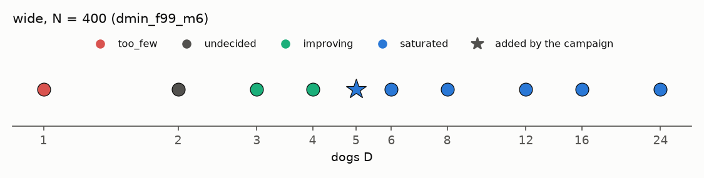
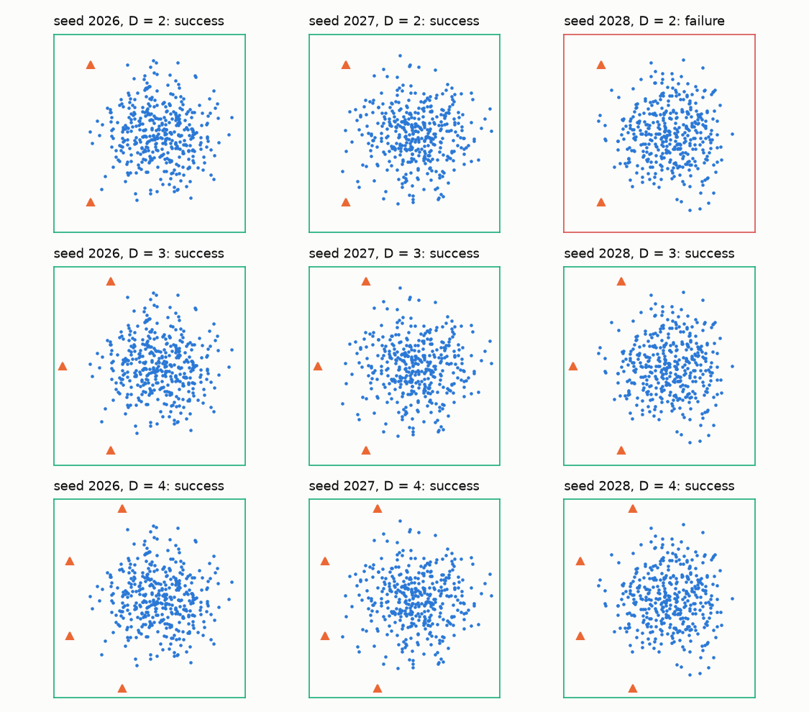

# Task Design and Experimental Methodology

This document details HerdSim's physical scaling laws, geometric task setup, adaptive sequential sampling rules, and the analytical framework used to classify simulation curves into critical team sizes and behavioral zones.

---

### Executive Overview

HerdSim standardizes multi-agent herding experiments through five interrelated pillars:

1. **Physical Scale-Invariance:** Field dimensions, goal size, and drive deadlines scale dynamically with flock size $N$ using the calibrated flock radius $R_f(N)$.
2. **Deterministic Start Layouts:** Four spatial flock distributions (`compact`, `wide`, `split`, `outlier_rich`) establish controlled initial dispersion, truncated at $3\sigma$ under isotropic 2D Rayleigh statistics.
3. **Adaptive Sequential Sampling:** Teams are evaluated using exact 99% Clopper-Pearson confidence intervals, midpoint grid densification, and saturation pruning to minimize computational overhead.
4. **Empirical Boundary Limits:** Flock sizes are bounded at $N = 566$ by physical drift calibration, while dog numbers are capped at $D = 24$ by the geometric capacity of the driving arc.
5. **Rigorous Behavioral Zoning:** Each `(layout, N)` curve is categorized into behavioral regimes ($D_{\min}, D_{\mathrm{sat}}, D_{\mathrm{crowd}}$) and evaluated against a 7-stage diagnostic failure taxonomy.

---

## 1. Task Geometry and Physical Scaling

### 1.1 Field Dimensions and Coordinate Scaling

Unlike arena-constrained studies, HerdSim uses an open field without artificial walls or reflective boundaries, mimicking natural open pastures. Because fixed arena dimensions would either drown small flocks ($N = 25$) or crush large flocks ($N = 400$), all dimensions scale with the **calibrated flock radius** $R_f(N)$—the natural equilibrium radius that $N$ sheep settle into when driven by a single shepherd (Figure 1, Table 1).

**Figure 1: Task geometry drawn to scale across flock sizes.**

* **Structure of the panels:**
  * **Left (Spatial layout at $N = 200$):** Shows the settled flock circle ($R_f = 10.5$ m, black circle around flock centre `+`), the maximum spawn extent across all layouts ($l_{\mathrm{reach}} = 109.4$ m, dashed blue circle for `outlier_rich`), the goal circle ($R_{\mathrm{goal}} = 19.9$ m, green circle), and the centre-to-centre drive distance ($l = 139.8$ m).
  * **Middle (Drive distance components vs. $N$):** Shows the three candidate terms of Table 1. Up to $N = 141$, $l$ follows $13\,R_f(N)$ (blue curve); from $N \ge 200$, the clearance term $l_{\mathrm{reach}} + R_{\mathrm{goal}} + R_f$ takes over (orange curve). The governing envelope is marked in grey.
  * **Right (Radius scaling):** Compares flock radius $R_f(N)$ and goal radius $R_{\mathrm{goal}} = 1.9\,R_f(N)$.

---

### 1.2 Mathematical Formulation of Arena Dimensions

At the start of any experimental campaign, $R_f(N)$ is measured empirically through calibration (defined as $\sqrt{2} \times$ the root-mean-square distance from the flock centre, matching the second moment of a uniform disc). Arena parameters are then derived deterministically:

**Table 1: Governing geometric formulas of the herding arena.**

| Metric | Governing Formula | Physical Purpose |
| :--- | :--- | :--- |
| **Flock Radius** $R_f(N)$ | Empirically calibrated per $N$ (Table 2) | Baseline unit of spatial extent for $N$ sheep. |
| **Goal Radius** $R_{\mathrm{goal}}$ | $1.9\,R_f(N)$ | Encloses an area $(1.9)^2 \approx 3.61\times$ the settled flock, preventing sheep congestion at the target. |
| **Drive Distance** $l$ | $\max\bigl(13\,R_f(N),\ 80.0\text{ m},\ l_{\mathrm{reach}} + R_{\mathrm{goal}} + R_f\bigr)$ | Ensures sufficient herding distance while completely separating initial spawn locations from the goal. |

---

### 1.3 Step-by-Step Numerical Walkthrough at $N = 200$

To illustrate how these formulas govern simulation geometry, consider an $N = 200$ flock:

1. **Flock Radius ($R_f = 10.47\text{ m} \approx 10.5\text{ m}$):**
   Obtained from empirical 300 s calibration under balanced mutual attraction and repulsion forces.
2. **Goal Radius ($R_{\mathrm{goal}} = 19.9\text{ m}$):**
   $$R_{\mathrm{goal}} = 1.9 \times 10.4725\text{ m} = 19.898\text{ m} \approx 19.9\text{ m}$$
3. **Maximum Spawn Reach ($l_{\mathrm{reach}} = 109.4\text{ m}$):**
   The Strömbom collect threshold is $f(200) = 2 \cdot (200)^{2/3} \approx 68.40\text{ m}$. Across the 4 starting layouts:
   * `compact`: $r_{\max} = 3\sigma = 3 \times (0.5\,R_f) = 1.5 \times 10.47 = 15.7\text{ m}$.
   * `wide`: $r_{\max} = 3\sigma = 3 \times (0.5\,f(N)) = 1.5 \times 68.40 = 102.6\text{ m}$.
   * `split`: 3 clusters at $f(N)$ with radius $3\sigma = 3 \times (0.5\,R_f / \sqrt{3}) \approx 9.1\text{ m} \implies r_{\max} = 68.40 + 9.1 = 77.5\text{ m}$.
   * `outlier_rich`: 20% outer ring between $1.1\,f(N)$ and $1.6\,f(N)$:
     $$l_{\mathrm{reach}} = 1.6 \times f(200) = 1.6 \times 68.3995\text{ m} = 109.439\text{ m} \approx 109.4\text{ m}$$
   The widest layout establishes $l_{\mathrm{reach}} = 109.4\text{ m}$.
4. **Drive Distance ($l = 139.8\text{ m}$):**
   Evaluating the three candidate terms in Table 1:
   * Term 1 (Flock scaling): $13\,R_f = 13 \times 10.4725\text{ m} = 136.14\text{ m}$.
   * Term 2 (Minimum floor): $80.0\text{ m}$.
   * Term 3 (Clearance constraint): $l_{\mathrm{reach}} + R_{\mathrm{goal}} + R_f = 109.44 + 19.90 + 10.47 = 139.81\text{ m} \approx 139.8\text{ m}$.
   $$l = \max(136.14,\ 80.0,\ 139.81) = 139.81\text{ m} \approx 139.8\text{ m}$$
   *Clearance Guarantee:* If $l \le l_{\mathrm{reach}} + R_{\mathrm{goal}}$, sheep could spawn already inside the goal circle. Adding $+ R_f$ guarantees that the entire settled herd at the goal is physically disengaged from the initial spawn region.

---

### 1.4 Success Criteria and Deadlines

A trial terminates successfully at the earliest tick where enough sheep are inside the goal:

* **Strict Rule:** Exactly all $N$ sheep must be inside the goal circle simultaneously.
* **99% Rule:** At least $\lceil 0.99\,N \rceil$ sheep must be inside the goal simultaneously ($N$ sheep for $N \le 50$; allows 1 outlier at $N = 100$, 2 at $N = 200$, 4 at $N = 400$, and 6 at $N = 566$).
* **Flock-Centre Rule:** Centre of flock mass enters the goal; used exclusively for reproducing legacy single-dog baselines ([paper check](../methods/strombom_check.md)).

Because larger herds are driven over longer distances ($206.8$ m at $N = 400$ vs. $80.6$ m at $N = 25$), deadlines are normalized to **drive times**:
$$T_{\mathrm{drive}} = \frac{l}{v_{\mathrm{sheep}}}$$
where $v_{\mathrm{sheep}} = 1.0\text{ m/s}$ is the maximum natural walking speed of an unpanicked sheep.

**Table 2: Physical dimensions and drive deadlines across the 5 primary flock sizes.**

| $N$ | Calibrated $R_f$ (m) | Drive Distance $l$ (m) | $T_{\mathrm{drive}}$ (s) | 12x Deadline (s) | 6x Deadline (s) | 3x Deadline (s) |
| :---: | :---: | :---: | :---: | :---: | :---: | :---: |
| **25** | 6.20 | 80.6 | 80.6 | 968 | 484 | 242 |
| **50** | 7.60 | 98.8 | 98.8 | 1186 | 593 | 297 |
| **100** | 9.08 | 118.1 | 118.1 | 1417 | 709 | 355 |
| **200** | 10.47 | 139.8 | 139.8 | 1678 | 839 | 420 |
| **400** | 11.40 | 206.8 | 206.8 | 2482 | 1241 | 621 |

*Data Sources:* Calibrated measurements recorded in `results/diagnostics/calibration_dmin_f99_m6.csv` and `results/dmin_m6/calibration.json`.

---

## 2. Start Layouts and Dog Initialization

### 2.1 The Four Starting Flock Distributions

In the Strömbom model, a sheep located farther than the collect distance $f(N) = 2\,N^{2/3}\text{ m}$ from the flock centre is defined as an outlier and must be collected before driving can commence. Scaling the initial layouts by $f(N)$ ensures that the structural difficulty and initial outlier proportion remain invariant across flock sizes (Figure 2, Animation 1):

* **`compact`:** 2D Gaussian with $\sigma = 0.5\,R_f(N)$, truncated at $3\sigma$. All sheep spawn well within $f(N)$, allowing dogs to enter the driving phase immediately.
* **`wide`:** 2D Gaussian with $\sigma = 0.5\,f(N)$, truncated at $3\sigma$. Placed so that approximately $13\%$ of sheep spawn beyond $f(N)$ across all $N$.
* **`split`:** $k = 3$ compact sub-clusters ($k = 2$ for $N < 12$) centered on a circle of radius $f(N)$. Each sub-cluster has $\sigma = 0.5\,R_f(N) / \sqrt{k}$, matching the internal density of `compact`.
* **`outlier_rich`:** 80% of sheep placed in a `compact` core, while 20% are distributed uniformly on an outer ring between $1.1\,f(N)$ and $1.6\,f(N)$.

**Figure 2: The four starting flock layouts ($N = 200$, $D = 4$, identical spatial scale).**

* **Visual Guide:** Blue dots = sheep; Orange triangles = dogs; Green circle = goal; Dashed circle = collect distance boundary $f(N)$.
* **Key takeaway:** Only `compact` starts entirely within $f(N)$; the remaining three layouts require active lateral collection by the shepherd team.

**Animation 1: Simulation timeline across all 4 layouts ($N = 200$, $D = 4$, seed 0, 99% rule, 6 drive times).**

* **Performance comparison:** `compact` finishes first (236 s) via continuous driving. `outlier_rich` (277 s) and `wide` (278 s) require brief initial gathering. `split` takes longest (631 s) because shepherds must herd multiple detached sub-flocks together before driving.

---

### 2.2 Mathematical Justification of $3\sigma$ Rayleigh Truncation

All Gaussian spawn distributions in HerdSim are truncated at a hard outer boundary $r_{\max} = 3\sigma$.

**1. 2D Isotropic Distribution:**  
In two-dimensional isotropic space with coordinate distributions $x, y \sim \mathcal{N}(0, \sigma^2)$, the radial distance $r = \sqrt{x^2 + y^2}$ follows a **Rayleigh distribution**. The cumulative probability $P(r \le k\sigma)$ is:
$$P(r \le k\sigma) = \int_0^{k\sigma} \frac{r}{\sigma^2} e^{-\frac{r^2}{2\sigma^2}} \, dr = 1 - e^{-\frac{k^2}{2}}$$

**2. Comparison of Threshold Options:**

| Threshold ($k\sigma$) | Retention Formula | Mass Retained | Discarded Tail | Methodological Evaluation |
| :---: | :---: | :---: | :---: | :--- |
| **$1\sigma$** | $1 - e^{-0.5}$ | $39.35\%$ | $60.65\%$ | Discards most of the distribution; flattens the density profile. |
| **$2\sigma$** | $1 - e^{-2.0}$ | $86.47\%$ | $13.53\%$ | Leaves over 13% of sheep outside; insufficient as a clean boundary. |
| **$3\sigma$** | $1 - e^{-4.5}$ | **$98.89\%$** | **$1.11\%$** | **Optimal:** Captures nearly 99% of flock mass while eliminating extreme outliers. |
| **$4\sigma$** | $1 - e^{-8.0}$ | $99.97\%$ | $0.03\%$ | Expands field boundary excessively, forcing dogs to spawn unreasonably far back. |

**3. Scientific Rationale for $3\sigma$:**
* **Physics Preservation:** Retaining $98.89\%$ of sheep preserves natural Gaussian density variations without introducing artificial spatial artifacts.
* **Elimination of Infinite Tails:** Standard Gaussians extend to infinity ($r \to \infty$). Across 145,000+ simulation trials, untruncated distributions would occasionally spawn rogue sheep hundreds of metres away, creating statistical noise unrelated to algorithm performance.
* **Deterministic Boundary ($l_{\mathrm{reach}}$):** Provides an exact mathematical upper bound for arena clearance and dog arc placement.

---

### 2.3 Dog Spawning Geometry

Shepherds must spawn behind the herd so they never appear inside the flock at tick 0 (Figure 3). The innermost dog arc is stationed at a safety buffer $d_{\mathrm{gap}} = 30\text{ m}$ (`dog_start_gap = 30`) behind the maximum possible sheep spawn coordinate:
$$R_{\mathrm{arc}} = l_{\mathrm{reach}} + d_{\mathrm{gap}}$$

*(For instance, at $N = 200$ on `outlier_rich`, $R_{\mathrm{arc}} = 109.4 + 30.0 = 139.4\text{ m}$ from the flock centre).*

* **Arc Configuration:** Dogs are distributed evenly along a semicircle ($\pi \approx 180^\circ$ span, opening away from the goal) with a minimum spacing of `dog_start_spacing = 5` m.
* **Arc Capacity:** The maximum number of dogs accommodated on the primary arc is:
  $$D_{\mathrm{first\_arc}} = \left\lfloor \frac{\pi R_{\mathrm{arc}}}{5} \right\rfloor$$
  *(At $N = 200$, the primary arc holds up to 87 dogs).* Any overflow beyond arc capacity is placed on a second concentric semicircle positioned an additional 5 m farther back.
* **Alternative Patterns:** The engine supports `ring` (full circle excluding the goal cone) and `handler` (all dogs clustered at a single point), but all primary study campaigns utilize `arcs`.

**Figure 3: Geometric dog initialization patterns.**

* **Top:** Default semicircular `arcs` for $D = 1$ to $64$ behind an $N = 100$ flock.
* **Bottom:** Visual comparison of `arcs`, `ring`, and `handler` configurations at $N = 200$ with $D = 8$.

---

## 3. Adaptive Sequential Sampling

Evaluating an entire 3D grid of conditions `(layout, N, D)` over 200 seeds using brute-force execution would require millions of trials. HerdSim employs an adaptive controller that samples in batches of 10 seeds and applies four sequential rules to allocate compute where statistical uncertainty is highest (Figures 4–7).

---

### 3.1 Sequential Early Stopping (99% Clopper-Pearson Interval)

After every 10-seed batch, HerdSim computes the exact two-sided 99% Clopper-Pearson confidence interval $[L, U]$ for the cell's true success probability $p$ and tests it against the reliability threshold $\theta = 0.90$ (Figure 4):

* **Reliable ($L \ge 0.90$):** Sampling terminates early. Because $L \ge 0.90$ requires at least 51 consecutive successes and evaluations occur every 10 seeds, the earliest reliable verdict occurs at **60/60 trials** ($L = 0.915$).
* **Unreliable ($U < 0.90$):** Sampling terminates early. A cell with 0 successes stops after just **10 trials** ($U = 0.369$).
* **Undecided ($L < 0.90 \le U$):** The cell receives another batch of 10 seeds, up to a maximum cap of 200 seeds (where cells with 168 to 190 successes remain undecided).

**Figure 4: Early stopping dynamics via the 99% Clopper-Pearson interval.**

* **Trajectories:** Red line = upper bound $U$ for zero successes (stops at 10 seeds); Green line = lower bound $L$ for 100% successes (stops at 60 seeds); Blue curve = an undecided cell (`wide`, $N = 400$, $D = 2$) hovering near $p \approx 0.93$ that exhausts all 200 seeds (187/200). Dashed line = threshold $\theta = 0.90$.

---

### 3.2 Midpoint Grid Densification

Protocols initially evaluate a coarse grid of team sizes ($D \in \{1, 2, 3, 4, 6, 8, 12, 16, 24\}$). When two adjacent tested sizes $D_1$ and $D_2$ exhibit different behavioral zones (or differing reliability verdicts when `decide_finish_times` is disabled), the campaign automatically inserts the geometric integer midpoint:
$$D_{\mathrm{mid}} = \left\lfloor \frac{D_1 + D_2}{2} \right\rfloor$$
provided that $D_2 - D_1 > 1$ and neither neighbor is pruned or undecided below 200 seeds (Figure 5).

**Figure 5: Midpoint densification on `wide`, $N = 400$.** The campaign detects a transition between $D = 4$ (`improving`, orange) and $D = 6$ (`saturated`, yellow), automatically scheduling $D = 5$ (star marker) to pinpoint the boundary.

---

### 3.3 Saturation and Overlap Pruning

When `decide_finish_times` is enabled, once saturation team size $D_{\mathrm{sat}}$ ([frontier values](#frontier-values)) is confirmed by a larger `saturated` team, testing even larger teams yields diminishing returns.

Any cell above the confirming team where median dog overlap (`dog_overlap`, fraction of dogs within 2 m of each other) exceeds **90%** receives no further seeds and is tagged `pruned` in `frontier_cells.csv` (Figure 6). Unreliable cells and `crowded` cells are never pruned.

**Figure 6: Overlap pruning on `compact`, $N = 200$ (99% rule, 6 drive times).**

* **Mechanism:** Finish times plateau between 232 s and 235 s from $D = 1$ to $D = 24$. Once saturation is confirmed at $D = 2$, larger teams are monitored for physical congestion. At $D = 24$, dog overlap reaches $0.91 > 0.90$, prompting the adaptive sampler to prune the cell (hollow square).

---

### 3.4 Paired Deterministic Random Streams

To eliminate inter-trial variance when comparing different team sizes $D$, all cells sharing the same `(layout, N)` use identical paired seeds (Figure 7). Seed index $i$ generates `master_seed + i` ($2026 + i$), which forks into three isolated pseudorandom generators:

1. **Flock placement stream:** Ensures sheep initial coordinates are identical across all $D$.
2. **Sheep brownian noise stream:** Generates identical random wandering perturbations until dog actions alter sheep states.
3. **Dog behavioral stream:** Governs controller stochasticity independently.

**Figure 7: Paired seed comparisons on `wide`, $N = 400$ (seeds 2026–2028 across $D = 2, 3, 4$).**

* **Observation:** Each vertical column represents an identical starting flock. In seed 2028, $D = 2$ fails (red border), while $D = 3$ and $D = 4$ succeed (green borders) under identical initial flock coordinates and noise.

---

## 4. Flock and Team Size Ranges

### 4.1 Flock Size Scaling ($N = 25$ to $566$)

All nine study runs test five primary sizes in doublings: $N \in \{25, 50, 100, 200, 400\}$. The 99% runs at 12x and 6x deadlines incorporate four intermediate $\sqrt{2}$ steps ($N \in \{71, 141, 283, 566\}$) to construct an evenly spaced 9-point sequence on log-log axes.

**The Calibration Boundary Edge:**  
The upper bound is fixed at $N = 566 = 400\sqrt{2}$ because larger flocks violate the 5% calibration stability tolerance:
* **With 3 calibration seeds:** Settled window drift stays below 1.9% through $N = 566$ and reaches 2.8% at $N = 600$. At $N = 630$, drift surges to **$5.9\%$**, breaching the 5% window tolerance.
* **With 20 calibration seeds:** Drift remains below 1.7% through $N = 566$, reaches 3.4% at $N = 630$, and breaches tolerance at $N = 660$ ($5.6\%$).

Consequently, $N = 566$ represents the maximum scientifically valid flock size for which physical equilibrium can be rigorously certified.

---

### 4.2 Team Size Progression ($D = 1$ to $24$)

All protocols initialize with a 9-point geometric progression:
$$D \in \{1, 2, 3, 4, 6, 8, 12, 16, 24\}$$
Above $D = 2$, this sequence alternates scale factors of $\frac{3}{2} = 1.5\times$ and $\frac{4}{3} \approx 1.33\times$, providing two integer steps per doubling ($\frac{3}{2} \times \frac{4}{3} = 2.0$) that closely bracket the ideal geometric ratio $\sqrt{2} \approx 1.414$.

#### Why the Grid Stops at $D = 24$

The upper bound is capped at $D = 24$ based on three geometric and physical constraints:

1. **Early Speed Saturation ($D_{\mathrm{sat}}$):**  
   Empirical $D_{\min}$ rarely exceeds 3 dogs, and finish times plateau at $D_{\mathrm{sat}} \le 8$ dogs (or 12 dogs on isolated curves). Because sheep movement is bounded at $v_{\mathrm{sheep}} = 1.0\text{ m/s}$, adding dogs beyond 24 incurs $\mathcal{O}(D)$ compute with zero task acceleration.
2. **Geometric Arc Capacity ($D_{\mathrm{cap}}$) and Overcrowding:**  
   During driving, dogs form a rear arc of length $L(N) = 2R \arcsin(R_f / R)$ at distance $R = r_a\sqrt{N}$. Given a physical separation threshold $s = 2.0\text{ m}$, the maximum non-overlapping dog capacity is:
   $$D_{\mathrm{cap}}(N) = \left\lfloor \frac{L(N)}{s} \right\rfloor + 1$$
   Arc capacities range from $D_{\mathrm{cap}} = 7$ ($N = 25$) to $12$ ($N = 400$). At $D = 24$, team size is **more than double the arc capacity** ($24 \ge 2\,D_{\mathrm{cap}}$), forcing inter-dog slot distances down to $0.58\text{--}1.01\text{ m}$ and causing $>90\%$ overlap. Testing $D = 32$ or $48$ would simulate overlapping point masses rather than distinct agents.
3. **Algorithmic Failure Plateaus:**  
   Controllers that fail at large $N$ (such as `fat` or `split` at 3x) exhibit flat or declining success curves between $D = 8$ and $24$. Failures stem from lack of lateral coordination, not lack of numbers; adding more dogs cannot salvage algorithmic flaws.

---

## 5. Frontier Values, Behavioral Zones, and Failure Taxonomy

### 5.1 Frontier Metrics

On every `(layout, N)` curve, pairwise bootstrap comparisons (4,000 resamples over shared seeds with $\pm 5\%$ margin) classify working teams into critical transition thresholds (Table 3, Figure 8):

**Table 3: Definitions of curve frontier metrics.**

| Metric | Formal Definition | Operational Role |
| :--- | :--- | :--- |
| **$D_{\min}$** | Smallest reliable team size ($L \ge 0.90$). | Primary scalability metric reported across runs. |
| **$D_{\min,\mathrm{low}}$** | Smallest team size with $U \ge 0.90$. | Forms undecided brackets $[D_{\min,\mathrm{low}}, D_{\min}]$ when intermediate cells remain open. |
| **$D_{\mathrm{sat}}$** | Smallest reliable team that no larger reliable team outperforms in finish time. | Pinpoints task completion speed saturation. |
| **$D_{\mathrm{best}}$** | Smallest working team with the lowest median finish time. | Absolute optimal operating team size. |
| **$D_{\mathrm{crowd}}$** | Smallest reliable team above $D_{\mathrm{best}}$ that is statistically slower than $D_{\mathrm{best}}$. | Detects performance degradation from congestion. |
| **$D_{\max}$** | Largest reliable team size before collapse. | Upper bound of reliable multi-agent operation. |
| **$D_{\mathrm{overcrowd}}$** | Smallest team above $D_{\min}$ where two consecutive team sizes fail. | Marks permanent operational breakdown. |

**Figure 8: Behavioral zones and frontier transitions on a representative simulation curve.**

* **Panel Breakdown:** Top panel shows zone designations and reliability status across $D$; Bottom panel shows median finish times for reliable teams.

---

### 5.2 Illustrative Worked Example

Table 4 details the classification mechanics on an example curve where $D_{\min} = 2$, $D_{\mathrm{sat}} = 4$, $D_{\mathrm{best}} = 5$, $D_{\mathrm{crowd}} = 6$, and $D_{\mathrm{overcrowd}} = 7$:

**Table 4: Step-by-step frontier classification on a model curve.**

| Team Size $D$ | Reliability Verdict | Median Finish Time | Finish-Time Comparison | Assigned Behavioral Zone |
| :---: | :---: | :---: | :--- | :--- |
| **1** | Unreliable | — | — | `too_few` |
| **2** | Reliable | 400 s | Slower than $D = 4$ | `improving` |
| **3** | Reliable | 300 s | Slower than $D = 4$ | `improving` |
| **4** | Reliable | 250 s | Statistically equivalent to $D = 5$ | `saturated` ($D_{\mathrm{sat}}$) |
| **5** | Reliable | 245 s | Fastest median time | `saturated` ($D_{\mathrm{best}}$) |
| **6** | Reliable | 290 s | Statistically slower than $D_{\mathrm{best}}$ | `crowded` ($D_{\mathrm{crowd}}, D_{\max}$) |
| **7** | Unreliable | — | Consecutive failure 1 | `collapse` ($D_{\mathrm{overcrowd}}$) |
| **8** | Unreliable | — | Consecutive failure 2 | `collapse` |

---

### 5.3 Complete Behavioral Zone Catalogue

Every cell tested in HerdSim is assigned to one of eight distinct behavioral zones (Table 5):

**Table 5: Complete catalogue of cell behavioral zones.**

| Zone | Operational Condition | Interpretation |
| :--- | :--- | :--- |
| **`too_few`** | Unreliable, positioned below $D_{\min}$. | Insufficient shepherds to reliably control the flock. |
| **`improving`** | Reliable, below $D_{\mathrm{sat}}$, not slower than $D_{\mathrm{best}}$. | Adding shepherds yields measurable speedups. |
| **`saturated`** | Reliable, at or above $D_{\mathrm{sat}}$, not slower than $D_{\mathrm{best}}$. | Adding shepherds yields no further speed gain. |
| **`crowded`** | Reliable, above $D_{\mathrm{best}}$, statistically slower than $D_{\mathrm{best}}$. | Physical crowding begins to degrade herding efficiency. |
| **`unreliable_dip`**| Unreliable, isolated between $D_{\min}$ and $D_{\mathrm{overcrowd}}$. | Temporary instability on non-monotone curves. |
| **`collapse`** | Unreliable, at or above $D_{\mathrm{overcrowd}}$. | Severe multi-agent congestion causes systematic failure. |
| **`recovered`** | Reliable again above $D_{\mathrm{overcrowd}}$. | Exceptional recovery at higher dog counts. |
| **`undecided`** | Statistically unresolved at the 200-seed ceiling. | Requires further sampling to establish definitive verdict. |

---

### 5.4 Diagnostic Failure Taxonomy

When a simulation trial fails to herd the flock before the deadline, it is assigned a mutually exclusive diagnostic failure label based on its per-tick trajectories (evaluated in strict precedence order, Table 6):

**Table 6: Hierarchical failure diagnostic labels in order of evaluation precedence.**

| Priority | Failure Label | Diagnostic Detection Condition | Underlying Physical Cause |
| :---: | :--- | :--- | :--- |
| **1** | `dogs_out_of_range` | $<10\%$ of outer sheep within $r_s$ of dogs, and $<1$ sheep beyond $2.5\,R_f$. | Shepherds lose perceptual contact with a cohesive flock. |
| **2** | `flock_escaped` | Mean flock-to-goal distance exceeds initial start distance. | Flock is driven in the wrong direction away from the goal. |
| **3** | `split` | Largest connected component of sheep within 5 m holds $<55\%$ of flock. | Severe herd fragmentation; flock splits into disjoint sub-clusters. |
| **4** | `scatter` | Root-mean-square flock radius exceeds $2.0\,R_f$. | Flock expands and diffuses across the field without cohesion. |
| **5** | `oscillation` | Goal distance reverses direction $\ge 3$ times by more than $R_{\mathrm{goal}}$. | Shepherds alternate excessively between opposing sides, causing herd cycling. |
| **6** | `stuck` | Flock-to-goal distance changes by less than $R_{\mathrm{goal}}$ between trial halves. | Herd stalls in a local equilibrium point; shepherds fail to advance. |
| **7** | `timeout` | Any failed trial not triggered by rules 1 through 6. | Normal herding trajectory that simply exhausted available ticks. |
