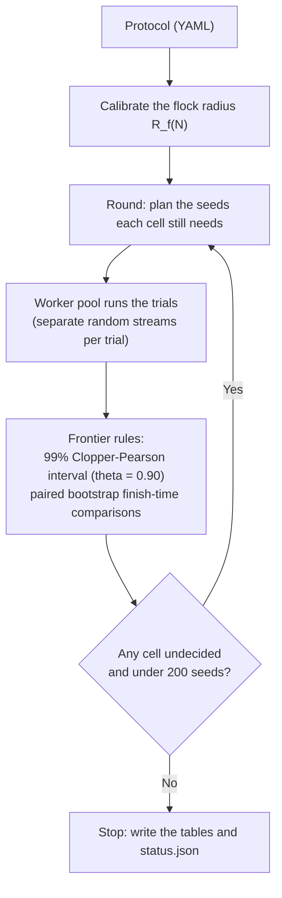

# Task Design and Experimental Method

This document describes how HerdSim sets up its tasks: the geometry, the start layouts, the adaptive sampling, the decision rules, and why the grids stop where they do.

---

## Table of Contents

- [1. Task Geometry and Scale](#1-task-geometry-and-scale)
  - [Why the Field Grows with the Flock](#why-the-field-grows-with-the-flock)
  - [Sizing by the Calibrated Flock Radius *R*f(*N*)](#sizing-by-the-calibrated-flock-radius-r_fn)
  - [Deadlines in Drive Times](#deadlines-in-drive-times)
- [2. Start Layouts and Dog Starts](#2-start-layouts-and-dog-starts)
  - [Flock Start Layouts](#flock-start-layouts)
  - [Start Spread Times Flock Size](#start-spread-times-flock-size)
  - [Dog Starts](#dog-starts)
- [3. Adaptive Sequential Sampling Engine](#3-adaptive-sequential-sampling-engine)
  - [The Adaptive Sampling Loop](#the-adaptive-sampling-loop)
  - [Stopping Early with the 99% Clopper-Pearson Interval](#stopping-early-with-the-99-clopper-pearson-interval)
  - [Midpoint Densification](#midpoint-densification)
  - [Pruning Above Saturation](#pruning-above-saturation)
  - [Paired Random Streams](#paired-random-streams)
  - [Saving Trials and Resuming](#saving-trials-and-resuming)
- [4. Why the Grid Stops Where It Does](#4-why-the-grid-stops-where-it-does)
  - [Flock Size *N*](#flock-size-n)
  - [Team Size *D*](#team-size-d)
  - [Seeds per Cell (Cap of 200)](#seeds-per-cell-cap-of-200)
  - [Deadlines and Success Rules](#deadlines-and-success-rules)
- [5. Frontier Rules and Zones](#5-frontier-rules-and-zones)
  - [Frontier Values](#frontier-values)
  - [Zones](#zones)
  - [How Failed Trials End](#how-failed-trials-end)
  - [When More Dogs Hurt](#when-more-dogs-hurt)
- [6. The Gather Task (Lama and di Bernardo 2024)](#6-the-gather-task-lama-and-di-bernardo-2024)

---

## 1. Task Geometry and Scale

### Why the Field Grows with the Flock

A flock of 400 sheep covers much more ground than a flock of 25. If both were run in a field of one fixed size, the large flock would fill it, and walls or edges would do part of the dogs' work. The effect of flock size would then be mixed up with the effect of the field.

HerdSim therefore sizes the field, the goal and the drive from the flock's own size, and has no walls at all.

*Figure 1: Task geometry drawn to scale. Left: the field at* $N = 200$ *sheep. Middle: how the drive distance* $l$ *grows with the flock radius. Right: the calibrated flock radius* $R_f(N)$ *and the goal radius across flock sizes.*

### Sizing by the Calibrated Flock Radius $R_f(N)$

Every length of the drive task is a multiple of the **calibrated flock radius $R_f(N)$**: the radius a flock of $N$ sheep settles to while one dog drives it (measured at the start of each run, per method and $N$).

| Quantity | Rule | Meaning |
| :--- | :--- | :--- |
| **Flock radius** $R_f(N)$ | Calibrated (for example $6.2$ m at $N = 25$, $11.4$ m at $N = 400$) | The size of an $N$-sheep flock under one driving dog. |
| **Drive distance** $l$ | $\max(13\,R_f(N),\ 80,\ l_{\mathrm{reach}} + R_{\mathrm{goal}} + R_f)$ | Larger flocks are driven farther; the goal never overlaps a start ($l_{\mathrm{reach}}$ is the farthest any sheep can start, over every layout of the protocol). |
| **Goal radius** $R_{\mathrm{goal}}$ | $1.9\,R_f(N)$ | The goal holds the settled flock with the same margin at every $N$. |
| **Field clearance** | $80$ m around the start | Only places the start; nothing stops the animals there. |
| **Boundary** | None | Animals can move anywhere, as in Strömbom et al. (2014) and Kubo et al. (2022). |

### Deadlines in Drive Times

A fixed 5-minute limit for every flock size would be unfair to large flocks, which are driven over 200 m against 80 m for small ones.

HerdSim writes deadlines as multiples of the **drive time** $T_{\mathrm{drive}}$, the time a sheep walking straight at its top speed ($1.0$ m/s for Strömbom sheep) needs to cover the drive distance:

$$
T_{\mathrm{drive}} = \frac{l}{v_{\mathrm{sheep,max}}}
$$

A compact flock driven by one dog finishes in about $1.44$ to $1.74\,T_{\mathrm{drive}}$. The main protocols use three deadlines:
- **Loose ($12\,T_{\mathrm{drive}}$):** plenty of time; one dog can bring strays back one after another.
- **Middle ($6\,T_{\mathrm{drive}}$).**
- **Tight ($3\,T_{\mathrm{drive}}$):** bringing strays back one by one is too slow; several dogs must work at once.

Deadlines of the main grids (protocol `dmin_m12` and its variants, four layouts):

| Flock size ($N$) | Flock radius $R_f$ | Drive distance $l$ | Drive time $T_{\mathrm{drive}}$ | $12\times$ deadline | $6\times$ deadline | $3\times$ deadline |
| :---: | :---: | :---: | :---: | :---: | :---: | :---: |
| **$N = 25$** | $6.20$ m | $80.6$ m | **$80.6$ s** (about 1.3 min) | $968$ s (about 16.1 min) | $484$ s (about 8.1 min) | $242$ s (about 4.0 min) |
| **$N = 50$** | $7.60$ m | $98.8$ m | **$98.8$ s** (about 1.6 min) | $1{,}186$ s (about 19.8 min) | $593$ s (about 9.9 min) | $297$ s (about 4.9 min) |
| **$N = 100$** | $9.08$ m | $118.1$ m | **$118.1$ s** (about 2.0 min) | $1{,}417$ s (about 23.6 min) | $709$ s (about 11.8 min) | $355$ s (about 5.9 min) |
| **$N = 200$** | $10.47$ m | $139.8$ m | **$139.8$ s** (about 2.3 min) | $1{,}678$ s (about 28.0 min) | $839$ s (about 14.0 min) | $420$ s (about 7.0 min) |
| **$N = 400$** | $11.40$ m | $206.8$ m | **$206.8$ s** (about 3.4 min) | $2{,}482$ s (about 41.4 min) | $1{,}241$ s (about 20.7 min) | $621$ s (about 10.3 min) |

From $N = 200$ on, the drive is longer than $13\,R_f$, because the scattered layouts reach farther than the compact one and the goal must lie beyond them.

---

## 2. Start Layouts and Dog Starts

### Flock Start Layouts

HerdSim has four start layouts, from a flock that needs no gathering to one that needs a lot:

*Figure 2: The four start layouts at* $N = 200$ *with* $D = 4$ *dogs, drawn to the same scale. The dashed circle is Strömbom's collect distance* $f(N) = r_a N^{2/3}$*; a sheep that starts outside it has to be collected before the flock can be driven.*

The scattered layouts are sized by $L = 2\,N^{2/3}$, the same collect distance (with $r_a = 2$).

1. **`compact`:** a Gaussian with $\sigma = 0.5\,R_f$, cut at $3\sigma$. Every sheep starts within $f(N)$, so the dogs start by driving.
2. **`wide`:** a Gaussian with $\sigma = 0.5\,L$, cut at $3\sigma$. Sheep start widely spread.
3. **`split`:** three compact clusters (two when $N < 12$) on a circle of radius $L$ around the flock centre.
4. **`outlier_rich`:** 80% of the sheep in a compact core and 20% on a ring between $1.1\,L$ and $1.6\,L$ from it.

### Start Spread Times Flock Size

The product of the flock's start spread $S_0$ (its RMS radius at the start) and $N$ is a rough measure of how much gathering a layout asks for:

$$
B = S_0 \times N
$$

At 6 drive times (`dmin_m6`, success rate over every $D$ tested):

| Layout | $N$ | Start spread $S_0$ | $S_0 \times N$ | Success rate (all $D$) |
| :--- | :---: | :---: | :---: | :---: |
| `compact` | 25 | $4.8$ m | 119 | 100.0% |
| `compact` | 100 | $6.7$ m | 665 | 100.0% |
| `compact` | 400 | $8.3$ m | 3,316 | 100.0% |
| `wide` | 400 | $74.8$ m | 29,931 | 83.8% |
| `outlier_rich` | 400 | $66.2$ m | 26,496 | 55.3% |
| `split` | 400 | $108.8$ m | 43,507 | 21.1% |

At $N = 400$ the scattered layouts have 8 to 13 times the value of `compact`, and they need more dogs. The measure does not order the scattered layouts, though: `outlier_rich` has a smaller value than `wide` and a lower success rate, so where the strays lie matters as well as how far out they are.  
*Data:* `python -m analysis.dispersion_burden`; $S_0$ is the mean of `max_extent`, the flock's largest RMS radius in a trial, which is its start.

### Dog Starts

The first dog circle lies $30$ m (`dog_start_gap`) beyond the farthest point any sheep of the layout can start, so every dog starts behind every sheep. Dogs on one circle stand $5$ m (`dog_start_spacing`) apart or more; more dogs go on a circle $5$ m farther out. Three start patterns:

*Figure 3: Dog starts. Top: the default arcs for* $D = 1$ *to* $64$ *behind an* $N = 100$ *flock. Bottom: arcs, ring and handler start compared at* $N = 200$ *with* $D = 8$ *dogs.*

- **`arcs` (default):** half circles behind the flock, on the side away from the goal, with the dogs spread evenly over each; one dog starts on the drive axis.
- **`ring`:** full circles round the flock, leaving out the cone that holds the goal.
- **`handler`:** every dog at one point straight behind the flock, as if released from a handler's post.

---

## 3. Adaptive Sequential Sampling Engine

Running every cell to 200 trials would spend most of the time on cells whose answer is obvious (one dog against 400 scattered sheep at a tight deadline, or twelve dogs on 25 compact sheep).

HerdSim instead runs in rounds and adds trials only where the answer is still open.

### The Adaptive Sampling Loop

### Stopping Early with the 99% Clopper-Pearson Interval

Each cell starts with a batch of 10 seeds. After each batch HerdSim computes the exact two-sided 99% Clopper-Pearson interval $[L, U]$ of the success rate:
- **Unreliable:** if $U < 0.90$, the cell is unreliable with 99% confidence and gets no more seeds.
- **Reliable:** if $L \ge 0.90$, it is reliable. This takes at least 51 successes without a failure, so 60 trials in batches of 10.
- **Undecided:** otherwise the cell gets another batch of 10, up to 200.

*Figure 4: Stopping early. Clear failures stop after 10 to 20 seeds, clear successes after 60; only cells near the threshold continue toward 200.*

### Midpoint Densification

When two neighbouring dog counts on a curve fall in different zones (for example $D = 2$ unreliable and $D = 4$ reliable) and are more than `refine_min_gap` apart, the next round adds the count halfway between ($D = 3$). $D_{\min}$ is then found without testing every count.

*Figure 5: Midpoint densification. A change of zone between* $D = 2$ *and* $D = 4$ *adds* $D = 3$ *to the next round.*

### Pruning Above Saturation

Above a confirmed $D_{\mathrm{sat}}$, a cell gets no more seeds when its dogs were copies of each other: when, on average, at least 90% of its dogs had another dog within 2 m (`prune_overlap`), and the cell is neither slower than $D_{\mathrm{best}}$ nor unreliable. Such cells are marked **pruned** in `frontier_cells.csv`.

*Figure 6: Pruning. Above saturation, cells whose dogs overlap (at least 0.90) get no more seeds.*

### Paired Random Streams

Seed $i$ of every cell is `master_seed + i` (for example $2026 + i$). Each trial draws the start positions, the sheep's random choices and the dogs' random choices from three separate streams.

So when $D = 2$ and $D = 4$ are compared, seed $i$ gives both teams the same start flock and the same random numbers for the sheep. The difference between them comes from the dogs, not from a luckier start.

*Figure 7: Paired seeds. Seed 2026 gives the same start flock at every dog count* $D$*.*

### Saving Trials and Resuming

Every finished trial is appended to `trials.jsonl` at once. A run can be stopped at any time (`Ctrl+C`) and resumed with the same command without losing trials. A lock on the folder stops a second run from writing to it at the same time.

---

## 4. Why the Grid Stops Where It Does

### Flock Size $N$

| Setting | Range | Reason |
| :--- | :--- | :--- |
| **Main grids and sensitivity** | $25$ to $400$ | At $N \le 50$ every layout needs one dog at every deadline, so smaller sizes add nothing. $N = 400$ was the largest calibrated size when the first study ran. |
| **Added sizes** | $71, 141, 283, 566$ | Steps of $\sqrt{2}$, so each size has the same weight in a log-log fit. $566 = 400\sqrt{2}$ is the last such step below about $N = 600$, above which a loose start no longer settles to the same flock size. |
| **Kubo model** | $25$ to $100$ | The Kubo flock packs to a radius of about $5.8$ m at any $N$, so larger $N$ only makes it denser. |
| **Sensing range** | $50$ to $200$ | At $N = 400$ the collect distance ($109$ m) is larger than the sheep's reaction distance ($65$ m), the top of the realistic sensing ranges tested. |
| **Gather task (`lama`)** | $1$ to $400$ targets, perfect squares | The paper's cells up to $\sqrt{N} = 20$; its axis runs to 25. That range holds the threshold of its Table I ($\sqrt{N} = 8$ to 11) and the square-root rise above it, which are the results compared (section 6). The five larger sizes would about double the run time and add nothing to the check. |
| **Large $N$** | $566$ to $3200$ | Tests large flocks at an imposed density, and the limit where the paper's drive point passes the sheep's reaction distance ($N \approx 1056$). |

### Team Size $D$

- **Main grids ($1, 2, 3, 4, 6, 8, 12, 16, 24$):** steps of about $1.5\times$, so at least two counts per doubling. $D = 24$ is well above every decided $D_{\min}$ of the main grids.
- **Gather task ($1$ to $25$, every count):** the paper's grid, at its resolution of one herder.
- **Holding with dog spacing (adds $7, 9, 10, 11, 13$):** the arc behind the flock holds about $7, 9, 10, 11, 12$ dogs 2 m apart at $N = 25$ to $400$; testing around those counts shows where crowding starts.

### Seeds per Cell (Cap of 200)

- **Batches of 10, cap of 200:** a reliable cell needs at least 51 successes without a failure (60 trials in batches of 10).
- **Why 200:** at 200 seeds a cell is decided only if its success rate is at least $0.955$ or at most $0.835$. Doubling to 400 narrows that band only to $0.94$ and $0.86$, for twice the trials. Over the 39 protocols, 324 of 5,773 cells (5.6%) ended open at the cap; the tables report them as brackets (for example `2-3`).

### Deadlines and Success Rules

- **Deadlines:** $12$, $6$ and $3$ drive times: loose, middle and tight.
- **Success rules:**
  - *Strict:* every sheep inside the goal at the same tick. Large teams often fail on the last sheep: chasing it, they can drive the flock back out of the goal.
  - *99%:* at least 99% of the sheep inside. One or two stragglers no longer decide a trial.

---

## 5. Frontier Rules and Zones

The rules are in [`analysis/frontier.py`](../../analysis/frontier.py):

*Figure 8: Zones along the dog count* $D$*, from the reliability of each cell and the paired finish-time comparisons.*

### Frontier Values

The finish-time values use the working range: the reliable $D$ from $D_{\min}$ up to $D_{\max}$.

| Value | Definition |
| :--- | :--- |
| **$D_{\min}$** | Smallest reliable $D$ ($L \ge 0.90$). |
| **$D_{\mathrm{overcrowd}}$** | Smallest $D$ above $D_{\min}$ where it and the next tested $D$ are both unreliable. |
| **$D_{\max}$** | Largest reliable $D$ below $D_{\mathrm{overcrowd}}$ (or the largest reliable $D$). |
| **$D_{\mathrm{best}}$** | Smallest working $D$ that is not slower than the fastest working $D$. |
| **$D_{\mathrm{sat}}$** | Smallest working $D$ that no larger working $D$ is faster than. |
| **$D_{\mathrm{crowd}}$** | Smallest working $D$ above $D_{\mathrm{best}}$ that is slower than $D_{\mathrm{best}}$. |

### Zones

- `too_few`: unreliable, below $D_{\min}$.
- `improving`: reliable, below $D_{\mathrm{sat}}$; more dogs finish sooner.
- `saturated`: reliable, from $D_{\mathrm{sat}}$ up, and not slower than $D_{\mathrm{best}}$.
- `crowded`: reliable, but slower than $D_{\mathrm{best}}$.
- `unreliable_dip`: unreliable, between $D_{\min}$ and $D_{\mathrm{overcrowd}}$.
- `collapse`: unreliable, from $D_{\mathrm{overcrowd}}$ up.
- `recovered`: reliable again above $D_{\mathrm{overcrowd}}$.
- `undecided`: its reliability, or its comparison with $D_{\mathrm{best}}$, is still open.

### How Failed Trials End

Failed drive trials are split by where the flock ended (`classify_failure_regime`):
- **Far from the goal:** the flock centre ended more than two goal radii from the goal centre. The flock was never gathered and driven to the goal.
- **Near the goal:** the flock centre ended within two goal radii. The flock got there but the deadline passed, or sheep were still outside.

Over the six main protocols, 70% to 91% of failed trials end far from the goal (report section 5.2). The split uses only where the flock ended; it does not say whether more time would have saved a trial.

### When More Dogs Hurt

Point dogs never made the drive fail in the main runs. Two settings were tested where extra dogs might get in each other's way:
- **Dogs that take up room:** with no dog allowed within 2 m of another, a dog whose step would end that close does not move that tick. On `outlier_rich` $N = 400$ in the holding task, every team from 9 dogs up is unreliable (success 0.77 at $D = 9$, 0.50 at $D = 16$). The arc behind the flock holds about 12 dogs at that spacing.
- **Holding small flocks:** holding fails at $N \le 50$, but because the dogs withdraw 67 m from a goal only 12 to 14 m across and the sheep wander out, not because of the number of dogs.

---

## 6. The Gather Task (Lama and di Bernardo 2024)

Everything above describes the drive task (`drive_to_goal`), used by every Strömbom and Kubo protocol. The `lama` method runs in a second task, `gather`, which reproduces the setting of [Lama & di Bernardo (2024)](https://doi.org/10.1103/PhysRevResearch.6.L032012) (model: [`docs/methods/models.md`](../methods/models.md#lama--di-bernardo-2024-non-cohesive-targets)). A protocol selects it with `task: gather`. Figure 8 of the [models document](../methods/models.md#local-herders-lama_herders) shows the herder rule and one real gather trial from start to end.

**Status:** run on the paper's grid (40,280 trials). HerdSim gives the thresholds of the paper's Table I to within one step of $\sqrt{N}$, and its maps have the same shape as the paper's Fig. 2; results in report section 3.14.

### Geometry: a disc round the goal

| Quantity | Rule | Source |
| :--- | :--- | :--- |
| **Start disc** $R$ | `gather_start_radius`, $50$ | The paper's main case (Fig. 2) |
| **Goal radius** | `gather_goal_fraction` $\times R = R/5 = 10$ | The paper's $r^{\ast} = R/5$ |
| **Start** (layout `uniform`) | Sheep and dogs uniform over the disc, goal included | The paper's $\Omega_0$ |
| **Required share** | `success_fraction` $= 0.99$ | The paper's $\chi^{\ast} = 0.99$ |
| **Time limit** | $166{,}667$ ticks $= 5000$ s at $\Delta t = 0.03$ | The paper's $t_{\max}$ (Fig. S8) |
| **Boundary** | None | As in the drive task |

The targets do not flock, so there is no driven flock radius to calibrate: the task is sized by $R$. Sheep are drawn before dogs, so a seed gives the same targets whatever the dog count, and cells at different $D$ stay paired as in the drive task.

### When a trial ends and what counts as success

- **Success:** at least 99% of the targets are inside the goal at a tick when every herder is inside it. This is the paper's stop ("the simulation is stopped when all the herders are inside $\Omega_G$").
- **Early end (a failure):** every herder is inside the goal and none of them senses a target outside it. The herders have brought in everything they can see, and the rest is lost. Read literally, the paper's rule would end a one-herder trial at the first tick whenever that herder starts inside the goal; this extra clause removes that case.
- **Otherwise:** the trial runs to the time limit.

Failures are labelled `targets_lost` (some targets were out of every herder's sight at the end) or `outnumbered` (every target was seen, but the share was not reached in time). Every row also keeps the share inside at the end (`final_in_goal_fraction`), so the paper's statistic (the mean of that share over the seeds) can be computed next to HerdSim's reliability rule.

### Two statistics

| | Paper | HerdSim |
| :--- | :--- | :--- |
| A team is enough when | the mean share inside at the end, over 50 runs, is at least $0.99$ | the 99% Clopper-Pearson interval of the success rate lies at or above $0.90$ |
| Seeds | 50 per cell | adaptive, 10 to 200 per cell |

Both are read from the same trial rows.

### Metrics recorded every 10 ticks

At $\Delta t = 0.03$ a failing trial runs $166{,}667$ ticks, and the per-tick metrics cost more than the model itself. The gather protocols therefore set `metrics_stride: 10` (one record every $0.3$ s). Success, the early end and the time limit are still checked every tick, and the last tick is always recorded, so the outcome of a trial does not depend on the stride. Only the first-arrival times are read from the recorded ticks, so they are never earlier than the exact time and can be later (a share reached and lost again between two records is missed).

### Protocols

| Protocol | Sensing radius $\xi$ | Paper figure |
| :--- | :---: | :--- |
| `lama_r50` | $10$ | Fig. 2b, Table I |
| `lama_r50_inf` | infinite | Fig. 2a |
