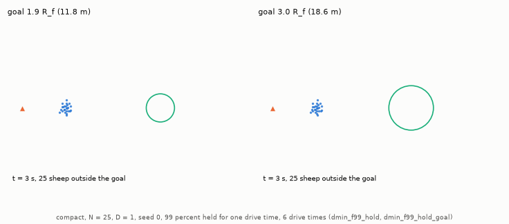
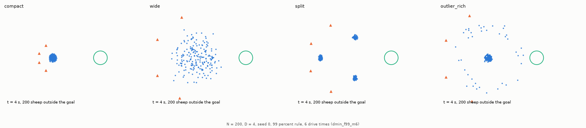
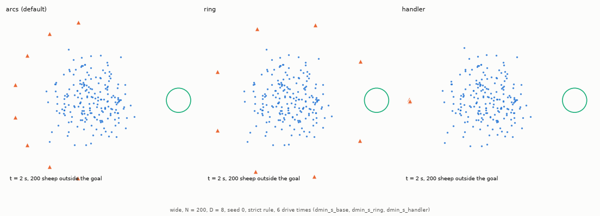
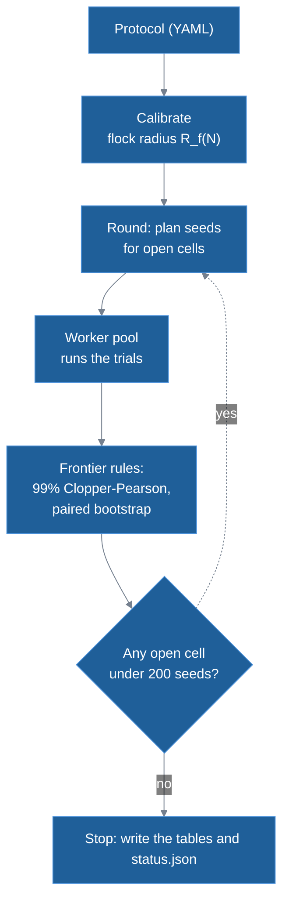
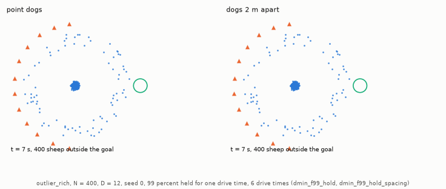
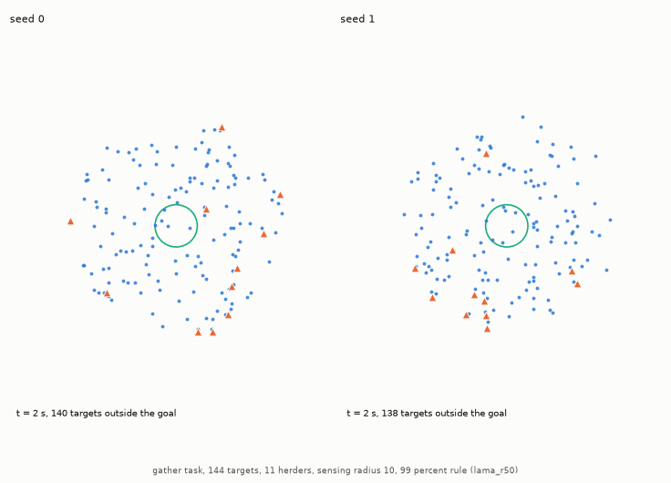

# Task design and experimental method

This doc explains the job HerdSim gives the dogs and how it decides, from many runs, which team sizes are enough. It is for a developer or researcher who knows Python but not herding models or this code. The sheep and dog rules are in [models](../methods/models.md), terms such as protocol, seed and tick in the [glossary](../glossary.md), and each protocol's sizes and settings in the [protocol catalogue](../guides/protocols.md).

Most of the doc is about the drive task: $D$ dogs must bring a flock of $N$ sheep into a round goal before a deadline. The main sheep model is that of Strömbom et al. (2014); the force model of Kubo et al. (2022) runs on the same task. Three Strömbom distances come up throughout:

- $r_a = 2$ m: below this distance sheep push each other apart.
- $r_s = 65$ m: the reaction distance. A sheep with no dog this close grazes: it mostly stands still and now and then steps in a random direction.
- Collect distance $f(N) = r_a N^{2/3}$: while any sheep is farther than this from the flock centre, Strömbom's dogs collect, fetching it back. Otherwise they drive, pushing the flock toward the goal from behind.

The gather task of Lama and di Bernardo (2024) has its own [section 6](#6-the-gather-task-lama-and-di-bernardo-2024).

## Contents

- [1. Task geometry and scale](#1-task-geometry-and-scale)
- [2. Start layouts and dog starts](#2-start-layouts-and-dog-starts)
- [3. Adaptive sampling](#3-adaptive-sampling)
- [4. Why the grid stops where it does](#4-why-the-grid-stops-where-it-does)
- [5. Frontier rules and zones](#5-frontier-rules-and-zones)
- [6. The gather task (Lama and di Bernardo 2024)](#6-the-gather-task-lama-and-di-bernardo-2024)

## 1. Task geometry and scale

### Why the field grows with the flock

A goal of fixed radius holds a flock of 25 with room to spare and a flock of 400 not at all, and a fixed 100 m drive is sixteen flock radii for the small flock and nine for the large one. HerdSim has no walls, as neither source model has one, and a wall would stop sheep that the dogs failed to stop. So HerdSim sets the drive distance and the goal radius as multiples of the flock's own size, and the task has the same shape at every $N$ (Figure 1).

**Figure 1: Task geometry drawn to scale.** The drive distance is the largest of three terms, and the flock and goal radii grow slowly with $N$.

- Marks: lengths in m (the figure's "units"); in the middle and right panels each dot is one of the five main flock sizes.
- Left: the field at $N = 200$, with the flock radius $R_f$, the goal of $1.9 R_f$, the farthest start sheep of the widest layout and the drive distance.
- Middle: the drive distance $l$ against $N$, with its three terms (Table 1); the largest, in grey, is used.
- Right: the calibrated flock radius $R_f(N)$ and the goal radius $1.9 R_f$.

### Sizing by the calibrated flock radius

Every length is a multiple of the **calibrated flock radius $R_f(N)$**, the size of a flock of $N$ sheep once one dog has driven it for a while. One dog that knows where every sheep is drives the flock for 300 s. Over the last 90 s, the radius is $\sqrt{2}$ times the RMS (root mean square) distance of the sheep from the flock centre, the radius of a uniform disc with that RMS. $R_f$ is the median over 3 seeds and two start sizes (start radius $s\sqrt{N/\pi}$ with $s$ = 1 and 3 m). It is measured once per method and $N$ when a campaign starts, and a size whose radius has not settled, or depends on the start size, is refused. Table 1 lists each length.

**Table 1: Lengths of the drive task.**

| Quantity | Rule | Meaning |
| :--- | :--- | :--- |
| Flock radius $R_f(N)$ | Calibrated (6.2 m at $N = 25$, 11.4 m at $N = 400$) | Size of an $N$-sheep flock under one driving dog. |
| Drive distance $l$ | $\max(13\,R_f(N),\ 80,\ l_{\mathrm{reach}} + R_{\mathrm{goal}} + R_f)$ | Start centre to goal centre. The 80 m floor never decides on the Strömbom grids ($13\,R_f$ = 80.6 m at $N = 25$) and sets the drive at $N = 50$ and 100 on the Kubo grid. The third term keeps the goal clear of every start; $l_{\mathrm{reach}}$ is the farthest any sheep can start, over every layout of the protocol. |
| Goal radius $R_{\mathrm{goal}}$ | $1.9\,R_f(N)$ | Same margin around the settled flock at every $N$. 13 and 1.9 are conventions; the sensitivity runs test $1.5\,R_f$. |
| Field clearance | 80 m around the flock, dog stations and goal | Only sizes the field; nothing stops the animals there. |
| Boundary | None | As in Strömbom et al. (2014) and Kubo et al. (2022). |

### Success rules

A trial succeeds when enough sheep are in the goal at the same tick:

- Strict: every sheep. Large teams often fail on the last sheep ([report, section 3.4](../report/part2_success_rule.md#34-rq4-the-success-rule-and-the-last-sheep)).
- 99%: at least $\lceil 0.99\,N \rceil$ sheep. Below $N = 100$ that is every sheep, so the rules are the same there; one straggler is allowed from $N = 100$, and four at $N = 400$.

### Deadlines in drive times

A fixed 5-minute limit would be unfair to large flocks, which are driven over 200 m against 80 m for small ones. Deadlines are therefore given in **drive times** $T_{\mathrm{drive}} = l / v_{\mathrm{sheep,max}}$, the time a sheep walking straight at top speed needs for the drive. A Strömbom sheep has one speed, 1.0 m/s, so $T_{\mathrm{drive}}$ in s equals $l$ in m.

The main protocols use 3, 6 and 12 drive times. For a compact flock under the strict rule at 6 drive times (`dmin_m6`), the median finish time is 1.44 to 1.74 drive times for every team of 1 to 24 dogs at $N = 25$ to 400 ([report, section 3.1](../report/part1_growth.md#31-rq1-how-does-d_min-grow-with-n)), so the deadlines are about two, four and eight times that. At 12 drive times one dog has time to collect outliers one after another, and at 3 drive times the team needed grows ([report, section 3.3](../report/part1_growth.md#33-rq3-how-does-the-deadline-change-d_min)). The Kubo protocols use the fixed 500 s of Kubo et al. (2022).

Table 2 gives the deadlines of the main grids (`dmin_m12` and its variants). Each is rounded up to whole 1 s ticks from the unrounded drive distance, so it can be 1 s above the multiple shown: at $N = 50$, $3 \times 98.8 = 296.4$ s gives 297 s.

**Table 2: Deadlines of the main grids.**

| $N$ | $R_f$ (m) | $l$ (m) and $T_{\mathrm{drive}}$ (s) | 12x (s) | 6x (s) | 3x (s) |
| :---: | :---: | :---: | :---: | :---: | :---: |
| 25 | 6.20 | 80.6 | 968 | 484 | 242 |
| 50 | 7.60 | 98.8 | 1186 | 593 | 297 |
| 100 | 9.08 | 118.1 | 1417 | 709 | 355 |
| 200 | 10.47 | 139.8 | 1678 | 839 | 420 |
| 400 | 11.40 | 206.8 | 2482 | 1241 | 621 |

The scattered layouts ([section 2](#flock-start-layouts)) grow as $N^{2/3}$ and $R_f(N)$ much more slowly, so from $N = 200$ the reach term sets the drive (18 $R_f$ at $N = 400$). The deadline grows with it, but in flock radii a large scattered flock is still driven farther than a small one.

### The holding task

The holding task asks whether the dogs can keep the flock in the goal once it is there. In `dmin_f99_hold` and `dmin_f99_hold_spacing` a trial succeeds only once 99% of the flock has stayed in the goal for one drive time. Meanwhile the dogs withdraw to $r_s + r_a = 67$ m beyond the farthest sheep, so every sheep grazes. A dog that only stopped would stay within $r_s$ of the nearest sheep, which would keep moving away and could leave through the far side of the goal. `dmin_f99_hold_goal` and `dmin_f99_hold_share` vary the goal radius and the share held at $N = 25$, 50 and 100.

A larger goal holds a small flock (Animation 1). This may be because the flock keeps walking while the dogs withdraw and walks out of a small goal; we have not tested it. The measurements are in [report, section 3.10](../report/part3_beyond_dmin.md#310-rq10-when-do-more-dogs-hurt-holding-the-flock-and-dogs-that-take-up-room).

**Animation 1: Holding a small flock (`compact`, $N = 25$, one dog, seed 0, 99% held for one drive time).** Only the larger goal holds the flock. Both start from the same flock ([`compact` layout](#flock-start-layouts)); each replay reproduces its stored trial (`dmin_f99_hold`, `dmin_f99_hold_goal`).

- Marks: blue dots are sheep, orange triangles dogs, the green circle the goal; bottom left, the time and the number of sheep outside the goal.
- Left: in a goal of $1.9 R_f$ (11.8 m) the flock ends outside the goal, so the hold fails.
- Right: in a goal of $3.0 R_f$ (18.6 m) the flock stays inside.

## 2. Start layouts and dog starts

### Flock start layouts

How spread out the flock starts decides how much collecting the dogs must do before they can drive. The four start layouts range from none to a lot (Figure 2). The scattered ones are sized by the collect distance $L = f(N) = 2\,N^{2/3}$, so "scattered" means the same at every $N$: a fixed share of the sheep starts where the dogs must collect rather than drive.

- `compact`: a Gaussian with $\sigma = 0.5\,R_f$, cut at $3\sigma$. Every sheep starts within $f(N)$, so the dogs drive at once.
- `wide`: a Gaussian with $\sigma = 0.5\,L$, cut at $3\sigma$, so about 13% of the sheep start beyond $L$ at every $N$ ($e^{-2}$ before the cut).
- `split`: three compact clusters ($\sigma = 0.5\,R_f / \sqrt{3}$ each; two below $N = 12$) centred on a circle of radius $L$.
- `outlier_rich`: 80% of the sheep in a compact core and 20% on a ring between $1.1\,L$ and $1.6\,L$ from it.

**Figure 2: The four start layouts ($N = 200$, $D = 4$, same scale).** A sheep that starts outside the collect distance has to be collected before the flock can be driven.

- Marks: the dashed circle is the collect distance $f(N)$.
- Panels: one per layout, named above each.

Animation 2 runs one team on each layout.

**Animation 2: The same team on the four start layouts ($N = 200$, $D = 4$, seed 0, 99% rule, 6 drive times).** On `compact` the dogs drive at once; on the scattered layouts they collect first, and `split` takes longest. Each replay reproduces its stored trial (`dmin_f99_m6`).

- Marks: as in Animation 1.
- Panels: `compact`, `wide`, `split` and `outlier_rich`, left to right. The flock is in at 236, 278, 631 and 277 s.

### Why the layouts are not ordered by spread

Start spread, the largest RMS radius the flock reaches in a trial (`max_extent`, taken as its start radius) averaged over trials, does not order the layouts by difficulty. At $N = 400$, `outlier_rich` starts less spread out than `wide` (66.2 m against 74.8 m) yet succeeds in 55% of trials against 84%, pooled over every tested team of `dmin_m6` (strict rule, 6 drive times). This may be because where the outliers lie matters as well as how far out they start; we have not tested it ([report, section 4.3](../report/part5_failures.md#43-how-failed-trials-end-and-the-start-spread)).

### Dog starts

The first dog circle lies 30 m (`dog_start_gap`) beyond the farthest point any sheep of that layout can start, so no dog starts among the sheep; as 30 m is less than $r_s$, the nearest sheep react from the first tick. Dogs on one circle stand at least 5 m apart (`dog_start_spacing`), and those that do not fit go on a circle 5 m farther out. Both are conventions; the sensitivity runs test gaps of 15 and 60 m. There are three patterns (Figure 3):

- `arcs` (default): half circles on the side away from the goal, dogs evenly spread. With an odd count one dog starts on the drive axis, the line through the flock and goal centres.
- `ring`: full circles, leaving out the cone that holds the goal.
- `handler`: every dog at one point straight behind the flock, at the first arc's distance, as for dogs sent out from one spot.

**Figure 3: Dog starts.** The default arcs behind the flock, and the ring and handler starts the sensitivity runs test.

- Marks: blue dots are sheep, orange triangles dogs and the green circle the goal.
- Top: the default arcs for $D = 1$ to 64 behind an $N = 100$ flock.
- Bottom: arcs, ring and handler at $N = 200$ with $D = 8$.

Animation 3 runs one flock from each start.

**Animation 3: Three dog starts on the same flock (`wide`, $N = 200$, $D = 8$, seed 0, strict rule, 6 drive times).** All three bring every sheep in, at 272, 290 and 271 s. Each replay reproduces its stored trial (`dmin_s_base`, `dmin_s_ring`, `dmin_s_handler`).

- Marks: as in Animation 1.
- Panels: `arcs`, `ring` and `handler`, left to right. Handler dogs spread out from one point before the flock is gathered.

## 3. Adaptive sampling

Most cells are decided before the cap of 200 seeds: one dog against 400 scattered sheep at a tight deadline, or twelve dogs on 25 compact sheep, needs no 200 runs. So HerdSim runs in rounds and adds trials only where the answer is still open. The terms (see the [glossary](../glossary.md#trials-and-experiments)):

- Cell: one method, layout, $N$ and $D$ in one protocol. It asks a question such as "can 3 dogs herd 200 sheep in this setup?" and holds one trial per seed.
- Curve: the cells of one method, layout and $N$, over $D$.
- Reliable: success rate at least $\theta = 0.90$ with 99% confidence.
- Zone: what a cell's place on its curve says, such as too few dogs or no faster than a smaller team ([section 5](#5-frontier-rules-and-zones), which also defines $D_{\mathrm{sat}}$ and $D_{\mathrm{best}}$).

### The adaptive sampling loop

The flock radius is calibrated once, then rounds repeat until no cell is both open and under 200 seeds, or the time budget (`budget_hours`, 72 h by default) is spent. A cell is open when its reliability is undecided or, only in a protocol that decides finish times (`decide_finish_times`), when a finish-time comparison is. Each round runs its seeds in a pool of worker processes and applies the frontier rules of [section 5](#5-frontier-rules-and-zones):

### Stopping early with the 99% Clopper-Pearson interval

Each cell starts with 10 seeds. After each batch HerdSim computes the exact two-sided 99% Clopper-Pearson interval $[L_{\mathrm{CP}}, U]$ of the success rate ($L_{\mathrm{CP}}$ is the lower bound, named to keep it apart from the collect distance $L$). The cell is then:

- Unreliable: $U < 0.90$, usually after 10 to 20 trials. No more seeds.
- Reliable: $L_{\mathrm{CP}} \ge 0.90$. This needs at least 51 straight successes, and looks come every 10 trials, so the earliest decision is at 60 trials (six batches of 10), and only with 60 of 60.
- Undecided: another batch of 10, up to 200.

The 99% holds for each look on its own (Figure 4). The repeated looks are not corrected for, so the chance of a wrong decision over a cell's whole run is somewhat above 1% ([report, limitations](../report/d_min_report.md#6-limitations)).

**Figure 4: Stopping early.** Clear failures stop after 10 to 20 seeds, clear successes at 60 trials, and only cells near the threshold go on toward 200.

- Marks: an illustration, not stored runs. Red is the interval's upper bound when no trial succeeds, green its lower bound when all succeed, blue an undecided cell after each batch of 10; the dashed line is $\theta = 0.90$.

### Midpoint densification

The protocol lists a coarse set of team sizes, and HerdSim fills in counts where the answer changes, so $D_{\min}$, the smallest reliable team, is found without testing every count. When two neighbouring tested counts on a curve are in different zones and differ by more than `refine_min_gap` = 1, the next round adds the count halfway between (Figure 5). When finish times are not decided, zones are compared on the reliability label alone: two neighbours differ when one is reliable, unreliable or undecided and the other is not the same. An undecided neighbour first waits for its own seeds unless it has reached the cap, and a pruned cell adds no midpoint.

**Figure 5: Midpoint densification.** A change of zone between $D = 2$ and $D = 4$ adds $D = 3$ to the next round.

- Marks: an illustration, not stored runs. Dots are tested $D$, coloured by zone; top row the first round, bottom row the next, with the added $D = 3$ as a star.

### Pruning above saturation

Well above the point where more dogs stop helping, most dogs of a large team can end up within 2 m of another dog. This may be because such a dog acts as a copy of its neighbour, so the cell repeats the one below it and more seeds would not change its zone; we have not tested it (Figure 6).

Pruning needs $D_{\mathrm{sat}}$ decided and a larger tested count also zoned saturated, so it does not apply when $D_{\mathrm{sat}}$ is the top of the grid and still improving. The rule is a mean dog overlap: every cell above that confirming count is pruned when at least 90% of its dogs, averaged over ticks and trials, had another dog within 2 m (`prune_overlap`). Only saturated or undecided cells are pruned, never an unreliable cell or one slower than $D_{\mathrm{best}}$; they are marked `pruned` in `frontier_cells.csv`.

**Figure 6: Pruning.** Above saturation, cells whose dogs overlap (at least 0.90) get no more seeds.

- Marks: an illustration, not stored runs. Blue is the median finish time (left axis), orange the mean dog overlap (right axis); the dotted line is 0.90 overlap and the shaded region is pruned.

### Paired random streams

To compare 2 dogs with 4 fairly, both teams should face the same flock. Seed $i$ of every cell is `master_seed + i` (for example $2026 + i$), and each trial draws the start positions, the sheep's random choices and the dogs' random choices from three separate streams. Seed $i$ thus gives every team the same start flock (Figure 7), and the sheep see the same noise until the dogs act differently, so the finish-time difference at a seed is mostly the effect of the team. The [paired bootstrap](#frontier-values) compares these differences. The time limit plays no part until it is reached, so a shorter deadline only cuts the same trial short, as the stored runs confirm ([report, section 3.3](../report/part1_growth.md#33-rq3-how-does-the-deadline-change-d_min)).

**Figure 7: Paired seeds.** Seed 2026 gives the same start flock at every team size $D$.

- Marks: an illustration, not stored runs. Columns are seeds 2026 to 2028, rows team sizes 2 to 4.

### Saving trials and resuming

A run can take hours. Each finished trial is appended to `trials.jsonl` at once, so a run stopped with `Ctrl+C` resumes with the same command without losing work, and a lock stops a second run writing to the folder. Git keeps a gzip copy, `trials.jsonl.gz`, because a large protocol's plain file passes GitHub's 100 MB limit; a run writes it when it ends, and a fresh clone unpacks it the first time the folder is opened.

## 4. Why the grid stops where it does

### Flock size

Each setting tests the flock sizes its question needs (Table 3).

**Table 3: Flock sizes by setting.**

| Setting | Range | Reason |
| :--- | :---: | :--- |
| Main grids | 25 to 400 | In the six main runs (both rules, 12, 6 and 3 drive times), $D_{\min} = 1$ on every layout at $N \le 50$. 400 is the top of the strict-rule grids; the added sizes and large-$N$ runs go higher. |
| Sensitivity | 100 to 400 | Where $D$ matters, on `wide` and `outlier_rich`, $D = 1$ to 16 at 6 drive times. |
| Added sizes (99% grids at 12 and 6 drive times) | 71, 141, 283, 566 | Steps of $\sqrt{2}$, even in $\log N$, so small sizes do not dominate the fit. $566 = 400\sqrt{2}$ is the last step below about $N = 600$, above which a driven flock no longer settles to one radius $R_f(N)$. |
| Kubo model | 25 to 100 | The Kubo flock packs to about 6 m (5.9 to 6.2) at any $N$; larger $N$ only makes it denser. |
| Sensing range | 50 to 200 | Dog sensing 15 to 100 m around $r_s$, full sight as control. At $N = 200$ the collect distance (68 m) already reaches $r_s$, and larger $N$ would mix that limit into the sensing effect. |
| Gather task (`lama`) | 1 to 400 targets, perfect squares | The paper's cells up to $\sqrt{N} = 20$ (its axis runs to 25). This holds the threshold of its Supplementary Table I ($\sqrt{N} = 8$, 9 and 11 at the 90%, 95% and 99% levels) and the square-root rise above it, the results compared in [section 6](#6-the-gather-task-lama-and-di-bernardo-2024). |
| Large $N$ | 566 to 3200 | Large flocks, and the limit where Strömbom's drive point passes $r_s$ ($N \approx 1056$). Above 566, $R_f$ is imposed from the density of the calibrated 566 flock. |

### Team size

The team sizes are spaced so that each answer falls between two tested counts:

- Main grids (1, 2, 3, 4, 6, 8, 12, 16, 24): steps of about 1.5x, at least two per doubling. 24 is well above every decided $D_{\min}$ of the main grids.
- Gather task (1 to 25, every count): the grid of Lama and di Bernardo (2024).
- Holding with spaced dogs: `dmin_f99_hold_spacing` keeps the grid of `dmin_f99_hold` and adds 7, 9, 10, 11 and 13. The arc behind the flock holds about 7, 9, 10, 11 and 12 dogs 2 m apart at $N = 25$ to 400, so a tested team sits at each of these sizes, and 13, just above the largest, shows where crowding starts.
- Holding small flocks: the question is the goal and the share, so `dmin_f99_hold_share` thins the grid to 1, 2, 4, 8 and 24, and `dmin_f99_hold_goal` uses the main grid. Both keep 24 as the largest $D$, so the dog starts match `dmin_f99_hold`.

### Seeds per cell (cap of 200)

At 200 seeds a cell is decided only if its success rate is at least 0.955 or at most 0.835. Doubling to 400 narrows that band only to 0.94 and 0.86, for twice the trials.

Over the 41 protocols the folders hold 6,845 cells, and 499 are open at the cap, counted at each folder's last sitting ([appendix A](../report/appendix_run_record.md#appendix-a-protocol-run-record)). An [open cell](../glossary.md#success-and-reliability) is still undecided on reliability or, in a [sitting](../glossary.md#trials-and-experiments) that decides finish times, on a finish-time comparison; pruned cells and cells with an error are never open. A curve whose $D_{\min}$ hangs on a cell undecided on reliability is reported as a bracket, such as `2-3`.

## 5. Frontier rules and zones

The frontier rules ([`analysis/frontier.py`](../../analysis/frontier.py)) turn a curve's cells into answers: the smallest team that works, the fastest one, and where more dogs stop helping or start to hurt. Figure 8 shows the zones along $D$.

**Figure 8: Zones along the team size $D$.** The zones follow from each cell's reliability and the paired finish-time comparisons.

- Marks: illustrative curves, not data. Coloured bands are the five main zones, too few to collapse ([Zones](#zones) adds the dip, recovered and undecided cases); $D_{\min}$, $D_{\mathrm{best}}$, $D_{\mathrm{sat}}$, $D_{\mathrm{crowd}}$ and $D_{\max}$ are marked below (Table 4).
- Top: success rate against $D$; the dashed line is $\theta = 0.90$.
- Bottom: median finish time against $D$; the shaded band is the margin around $D_{\mathrm{best}}$.

### Frontier values

The finish-time values look only at the working range, the reliable $D$ from $D_{\min}$ to $D_{\max}$ (Table 4). Two cells are compared on finish time with a paired bootstrap:

1. Pairs: the per-seed finish-time differences on the seeds both cells succeeded on (at least 5).
2. Bootstrap: 4000 resamples give a 99% interval for the median difference, relative to the slower cell's median.
3. Verdict: faster or slower when the whole interval lies beyond $\pm 5$% (`time_margin`), the same when it lies within, undecided otherwise.

**Table 4: Frontier values.**

| Value | Definition |
| :--- | :--- |
| $D_{\min}$ | Smallest reliable $D$ ($L_{\mathrm{CP}} \ge 0.90$). |
| $D_{\min,\mathrm{low}}$ | Smallest $D$ with $U \ge 0.90$: the lowest team that may still be reliable, and the low end of a bracket. |
| $D_{\mathrm{overcrowd}}$ | Smallest $D$ above $D_{\min}$ where it and the next tested $D$ are both unreliable; two in a row, because one can be a sampling dip near the threshold. With no reliable $D$ yet, the search starts above $D_{\min,\mathrm{low}}$, so teams failing above one that may still be reliable count as too many, not too few. |
| $D_{\max}$ | Largest reliable $D$ below $D_{\mathrm{overcrowd}}$ (or the largest reliable $D$). |
| $D_{\mathrm{best}}$ | Smallest working $D$ decided the same as or faster than the fastest working $D$. |
| $D_{\mathrm{sat}}$ | Smallest working $D$ that no larger working $D$ is faster than (faster by the paired bootstrap verdict, beyond the 5% margin); above it more dogs stop helping. |
| $D_{\mathrm{crowd}}$ | Smallest working $D$ above $D_{\mathrm{best}}$ that is slower than $D_{\mathrm{best}}$. |

### Zones

Each cell gets one zone:

- `too_few`: unreliable, below $D_{\min}$ (below $D_{\min,\mathrm{low}}$ on a curve with no reliable $D$).
- `improving`: reliable, below $D_{\mathrm{sat}}$, not slower than $D_{\mathrm{best}}$.
- `saturated`: reliable, from $D_{\mathrm{sat}}$ up, not slower than $D_{\mathrm{best}}$.
- `crowded`: reliable, above $D_{\mathrm{best}}$ and slower than it, below or above $D_{\mathrm{sat}}$.
- `unreliable_dip`: unreliable, between $D_{\min}$ (or $D_{\min,\mathrm{low}}$) and $D_{\mathrm{overcrowd}}$.
- `collapse`: unreliable, from $D_{\mathrm{overcrowd}}$ up.
- `recovered`: reliable again above $D_{\mathrm{overcrowd}}$, outside the working range.
- `undecided`: reliability, or the comparison with $D_{\mathrm{best}}$, still open.

### How failed trials end

Failed drive trials are split by whether the flock ended far from the goal or near it (`analysis/dispersion_burden.py`); the definition and counts are in [report, section 4.3](../report/part5_failures.md#43-how-failed-trials-end-and-the-start-spread).

### Crowding with dogs that take up room

In the main runs the dogs have no size (point dogs), so two can stand at one point. One setting gives them room: a dog whose step would end within 2 m of another does not move that tick. In the holding task on `outlier_rich` $N = 400$ this makes large teams fail (Animation 4; [report, section 3.10](../report/part3_beyond_dmin.md#310-rq10-when-do-more-dogs-hurt-holding-the-flock-and-dogs-that-take-up-room)).

**Animation 4: Twelve point dogs against twelve dogs kept 2 m apart, holding the same flock (`outlier_rich`, $N = 400$, seed 0, 99% held for one drive time, 6 drive times).** Only the point dogs bring the flock in and hold it; the spaced dogs never get 99% of the flock into the goal before the deadline. Each replay reproduces its stored trial (`dmin_f99_hold`, `dmin_f99_hold_spacing`).

- Marks: as in Animation 1.
- Left: point dogs. The hold is met at 1162 s with every sheep in.
- Right: spaced dogs. At the 1241 s deadline, 289 sheep are outside the goal.

## 6. The gather task (Lama and di Bernardo 2024)

The `lama` method runs in a second task, `gather` (`task: gather` in a protocol), which reproduces the setting of [Lama and di Bernardo (2024)](https://doi.org/10.1103/PhysRevResearch.6.L032012) (model: [`docs/methods/models.md`](../methods/models.md#lama--di-bernardo-2024-non-cohesive-targets)). Every Strömbom and Kubo protocol uses the drive task (`drive_to_goal`) above.

As in the paper, this section calls the sheep targets and the dogs herders. The targets do not flock and start scattered over a disc, and the herders must bring them into a goal at its centre. Each herder senses targets only within its sensing radius $\xi$; Figure 8 of the [models document](../methods/models.md#local-herders-lama_herders) shows the rule and one trial. The runs cover the paper's grid up to $\sqrt{N} = 20$, with $N$ the number of targets (40,280 trials); results are in [report, section 3.14](../report/part6_square_root_law.md#314-rq14-targets-without-cohesion-the-square-root-law-of-lama-and-di-bernardo-2024).

### Geometry of the gather task

Figure and table numbers in the Source column refer to the paper; Table I and Fig. S8 are in its Supplementary Material. The paper gives lengths with no unit, and HerdSim reads them as metres. $\Delta t$ is the time step of one tick.

**Table 5: Geometry of the gather task.**

| Quantity | Setting and value | Source |
| :--- | :--- | :--- |
| Start disc $R$ | `gather_start_radius`, 50 m | The paper's main case (Fig. 2) |
| Goal radius | `gather_goal_fraction` $\times R = R/5 = 10$ m | The paper's $r^{\ast} = R/5$ |
| Start (layout `uniform`) | Targets and herders uniform over the disc, goal included | The paper's $\Omega_0$ |
| Required share | `success_fraction` = 0.99 | The paper's $\chi^{\ast} = 0.99$ |
| Time limit | 5000 s (166,667 ticks of 0.03 s, stored as 5000.01 s) | The paper's $t_{\max} = 5.0 \times 10^3$ (Fig. S8), given with no unit and read as seconds |
| Boundary | None | As in the drive task |

With no flocking there is no flock radius to calibrate, so the task is sized by $R$. Targets are drawn before herders, so a seed gives the same targets at every team size and cells stay paired as in the drive task.

### When a trial ends and what counts as success

A gather trial ends in one of three ways:

- Success: at least 99% of the targets are in the goal at a tick when every herder is inside it, the paper's stop ("the simulation is stopped when all the herders are inside $\Omega_G$").
- Early end, a failure: read literally, the paper's stop would end a one-herder trial at the first tick whenever the herder starts inside. HerdSim ends a trial early only when every herder is inside and none senses a target outside, so targets that no herder senses are never gathered.
- Otherwise: the trial runs to the time limit.

Failures are labelled `targets_lost` (some targets beyond every herder's sensing radius at the end) or `outnumbered` (all sensed, but the share not reached in time). Every row keeps the share inside at the end (`final_in_goal_fraction`), so the paper's statistic can be computed next to HerdSim's. Animation 5 shows one run of each kind, in a cell just above the paper's threshold.

**Animation 5: Two ways a gather run ends (144 targets, 11 herders, $\xi = 10$ m).** One run succeeds; the other ends early with targets lost. Each replay reproduces its stored trial (`lama_r50`).

- Marks: blue dots are targets, orange triangles herders, the green circle the goal; bottom left, the time and the number of targets outside the goal.
- Left: seed 0 gathers all but one target and succeeds under the 99% rule.
- Right: seed 1 leaves two targets beyond every herder's sensing radius; the herders walk back into the goal and the run ends early as `targets_lost`.

### Two statistics

The paper and HerdSim judge "enough herders" differently, both from the same trial rows (Table 6). HerdSim computes the paper's statistic as the mean final share over the runs of a cell and requires at least 0.99; the averaging and the "at least" are HerdSim's reading.

**Table 6: Paper and HerdSim statistics.**

| Question | Paper | HerdSim |
| :--- | :--- | :--- |
| A team is enough when | the share inside at the end is "at least a certain fraction" $\chi > \chi^{\ast}$, with $\chi^{\ast} = 0.99$, over 50 runs | the 99% Clopper-Pearson interval of the success rate lies at or above 0.90 |
| Seeds | 50 per cell | adaptive, 10 to 200 per cell |

### Metrics recorded every 10 ticks

A gather trial that runs to the time limit (5000 s, 166,667 ticks of 0.03 s, stored as 5000.01 s) takes 166,667 ticks, and per-tick metrics cost more than the model. The gather protocols set `metrics_stride: 10`, one record every 0.3 s. Success, the early end and the time limit are still checked every tick and the last tick is always recorded, so outcomes do not depend on the stride. Only first-arrival times (the first recorded tick with a given share inside) are affected: never earlier than the exact time and possibly later, since a share reached and lost between two records is missed.

### Protocols

Table 7 lists the gather protocols.

**Table 7: Gather protocols.**

| Protocol | Sensing radius $\xi$ (m) | Paper figure |
| :--- | :---: | :--- |
| `lama_r50` | 10 | Fig. 2b, Table I |
| `lama_r50_inf` | infinite | Fig. 2a |
