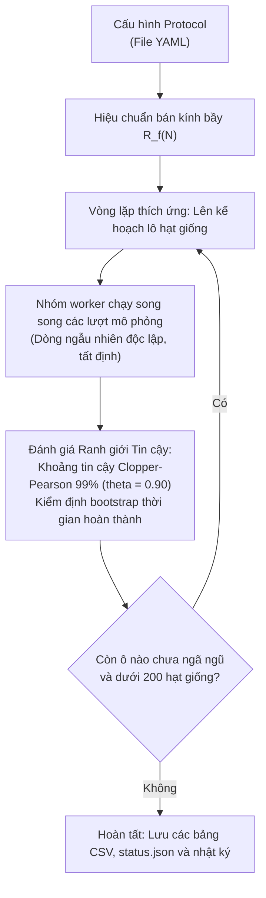

# Thiết kế Nhiệm vụ và Phương pháp luận Thực nghiệm

Tài liệu này trình bày chi tiết về phương pháp luận thực nghiệm, hình học nhiệm vụ, các quy tắc quyết định thống kê và cơ sở lựa chọn tham số trong **HerdSim**.

---

## Mục lục

- [1. Hình học Nhiệm vụ và Tính Bất biến theo Quy mô](#1-hình-học-nhiệm-vụ-và-tính-bất-biến-theo-quy-mô)
  - [Sai lầm chí tử của việc cố định kích thước bãi cỏ](#sai-lầm-chí-tử-của-việc-cố-định-kích-thước-bãi-cỏ)
  - [Quy chuẩn theo Bán kính Bầy tự nhiên *R*f(*N*)](#quy-chuẩn-theo-bán-kính-bầy-tự-nhiên-r_fn)
  - [Thời hạn Chuẩn hóa và Thời gian Lùa đặc trưng](#thời-hạn-chuẩn-hóa-và-thời-gian-lùa-đặc-trưng)
- [2. Cấu hình Xuất phát Ban đầu](#2-cấu-hình-xuất-phát-ban-đầu)
  - [4 Bố cục phân bố cừu ban đầu](#4-bố-cục-phân-bố-cừu-ban-đầu)
  - [3 Cách thả chó xuất phát](#3-cách-thả-chó-xuất-phát)
- [3. Động cơ Lấy mẫu Thích ứng Tuần tự (Adaptive Sequential Sampling)](#3-động-cơ-lấy-mẫu-thích-ứng-tuần-tự-adaptive-sequential-sampling)
  - [Vòng lặp lấy mẫu thích ứng](#vòng-lặp-lấy-mẫu-thích-ứng)
  - [Dừng sớm bằng khoảng tin cậy Clopper-Pearson 99%](#dừng-sớm-bằng-khoảng-tin-cậy-clopper-pearson-99)
  - [Tự động chèn điểm giữa (Midpoint Densification)](#tự-động-chèn-điểm-giữa-midpoint-densification)
  - [Tỉa ô bão hòa và trùng lặp (Saturation & Overlap Pruning)](#tỉa-ô-bão-hòa-và-trùng-lặp-saturation--overlap-pruning)
  - [Cặp dòng ngẫu nhiên dùng chung (Common Random Numbers)](#cặp-dòng-ngẫu-nhiên-dùng-chung-common-random-numbers)
  - [Ghi đĩa an toàn và khả năng tiếp tục chạy (Resume)](#ghi-đĩa-an-toàn-và-khả-năng-tiếp-tục-chạy-resume)
- [4. Vì sao Lưới Dừng ở những Giới hạn này? (Cơ sở chọn tham số)](#4-vì-sao-lưới-dừng-ở-những-giới-hạn-này-cơ-sở-chọn-tham-số)
  - [Quy mô đàn cừu *N*](#quy-mô-đàn-cừu-n)
  - [Số lượng chó *D*](#số-lượng-chó-d)
  - [Số hạt giống trên mỗi ô (Mức trần 200)](#số-hạt-giống-trên-mỗi-ô-mức-trần-200)
  - [Thời hạn và Tiêu chí đánh giá thành công](#thời-hạn-và-tiêu-chí-đánh-giá-thành-công)
- [5. Các Quy tắc Ranh giới Thống kê và Vùng Hành vi](#5-các-quy-tắc-ranh-giới-thống-kê-và-vùng-hành-vi)
  - [Định nghĩa các chỉ số ranh giới](#định-nghĩa-các-chỉ-số-ranh-giới)
  - [Phân loại các vùng hành vi](#phân-loại-các-vùng-hành-vi)
- [6. Nhiệm vụ gom (Lama và di Bernardo 2024)](#6-nhiệm-vụ-gom-lama-và-di-bernardo-2024)

---

## 1. Hình học Nhiệm vụ và Tính Bất biến theo Quy mô

### Sai lầm chí tử của việc cố định kích thước bãi cỏ

Một sai lầm rất phổ biến trong các mô phỏng bầy đàn động vật và robot là giữ nguyên kích thước bãi cỏ khi tăng số lượng cá thể $N$.

400 con cừu chiếm diện tích vật lý lớn hơn rất nhiều so với 25 con. Nếu bạn nhốt 400 con cừu vào một sân bóng đá, chúng sẽ bị nén chặt sát các bức tường ranh giới. Đàn chó lúc này chẳng cần phải vất vả chăn dắt; chính các bức tường biên đã gom cừu hộ chúng! Điều đó sẽ làm sai lệch hoàn toàn kết quả nghiên cứu khoa học, vì đã đánh đồng *quy mô bầy* với *hiện tượng chèn ép nhân tạo do tường bao*.

HerdSim thiết lập **tính bất biến quy mô thực sự (physical scale invariance)** bằng cách mở rộng kích thước trường chạy tỷ lệ thuận với kích thước tự nhiên của đàn cừu.

*Hình 1: Hình học nhiệm vụ được vẽ theo đúng tỷ lệ vật lý. Trái: Bố trí đấu trường ở* $N = 200$ *cừu. Giữa: Cách cự ly lùa* $l$ *co giãn theo quy mô đàn. Phải: Bán kính bầy tự nhiên* $R_f(N)$ *và bán kính chuồng đích trên các quy mô đàn, đảm bảo mật độ bầy và độ khó lùa luôn tương đương nhau.*

### Quy chuẩn theo Bán kính Bầy tự nhiên $R_f(N)$

Toàn bộ kích thước hình học được neo vào **bán kính bầy trạng thái dừng đã được hiệu chuẩn $R_f(N)$**: bán kính cân bằng thực nghiệm của đàn $N$ con cừu khi được lùa bởi một chú chó giàu kinh nghiệm.

| Tham số | Quy tắc Toán học | Ý nghĩa Vật lý |
| :--- | :--- | :--- |
| **Bán kính bầy** $R_f(N)$ | Hiệu chuẩn thực nghiệm ($6.2\text{ m}$ tại $N=25$; $11.4\text{ m}$ tại $N=400$) | Bán kính trạng thái dừng tự nhiên của đàn $N$ cừu dưới áp lực lùa ổn định. |
| **Khoảng cách lùa** $l$ | $\max(13 \cdot R_f(N),\thinspace 80,\thinspace l_{\mathrm{reach}} + R_{\mathrm{goal}} + R_f)$ | Đảm bảo đàn cừu lớn phải đi quãng đường dài hơn tương ứng để bảo toàn tỷ lệ quy mô. |
| **Bán kính chuồng đích** $R_{\mathrm{goal}}$ | $1.9 \cdot R_f(N)$ | Giữ nguyên mật độ chứa đàn và độ khó khi lùa vào cửa chuồng cho mọi quy mô đàn. |
| **Khoảng đệm biên** | $80\text{ m}$ tính từ vị trí tác tử xa nhất | Ngăn chặn hiện tượng tác tử chạm mép tọa độ. |
| **Biên giới mở** | **Không có tường hay biên phản xạ** | Đồng cỏ tự nhiên không có tường bóng bàn. Tác tử tự do di chuyển ra ngoài mà không bị dội ngược lại. |

### Thời hạn Chuẩn hóa và Thời gian Lùa đặc trưng

Nếu đặt cùng một thời hạn cố định 5 phút cho tất cả các đàn, đàn lớn sẽ bị phạt oan uổng vì chúng phải di chuyển hơn $200\text{ m}$ so với chỉ $80\text{ m}$ của đàn nhỏ.

HerdSim chuẩn hóa thời hạn bằng **thời gian lùa đặc trưng** ($T_{\mathrm{drive}}$): thời gian tối thiểu để con cừu chạy nhanh nhất đi trên đường thẳng ở vận tốc ổn định ($v_{\mathrm{sheep,max}} = 1.0\text{ m/s}$) vượt qua quãng đường lùa:

$$
T_{\mathrm{drive}} = \frac{l}{v_{\mathrm{sheep,max}}}
$$

Một đàn cừu tập trung được lùa bởi 1 chú chó thông thường sẽ hoàn thành nhiệm vụ trong khoảng $1.44$ đến $1.74 \times T_{\mathrm{drive}}$. Các thử nghiệm nghiên cứu đánh giá trên 3 mức áp lực thời gian:
- **Thong thả ($12\times T_{\mathrm{drive}}$)**: Dư dả thời gian. Một chú chó duy nhất có đủ thời gian đi gom tuần tự từng con cừu lạc.
- **Trung bình ($6\times T_{\mathrm{drive}}$)**: Nhịp độ làm việc tiêu chuẩn ngoài thực địa.
- **Gấp rút ($3\times T_{\mathrm{drive}}$)**: Rất khẩn cấp. Việc gom tuần tự chắc chắn sẽ trễ hạn; các chú chó bắt buộc phải tỏa ra làm việc song song.

| Quy mô đàn ($N$) | Bán kính bầy $R_f$ | Cự ly lùa $l$ | Thời gian lùa ($T_{\mathrm{drive}}$) | Thời hạn $12\times$ (Thong thả) | Thời hạn $6\times$ (Trung bình) | Thời hạn $3\times$ (Khẩn cấp) |
| :---: | :---: | :---: | :---: | :---: | :---: | :---: |
| **$N = 25$** | $6.20\text{ m}$ | $80.6\text{ m}$ | **$80.6\text{ s}$** ($\sim 1.3\text{ phút}$) | $967\text{ s}$ ($\sim 16.1\text{ phút}$) | $484\text{ s}$ ($\sim 8.1\text{ phút}$) | $242\text{ s}$ ($\sim 4.0\text{ phút}$) |
| **$N = 50$** | $7.60\text{ m}$ | $98.8\text{ m}$ | **$98.8\text{ s}$** ($\sim 1.6\text{ phút}$) | $1,185\text{ s}$ ($\sim 19.8\text{ phút}$) | $593\text{ s}$ ($\sim 9.9\text{ phút}$) | $296\text{ s}$ ($\sim 4.9\text{ phút}$) |
| **$N = 100$** | $9.08\text{ m}$ | $118.1\text{ m}$ | **$118.1\text{ s}$** ($\sim 2.0\text{ phút}$) | $1,417\text{ s}$ ($\sim 23.6\text{ phút}$) | $708\text{ s}$ ($\sim 11.8\text{ phút}$) | $354\text{ s}$ ($\sim 5.9\text{ phút}$) |
| **$N = 200$** | $10.47\text{ m}$ | $139.8\text{ m}$ | **$139.8\text{ s}$** ($\sim 2.3\text{ phút}$) | $1,678\text{ s}$ ($\sim 28.0\text{ phút}$) | $839\text{ s}$ ($\sim 14.0\text{ phút}$) | $419\text{ s}$ ($\sim 7.0\text{ phút}$) |
| **$N = 400$** | $11.40\text{ m}$ | $206.8\text{ m}$ | **$206.8\text{ s}$** ($\sim 3.4\text{ phút}$) | $2,482\text{ s}$ ($\sim 41.4\text{ phút}$) | $1,241\text{ s}$ ($\sim 20.7\text{ phút}$) | $620\text{ s}$ ($\sim 10.3\text{ phút}$) |

---

## 2. Cấu hình Xuất phát Ban đầu

### 4 Bố cục phân bố cừu ban đầu

HerdSim cung cấp 4 cấu hình xuất phát chuẩn hóa để tách bạch giai đoạn gom cừu lạc khỏi giai đoạn lùa bầy:

*Hình 2: Bốn bố cục bầy ban đầu tại* $N = 200$ *cừu với* $D = 4$ *chó (vẽ theo cùng một tỷ lệ xích). Vòng tròn đứt nét đánh dấu biên giới gom* $f(N) = r_a N^{2/3}$*. Bất kỳ con cừu nào nằm ngoài vòng này sẽ kích hoạt hành vi gom cừu lạc.*

1. **`compact`**: Cừu lấy mẫu từ phân phối Gaussian hẹp ($\sigma = 0.5 \cdot R_f$). Toàn bộ cừu nằm trong $f(N)$; đàn chó lập tức vào chế độ lùa bầy.
2. **`wide`**: Cừu phân tán trên diện rộng ($\sigma = 0.5 \cdot 2 N^{2/3}$), đòi hỏi các chú chó phải đi vòng rộng để bao quát chu vi.
3. **`split`**: Đàn cừu bị tách thành 3 cụm riêng biệt đối xứng trên một vòng tròn. Chó phải gom các cụm lại với nhau mà không làm chúng vỡ vụn thêm.
4. **`outlier_rich`**: 80% số cừu bắt đầu trong một lõi đặc trung tâm, 20% còn lại bị rải rác làm những cá thể lạc đàn rất xa trên đồng cỏ.

### 3 Cách thả chó xuất phát

Đàn chó xuất phát cách đàn cừu $30\text{ m}$ về phía sau theo một trong 3 hình học:

*Hình 3: Các dạng bố trí thả chó xuất phát. Trên: Vòng cung đồng tâm mặc định cho* $D = 1$ *đến* $64$ *phía sau đàn* $N = 100$*. Dưới: So sánh trực tiếp giữa thả vòng cung (`arcs`), thả bao vây (`ring`) và thả từ một cọc (`handler`) tại* $N = 200$ *với* $D = 8$ *chó.*

- **`arcs` (Mặc định)**: Các vòng cung đồng tâm phía sau đàn cừu. Chó đơn lẻ đứng ngay trục lùa; các chú chó thêm vào sẽ đứng cánh đối xứng.
- **`ring`**: Chó phân bố đều trên một vòng tròn hở bao quanh đàn cừu (chừa một lối mở hướng về phía đích).
- **`handler`**: Toàn bộ đàn chó xuất phát từ một tọa độ duy nhất phía sau đàn, mô phỏng người chăn dắt thả chó từ một vị trí cố định.

---

## 3. Động cơ Lấy mẫu Thích ứng Tuần tự (Adaptive Sequential Sampling)

Nếu chạy đủ 200 lượt cho mọi tổ hợp tham số, chúng ta sẽ lãng phí hàng trăm ngàn lượt tính toán vô ích (ví dụ: chạy 200 lần chỉ để chứng minh 1 chó không thể lùa 400 cừu tản mác trong 4 phút, hoặc 12 chó dễ dàng lùa 25 cừu tập trung).

HerdSim sử dụng **vòng lặp lấy mẫu thích ứng tuần tự**, chỉ tập trung tài nguyên tính toán vào những ô tham số còn nhiều bất định.

### Vòng lặp lấy mẫu thích ứng

### Dừng sớm bằng khoảng tin cậy Clopper-Pearson 99%

Mỗi ô tham số bắt đầu với một lô nhỏ gồm 10 hạt giống. Sau mỗi lô, hệ thống tính khoảng tin cậy 2 phía chính xác 99% Clopper-Pearson $[L, U]$ cho xác suất thành công thực sự:
- **Dừng sớm khi chắc chắn thất bại**: Nếu cận trên $U \lt 0.90$, đội hình này chắc chắn không đạt chuẩn tin cậy. Quá trình thử nghiệm dừng ngay lập tức.
- **Dừng sớm khi chắc chắn thành công**: Nếu một đội thắng liên tiếp 60 lượt (không thua lượt nào), cận dưới $L \ge 0.90$. Hệ thống chắc chắn ô này đạt tin cậy; thử nghiệm dừng sớm.
- **Các ô ranh giới**: Chỉ những ô mấp mé ngưỡng tin cậy 90% mới được cấp thêm các lô 10 hạt giống tiếp theo, tối đa lên tới 200 hạt giống.

*Hình 4: Cơ chế dừng sớm. Thất bại rõ ràng dừng sau 10–20 hạt giống; thành công rõ ràng dừng sau 60 trận thắng liên tiếp; chỉ những ô chưa ngã ngũ mới chạy tiếp lên mức trần 200.*

### Tự động chèn điểm giữa (Midpoint Densification)

Nếu hai giá trị số chó liền kề có bước nhảy về vùng hành vi (ví dụ: $D = 2$ thất bại nhưng $D = 4$ thành công), động cơ sẽ tự động đưa điểm giữa ($D = 3$) vào vòng chạy tiếp theo. Điều này giúp định vị chính xác $D_{\min}$ mà không cần chạy quét toàn bộ các số.

*Hình 5: Tự động chèn điểm giữa. Sự chuyển tiếp vùng hành vi giữa* $D = 2$ *và* $D = 4$ *tự động kích hoạt lượt đánh giá cho* $D = 3$.

### Tỉa ô bão hòa và trùng lặp (Saturation & Overlap Pruning)

Khi tốc độ hoàn thành đã đạt mức bão hòa ($D_{\mathrm{sat}}$), nếu việc tăng thêm số lượng chó khiến chúng chỉ hành động sao chép lẫn nhau (độ trùng lặp trung bình $\ge 0.90$) mà không giúp lùa nhanh hơn, động cơ sẽ đánh dấu ô đó là **đã tỉa (pruned)** và ngừng chạy thêm hạt giống.

*Hình 6: Tỉa bão hòa. Khi thời gian lùa đã đi ngang, các ô có độ trùng lặp cao (&ge; 0.90) sẽ được tỉa bỏ để tiết kiệm tài nguyên.*

### Cặp dòng ngẫu nhiên dùng chung (Common Random Numbers)

Mỗi hạt giống $i$ dùng `master_seed + i` (ví dụ: $2026 + i$). Tọa độ ban đầu của cừu và các quyết định ngẫu nhiên của từng cá thể được sinh ra từ các luồng ngẫu nhiên biệt lập.

Khi so sánh $D = 2$ chó với $D = 4$ chó, cả hai đội đều đối mặt với **chính xác cùng một bãi cỏ ban đầu và cùng một chuỗi phản ứng ngẫu nhiên của đàn cừu**, triệt tiêu hoàn toàn yếu tố may rủi về địa hình.

*Hình 7: Cặp hạt giống ngẫu nhiên. Hạt giống 2026 tạo ra cùng một bố cục cừu ban đầu cho mọi số lượng chó D, giúp đo lường thuần túy hiệu quả thuật toán của quy mô đội.*

### Ghi đĩa an toàn và khả năng tiếp tục chạy (Resume)

Mọi lượt thử nghiệm sau khi hoàn thành đều được ghi nối tiếp ngay vào file `trials.jsonl`. Các chiến dịch có thể tạm dừng bất kỳ lúc nào (`Ctrl+C`) và chạy tiếp mà không bị mất dữ liệu; cơ chế khóa file `.lock` ngăn ngừa xung đột dữ liệu.

---

## 4. Vì sao Lưới Dừng ở những Giới hạn này? (Cơ sở chọn tham số)

Mỗi chiến dịch mô phỏng đều có các chặn giới hạn. Dưới đây là cơ sở vật lý và toán học của các giới hạn trong HerdSim:

### Quy mô đàn cừu $N$

| Phạm vi | Giá trị $N$ | Cơ sở Khoa học & Vật lý |
| :--- | :--- | :--- |
| **Các lưới chính** | $25$ đến $400$ | Tại $N \le 50$, mọi bố cục đều chỉ cần 1 chó ở mọi thời hạn, do đó thử nghiệm nhỏ hơn không cung cấp thêm tri thức mới. $400$ là mức trần hiệu chuẩn của nghiên cứu ban đầu. |
| **Lưới dày mở rộng** | $+ 71, 141, 283, 566$ | Các bước nhân $\sqrt{2}$ trên $N = 50$, đảm bảo trọng số hình học đều nhau khi khớp hàm lũy thừa. $N = 566 = 400\sqrt{2}$ là giới hạn cuối cùng trước khi bán kính dừng của mô hình Strömbom bị phá vỡ (ở $N \ge 600$, bầy cừu không còn ổn định kích thước riêng). |
| **Nhiệm vụ gom (`lama`)** | $1$ đến $400$ mục tiêu, các số chính phương | Lưới của chính bài báo: $\sqrt{N} = 1$ đến $20$ trên trục của nó, để phần kiểm chứng đọc đúng các ô đó (mục 6). |
| **Mô hình Kubo** | $25$ đến $100$ | Bầy cừu Kubo nén chặt về bán kính $R_f \approx 5.8\text{ m}$ ở mọi $N$. Vượt quá $N = 100$ sẽ tạo ra mật độ chèn ép phi thực tế. |
| **Tầm nhìn hạn chế** | $50$ đến $200$ | Tại $N = 400$, bán kính gom cừu lạc ($109\text{ m}$) vượt quá tầm nhìn $65\text{ m}$ của cừu, khiến quy tắc cục bộ không thể thấy cừu lạc. |
| **Đàn $N$ cực lớn** | $566$ đến $3200$ | Khảo sát giới hạn mô hình khi áp đặt mật độ đàn không đổi. Phát hiện điểm kỳ dị toán học tại $N = 1056$ nơi cự ly lùa của bài báo vượt quá cự ly phản ứng của cừu. |

### Số lượng chó $D$

- **Lưới chính ($1, 2, 3, 4, 6, 8, 12, 16, 24$)**: Các bước nhân khoảng $1.5\times$ đảm bảo mỗi lần tăng gấp đôi số chó đều có ít nhất 2 điểm đo. Mức $D = 24$ được chọn vì không có đường cong nào còn tiếp tục tăng tốc ở 24; các đường không đạt tin cậy đều có tỷ lệ thành công đi ngang hoặc giảm sút.
- **Nhiệm vụ gom ($1$ đến $25$, mọi giá trị)**: Lưới người chăn của bài báo, với độ phân giải một người chăn, để đọc được đội tối thiểu của nó mà không cần nội suy.
- **Giữ đàn với giãn cách chó ($+ 7, 9, 10, 11, 13$)**: Số lượng chó tối đa mà vòng cung lùa có thể chứa ở khoảng cách an toàn $2\text{ m}$ là $7, 9, 10, 11, 12$ tương ứng từ $N = 25$ đến $400$. Thử nghiệm xung quanh các giá trị này giúp bắt trọn thời điểm bắt đầu xảy ra hiện tượng chèn lấn gây hại.

### Số hạt giống trên mỗi ô (Mức trần 200)

- **Lô 10 hạt giống, trần 200**: Để cận dưới đạt $L \ge 0.90$ với khoảng tin cậy 99% cần 51 trận thắng liên tiếp ($60$ lượt theo lô 10).
- **Tại sao là 200**: Sau 200 hạt giống, một ô chỉ ngã ngũ nếu tỷ lệ quan sát được $\ge 0.955$ hoặc $\le 0.835$. Nếu tăng gấp đôi lên 400 hạt giống, khoảng bất định này chỉ thu hẹp thành $0.94$ và $0.86$, tốn gấp 4 lần chi phí tính toán nhưng lợi ích thống kê thu lại không đáng kể. Trên toàn bộ 4,773 ô đã đánh giá, chỉ có 8.1% ô kết thúc ở trạng thái mở tại trần 200, và được báo cáo minh bạch dưới dạng khoảng chặn (ví dụ: `[2, 3]`).

### Thời hạn và Tiêu chí đánh giá thành công

- **Thời hạn**: $12\times, 6\times, 3\times$ thời gian lùa đại diện cho 3 cấp độ áp lực: thong thả, làm việc bình thường và khẩn cấp.
- **Tiêu chí thành công**:
  - *Tuyệt đối 100%*: Toàn bộ 100% cừu phải vào chuồng cùng lúc. Thường thất bại ở các đội nhiều chó do hiện tượng **Hiệu ứng cá thể lạc đàn (Straggler Effect)** (chó đuổi 1 con cừu lạc làm cả đàn trong chuồng hoảng sợ chạy bung ra).
  - *Đạt 99%*: Có ít nhất 99% cừu vào chuồng. Tách bạch năng lực phối hợp đội hình khỏi nhiễu ranh giới ở cửa chuồng mở.

---

## 5. Các Quy tắc Ranh giới Thống kê và Vùng Hành vi

Quá trình phân loại thống kê được quản lý bởi [`analysis/frontier.py`](../../analysis/frontier.py):

*Hình 8: Phân loại các vùng hành vi dọc theo trục số lượng chó D. Các ô được phân định ranh giới dựa trên khoảng tin cậy Clopper-Pearson và kiểm định bootstrap tốc độ theo cặp hạt giống.*

### Định nghĩa các chỉ số ranh giới

| Chỉ số | Định nghĩa |
| :--- | :--- |
| **$D_{\min}$** | Đội hình chó nhỏ nhất đạt độ tin cậy ($L \ge 0.90$). |
| **$D_{\mathrm{sat}}$** | Đội hình chó nhỏ nhất mà từ đó thêm chó không làm tăng tốc độ có ý nghĩa thống kê. |
| **$D_{\mathrm{best}}$** | Đội hình nhỏ nhất không chậm hơn đội hình nhanh nhất trên đường cong. |
| **$D_{\mathrm{crowd}}$** | Đội hình nhỏ nhất $\gt D_{\mathrm{best}}$ bị chậm đi rõ rệt do ùn ứ, cản trở lẫn nhau. |
| **$D_{\mathrm{overcrowd}}$** | Số chó nhỏ nhất $\gt D_{\min}$ mà tại đó và các mức cao hơn bị rớt khỏi ngưỡng tin cậy (suy sụp). |
| **$D_{\max}$** | Đội hình tin cậy lớn nhất nằm ngay dưới $D_{\mathrm{overcrowd}}$. |

### Phân loại các vùng hành vi

- `too_few`: Không tin cậy, dưới mức $D_{\min}$.
- `improving`: Đạt tin cậy, dưới mức $D_{\mathrm{sat}}$; thêm chó giúp tăng tốc rõ rệt.
- `saturated`: Đạt tin cậy, từ $D_{\mathrm{sat}}$ trở lên; thêm chó không giúp chạy nhanh hơn.
- `crowded`: Đạt tin cậy, nhưng chạy chậm hơn $D_{\mathrm{best}}$ do chó cản trở nhau.
- `collapse`: Không tin cậy, tại hoặc trên mức $D_{\mathrm{overcrowd}}$.

---

## 6. Nhiệm vụ gom (Lama và di Bernardo 2024)

Mọi phần ở trên mô tả nhiệm vụ lùa (`drive_to_goal`), dùng cho mọi giao thức Strömbom và Kubo. Phương pháp `lama` chạy trong một nhiệm vụ thứ hai, `gather`, tái hiện bối cảnh của [Lama & di Bernardo (2024)](https://doi.org/10.1103/PhysRevResearch.6.L032012) (mô hình: [`docs/methods/models_vi.md`](../methods/models_vi.md#mô-hình-mục-tiêu-brownian-không-liên-kết-lama-2024)). Giao thức chọn nó bằng `task: gather`.

**Trạng thái:** đã kiểm chứng với Hình 2 của bài báo và chạy trên lưới của bài báo (40.280 lượt); kết quả ở mục 3.14 của báo cáo.

### Hình học: một đĩa quanh đích

| Tham số | Quy tắc | Nguồn |
| :--- | :--- | :--- |
| **Đĩa xuất phát** $R$ | `gather_start_radius`, $50$ | Trường hợp chính của bài báo (Hình 2) |
| **Bán kính đích** | `gather_goal_fraction` $\times R$ $= R/5 = 10$ | $r^{\ast} = R/5$ của bài báo |
| **Xuất phát** (bố cục `uniform`) | Cừu và chó phân bố đều trong đĩa, kể cả vùng đích | $\Omega_0$ của bài báo |
| **Tỷ lệ cần đạt** | `success_fraction` $= 0{,}99$ | $\chi^{\ast} = 0{,}99$ của bài báo |
| **Giới hạn thời gian** | $166.667$ tick $= 5000$ s với $\Delta t = 0{,}03$ | $t_{\max}$ của bài báo (Hình S8) |
| **Biên mở** | Không có tường | Như nhiệm vụ lùa |

Mục tiêu không tụ bầy nên không có bán kính bầy bị lùa để hiệu chuẩn: nhiệm vụ định cỡ bằng $R$, và `calibrate` không có việc gì để làm. Cừu được rút trước chó, nên một hạt giống cho cùng các mục tiêu dù số chó là bao nhiêu, và các ô ở các $D$ khác nhau vẫn được ghép cặp như trong nhiệm vụ lùa.

### Khi nào một lượt kết thúc và thế nào là thành công

- **Thành công**: ít nhất 99% mục tiêu ở trong đích tại thời điểm mọi người chăn đều ở trong đích. Đây là điểm dừng của bài báo ("mô phỏng dừng khi mọi người chăn ở trong $\Omega_G$").
- **Kết thúc sớm (thất bại)**: mọi người chăn ở trong đích và không ai cảm nhận được mục tiêu nào bên ngoài. Người chăn đã gom hết những gì nhìn thấy, phần còn lại bị mất. Hiểu theo nghĩa đen, quy tắc của bài báo sẽ kết thúc lượt chạy một người chăn ngay tick đầu tiên mỗi khi người chăn đó xuất phát trong đích; mệnh đề thêm loại bỏ trường hợp này.
- **Còn lại**: lượt chạy tiếp tục tới giới hạn thời gian.

Thất bại được gắn nhãn `targets_lost` (có mục tiêu ngoài tầm nhìn của mọi người chăn lúc kết thúc) hoặc `outnumbered` (mọi mục tiêu đều được thấy nhưng không đạt tỷ lệ kịp giờ). Mỗi hàng cũng lưu tỷ lệ trong đích lúc kết thúc (`final_in_goal_fraction`), nên thống kê riêng của bài báo (trung bình tỷ lệ đó trên các hạt giống) có thể tính cạnh quy tắc tin cậy của HerdSim.

### Hai thống kê

| | Bài báo | HerdSim |
| :--- | :--- | :--- |
| Một cỡ đội được xem là đạt khi | trung bình tỷ lệ trong đích lúc kết thúc, trên 50 lượt, ít nhất bằng $0{,}99$ | khoảng Clopper-Pearson 99% của tỷ lệ thành công nằm tại hoặc trên $0{,}90$ |
| Hạt giống | 50 mỗi ô | thích ứng, 10 đến 200 mỗi ô |

Cả hai được đọc từ cùng các hàng dữ liệu. Phần kiểm chứng dùng thống kê của bài báo trên 50 hạt giống mỗi ô; các chiến dịch báo cáo theo quy tắc của HerdSim, quy tắc mọi kết quả HerdSim khác đều dùng, kèm thống kê của bài báo bên cạnh.

### Ghi metric mỗi 10 tick

Với $\Delta t = 0{,}03$, một lượt thất bại chạy $166.667$ tick, và chi phí metric mỗi tick còn lớn hơn chính mô hình. Vì vậy các giao thức gom đặt `metrics_stride: 10` (một bản ghi mỗi $0{,}3$ s). Thành công, kết thúc sớm và giới hạn thời gian vẫn được kiểm tra mỗi tick, và tick cuối luôn được ghi, nên kết quả của một lượt không phụ thuộc bước ghi. Chỉ thời gian tới đích lần đầu được đọc từ các tick đã ghi, nên không bao giờ sớm hơn giá trị chính xác và có thể muộn hơn (một tỷ lệ đạt rồi mất giữa hai lần ghi sẽ bị bỏ lỡ).

### Giao thức

| Giao thức | Bán kính cảm nhận $\xi$ | Hình trong bài báo |
| :--- | :---: | :--- |
| `lama_r50` | $10$ | Hình 2b, Bảng I |
| `lama_r50_inf` | vô hạn | Hình 2a |
