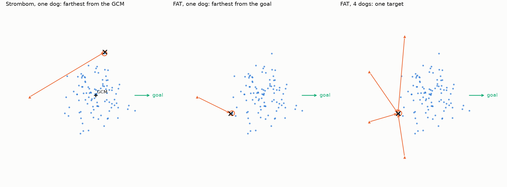
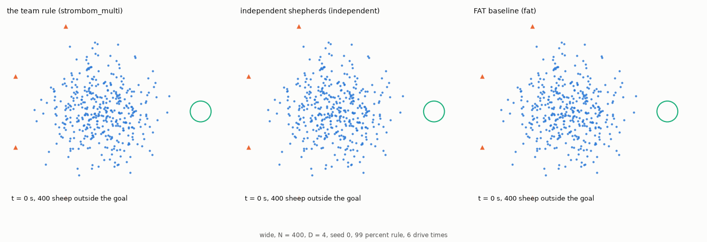

# Uncoordinated greedy baseline: `fat`

Farthest-agent targeting, or FAT, tests whether coordination is needed at all ([report, section 2.4](../report/d_min_report.md#24-rq4-do-uncoordinated-fat-dogs-reach-a-finite-d_min)). Every dog aims at the point $r_a = 2$ m behind the sheep farthest from the goal, on its far side from the goal (`sim/strombom/team.py`: `fat_target`, `step`), and moves with [Strömbom's step, noise and stop rule](strombom_multi.md#dog-speed-step-and-stop-rule). Strömbom's rule takes the sheep farthest from the flock centre instead. FAT has no assignment, no drive arc, no communication and no collect/drive switch. Its dogs bunch on one sheep because nothing keeps them apart (Figure 1, Animation 1).

**Figure 1: Bunching in FAT (`wide`, $N = 100$).** Every FAT dog picks the same sheep, so a team works like a single dog.

- Marks: blue dots are sheep, orange triangles dogs; the orange circle marks the chosen sheep, the cross the dog's target, the green arrow the direction to the goal.
- Left: Strömbom's single-dog rule, behind the sheep farthest from the GCM.
- Middle: FAT with one dog, behind the sheep farthest from the goal.
- Right: FAT with 4 dogs, bunched on the same sheep.

## Target equation

At each tick, with sheep positions $\{\mathbf{x}_1, \dots, \mathbf{x}_N\}$ and goal centre $\mathbf{g}$, `fat_target` picks the sheep $i^*$ farthest from $\mathbf{g}$,

$$
i^* = \arg\max_{i \in \{1, \dots, N\}} \lVert \mathbf{x}_i - \mathbf{g} \rVert,
$$

and puts the shared target point $r_a$ behind $\mathbf{x}_{i^*}$ on the ray from $\mathbf{g}$ through $\mathbf{x}_{i^*}$:

$$
P_{\mathrm{FAT}} = \mathbf{x}_{i^*} + r_a \frac{\mathbf{x}_{i^*} - \mathbf{g}}{\lVert \mathbf{x}_{i^*} - \mathbf{g} \rVert}.
$$

Every dog $d \in \{1, \dots, D\}$ receives $\mathbf{T}_d = P_{\mathrm{FAT}}$ at that tick. All sheep equations, force weights and dog kinematic parameters ($\Delta t, v_{\mathrm{dog}}, r_s, r_a, \rho_a, c, h, e, p$ and the stop distance $3r_a = 6$ m) are identical to [`strombom_sheep.md`](strombom_sheep.md) and [`strombom_multi.md`](strombom_multi.md) (Table 1).

**Table 1: `strombom_multi` and `fat`.**

| Part | `strombom_multi` ([strombom_multi.md](strombom_multi.md)) | `fat` (`sim/strombom/team.py`) |
| :--- | :--- | :--- |
| Mode switch | Collects when $\max_i \lVert \mathbf{x}_i - \mathrm{GCM} \rVert > f(N) = r_a N^{2/3}$; drives otherwise | None; always pushes the farthest sheep toward $\mathbf{g}$ |
| Target reference | Collect: $\mathrm{GCM}$; drive: goal $\mathbf{g}$ | Always goal $\mathbf{g}$ |
| Multi-dog collect | Hungarian assignment of the $D$ dogs to the $D$ farthest outliers from $\mathrm{GCM}$ | Every dog aims at the single sheep farthest from $\mathbf{g}$ |
| Multi-dog drive | $D$ slots along a circular arc of radius $r_a\sqrt{N}$ behind $\mathrm{GCM}$ | Every dog aims at $P_{\mathrm{FAT}}$ |
| Sheep and dog step | [`strombom_sheep.md`](strombom_sheep.md), `PAPER` parameters | Identical |

## Shared calibration (`calibrate_as: strombom_multi`)

In [`dmin_fat.yaml`](../../protocols/configs/protocols/dmin_fat.yaml) and [`dmin_f99_fat.yaml`](../../protocols/configs/protocols/dmin_f99_fat.yaml), the method entry sets `calibrate_as: strombom_multi` (`services/calibration.py`). Calibration therefore measures the settled flock radius $R_f(N)$ with one `strombom_multi` dog rather than one `fat` dog, so `fat` and `strombom_multi` run on the same $R_f(N)$, start flocks, goal radius, drive distance, seeds and 6-drive-time deadline (Animation 1).

**Animation 1: `strombom_multi` and `fat` on the same start flock (`wide`, $N = 400$, $D = 4$, seed 0, 99% rule, 6 drive times).** Only the team rule brings the flock in; FAT fails when time is up.

- Marks: blue dots are sheep, orange triangles dogs, the green circle the goal; the bottom-left text gives the time and the sheep outside the goal.
- Left: the team rule gives each dog its own outlier while collecting, then drives from an arc, and succeeds at 569 s (`dmin_f99_m6`).
- Right: every FAT dog aims at the sheep farthest from the goal; the bulk of the flock gathers, but 298 sheep stay outside the goal at the 1241 s deadline (`dmin_f99_fat`).

## References

1. Strömbom, D., et al. (2014). *Solving the shepherding problem: heuristics for herding autonomous, interacting agents*. Journal of the Royal Society Interface, 11(100), 20140719. [doi:10.1098/rsif.2014.0719](https://doi.org/10.1098/rsif.2014.0719)
2. Nalepka, P., Kallen, R. W., Chemero, A., Saltzman, E., & Richardson, M. J. (2017). *Herd those sheep: Emergent multiagent coordination and behavioral-mode switching*. Psychological Science, 28(5), 630-650. [doi:10.1177/0956797617692107](https://doi.org/10.1177/0956797617692107)
3. Auletta, F., Fiore, D., Richardson, M. J., & di Bernardo, M. (2022). *Herding stochastic autonomous agents via local control rules and online target selection strategies*. Autonomous Robots, 46, 469-481. [doi:10.1007/s10514-021-10033-6](https://doi.org/10.1007/s10514-021-10033-6)
