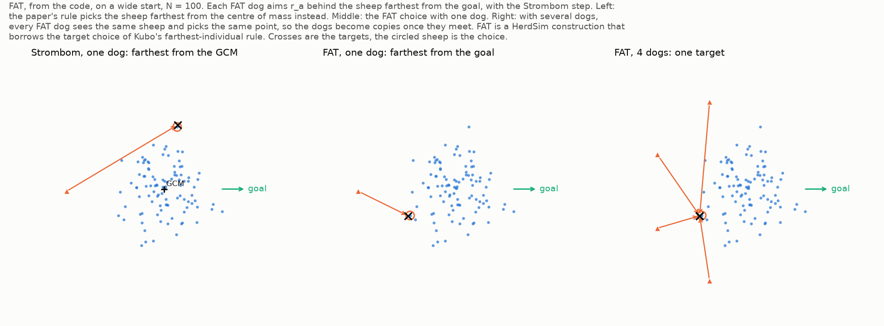
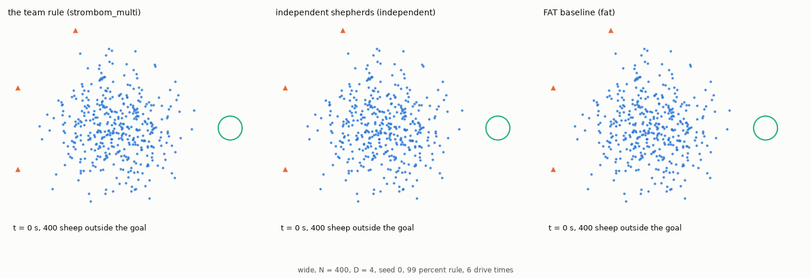

# Uncoordinated Greedy Baseline: `fat`

This document specifies the **Farthest-Agent Targeting (`fat`)** baseline controller (Level 0 in HerdSim's controller hierarchy), designed to evaluate whether multi-agent coordination is strictly required to herd a flock or if simple uncoordinated greed suffices.

---

### Executive Overview

`fat` represents a completely uncoordinated baseline where every shepherd acts greedily and independently without communication, role assignment, or behavioral mode switching:

1. **Greedy Single-Target Heuristic:** At every tick, all $D$ dogs target the exact same spatial waypoint $P_ {\mathrm{FAT}}$ stationed behind the single sheep farthest from the goal.
2. **Identical Kinematics:** Sheep motion, force parameters, and dog kinematics ($\Delta t = 1$ s, $v_ {\mathrm{dog}} = 1.5$ m/s, stop rule within $3\,r_a = 6$ m) are identical to [`strombom_sheep.md`](strombom_sheep.md) and [`strombom_multi.md`](strombom_multi.md).
3. **Severe Multi-Agent Bunching:** Because nothing keeps dogs apart or assigns them to separate sheep, multiple dogs collapse into an overlapping cluster, causing complete operational failure on large or scattered flocks (Figure 1).



**Figure 1: Geometric comparison of target selection and physical bunching in FAT (`wide`, $N = 100$).**

* **Left panel (Strömbom single-dog rule):** The dog positions itself behind the sheep farthest from the flock centre ($\mathrm{GCM}$), gathering stragglers inward.
* **Middle panel (FAT with 1 dog):** The dog targets the sheep farthest from the goal $\mathbf{g}$, driving it forward but ignoring lateral spread.
* **Right panel (FAT with 4 dogs):** All four dogs pick the exact same trailing sheep and bunch together, behaving essentially like an oversized single dog.
* **Visual Symbols:** Blue dots = sheep; Orange triangles = dogs; Orange circle = targeted sheep; Cross `x` = dog target waypoint; Green arrow = direction toward the goal.

---

## 1. Target Formulation and Mathematical Mechanics

At each tick, given sheep coordinates $\{\mathbf{x}_1, \dots, \mathbf{x}_N\}$ and goal center $\mathbf{g}$, the algorithm identifies the single sheep $i^*$ that maximizes Euclidean distance to the goal:

$$
i^* = \arg\max_{i \in \{1, \dots, N\}} \lVert \mathbf{x}_i - \mathbf{g} \rVert
$$

The shared target waypoint $P_ {\mathrm{FAT}}$ is positioned at distance $r_a = 2.0\text{ m}$ behind sheep $i^*$ along the ray extending from $\mathbf{g}$:

$$
P_{\mathrm{FAT}} = \mathbf{x}_{i^*} + r_a \frac{\mathbf{x}_{i^*} - \mathbf{g}}{\lVert \mathbf{x}_{i^*} - \mathbf{g} \rVert}
$$

Every dog $d \in \{1, \dots, D\}$ receives the identical waypoint $\mathbf{T}_ {d} = P_ {\mathrm{FAT}}$.

> [!NOTE]
> **Key Differences from Strömbom's Rule:**  
> While Strömbom's heuristic targets the sheep farthest from the flock center ($\mathrm{GCM}$) to restore herd cohesion, FAT targets the sheep farthest from the **goal** ($\mathbf{g}$). FAT never checks whether the herd is cohesive and never gathers lateral stragglers.

---

## 2. Why Uncoordinated Greed Fails at Scale

In experimental trials ([report, Section 2.4](../report/d_min_report.md#24-rq4-do-uncoordinated-fat-dogs-reach-a-finite-d_min)), `fat` collapses completely for $N \ge 200$ across all scattered layouts. Three physical mechanisms explain this failure:

1. **Pathological Agent Bunching:**  
   Because all dogs chase the identical waypoint, shepherds crowd within 2 m of each other. In multi-dog trials ($D > 1$), median dog overlap (`mean_dog_overlap`, fraction of dogs within 2 m of another dog) surges to **0.73** in `dmin_f99_fat` (compared to only **0.15** in `strombom_multi`). At $N = 200$, overlap reaches $0.58$ at $D = 2$, $0.70$ at $D = 3$, and $0.80$ at $D = 4$.
2. **Absence of Flank Containment:**  
   When sheep are pushed toward the goal, repulsive interactions between sheep cause the flock to spread laterally. Because FAT provides no driving arc to contain the flanks, sheep escape to the sides and are permanently abandoned.
3. **Flock Neglect and Flat Success Curves:**  
   Adding more dogs ($D = 4, 8, 16, 24$) provides no benefit: success rates stay flat between $0.40$ and $0.55$. More dogs simply crowd onto the same rear sheep without expanding spatial coverage.

---

## 3. Shared Calibration Protocol (`calibrate_as: strombom_multi`)

To ensure rigorous scientific comparison, all FAT campaigns ([`dmin_fat.yaml`](../../protocols/configs/protocols/dmin_fat.yaml) and [`dmin_f99_fat.yaml`](../../protocols/configs/protocols/dmin_f99_fat.yaml)) specify:

```yaml
calibrate_as: strombom_multi
```

* **Methodological Purpose:** Sizing the arena, flock radius $R_f(N)$, goal radius $R_{\mathrm{goal}}$, drive distance $l$, and deadlines based on FAT would introduce circular bias, because FAT cannot settle a natural flock.
* **Controlled Conditions:** Calibrating under `strombom_multi` guarantees that FAT is tested on the **exact same physical task geometry**, starting layouts, paired random seeds, and 6-drive-time deadlines as the coordinated team rule (Animation 1).



**Animation 1: Three-controller ablation on the identical starting flock (`wide`, $N = 400$, $D = 4$, seed 0, 99% rule, 6 drive times).**

* **Performance Breakdown:**
  * **Left (`strombom_multi`, Level 2):** Shepherds gather 4 outliers in parallel via Hungarian matching, then form a driving arc, successfully penning the herd at 569 s (`dmin_f99_m6`).
  * **Middle (`independent`, Level 1):** Shepherds switch between collect and drive, but all chase the identical outlier, failing at the 1241 s deadline with 298 sheep outside (`dmin_f99_indep`).
  * **Right (`fat`, Level 0):** All 4 dogs crowd onto the single trailing sheep, completely neglecting lateral stragglers and failing at 1241 s with the herd dispersed (`dmin_f99_fat`).

---

## References

1. Strömbom, D., et al. (2014). *Solving the shepherding problem: heuristics for herding autonomous, interacting agents*. Journal of the Royal Society Interface, 11(100), 20140719. [doi:10.1098/rsif.2014.0719](https://doi.org/10.1098/rsif.2014.0719)
2. Nalepka, P., et al. (2017). *Herd those sheep: Emergent multiagent coordination and behavioral-mode switching*. Psychological Science, 28(5), 630-650. [doi:10.1177/0956797617692107](https://doi.org/10.1177/0956797617692107)
3. Auletta, F., et al. (2022). *Herding stochastic autonomous agents via local control rules and online target selection strategies*. Autonomous Robots, 46, 469-481. [doi:10.1007/s10514-021-10033-6](https://doi.org/10.1007/s10514-021-10033-6)
