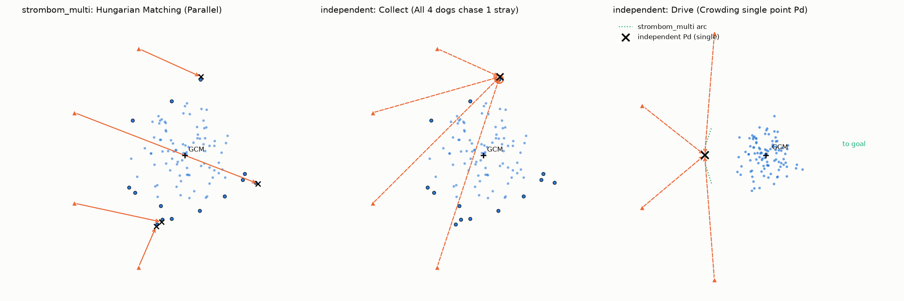
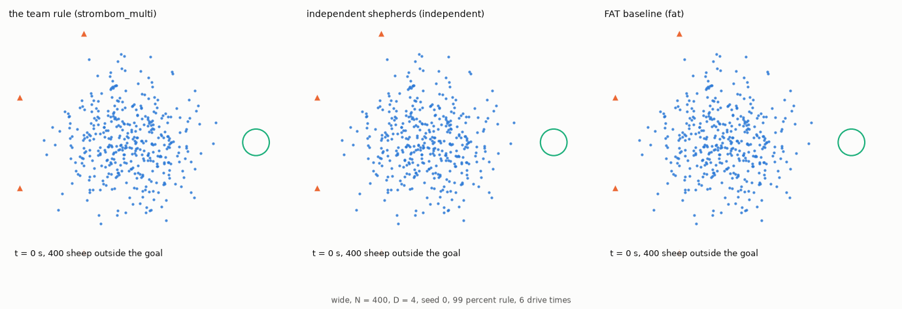

# Independent paper shepherds: `independent`

This baseline tests what a team gets from Strömbom's single-dog rule alone without a team coordination layer ([report, section 2.5](../report/d_min_report.md#25-rq5-what-does-the-team-layer-add-over-independent-shepherds)). Every dog runs Strömbom's single-dog decision rule on the whole flock: it switches between collecting (aiming $r_a = 2$ m behind the outlier farthest from the flock centre) and driving (aiming at the single drive point $P_d = \mathrm{GCM} + r_a\sqrt{N}\,\widehat{\mathrm{GCM} - \mathbf{g}}$), with the same step, noise and stop rule as `strombom_multi` (`sim/strombom/team.py`: `step`).

Because every dog sees the whole flock and has no assignment to separate outliers or driving slots, all $D$ dogs make the same choice at every tick (Figure 1, Animation 1).

**Figure 1: The team rule against `independent` ($N = 100, D = 4$).** Without a team layer, every dog aims at the same point both when collecting and when driving.

- Marks: blue dots are sheep, orange triangles dogs, the plus sign the GCM, crosses target points; arrows are dashed for `independent`.
- Left: the team rule `strombom_multi`, where 4 dogs collect 4 different outliers in parallel via Hungarian assignment.
- Middle: `independent` collecting, where all 4 dogs chase the same outlier while other stragglers wait.
- Right: `independent` driving, where all dogs head toward the single point $P_d$ instead of spreading across the driving arc (dotted green line).

## Comparison with `strombom_multi` and `fat`

Table 1 places `independent` between the uncoordinated baseline [`fat`](fat.md) and the coordinated team rule [`strombom_multi`](strombom_multi.md):

**Table 1: Comparison of dog controllers.**

| Controller | Collect/drive switch | Outlier assignment | Driving formation | Shared calibration |
| :--- | :--- | :--- | :--- | :--- |
| `fat` ([fat.md](fat.md)) | None; always pushes farthest sheep | None; all aim at farthest sheep | None; all aim at $P_{\mathrm{FAT}}$ | `calibrate_as: strombom_multi` |
| `independent` | Yes; collects if any sheep $> f(N)$ | None; all chase single farthest outlier | None; all crowd single point $P_d$ | `calibrate_as: strombom_multi` |
| `strombom_multi` ([strombom_multi.md](strombom_multi.md)) | Yes; collects if any sheep $> f(N)$ | Hungarian matching ($D$ outliers) | Arc of $D$ slots covering flanks | Reference |

## Shared calibration (`calibrate_as: strombom_multi`)

In [`dmin_f99_indep.yaml`](../../protocols/configs/protocols/dmin_f99_indep.yaml), the method entry sets `calibrate_as: strombom_multi` (`services/calibration.py`). Because with one dog ($D = 1$) `independent` reduces identically to `strombom_multi`, both controllers run on the exact same calibrated flock radius $R_f(N)$, start flocks, goal radius, drive distance and deadline (Animation 1).

**Animation 1: Three dog rules on the same start flock (`wide`, $N = 400$, $D = 4$, seed 0, 99% rule, 6 drive times).** Only the team rule brings the flock in; both baselines fail when time is up.

- Marks: blue dots are sheep, orange triangles dogs, the green circle the goal; the bottom-left text gives the time and the sheep outside the goal.
- Left: the team rule gives each dog its own outlier while collecting, then drives from an arc, and succeeds at 569 s (`dmin_f99_m6`).
- Middle: the `independent` dogs all chase the same outlier, crowd together and fail at the 1241 s deadline with 298 sheep outside (`dmin_f99_indep`).
- Right: every `fat` dog aims behind the sheep farthest from the goal without gathering lateral stragglers and fails at 1241 s (`dmin_f99_fat`).

## References

1. Strombom, D., et al. (2014). *Solving the shepherding problem: heuristics for herding autonomous, interacting agents*. Journal of the Royal Society Interface, 11(100), 20140719, [10.1098/rsif.2014.0719](https://doi.org/10.1098/rsif.2014.0719).

