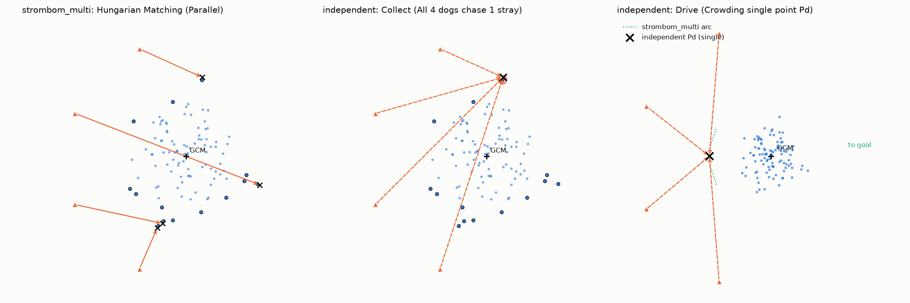
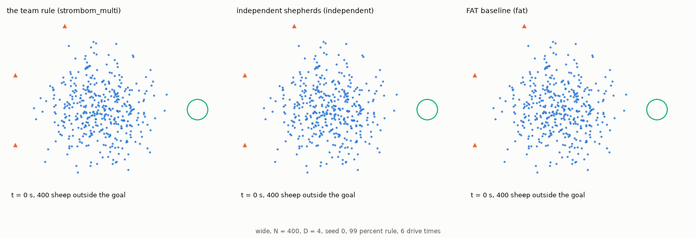

# Independent Paper Shepherds Baseline: `independent`

This document specifies the **Independent Paper Shepherds (`independent`)** baseline controller (Level 1 in HerdSim's controller hierarchy). It tests what a multi-dog team achieves from Strömbom's canonical single-dog decision rule alone when no inter-agent coordination layer is provided ([report, Section 2.5](../report/d_min_report.md#25-rq5-what-does-the-team-layer-add-over-independent-shepherds)).

---

### Executive Overview

`independent` represents a partially structured baseline that retains Strömbom's behavioral mode switching, but lacks multi-agent assignment and formation coordination:

1. **Independent Canonical Rule:** Every shepherd runs Strömbom's (2014) single-dog decision heuristic over the global flock state.
2. **Behavioral Mode Switching:** Unlike [`fat`](fat.md), each dog detects when the flock is dispersed ($\max_i \lVert \mathbf{x}_i - \mathrm{GCM} \rVert > f(N)$) and alternates between collecting stragglers and driving the cohesive herd.
3. **Absence of Coordination (Duplicated Targets):** Because each dog observes the identical global state and has no role assignment:
   * **During Collecting:** All $D$ dogs chase the exact same outlier farthest from $\mathrm{GCM}$, while other stragglers are neglected.
   * **During Driving:** All $D$ dogs converge onto the exact same rear drive point $P_d$, leaving flock flanks uncontained (Figure 1).



**Figure 1: Geometric comparison of the coordinated team rule (`strombom_multi`) against uncoordinated `independent` shepherds ($N = 100, D = 4$).**

* **Left panel (`strombom_multi` Collecting):** Coordinated team assigns 4 dogs to 4 distinct outliers in parallel via the Kuhn-Munkres Hungarian algorithm.
* **Middle panel (`independent` Collecting):** All 4 dogs crowd behind the single farthest outlier, leaving all remaining stragglers unaddressed.
* **Right panel (`independent` Driving):** All 4 dogs head toward the single rear point $P_d$ (dashed arrows) rather than distributing along the flank driving arc (dotted green line).
* **Visual Symbols:** Blue dots = sheep; Orange triangles = dogs; Plus sign `+` = $\mathrm{GCM}$; Crosses `x` = target waypoints; Green dotted line = multi-dog driving arc; Dashed arrows = paths of independent shepherds.

---

## 1. Behavioral Mechanics and Mathematical Target Selection

At each tick, every dog independently computes the flock centre of mass $\mathrm{GCM} = \frac{1}{N}\sum_{i=1}^N \mathbf{x}_i$ and evaluates the dispersion condition:

$$
\max_{i \in \{1, \dots, N\}} \lVert \mathbf{x}_i - \mathrm{GCM} \rVert > f(N) = r_a N^{2/3}
$$

### A. Collecting Mode (Flock Dispersed)

If any sheep exceeds $f(N)$, all dogs switch to collecting. Each dog independently targets the sheep $i^*$ farthest from $\mathrm{GCM}$:

$$
i^* = \arg\max_{i \in \{1, \dots, N\}} \lVert \mathbf{x}_i - \mathrm{GCM} \rVert
$$

The target waypoint $P_c$ is positioned distance $r_a = 2.0\text{ m}$ behind $i^*$ relative to $\mathrm{GCM}$:

$$
P_c = \mathbf{x}_{i^*} + r_a \frac{\mathbf{x}_{i^*} - \mathrm{GCM}}{\lVert \mathbf{x}_{i^*} - \mathrm{GCM} \rVert}
$$

Every dog $d \in \{1, \dots, D\}$ sets $\mathbf{T}_ {d} = P_c$.

### B. Driving Mode (Flock Cohesive)

When all sheep lie within $f(N)$, all dogs switch to driving. Each dog targets the single rear drive point $P_d$ located distance $R_ {\mathrm{arc}} = r_a \sqrt{N}$ behind $\mathrm{GCM}$:

$$
P_d = \mathrm{GCM} + r_a \sqrt{N} \frac{\mathrm{GCM} - \mathbf{g}}{\lVert \mathrm{GCM} - \mathbf{g} \rVert}
$$

Every dog $d \in \{1, \dots, D\}$ sets $\mathbf{T}_ {d} = P_d$.

---

## 2. Why Mode Switching Alone Fails at $N \ge 400$

In scaling trials ([report, Section 2.5](../report/d_min_report.md#25-rq5-what-does-the-team-layer-add-over-independent-shepherds)), `independent` shepherds exhibit an informative performance split:

1. **Success at Small Herd Sizes ($N \le 200$):**  
   At $N \le 200$, the number of simultaneous outliers is small (often 0 or 1). Serial collection by clustered dogs suffices to restore cohesion, allowing `independent` to succeed on compact flocks.
2. **Collapse at Large Herd Sizes ($N \ge 400$):**  
   At $N \ge 400$, herd perimeter scales as $P \approx 2\pi R \propto N^{1/2}$. When the flock scatters, multiple outliers arise simultaneously across different quadrants. Because all $D$ dogs swarm outlier 1, outliers 2, 3, and 4 drift freely into grazing mode.
3. **Flank Escape During Driving:**  
   Because all dogs crowd into the single point $P_d$ instead of maintaining lateral positions along an arc, sheep naturally spread laterally under local repulsive forces $\mathbf{R}_ {s,i}$. The flock escapes around the unshielded flanks, triggering endless mode switching and failure at the 6-drive-time deadline (Animation 1).

---

## 3. The 3-Level Controller Hierarchy

HerdSim evaluates shepherding across three rigorous levels of coordination complexity:

**Table 1: Three-level controller ablation hierarchy in HerdSim.**

| Controller | Coordination Level | Mode Switching | Outlier Assignment | Driving Formation | Scaling Boundary |
| :--- | :--- | :--- | :--- | :--- | :--- |
| **`fat`** ([fat.md](fat.md)) | **Level 0 (Greedy)** | None (always pushes trailing sheep) | None (all dogs chase single sheep farthest from $\mathbf{g}$) | None (all converge to $P_{\mathrm{FAT}}$) | Collapses at $N \ge 200$ across all layouts |
| **`independent`** | **Level 1 (Paper Baseline)** | Yes ($\max \lVert \mathbf{x}_i - \mathrm{GCM} \rVert > r_a N^{2/3}$) | None (all dogs crowd single outlier farthest from $\mathrm{GCM}$) | None (all converge to single point $P_d$) | Collapses at $N \ge 400$ ($D_{\min}$ undefined) |
| **`strombom_multi`** ([strombom_multi.md](strombom_multi.md)) | **Level 2 (Coordinated Team)** | Yes ($\max \lVert \mathbf{x}_i - \mathrm{GCM} \rVert > r_a N^{2/3}$) | **Hungarian Kuhn-Munkres** ($D$ outliers in parallel) | **Flank Driving Arc** ($D$ equidistant slots) | Scales reliably through $N = 566$ ($D_{\min} = 2\text{--}3$ at $N = 400$) |

---

## 4. Shared Calibration Protocol (`calibrate_as: strombom_multi`)

In protocol configurations ([`dmin_f99_indep.yaml`](../../protocols/configs/protocols/dmin_f99_indep.yaml)), the method entry specifies:

```yaml
calibrate_as: strombom_multi
```

* **Mathematical Identity at $D = 1$:** For a single dog, `independent` and `strombom_multi` are mathematically identical—both reduce exactly to Strömbom's 2014 single-dog model.
* **Controlled Evaluation:** Calibrating under `strombom_multi` guarantees that `independent` is evaluated on the exact same calibrated flock radius $R_f(N)$, start layouts, goal radius $R_{\mathrm{goal}}$, drive distance $l$, paired random seeds, and deadlines as the full team rule.



**Animation 1: Three-controller ablation on the identical starting flock (`wide`, $N = 400$, $D = 4$, seed 0, 99% rule, 6 drive times).**

* **Performance Breakdown:**
  * **Left (`strombom_multi`, Level 2):** Parallel Hungarian outlier retrieval + flank driving arc delivers the entire herd into the goal at 569 s (`dmin_f99_m6`).
  * **Middle (`independent`, Level 1):** Shepherds alternate modes, but all chase the single farthest outlier together, timing out at 1241 s with 298 sheep outside (`dmin_f99_indep`).
  * **Right (`fat`, Level 0):** All dogs crowd behind the trailing sheep without flank control, failing at 1241 s with the flock completely fragmented (`dmin_f99_fat`).

---

## References

1. Strömbom, D., et al. (2014). *Solving the shepherding problem: heuristics for herding autonomous, interacting agents*. Journal of the Royal Society Interface, 11(100), 20140719. [doi:10.1098/rsif.2014.0719](https://doi.org/10.1098/rsif.2014.0719)
2. Nalepka, P., et al. (2017). *Herd those sheep: Emergent multiagent coordination and behavioral-mode switching*. Psychological Science, 28(5), 630-650. [doi:10.1177/0956797617692107](https://doi.org/10.1177/0956797617692107)
3. Auletta, F., et al. (2022). *Herding stochastic autonomous agents via local control rules and online target selection strategies*. Autonomous Robots, 46, 469-481. [doi:10.1007/s10514-021-10033-6](https://doi.org/10.1007/s10514-021-10033-6)
