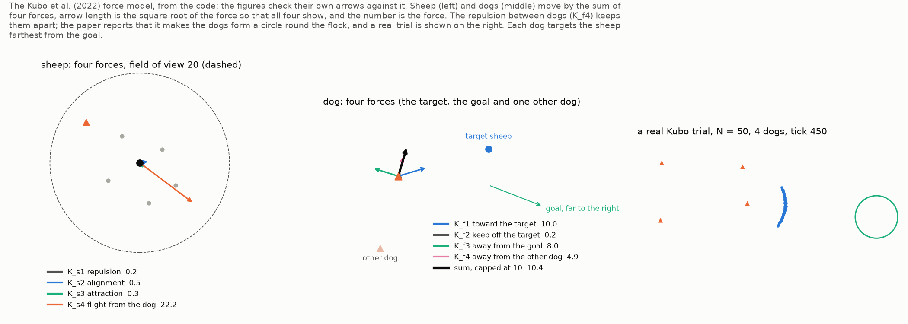
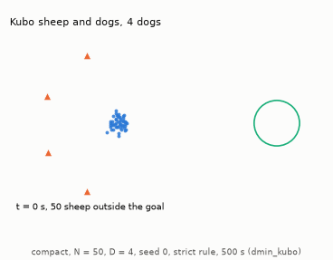
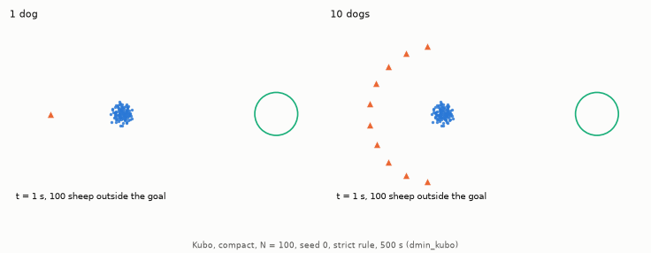

# Kubo et al. (2022) method

## Kubo et al. (2022) continuous potential fields

The model of [Kubo et al. (2022)](https://doi.org/10.1007/s10015-021-00726-7) checks whether the Strömbom results hold for a different kind of sheep: sheep and dogs move under smooth forces instead of rules (Figure 1).

**Figure 1: The Kubo et al. (2022) model.** The repulsion between dogs spreads them out without assigning dogs to sheep.

- Marks: arrows are force terms, coloured and sized as in each panel's legend; orange triangles are dogs, blue or grey dots sheep, the green circle the goal.
- Left: forces on a sheep, with its 20 m field of view dashed.
- Middle: forces on a dog.
- Right: a Kubo trial ($N = 50$, 4 dogs, tick 450).

A Kubo sheep responds only to the sheep and dogs within its 20 m view. In the terms below, $x$ is a sheep position, $X$ a dog position, $v$ a sheep's velocity on the last tick, $r$ a distance, and an overbar the mean over the sheep $j$ or dogs $j$ in view. The sheep's velocity is $\mathbf{u} = K_{s1} \mathbf{S}_1 + K_{s2} \mathbf{S}_2 + K_{s3} \mathbf{S}_3 + K_{s4} \mathbf{S}_4$, with four terms:

- Repulsion from neighbours: $\mathbf{S}_1 = \overline{(x_i - x_j)/\lVert x_i - x_j \rVert^2}$, of size $1/r$, with $K_{s1} = 10$.
- Alignment: $\mathbf{S}_2 = \overline{v_j/\lVert v_j \rVert}$, the mean heading of the neighbours in view that are moving, with $K_{s2} = 0.5$. A sheep at rest has no heading and is left out.
- Attraction to neighbours: $\mathbf{S}_3 = -\overline{(x_i - x_j)/\lVert x_i - x_j \rVert}$, a unit direction, with $K_{s3} = 2$.
- Flight from dogs: $\mathbf{S}_4 = \overline{(x_i - X_j)/\lVert x_i - X_j \rVert^3}$, of size $1/r^2$, with $K_{s4} = 5000$.

The paper states no time step and no speed caps. HerdSim takes the time step (0.05 s) and the caps (sheep 5 m/s, dogs 10 m/s) from a public MATLAB port of the method, `PatrickHup/Force-Based-Sheep-Herding-Algorithm` (file `src/main.m`).

Kubo sheep differ from Strömbom sheep in four ways:

- Speed: a Kubo sheep speeds up under a stronger push, up to 5 m/s, so more dogs can finish sooner on compact flocks; the median finish times are in [report, section 3.9](../report/part4_coordination.md#39-rq9-which-part-of-the-team-rule-matters).
- Several dogs: their push is a mean over the dogs in view, so its size does not grow with $D$ and needs no normalisation.
- Layouts: Kubo runs on compact starts only, because the scattered layouts are sized by Strömbom's [collect distance](strombom_multi.md#when-to-collect), which Kubo does not use.
- Isolated sheep: a Kubo sheep has no noise and is attracted only within 20 m, so a sheep more than 20 m from all others stays put until a dog comes within 20 m.

Animations 1 and 2 show the model; its deadline is in [task design](../experiments/task_design.md#deadlines-in-drive-times).

**Animation 1: The Kubo model with 4 dogs (`compact`, $N = 50$, seed 0, [strict rule](../experiments/task_design.md#success-rules), time limit 500 s).** Every dog heads for the sheep farthest from the goal, yet their repulsion keeps them spread round the back and sides of the flock. The flock stretches into an arc and flows into the goal; the trial succeeds at 58 s with every sheep in (`dmin_kubo`).

- Marks: blue dots are sheep, orange triangles dogs, the green circle the goal; the bottom-left text gives the time and the sheep outside the goal.

**Animation 2: One Kubo dog and ten on the same flock (`compact`, $N = 100$, seed 0, strict rule, time limit 500 s).** Under the stronger push of ten dogs the sheep run faster, and in this trial ten dogs bring the flock in four times sooner than one (`dmin_kubo`).

- Marks: as in Animation 1.
- Left: 1 dog; the flock reaches the goal at 117 s.
- Right: 10 dogs; the flock reaches the goal at 28 s.

## Kubo dogs

Kubo dogs (controller `kubo_forces`, method `kubo`) never switch between collecting and driving. Each chases the sheep farthest from the goal. With $X$ the dog's position, $T$ its target sheep's, $G$ the goal centre and $r$ a distance, a dog moves with velocity $K_{f1} \mathbf{F}_1 + K_{f2} \mathbf{F}_2 + K_{f3} \mathbf{F}_3 + K_{f4} \mathbf{F}_4$, capped at 10 m/s (Figure 1), with four terms:

- Toward the target: $\mathbf{F}_1 = (T - X)/\lVert T - X \rVert$, a unit vector, with $K_{f1} = 10$.
- Off the target: $\mathbf{F}_2 = (X - T)/\lVert X - T \rVert^3$, of size $1/r^2$, so the dog keeps a distance, with $K_{f2} = 200$.
- Away from the goal: $\mathbf{F}_3 = (X - G)/\lVert X - G \rVert$, a unit vector, so the dog stays behind the flock, with $K_{f3} = 8$. The paper prints this term with a minus sign; HerdSim uses the plus sign that the paper's text ("keep away from goal") and its stability analysis need.
- Away from other dogs: $\mathbf{F}_4 = \overline{(X - X_j)/\lVert X - X_j \rVert^3}$, the mean over the other dogs $j$, of size $1/r^2$, with $K_{f4} = 3000$ and no distance cutoff.

All dogs thus chase one sheep, as FAT dogs do, and $\mathbf{F}_4$ spreads them out without any assignment (Animation 1).

## References

1. Kubo, M., Tashiro, M., Sato, H., Yamaguchi, A. (2022). *Herd guidance by multiple sheepdog agents with repulsive force*. Artificial Life and Robotics, 27, 416-427. [DOI: 10.1007/s10015-021-00726-7](https://doi.org/10.1007/s10015-021-00726-7)
