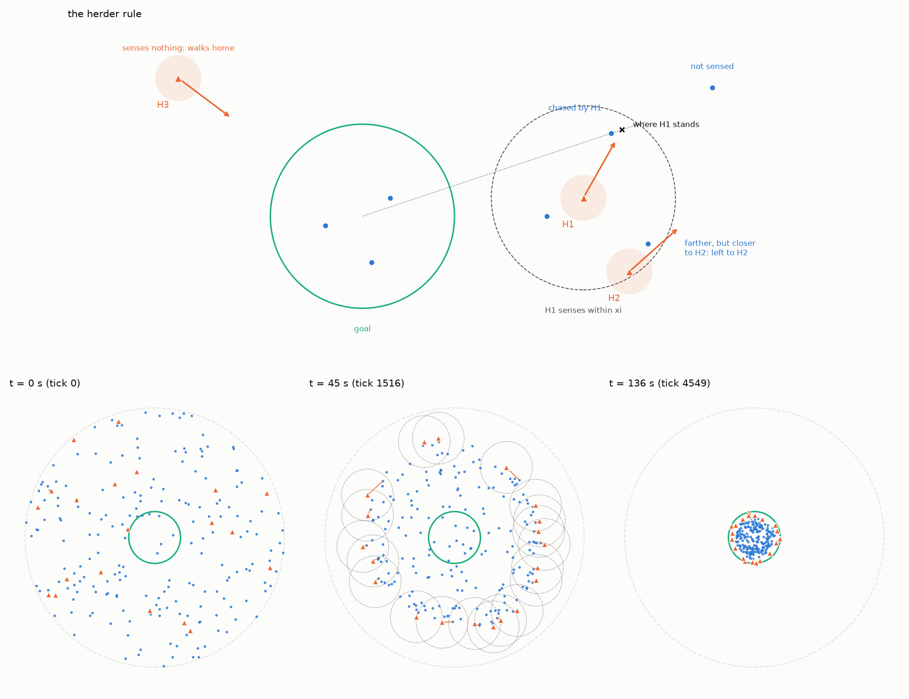
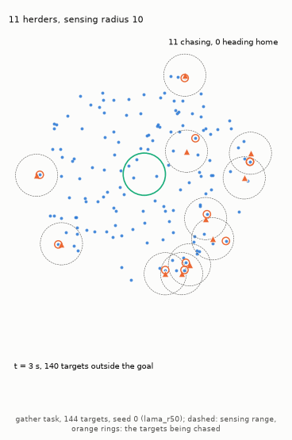

# Lama and di Bernardo (2024) method

## Lama and di Bernardo (2024) non-cohesive targets

In the model of [Lama and di Bernardo (2024)](https://doi.org/10.1103/PhysRevResearch.6.L032012) the "sheep" do not stick together at all. HerdSim runs it as the method `lama` (sheep model `lama_targets`, dog controller `lama_herders`) on its own task, `gather` ([task design, section 7](../experiments/task_design.md#7-the-gather-task-lama-and-di-bernardo-2024)). Table 1 maps the paper's names to HerdSim's.

**Table 1: Names in the paper and in HerdSim.**

| Paper | HerdSim | Meaning |
| :--- | :--- | :--- |
| Non-cohesive targets, $M$ | Sheep, $N$ | The herded agents and their number |
| Herders, $N$ | Dogs, $D$ | The herding agents and their number |
| $N^{\ast}(M)$ | Smallest team on the gather task | Fewest herders that gather the targets |
| $D$ | $D_T$ (`target_diffusion`) | Diffusion of the targets |

The paper reports that the smallest team for targets without cohesion grows as $\sqrt{M}$ (slope 0.5); with limited sensing this holds only above a threshold number of targets. HerdSim runs the model to set that growth next to the growth of $D_{\min}$, the smallest team that reaches the success rule reliably, for Strömbom sheep ([report, section 3.8](../report/part1_growth.md#38-rq8-growth-with-n-on-a-denser-grid-d_sat-and-the-shape-of-the-curve)).

Targets are random walkers with no cohesion, no alignment and no speed cap. Each target $a$ at $\mathbf{x}_a$ moves under its own standard Gaussian white noise $\mathbf{w}_a$ and is pushed by the herders $i$ at $\mathbf{y}_i$ within the push radius $\lambda$, with push strength $\beta$ (paper eq. 1):

$$
\dot{\mathbf{x}}_a = \sqrt{2D_T}\thinspace \mathbf{w}_a + \beta \sum_{i:\ \lVert \mathbf{x}_a - \mathbf{y}_i \rVert \le \lambda} \left(\lambda - \lVert \mathbf{x}_a - \mathbf{y}_i \rVert\right) \frac{\mathbf{x}_a - \mathbf{y}_i}{\lVert \mathbf{x}_a - \mathbf{y}_i \rVert}
$$

The push is $\beta\lambda$ at contact and falls linearly to zero at $\lambda$. Pushes of several herders add, unlike the normalised Strömbom push. The paper's $v_T = \beta\lambda = 7.5$, the push of one herder at contact, is only a reference speed; two herders push harder, and the noise has no cap.

Integration is Euler-Maruyama, the forward Euler step with noise. Each step of $\Delta t = 0.03$ adds $\Delta t$ times the push plus a Gaussian step of size $\sqrt{2 D_T \Delta t}$ per coordinate. The paper gives no units; HerdSim reads its time unit as one second and its lengths as metres, which gives the units in Tables 2 and 4.

**Table 2: Parameters of the Lama target model.**

| Parameter | Paper | HerdSim key | Value | Unit |
| :--- | :--- | :--- | :---: | :--- |
| Diffusion of the targets | $D$ | `target_diffusion` | 1 | m^2/s |
| Push strength | $\beta$ | `repulsion_strength` | 3 | 1/s |
| Push radius | $\lambda$ | `repulsion_radius` | 2.5 | m |
| Time step | $\Delta t$ | `dt` | 0.03 | s |

## Lama herders

Lama herders (controller `lama_herders`) sense only nearby targets and herders, and share the work with no communication. This is the herder rule of Lama and di Bernardo (2024), paper eqs. 2 to 4 (Figure 1). Distances are measured from the goal centre, the paper's origin. Each tick a herder:

1. Senses the targets and other herders within its sensing radius $\xi$.
2. Picks the sensed target farthest from the goal centre, leaving out any target strictly closer to another sensed herder, whatever that herder chooses.
3. Moves toward the point a stand-off $\delta$ (the paper's symbol, unrelated to Strömbom's step $\delta$) beyond its target on the ray from the goal centre, so its push sends the target inward (equation below).
4. With nothing to chase, walks straight back toward the goal centre at its top speed $v_H$ and stands still once inside the goal.

In step 3 the herder's velocity is

$$
\dot{\mathbf{y}}_i = \left[\thinspace -\alpha\left(\mathbf{y}_i - \mathbf{x}^{\ast}_i - \delta\thinspace \hat{\mathbf{x}}^{\ast}_i\right)\right]_{v_H}
$$

where $\mathbf{x}^{\ast}_i$ is the target, $\hat{\mathbf{x}}^{\ast}_i$ the unit direction from the goal centre to it, $\alpha$ the gain, and $[\cdot]_{v_H}$ caps the length at $v_H$.

The rule has no noise and no repulsion between herders. HerdSim refuses a parameter set with $v_H \le v_T$, because the paper assumes herders faster than the targets. Table 3 lists the parameters, read in seconds and metres as for the targets, and Animation 1 shows the rule in a stored trial.

**Figure 1: The Lama and di Bernardo (2024) method.** With no team layer, the herders spread round the edge of the targets and work inward.

- Marks: blue dots are targets, orange triangles herders, the green circle the goal; dashed circles are sensing radii and shaded discs push radii.
- Top: a constructed scene. H1 leaves the farthest target to H2, which is closer to it, and chases the next one from the cross $\delta$ beyond it; H3 senses nothing and walks back toward the goal.
- Bottom: one trial ($\xi = 10$, $N = 196$, $D = 20$) at the start, a third of the way and the end; the dashed grey circle is the [start disc](../experiments/task_design.md#geometry-of-the-gather-task) of radius 50. At the end every target is in the goal and the herders stand just inside its rim.

**Table 3: Parameters of the Lama herder rule.**

| Parameter | Paper | HerdSim key | Value | Unit |
| :--- | :--- | :--- | :---: | :--- |
| Sensing radius (the protocol `lama_r50_inf` sets it infinite) | $\xi$ | `sensing_radius` | 10 | m |
| Top speed | $v_H$ | `herder_speed` | 8 | m/s |
| Gain | $\alpha$ | `herder_gain` | 5 | 1/s |
| Stand-off beyond the target ($\lambda/2$) | $\delta$ | `chase_offset` | 1.25 | m |

**Animation 1: Lama herders gathering 144 targets (`uniform` start, $D = 11$, seed 0, 99% rule with every herder inside the goal, time limit 5000 s).** On the [gather task](../experiments/task_design.md#geometry-of-the-gather-task) each herder works on the sensed target farthest from the goal centre, and together they close in on the goal; a herder with no sensed target of its own walks home. This is the left trial of [Animation 5 in task design](../experiments/task_design.md#when-a-trial-ends-and-what-counts-as-success), which gives its outcome (`lama_r50`).

- Marks: triangles are the 11 herders, dashed circles their sensing radius. An orange ring marks each target a herder chases, read from the choice stored at that tick; it sits next to its herder, $\delta = 1.25$ away.

Herders and targets move from the same state at the start of each step, as in the paper's explicit schemes. Other choices where the paper is silent are in the code: the sign of the push in [`sim/methods/lama/dynamics.py`](../../sim/methods/lama/dynamics.py), and when a trial ends and the tick order in [`sim/plugins/scenarios/gather.py`](../../sim/plugins/scenarios/gather.py).

## References

1. Lama, A., & di Bernardo, M. (2024). *Shepherding and herdability in complex multiagent systems*. Physical Review Research, 6, L032012. [DOI: 10.1103/PhysRevResearch.6.L032012](https://doi.org/10.1103/PhysRevResearch.6.L032012)
