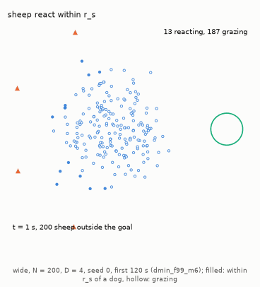
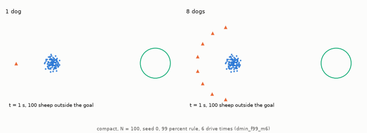
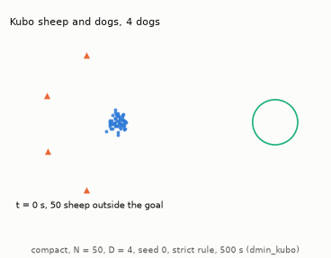
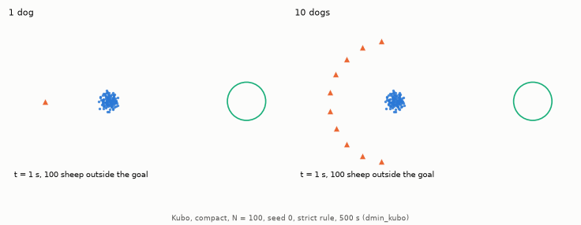
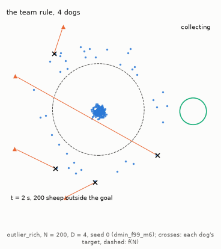
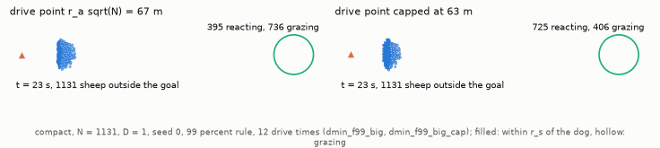
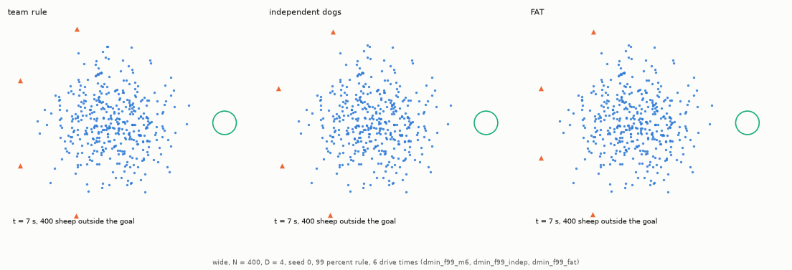
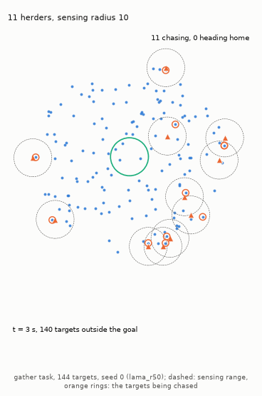

# Agent models and multi-dog coordination

This doc explains how the sheep and the dogs decide where to move in HerdSim: the equations, the paper each one comes from, and what HerdSim adds or chooses where a paper is silent. It is for a developer or researcher who knows Python but not herding models or this code. The main sheep model is that of Strömbom et al. (2014), which HerdSim extends from one dog to teams of $D$ dogs herding $N$ sheep; Kubo et al. (2022) and Lama and di Bernardo (2024) run for comparison. Terms of the study (layouts, drive times, cells, seeds, protocol ids, the success rules) are defined in the [glossary](../glossary.md), and the task the dogs are given in [task design](../experiments/task_design.md).

## Contents

- [1. Sheep flocking models](#1-sheep-flocking-models)
- [2. Shepherd controllers](#2-shepherd-controllers)
- [References](#references)

## 1. Sheep flocking models

Strömbom et al. compared their model with GPS tracks of a real flock and dog. A method is one sheep model paired with one dog controller, and the protocols and the report name methods. A tick is one time step of a model: 1 s for Strömbom, 0.05 s for Kubo and 0.03 s for Lama.

The animations in this doc replay stored trials, and each caption gives the conditions of its trial. These are the start layout, $N$, $D$, the seed, the success rule, the time limit and the protocol whose stored trial it replays. A start layout is how the flock is spread at the start ([start layouts](../experiments/task_design.md#flock-start-layouts)):
- `compact`: a tight flock.
- `wide`: a Gaussian spread of half the collect distance, the distance beyond which a dog fetches a sheep back (defined [below](#1-when-to-collect)).
- `split`: three compact clusters on a circle.
- `outlier_rich`: 80% of the sheep in a compact core and 20% on a ring beyond the collect distance.
- `uniform`: the gather task's start, targets and herders spread evenly over a disc round the goal.

`wide`, `split` and `outlier_rich` are the scattered layouts. The strict rule needs every sheep in the goal at once, and the 99% rule at least $\lceil 0.99 N \rceil$ ([success rules](../experiments/task_design.md#success-rules)). On the gather task a success also needs every herder inside the goal ([task design, section 6](../experiments/task_design.md#6-the-gather-task-lama-and-di-bernardo-2024)). The time limit of the drive task is given in [drive times](../experiments/task_design.md#deadlines-in-drive-times), the time a sheep walking straight at 1 m/s needs to cover the drive distance.

### Strömbom et al. (2014) discrete behavioral model

In the model of [Strömbom et al. (2014)](https://doi.org/10.1098/rsif.2014.0719) there is no plan for the flock as a whole. Each sheep picks its own heading at every tick ($t \to t+1$, one second) from five influences: keep going, stay with the flock, keep a little space, run from the dog, and some noise (Figure 1).


**Figure 1: The sheep rule of Strömbom et al. (2014).** A reacting sheep's new heading is a weighted sum of five unit vectors.

- Marks: blue dots are flock-mates, the black dot is sheep $i$, the red dot is a neighbour closer than $r_a$, the green plus sign is $\mathrm{LCM}_i$ and the orange triangle is a dog; the shaded discs have radii $r_a$ and $r_s$.
- Left: what sheep $i$ responds to, its flock-mates, a neighbour closer than $r_a = 2$ m, a dog within $r_s = 65$ m, and the centre of its neighbours $\mathrm{LCM}_i$ (local centre of mass).
- Right: the five unit vectors and their weights, away from close neighbours ($\rho_a = 2.0$), toward the neighbours' centre ($c = 1.05$), away from the dog ($\rho_s = 1.0$), the previous heading ($h = 0.5$) and noise ($e = 0.3$). Their weighted sum is the new heading $\mathbf{H}_i'$.

#### Reacting to a dog

A sheep $i$ at position $\mathbf{x}_i$ reacts when a dog is within $r_s = 65$ m, the reaction distance. Its new heading is a weighted sum of five unit vectors, described one by one below:

$$
\mathbf{H}_i' = h\thinspace \mathbf{H}_i + c\thinspace \mathbf{C}_i + \rho_a\thinspace \mathbf{R}_{a,i} + \rho_s\thinspace \mathbf{R}_{s,i} + e\thinspace \mathbf{\epsilon}_i
$$

#### 1. Previous heading
The previous heading $\mathbf{H}_i$ has weight $h = 0.5$. It keeps part of the sheep's last direction, so a sheep does not turn instantly. $\mathbf{H}_i$ is the direction of its last step:

$$
\mathbf{H}_i = \frac{\mathbf{x}_i^t - \mathbf{x}_i^{t-1}}{\lVert \mathbf{x}_i^t - \mathbf{x}_i^{t-1} \rVert}
$$

The paper does not say what happens after a step in which the sheep did not move. HerdSim then uses a zero vector.

#### 2. Attraction to the flock
The attraction $\mathbf{C}_i$ has weight $c = 1.05$. It draws a sheep toward the centre $\mathrm{LCM}_i$ of its $n$ nearest neighbours $\mathcal{N}_n(i)$:

$$
\mathbf{C}_i = \frac{\mathrm{LCM}_i - \mathbf{x}_i}{\lVert \mathrm{LCM}_i - \mathbf{x}_i \rVert}, \quad \text{where } \mathrm{LCM}_i = \frac{1}{n} \sum_{k \in \mathcal{N}_n(i)} \mathbf{x}_k
$$

In the paper's base case $n = N - 1$, so each sheep is drawn to the centre of the whole flock. The setting `n_neighbors` sets $n$; its default, -1, means $N - 1$, and a value such as `0.25N` means $\lceil 0.25 N \rceil$.

> [!NOTE]
> With $n = N - 1$ every sheep knows where the centre of the whole flock is, which a real sheep among hundreds cannot. `cli/diagnostics/gradient_validation.py` measures how far a local estimate is from the true direction. Its estimate is the sum of unit vectors toward the $k$ nearest neighbours. HerdSim's own rule with a smaller `n_neighbors` heads to the mean position of those neighbours instead, and the diagnostic does not measure that rule. The diagnostic uses the sheep in the outer half of a start flock, over 10 start flocks per layout. The error shrinks as more neighbours are used and grows with $N$. With 15 neighbours the mean error is 7.4 deg on `compact` and `wide`, 9.9 deg on `outlier_rich` and 12.5 deg on `split` at $N = 25$. At $N = 400$ it is 31 deg on `compact` and `wide`, 45 deg on `outlier_rich` and 58 deg on `split`. `compact` and `wide` give one measurement, shown twice by the tool: both are truncated Gaussians drawn with the same seeds, and the angle does not depend on their width. The full-flock centre is therefore a simplification that matters for large flocks. At $N = 400$ a sheep using 15 neighbours would on average head 30 deg or more off the true direction.

#### 3. Keeping space
The separation term $\mathbf{R}_{a,i}$ has weight $\rho_a = 2.0$. Every neighbour $j$ closer than $r_a = 2$ m pushes sheep $i$ away. It has the largest weight, so close neighbours are pushed apart most strongly. With no neighbour within $r_a$ the term is zero.

$$
\mathbf{R}_{a,i} = \frac{\sum_{j \in \mathcal{N}_a(i)} \frac{\mathbf{x}_i - \mathbf{x}_j}{\lVert \mathbf{x}_i - \mathbf{x}_j \rVert}}{\left\lVert \sum_{j \in \mathcal{N}_a(i)} \frac{\mathbf{x}_i - \mathbf{x}_j}{\lVert \mathbf{x}_i - \mathbf{x}_j \rVert} \right\rVert}, \quad \text{where } \mathcal{N}_a(i) = \lbrace j \ne i \mid \lVert \mathbf{x}_i - \mathbf{x}_j \rVert \lt r_a\rbrace
$$

#### 4. Running from the dog
The push $\mathbf{R}_{s,i}$ has weight $\rho_s = 1.0$. It points away from the dogs within $r_s = 65$ m. How the pushes of several dogs combine is in [multi-dog push blending](#multi-dog-push-blending-herdsim-extension) below.

#### 5. Noise
The noise $\mathbf{\epsilon}_i$ has weight $e = 0.3$. It is a unit vector at an angle drawn uniformly from $[0, 2\pi)$.

#### Moving
Each tick a reacting sheep moves $\delta = 1$ m along its new heading:

$$
\mathbf{x}_i^{t+1} = \mathbf{x}_i^t + \delta\thinspace \frac{\mathbf{H}_i'}{\lVert \mathbf{H}_i' \rVert}
$$

The step has a fixed length, so a reacting sheep always walks at exactly $1$ m/s. The dogs set only its direction.

#### Grazing
A sheep with every dog farther than $r_s = 65$ m grazes. With probability $0.95$ it stays put; with probability $0.05$ it takes one step of $\delta$ in a random direction $\mathbf{\epsilon}_{\mathrm{graze}}$:

```math
\mathbf{x}_i^{t+1} = \begin{cases}
\mathbf{x}_i^t + \delta\thinspace \mathbf{\epsilon}_{\mathrm{graze}}, & \text{with probability } 0.05 \\
\mathbf{x}_i^t, & \text{with probability } 0.95
\end{cases}
```

A grazing sheep gets no push from close neighbours, because the paper introduces that term only for reacting sheep. A flock that no dog reaches therefore spreads only by the slow random walk of grazing. Animation 1 shows the switch from grazing to reacting as the dogs approach.



**Animation 1: Sheep react only within $r_s$ of a dog (`wide`, $N = 200$, $D = 4$, seed 0, 99% rule, 6 drive times, limit 839 s, first 120 s shown).** As the dogs come round behind the flock, the reacting part spreads through it until the whole flock is packed in front of the dogs. The replay reproduces its stored trial (`dmin_f99_m6`).

- Marks: filled dots are sheep within $r_s = 65$ m of a dog, which react with all five terms; hollow dots are grazing sheep; triangles are dogs.
- Timeline: 13 of the 200 sheep react at 1 s, and all 200 by 120 s.
- Seed: seed 0 is the first stored trial of a cell. Every animation in this doc uses it, so none was picked for how it looks.

### Multi-dog push blending (HerdSim extension)

Strömbom's model was written for one dog, so HerdSim has to say how a sheep responds to several. Summing the dogs' pushes would make them too strong:
- The attraction to the flock has weight $c = 1.05$.
- Seen from the sheep, let two dogs be at an angle $\theta$ apart. Their unit pushes then add up to $2\cos(\theta/2)$, which is more than $1.05$ whenever $\theta$ is less than 116 deg.
- From $D = 2$ on, sheep on different sides of the flock could then be pushed apart by different dogs with more than the attraction holding them together. The summed rule was rejected on this argument and not run, so we have not tested it.

HerdSim instead adds the unit vectors away from every dog $j$ (at $\mathbf{y}_j$) within $r_s$ and normalises the sum to unit length:

$$
\mathbf{R}_{s,i} = \frac{\sum_{j \in \mathrm{threat}} \frac{\mathbf{x}_i - \mathbf{y}_j}{\lVert \mathbf{x}_i - \mathbf{y}_j \rVert}}{\left\lVert \sum_{j \in \mathrm{threat}} \frac{\mathbf{x}_i - \mathbf{y}_j}{\lVert \mathbf{x}_i - \mathbf{y}_j \rVert} \right\rVert}, \quad \text{where } \mathrm{threat} = \lbrace j \mid \lVert \mathbf{x}_i - \mathbf{y}_j \rVert \lt r_s\rbrace
$$

#### Example
Take a sheep at $(0, 5)$ with one dog at $(-3, 0)$, behind it on the left, and one at $(3, 0)$, behind it on the right. Forward here means $+y$, away from both dogs:
- The left dog pushes the sheep forward and to the right $(+x, +y)$.
- The right dog pushes it forward and to the left $(-x, +y)$.
- The sideways parts cancel and the forward parts add.
- After normalising, the push has the size of one dog's push and points straight forward.

> [!NOTE]
> Normalising is a modelling choice. It keeps Strömbom's weight $\rho_s = 1.0$ for any number of dogs. With more dogs the push comes from a different direction but keeps size 1. The sheep's speed is set by the fixed step of 1 m per tick. The flat finish time beyond $D_{\mathrm{sat}}$, the team from which more dogs stop shortening the drive ([glossary](../glossary.md#team-sizes)), follows from that step length ([report, section 6](../report/d_min_report.md#6-limitations), item 9), and the normalisation plays no part in it. Whether real sheep flee harder from several dogs than from one is a question for field data.

Animation 2 shows the effect on one flock driven by one dog and by eight.



**Animation 2: One dog and eight dogs on the same flock (`compact`, $N = 100$, seed 0, 99% rule, 6 drive times).** A reacting sheep walks at 1 m/s however many dogs push it, and in this trial the flock walks to the goal at the same pace with eight dogs as with one. Both start from the same flock (`dmin_f99_m6`).

- Marks: blue dots are sheep, orange triangles are dogs and the green circle is the goal; the text at the bottom left gives the time and how many sheep are outside the goal.
- Left: 1 dog; the trial succeeds at 195 s.
- Right: 8 dogs gather in an arc behind the flock; the trial succeeds at 192 s.

### Kubo et al. (2022) continuous potential fields

The force model of [Kubo et al. (2022)](https://doi.org/10.1007/s10015-021-00726-7) checks whether the Strömbom results hold for a different kind of sheep. Instead of Strömbom's rules, sheep and dogs move under smooth forces (Figure 2).


**Figure 2: The Kubo et al. (2022) model.** Sheep and dogs move under smooth forces, and the repulsion between dogs spreads them out without assigning dogs to sheep.

- Marks: arrows are force terms, coloured as in each panel's legend, which also gives each term's size; orange triangles are dogs, blue or grey dots are sheep, and the green circle is the goal.
- Left: forces on a sheep (repulsion, alignment, attraction, flight from dogs), with its 20 m field of view dashed.
- Middle: forces on a dog (toward the farthest sheep, away from that sheep when close, away from the goal, away from other dogs).
- Right: a snapshot of a Kubo trial ($N = 50$, 4 dogs, tick 450) in which the repulsion between dogs spreads them out.

The Kubo sheep, as HerdSim runs them:

- Sheep velocity: $\mathbf{u} = K_{s1} \mathbf{S}_1 + K_{s2} \mathbf{S}_2 + K_{s3} \mathbf{S}_3 + K_{s4} \mathbf{S}_4$ with $K_{s1} = 10$, $K_{s2} = 0.5$, $K_{s3} = 2$, $K_{s4} = 5000$. Each term is a mean over the sheep or dogs within the sheep's view of $20$ m. Here $x$ is a sheep position, $X$ a dog position and $r$ the distance between the two:
  - Repulsion from neighbours, $\mathbf{S}_1 = \overline{(x_i - x_j)/\lVert x_i - x_j \rVert^2}$ (size $1/r$).
  - Alignment with the neighbours' headings, $\mathbf{S}_2$, over the neighbours that are moving.
  - Attraction to neighbours, $\mathbf{S}_3 = -\overline{(x_i - x_j)/\lVert x_i - x_j \rVert}$ (a unit direction).
  - Flight from dogs, $\mathbf{S}_4 = \overline{(x_i - X_j)/\lVert x_i - X_j \rVert^3}$ (size $1/r^2$).

  HerdSim caps the sheep speed at $5$ m/s. Kubo et al. (2022) do not state a cap; the value comes from a public MATLAB port (see "Not in the paper" below).
- Differences from Strömbom:
  - A Kubo sheep speeds up under a stronger push, up to HerdSim's cap of $5$ m/s, while a reacting Strömbom sheep always walks at $1$ m/s. More Kubo dogs finish sooner, even on compact flocks. Under the strict rule (`dmin_kubo`) the median finish time falls from 102-116 s with one dog to 29-30 s with ten at $N = 25$-100; at $N = 100$ it is 115 s with one dog and with two ([report, section 3.1](../report/part1_growth.md#31-rq1-how-does-d_min-grow-with-n)). Under the 99% rule (`dmin_f99_kubo`) at $N = 100$ it falls from 115 s with one dog to 29 s with ten and 25 s with 24 ([report, section 3.9](../report/part4_coordination.md#39-rq9-which-part-of-the-team-rule-matters)). This may be because more dogs push the Kubo sheep harder; we have not tested it.
  - The push of several dogs is a mean over the dogs in view, which already keeps its size independent of $D$, so no normalisation is needed.
  - Kubo runs on compact starts only. The scattered layouts are sized by Strömbom's collect distance $f(N) = r_a N^{2/3}$ (43 m at $N = 100$), which plays no part in the Kubo model, as it has no collect rule. A Kubo sheep is attracted only to neighbours within $20$ m, and the model has no noise. A sheep that starts more than 20 m from every other sheep therefore stays where it is until a dog comes within 20 m of it.
- Not in the paper: the time step ($0.05$ s) and the two speed caps (sheep $5$, dogs $10$) come from a public MATLAB port of the method (PatrickHup, Force-Based-Sheep-Herding-Algorithm).

The Kubo time limit is 500 s, the paper's window. The drive in these runs ($N = 25$ to 100) is about 80 m, which a sheep at the 5 m/s cap covers in 16 s, so the limit is about 31 times that. Animation 3 shows four Kubo dogs spreading out with no assignment, and Animation 4 shows how much faster ten dogs are than one.



**Animation 3: The Kubo model with 4 dogs (`compact`, $N = 50$, seed 0, strict rule, time limit 500 s).** Every dog heads for the sheep farthest from the goal, yet the repulsion between dogs keeps the 4 dogs spread round the back and sides of the flock. The flock stretches into an arc facing the dogs and flows into the goal, and the trial succeeds at 58 s with every sheep in (`dmin_kubo`).

- Marks: blue dots are sheep, orange triangles are dogs and the green circle is the goal; the text at the bottom left gives the time and how many sheep are outside the goal.



**Animation 4: One Kubo dog and ten on the same flock (`compact`, $N = 100$, seed 0, strict rule, time limit 500 s).** Under the stronger push of ten dogs the Kubo sheep run faster, and in this trial ten dogs bring the flock in four times sooner than one. In the Strömbom trial of Animation 2 (99% rule, 6 drive times), eight dogs took 192 s against 195 s for one. Both start from the same flock (`dmin_kubo`).

- Marks: blue dots are sheep, orange triangles are dogs and the green circle is the goal; the text at the bottom left gives the time and how many sheep are outside the goal.
- Left: 1 dog; the flock reaches the goal at 117 s.
- Right: 10 dogs; the flock reaches the goal at 28 s.

### Lama & di Bernardo (2024) non-cohesive targets

The model of [Lama & di Bernardo (2024)](https://doi.org/10.1103/PhysRevResearch.6.L032012) has "sheep" that do not stick together at all, called non-cohesive targets, and its dogs are called herders. HerdSim runs it as the method `lama` (sheep model `lama_targets`, dog controller `lama_herders`). It has its own task, `gather`, where herders bring targets spread over a disc into a goal at its centre (see [task design](../experiments/task_design.md#6-the-gather-task-lama-and-di-bernardo-2024)).

The paper writes $N$ for the number of herders and $M$ for the number of targets. HerdSim keeps its own letters everywhere: $D$ is the number of dogs (herders) and $N$ the number of sheep (targets). So the paper's $N^{\ast}(M)$, the smallest team for $M$ targets, is HerdSim's smallest team on the gather task. The paper's $D$ (diffusion) is called `target_diffusion` here and $D_T$ in the equation below.

The model is here because of a question about growth. The study asks how the smallest reliable team ($D_{\min}$; a team is reliable when the 99% Clopper-Pearson interval of its success rate lies at or above 0.90 by default, see the [glossary](../glossary.md#success-and-reliability)) grows with $N$. Each slope below is the log-log slope of $D_{\min}$ against $N$, given as the range the $D_{\min}$ brackets allow, over nine flock sizes from $N = 25$ to 566 under the 99% rule ([report, section 3.8](../report/part1_growth.md#38-rq8-growth-with-n-on-a-denser-grid-d_sat-and-the-shape-of-the-curve)):
- `wide`: 0.27 to 0.38 at 12 drive times, and 0.38 to 0.61 at 6.
- `outlier_rich`: 0.28 to 0.38 at 12 drive times, and 0.40 to 0.58 at 6.

The paper reports that for targets without cohesion the smallest team grows as $\sqrt{M}$ (slope 0.5). With limited sensing this holds only above a density threshold, which the paper calls $M_{\mathrm{low}}$. Running the paper's model inside HerdSim puts both on one simulator and one set of statistics. The runs and their results are in [task design, section 6](../experiments/task_design.md#6-the-gather-task-lama-and-di-bernardo-2024) and the report.

- Targets (the "sheep"): random walkers with no cohesion, no alignment and no speed cap. Each target $a$ at $\mathbf{x}_a$ moves under its own noise $\mathbf{w}_a$ (standard Gaussian white noise; written $\mathbf{w}$ here because $\xi$ is the sensing radius below). It is also pushed by the herders $i$ (at $\mathbf{y}_i$) within the push radius $\lambda$, with push strength $\beta$ (paper eq. 1):

$$
\dot{\mathbf{x}}_a = \sqrt{2D_T}\thinspace \mathbf{w}_a + \beta \sum_{i:\ \lVert \mathbf{x}_a - \mathbf{y}_i \rVert \le \lambda} \left(\lambda - \lVert \mathbf{x}_a - \mathbf{y}_i \rVert\right) \frac{\mathbf{x}_a - \mathbf{y}_i}{\lVert \mathbf{x}_a - \mathbf{y}_i \rVert}
$$

- The push points away from the herder. It is $\beta\lambda$ at contact and falls linearly to zero at $\lambda$. The pushes of several herders add, unlike the normalised Strömbom push above. The paper's top escape speed from one herder is $v_T = \beta\lambda = 7.5$. This is a speed scale, not a cap: two herders can push harder, and the noise is unbounded.
- Integration: Euler-Maruyama with $\Delta t = 0.03$. This is the forward Euler step with noise: each step adds $\Delta t$ times the push plus a Gaussian step of size $\sqrt{2 D_T \Delta t}$ per coordinate. The paper gives no units; HerdSim reads its time unit as one second.

Table 1 lists the parameters of the target model.

**Table 1: Parameters of the Lama target model.**

| Parameter | Paper | HerdSim key | Value (no unit; the paper gives none) |
| :--- | :--- | :--- | :---: |
| Diffusion of the targets | $D$ | `target_diffusion` | 1 |
| Push strength | $\beta$ | `repulsion_strength` | 3 |
| Push radius | $\lambda$ | `repulsion_radius` | 2.5 |
| Time step | $\Delta t$ | `dt` | 0.03 |

## 2. Shepherd controllers

A dog controller decides, each tick, where every dog goes. HerdSim has five, each paired with a sheep model as a method (Table 2).

**Table 2: Methods and their dog controllers.**

| Method | Sheep model | Dog controller | What the dogs do |
| :--- | :--- | :--- | :--- |
| `strombom_multi` | `strombom` | `collect_drive_multi` | Team rule: assignment of outliers and a drive arc |
| `fat` | `strombom` | `fat` | No coordination: every dog behind the sheep farthest from the goal |
| `independent` | `strombom` | `independent` | Strömbom's single-dog rule for every dog, no team layer |
| `kubo` | `kubo` | `kubo_forces` | Kubo's forces, with repulsion between dogs |
| `lama` | `lama_targets` | `lama_herders` | Local sensing, chase the sensed target farthest from the goal centre; gather task only |

The first three use Strömbom sheep and differ only in how the dogs share the work. The team rule is the method `strombom_multi` and its controller `collect_drive_multi`. It is Strömbom's single-dog decision plus a team layer, the part that gives each dog its own target. `fat` and `independent` are the baselines that the team rule is compared with.

### Coordinated team architecture: `strombom_multi`

The team rule extends Strömbom's single-dog rule so that each dog has its own job, its own outlier to fetch or its own slot on an arc behind the flock (Figure 3). With one dog it is the paper's rule. By default every dog knows where every sheep is. The protocols `dmin_f99_view_range` and `dmin_f99_view_comm` limit what a dog sees ([report, section 3.12](../report/part4_coordination.md#312-rq12-what-a-dog-sees-and-sharing-it)).


**Figure 3: The team rule `strombom_multi` with $D = 1, 2, 4, 8$ dogs ($N = 200$).** More dogs collect more outliers at once, and spread over a wider arc when they drive.

- Marks: blue dots are sheep, dots with a dark outline are outliers, orange triangles are dogs, each arrow joins a dog to its target and crosses are the targets; the columns have $D = 1$ (the paper's rule), 2, 4 and 8.
- Top: collecting on a wide start. The $D$ farthest outliers are assigned one to a dog by the Hungarian algorithm (see [assigning outliers](#2-assigning-outliers-hungarian-algorithm)), with crosses at the collect points $P_c$, so the dogs collect in parallel.
- Bottom: driving a compact start. The dogs spread over an arc of radius $R$ behind the flock, with the paper's drive point $P_d$ in the middle, and keep their angular order so their paths do not cross.

#### 1. When to collect
The dogs either collect, fetching outliers back to the flock, or drive, pushing the whole flock toward the goal from behind:
- If any sheep is farther than $f(N) = r_a N^{2/3}$ from the flock centre ($\mathrm{GCM} = \frac{1}{N} \sum_k \mathbf{x}_k$, the global centre of mass), the dogs collect; otherwise they drive. A sheep beyond $f(N)$ is an outlier.
- $f(N)$ is Strömbom's threshold, the collect distance. It grows faster with $N$ than the radius of a packed flock ($\propto \sqrt{N}$), so a large flock may be looser than a small one before a sheep counts as an outlier.

#### 2. Assigning outliers (Hungarian algorithm)
- For an outlier $o$, the collect point $P_c$ lies $r_a = 2$ m behind it, seen from the flock centre:

$$
P_c = \mathbf{x}_o + r_a \frac{\mathbf{x}_o - \mathrm{GCM}}{\lVert \mathbf{x}_o - \mathrm{GCM} \rVert}
$$

- The $D$ farthest outliers are assigned one to a dog so that the total straight-line distance from the dogs to their collect points is smallest. This is the assignment problem that the Hungarian algorithm solves, and the docs use that name for it. The code calls `scipy.optimize.linear_sum_assignment`, which solves the same problem with a variant of the Jonker-Volgenant algorithm. In the plane, an assignment with the least total distance has no crossing paths.
- The assignment is recomputed every tick, so a dog's target can change as outliers move.
- When there are fewer outliers than dogs, the dogs left over drive the core of the flock (the sheep within $f(N)$) from behind.

Figure 4 shows the outliers, the collect points and the assignment, and Animation 5 shows them in a real trial.


**Figure 4: Collecting.** Each outlier gets a collect point, and the Hungarian algorithm pairs dogs with collect points so that no two paths cross.

- Marks: light blue dots are sheep within $f(N)$, dots with a dark outline are outliers, the plus sign is the GCM, crosses are collect points and orange triangles are dogs.
- Left: the shaded disc is the circle $f(N) = r_a N^{2/3}$; a sheep outside it is an outlier. Its collect point $P_c$ lies $r_a = 2$ m behind it on the ray from the flock centre (GCM); the drawing puts the cross four times farther out so it can be seen.
- Right: the Hungarian algorithm assigns dogs to collect points one to one with the least total distance, so no two paths cross. The dashed lines are a constructed assignment that crosses.



**Animation 5: The team rule in a 4-dog trial (`outlier_rich`, $N = 200$, $D = 4$, seed 0, 99% rule, 6 drive times).** While sheep are outside $f(N)$ the dogs go to the collect points of four different outliers; once every sheep is inside they drive from the arc (Figure 5). The cross is drawn at the true $r_a = 2$ m, so it sits almost on its sheep (`dmin_f99_m6`).

- Marks: what the rule decides at each frame, computed from the positions shown with the controller's own code. Each cross is a dog's target and the line joins the dog to it; the dashed circle is $f(N) = r_a N^{2/3}$ round the flock centre; the label at top right is the mode.
- Timeline: the team first switches to driving at 100 s. It goes back to collecting at 120 s when a sheep is again outside $f(N)$, drives from 266 s on, and succeeds at 277 s with 1 sheep outside.

#### 3. Driving and its limit for large flocks
- When every sheep is within $f(N)$, the dogs drive.
- The paper's drive point $P_d$ lies behind the flock, on the side away from the goal centre $\mathbf{x}_{\mathrm{goal}}$:

$$
P_d = \mathrm{GCM} + r_a \sqrt{N} \frac{\mathrm{GCM} - \mathbf{x}_{\mathrm{goal}}}{\lVert \mathrm{GCM} - \mathbf{x}_{\mathrm{goal}} \rVert}
$$

- The offset $r_a \sqrt{N}$ grows like the radius of a packed flock. With the [calibrated flock radius](../experiments/task_design.md#sizing-by-the-calibrated-flock-radius) it puts the dog about 2.2 flock radii behind the centre at $N = 100$ and 3.5 at $N = 400$.
- Above $N \approx 1056$ the drive point is out of reach. Sheep react to a dog only within $r_s = 65$ m. Once $r_a \sqrt{N} = 2\sqrt{N} > 65$, that is $N > 1056$, the dog at $P_d$ reaches only the rear of the flock (the front is more than 65 m away). At $N = 1131$ on `compact` and `wide` (99% rule, 12 drive times, `dmin_f99_big`), no team of 1, 2, 3, 4, 6, 8 or 12 dogs drives the flock: 0 of 10 trials succeed for each.
- `drive_offset_cap` is a labelled HerdSim variant that limits the offset to $r_s - r_a = 63$ m, and it brings the compact drive back. The results with and without the cap are in [report, section 3.13](../report/part1_growth.md#313-rq13-very-large-flocks-and-a-limit-of-the-drive-rule).
- Several dogs spread over an arc that covers the flock's width, $\pm \arcsin(R_{\mathrm{flock}} / R)$. Here $R$ is the distance from the flock centre to $P_d$, which is the drive offset. $R_{\mathrm{flock}}$ is the flock's current radius, $\sqrt{2}$ times the root mean square distance of the sheep from the GCM. Dogs and arc slots are matched in angular order round the flock centre, so neighbours stay neighbours and no two dogs cross (Figure 5).


**Figure 5: Driving.** One dog drives from a point behind the flock; several dogs spread over an arc that also covers its sides.

- Marks: blue dots are sheep, the plus sign is the GCM, crosses are the drive point or the arc slots, orange triangles are dogs and the green line is the arc.
- Left: the drive point $P_d$ lies $r_a\sqrt{N} = 20$ m behind the flock centre at $N = 100$, on the side away from the goal $\mathbf{x}_{\mathrm{goal}}$.
- Right: with several dogs the arc reaches round the flock's sides.

Animation 6 shows the limit for large flocks: one dog at $N = 1131$ with and without the cap.



**Animation 6: The drive point at $N = 1131$, without and with the cap (`compact`, $D = 1$, seed 0, 99% rule, 12 drive times).** From the paper's drive point one dog reaches only the rear of the flock; capped at 63 m it drives the flock in. Both start from the same flock (`dmin_f99_big`, `dmin_f99_big_cap`).

- Marks: filled dots are sheep within $r_s = 65$ m of the dog; hollow dots are grazing.
- Left: at the paper's drive point, $r_a \sqrt{N} = 67$ m behind the flock centre, 130 of 1131 sheep react at 1150 s. The front grazes, the flock barely moves, and the trial fails when time is up at 4490 s.
- Right: with `drive_offset_cap` the dog stands at most 63 m behind the centre, 762 sheep react at 1150 s, and the flock reaches the goal at 3844 s with 11 sheep outside.

#### 4. Speed and the stop rule
- Speed: $v_{\mathrm{dog}} = 1.5$ m/s, Strömbom's value ($1.5$ times the sheep speed). Jadhav et al. (2024) measured a dog and a flock in the field: "a mean speed of 1.5 ms-1, slightly higher than the mean speed of sheep, 1.3 ms-1" (their text on Fig. 2f, page 4 of the PDF in `docs/papers/`). Their ratio of about $1.15$ is tested by the sensitivity protocol `dmin_s_dogspeed`.
- Step: each dog walks toward its target with Strömbom's step. The step adds a random unit vector of weight $0.3$ to the unit direction, as the sheep noise does, and moves 1.5 m along the result. The baselines below use the same step.
- Stop rule: a dog closer than $3 r_a = 6$ m to any sheep stands still that tick (Strömbom's rule).
- The last sheep under the strict rule (6 drive times, 6 or more dogs): in the sensitivity base run `dmin_s_base` (`wide` and `outlier_rich`, $N = 100$-400), 99% of the flock had been in the goal in 367 of 379 strict failures (97%). In `dmin_m6` (four layouts, $N = 25$-400) the count is 499 of 550 (91%). That run includes `split`, where 41 of 78 failures had 99% in; without `split` it is 458 of 472 (97%). In one traced trial (`wide` $N = 400$, 16 dogs, seed 2) the dogs go after the last sheep, end up between the flock and the goal, and drive the flock back out of it twice. Other strict failures may end the same way; we have not tested it. With dogs at 1.15 m/s (`dmin_s_dogspeed`) the strict $D_{\min}$ at $N = 400$ drops from none on the grid to 6 on `outlier_rich`, and from a lower bound of 9 to 5 on `wide` ([report, section 3.4](../report/part2_success_rule.md#34-rq4-the-success-rule-and-the-last-sheep)).

### Uncoordinated greedy baseline: `fat`

Farthest-agent targeting, or FAT, tests whether coordination is needed at all (Figure 6):
- Rule: every dog goes to the point $r_a$ behind the sheep farthest from the goal, on its far side from the goal, with Strömbom's step, noise and stop rule. This target is the greedy goal-directed choice, the first force term of the Kubo dog. Strömbom's rule instead takes the sheep farthest from the flock centre.
- What is missing: no assignment, no drive arc, no communication, and no collect/drive switch.

FAT dogs bunch on one sheep because nothing keeps them apart. Kubo dogs chase the same sheep too, but their repulsion from each other spreads them out (Animation 3).


**Figure 6: Bunching in FAT.** Every FAT dog picks the same sheep, so a team works like a single dog.

- Marks: blue dots are sheep and orange triangles are dogs; the orange circle marks the chosen sheep, the cross is the dog's target and the green arrow points to the goal.
- Left: Strömbom's single-dog rule goes behind the sheep farthest from the flock centre (GCM).
- Middle: FAT with one dog goes behind the sheep farthest from the goal.
- Right: with 4 dogs every dog picks the same sheep, and they bunch into one group.

### Independent paper shepherds: `independent`

This baseline asks what a team gets from the paper's rule alone. Every dog runs Strömbom's single-dog rule on its own (Figure 7):
- It takes the collect/drive decision on the whole flock, aims at the sheep farthest from the flock centre or at the drive point, and walks there with Strömbom's step, noise and stop rule.
- There is no team layer. Every dog sees the same flock, so all make the same choice, and the controller is one dog with $D$ copies. Unlike FAT it keeps the paper's target and the collect/drive switch, which is what separates the two baselines.
- Result (6 drive times, 99% rule, `dmin_f99_indep`): on every scattered layout a reliable team exists up to $N = 200$. At $N = 200$ $D_{\min}$ is 2-3 on `wide`, 3 on `outlier_rich` and 1-3 on `split`. At $N = 400$ there is none up to 24 dogs on any scattered layout ([report, section 3.9](../report/part4_coordination.md#39-rq9-which-part-of-the-team-rule-matters)).


**Figure 7: `strombom_multi` against `independent` ($N = 100, D = 4$).** Without a team layer the dogs all make the same choice, both when collecting and when driving.

- Marks: blue dots are sheep, dots with a dark outline are outliers, orange triangles are dogs, each arrow joins a dog to its target (dashed for `independent`) and crosses are the targets.
- Left: `strombom_multi`. The 4 dogs are assigned to 4 different outliers and collect in parallel.
- Middle: `independent`, collecting. Every dog sees the same flock and makes the same choice, so all 4 chase the same outlier while the other outliers wait.
- Right: `independent`, driving. All dogs go to the same drive point $P_d$ instead of spreading over an arc (dotted green), so they crowd and do not cover the flock's sides.

Animation 7 runs the team rule and both baselines on one start flock.



**Animation 7: Three dog rules on the same start flock (`wide`, $N = 400$, $D = 4$, seed 0, 99% rule, 6 drive times).** Only the team rule brings the flock in; both baselines fail when time is up. Each replay reproduces its stored trial.

- Marks: blue dots are sheep, orange triangles are dogs and the green circle is the goal; the text at the bottom left gives the time and how many sheep are outside the goal.
- Left: `strombom_multi` gives each dog its own outlier while collecting, then drives from an arc, and succeeds at 569 s.
- Middle: the `independent` dogs all make the same choice, and once they meet they move as one, so a single triangle shows.
- Right: every FAT dog aims at the sheep farthest from the goal; the bulk of the flock gathers, but outliers stay far out to the end.

### Continuous force shepherds: `kubo_forces` (method `kubo`)

Kubo dogs never switch between collecting and driving. Each moves under four forces (Figure 2), with velocity $K_{f1} \mathbf{F}_1 + K_{f2} \mathbf{F}_2 + K_{f3} \mathbf{F}_3 + K_{f4} \mathbf{F}_4$, capped at $10$ m/s:
- Toward the target, $\mathbf{F}_1$: a unit vector toward the sheep farthest from the goal ($K_{f1} = 10$).
- Off the target, $\mathbf{F}_2$: away from that sheep, of size $1/r^2$, so the dog keeps a distance ($K_{f2} = 200$).
- Away from the goal, $\mathbf{F}_3$: a unit vector away from the goal centre, so the dog stays behind the flock ($K_{f3} = 8$).
- Away from other dogs, $\mathbf{F}_4$: the mean of $(X_i - X_j)/\lVert X_i - X_j \rVert^3$ over the other dogs, of size $1/r^2$ ($K_{f4} = 3000$), with no distance cutoff.

All dogs chase the same sheep, but the repulsion between them spreads them out behind the flock (Figure 2, right) without any assignment.

### Local herders: `lama_herders`

Lama herders see only what is near them and still split the work, with no team layer. This is the herder rule of Lama & di Bernardo (2024), paper eqs. 2 to 4 (Figure 8). Every distance is measured from the goal centre, which is the paper's origin.


**Figure 8: The Lama & di Bernardo (2024) method.** Each herder chases the sensed target farthest from the goal centre that no closer herder takes, so the herders spread round the edge and work inward.

- Marks: blue dots are targets, orange triangles are herders and the green circle is the goal.
- Top: the herder rule on a constructed scene, checked against the code. H1 senses three targets within its sensing radius $\xi$ (dashed). It leaves the farthest one to H2, which is closer to it, and chases the next farthest from the goal. The cross is the point $\delta$ beyond that target on the ray from the goal centre, where H1 stands to push it inward. H3 senses nothing and walks back toward the goal. The shaded discs are the push radius $\lambda$.
- Bottom: one real trial with $\xi = 10$, $N = 196$ targets and $D = 20$ herders, at the start, a third of the way and the end. The dashed grey circle is the start disc of radius 50. In the middle panel the dashed circles are the herders' sensing and each line joins a herder to the target it chases. At the end every target is inside the goal and the herders stand just inside its rim.

Each tick a herder does the following:

1. What it senses: the targets and the other herders within $\xi = 10$ of it (`sensing_radius`; the protocol `lama_r50_inf` sets it infinite).
2. Which target it chases: the sensed target farthest from the goal centre, leaving out any target that is closer to another sensed herder. So nearby herders split the work without talking to each other and without any global view.
3. Where it stands: the paper's $\delta = \lambda/2 = 1.25$ (unrelated to Strömbom's step $\delta$) beyond its target $\mathbf{x}^{\ast}_i$, on the ray from the goal centre (direction $\hat{\mathbf{x}}^{\ast}_i$), so its push sends the target inward. It moves toward that point with gain $\alpha = 5$, at most $v_H = 8$ per second ($[\cdot]_{v_H}$ caps the length at $v_H$):

$$
\dot{\mathbf{y}}_i = \left[\thinspace -\alpha\left(\mathbf{y}_i - \mathbf{x}^{\ast}_i - \delta\thinspace \hat{\mathbf{x}}^{\ast}_i\right)\right]_{v_H}
$$

4. With nothing to chase: it walks straight back toward the goal centre at $v_H$ and stands still once inside the goal.
5. No noise, no repulsion between herders, no team layer. HerdSim refuses a parameter set with $v_H \le v_T$, because the paper assumes herders faster than the targets.

Table 3 lists the herder parameters, and Animation 8 shows the rule in a stored trial.

**Table 3: Parameters of the Lama herder rule.**

| Parameter | Paper | HerdSim key | Value (no unit; the paper gives none) |
| :--- | :--- | :--- | :---: |
| Sensing radius | $\xi$ | `sensing_radius` | 10 |
| Top speed | $v_H$ | `herder_speed` | 8 |
| Gain | $\alpha$ | `herder_gain` | 5 |
| Stand-off beyond the target | $\delta$ | `chase_offset` | 1.25 |



**Animation 8: Lama herders gathering 144 targets (`uniform` start, $D = 11$, seed 0, 99% rule with every herder inside the goal, time limit 5000.01 s).** The herders start spread over the disc, each works on the sensed target farthest from the goal centre, and they close in on the goal together. The trial succeeds at 437 s with 1 target outside (`lama_r50`).

- Marks: triangles are the 11 herders and dashed circles their sensing radius $\xi = 10$. An orange ring marks each target a herder chases, read from the choice the model stored at that tick. A herder stands $\delta = 1.25$ beyond its target, so the ring sits next to its triangle.
- Herders heading home: a herder with no target to chase walks home, either because it senses none or because each one it senses is closer to another herder. At the end 2 herders have no target.

Herders and targets are moved from the same state at the start of each step, as in the paper's explicit schemes. Reading the already moved targets instead changes the result: a team of 16 then gathered 400 targets, against 17 with the paper's order, with infinite sensing (recorded in the docstring of `sim/plugins/sheep/lama.py`; the report does not give this comparison). Where the paper is silent, HerdSim's choices are written in the code. The sign of the push is in [`sim/methods/lama/dynamics.py`](../../sim/methods/lama/dynamics.py), and when a trial ends and the tick order are in [`sim/plugins/scenarios/gather.py`](../../sim/plugins/scenarios/gather.py).

## References

1. Strömbom, D., et al. (2014). *Solving the shepherding problem: heuristics for herding autonomous, interacting agents*. Journal of the Royal Society Interface, 11(100), 20140719. [DOI: 10.1098/rsif.2014.0719](https://doi.org/10.1098/rsif.2014.0719)
2. Kubo, M., Tashiro, M., Sato, H., Yamaguchi, A. (2022). *Herd guidance by multiple sheepdog agents with repulsive force*. Artificial Life and Robotics, 27, 416-427. [DOI: 10.1007/s10015-021-00726-7](https://doi.org/10.1007/s10015-021-00726-7)
3. Lama, A., & di Bernardo, M. (2024). *Shepherding and herdability in complex multiagent systems*. Physical Review Research, 6, L032012. [DOI: 10.1103/PhysRevResearch.6.L032012](https://doi.org/10.1103/PhysRevResearch.6.L032012)
4. Jadhav, V., et al. (2024). *Collective responses of flocking sheep (Ovis aries) to a herding dog (border collie)*. Communications Biology, 7, 1543.
