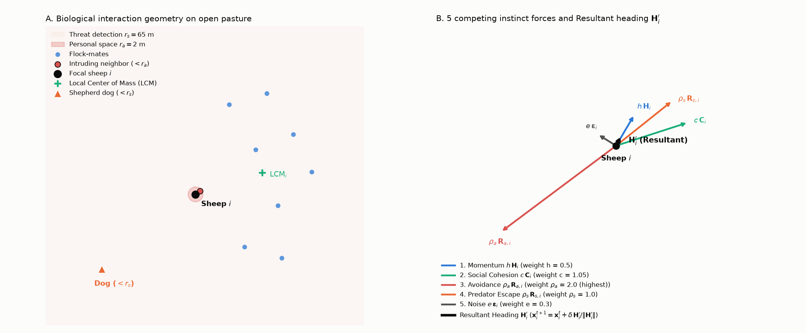
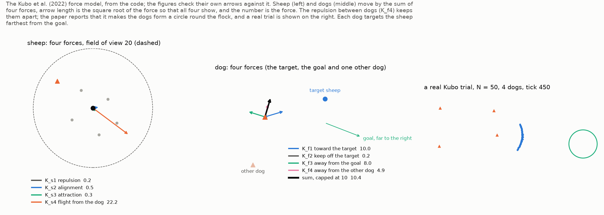
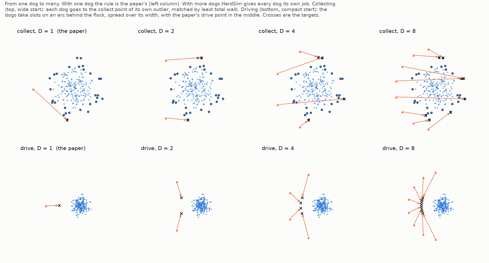
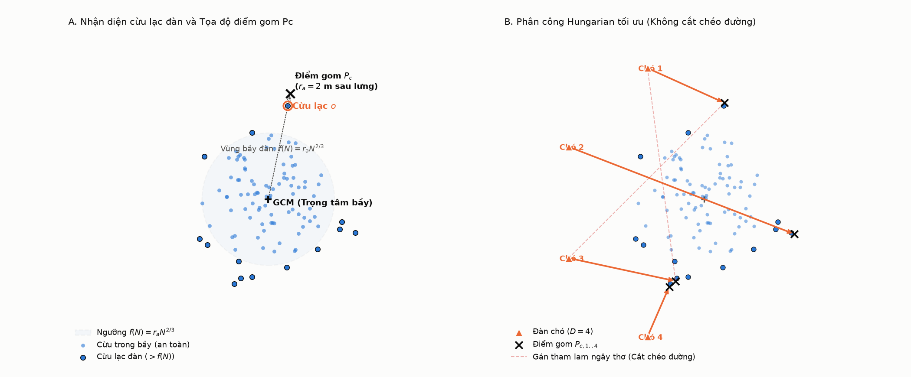
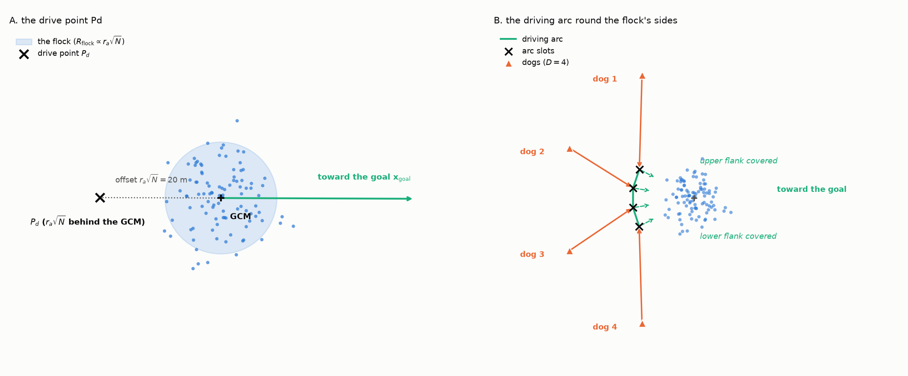
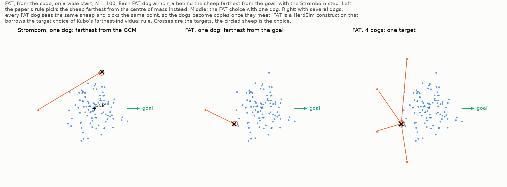
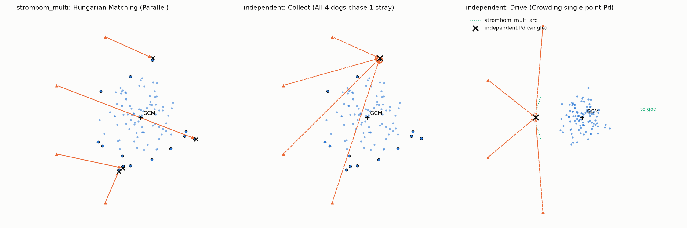
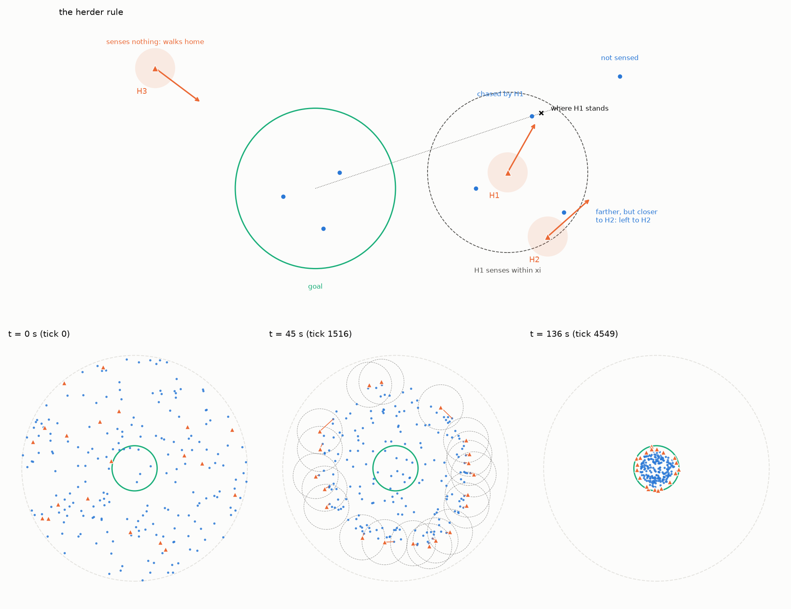

# Mô hình Tác tử và Phối hợp Nhiều Chó

Tài liệu này mô tả các mô hình cừu và các bộ điều khiển chó trong **HerdSim**: các phương trình, nguồn gốc của chúng, và những gì HerdSim thêm vào hoặc tự chọn ở những chỗ bài báo không nói.

HerdSim chạy mô hình cừu của Strömbom et al. (2014), mà các tác giả đã so với dữ liệu GPS của một bầy cừu và một chó thật, và mở rộng quy tắc một chó của họ cho cả đội chó. Nó còn chạy hai mô hình đã công bố khác để so sánh: Kubo et al. (2022) và Lama và di Bernardo (2024).

---

## Mục lục

- [1. Mô hình Bầy cừu](#1-mô-hình-bầy-cừu)
  - [Mô hình hành vi rời rạc Strömbom et al. (2014)](#mô-hình-hành-vi-rời-rạc-strömbom-et-al-2014)
  - [Chuẩn hóa tổng lực đẩy từ nhiều chó (Cải tiến của HerdSim)](#chuẩn-hóa-tổng-lực-đẩy-từ-nhiều-chó-cải-tiến-của-herdsim)
  - [Mô hình trường lực thế liên tục Kubo et al. (2022)](#mô-hình-trường-lực-thế-liên-tục-kubo-et-al-2022)
  - [Mô hình mục tiêu Brownian không liên kết Lama (2024)](#mô-hình-mục-tiêu-brownian-không-liên-kết-lama-2024)
- [2. Các Bộ điều khiển Chó](#2-các-bộ-điều-khiển-chó)
  - [Quy tắc đội: `strombom_multi`](#quy-tắc-đội-strombom_multi)
  - [Đối chứng không phối hợp: `fat`](#đối-chứng-không-phối-hợp-fat)
  - [Chó chăn độc lập theo bài báo: `independent`](#chó-chăn-độc-lập-theo-bài-báo-independent)
  - [Chó theo lực liên tục: `kubo_forces` (phương pháp `kubo`)](#chó-theo-lực-liên-tục-kubo_forces-phương-pháp-kubo)
  - [Người chăn cảm nhận cục bộ: `lama_herders`](#người-chăn-cảm-nhận-cục-bộ-lama_herders)
- [Tài liệu tham khảo](#tài-liệu-tham-khảo)

---

## 1. Mô hình Bầy cừu

### Mô hình hành vi rời rạc Strömbom et al. (2014)

Trong mô hình của [Strömbom et al. (2014)](https://doi.org/10.1098/rsif.2014.0719), mỗi con cừu tự quyết định hướng đi của nó ở mỗi bước thời gian ($t \to t+1$, một bước = một giây) từ vài lực kéo đơn giản: giữ hướng cũ, ở cùng bầy, giữ một chút khoảng cách, chạy khỏi chó, cộng thêm một ít nhiễu. Không có kế hoạch nào cho cả bầy.


*Hình 1: Quy tắc của cừu theo Strömbom et al. (2014). (A) Những gì cừu* $i$ *phản ứng: bạn cùng bầy, một con gần hơn* $r_a = 2$ *m, một chó trong vòng* $r_s = 65$ *m, và tâm các hàng xóm* $\mathrm{LCM}_i$*. (B) Năm vectơ đơn vị và trọng số: ra xa con ở gần (*$\rho_a = 2{,}0$*), về tâm các hàng xóm (*$c = 1{,}05$*), ra xa chó (*$\rho_s = 1{,}0$*), hướng cũ (*$h = 0{,}5$*) và nhiễu (*$e = 0{,}3$*); tổng có trọng số là hướng mới* $\mathbf{H}_i'$*.*

#### Phản ứng với chó (có chó gần hơn $r_s$)

Khi có chó trong vòng $r_s = 65$ m, cừu $i$ phản ứng. Hướng mới của nó là tổng có trọng số của năm vectơ đơn vị:

$$
\mathbf{H}_i' = h\thinspace \mathbf{H}_i + c\thinspace \mathbf{C}_i + \rho_a\thinspace \mathbf{R}_{a,i} + \rho_s\thinspace \mathbf{R}_{s,i} + e\thinspace \mathbf{\epsilon}_i
$$

##### 1. Hướng cũ ($\mathbf{H}_i$, trọng số $h = 0{,}5$)
Một con cừu giữ lại một phần hướng cũ, nên không quay ngoắt. $\mathbf{H}_i$ là hướng của bước vừa đi:

$$
\mathbf{H}_i = \frac{\mathbf{x}_i^t - \mathbf{x}_i^{t-1}}{\lVert \mathbf{x}_i^t - \mathbf{x}_i^{t-1} \rVert}
$$

Bài báo không nói chuyện gì xảy ra sau một bước mà cừu không di chuyển; khi đó HerdSim dùng vectơ không.

##### 2. Lực hút về bầy ($\mathbf{C}_i$, trọng số $c = 1{,}05$)
Một con cừu bị hút về tâm $\mathrm{LCM}_i$ của $n$ hàng xóm gần nhất:

$$
\mathbf{C}_i = \frac{\mathrm{LCM}_i - \mathbf{x}_i}{\lVert \mathrm{LCM}_i - \mathbf{x}_i \rVert}, \quad \text{với } \mathrm{LCM}_i = \frac{1}{n} \sum_{k \in \mathcal{N}_n(i)} \mathbf{x}_k
$$

Trong trường hợp cơ sở của bài báo $n = N - 1$, nên mỗi con cừu bị hút về tâm của cả bầy.

> [!NOTE]
> **Biết tâm của cả bầy.** Với $n = N - 1$, mọi con cừu biết tâm của cả bầy nằm đâu, điều mà một con cừu thật giữa hàng trăm con không làm được. Một con cừu có thể ước lượng hướng đó từ các hàng xóm gần nhất. `cli/diagnostics/gradient_validation.py` đo ước lượng đó lệch bao nhiêu so với hướng thật trên các bố cục xuất phát: sai số giảm khi dùng nhiều hàng xóm hơn và tăng theo $N$ (ở $N = 400$ với 15 hàng xóm, sai số trung bình vẫn khoảng 30°). Vì vậy dùng tâm cả bầy là một sự đơn giản hóa; một con cừu cảm nhận 15 hàng xóm sẽ thường đi lệch 30° so với tâm đó.

##### 3. Giữ khoảng cách ($\mathbf{R}_{a,i}$, trọng số $\rho_a = 2{,}0$)
Mọi hàng xóm $j$ gần hơn $r_a = 2$ m đẩy cừu $i$ ra xa. Số hạng này có trọng số lớn nhất, để cừu không bao giờ chồng lên nhau:

$$
\mathbf{R}_{a,i} = \frac{\sum_{j \in \mathcal{N}_a(i)} \frac{\mathbf{x}_i - \mathbf{x}_j}{\lVert \mathbf{x}_i - \mathbf{x}_j \rVert}}{\left\lVert \sum_{j \in \mathcal{N}_a(i)} \frac{\mathbf{x}_i - \mathbf{x}_j}{\lVert \mathbf{x}_i - \mathbf{x}_j \rVert} \right\rVert}, \quad \text{với } \mathcal{N}_a(i) = \lbrace j \ne i \mid \lVert \mathbf{x}_i - \mathbf{x}_j \rVert \lt r_a\rbrace
$$

##### 4. Chạy khỏi chó ($\mathbf{R}_{s,i}$, trọng số $\rho_s = 1{,}0$)
Ra xa các chó trong vòng $r_s = 65$ m (với nhiều chó, xem bên dưới).

##### 5. Nhiễu ($\mathbf{\epsilon}_i$, trọng số $e = 0{,}3$)
Một vectơ đơn vị với góc rút đều trong $[0, 2\pi)$.

#### Di chuyển
Mỗi bước, một con cừu đang phản ứng đi $\delta = 1$ m theo hướng mới:

$$
\mathbf{x}_i^{t+1} = \mathbf{x}_i^t + \delta\thinspace \frac{\mathbf{H}_i'}{\lVert \mathbf{H}_i' \rVert}
$$

Vậy một con cừu đang phản ứng luôn đi đúng $1$ m/s. Chó đổi hướng của nó, không bao giờ đổi tốc độ.

#### Gặm cỏ (không có chó trong vòng $r_s$)
Khi mọi chó ở xa hơn $r_s = 65$ m, cừu gặm cỏ: với xác suất $0{,}95$ nó đứng yên, với xác suất $0{,}05$ nó đi một bước theo hướng ngẫu nhiên:

```math
\mathbf{x}_i^{t+1} = \begin{cases}
\mathbf{x}_i^t + \delta\thinspace \mathbf{\epsilon}_{\mathrm{graze}}, & \text{với xác suất } 0{,}05 \\
\mathbf{x}_i^t, & \text{với xác suất } 0{,}95
\end{cases}
```

Một con cừu đang gặm cỏ không bị hàng xóm gần đẩy ra: bài báo chỉ đưa số hạng đó vào cho cừu đang phản ứng. Vì vậy một bầy không có chó nào tới gần chỉ tản ra theo bước đi ngẫu nhiên chậm của việc gặm cỏ.

---

### Chuẩn hóa tổng lực đẩy từ nhiều chó (Cải tiến của HerdSim)

Mô hình của Strömbom được viết cho **một chó**. Với nhiều chó, cộng các lực đẩy lại sẽ làm chúng quá mạnh:
- Lực hút về bầy có trọng số $c = 1{,}05$.
- Hai chó cách nhau một góc $\theta$ đẩy với độ lớn tổng $2\cos(\theta/2)$, lớn hơn $1{,}05$ khi chúng cách nhau dưới $116^\circ$.
- Khi đó cừu ở hai phía của bầy sẽ bị hai chó khác nhau đẩy tách ra với lực mạnh hơn lực hút giữ chúng lại, từ $D = 2$ trở lên. Quy tắc cộng lực bị loại trên lập luận này và không được chạy.

Vì vậy HerdSim cộng các vectơ đơn vị hướng ra xa mọi chó trong vòng $r_s$ rồi **chuẩn hóa tổng về độ dài một**:

$$
\mathbf{R}_{s,i} = \frac{\sum_{j \in \mathrm{threat}} \frac{\mathbf{x}_i - \mathbf{y}_j}{\lVert \mathbf{x}_i - \mathbf{y}_j \rVert}}{\left\lVert \sum_{j \in \mathrm{threat}} \frac{\mathbf{x}_i - \mathbf{y}_j}{\lVert \mathbf{x}_i - \mathbf{y}_j \rVert} \right\rVert}, \quad \text{với } \mathrm{threat} = \lbrace j \mid \lVert \mathbf{x}_i - \mathbf{y}_j \rVert \lt r_s\rbrace
$$

#### Ví dụ
Một con cừu ở $(0, 5)$, một chó ở $(-3, 0)$ phía sau bên trái và một chó ở $(3, 0)$ bên phải:
- Chó bên trái đẩy cừu về phía trước và sang phải $(+x, +y)$.
- Chó bên phải đẩy nó về phía trước và sang trái $(-x, +y)$.
- Các thành phần ngang triệt tiêu và các thành phần tiến về phía trước cộng lại.
- Sau khi chuẩn hóa, lực đẩy có độ lớn bằng lực của một chó và hướng thẳng về phía trước.

> [!NOTE]
> **Một lựa chọn mô hình.** Chuẩn hóa giữ trọng số $\rho_s = 1{,}0$ của Strömbom với bất kỳ số chó nào và giữ bầy liền, nên một đội lớn hơn chỉ thay đổi cừu bị đẩy từ đâu, không bao giờ thay đổi mạnh đến đâu. Cừu thật có chạy mạnh hơn khi gặp nhiều chó hay không là câu hỏi cho dữ liệu thực địa.

---

### Mô hình trường lực thế liên tục Kubo et al. (2022)

Để so sánh, HerdSim chạy mô hình lực của [Kubo et al. (2022)](https://doi.org/10.1007/s10015-021-00726-7). Thay cho các quy tắc của Strömbom, cừu và chó di chuyển dưới các lực trơn:


*Hình 2: Mô hình Kubo et al. (2022). Trái: lực lên một con cừu (đẩy, hút, chạy khỏi chó, đồng hướng). Giữa: lực lên một chó (về con cừu xa nhất, ra xa con cừu đó khi gần, ra xa đích, ra xa chó khác). Phải: một khung hình mà lực đẩy giữa các chó làm chúng trải ra.*

- **Vận tốc cừu** $u = K_{s1} a + K_{s2} b + K_{s3} c + K_{s4} d$ với $K_{s1} = 10$, $K_{s2} = 0{,}5$, $K_{s3} = 2$, $K_{s4} = 5000$, mỗi số hạng là trung bình trên các con cừu hoặc chó trong tầm nhìn $20$ m của con cừu:
  1. Đẩy khỏi hàng xóm, $a = \overline{(x_i - x_j)/\lVert x_i - x_j \rVert^2}$ (độ lớn $1/r$).
  2. Đồng hướng với hàng xóm, $b$.
  3. Hút về hàng xóm, $c = -\overline{(x_i - x_j)/\lVert x_i - x_j \rVert}$ (một hướng đơn vị).
  4. Chạy khỏi chó, $d = \overline{(x_i - X_j)/\lVert x_i - X_j \rVert^3}$ (độ lớn $1/r^2$).

  Tốc độ cừu bị giới hạn ở $5$ m/s.
- **Khác với Strömbom:**
  - Một con cừu Kubo tăng tốc khi bị đẩy mạnh hơn, đến $5$ m/s, còn cừu Strömbom luôn đi $1$ m/s. Vì vậy thêm chó Kubo thì xong sớm hơn, kể cả trên bầy tập trung: từ khoảng $115$ s với một chó xuống $29$ s với mười chó.
  - Lực đẩy của nhiều chó là trung bình trên các chó trong tầm nhìn, nên độ lớn của nó đã không phụ thuộc $D$ và không cần chuẩn hóa.
  - Kubo chỉ chạy trên bố cục tập trung: một con cừu Kubo chỉ hút trong vòng $20$ m, nên con nào xuất phát xa hơn thế với mọi con khác sẽ không bao giờ nhập bầy, và một xuất phát `wide` ở $L = 2 N^{2/3}$ (43 m ở $N = 100$) sẽ để cừu bị cô lập mãi.
- **Không có trong bài báo:** bước thời gian ($0{,}05$ s) và hai giới hạn tốc độ (cừu $5$, chó $10$) lấy từ một bản chuyển thể MATLAB công khai của phương pháp (PatrickHup, Force-Based-Sheep-Herding-Algorithm).

---

### Mô hình mục tiêu Brownian không liên kết Lama (2024)

HerdSim chạy mô hình mục tiêu không gắn kết của [Lama & di Bernardo (2024)](https://doi.org/10.1103/PhysRevResearch.6.L032012) với phương pháp `lama` (mô hình cừu `lama_targets`, bộ điều khiển chó `lama_herders`). Nó chạy trong nhiệm vụ riêng, `gather` (xem [thiết kế nhiệm vụ](../experiments/task_design_vi.md#6-nhiệm-vụ-gom-lama-và-di-bernardo-2024)).

**Vì sao có ở đây:** với cừu tụ bầy, độ dốc log-log của đội nhỏ nhất theo $N$ trong HerdSim là 0,27 đến 0,61 tùy thời hạn. Bài báo công bố rằng với mục tiêu không gắn kết, đội nhỏ nhất tăng theo $\sqrt{M}$ (độ dốc 0,5), và khi tầm cảm nhận giới hạn thì chỉ trên một ngưỡng mật độ $M_{\mathrm{low}}$. Chạy mô hình của bài báo trong HerdSim đặt cả hai lên cùng một bộ mô phỏng và cùng một bộ thống kê. Các lượt chạy và kết quả ở [thiết kế nhiệm vụ, mục 6](../experiments/task_design_vi.md#6-nhiệm-vụ-gom-lama-và-di-bernardo-2024) và trong báo cáo.

**Ký hiệu.** Bài báo viết $N$ cho số người chăn và $M$ cho số mục tiêu. HerdSim giữ ký hiệu của mình ở mọi nơi: $D$ là số chó (người chăn) và $N$ là số cừu (mục tiêu). Vậy $N^{\ast}(M)$ của bài báo là đội nhỏ nhất của HerdSim trên nhiệm vụ gom. $D$ của bài báo (hệ số khuếch tán) ở đây gọi là `target_diffusion`.

- **Mục tiêu ("cừu")**: các hạt đi ngẫu nhiên **không gắn kết, không đồng hướng và không giới hạn tốc độ**. Mỗi hạt di chuyển theo nhiễu riêng cộng lực đẩy của các người chăn trong vòng $\lambda$ (phương trình 1 của bài báo):

$$
\dot{\mathbf{x}}_a = \sqrt{2D_T}\thinspace \boldsymbol{\xi}_a + \beta \sum_{i:\ \lVert \mathbf{x}_a - \mathbf{y}_i \rVert \le \lambda} \left(\lambda - \lVert \mathbf{x}_a - \mathbf{y}_i \rVert\right) \frac{\mathbf{x}_a - \mathbf{y}_i}{\lVert \mathbf{x}_a - \mathbf{y}_i \rVert}
$$

- **Lực đẩy** hướng ra xa người chăn, bằng $\beta\lambda$ khi chạm và giảm tuyến tính về không ở $\lambda$. Lực đẩy của nhiều người chăn **cộng lại**, khác với lực đẩy đã chuẩn hóa của Strömbom ở trên. Tốc độ thoát tối đa khỏi một người chăn là $v_T = \beta\lambda = 7{,}5$.
- **Tích phân**: Euler-Maruyama với $\Delta t = 0{,}03$ s.

| Tham số | Bài báo | Khóa HerdSim | Giá trị |
| :--- | :---: | :--- | :---: |
| Khuếch tán của mục tiêu | $D$ | `target_diffusion` | 1 |
| Độ mạnh lực đẩy | $\beta$ | `repulsion_strength` | 3 |
| Bán kính lực đẩy | $\lambda$ | `repulsion_radius` | 2,5 |
| Bước thời gian | $\Delta t$ | `dt` | 0,03 |


---

## 2. Các Bộ điều khiển Chó

HerdSim có năm bộ điều khiển chó:

```text
Bộ điều khiển chó
├── strombom_multi   (quy tắc đội: phân công con lạc + vòng cung lùa)
├── fat              (không phối hợp: mọi chó đứng sau con cừu xa đích nhất)
├── independent      (quy tắc một chó của Strömbom cho mọi chó, không có tầng đội)
├── kubo_forces      (lực của Kubo, có lực đẩy giữa các chó)
└── lama_herders     (cảm nhận cục bộ, đuổi mục tiêu xa nhất; chỉ nhiệm vụ gom)
```

---

### Quy tắc đội: `strombom_multi`

Mở rộng quy tắc một chó của Strömbom cho một đội, để mỗi chó có mục tiêu gom hoặc vị trí trên cung của riêng nó:


*Hình 3: Quy tắc đội `strombom_multi` với* $D = 1, 2, 4, 8$ *chó. Hàng trên (gom trên bố cục `wide`,* $N = 200$*):* $D$ *con lạc xa nhất được thuật toán Hungarian phân cho mỗi chó một con (dấu chéo là các điểm gom* $P_c$*), nên các chó gom song song. Hàng dưới (lùa một bầy tập trung,* $N = 200$*): các chó trải trên một cung bán kính* $R$ *sau bầy (điểm lùa* $P_d$ *của bài báo ở giữa), giữ thứ tự góc để đường đi không cắt nhau.*

#### 1. Khi nào gom ($f(N) = r_a N^{2/3}$)
- Nếu có con cừu nào xa tâm bầy ($\mathrm{GCM} = \frac{1}{N} \sum_k \mathbf{x}_k$) hơn $f(N) = r_a N^{2/3}$, các chó **gom**; nếu không, chúng **lùa**.
- Đây là ngưỡng của Strömbom. Nó tăng theo $N$ nhanh hơn bán kính của một bầy chặt ($\propto \sqrt{N}$), nên một bầy lớn được phép lỏng hơn một bầy nhỏ trước khi một con cừu bị coi là con lạc.

#### 2. Phân công con lạc (thuật toán Hungarian)
- Với một con lạc $o$, điểm gom $P_c$ nằm sau nó $r_a = 2$ m, nhìn từ tâm bầy:

$$
P_c = \mathbf{x}_o + r_a \frac{\mathbf{x}_o - \mathrm{GCM}}{\lVert \mathbf{x}_o - \mathrm{GCM} \rVert}
$$

- $D$ con lạc xa nhất được thuật toán Hungarian (`scipy.optimize.linear_sum_assignment`) phân cho mỗi chó một con, sao cho tổng khoảng cách thẳng từ các chó đến điểm gom của chúng nhỏ nhất; trên mặt phẳng, một phép phân công như vậy không có đường đi nào cắt nhau. Phép phân công được tính lại mỗi bước, nên mục tiêu của một chó có thể đổi khi các con lạc di chuyển. Những chó thừa khi số con lạc ít hơn số chó sẽ lùa phần lõi bầy (những con trong vòng $f(N)$) từ phía sau.


*Hình 4: Gom. (A) Một con cừu ngoài vòng* $f(N) = r_a N^{2/3}$ *là con lạc; điểm gom* $P_c$ *của nó nằm sau nó* $r_a = 2$ *m trên tia từ tâm bầy (GCM); hình vẽ đặt dấu chéo xa gấp bốn lần để nhìn thấy được. (B) Thuật toán Hungarian phân chó cho các điểm gom từng cặp với tổng quãng đường nhỏ nhất, nên không có hai đường đi nào cắt nhau (nét đứt là một cách phân công vẽ tay có đường cắt nhau).*

#### 3. Lùa ($P_d$) và giới hạn của nó ở $N$ lớn
- Khi mọi con cừu đều trong vòng $f(N)$, các chó **lùa**.
- Điểm lùa $P_d$ của bài báo nằm sau bầy, ở phía xa đích:

$$
P_d = \mathrm{GCM} + r_a \sqrt{N} \frac{\mathrm{GCM} - \mathbf{x}_{\mathrm{goal}}}{\lVert \mathrm{GCM} - \mathbf{x}_{\mathrm{goal}} \rVert}
$$

- Khoảng $r_a \sqrt{N}$ tăng giống bán kính của một bầy chặt. Với bầy đã hiệu chỉnh, nó đặt chó sau tâm khoảng 2,2 bán kính bầy ở $N = 100$ và 3,5 ở $N = 400$.
- **Trên $N \approx 1056$, điểm lùa nằm ngoài tầm.** Cừu chỉ phản ứng với chó trong vòng $r_s = 65$ m. Khi $r_a \sqrt{N} = 2\sqrt{N} > 65$, tức $N > 1056$, chó ở $P_d$ chỉ với tới phần đuôi của bầy (phần đầu cách hơn 65 m), và không đội nào đến 12 chó lùa được bầy ở $N = 1131$. Như một biến thể HerdSim có ghi rõ, `drive_offset_cap` giới hạn khoảng đó ở $r_s - r_a = 63$ m, và việc lùa bầy tập trung hoạt động trở lại (một chó ở $N = 1131$, hai ở 1600, và 42 trên 42 lượt chạy dở ở 3200); trên `wide` giới hạn này cho $D_{\min} = 5$–9 ở 1131 và không có đội tin cậy nào đến 12 ở 1600.
- Với nhiều chó, chúng trải trên một cung bán kính $R$ (khoảng cách đến $P_d$) phủ hết bề rộng bầy, $\pm \arcsin(R_{\mathrm{flock}} / R)$, với $R_{\mathrm{flock}}$ là bán kính hiện tại của bầy ($\sqrt{2}$ lần độ trải RMS của nó). Chó và các vị trí trên cung được ghép theo thứ tự góc quanh tâm bầy, nên chó cạnh nhau vẫn cạnh nhau và không có hai chó nào cắt qua nhau.


*Hình 5: Lùa. (A) Điểm lùa* $P_d$ *nằm sau tâm bầy* $r_a\sqrt{N} = 20$ *m ở* $N = 100$*, phía xa đích* $\mathbf{x}_{\mathrm{goal}}$*. (B) Với nhiều chó, vòng cung vươn ra hai bên bầy và giữ hai bên không bứt ra.*

#### 4. Tốc độ và quy tắc dừng
- **Tốc độ**: $v_{\mathrm{dog}} = 1{,}5$ m/s, giá trị của Strömbom ($1{,}5$ lần tốc độ cừu). Dữ liệu thực địa của một chó và một bầy (Jadhav et al. 2024) cho tỷ lệ khoảng $1{,}15$, được giao thức độ nhạy `dmin_s_dogspeed` thử.
- **Bước đi**: mỗi chó di chuyển theo bước đi của Strömbom về phía mục tiêu của nó, với nhiễu góc của bài báo, như các đối chứng bên dưới.
- **Quy tắc dừng**: một chó gần hơn $3 r_a = 6$ m với bất kỳ con cừu nào thì đứng yên bước đó (quy tắc của Strömbom).
- **Con cừu cuối cùng dưới quy tắc nghiêm ngặt**: khi mọi con cừu phải vào đích, các đội lớn thường thất bại sau khi 99% bầy đã vào, vì các chó đuổi theo con lạc cuối cùng lùa bầy ra ngoài trở lại; chó chậm hơn (1,15 m/s) tránh được điều đó. Số liệu ở mục 3.4 của báo cáo.

---

### Đối chứng không phối hợp: `fat`

**Nhắm con xa nhất (FAT)** kiểm tra xem có cần phối hợp hay không:
- **Quy tắc**: mọi chó đi tới điểm cách $r_a$ phía sau con cừu xa đích nhất, ở phía xa đích của nó, với bước đi, nhiễu và quy tắc dừng của Strömbom. Mục tiêu là lựa chọn tham lam hướng về đích (số hạng thứ nhất của chó Kubo), trong khi quy tắc của Strömbom chọn con cừu xa tâm bầy nhất.
- **Thiếu gì**: không phân công, không vòng cung lùa, không giao tiếp, và không có công tắc gom/lùa.


*Hình 6: Dồn cục trong FAT. Trái: quy tắc một chó của Strömbom đi sau con cừu xa tâm bầy (GCM) nhất. Giữa: FAT với một chó đi sau con cừu xa đích nhất. Phải: với 4 chó, mọi chó chọn cùng một con và dồn thành một cụm hoạt động như một chó duy nhất.*

---

### Chó chăn độc lập theo bài báo: `independent`

Mỗi chó tự chạy quy tắc một chó của Strömbom:
- Nó quyết định gom hay lùa dựa trên cả bầy, nhắm con cừu xa tâm bầy nhất hoặc điểm lùa, và đi tới đó với bước đi, nhiễu và quy tắc dừng của Strömbom.
- **Không có tầng đội**, và vì mọi chó thấy cùng một bầy, tất cả chọn giống nhau: bộ điều khiển là một chó với $D$ bản sao. Khác với FAT, nó giữ mục tiêu của bài báo và công tắc gom/lùa, và đó là điều phân biệt hai đối chứng.
- *Kết quả* (bố cục phân tán, 6 lần thời gian lùa, quy tắc 99%): có đội tin cậy đến $N = 200$ (2–3 chó trên `wide`, 3 trên `outlier_rich`) và không có đội nào đến 24 ở $N = 400$, nơi quy tắc đội cần 2–3 chó trên `wide` và 3 trên `outlier_rich` và không có đội tin cậy nào trên `split`.


*Hình 7: `strombom_multi` so với `independent` (*$N = 100, D = 4$*). Trái (`strombom_multi`): 4 chó được phân cho 4 con lạc khác nhau và gom song song. Giữa (`independent`, gom): mọi chó thấy cùng một bầy và chọn giống nhau, nên cả 4 đuổi cùng một con lạc trong khi các con khác chờ. Phải (`independent`, lùa): mọi chó đi tới cùng điểm lùa* $P_d$ *thay vì trải trên một cung (chấm xanh lá), nên chúng chen nhau và không che được hai bên bầy.*

---

### Chó theo lực liên tục: `kubo_forces` (phương pháp `kubo`)

Chó di chuyển theo lực của Kubo thay vì chuyển giữa các chế độ (Hình 2). Vận tốc của chó là $K_{f1} A + K_{f2} B + K_{f3} C + K_{f4} D$, rồi giới hạn ở $10$ m/s:
1. **Về mục tiêu**: một vectơ đơn vị về con cừu xa đích nhất ($K_{f1} = 10$).
2. **Ra xa mục tiêu**: ra xa con cừu đó, độ lớn $1/r^2$, để chó giữ khoảng cách ($K_{f2} = 200$).
3. **Ra xa đích**: một vectơ đơn vị ra xa tâm đích, để chó ở phía sau bầy ($K_{f3} = 8$).
4. **Ra xa các chó khác**: trung bình của $(X_i - X_j)/\lVert X_i - X_j \rVert^3$ trên các chó khác, độ lớn $1/r^2$ ($K_{f4} = 3000$), không có ngưỡng khoảng cách.

Lực đẩy giữa các chó làm chúng trải ra sau bầy (Hình 2, phải) mà không cần phân công.

---

### Người chăn cảm nhận cục bộ: `lama_herders`

Quy tắc người chăn của Lama & di Bernardo (2024), phương trình 2 đến 4 của bài báo. Mọi khoảng cách được đo từ tâm đích, là gốc tọa độ của bài báo.


*Hình 8: Phương pháp của Lama & di Bernardo (2024). Trên: quy tắc người chăn trên một cảnh dựng tay, được kiểm tra với code. H1 cảm nhận ba mục tiêu trong* $\xi$ *(nét đứt). Nó nhường mục tiêu xa nhất cho H2, vì mục tiêu đó gần H2 hơn, và đuổi mục tiêu xa đích kế tiếp. Dấu chéo là điểm cách mục tiêu đó* $\delta$ *trên tia từ tâm đích, nơi H1 đứng để đẩy nó vào trong. H3 không cảm nhận gì nên đi về phía đích. Các đĩa tô nhạt là bán kính đẩy* $\lambda$ *. Dưới: một lượt chạy thật với* $\xi = 10$ *,* $N = 196$ *mục tiêu và* $D = 20$ *người chăn, lúc bắt đầu, sau một phần ba thời gian và lúc kết thúc. Vòng tròn xám nét đứt là đĩa xuất phát bán kính 50. Ở hình giữa, các vòng nét đứt là vùng cảm nhận của người chăn và mỗi đoạn thẳng nối một người chăn với mục tiêu nó đang đuổi. Người chăn trải quanh mép và làm dần vào trong. Lúc kết thúc mọi mục tiêu đều ở trong đích và người chăn đứng ngay bên trong mép đích.*

1. **Người chăn cảm nhận gì**: các mục tiêu và các người chăn khác trong vòng $\xi = 10$ (`sensing_radius`; giao thức `lama_r50_inf` đặt nó vô hạn).
2. **Đuổi mục tiêu nào**: mục tiêu cảm nhận được **xa tâm đích nhất**, bỏ qua mục tiêu nào gần một người chăn khác cảm nhận được hơn. Nhờ đó các người chăn gần nhau chia việc mà không cần nói chuyện và không cần nhìn toàn cục.
3. **Đứng ở đâu**: cách mục tiêu $\delta = \lambda/2 = 1{,}25$ về phía ngoài trên tia từ tâm đích, để lực đẩy đưa mục tiêu vào trong. Nó di chuyển về điểm đó với hệ số $\alpha = 5$, tối đa $v_H = 8$ mỗi giây:

$$
\dot{\mathbf{y}}_i = \left[\thinspace -\alpha\left(\mathbf{y}_i - \mathbf{x}^{\ast}_i - \delta\thinspace \hat{\mathbf{x}}^{\ast}_i\right)\right]_{v_H}
$$

4. **Khi không có gì để đuổi**: nó đi thẳng về tâm đích với tốc độ $v_H$ và đứng yên khi đã vào trong đích.
5. **Không nhiễu, không lực đẩy giữa các người chăn, không có tầng đội.** HerdSim từ chối bộ tham số có $v_H \le v_T$, vì bài báo giả định người chăn nhanh hơn.

| Tham số | Bài báo | Khóa HerdSim | Giá trị |
| :--- | :---: | :--- | :---: |
| Bán kính cảm nhận | $\xi$ | `sensing_radius` | 10 |
| Tốc độ tối đa | $v_H$ | `herder_speed` | 8 |
| Hệ số | $\alpha$ | `herder_gain` | 5 |
| Khoảng đứng sau mục tiêu | $\delta$ | `chase_offset` | 1,25 |

Người chăn và mục tiêu được di chuyển từ cùng một trạng thái ở đầu mỗi bước, như các lược đồ hiển của bài báo. Ở lượt kiểm chứng đầu, người chăn đọc vị trí mục tiêu đã di chuyển, và ở 400 mục tiêu cần ít hơn một người chăn so với thứ tự của bài báo (16 so với 17 khi thấy mọi thứ). Ở những chỗ bài báo không nói, lựa chọn của HerdSim được ghi trong mã: chiều của lực đẩy trong [`sim/methods/lama/dynamics.py`](../../sim/methods/lama/dynamics.py), và khi nào một lượt kết thúc cùng thứ tự các bước trong [`sim/plugins/scenarios/gather.py`](../../sim/plugins/scenarios/gather.py).

---

## Tài liệu tham khảo

1. **Strömbom, D., et al. (2014)**. *Solving the shepherding problem: heuristics for herding autonomous, interacting agents*. Journal of the Royal Society Interface, 11(100), 20140719. [DOI: 10.1098/rsif.2014.0719](https://doi.org/10.1098/rsif.2014.0719)
2. **Kubo, M., Tashiro, M., Sato, H., Yamaguchi, A. (2022)**. *Herd guidance by multiple sheepdog agents with repulsive force*. Artificial Life and Robotics, 27, 416–427. [DOI: 10.1007/s10015-021-00726-7](https://doi.org/10.1007/s10015-021-00726-7)
3. **Lama, A., & di Bernardo, M. (2024)**. *Shepherding control and herdability in complex multiagent systems*. Physical Review Research, 6, L032012. [DOI: 10.1103/PhysRevResearch.6.L032012](https://doi.org/10.1103/PhysRevResearch.6.L032012)
4. **Jadhav, V., et al. (2024)**. *Collective responses of flocking sheep (Ovis aries) to a herding dog (border collie)*. Communications Biology, 7, 1543.
