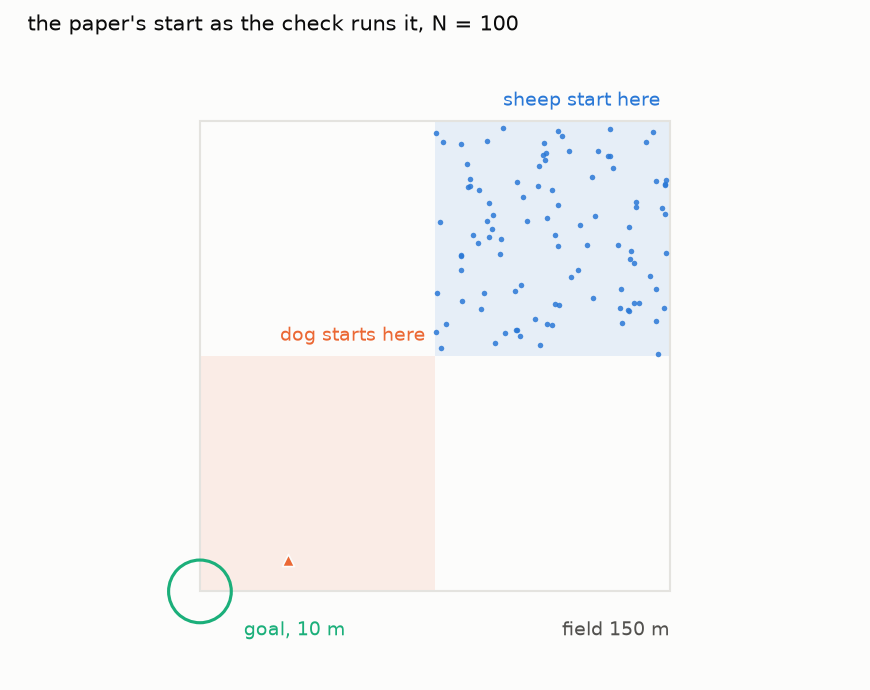
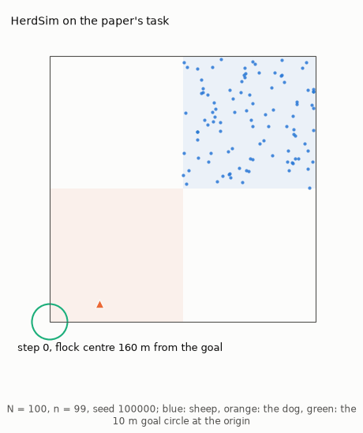
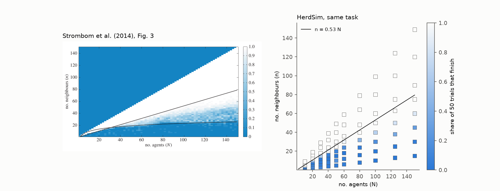
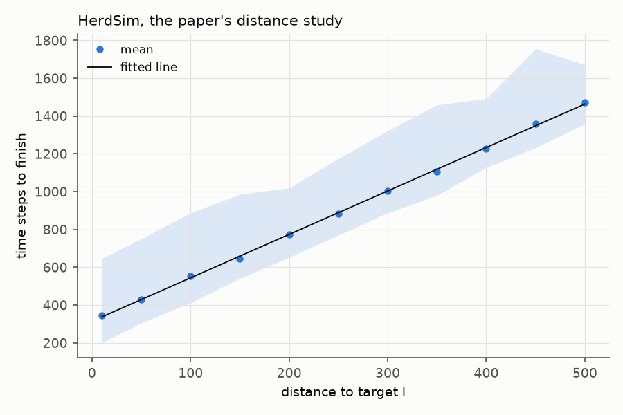

# Checking HerdSim against Strombom et al. (2014)

Does HerdSim run the sheep and the dog of [Strombom et al. (2014)](https://doi.org/10.1098/rsif.2014.0719), or something of its own? This doc reruns two of the paper's one-dog results with HerdSim's own trial code and compares them with what the paper states. HerdSim's model is described in [Strombom sheep](strombom_sheep.md).

## Terms

- Flock size $N$: the number of sheep.
- Neighbour count $n$: how many nearest neighbours attract a sheep, out of the other $N - 1$. The paper calls $n = N - 1$ the global case.
- Time step: one tick of HerdSim, one step of the paper.
- Finish: a trial finishes when the flock centre (the mean position of the sheep) is within 10 m of the goal before the time limit.
- Grid point: one pair of $N$ and $n$.
- Grazing repulsion: sheep that no dog is within $r_s$ of also push apart when closer than $r_a$ (both in Table 1), as the paper says (section 2). Every trial of the check applies it; in HerdSim it is the model parameter `graze_repulsion` ([grazing](strombom_sheep.md#grazing)).

## Setup and result in short

The check uses the paper's setup wherever the paper gives one: the square field, the start squares of the sheep and the dog, the goal in the corner, the time limit and the sheep parameters. Where the paper is silent, [Table 2](#how-the-papers-figure-3-is-set-up) says so and HerdSim's reading is used. Figure 1 shows the paper's start as the check runs it, and Animation 1 one trial.

Every trial finishes at the 30 grid points where the paper's text says all should ($n \ge 0.6 N$, sizes 10 to 150), and the counts have the shape of the paper's Figure 3. The paper's distance study also matches: every trial finishes at all 11 distances run, and the time grows linearly with the distance.



**Figure 1: The start of the paper's task as the check runs it, $N = 100$.** Every trial of the check of the paper's Figure 3 starts this way: the sheep in the upper right quarter of the 150 m field, the dog in the lower left quarter, next to the goal at the corner. The distance study moves the two squares (its own section).

- Marks: blue dots are sheep, the orange triangle is the dog, the green circle is the goal; the shaded squares are where the sheep (blue) and the dog (orange) start. It is the start of the trial in Animation 1.

*Data:* `uv run python docs/generate_docs/make_figures.py`.



**Animation 1: One trial of the paper's task run by HerdSim ($N = 100$, $n = 99$, seed 100000).** The dog goes round to the far side of the flock, and the flock moves to the goal circle, finishing at time step 434.

- Marks: as in Figure 1; the label gives the time step and the distance from the flock centre to the goal.

*Data:* `uv run python docs/generate_docs/make_gifs.py paper_task`.

## How the paper's Figure 3 is set up

Each trial runs through HerdSim's own trial code, with the paper's values. Table 1 lists the model parameters, all the paper's (its Table 1) except $r_s$, which its Figure 3 sets to 45 m. Table 2 lists the rest of the setup and, for each setting the paper leaves open, HerdSim's reading.

**Table 1: Model parameters used, from the paper's Table 1 and Figure 3 caption.**

| Symbol | Meaning | Value |
| :--- | :--- | :---: |
| $r_a$ | sheep-to-sheep interaction distance (m) | 2 |
| $\rho_a$ | weight of repulsion from other sheep | 2 |
| $c$ | weight of attraction to the $n$ nearest neighbours | 1.05 |
| $\rho_s$ | weight of repulsion from the dog | 1 |
| $h$ | weight of the previous heading | 0.5 |
| $e$ | weight of the angular noise | 0.3 |
| $\delta$ | sheep step per time step (m) | 1 |
| $p$ | probability that a grazing sheep moves in a time step | 0.05 |
| $r_s$ | distance within which a sheep reacts to the dog (m) | 45 (the paper's Table 1: 65) |
| $\delta_s$ | dog step per time step (m) | 1.5 |

**Table 2: The rest of the setup of the paper's Figure 3.**

| Setting | Value | Where it comes from |
| :--- | :--- | :--- |
| Field | open square, side $L = 150$ m | the paper's Table 1; section 4.1 says it is not enclosed |
| Sheep start | uniform in the upper right quarter, 75 to 150 m on both axes | section 4.1, "randomly positioned"; uniform is HerdSim's reading |
| Dog start | one dog, uniform in the lower left quarter, 0 to 75 m on both axes | section 4.1, "released in the lower left quarter" (section 2 says "outside" the sheep's quarter; the example of the paper's Figure 2 starts at (15, 170)); uniform is HerdSim's reading |
| Goal | the origin; the trial ends when the flock centre is within 10 m | the paper's Figure 2 caption gives 10 units for one example and section 4.1 "a certain distance"; 10 m is HerdSim's reading |
| Time limit | 8000 time steps | the paper's Figure 3 caption |
| Order within a time step | every sheep moves, then the dog | HerdSim's reading; the paper does not say |
| Previous heading after a step without moving | zero | HerdSim's reading; the paper does not say |
| Length of a grazing step | $\delta$, in a random direction | HerdSim's reading; the paper gives only the probability $p$ |
| Grazing repulsion | applied | the paper repels sheep from each other "regardless of distance to the shepherd" (section 2); how a repelled grazing sheep moves is not stated, so HerdSim's reading: it steps $\delta$ along its previous heading, the push from its neighbours and noise |
| Trials per point | 50 | the paper's text on its Figure 3: "over 50 simulations" |
| Seed of trial $i$ at size $N$ | $1000 N + i$, the same for every $n$ at that $N$; in the distance study $1{,}000{,}000 + 1000\,l + i$ | HerdSim's choice; a trial can be replayed from its seed |

The paper's Figure 3 covers $N$ from 2 to 150 and $n$ from 1 to $N - 1$. HerdSim runs 80 grid points: ten sizes (10, 20, 30, 40, 50, 60, 80, 100, 125 and 150) and, at each, the global case and $n = \lceil s N \rceil$ (at least 1) for the shares $s$ = 0.1, 0.2, 0.3, 0.4, 0.5, 0.6 and 0.8. How to run it and its cost are in the [command-line reference](../guides/cli_reference.md#clipaper_checkpy-check-against-the-paper).

## Results for the paper's Figure 3

The paper's Figure 3 shows, for flock sizes $N$ up to 150 and every neighbour count $n$, the share of 50 runs in which one dog brings the flock to the corner within 8000 time steps. HerdSim ran the same task; Figure 2 sets the two side by side.

Table 3 compares them point by point. HerdSim's grid has no point between $n = 0.5 N$ and $0.6 N$, so the paper's line at $0.53 N$ falls between two tested columns, and 50 of 50 bounds the finish rate at 0.899 or more (99% confidence), not at exactly 1.

**Table 3: The paper's Figure 3 against HerdSim.**

| Claim | Paper | HerdSim | Result |
| :--- | :--- | :--- | :--- |
| All finish above $n = 0.53 N$ | every trial finishes from the global case down to about $n = 0.53 N$ | 50 of 50 at all 30 grid points with $n \ge 0.6 N$ | same |
| Success falls below that line | for $N > 30$, from 1 to rare | at $N = 100$, 49, 34 and 9 of 50 at $n$ = 50, 40 and 30 | same |
| Rare success under a lower curve | rare under $n \approx 3 \log N$ | not checked: the paper does not state the base of the logarithm | cannot tell |
| The figure | - | the same shape by eye (Figure 2) | same |



**Figure 2: Share of trials that finish against $N$ and $n$ in the paper (left) and in HerdSim (right), one dog, 8000 time steps, $r_s = 45$ m.** By eye the two have the same shape, with the change near the line $n = 0.53 N$.

- Marks: blue is no trial finishing and white is every trial; the black line is $n = 0.53 N$, and the paper's panel also draws its curve $n \approx 3 \log N$.
- Left: the paper's Figure 3, cropped from its PDF (licence CC BY 4.0), with its own colour scale; it is also blue above $n = N - 1$, where no trial exists.
- Right: HerdSim, one square per grid point, on a similar blue-to-white scale.

*Data:* `uv run python -m docs.generate_docs.page paper` prints the counts; the figure comes from `uv run python docs/generate_docs/make_result_figures.py`.

## Time against distance to the goal

The paper's text (p. 4) describes a second study: 46 sheep start in a 50 x 50 square centred at $(l + 25\sqrt{2}, l + 25\sqrt{2})$, with $l$ "increasing from 10 to 500" and 100 runs per $l$. It gives no other setting, so HerdSim uses the paper's Table 1 values ($r_s = 65$ m), the global case, HerdSim's 10 m end rule (Table 2), the 8000 time steps of the paper's Figure 3, $l$ = 10 and 50 to 500 in steps of 50, and the dog in a 50 m square next to the sheep's on the goal side. The paper's result is in its supplementary Figure S2, which we do not have, so HerdSim is compared with its text.

**Table 4: The paper's distance study against HerdSim.**

| Claim | Paper | HerdSim | Result |
| :--- | :--- | :--- | :--- |
| Success against distance | "the success rate is unaffected" | 100 of 100 at all 11 distances | same |
| Time against distance | "the average time to completion increases linearly with distance to target" | a line through the 11 mean times: 314 + 2.30 $l$ steps, $R^2$ = 0.9995 (Figure 3) | same |
| The time itself | no number (its Figure S2 is not available to us) | 345 steps at $l = 10$ to 1472 at $l = 500$ | cannot tell |



**Figure 3: Time steps to finish against distance $l$ in the paper's distance study, HerdSim only.** Every trial finishes, and the mean time lies on a straight line. The paper's figure for this study (its Figure S2) is not available, so there is no paper panel.

- Marks: dots are the mean over 100 runs, the band runs from the fastest to the slowest run, and the line is the least-squares fit of the means.

*Data:* `uv run python -m docs.generate_docs.page paper` prints the counts and times; the figure comes from `uv run python docs/generate_docs/make_result_figures.py`.

## What this does not show

- The paper gives its results as pictures with no tables, so the comparison uses only the numbers its text, captions and its Table 1 state; the pictures are compared by eye.
- The check covers one dog and up to 150 sheep, the range of the paper's Figure 3, and counts whether and when a trial finishes. It says nothing about more dogs or larger flocks.
- We have not varied the settings the paper leaves open (Table 2 and the distance study), and HerdSim's grid of the paper's Figure 3 has 80 points, not every $(N, n)$.
- The paper's other simulations are not reproduced:
  - Figure 2 is one example run.
  - Figure 4 (time spent driving and collecting) names and draws its vectors but does not define them.
  - Figure 5 sets $n = 46$ for 46 sheep, which exceeds $N - 1$, and its field data are not given.
  - Figure 6 uses another dog rule (a dog that acts on its 20 nearest sheep), which HerdSim does not implement.

## Reproducing the check

The trials are run with `cli/paper_check.py` ([command-line reference](../guides/cli_reference.md#clipaper_checkpy-check-against-the-paper)), which stores one row per trial with its seed in `results/paper_check/`; `paper_check/trials.py` runs any trial again from its seed. The tables and figures come from:

```bash
uv run python -m docs.generate_docs.page paper
uv run python docs/generate_docs/make_result_figures.py
uv run python docs/generate_docs/make_figures.py
uv run python docs/generate_docs/make_gifs.py paper_task
```

The figure scripts need `pdftoppm` (poppler-utils) to crop the paper's figure, and stop with its name if it is missing.
