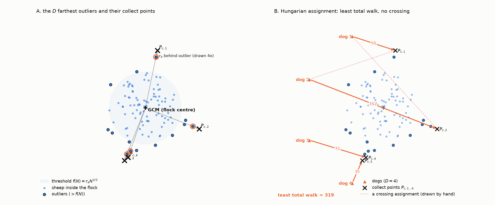
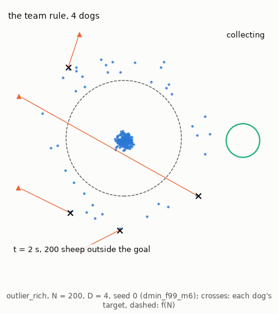

# Team rule `strombom_multi`

This doc describes `strombom_multi`, HerdSim's rule for a team of $D$ dogs. It extends the one-dog rule of [Strombom et al. (2014)](https://doi.org/10.1098/rsif.2014.0719) by giving each dog its own target at every tick. The sheep model is in [strombom_sheep.md](strombom_sheep.md); the two baselines without team coordination are [`independent`](independent.md) and [`fat`](fat.md).

At every tick the team does one of two things (Figure 1):

- Collect: some sheep are too far from the flock centre. These sheep are the outliers. Each of the $D$ farthest outliers gets one dog, which goes behind it and pushes it back. Dogs left over drive the rest of the flock.
- Drive: every sheep is close enough to the centre. The dogs spread along an arc behind the flock and push it toward the goal.

With $D = 1$, `strombom_multi` is HerdSim's one-dog Strombom rule, the same rule the [paper check](strombom_check.md) compares with Strombom et al. (2014).

**Figure 1: The team rule `strombom_multi` for $D = 1, 2, 4, 8$ dogs ($N = 200$).** Larger teams collect more outliers at once (top) and cover a wider arc behind the flock when driving (bottom).

- Marks: light blue dots are sheep inside the collect distance $f(N)$ (dashed circle), dark-outlined dots are outliers, orange triangles are dogs, and orange arrows point to each dog's target (`x`).
- Top: `wide` start, collecting. The $D$ farthest outliers are matched to the $D$ dogs at their collect points $P_c$.
- Bottom: `compact` start, driving. The $D$ dogs are matched in angular order to slots on the arc behind the flock, through the drive point $P_d$.

## When to collect

The flock centre is the mean sheep position, $\mathrm{GCM} = \frac{1}{N}\sum_k \mathbf{x}_k$. A sheep farther from it than the collect distance $f(N)$ of Strombom et al. (2014) is an outlier:

$$
f(N) = r_a N^{2/3}
$$

With $r_a = 2$ m, $f(N)$ is 43.1 m at $N = 100$. While at least one sheep is an outlier, the team collects; once every sheep is within $f(N)$, the team drives.

The limit grows with $N^{2/3}$, faster than the radius of a tightly packed flock, which grows with $\sqrt{N}$. A larger flock is therefore allowed to spread more, relative to its size, before the dogs start collecting.

## Assigning outliers (Hungarian algorithm)

The team takes the $\min(D, n_{\mathrm{outliers}})$ outliers farthest from $\mathrm{GCM}$, with ties broken by sheep index. For each of them, the collect point $P_c$ is $r_a = 2$ m behind the outlier, on the line from $\mathrm{GCM}$ through it (Figure 2, Animation 1). A dog there is on the far side of the outlier, so its push sends the outlier back toward the flock:

$$
P_c = \mathbf{x}_o + r_a \frac{\mathbf{x}_o - \mathrm{GCM}}{\lVert \mathbf{x}_o - \mathrm{GCM} \rVert}
$$

At every tick, dogs are paired with collect points by the Hungarian algorithm: the pairing with the smallest total straight-line distance from each dog to its point. In such a pairing no two dog-to-point lines cross, because uncrossing two crossing lines always gives a shorter total.

If there are more dogs than outliers, the dogs without an outlier drive the core of the flock (the sheep within $f(N)$ of $\mathrm{GCM}$) on a driving arc, as described in the next section.

**Figure 2: Outlier collection and Hungarian assignment ($N = 100$, $D = 4$).** Each of the $D$ farthest outliers defines a collect point $P_c$, and the Hungarian algorithm assigns the dogs to them without crossing lines.

- Marks: light blue dots are sheep inside $f(N)$ (dashed circle), dark-outlined dots are outliers, `+` is the $\mathrm{GCM}$, `x` marks are collect points $P_c$, and orange triangles are dogs.
- Left: $P_c$ on the line from $\mathrm{GCM}$ through outlier $o$ (the offset is drawn at $4\,r_a$ so it can be seen).
- Right: the Hungarian assignment (solid orange arrows) next to a crossing assignment (red dashed lines).

**Animation 1: `strombom_multi` in a 4-dog trial (`outlier_rich`, $N = 200$, $D = 4$, seed 0, 99% rule, 6 drive times).** Dogs collect up to four outliers at a time while spare dogs drive the core, then form a driving arc once all sheep are inside $f(N)$, finishing at 277 s (`dmin_f99_m6`).

- Marks: `x` marks are each dog's target, orange lines connect each dog to its target, the dashed circle is $f(N)$, and the top-right label shows the active mode.

## Driving and its limit for large flocks

When all sheep are within $f(N)$, the team pushes the flock toward the goal centre $\mathbf{x}_{\mathrm{goal}}$. Strombom's drive point $P_d$ is on the line from the goal through $\mathrm{GCM}$, a distance $r_a\sqrt{N}$ past $\mathrm{GCM}$ (Figure 3):

$$
P_d = \mathrm{GCM} + r_a \sqrt{N} \frac{\mathrm{GCM} - \mathbf{x}_{\mathrm{goal}}}{\lVert \mathrm{GCM} - \mathbf{x}_{\mathrm{goal}} \rVert}
$$

The distance $r_a\sqrt{N}$ is Strombom's choice; it grows with $\sqrt{N}$, so $P_d$ moves back as the flock grows. With the calibrated radii it is larger than $R_f$ (20 m against 9.08 m at $N = 100$), so $P_d$ is some way behind the back of the flock.

One dog drives from $P_d$. For $D > 1$, HerdSim places $D$ evenly spaced slots on an arc of radius $R_{\mathrm{arc}} = r_a\sqrt{N}$ around $\mathrm{GCM}$, with $P_d$ in the middle. The arc reaches as far to each side as the flock is wide, so the outer dogs stop sheep leaving at the flanks. Its half-angle is:

$$
\phi = \arcsin\left(\min\left(1,\, \frac{R_{\mathrm{flock}}}{R_{\mathrm{arc}}}\right)\right)
$$

Here $R_{\mathrm{flock}}$ is the flock radius at that tick, $\sqrt{2}$ times the root-mean-square distance of the sheep from $\mathrm{GCM}$ (the same measure as the [calibrated flock radius](../experiments/task_design.md#sizing-by-the-calibrated-flock-radius) $R_f$). Dogs and slots are each sorted by angle around $\mathrm{GCM}$ and paired in that order, so neighbouring dogs do not cross on their way to the arc.

The arc radius $R_{\mathrm{arc}} = 2\sqrt{N}$ m passes the [detection radius](strombom_sheep.md) $r_s = 65$ m only above $N = (65/2)^2 \approx 1056$. Beyond that, a dog on the arc is farther than $r_s$ from the flock centre, so only the sheep at the back of the flock would react to it. All flock sizes in the study are at most $N = 566$.

**Figure 3: Drive point $P_d$ and driving arc slots ($N = 100$, $D = 4$).** One dog drives from $P_d$; several dogs spread across an arc as wide as the flock.

- Marks: blue dots are sheep, the shaded blue circle is $R_{\mathrm{flock}}$, `+` is the $\mathrm{GCM}$, `x` marks are $P_d$ or arc slots, the green curve is the driving arc, and orange triangles are dogs.
- Left: $P_d$ is $r_a\sqrt{N} = 20$ m behind $\mathrm{GCM}$, on the side away from $\mathbf{x}_{\mathrm{goal}}$.
- Right: 4 arc slots spanning $\pm \arcsin(R_{\mathrm{flock}} / R_{\mathrm{arc}})$, paired with the 4 dogs in angular order.

## Dog speed, step and stop rule

Every dog knows the positions of all sheep and moves once per tick ($\Delta t = 1$ s), after the sheep. Each tick it does one of two things:

- Stop: if any sheep is closer than $3\,r_a = 6$ m, the dog stands still for that tick (Strombom's stop rule).
- Step: otherwise it heads toward its target $\mathbf{T}_d$ with some noise and moves at $v_{\mathrm{dog}} = 1.5$ m/s, 1.5 times the sheep speed.

The heading is the unit vector toward the target plus a random unit vector $\boldsymbol{\epsilon}_d$ with weight $e = 0.3$, drawn each tick from the dogs' own random stream, separate from the sheep's ([paired random streams](../experiments/task_design.md#paired-random-streams)):

$$
\mathbf{v}_d = v_{\mathrm{dog}} \frac{\widehat{\mathbf{T}_d - \mathbf{y}_d} + e\,\boldsymbol{\epsilon}_d}{\left\lVert \widehat{\mathbf{T}_d - \mathbf{y}_d} + e\,\boldsymbol{\epsilon}_d \right\rVert}
$$

Here $\mathbf{y}_d$ is the dog's position and $\widehat{\mathbf{v}}$ the unit vector of $\mathbf{v}$.

## References

1. Strombom, D., et al. (2014). *Solving the shepherding problem: heuristics for herding autonomous, interacting agents*. Journal of the Royal Society Interface, 11(100), 20140719, [10.1098/rsif.2014.0719](https://doi.org/10.1098/rsif.2014.0719).
