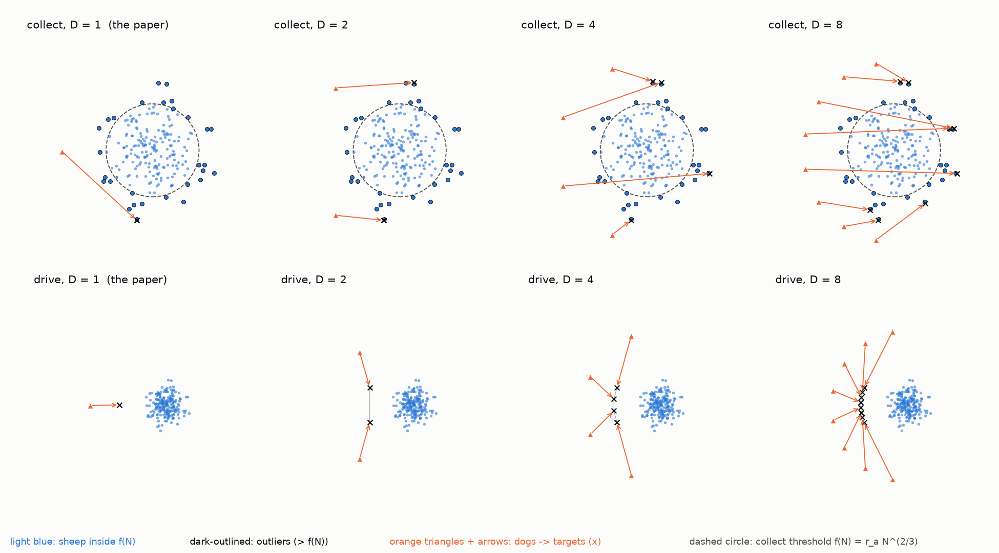
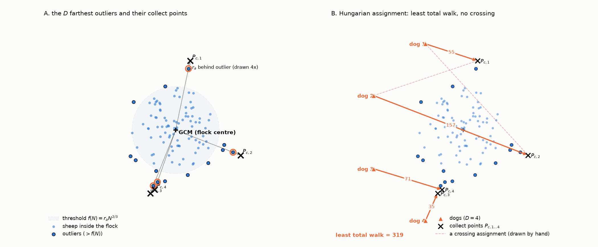
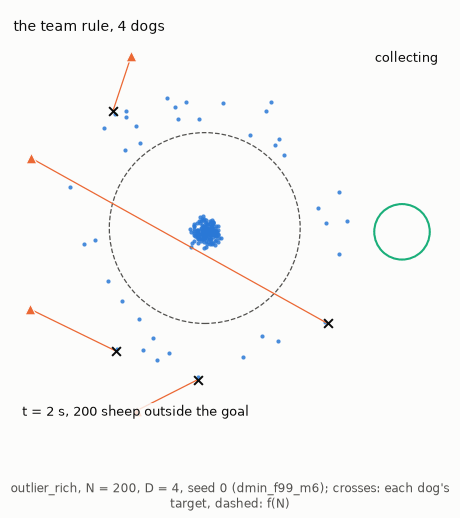
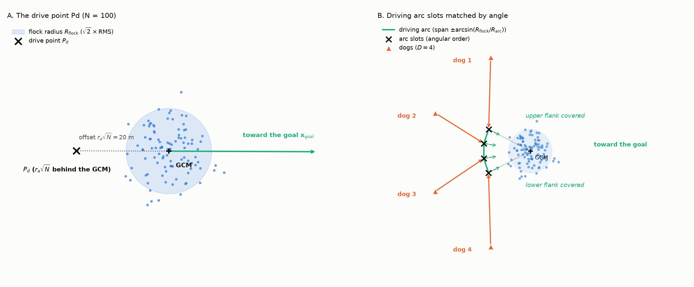

# Coordinated team architecture: `strombom_multi`

The team rule is Strombom's single-dog decision plus a team layer that gives each dog its own job (Figure 1). The dogs either collect, fetching outliers back, or drive the whole flock toward the goal from behind. Three terms set the jobs. An outlier is a sheep farther than the [collect distance](#when-to-collect) $f(N)$ from the flock centre. The collect point $P_c$ is where a dog stands to fetch an outlier, just behind it as seen from the flock centre. The drive point $P_d$ is where a dog stands to push the whole flock, behind the flock on the side away from the goal.

While there are outliers, each of the $D$ farthest outliers gets its own dog and any spare dog drives the rest of the flock; with no outliers each dog gets its own slot, a standing point on an arc through $P_d$ ([driving](#driving-and-its-limit-for-large-flocks)). With one dog this is the paper's rule.

**Figure 1: The team rule `strombom_multi` with $D = 1, 2, 4, 8$ dogs ($N = 200$).** More dogs collect more outliers at once, and spread over a wider arc when they drive.

- Marks: blue dots are sheep, dark-outlined dots outliers and orange triangles dogs; each arrow joins a dog to its target, a cross. Columns have $D = 1$ (the paper's rule), 2, 4 and 8.
- Top: collecting a `wide` start; the $D$ farthest outliers get one dog each ([assigning outliers](#assigning-outliers-hungarian-algorithm)), at their collect points $P_c$.
- Bottom: driving a `compact` start; the dogs spread over an arc round the flock centre, through the drive point $P_d$ at its middle, and keep their angular order.

## When to collect

The collect distance is Strombom's threshold $f(N) = r_a N^{2/3}$, 43 m at $N = 100$. If any sheep is farther than $f(N)$ from the flock centre $\mathrm{GCM} = \frac{1}{N} \sum_k \mathbf{x}_k$ (global centre of mass), that sheep is an outlier and the dogs collect; otherwise they drive. $f(N)$ grows faster with $N$ than the radius of a packed flock ($\propto \sqrt{N}$), so a large flock may be looser than a small one before a sheep counts as an outlier.

## Assigning outliers (Hungarian algorithm)

For an outlier $o$, the collect point $P_c$ lies $r_a = 2$ m behind it, seen from the flock centre:

$$
P_c = \mathbf{x}_o + r_a \frac{\mathbf{x}_o - \mathrm{GCM}}{\lVert \mathbf{x}_o - \mathrm{GCM} \rVert}
$$

The $D$ farthest outliers get one dog each. Dogs are matched to their collect points by the assignment with the least total distance (Hungarian algorithm), which in the plane has no crossing paths. It is recomputed every tick, so a dog's target can change as outliers move. Dogs left over when there are fewer outliers than dogs drive the core of the flock (the sheep within $f(N)$) from behind. Figure 2 shows the geometry and Animation 1 a real trial.

**Figure 2: Collecting.** Each outlier gets a collect point, and the Hungarian algorithm pairs dogs with collect points so that no two paths cross.

- Marks: light blue dots are sheep within $f(N)$, dark-outlined dots outliers, the plus sign the GCM, crosses collect points and orange triangles dogs.
- Left: the shaded disc is $f(N)$; each outlier's collect point lies on the ray from the GCM, drawn at $4 r_a$ behind the outlier.
- Right: the assignment with the least total distance; the dashed lines are a constructed assignment that crosses.

**Animation 1: The team rule in a 4-dog trial (`outlier_rich`, $N = 200$, $D = 4$, seed 0, 99% rule, 6 drive times).** While sheep are outside $f(N)$ each outlier, up to four, gets its own dog and spare dogs drive the rest, and once every sheep is inside they drive from an arc behind the flock. The trial succeeds at 277 s with 1 sheep outside (`dmin_f99_m6`).

- Marks: crosses are targets, at the true $r_a = 2$ m, and lines join dogs to them; the dashed circle is $f(N)$ and the top-right label the mode.

## Driving and its limit for large flocks

When every sheep is within $f(N)$, the dogs drive. The paper's drive point $P_d$ lies behind the flock, on the side away from the goal centre $\mathbf{x}_{\mathrm{goal}}$:

$$
P_d = \mathrm{GCM} + r_a \sqrt{N} \frac{\mathrm{GCM} - \mathbf{x}_{\mathrm{goal}}}{\lVert \mathrm{GCM} - \mathbf{x}_{\mathrm{goal}} \rVert}
$$

The offset $r_a \sqrt{N}$ grows as $\sqrt{N}$, faster than the [calibrated flock radius](../experiments/task_design.md#sizing-by-the-calibrated-flock-radius) $R_f$: it puts the dog about 2.2 flock radii behind the centre at $N = 100$ and 3.5 at $N = 400$.

Several dogs spread over an arc round the GCM, of radius $R_{\mathrm{arc}} = r_a\sqrt{N}$ with $P_d$ at its middle. Each dog gets one slot, its own standing point on the arc. The slots span the flock's width, $\pm \arcsin(R_{\mathrm{flock}} / R_{\mathrm{arc}})$, where $R_{\mathrm{flock}}$ is the flock radius at that tick, measured as $R_f$ is. Dogs and slots are matched in angular order round the flock centre, so neighbours stay neighbours and no two dogs cross (Figure 3).

The rule has a limit. Above $N \approx 1056$, where $2\sqrt{N} > r_s = 65$ m, a dog at $P_d$ is beyond the distance at which sheep react and reaches only the rear of the flock. The study stops at $N = 566$, well below it.

**Figure 3: Driving.** One dog drives from a point behind the flock; several dogs spread over an arc that also covers its sides.

- Marks: blue dots are sheep, the plus sign the GCM, crosses the drive point or arc slots, orange triangles dogs and the green line the arc.
- Left: one dog at $P_d$, $r_a\sqrt{N} = 20$ m behind the flock centre at $N = 100$.
- Right: several dogs on the arc.

## Dog speed, step and stop rule

A dog walks at $v_{\mathrm{dog}} = 1.5$ m/s, Strombom's 1.5 m per time step read as 1 s per step, 1.5 times the sheep's 1 m/s. Each step adds a random unit vector of weight 0.3 to the unit direction toward the point the dog aims at, as for the sheep noise, and the dog moves 1.5 m along the result. A dog closer than $3 r_a = 6$ m to any sheep stands still that tick (Strombom's stop rule). Every dog knows where every sheep is.

## References

1) Strombom, D., et al. (2014). *Solving the shepherding problem: heuristics for herding autonomous, interacting agents*. Journal of the Royal Society Interface, 11(100), 20140719. [DOI: 10.1098/rsif.2014.0719](https://doi.org/10.1098/rsif.2014.0719)
